# AGV parking-lot functional requirements, illustrated

Companion to *Functional_requirements-停车场功能需求20261013_V1_0_1.pdf* (13 Oct 2026, v1.0.1). That document lists 52 requirements from **Volley** (the customer) for a magnetic-tape-guided AGV that talks to the fleet manager over **VDA5050 / MQTT**, with **HITO**'s response and effort estimate for each. This document restates every requirement with a diagram, HITO's answer and the quoted effort.

Estimates are business days, written *development + testing*. A `/` means the source gave no number. Field names inside diagrams are illustrative unless the source names them.

## Reading the diagrams

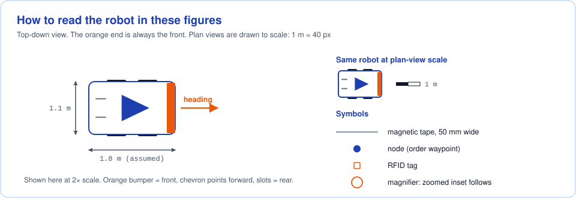

**Figure 1. How to read the robot, and the drawing scale.** Every plan view is drawn to the same scale: 1 m = 40 px, with a scale bar in each figure. The AGV is assumed to be 1.8 m × 1.1 m because the source gives no dimensions; change svgkit.AGV_L / AGV_W and rebuild if the real size differs. The orange bumper marks the front, the chevron points forward and the two slots mark the rear. Tape is drawn at its real 50 mm width (never thinner than 2.5 px); nodes and RFID tags are symbols and are drawn larger than real. Millimetre-level details are shown in zoomed insets, marked by an orange magnifier circle with dashed leader lines.

Every requirement carries a status taken from HITO's reply. The letter repeats the colour so the meaning survives greyscale printing:

| Letter | Status | Meaning |
|---|---|---|
| **W** | Works today | HITO says the AGV already behaves this way. |
| **I** | Will implement | HITO agrees to build it. |
| **C** | Conditional / to discuss | Agreed only after testing, discussion, or a counter-proposal. |
| **D** | Closed as duplicate | HITO closed it as a repeat of another item. |
| **P** | Process / outside AGV | Joint approval rule, or behaviour HITO places outside the AGV (MQTT broker). |
| **B** | Needs hardware / clarification | Needs new hardware, or HITO didn't understand it. |
| **R** | Not feasible | HITO says the current vehicle can't achieve it. |

## Scale and data structure conventions

All plan views share one scale, 1 m = 40 px, and carry a scale bar. Where a requirement is in millimetres or fractions of a degree, an orange magnifier marks the spot and a zoomed inset shows it at its own stated scale. Numbers labelled *example values* (speeds, braking rate, field sizes, AGV size) are assumptions for illustration; the source document doesn't specify them.

Each section that involves VDA5050 messages ends with a structure figure in UML composition style, showing where each relevant field sits inside its message. The field set follows VDA 5050 version 2.0, abbreviated; check it against the version the two companies agree on.

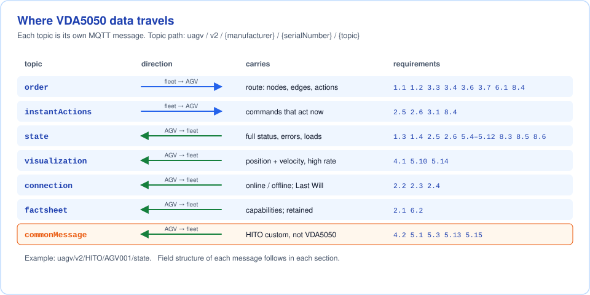

**Figure 2. Where VDA5050 data travels.** VDA5050 splits communication into separate MQTT topics. Each row is one topic: blue arrows are messages from the fleet manager to the AGV, green arrows go the other way. The last column lists the requirements that touch each topic. commonMessage (orange) is HITO's own addition and not part of the standard. The topic path follows the pattern interfaceName / majorVersion / manufacturer / serialNumber / topic, for example uagv/v2/HITO/AGV001/state.

## Overview

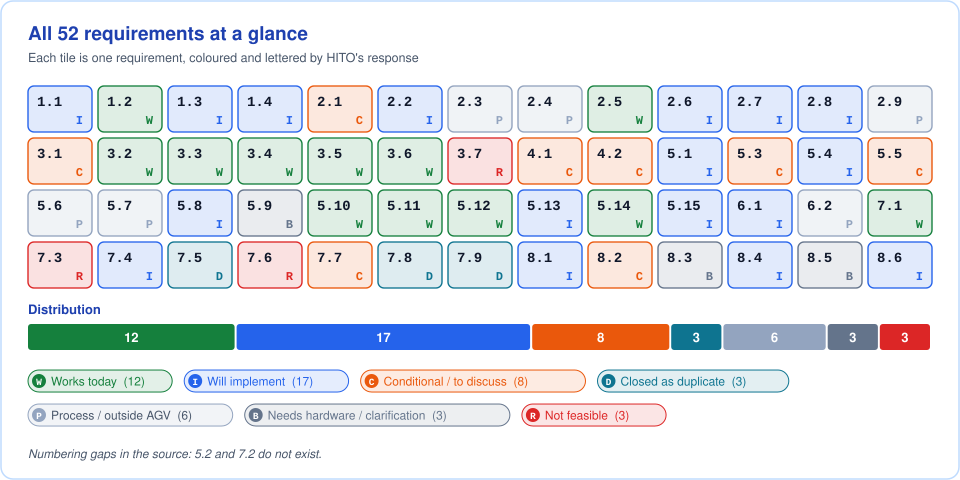

**Figure 3. Status of all 52 requirements.** One tile per requirement, coloured and lettered by how HITO answered it. Read the bar underneath for the totals: 12 already work, 17 will be built, 8 are conditional (they depend on testing, discussion or a counter-proposal), and 15 are closed without new work for different reasons — 3 as duplicates, 6 as process items, 3 blocked on hardware or clarification, and 3 rejected as not feasible.

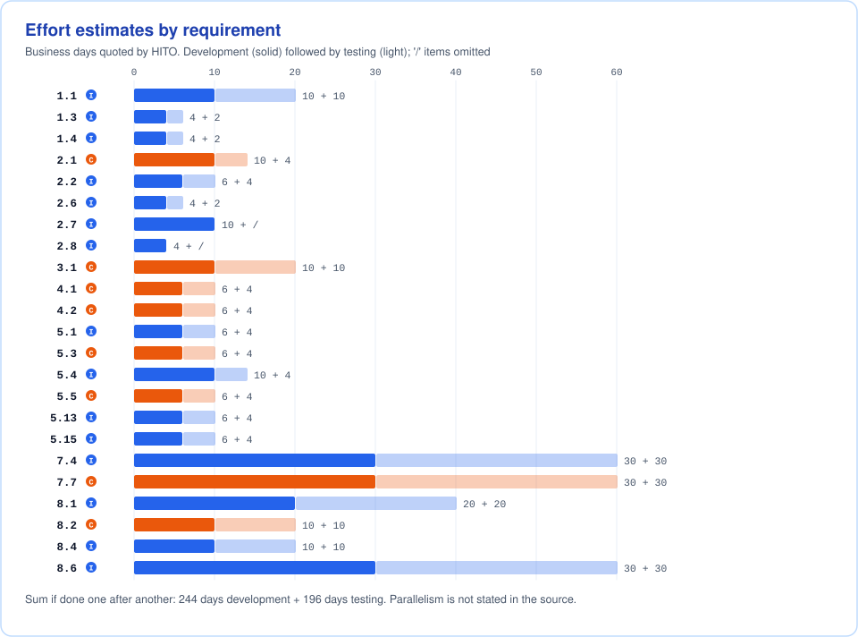

**Figure 4. How long HITO says the work takes.** Each bar is one requirement that has an estimate. The solid part is development days, the pale part is testing days. Three items dominate at 30 + 30 days: speed-based tracking parameters (7.4), early braking for a short final edge (7.7) and remote joystick recovery (8.6). Adding every bar end to end gives 244 + 196 days, but the source doesn't say how much can run in parallel, so treat that as an upper bound, not a schedule.

## 1. Order execution and rotation at nodes

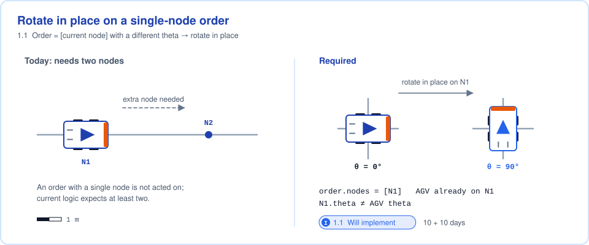

**Figure 5. Turning on the spot when the order has only one node.** Volley wants to send an order that contains only the node the AGV is already standing on, with a new heading, so the AGV simply turns in place. On the left is today's behaviour: the firmware ignores a one-node order and needs a second node before it moves. On the right is the requirement: the same AGV on N1 turns from facing right (0°) to facing up (90°) without driving anywhere.

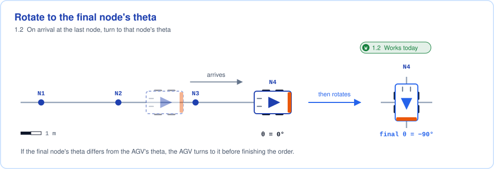

**Figure 6. Turning to the final node's heading.** The AGV drives along N1 → N4. When it reaches N4 it is still facing the direction it drove in (0°). If the order says N4's heading is −90° (facing down), the AGV must turn to that heading before the order counts as done. HITO says this already works.

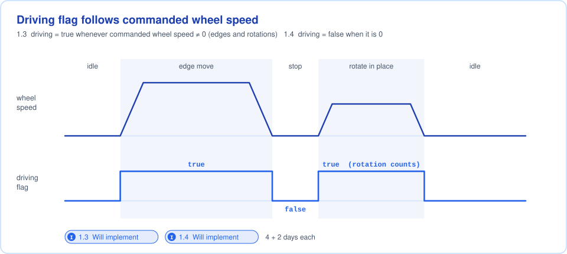

**Figure 7. When the 'driving' flag is true.** Time runs left to right. The top trace is the wheel speed the controller commands; the bottom trace is the driving flag the AGV reports. The flag must be true whenever the wheels are commanded to turn — including during an in-place rotation, where the AGV isn't changing position but its wheels are moving (1.3). It must drop to false as soon as the commanded speed is zero (1.4).

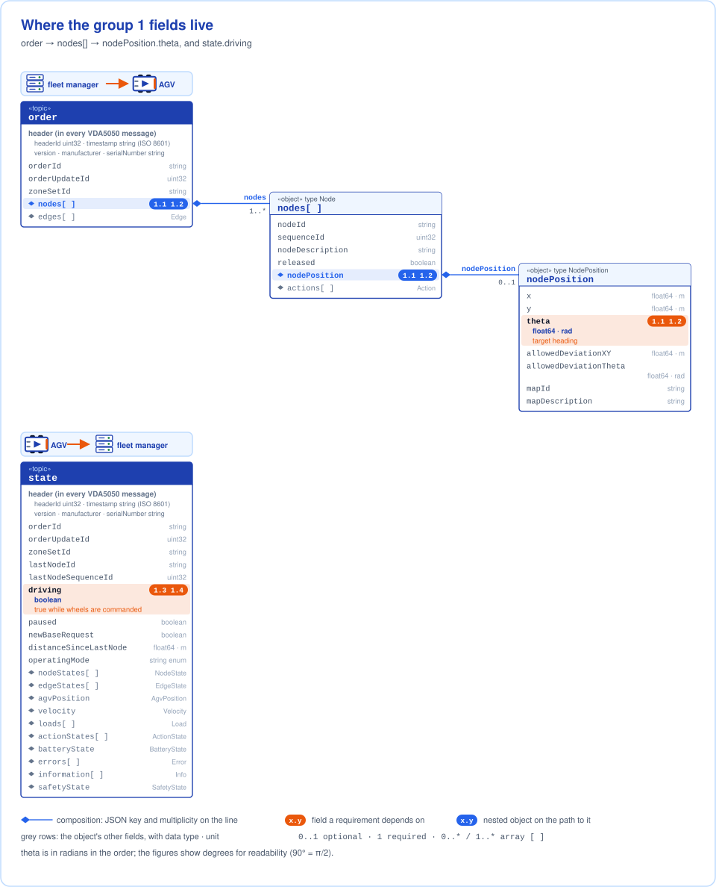

**Figure 8. Message structure for group 1.** How to read these structure figures. The badge above each message shows who publishes it and who receives it: here the fleet manager sends order to the AGV, and the AGV sends state back. Each box lists every field of one JSON object with its data type and unit (for example float64 · m). Nested objects are fields too, marked with a small diamond; the ones on the path to a requirement are highlighted in blue, and a line runs from that row to the object's own box. The line is labelled with the JSON key and how many there can be ([ ] means an array). Fields a requirement depends on are highlighted in orange. So 1.1 and 1.2 read order → nodes[ ] → nodePosition → theta (float64, radians), and 1.3 / 1.4 read state → driving (boolean).

| ID | Requirement | HITO response | Status | Effort |
|---|---|---|---|---|
| **1.1** | When the AGV receives an order containing only a single node, and that node is the AGV's current node, if the theta in the order differs from the current theta, the AGV must rotate in place to the commanded theta. | Can be implemented. Current logic requires two nodes. Firmware update after successful testing. | I · Will implement | 10 + 10 |
| **1.2** | When the AGV reaches the final node of an order and that node's theta differs from the current theta, the AGV must rotate to the theta specified for the final node. | Already how it works. | W · Works today | / |
| **1.3** | During all edge movements and rotational movements, the AGV must report its driving state as true whenever the commanded wheel speed is non-zero. | Can be implemented. | I · Will implement | 4 + 2 |
| **1.4** | When the commanded wheel speed is zero, the AGV must report its driving state as false. | Can be implemented. | I · Will implement | 4 + 2 |

## 2. MQTT connection, factsheet and action reporting

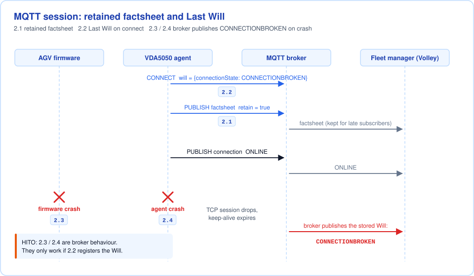

**Figure 9. Who tells the fleet manager that an AGV has dropped off.** Read top to bottom as a message sequence between four parties. When the VDA5050 agent connects, it hands the MQTT broker a 'Last Will': a message the broker should publish on its behalf if the connection dies (2.2). It then publishes the factsheet with the retained flag, so the broker keeps a copy for any subscriber that connects later (2.1). If the firmware or the agent crashes, the connection drops and the broker — not the AGV — publishes CONNECTIONBROKEN (2.3, 2.4). That's why HITO says 2.3 and 2.4 aren't its responsibility, and why they only work once 2.2 is done.

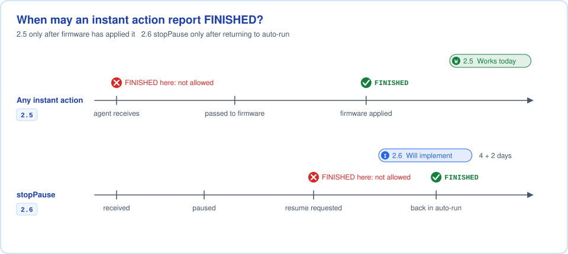

**Figure 10. When an instant action may be reported as finished.** Each line is the life of one instant action, left to right. The red cross marks the moment the AGV must not yet say FINISHED; the green tick marks the earliest moment it may. For any instant action (2.5), merely receiving the command isn't enough — the firmware has to have actually applied it. For stopPause (2.6), the AGV may only report FINISHED once it is back in automatic driving mode, not when the resume was merely requested.

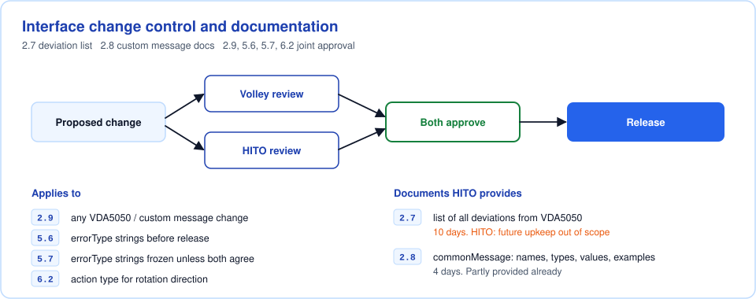

**Figure 11. Interface documentation and joint sign-off.** The flow chart shows the approval rule both parties agreed to: any change goes through both Volley and HITO before release. The left list names which requirements this rule covers (interface changes, the error-type strings and the rotation action type). The right list shows the two documents HITO owes: a list of every place it departs from the VDA5050 standard (2.7) and full documentation of its custom messages (2.8). Note HITO's remark that keeping 2.7 up to date in future is outside its scope.

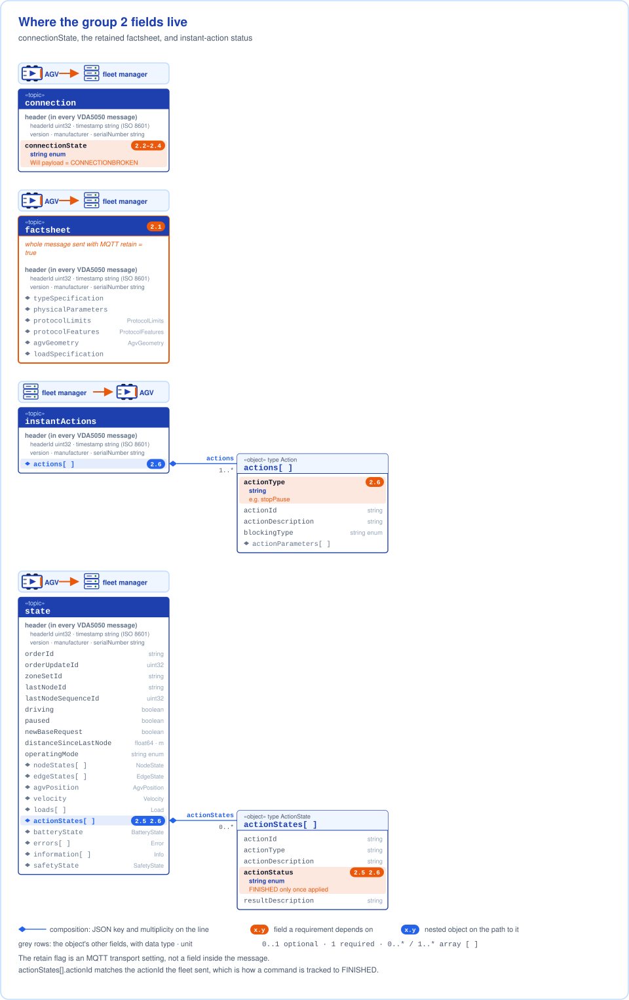

**Figure 12. Message structure for group 2.** connection.connectionState carries ONLINE, OFFLINE or CONNECTIONBROKEN; the Last Will registered in 2.2 is a connection message with CONNECTIONBROKEN. 2.1 concerns the whole factsheet message, which is sent with MQTT's retain flag (a transport setting, not a field). For 2.5 and 2.6, a command sent in instantActions.actions[] is tracked through state.actionStates[]: the actionId matches, and actionStatus may only become FINISHED once the firmware has applied the action.

| ID | Requirement | HITO response | Status | Effort |
|---|---|---|---|---|
| **2.1** | The AGV must publish the factsheet message with the MQTT retained flag set to true. | Factsheet already published (sent twice at startup). Volley to list which topics need the retained flag. | C · Conditional / to discuss | 10 + 4 |
| **2.2** | The AGV must register an MQTT Last Will message on the connection topic, with connectionState set to CONNECTIONBROKEN. | No issues. Firmware update after successful testing. | I · Will implement | 6 + 4 |
| **2.3** | When the AGV's main firmware shuts down or crashes, the AGV must ensure that the MQTT broker publishes CONNECTIONBROKEN. | Built-in MQTT broker mechanism, unrelated to AGV firmware shutting down or crashing. | P · Process / outside AGV | / |
| **2.4** | When the AGV's VDA5050 agent shuts down or crashes, the AGV must ensure that the MQTT broker publishes CONNECTIONBROKEN. | AGV cannot guarantee this; governed by the broker's built-in mechanism. | P · Process / outside AGV | / |
| **2.5** | For an instant action, the AGV may report FINISHED only after the firmware has actually executed and applied the request, not merely because the VDA5050 agent received it. | Already how it works. | W · Works today | / |
| **2.6** | For the stopPause instant action, the AGV may report FINISHED only after the firmware has returned to the auto-run state. | No issues. Firmware update after successful testing. | I · Will implement | 4 + 2 |
| **2.7** | HITO must provide updated interface documentation listing all deviations from the current VDA5050 specification. | Future maintenance is outside HITO's scope. Documentation can be updated. | I · Will implement | 10 + / |
| **2.8** | HITO must fully document all custom messages, including commonMessage: field names, field types, permitted values and example payloads. | Documentation already provided; can be updated later. | I · Will implement | 4 + / |
| **2.9** | Any change to the VDA5050 interface or custom messages must be jointly reviewed and approved by Volley and HITO before release. | No issues. | P · Process / outside AGV | / |

## 3. Cancellation, release horizon and stopping precision

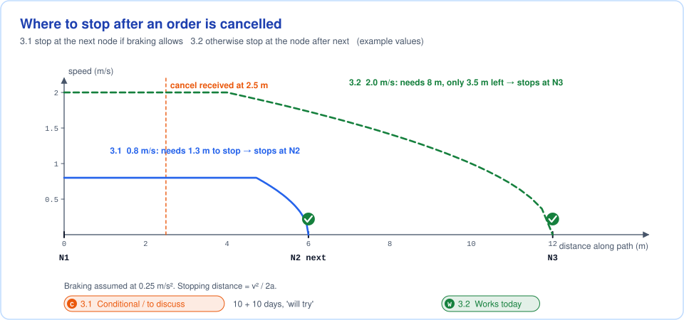

**Figure 13. Where the AGV stops after its order is cancelled.** Speed (m/s) against distance (m), using example values: braking at 0.25 m/s², nodes 6 m apart, cancel arriving at 2.5 m. Stopping distance is v² / 2a. The blue AGV at 0.8 m/s needs only 1.3 m, so it keeps going and brakes to stop exactly at the next node N2 (3.1, HITO will try). The green AGV at 2.0 m/s needs 8 m but only 3.5 m remain before N2, so it passes N2 and stops at N3 instead (3.2, already works).

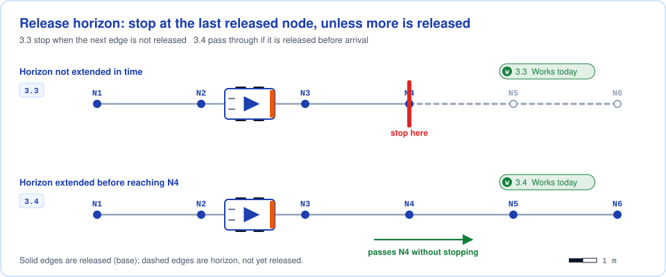

**Figure 14. Stopping at the edge of the released path.** Fleet managers release a route in pieces: solid edges are released and the AGV may drive them; dashed edges are planned but not yet released. Top row: nothing beyond N4 has been released by the time the AGV gets there, so it must stop at N4 (3.3). Bottom row: the fleet manager releases the next stretch before the AGV arrives, so it must drive straight through N4 without stopping (3.4). Both already work.

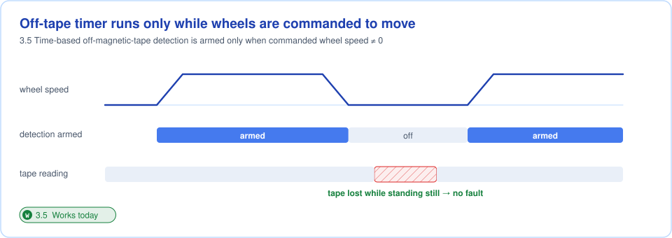

**Figure 15. Off-tape detection only while moving.** Time runs left to right. The AGV raises an off-tape fault if it loses the tape for too long, but that timer should only run while the wheels are commanded to move (blue 'armed' blocks). In the middle the AGV is standing still and the sensor briefly loses the tape (red hatched block); because the timer is off, no fault is raised. HITO says this already works.

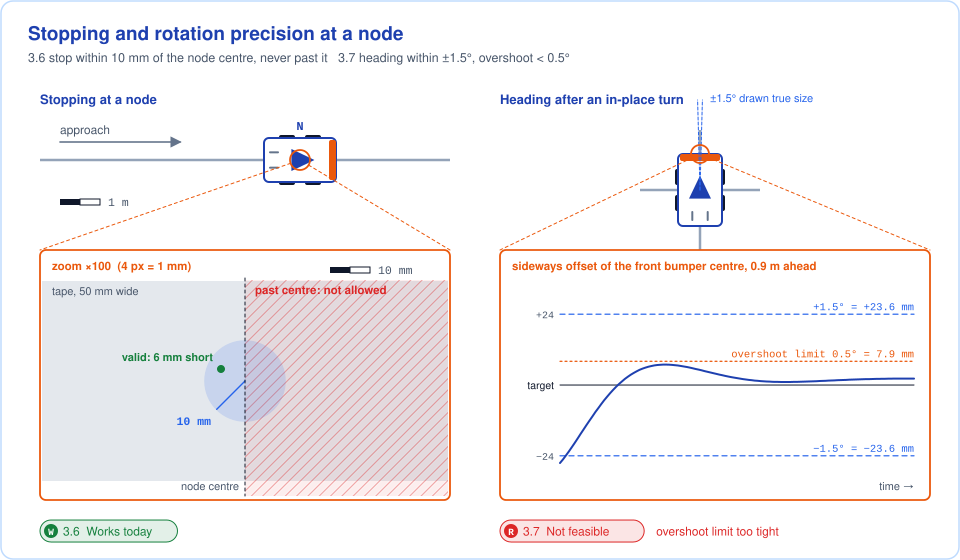

**Figure 16. How precisely the AGV must stop and turn.** Top row: the AGV at true scale, where both tolerances are far too small to see. Left inset (100× zoom, 4 px = 1 mm): the tape is 50 mm wide; the AGV's reference point must end inside the 10 mm circle around the node centre and must never cross the centre line (red hatching), so a stop 6 mm short is valid (3.6). Right inset: an angle error is easier to judge as sideways movement of the front bumper, 0.9 m ahead of the turning centre. There ±1.5° becomes ±23.6 mm and 0.5° becomes 7.9 mm. The curve shows the bumper swinging past the target during the turn, peaking under the 7.9 mm overshoot limit and settling inside the ±1.5° band. HITO rejected the 0.5° overshoot limit (3.7).

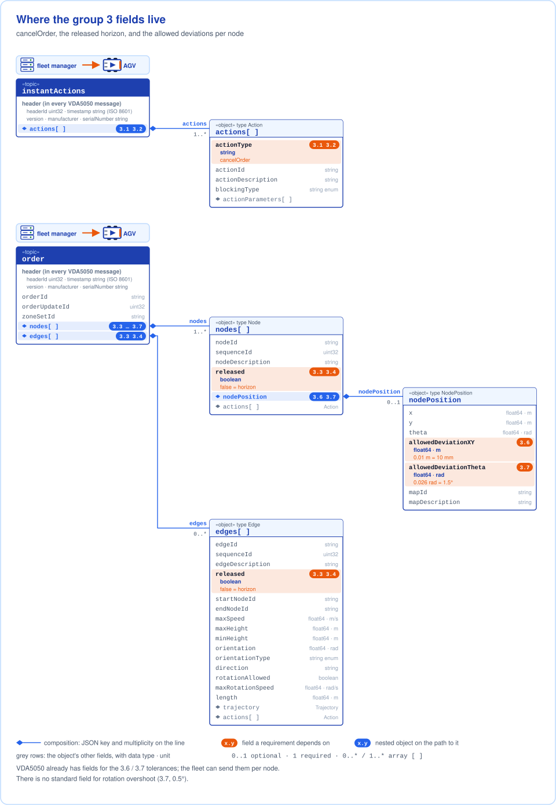

**Figure 17. Message structure for group 3.** cancelOrder (3.1, 3.2) is an actionType sent through instantActions. The release horizon (3.3, 3.4) is the released flag on each node and edge of the order. VDA5050 already has per-node tolerance fields: allowedDeviationXY (metres) and allowedDeviationTheta (radians) in nodePosition, so the 10 mm and 1.5° of 3.6 and 3.7 can be sent as 0.01 and about 0.026. There is no standard field for the 0.5° overshoot limit.

| ID | Requirement | HITO response | Status | Effort |
|---|---|---|---|---|
| **3.1** | When an order is canceled, if the AGV can decelerate to zero at the next node (given speed, deceleration, remaining edge distance), it must stop at the next node. | May be difficult; will try. Update if testing succeeds. | C · Conditional / to discuss | 10 + 10 |
| **3.2** | When an order is canceled and the AGV cannot decelerate to zero at the next node, it must stop at the node after the next node. | Already how it works. | W · Works today | / |
| **3.3** | When the AGV reaches the last released node while the following edge is not yet released, it must stop at that last released node. | Already how it works. | W · Works today | / |
| **3.4** | If the following edge and node are released before the AGV reaches the last released node, the AGV must pass through without stopping. | Already how it works. | W · Works today | / |
| **3.5** | The AGV must perform time-based off-magnetic-tape detection only when the commanded wheel speed is non-zero. | Already how it works. | W · Works today | / |
| **3.6** | At any node where a stop is required, the AGV must stop within a 10 mm radius of the node center and must not overshoot the node center. | Standard operating procedure, achieved with the lateral magnetic strip. Abnormal conditions to be discussed separately. | W · Works today | / |
| **3.7** | After an in-place rotation at a node, the AGV must stop within ±1.5° of the target angle with rotational overshoot of less than 0.5°. | Overshoot below 0.5° is difficult to achieve. In-place rotation at a node cannot be used for positioning. | R · Not feasible | / |

## 4. Message publishing frequency

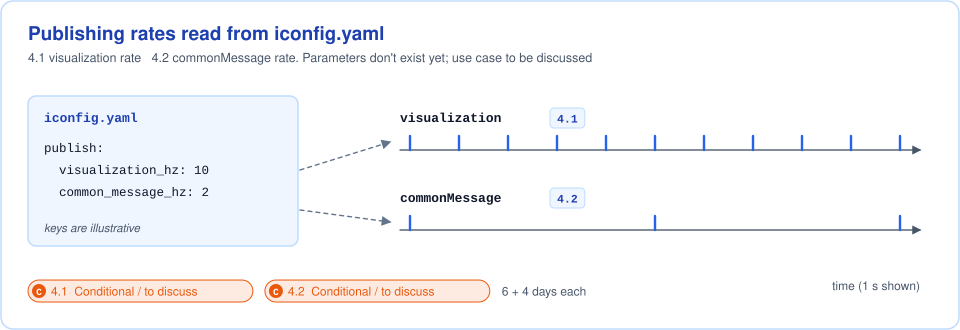

**Figure 18. Making message rates configurable.** Each tick mark is one message sent during a one-second window. Volley wants the rates of the visualization message (4.1) and of commonMessage (4.2) read from the AGV's iconfig.yaml file, so they can be tuned without new firmware. Here 10 Hz and 2 Hz are example values. These settings don't exist today; HITO wants to discuss the use case first.

*The message structure for group 4 is shown with group 5, which uses the same messages.*

| ID | Requirement | HITO response | Status | Effort |
|---|---|---|---|---|
| **4.1** | The AGV must publish visualization messages at the frequency set by parameters in iconfig.yaml. | Parameter not currently available. Use case to be discussed. | C · Conditional / to discuss | 6 + 4 |
| **4.2** | The AGV must publish commonMessage messages at the frequency set by parameters in iconfig.yaml. | Parameter not currently available. Use case to be discussed. | C · Conditional / to discuss | 6 + 4 |

## 5. State, commonMessage and error reporting

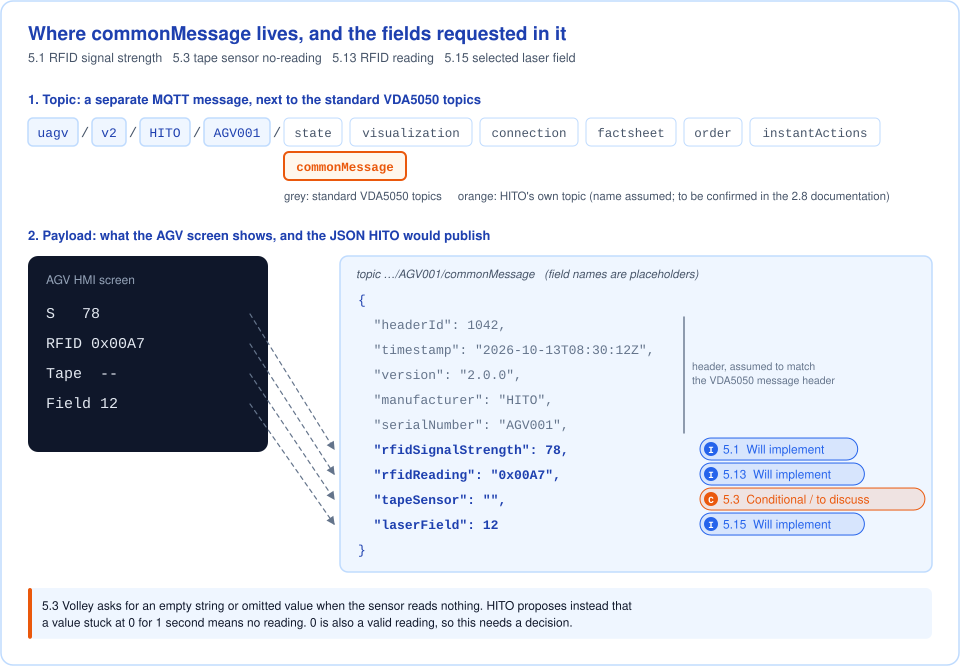

**Figure 19. Where commonMessage lives, and the fields requested in it.** Part 1 answers where the message travels. commonMessage is not one of the six standard VDA5050 topics (grey); it is HITO's own extra MQTT topic (orange), published by the AGV under the same topic path as the others: uagv / v2 / manufacturer / serialNumber / commonMessage. The source doesn't give the exact topic name or payload format, so both are assumptions until HITO delivers the documentation promised in 2.8. Part 2 shows the payload. The dark panel is what the AGV's own screen shows today; the light panel is the JSON message, starting with the same header fields every VDA5050 message carries (assumed), followed by the four new fields. The dashed arrows show which on-screen value each field carries: RFID signal strength (5.1), the RFID tag read (5.13), the tape sensor reading (5.3) and the active laser field (5.15). The tape sensor reads nothing here, so the field is an empty string, as Volley asked. The note explains HITO's different proposal. The structure figure at the end of section 5 shows commonMessage next to state and visualization.

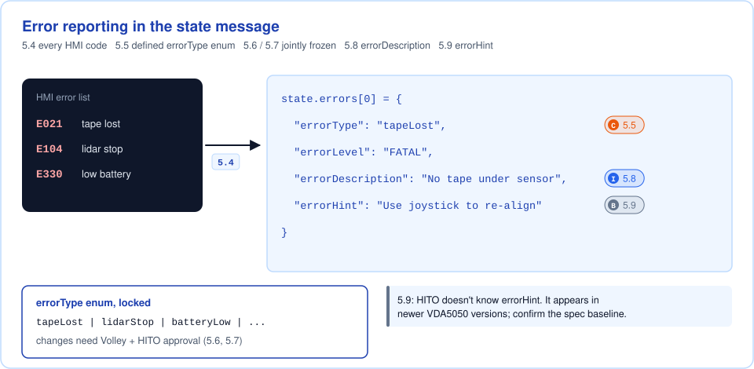

**Figure 20. How errors should be reported.** Every error code shown on the AGV's screen (left) must also appear in the state message sent to the fleet manager (5.4). Each error entry should use an agreed name from a fixed list rather than free text (5.5), always include a readable description (5.8), and may include a hint for the operator (5.9). The fixed list of names can only change if both companies agree (5.6, 5.7). HITO said it didn't understand what errorHint means.

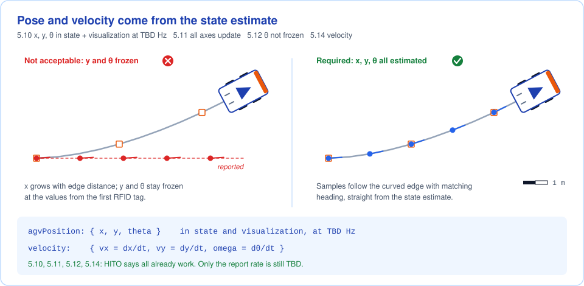

**Figure 21. Reporting where the AGV actually is.** Both panels show an AGV following a curved stretch of tape; dots are the positions it reports, and the short line on each dot is the heading it reports. Left, the wrong way: the AGV only adds the distance travelled to x and keeps y and the heading frozen at whatever the first RFID tag said, so its reported track runs in a straight line away from where it really is. Right, the required way: x, y and heading all come from the AGV's position estimate, so the reported dots follow the real path. Velocity is then the rate of change of those values. HITO says all of this already works; only the reporting rate is still to be agreed.

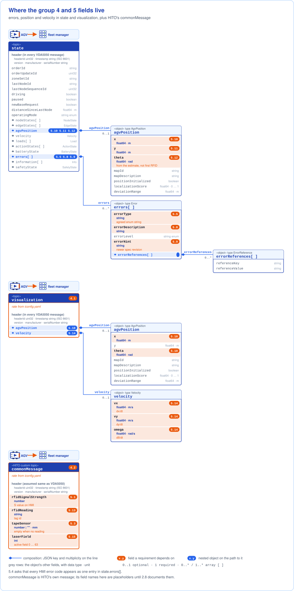

**Figure 22. Message structure for groups 4 and 5.** Position appears twice: state.agvPosition and visualization.agvPosition, both holding x, y and theta from the state estimate (5.10–5.12). Velocity for 5.14 sits in visualization.velocity as vx, vy and omega. Each error in 5.4–5.9 is one entry in state.errors[], with errorType, errorDescription and the optional errorHint, which comes from a newer revision of the standard. The visualization rate (4.1) and the whole commonMessage (4.2, 5.1, 5.3, 5.13, 5.15) are on separate topics; commonMessage is HITO's own format, so its field names here are placeholders.

| ID | Requirement | HITO response | Status | Effort |
|---|---|---|---|---|
| **5.1** | The AGV must report RFID signal strength in commonMessage, matching the S value on the AGV's screen. | Not currently available but can be added. | I · Will implement | 6 + 4 |
| **5.3** | When the magnetic tape sensor has no reading, the AGV must report it in commonMessage as an empty string or an optional value. | Counter-proposal: a value that stays at 0 for 1 second means the sensor has no reading. | C · Conditional / to discuss | 6 + 4 |
| **5.4** | The AGV must report all error codes shown on the HMI screen in the errors field of the state message. | Missing information will be added later. | I · Will implement | 10 + 4 |
| **5.5** | The AGV must use defined string enumeration values for errorType rather than undefined raw strings. | Can be added after discussion and agreement. | C · Conditional / to discuss | 6 + 4 |
| **5.6** | The errorType string values must be jointly reviewed and approved by Volley and HITO before release. | No issues. | P · Process / outside AGV | / |
| **5.7** | The errorType string values must not change unless both Volley and HITO agree. | No issues. | P · Process / outside AGV | / |
| **5.8** | The AGV must populate errorDescription for every reported error. | No issues; can be added later. (No estimate given.) | I · Will implement | / |
| **5.9** | The AGV may populate errorHint for any reported error. | HITO does not understand what this means. | B · Needs hardware / clarification | / |
| **5.10** | The AGV must report state-estimated x, y and theta in agvPosition in both state and visualization messages, at a TBD Hz frequency to be agreed. | Already how it works. (Frequency still TBD.) | W · Works today | / |
| **5.11** | The AGV must continuously update x, y and theta from its state estimate, not update one axis by edge distance while keeping the other unchanged. | Already how it works. | W · Works today | / |
| **5.12** | The AGV must report theta from its state estimate, not a fixed value derived from the first RFID reading. | Already how it works. | W · Works today | / |
| **5.13** | The AGV must report the actual RFID reader reading in commonMessage, matching the RFID value on the AGV's screen. | No issues; can be added later. | I · Will implement | 6 + 4 |
| **5.14** | The AGV must report velocity in visualization: the derivatives of x, y and theta. | Already available. | W · Works today | / |
| **5.15** | The AGV must report the currently selected laser protective field in commonMessage. | No issues; can be added later. | I · Will implement | 6 + 4 |

## 6. Rotation direction set by actions

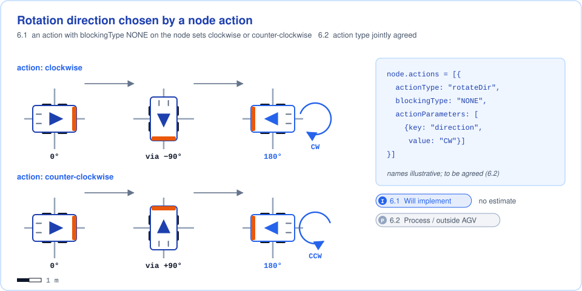

**Figure 23. Choosing which way the AGV turns.** Both rows show the AGV turning from 0° to 180° on the same spot, but in opposite directions. Turning clockwise it passes through facing down; turning counter-clockwise it passes through facing up. Volley wants to pick the direction by attaching an action to the node (example on the right) — useful when one side of the AGV would hit something during the turn. 'blockingType NONE' means the action doesn't pause anything else. The action's name and fields still have to be agreed (6.2).

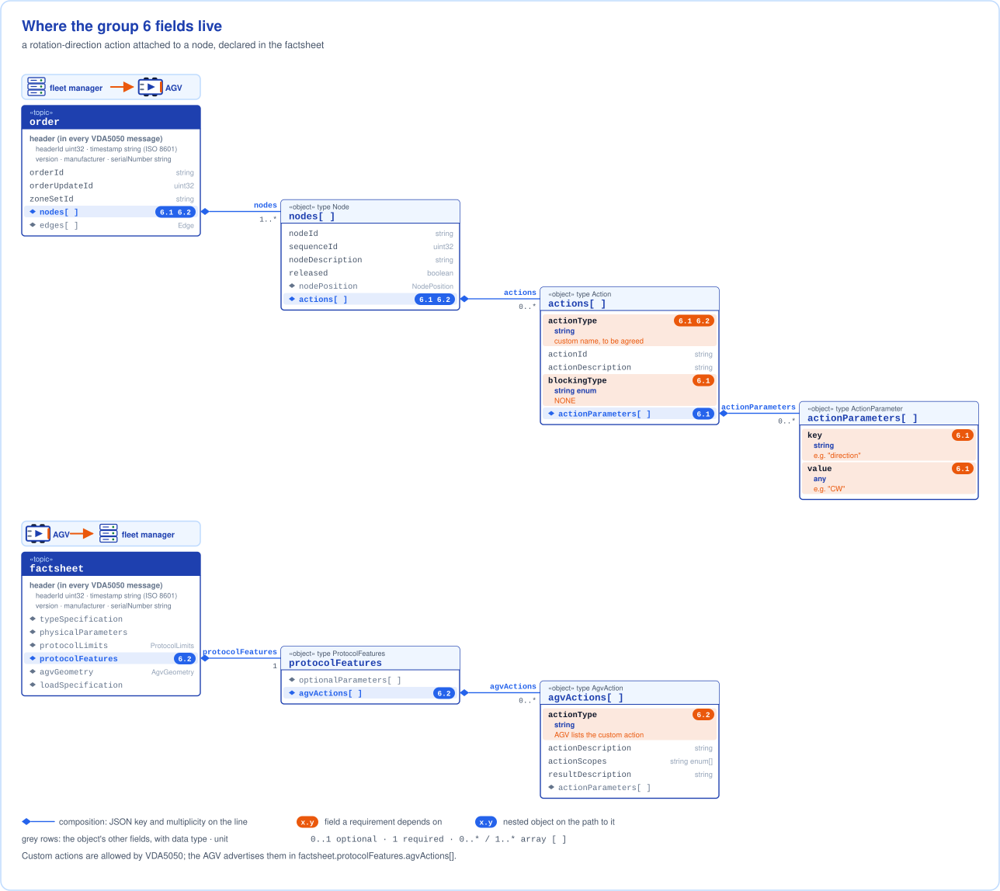

**Figure 24. Message structure for group 6.** The rotation-direction request of 6.1 is an action inside the node: order.nodes[i].actions[j], with blockingType NONE and the direction passed as a key/value pair in actionParameters[]. The action's name is custom, so 6.2 asks both sides to agree it. VDA5050 expects the AGV to advertise every custom action it supports in factsheet.protocolFeatures.agvActions[].

| ID | Requirement | HITO response | Status | Effort |
|---|---|---|---|---|
| **6.1** | The AGV must rotate to a node's theta in the direction given by an action attached to that node with blockingType NONE. | Can be added; released after successful testing. (No estimate given.) | I · Will implement | / |
| **6.2** | The action type used to specify rotation direction must be jointly reviewed and approved by Volley and HITO. | No issues. | P · Process / outside AGV | / |

## 7. Magnetic tape tracking and deceleration

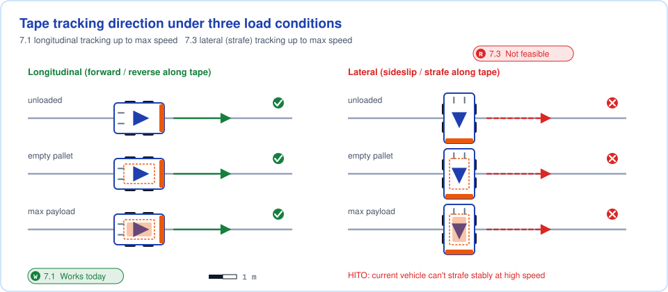

**Figure 25. Following the tape forwards versus sideways.** Each row is one load condition: no load, an empty pallet (dashed box), and the heaviest allowed load (filled box). Left column: the AGV drives forwards along the tape, which must stay stable up to full speed in every case — HITO says it already does (7.1). Right column: the AGV is turned crossways and slides sideways along the tape (strafing). HITO says this vehicle can't do that stably at high speed (7.3).

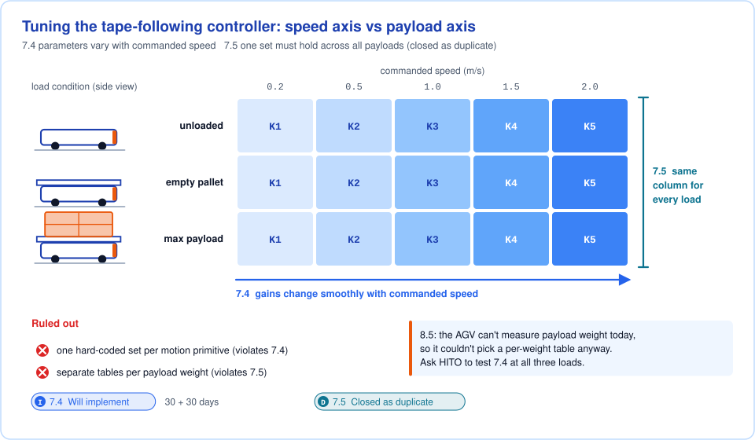

**Figure 26. Tuning the tape-following controller.** Each row is one load condition, drawn on the left as a side view of the AGV: empty, carrying an empty pallet, and carrying a full load. The grid shows which controller settings (K1 to K5) the AGV uses at each combination of commanded speed (columns) and load (rows). Moving left to right, the settings change with speed, which is 7.4. Moving top to bottom they stay the same whatever the load, which is 7.5. The two requirements constrain different directions of the grid, so meeting one doesn't guarantee the other, even though HITO closed 7.5 as a duplicate. The note explains why one set for all loads is the only practical option: the AGV can't weigh its load (8.5).

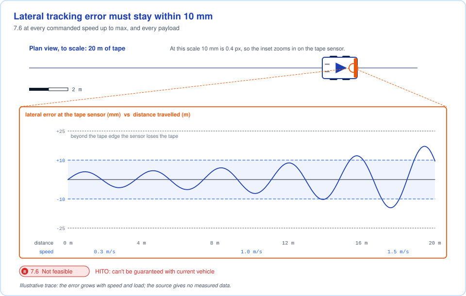

**Figure 27. How far the AGV may drift from the tape.** Top: 20 m of tape and the AGV at true scale. A 10 mm error would be 0.4 px here, which is why the requirement can't be seen at this scale. The inset zooms in on the tape sensor at the front of the AGV (4 px = 1 mm) and plots its sideways error along the whole 20 m run. The blue band is the ±10 mm limit; the grey dotted lines are the tape edges at ±25 mm, beyond which the sensor would lose the tape altogether. In this illustrative trace the error grows as speed rises from 0.3 to 1.5 m/s and breaks the limit near the end. HITO says it can't guarantee ±10 mm at every speed and load.

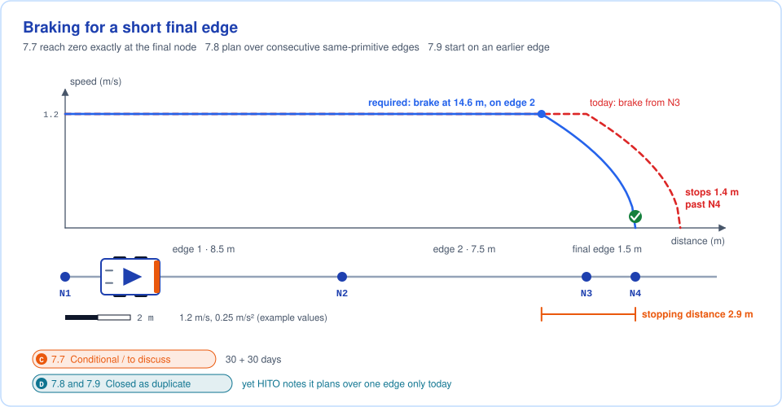

**Figure 28. Braking early enough for a short last edge.** Drawn to scale with example values: speed 1.2 m/s, braking 0.25 m/s², which gives a 2.9 m stopping distance (orange bracket). The final edge N3 → N4 is only 1.5 m. The chart above plots speed against the same distance axis. Red dashed: today the AGV brakes only once it reaches the final edge, so it stops 1.4 m past N4. Blue: the requirement is to start braking at 14.6 m, back on edge 2, so speed reaches zero exactly at N4 (7.7). That needs the stopping point worked out across several edges, not just the last one (7.8, 7.9).

*Group 7 is internal control behaviour and adds no VDA5050 fields, so it has no structure figure.*

| ID | Requirement | HITO response | Status | Effort |
|---|---|---|---|---|
| **7.1** | Unloaded, with empty pallet and at max payload, the AGV must stably track the tape at all longitudinal speeds up to its maximum. | Expected behavior under normal conditions. | W · Works today | / |
| **7.3** | Unloaded, with empty pallet and at max payload, the AGV must stably track the tape at all lateral (sideslip / strafe) speeds up to its maximum. | Cannot be implemented: current vehicle model can't do stable high-speed lateral movement. | R · Not feasible | / |
| **7.4** | The AGV must schedule tape tracking control parameters dynamically from the commanded speed, not hard-code them per motion primitive. | Feasible. Update after successful testing. | I · Will implement | 30 + 30 |
| **7.5** | The AGV must schedule tape tracking parameters so a single set covers all payload conditions, not hard-coded per payload weight. | Duplicates a requirement above. | D · Closed as duplicate | / |
| **7.6** | Across all commanded speeds and all payloads, the AGV must keep lateral tape tracking error within 10 mm. | Cannot be guaranteed with the current vehicle model. | R · Not feasible | / |
| **7.7** | Regardless of the final edge's length, the AGV must start decelerating early enough to reach zero at the final node without overshooting. | Difficult. Will attempt later; update if testing succeeds. | C · Conditional / to discuss | 30 + 30 |
| **7.8** | The AGV must compute the deceleration start point from the total remaining distance across consecutive edges with the same motion primitive, not only the final edge. | Duplicate. Currently calculations only work along one edge. | D · Closed as duplicate | / |
| **7.9** | If the final edge is shorter than the stopping distance, the AGV must begin decelerating on an earlier edge. | Duplicates a requirement above. | D · Closed as duplicate | / |

## 8. Lidar fields, payload, coupling and remote control

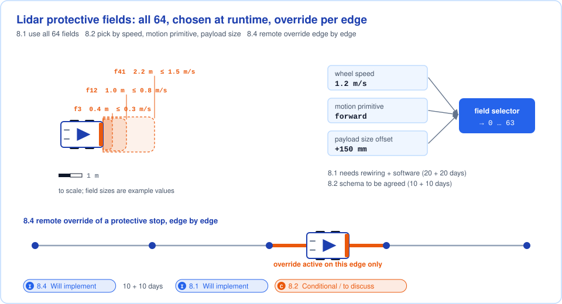

**Figure 29. Choosing and overriding the lidar safety zone.** Top left, to scale: the orange outlines are three of the scanner's protective fields, reaching 0.4 m, 1.0 m and 2.2 m ahead of the bumper (example values); faster driving needs a longer field. If anything enters the active field, the AGV stops. Volley wants all 64 fields usable (8.1) and chosen automatically from speed, type of motion and load overhang (8.2), shown by the selector on the right. Bottom: an operator may remotely override a protective stop, and the override is limited to one edge (orange) before it switches off again (8.4).

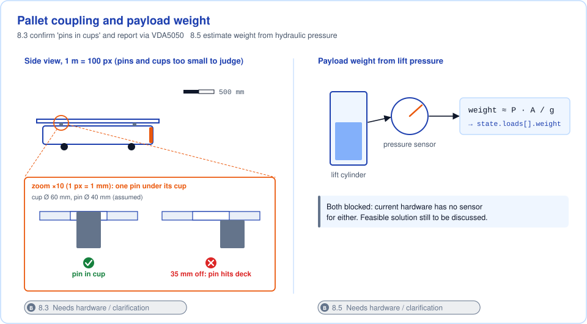

**Figure 30. Confirming the pallet is seated and knowing its weight.** Top left: side view at 1 m = 100 px. At this scale the pins and cups are only a few pixels, so the inset zooms ten times (1 px = 1 mm) on one of them, assuming a 60 mm cup and a 40 mm pin. When the AGV is centred, the pin enters the cup. When it is 35 mm off, the pin lands on the pallet deck beside the cup. Volley wants the AGV to tell these apart and report it (8.3). Right: Volley wants the load's weight estimated from lift-cylinder pressure (8.5). HITO says the current hardware has no sensor for either.

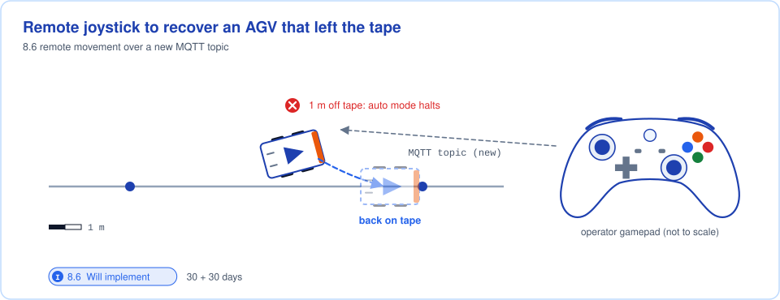

**Figure 31. Driving the AGV back onto the tape by remote control.** To scale: the AGV has drifted about 1 m off the tape, so automatic mode stops. An operator drives it back with a handheld gamepad whose commands travel to the AGV over a new MQTT topic (blue dashed path). The gamepad is not drawn to scale. HITO agreed, at 30 + 30 days. While driven this way, the AGV would normally report operatingMode MANUAL in its state message.

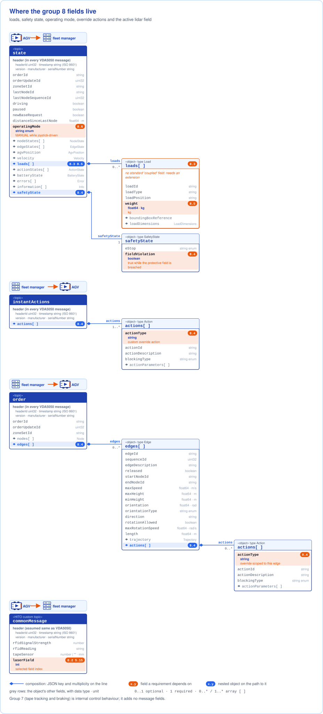

**Figure 32. Message structure for group 8.** Payload weight (8.5) has a standard home in state.loads[].weight. Pallet coupling (8.3) has no standard field, so it would need an agreed extension. A protective-field breach shows as state.safetyState.fieldViolation; the override for 8.4 would be a custom action, sent either as an instant action or attached to one edge (order.edges[].actions[]) so it expires with that edge. Joystick driving (8.6) would show as operatingMode MANUAL. The active lidar field (5.15, 8.2) goes in HITO's commonMessage. Group 7 has no structure figure because it adds no message fields.

| ID | Requirement | HITO response | Status | Effort |
|---|---|---|---|---|
| **8.1** | The AGV must use all 64 available laser protective (lidar) fields. | Can be implemented by changing the electrical wiring and adding software. | I · Will implement | 20 + 20 |
| **8.2** | The AGV must select the lidar field from wheel speed, motion primitive and a runtime-configurable payload size offset. Schema to be agreed. | Good idea; can be added after discussion. | C · Conditional / to discuss | 10 + 10 |
| **8.3** | The AGV must actively confirm whether a pallet is correctly coupled ('pins in cups') and report it via VDA5050. | Current hardware doesn't support it; feasible solution to be discussed. | B · Needs hardware / clarification | / |
| **8.4** | The AGV must support remote override of a laser protective stop during operation, applied edge by edge. | Can be implemented as part of the instant action function. | I · Will implement | 10 + 10 |
| **8.5** | The AGV must estimate payload weight from hydraulic pressure and publish it as payload data in state. | Current hardware doesn't support it; feasible solution to be discussed. | B · Needs hardware / clarification | / |
| **8.6** | The AGV may support remote joystick / remote movement for recovery, e.g. when off the magnetic tape. | Can be implemented with a new topic interface. Update after successful testing. | I · Will implement | 30 + 30 |

## Points to raise with HITO

**7.5 is not a duplicate of 7.4.** 7.4 asks for parameters that vary with commanded speed; 7.5 asks for one parameter set that holds across every payload. A speed-scheduled table kept separately per payload would meet 7.4 and fail 7.5. Because the AGV can't measure payload weight (8.5), a single robust set is the only workable design anyway. Ask HITO to confirm that the 7.4 work uses one set for all loads and that its 30 + 30 days include tests at unloaded, empty-pallet and max-payload conditions.

**7.8 and 7.9 are not covered by 7.7 as written.** HITO's own note says deceleration is planned along one edge only, which is the exact gap 7.9 describes. Get it in writing that the 7.7 estimate includes multi-edge planning.

**5.3 counter-proposal changes the contract.** "0 for one second" is ambiguous because 0 can be a real reading. Decide between an empty / omitted value and HITO's rule.

**Rejections need numbers.** For 3.7, 7.3 and 7.6, ask what HITO *can* guarantee: rotation tolerance, lateral tracking error, and the top speed for stable strafing.

**2.3 / 2.4 depend on 2.2.** The broker publishes CONNECTIONBROKEN only if the Will is registered; test the three together.

**Open items without owner or date:** reporting frequency in 5.10 (TBD Hz), retained-topic list for 2.1, lidar schema for 8.2, hardware options for 8.3 and 8.5, the meaning of errorHint in 5.9 (check which VDA5050 version is the baseline), and estimates for 5.8 and 6.1. 2.7's "future maintenance out of scope" should be settled contractually.

**Source housekeeping:** IDs 5.2 and 7.2 are missing; 3.2's Chinese text has a typo (先在 → 现在).

## Glossary

VDA5050
: Open interface standard from the German automotive and machinery associations (VDA and VDMA) for communication between AGVs and a fleet manager. Messages are JSON documents sent over MQTT, one topic per message type. See Figure 2.

MQTT
: Lightweight publish/subscribe messaging protocol. Clients publish messages to named topics through a broker, and every client subscribed to that topic receives them.

MQTT broker
: The server that receives every published message and forwards it to the subscribers of its topic. It also stores retained messages and publishes Last Will messages.

Last Will
: A message a client hands to the broker when it connects. If the client later disconnects without saying goodbye (crash, network loss), the broker publishes that message for it. VDA5050 uses it to announce CONNECTIONBROKEN.

Retained message
: A message published with MQTT's retain flag. The broker keeps the latest one per topic and hands it to any client that subscribes later, so a fleet manager that starts after the AGV still gets the factsheet.

Fleet manager
: The central server that plans routes and sends orders to AGVs. VDA5050 calls it master control; in this project it is Volley's system.

Topic
: The address a message is published to, for example uagv/v2/HITO/AGV001/state.

order (topic)
: VDA5050 message from the fleet manager giving the AGV its route as nodes and edges, with optional actions on each. Structure: Figure 8.

instantActions (topic)
: VDA5050 message carrying commands the AGV must act on immediately, such as cancelOrder, startPause or stopPause. Structure: Figure 12.

state (topic)
: The AGV's full status report: order progress, position, loads, action progress, battery, errors and safety state. Structure: Figure 22.

visualization (topic)
: A lighter, higher-rate message with just position and velocity, meant for live display. Structure: Figure 22.

connection (topic)
: Reports ONLINE, OFFLINE or CONNECTIONBROKEN. The CONNECTIONBROKEN version is registered as the Last Will. Structure: Figure 12.

factsheet (topic)
: The AGV's self-description: type, physical limits, supported features and the custom actions it understands. Structure: Figure 12.

commonMessage (topic)
: HITO's own extra topic, not part of VDA5050, carrying RFID, tape-sensor and lidar-field values. See Figure 19.

Instant action
: An action sent on the instantActions topic rather than attached to a node or edge, so it runs as soon as it arrives.

Node
: A waypoint in an order. The AGV drives from node to node along edges; nodes can carry a target heading and actions.

Edge
: The path segment between two nodes in an order.

Base and horizon
: The released part of an order (base) may be driven. The unreleased part (horizon) is a preview the AGV must not enter until the fleet manager releases it.

blockingType
: Says whether an action stops other things while it runs: NONE (nothing waits), SOFT (driving waits) or HARD (everything waits).

theta (θ)
: Heading angle in radians, measured counter-clockwise from the map's x axis.

State estimate
: The AGV's best estimate of its position and heading, fused from wheel odometry, RFID reads and the tape sensor.

Magnetic tape
: A strip on the floor, here assumed 50 mm wide, that the AGV's sensor array follows to stay on its path.

RFID tag
: Floor tags the AGV reads to know exactly which node it is at.

HMI
: Human-machine interface: the AGV's own on-board screen.

Motion primitive
: One kind of movement the controller handles as a unit, such as straight driving, a curve, an in-place turn or strafing.

Protective field
: An area watched by the safety laser scanner (lidar). If anything enters the active field, the AGV stops. Larger fields are needed at higher speeds.

Strafe / sideslip
: Moving sideways without turning, possible on vehicles with omnidirectional wheels.

UML composition
: A diagram line with a filled diamond meaning the object on the right only exists inside the object on the left; in JSON, it is a nested object or array.

---

Diagrams are generated by `generator/build.py` (pure Python) from `generator/data.py`. Visual tokens follow the design system produced by [UI UX Pro Max](https://github.com/nextlevelbuilder/ui-ux-pro-max-skill) (Minimalism & Swiss Style, tracking blue + delivery orange, IBM Plex Sans / JetBrains Mono), saved in `design-system/agv-spec/MASTER.md`.
