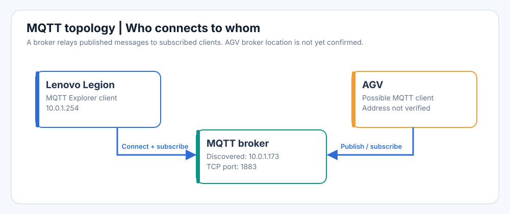
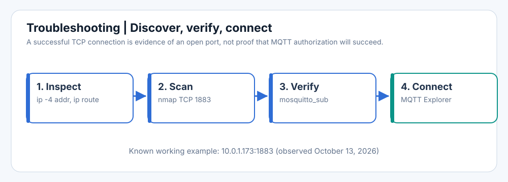
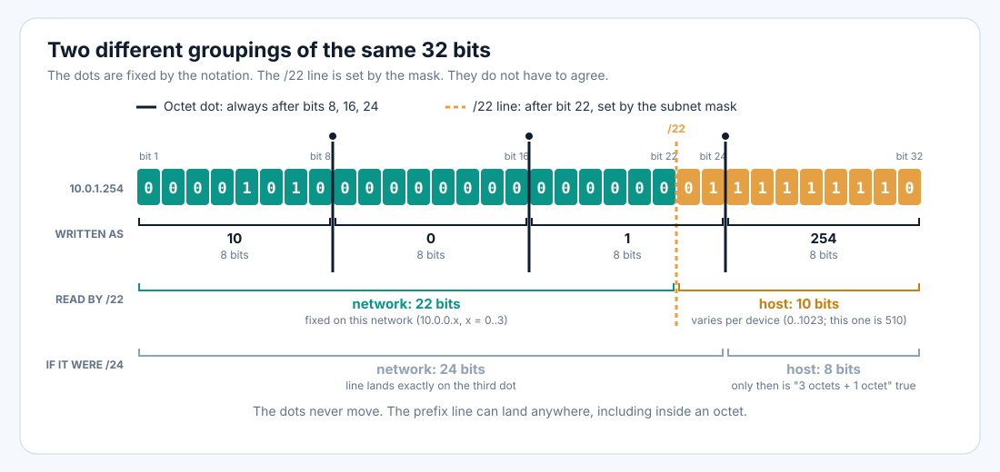
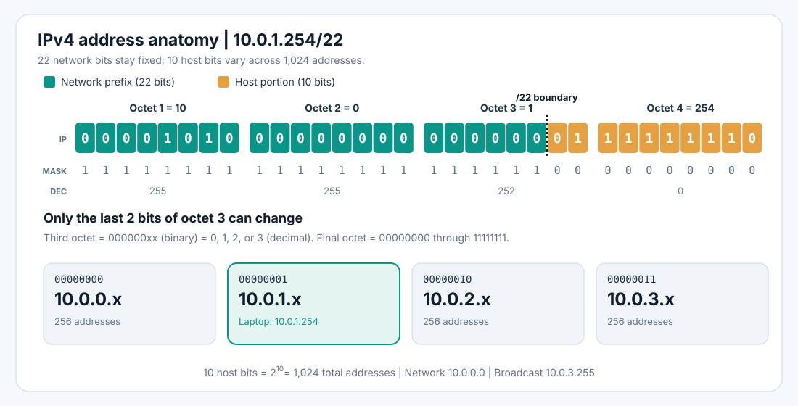

# Finding and Connecting to an MQTT Broker on Ubuntu 24.04

> **Field guide — Lenovo Legion + AGV network**  
> Last verified: **2026-10-13** · Local laptop IP: **`10.0.1.254/22`** · Discovered broker: **`10.0.1.173:1883`**  
> **Scope:** Reproduce the working connection, understand the network, and diagnose failures. IP addresses may change (DHCP).



## Contents

1. [Quick-start cheat sheet](#1-quick-start-cheat-sheet)
2. [What we discovered](#2-what-we-discovered)
3. [How the local subnet works](#3-how-the-local-subnet-works)
4. [Finding the broker again](#4-finding-the-broker-again)
5. [Connecting with MQTT Explorer](#5-connecting-with-mqtt-explorer)
6. [Verifying with Mosquitto tools](#6-verifying-with-mosquitto-tools)
7. [How MQTT works](#7-how-mqtt-works)
8. [Troubleshooting](#8-troubleshooting)
9. [Glossary of terminology and acronyms](#9-glossary-of-terminology-and-acronyms)
10. [References, icon assets, and diagram regeneration](#10-references-icon-assets-and-diagram-regeneration)

## 1. Quick-start cheat sheet

**Known working MQTT Explorer connection (observed 2026-10-13):**

| Setting | Value |
|---|---|
| Connection name | `AGV MQTT Broker` (user-defined) |
| Protocol | `mqtt://` (plain MQTT over TCP) |
| Host | **`10.0.1.173`** |
| Port | **`1883`** |
| TLS encryption | Off **for this plaintext-port configuration** |
| Username/password | Whatever the broker requires; not confirmed by scan |
| Evidence | Nmap reported `1883/tcp open`; MQTT Explorer subsequently connected successfully |

**If the address stops working:**

```bash
# 1. Confirm Wi-Fi address and subnet
ip -4 addr show dev wlp130s0f0
ip route

# 2. Try the previously discovered broker first
nc -vz -w 2 10.0.1.173 1883

# 3. Scan the likely address range for TCP/1883
nmap -n -sT -p 1883 --open 10.0.1.0/24

# 4. If necessary, expand to the full actual subnet
nmap -n -sT -p 1883 --open 10.0.0.0/22

# 5. Verify MQTT protocol / broker access (may wait for messages)
mosquitto_sub -h 10.0.1.173 -p 1883 -t '#' -v
```

> **Permissions:** Only scan devices/networks you are authorized to inspect. In a live garage, ask for the broker hostname/config if available rather than scanning production equipment unnecessarily.

## 2. What we discovered

The following comes from the actual command output and successful connection in this session, not a guessed deployment architecture.

| Observation | What it establishes | What it does *not* establish |
|---|---|---|
| `wlp130s0f0` = `10.0.1.254/22` | Laptop has a Wi-Fi IPv4 address on `10.0.0.0/22` | That every device is on `10.0.1.x` |
| `enp129s0` = `NO-CARRIER` | Wired Ethernet was not linked | Anything about wired Ethernet elsewhere |
| `tailscale0` = `100.73.24.31/32` | Tailscale interface exists | That local broker traffic goes through Tailscale |
| Nmap reports `10.0.1.173`, `1883/tcp open` | Host accepts TCP connections at port 1883 | Who operates the host; its MQTT role from TCP alone |
| MQTT Explorer successfully connected | The entered settings reached a working broker | AGV identity/topic structure, or whether broker is AGV-hosted |
| Nmap's aggressive scan finished in 1.45 seconds | Fast scan found this candidate | That no other brokers exist; zero retries can miss them |



## 3. How the local subnet works

Your machine reported:

```text
inet 10.0.1.254/22 brd 10.0.3.255
```

Three facts are packed into that one line: the laptop's address is `10.0.1.254`, the network it belongs to is described by `/22`, and the broadcast address for that network is `10.0.3.255`. This section shows how the `/22` turns `10.0.1.254` into a network of `10.0.0.0` through `10.0.3.255`. The key is that an IP address is really a single 32-bit binary number, and the dotted-decimal form is just a convenient way to write it eight bits at a time.

### 3.1 An IP address is four octets

An IPv4 address is **32 bits**. Nobody wants to read 32 ones and zeros in a row, so the convention is to cut them into **four groups of 8 bits**, called **octets**, and write each group as a decimal number from `0` to `255`, separated by dots. That is all the dots mean: they are the cut lines between octets. The 8-bit grouping is fixed by the notation and has nothing to do with the subnet mask (section 3.3 spells out why that matters).

| Position | Decimal | Binary (8 bits) | How the decimal comes from the bits |
|---|---:|---|---|
| Octet 1 | `10` | `00001010` | `8 + 2` |
| Octet 2 | `0` | `00000000` | nothing set |
| Octet 3 | `1` | `00000001` | `1` |
| Octet 4 | `254` | `11111110` | `128 + 64 + 32 + 16 + 8 + 4 + 2` |

Each bit position in an octet has a fixed weight, from `128` on the left down to `1` on the right:

```text
weight:  128  64  32  16   8   4   2   1
254   =    1   1   1   1   1   1   1   0   -> 128+64+32+16+8+4+2 = 254
  1   =    0   0   0   0   0   0   0   1   -> 1
252   =    1   1   1   1   1   1   0   0   -> 128+64+32+16+8+4   = 252
```

So `10.0.1.254` and `00001010.00000000.00000001.11111110` are the **same number** written two ways. Everything below works on the binary form and then translates back to decimal.

### 3.2 The `/22` says how many of the 32 bits are the network part

The `/22` is a **CIDR prefix length**. It means: *reading from the left, the first 22 bits identify the network, and the remaining 10 bits identify the host within that network.* Every device on the same local network shares the same first 22 bits and differs only in the last 10.

The same rule can be written as a **subnet mask**: 22 ones followed by 10 zeros. A `1` means "this bit is part of the network and stays fixed"; a `0` means "this bit is part of the host and can vary". Cut that 32-bit mask into octets exactly as you would an address:

```text
/22 as 32 bits:   11111111 11111111 11111100 00000000
as octets:        [ 255 ]  [ 255 ]  [ 252 ]  [  0  ]
                   8 ones   8 ones   6 ones  8 zeros
                                    2 zeros
```

This is why the mask comes out as `255.255.252.0` rather than something rounder. The 22 ones do not divide evenly into octets: the first 16 fill octets 1 and 2 completely (`11111111` = `255`), the **next 6 land in octet 3** (`11111100` = `128+64+32+16+8+4` = `252`), and octet 4 gets none (`0`). The prefix length and the mask carry the same information; `/22` is just shorter to write.

### 3.3 The dots never move; only the network/host line does

A very natural expectation is that a `/22` address should look like three network numbers and one host number, with the third number shrunk to 6 bits and the fourth number grown to 10 bits:

```text
expected (not how it works):   00001010 . 00000000 . 000001 . 0011111110
                                8 bits     8 bits    6 bits    10 bits
```

That is not what the notation does. Dotted-decimal is a **fixed display format**: always four octets, always 8 bits each, always `0` to `255` (that is `0` to `2⁸ − 1`), no matter what the prefix length is. The dots are placed at bits 8, 16, and 24 for every IPv4 address ever written. They do not know the mask exists.

The `/22` is a **second, independent line** drawn on top of the same 32 bits, and it is allowed to fall in the middle of an octet:



Read the figure top to bottom. The bit row is the laptop's address. The three solid navy lines are the dots, and they sit after bits 8, 16, and 24 for every IPv4 address. The dashed amber line is the `/22` boundary after bit 22. The "written as" row groups the bits by the dots and gives `10 . 0 . 1 . 254`. The "read by /22" row groups the *same bits* by the mask and gives a 22-bit network part and a 10-bit host part. The last row shows that a `/24` line would land exactly on the third dot, which is the only case where the two groupings agree.

Two things follow from this, and both matter for reading `10.0.1.254/22` correctly.

**First, the third octet is still the 8-bit number `1`.** Its bits are `00000001`. The `/22` line cuts those 8 bits into `000000` (network side) and `01` (host side), but you never write those two pieces as separate numbers. The octet is still written as `1`.

**The "fixed" rule applies to every network bit, not just the ones in octet 3.** It is easy to read the sections above as "octets 1 and 2 can be anything, but octet 3 is restricted". That is backwards. All 22 network bits are fixed, and the first 16 of them *are* octets 1 and 2. On this network octet 1 is always `10` and octet 2 is always `0`. A device at `10.1.1.5` differs from the laptop in bit 16, which is a network bit, so it is on a different network even though it starts with `10.`. Octet 3 only looks special because it is the one octet that is *partly* fixed and partly free; octets 1 and 2 are entirely fixed, and octet 4 is entirely free.

**The network bits are fixed to this network's value, not to zero.** The six network bits of octet 3 do not have to be `000000` in general. They have to match whatever the network they belong to has in those positions, and for `10.0.0.0/22` that value happens to be `000000`. The same is true of octets 1 and 2: `00001010` and `00000000` are not demanded by the mask, they are simply what this network's first 16 bits are. A different `/22` has different fixed values and therefore a different range of third octets:

| Network | Octet 1 bits | Octet 2 bits | Octet 3, top 6 bits (fixed) | Octet 3, bottom 2 bits (free) | Third-octet range | Same network as the laptop? |
|---|---|---|---|---|---:|---|
| `10.0.0.0/22` | `00001010` | `00000000` | `000000` | `00`–`11` | `0`–`3` | **yes** (this is it) |
| `10.0.4.0/22` | `00001010` | `00000000` | `000001` | `00`–`11` | `4`–`7` | no |
| `10.0.8.0/22` | `00001010` | `00000000` | `000010` | `00`–`11` | `8`–`11` | no |
| `10.1.0.0/22` | `00001010` | `00000001` | `000000` | `00`–`11` | `0`–`3` | no (octet 2 differs) |
| `192.168.4.0/22` | `11000000` | `10101000` | `000001` | `00`–`11` | `4`–`7` | no |

So the answer to "can those bits be anything?" is: across the whole address space, yes. Any pattern of 22 network bits names some network, and that pattern *is* the network's identity. Within one network, no. Every device on it carries the same 22 bits, and the only bits that differ from one device to the next are the 10 host bits. The mask tells you *which* bits are locked; the network address (`10.0.0.0`) tells you *what* they are locked to.

The reason this guide keeps pointing at octet 3 is practical, not conceptual. Octets 1 and 2 are obviously the same for every address you will see on this network, and octet 4 obviously varies. Octet 3 is where the laptop's value `1` tempts you into thinking the network is `10.0.1.0`, and where a broker at `10.0.2.x` could hide from a `/24` scan.

**Second, watch where the `1` bit sits.** Writing the split as `000001|00` moves the set bit onto the network side and silently changes the octet's value to `4`. The value `1` is `00000001`, so the split is `000000|01`: the set bit is one of the two **host** bits. That is exactly why the laptop's network address is `10.0.0.0`: when you zero the host bits, that `1` disappears.

```text
third octet = 1:   0 0 0 0 0 0 | 0 1      network part 000000, host part 01   (correct)
not:               0 0 0 0 0 1 | 0 0      this is the value 4, not 1
```

#### "Three octets network, one octet host" is specifically the /24 case

The reason three-plus-one feels natural is that `/24` is by far the most common home and office subnet. With a `/24` the mask is `255.255.255.0`, and the network/host line happens to land exactly on the third dot, so the octet grouping and the mask grouping coincide. Change the prefix by even one bit and they stop coinciding:

| Prefix | Mask | Where the line falls | Third octet | Fourth octet |
|---|---|---|---|---|
| `/24` | `255.255.255.0` | exactly on the third dot | all 8 bits network | all 8 bits host |
| `/23` | `255.255.254.0` | 1 bit inside octet 3 | 7 network + 1 host | all 8 bits host |
| **`/22`** | **`255.255.252.0`** | **2 bits inside octet 3** | **6 network + 2 host** | **all 8 bits host** |
| `/25` | `255.255.255.128` | 1 bit inside octet 4 | all 8 bits network | 1 network + 7 host |

So the correct mental model is not "octets 1 to 3 are the network and octet 4 is the host". It is "the first *N* bits are the network and the rest are the host, and the octets are just how we print the bits".

#### If you want two numbers that match the split

You can think of the address as a **22-bit network ID** and a **10-bit host ID**. That is a perfectly good view, and it is what the "6-bit third number, 10-bit fourth number" expectation above is really reaching for. The catch is that once you do this you have to stop using the dots for the host part, because the 10-bit host number straddles a dot:

```text
32 bits:     0000101000000000000000 0111111110
             |---- network ID ----| |-host ID|
                  22 bits              10 bits
                                       = 510  (0 to 2¹⁰ − 1 = 1023)
```

The host ID is the last two bits of octet 3 **and** all of octet 4, combined into one number:

```text
host ID = (octet 3 mod 4) × 256 + octet 4
```

| Address | Octet 3 mod 4 | Octet 4 | Host ID | Meaning |
|---|---:|---:|---:|---|
| `10.0.1.254` (laptop) | `1` | `254` | `1×256 + 254 = 510` | host number 510 of 1,024 |
| `10.0.1.173` (broker) | `1` | `173` | `1×256 + 173 = 429` | host number 429 |
| `10.0.2.40` (hypothetical) | `2` | `40` | `2×256 + 40 = 552` | host number 552, same network, not in `10.0.1.x` |

Nobody writes the 22-bit network ID as a plain decimal; it is always shown as `10.0.0.0/22`. But the host ID is worth keeping in mind, because it is the number that actually ranges over `0` to `1023`. The fourth octet alone only ranges over `0` to `255`, and that is the difference between a `/24` and a `/22`.

### 3.4 Line the mask up under the address, octet by octet

Now put the mask directly beneath the address. Wherever the mask bit is `1`, the address bit above it belongs to the network. Wherever the mask bit is `0`, the address bit belongs to the host.

```text
IPv4 address:   00001010 . 00000000 . 00000001 . 11111110   = 10.0.1.254
Subnet mask:    11111111 . 11111111 . 11111100 . 00000000   = 255.255.252.0
                NNNNNNNN   NNNNNNNN   NNNNNNhh   hhhhhhhh
                [---- 22 network bits -----][- 10 host -]
                N = network bit (mask 1, fixed)   h = host bit (mask 0, can vary)
```

Reading the four octets left to right:

| Octet | Address bits | Mask bits | What the mask says | Result |
|---|---|---|---|---|
| 1 | `00001010` (`10`) | `11111111` (`255`) | all 8 bits are network | first octet is always `10` on this network |
| 2 | `00000000` (`0`) | `11111111` (`255`) | all 8 bits are network | second octet is always `0` |
| 3 | `00000001` (`1`) | `11111100` (`252`) | first 6 bits network, **last 2 bits host** | fixed part `000000`, variable part `01` |
| 4 | `11111110` (`254`) | `00000000` (`0`) | all 8 bits are host | any value `0` to `255` |

Octets 1 and 2 are easy: a mask of `255` locks the whole octet. Octet 4 is the opposite: a mask of `0` frees the whole octet. **Octet 3 is the one that causes confusion**, because the `/22` boundary falls *inside* it. The mask `252` locks only the top six bits of the third octet and leaves the bottom two free.



In the diagram, **teal** marks the 22 fixed network bits and **amber** marks the 10 changeable host bits. The dashed line is the `/22` boundary, and it sits two bits from the right edge of octet 3.

### 3.5 Turning the bits back into addresses

Since only two bits of octet 3 are free, the third octet can take exactly four values: the fixed `000000` followed by `00`, `01`, `10`, or `11`. In decimal those are `0`, `1`, `2`, and `3`. The fourth octet is entirely free, so each of those four values comes with a full `0` to `255` range:

| Third octet (binary) | Third octet (decimal) | Addresses in this block |
|---|---:|---|
| `000000` **`00`** | `0` | `10.0.0.0` – `10.0.0.255` |
| `000000` **`01`** | `1` | `10.0.1.0` – `10.0.1.255` (laptop and discovered broker) |
| `000000` **`10`** | `2` | `10.0.2.0` – `10.0.2.255` |
| `000000` **`11`** | `3` | `10.0.3.0` – `10.0.3.255` |

Two special addresses fall out of this directly:

- **Network address:** set every host bit to `0`. Octet 3 becomes `000000`**`00`** = `0`, octet 4 becomes `0`. Result: **`10.0.0.0`**. This is why the network is `10.0.0.0`, not `10.0.1.0`, even though the laptop's own third octet is `1`.
- **Broadcast address:** set every host bit to `1`. Octet 3 becomes `000000`**`11`** = `3`, octet 4 becomes `11111111` = `255`. Result: **`10.0.3.255`**, which matches the `brd` value the kernel printed.

The host portion is `2 + 8 = 10` bits, so there are **2¹⁰ = 1,024** addresses in the block. The first (`10.0.0.0`) names the network and the last (`10.0.3.255`) is broadcast, leaving **1,022 conventional host addresses**.

| Concept | Address |
|---|---|
| Laptop host IP | `10.0.1.254` |
| Network address | `10.0.0.0` |
| Prefix / subnet mask | `/22` / `255.255.252.0` |
| IPv4 broadcast address | `10.0.3.255` |
| Conventional usable hosts | `10.0.0.1` to `10.0.3.254` |
| Total IPv4 addresses | 1024 (1022 conventional host addresses) |
| Narrower search range (not your full subnet) | `10.0.1.0/24` |

### 3.6 Decimal shortcut (no binary required)

Once you see why it works, you can skip the binary. For the octet where the mask is neither `255` nor `0`:

1. **Block size** = `256 − mask octet`. Here `256 − 252 = 4`.
2. **Network octet** = the largest multiple of the block size that is ≤ your address octet. Multiples of 4 are `0, 4, 8, …`; the largest one ≤ `1` is `0`.
3. **Broadcast octet** = network octet `+ block size − 1` = `0 + 4 − 1 = 3`.
4. Octets to the right of the boundary are `0` for the network address and `255` for broadcast.

Worked check on a different address, to show the octet actually matters: if the laptop had been `10.0.6.20/22`, the block size is still 4, the largest multiple of 4 ≤ 6 is `4`, so the network would be `10.0.4.0` and the broadcast `10.0.7.255`. A device at `10.0.3.50` would then be on a *different* `/22` even though it shares the first two octets.

The same shortcut explains the `/24` used for scanning: a `/24` mask is `255.255.255.0`, so the third-octet block size is `256 − 255 = 1`. Every third-octet value is its own `/24`. That makes `10.0.1.0/24` exactly one quarter of your `/22`.

### 3.7 Why this matters for finding the broker

The discovered broker at `10.0.1.173` happens to share the laptop's third octet, so the quick `10.0.1.0/24` scan found it. Nothing requires that. A broker at `10.0.2.40` would be on the same local network, reachable without a router, and completely invisible to a `/24` scan. That is why the cheat sheet lists both commands: scan `10.0.1.0/24` first because it is a quarter of the work, and fall back to `10.0.0.0/22` when it comes up empty.

**Important distinction:** `10.0.1.x` is a useful *subset for scanning*, but your system's configured network is `10.0.0.0/22`. For your actual `/22`, addresses `10.0.1.0` and `10.0.1.255` are not special network/broadcast addresses; those designations would apply only to a separately configured `10.0.1.0/24` network.

### Inspect IP addresses, routes, and neighbors

```bash
ip -4 addr show dev wlp130s0f0   # interface IPv4 configuration
ip route                          # routes; default gateway; chosen interface
ip neigh show dev wlp130s0f0     # recently discovered IP-to-MAC neighbors
```

The neighbor table is a **cache**, not a comprehensive list of all devices. A gateway is a routing device, not necessarily the MQTT broker.

## 4. Finding the broker again

### A. Try the known address first (fastest)

```bash
nc -vz -w 2 10.0.1.173 1883
```

`-z` tests a connection without sending application data, `-v` requests verbose output, `-w 2` sets a short timeout. A successful TCP connection means the port is reachable, **not** that authentication/subscription will succeed.

### B. Search likely hosts using Nmap

```bash
sudo apt update
sudo apt install -y nmap netcat-openbsd mosquitto-clients
nmap -n -sT -p 1883 --open 10.0.1.0/24
```

| Nmap option | Meaning |
|---|---|
| `-n` | Skip DNS resolution (reduce delays) |
| `-sT` | Full TCP `connect()` scan; works without raw-packet privileges |
| `-p 1883` | Probe the typical plaintext MQTT TCP port |
| `--open` | Show open ports rather than cluttering results with closed/filtered ones |
| `10.0.1.0/24` | Only the likely `10.0.1.x` address block (256 addresses) |
| `10.0.0.0/22` | All 1,024 addresses of the configured subnet |
| `-Pn` | Treat hosts as up and skip initial host discovery; can help when ping probes are blocked but may scan more hosts |
| `--max-retries 0` | Never retransmit unanswered probes; fast but can produce false negatives |
| `--host-timeout 2s` | Per-host cutoff; can miss slow devices |
| `-sV` | Attempt service/version detection on reachable ports |

### C. Fast, aggressive scan — understand the tradeoff

This exact command was used successfully in the session:

```bash
nmap -n -Pn -sT -p 1883 --open --max-retries 0 --host-timeout 2s 10.0.1.0/24
```

It found:

```text
Nmap scan report for 10.0.1.173
Host is up (0.0044s latency).
PORT     STATE SERVICE
1883/tcp open  mqtt
Nmap done: 256 IP addresses (256 hosts up) scanned in 1.45 seconds
```

**Warning interpretation:** The many `giving up on port because retransmission cap hit (0)` lines resulted from `--max-retries 0`. They **do not mean** all those hosts are confirmed offline, or that every IP has a broker. The `256 hosts up` line is also not proof of 256 real devices when `-Pn` was used: Nmap skips discovery and treats scan targets as up.

For a less aggressive verification after finding a candidate:

```bash
nmap -n -sV -p 1883 10.0.1.173
```

For a broker with TLS, `8883` is a *common* alternative, but configured broker ports can differ:

```bash
nmap -n -sT -p 1883,8883 --open 10.0.1.0/24
```

### D. Why scans may be slow

Host discovery, timeouts, retransmissions, packet filtering, and hundreds of unresponsive addresses all affect duration. Check a known IP first, narrow the range if you have a good reason, and avoid unnecessarily broad production scans. For best repeatability, find the host's DNS name, DHCP reservation, or broker deployment configuration.

## 5. Connecting with MQTT Explorer

Install and launch (Ubuntu 24.04):

```bash
sudo snap install mqtt-explorer
mqtt-explorer
```

1. Open MQTT Explorer's connections dialog (hamburger menu; **+** to add).
2. Change the default public test broker (`mqtt.eclipse.org`) to the discovered local host.
3. Enter **Host** `10.0.1.173`, **Port** `1883`, **Protocol** `mqtt://`.
4. Leave **Encryption (TLS)** off *if* this is the broker's plaintext listener. Use credentials if required.
5. Click **Save**, then **Connect**.
6. Expand topics as messages arrive; inspect payloads, retain flags, and timestamps if displayed.

**Do not use a public demo broker** if your goal is garage/AGV telemetry. A successful connection doesn't guarantee subscriptions are authorized or that the AGV is currently publishing.

## 6. Verifying with Mosquitto tools

[Lucide terminal icon (online SVG)](https://cdn.jsdelivr.net/npm/lucide-static@latest/icons/terminal.svg) · [Lucide network icon (online SVG)](https://cdn.jsdelivr.net/npm/lucide-static@latest/icons/network.svg)

Subscribe to standard topics:

```bash
mosquitto_sub -h 10.0.1.173 -p 1883 -t '#' -v
```

`-h` host, `-p` port, `-t` topic filter, `-v` prints both topic and payload. `#` is a multi-level wildcard matching ordinary topics. MQTT topics beginning with `$` are not included by a root `#` subscription; subscribe to `$SYS/#` separately *if authorized and enabled*.

If your broker requires credentials, consult its documented authentication settings. Avoid including plaintext passwords directly in shell history or shared screenshots.

A successful subscription may stay silent while no matching messages are published. Confirm access by inspecting MQTT Explorer or a **known, safe** read-only telemetry topic; avoid publishing commands to a live AGV merely to test connectivity.

## 7. How MQTT works

**MQTT** = *Message Queuing Telemetry Transport*, a lightweight publish/subscribe messaging protocol commonly running over TCP. A **broker** accepts client connections and routes messages between publishers and subscribers. Both a robot and your desktop tool can be MQTT **clients**.

| Term | Explanation | Example |
|---|---|---|
| Broker | Server routing MQTT messages | `10.0.1.173:1883` in this session |
| Client | Connected program/device | MQTT Explorer or AGV software |
| Publisher | Client sending a message to a topic | AGV emits status |
| Subscriber | Client requesting messages matching a filter | MQTT Explorer subscribes to `#` |
| Topic | Hierarchical UTF-8 message name, levels separated by `/` | `agv/123/state` (illustrative) |
| Payload | Message body (bytes, often JSON or text) | `{ "battery": 82 }` (illustrative) |
| QoS | Quality of Service delivery level | QoS 0, 1, or 2 |
| Retained message | Broker stores last retained message for a topic to send to new subscribers | Last-known status |
| Keep Alive | Client/server mechanism to detect disconnected sessions | MQTT keep-alive interval |
| Session | State associated with a client connection, optionally persisting subscriptions | Durable subscription state |
| ACL | Access Control List authorizing publish/subscribe operations | Read-only telemetry access |
| TLS | Transport Layer Security, encrypting/protecting connections | Commonly on port `8883` |

**QoS levels:** **0** = at most once; **1** = at least once (duplicates possible); **2** = exactly once at the MQTT protocol delivery level. QoS does not guarantee the AGV actually performed a commanded physical action.

### How this relates to the AGV

The observed data identifies a working broker endpoint, **not** the location of broker software or the AGV's client identity. One possible architecture is: AGV publishes telemetry → broker distributes it → MQTT Explorer displays it. Your project's actual topic names and message schemas must be obtained from its code or broker configuration. Example `agv/123/state` and VDA 5050 topic examples are *illustrations*, not observed traffic.

## 8. Troubleshooting

| Symptom | Likely causes | What to try |
|---|---|---|
| Connection refused | Host reachable, no listener on chosen port | Confirm IP and port with `nc`/Nmap |
| Connection timeout | Filtering, wrong IP, isolation, host offline | Check Wi-Fi, `ip route`, narrower authorized scans |
| MQTT protocol error | Wrong service, port, transport/protocol version | Confirm broker listener settings; `nmap -sV` |
| Not authorized / authentication failed | Username/password, ACL, or certificate issue | Ask broker administrator for credentials/permissions |
| TLS/certificate error | Wrong TLS toggle/port, unknown CA, hostname mismatch | Use configured TLS port and CA; keep validation enabled |
| Connected but no topics | No active publications, subscriptions blocked, topic filter mismatch | Check authorized topic filter; inspect known retained telemetry |
| Previously working IP disappears | DHCP lease or network changed | Recheck `ip -4 addr`, find broker hostname/DHCP reservation |
| Nmap warns `retransmission cap hit (0)` | `--max-retries 0` suppressed retry | Rescan specific candidates without that flag |
| Scan reports “256 hosts up” | `-Pn` assumes all target hosts are up | Do not interpret as actual discovered hosts |
| MQTT Explorer only shows demo/test topics | Connected to public demo host | Replace `mqtt.eclipse.org` with local `10.0.1.173` |

## 9. Glossary of terminology and acronyms

| Term | Full name / definition | Relevance |
|---|---|---|
| AGV | Automated Guided Vehicle | Robot client / topic source (deployment not yet confirmed) |
| IP | Internet Protocol | Logical device addressing |
| IPv4 | Internet Protocol version 4 | 32-bit addresses such as `10.0.1.254` |
| NIC | Network Interface Controller | Hardware/software-facing network interface |
| Wi-Fi | Wireless local-area networking (IEEE 802.11) | `wlp130s0f0` is the laptop's active wireless interface |
| LAN | Local Area Network | Local garage network |
| CIDR | Classless Inter-Domain Routing | Prefix `/22` denotes 22 network bits |
| Subnet | Address range sharing a network prefix | `10.0.0.0/22` |
| Subnet mask | Bitmask separating network from host bits | `255.255.252.0` |
| Gateway | Next-hop router to reach other networks | Visible in `ip route`; not automatically broker |
| DHCP | Dynamic Host Configuration Protocol | Often assigns IP addresses/leases |
| DNS | Domain Name System | Resolves hostnames to addresses; Nmap `-n` skips lookups |
| MAC | Media Access Control (address) | Link-layer interface identifier |
| ARP | Address Resolution Protocol | Maps local IPv4 addresses to link-layer addresses; contributes to `ip neigh` |
| TCP | Transmission Control Protocol | Reliable connection-oriented transport for MQTT here |
| Port | Transport endpoint number | `1883` (common plaintext MQTT); `8883` (common MQTT over TLS) |
| TLS | Transport Layer Security | Encryption and peer authentication |
| VPN | Virtual Private Network | Tailscale is separate from your direct Wi-Fi interface |
| MQTT | Message Queuing Telemetry Transport | Publish/subscribe application protocol |
| QoS | Quality of Service | MQTT delivery assurance level |
| ACL | Access Control List | Broker topic-level authorizations |
| JSON | JavaScript Object Notation | Common structured message payload format |
| VDA 5050 | Interface specification for communication between AGVs/AMRs and master control | Potential MQTT topic conventions; not verified here |
| AMR | Autonomous Mobile Robot | Related robot category |
| Nmap | Network Mapper | Port scanning and service probing tool |
| Netcat (`nc`) | Network utility for TCP/UDP connectivity | Quick single-host port checks |
| Mosquitto | MQTT broker project and CLI client tools | Provides `mosquitto_sub` |
| `ip a` | Abbreviation of `ip address` | Displays network interfaces and addresses |
| `/24` | 24 network bits; mask `255.255.255.0` | Convenient narrower scan range |
| `/22` | 22 network bits; mask `255.255.252.0` | Laptop's actual subnet |
| `-Pn` | Nmap skip host discovery | Assumes target hosts up for scanning |

## 10. References, icon assets, and diagram regeneration

**Visual design:** original custom SVG diagrams rendered with Python, inspired by the [UI UX Pro Max design principles](https://github.com/nextlevelbuilder/ui-ux-pro-max-skill): restrained blue/teal palette, strong type hierarchy, rounded cards, generous spacing, accessible contrast. **Not** an official output from that skill.

**Optional online SVG icon references (Lucide):** [Wi-Fi](https://cdn.jsdelivr.net/npm/lucide-static@latest/icons/wifi.svg), [Network](https://cdn.jsdelivr.net/npm/lucide-static@latest/icons/network.svg), [Router](https://cdn.jsdelivr.net/npm/lucide-static@latest/icons/router.svg), [Terminal](https://cdn.jsdelivr.net/npm/lucide-static@latest/icons/terminal.svg), [Shield Check](https://cdn.jsdelivr.net/npm/lucide-static@latest/icons/shield-check.svg). Icons are linked rather than required at runtime, so the diagrams work offline. See [Lucide](https://lucide.dev/) for licensing and attribution details.

**Primary references:** [MQTT Explorer](https://mqtt-explorer.com/), [Nmap Reference Guide](https://nmap.org/book/man.html), [Eclipse Mosquitto client manual](https://mosquitto.org/man/mosquitto_sub-1.html), [MQTT.org](https://mqtt.org/).

**Included files:** `README.md` (this guide), `assets/01-topology.svg`, `assets/02-subnet.svg`, `assets/03-workflow.svg`, `assets/04-dots-vs-prefix.svg`, and `generate_diagrams.py`. To regenerate:

```bash
python3 generate_diagrams.py
```

> **VS Code:** Keep the `assets/` directory next to `README.md` so relative SVG embeds render in Markdown Preview (`Ctrl+Shift+V`). The SVGs are plain vector files and can be edited separately.
