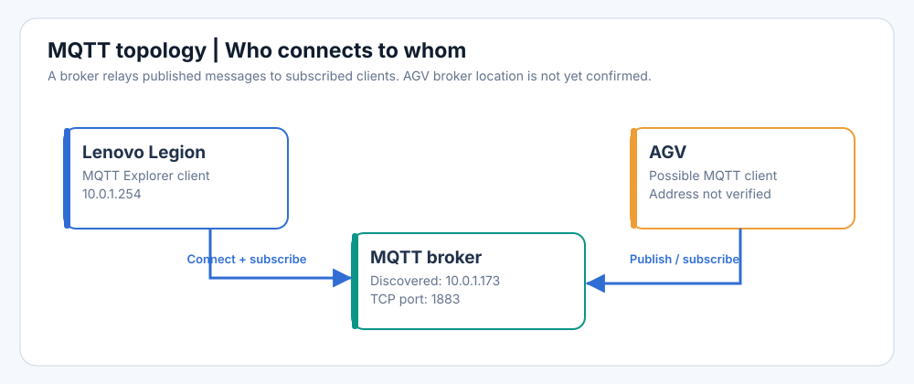
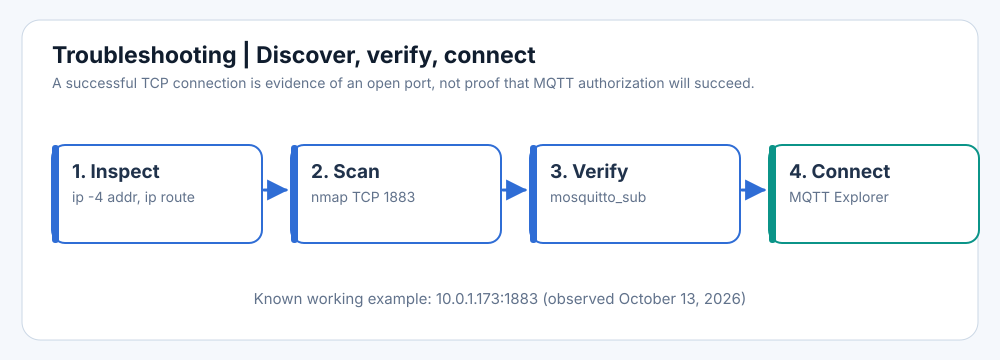
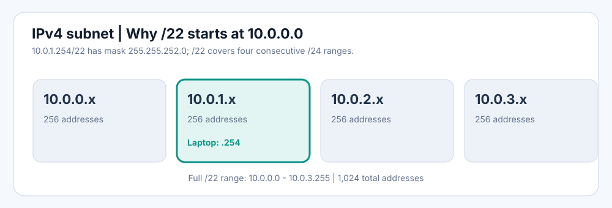

# Finding and Connecting to an MQTT Broker on Ubuntu 24.04

> **Field guide — Lenovo Legion + AGV network**  
> Last verified: **2026-10-13** · Local laptop IP: **`10.0.1.254/22`** · Discovered broker: **`10.0.1.173:1883`**  
> **Scope:** Reproduce the working connection, understand the network, and diagnose failures. IP addresses may change (DHCP).



## Contents

1. [Quick-start cheat sheet](#1-quick-start-cheat-sheet)
2. [What we discovered](#2-what-we-discovered)
3. [How the local subnet works](#3-how-the-local-subnet-works)
4. [Finding the broker again](#4-finding-the-broker-again)
5. [Connecting with MQTT Explorer](#5-connecting-with-mqtt-explorer)
6. [Verifying with Mosquitto tools](#6-verifying-with-mosquitto-tools)
7. [How MQTT works](#7-how-mqtt-works)
8. [Troubleshooting](#8-troubleshooting)
9. [Glossary of terminology and acronyms](#9-glossary-of-terminology-and-acronyms)
10. [References, icon assets, and diagram regeneration](#10-references-icon-assets-and-diagram-regeneration)

## 1. Quick-start cheat sheet

**Known working MQTT Explorer connection (observed 2026-10-13):**

| Setting | Value |
|---|---|
| Connection name | `AGV MQTT Broker` (user-defined) |
| Protocol | `mqtt://` (plain MQTT over TCP) |
| Host | **`10.0.1.173`** |
| Port | **`1883`** |
| TLS encryption | Off **for this plaintext-port configuration** |
| Username/password | Whatever the broker requires; not confirmed by scan |
| Evidence | Nmap reported `1883/tcp open`; MQTT Explorer subsequently connected successfully |

**If the address stops working:**

```bash
# 1. Confirm Wi-Fi address and subnet
ip -4 addr show dev wlp130s0f0
ip route

# 2. Try the previously discovered broker first
nc -vz -w 2 10.0.1.173 1883

# 3. Scan the likely address range for TCP/1883
nmap -n -sT -p 1883 --open 10.0.1.0/24

# 4. If necessary, expand to the full actual subnet
nmap -n -sT -p 1883 --open 10.0.0.0/22

# 5. Verify MQTT protocol / broker access (may wait for messages)
mosquitto_sub -h 10.0.1.173 -p 1883 -t '#' -v
```

> **Permissions:** Only scan devices/networks you are authorized to inspect. In a live garage, ask for the broker hostname/config if available rather than scanning production equipment unnecessarily.

## 2. What we discovered

The following comes from the actual command output and successful connection in this session, not a guessed deployment architecture.

| Observation | What it establishes | What it does *not* establish |
|---|---|---|
| `wlp130s0f0` = `10.0.1.254/22` | Laptop has a Wi-Fi IPv4 address on `10.0.0.0/22` | That every device is on `10.0.1.x` |
| `enp129s0` = `NO-CARRIER` | Wired Ethernet was not linked | Anything about wired Ethernet elsewhere |
| `tailscale0` = `100.73.24.31/32` | Tailscale interface exists | That local broker traffic goes through Tailscale |
| Nmap reports `10.0.1.173`, `1883/tcp open` | Host accepts TCP connections at port 1883 | Who operates the host; its MQTT role from TCP alone |
| MQTT Explorer successfully connected | The entered settings reached a working broker | AGV identity/topic structure, or whether broker is AGV-hosted |
| Nmap's aggressive scan finished in 1.45 seconds | Fast scan found this candidate | That no other brokers exist; zero retries can miss them |



## 3. How the local subnet works

Your machine reported:

```text
inet 10.0.1.254/22 brd 10.0.3.255
```

The `/22` is a **CIDR prefix length**: 22 network bits out of a 32-bit IPv4 address. The equivalent subnet mask is **`255.255.252.0`**. The third octet's mask is `252` (`11111100` in binary), so the third-octet network boundaries advance in groups of four: `0–3`, `4–7`, etc. Since your IP's third octet is `1`, the network starts at **`10.0.0.0`**, not `10.0.1.0`.



| Concept | Address |
|---|---|
| Laptop host IP | `10.0.1.254` |
| Network address | `10.0.0.0` |
| Prefix / subnet mask | `/22` / `255.255.252.0` |
| IPv4 broadcast address | `10.0.3.255` |
| Conventional usable hosts | `10.0.0.1` to `10.0.3.254` |
| Total IPv4 addresses | 1024 (1022 conventional host addresses) |
| Narrower search range (not your full subnet) | `10.0.1.0/24` |

**Important distinction:** `10.0.1.x` is a useful *subset for scanning*, but your system's configured network is `10.0.0.0/22`. For your actual `/22`, addresses `10.0.1.0` and `10.0.1.255` are not special network/broadcast addresses; those designations would apply only to a separately configured `10.0.1.0/24` network.

### Inspect IP addresses, routes, and neighbors

```bash
ip -4 addr show dev wlp130s0f0   # interface IPv4 configuration
ip route                          # routes; default gateway; chosen interface
ip neigh show dev wlp130s0f0     # recently discovered IP-to-MAC neighbors
```

The neighbor table is a **cache**, not a comprehensive list of all devices. A gateway is a routing device, not necessarily the MQTT broker.

## 4. Finding the broker again

### A. Try the known address first (fastest)

```bash
nc -vz -w 2 10.0.1.173 1883
```

`-z` tests a connection without sending application data, `-v` requests verbose output, `-w 2` sets a short timeout. A successful TCP connection means the port is reachable, **not** that authentication/subscription will succeed.

### B. Search likely hosts using Nmap

```bash
sudo apt update
sudo apt install -y nmap netcat-openbsd mosquitto-clients
nmap -n -sT -p 1883 --open 10.0.1.0/24
```

| Nmap option | Meaning |
|---|---|
| `-n` | Skip DNS resolution (reduce delays) |
| `-sT` | Full TCP `connect()` scan; works without raw-packet privileges |
| `-p 1883` | Probe the typical plaintext MQTT TCP port |
| `--open` | Show open ports rather than cluttering results with closed/filtered ones |
| `10.0.1.0/24` | Only the likely `10.0.1.x` address block (256 addresses) |
| `10.0.0.0/22` | All 1,024 addresses of the configured subnet |
| `-Pn` | Treat hosts as up and skip initial host discovery; can help when ping probes are blocked but may scan more hosts |
| `--max-retries 0` | Never retransmit unanswered probes; fast but can produce false negatives |
| `--host-timeout 2s` | Per-host cutoff; can miss slow devices |
| `-sV` | Attempt service/version detection on reachable ports |

### C. Fast, aggressive scan — understand the tradeoff

This exact command was used successfully in the session:

```bash
nmap -n -Pn -sT -p 1883 --open --max-retries 0 --host-timeout 2s 10.0.1.0/24
```

It found:

```text
Nmap scan report for 10.0.1.173
Host is up (0.0044s latency).
PORT     STATE SERVICE
1883/tcp open  mqtt
Nmap done: 256 IP addresses (256 hosts up) scanned in 1.45 seconds
```

**Warning interpretation:** The many `giving up on port because retransmission cap hit (0)` lines resulted from `--max-retries 0`. They **do not mean** all those hosts are confirmed offline, or that every IP has a broker. The `256 hosts up` line is also not proof of 256 real devices when `-Pn` was used: Nmap skips discovery and treats scan targets as up.

For a less aggressive verification after finding a candidate:

```bash
nmap -n -sV -p 1883 10.0.1.173
```

For a broker with TLS, `8883` is a *common* alternative, but configured broker ports can differ:

```bash
nmap -n -sT -p 1883,8883 --open 10.0.1.0/24
```

### D. Why scans may be slow

Host discovery, timeouts, retransmissions, packet filtering, and hundreds of unresponsive addresses all affect duration. Check a known IP first, narrow the range if you have a good reason, and avoid unnecessarily broad production scans. For best repeatability, find the host's DNS name, DHCP reservation, or broker deployment configuration.

## 5. Connecting with MQTT Explorer

Install and launch (Ubuntu 24.04):

```bash
sudo snap install mqtt-explorer
mqtt-explorer
```

1. Open MQTT Explorer's connections dialog (hamburger menu; **+** to add).
2. Change the default public test broker (`mqtt.eclipse.org`) to the discovered local host.
3. Enter **Host** `10.0.1.173`, **Port** `1883`, **Protocol** `mqtt://`.
4. Leave **Encryption (TLS)** off *if* this is the broker's plaintext listener. Use credentials if required.
5. Click **Save**, then **Connect**.
6. Expand topics as messages arrive; inspect payloads, retain flags, and timestamps if displayed.

**Do not use a public demo broker** if your goal is garage/AGV telemetry. A successful connection doesn't guarantee subscriptions are authorized or that the AGV is currently publishing.

## 6. Verifying with Mosquitto tools

[Lucide terminal icon (online SVG)](https://cdn.jsdelivr.net/npm/lucide-static@latest/icons/terminal.svg) · [Lucide network icon (online SVG)](https://cdn.jsdelivr.net/npm/lucide-static@latest/icons/network.svg)

Subscribe to standard topics:

```bash
mosquitto_sub -h 10.0.1.173 -p 1883 -t '#' -v
```

`-h` host, `-p` port, `-t` topic filter, `-v` prints both topic and payload. `#` is a multi-level wildcard matching ordinary topics. MQTT topics beginning with `$` are not included by a root `#` subscription; subscribe to `$SYS/#` separately *if authorized and enabled*.

If your broker requires credentials, consult its documented authentication settings. Avoid including plaintext passwords directly in shell history or shared screenshots.

A successful subscription may stay silent while no matching messages are published. Confirm access by inspecting MQTT Explorer or a **known, safe** read-only telemetry topic; avoid publishing commands to a live AGV merely to test connectivity.

## 7. How MQTT works

**MQTT** = *Message Queuing Telemetry Transport*, a lightweight publish/subscribe messaging protocol commonly running over TCP. A **broker** accepts client connections and routes messages between publishers and subscribers. Both a robot and your desktop tool can be MQTT **clients**.

| Term | Explanation | Example |
|---|---|---|
| Broker | Server routing MQTT messages | `10.0.1.173:1883` in this session |
| Client | Connected program/device | MQTT Explorer or AGV software |
| Publisher | Client sending a message to a topic | AGV emits status |
| Subscriber | Client requesting messages matching a filter | MQTT Explorer subscribes to `#` |
| Topic | Hierarchical UTF-8 message name, levels separated by `/` | `agv/123/state` (illustrative) |
| Payload | Message body (bytes, often JSON or text) | `{ "battery": 82 }` (illustrative) |
| QoS | Quality of Service delivery level | QoS 0, 1, or 2 |
| Retained message | Broker stores last retained message for a topic to send to new subscribers | Last-known status |
| Keep Alive | Client/server mechanism to detect disconnected sessions | MQTT keep-alive interval |
| Session | State associated with a client connection, optionally persisting subscriptions | Durable subscription state |
| ACL | Access Control List authorizing publish/subscribe operations | Read-only telemetry access |
| TLS | Transport Layer Security, encrypting/protecting connections | Commonly on port `8883` |

**QoS levels:** **0** = at most once; **1** = at least once (duplicates possible); **2** = exactly once at the MQTT protocol delivery level. QoS does not guarantee the AGV actually performed a commanded physical action.

### How this relates to the AGV

The observed data identifies a working broker endpoint, **not** the location of broker software or the AGV's client identity. One possible architecture is: AGV publishes telemetry → broker distributes it → MQTT Explorer displays it. Your project's actual topic names and message schemas must be obtained from its code or broker configuration. Example `agv/123/state` and VDA 5050 topic examples are *illustrations*, not observed traffic.

## 8. Troubleshooting

| Symptom | Likely causes | What to try |
|---|---|---|
| Connection refused | Host reachable, no listener on chosen port | Confirm IP and port with `nc`/Nmap |
| Connection timeout | Filtering, wrong IP, isolation, host offline | Check Wi-Fi, `ip route`, narrower authorized scans |
| MQTT protocol error | Wrong service, port, transport/protocol version | Confirm broker listener settings; `nmap -sV` |
| Not authorized / authentication failed | Username/password, ACL, or certificate issue | Ask broker administrator for credentials/permissions |
| TLS/certificate error | Wrong TLS toggle/port, unknown CA, hostname mismatch | Use configured TLS port and CA; keep validation enabled |
| Connected but no topics | No active publications, subscriptions blocked, topic filter mismatch | Check authorized topic filter; inspect known retained telemetry |
| Previously working IP disappears | DHCP lease or network changed | Recheck `ip -4 addr`, find broker hostname/DHCP reservation |
| Nmap warns `retransmission cap hit (0)` | `--max-retries 0` suppressed retry | Rescan specific candidates without that flag |
| Scan reports “256 hosts up” | `-Pn` assumes all target hosts are up | Do not interpret as actual discovered hosts |
| MQTT Explorer only shows demo/test topics | Connected to public demo host | Replace `mqtt.eclipse.org` with local `10.0.1.173` |

## 9. Glossary of terminology and acronyms

| Term | Full name / definition | Relevance |
|---|---|---|
| AGV | Automated Guided Vehicle | Robot client / topic source (deployment not yet confirmed) |
| IP | Internet Protocol | Logical device addressing |
| IPv4 | Internet Protocol version 4 | 32-bit addresses such as `10.0.1.254` |
| NIC | Network Interface Controller | Hardware/software-facing network interface |
| Wi-Fi | Wireless local-area networking (IEEE 802.11) | `wlp130s0f0` is the laptop's active wireless interface |
| LAN | Local Area Network | Local garage network |
| CIDR | Classless Inter-Domain Routing | Prefix `/22` denotes 22 network bits |
| Subnet | Address range sharing a network prefix | `10.0.0.0/22` |
| Subnet mask | Bitmask separating network from host bits | `255.255.252.0` |
| Gateway | Next-hop router to reach other networks | Visible in `ip route`; not automatically broker |
| DHCP | Dynamic Host Configuration Protocol | Often assigns IP addresses/leases |
| DNS | Domain Name System | Resolves hostnames to addresses; Nmap `-n` skips lookups |
| MAC | Media Access Control (address) | Link-layer interface identifier |
| ARP | Address Resolution Protocol | Maps local IPv4 addresses to link-layer addresses; contributes to `ip neigh` |
| TCP | Transmission Control Protocol | Reliable connection-oriented transport for MQTT here |
| Port | Transport endpoint number | `1883` (common plaintext MQTT); `8883` (common MQTT over TLS) |
| TLS | Transport Layer Security | Encryption and peer authentication |
| VPN | Virtual Private Network | Tailscale is separate from your direct Wi-Fi interface |
| MQTT | Message Queuing Telemetry Transport | Publish/subscribe application protocol |
| QoS | Quality of Service | MQTT delivery assurance level |
| ACL | Access Control List | Broker topic-level authorizations |
| JSON | JavaScript Object Notation | Common structured message payload format |
| VDA 5050 | Interface specification for communication between AGVs/AMRs and master control | Potential MQTT topic conventions; not verified here |
| AMR | Autonomous Mobile Robot | Related robot category |
| Nmap | Network Mapper | Port scanning and service probing tool |
| Netcat (`nc`) | Network utility for TCP/UDP connectivity | Quick single-host port checks |
| Mosquitto | MQTT broker project and CLI client tools | Provides `mosquitto_sub` |
| `ip a` | Abbreviation of `ip address` | Displays network interfaces and addresses |
| `/24` | 24 network bits; mask `255.255.255.0` | Convenient narrower scan range |
| `/22` | 22 network bits; mask `255.255.252.0` | Laptop's actual subnet |
| `-Pn` | Nmap skip host discovery | Assumes target hosts up for scanning |

## 10. References, icon assets, and diagram regeneration

**Visual design:** original custom SVG diagrams rendered with Python, inspired by the [UI UX Pro Max design principles](https://github.com/nextlevelbuilder/ui-ux-pro-max-skill): restrained blue/teal palette, strong type hierarchy, rounded cards, generous spacing, accessible contrast. **Not** an official output from that skill.

**Optional online SVG icon references (Lucide):** [Wi-Fi](https://cdn.jsdelivr.net/npm/lucide-static@latest/icons/wifi.svg), [Network](https://cdn.jsdelivr.net/npm/lucide-static@latest/icons/network.svg), [Router](https://cdn.jsdelivr.net/npm/lucide-static@latest/icons/router.svg), [Terminal](https://cdn.jsdelivr.net/npm/lucide-static@latest/icons/terminal.svg), [Shield Check](https://cdn.jsdelivr.net/npm/lucide-static@latest/icons/shield-check.svg). Icons are linked rather than required at runtime, so the diagrams work offline. See [Lucide](https://lucide.dev/) for licensing and attribution details.

**Primary references:** [MQTT Explorer](https://mqtt-explorer.com/), [Nmap Reference Guide](https://nmap.org/book/man.html), [Eclipse Mosquitto client manual](https://mosquitto.org/man/mosquitto_sub-1.html), [MQTT.org](https://mqtt.org/).

**Included files:** `README.md` (this guide), `assets/01-topology.svg`, `assets/02-subnet.svg`, `assets/03-workflow.svg`, and `generate_diagrams.py`. To regenerate:

```bash
python3 generate_diagrams.py
```

> **VS Code:** Keep the `assets/` directory next to `README.md` so relative SVG embeds render in Markdown Preview (`Ctrl+Shift+V`). The SVGs are plain vector files and can be edited separately.
