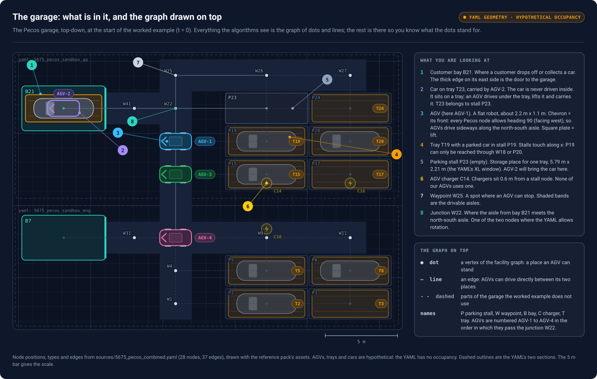
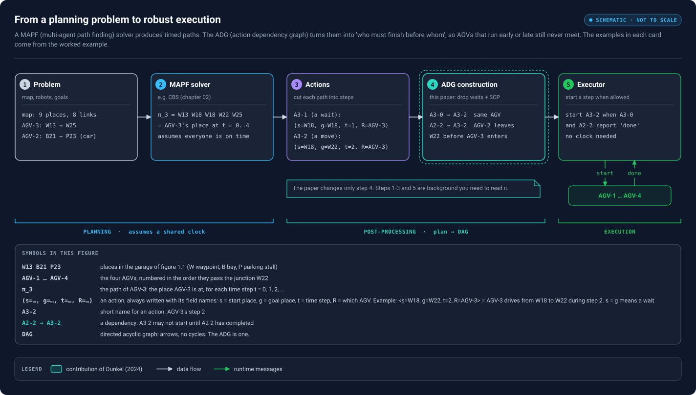
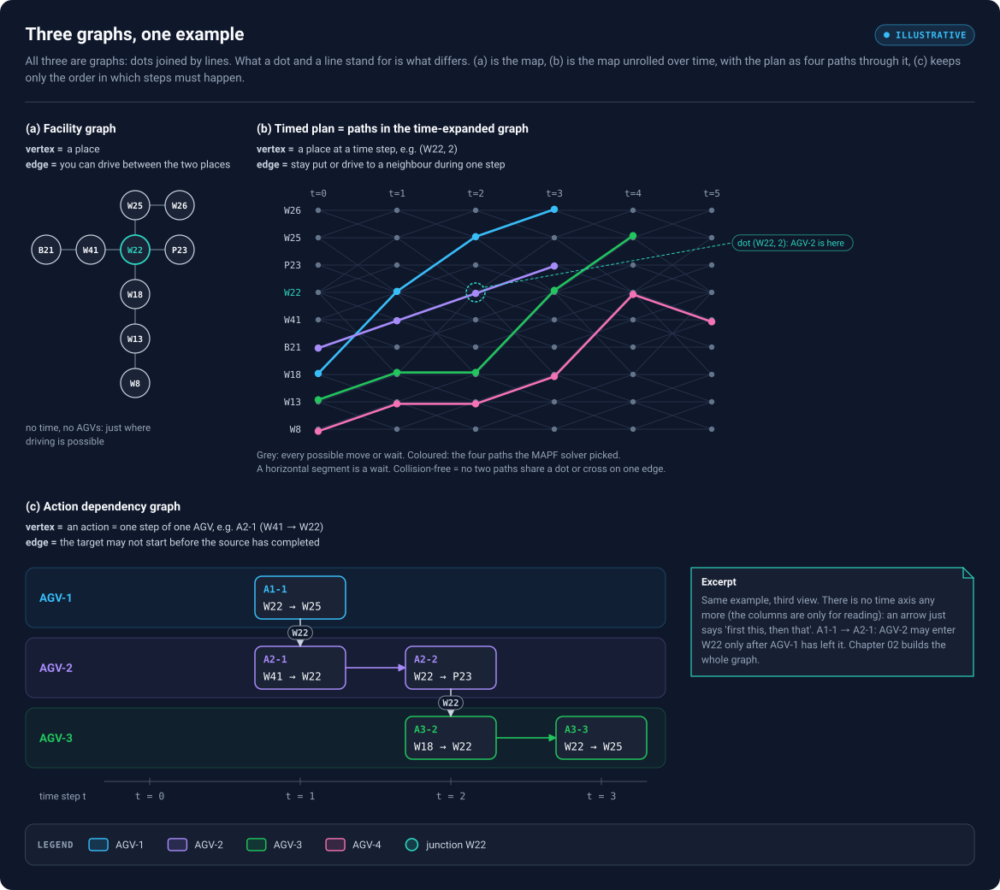
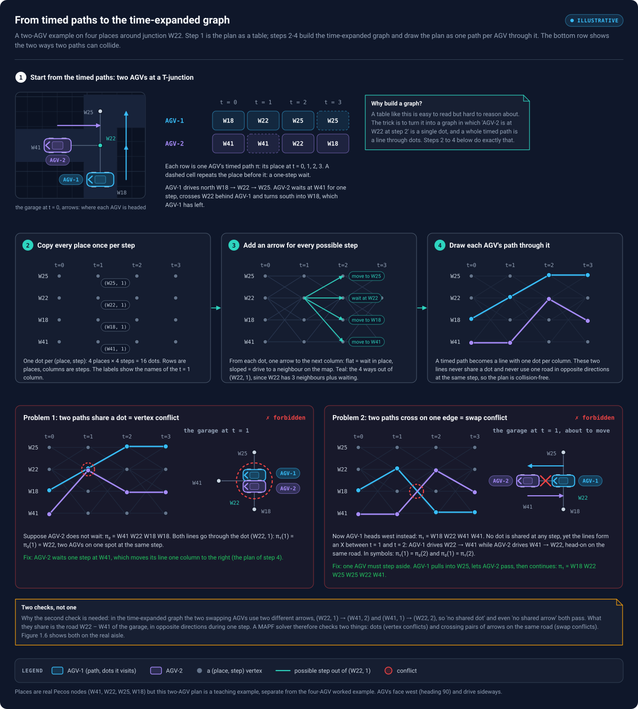
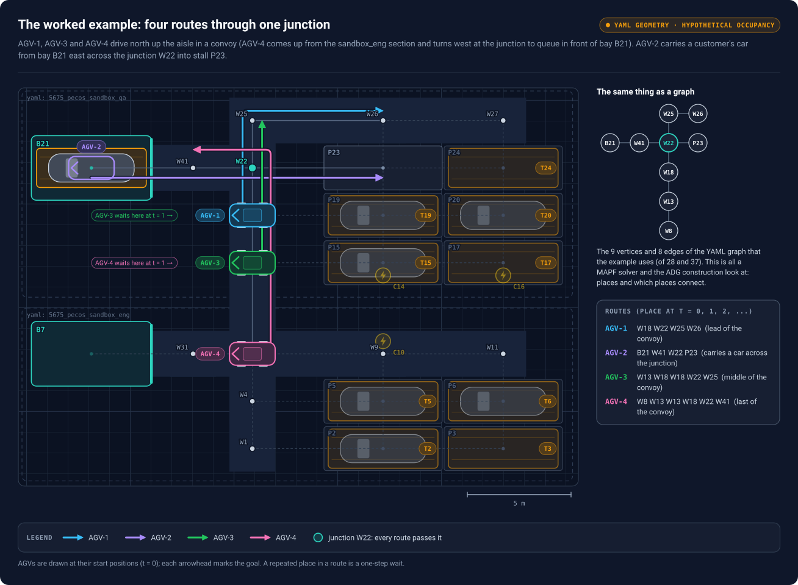
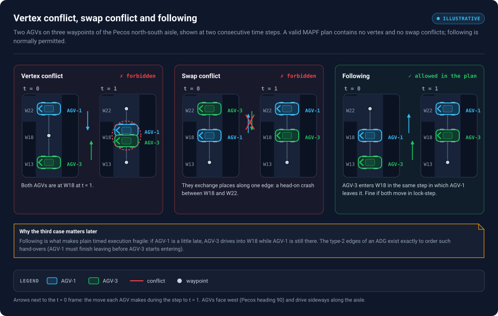
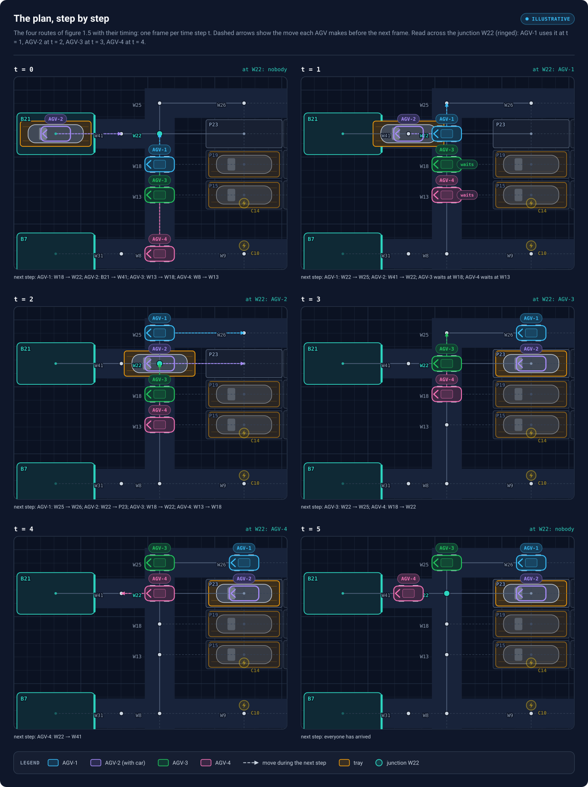
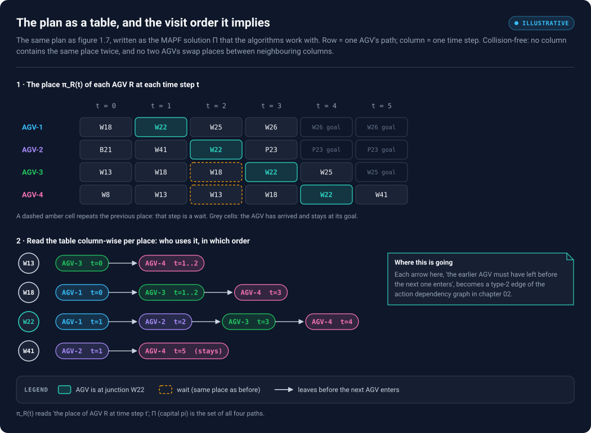

# 01 — Visual foundations: the garage, its graph, time, and the worked example

*Chapter 1 of 3. About 40 minutes. Next: [02 — From CBS to an action dependency graph](02-cbs-to-adg.md).*

> **One example, all the way through.** Every figure and table in chapters 01–03 uses the same small scene: four AGVs (AGV-1 to AGV-4) in the Pecos parking garage, all of which have to cross the same junction. Every path, conflict, dependency edge and timing you see was computed by [`scripts/adg/adg.py`](../scripts/adg/adg.py), not drawn by hand, so you can re-run and check the numbers.

> **Every figure explains itself.** Each figure ends with a key ("What you are looking at", "Symbols in this figure" or "How to read …") that defines every name and mark it uses. If something in a figure is unclear, look there first.

> **Viewing the figures.** Markdown previews show the SVGs as static images sized for the reading column. For pan and zoom, open [`figures/viewer.html`](../figures/viewer.html) in a browser (scroll to zoom, drag to pan, ← → to switch figures), or open any `.svg` file directly.

## What you will be able to do after this chapter

- Explain what an automated garage contains (bays, trays, AGVs, stalls, chargers, waypoints) and how it becomes a **facility graph**.
- Tell apart the three graphs in this topic: the **facility graph**, the **timed plan** and the **Action Dependency Graph (ADG)**.
- Read a multi-robot plan as a filmstrip and as a table, and check by hand that it is collision-free.
- Turn an AGV's path into the paper's **actions** ⟨s=start, g=goal, t=step, R=AGV⟩, and spot which ones are **waits**.

---

## 1. The setting: an automated parking garage

A customer drives into a **bay**, gets out and leaves. From then on the car is never driven. It stands on a **tray**, a flat steel platform. An **AGV** (automated guided vehicle, a low flat robot) drives *under* the tray, lifts it and carries tray and car to a **parking stall**. When the customer returns, an AGV fetches the tray and brings it back to a bay. AGVs recharge at **chargers**, and drive along **aisles** between named stopping points called **waypoints**.

Pan / zoom: [interactive viewer](../figures/viewer.html#01-garage) · [standalone SVG](../figures/01-garage.svg)

*Figure 1.1 — The Pecos garage (`sources/5675_pecos_combined.yaml`), top-down, at the start of the example (t = 0). The numbered callouts are explained in the panel on the right. The dots and thin lines drawn on the floor are the **facility graph**: the only part of this picture the planning algorithms ever see.*

Names are the YAML's node ids with a prefix for the node type, as in the reference material: **P** = parking stall, **W** = waypoint, **B** = customer bay, **C** = AGV charger; **T** = tray (a tray is named after the stall it belongs to). The number is only an identifier. The YAML has 28 nodes and 37 edges in two sections, `sandbox_eng` (lower half) and `sandbox_qa` (upper half); the example happens almost entirely in `sandbox_qa`. The four AGVs are numbered **AGV-1** to **AGV-4** in the order in which they pass the junction W22: AGV-1 first, AGV-4 last.

At t = 0:

- **AGV-2** stands in **bay B21** under tray T23 with a customer's car on it. Its job: carry the car east to its stall **P23**.
- **AGV-1** stands on the north–south aisle at **W18**. Its job: drive up the aisle and along the top row to **W26**.
- **AGV-3** stands behind it at **W13** and has to move up to **W25**, where it will wait for its next job.
- **AGV-4** comes up the aisle from **W8** in the `sandbox_eng` section and has to go to **W41**, in front of bay B21, ready for the next customer.

The junction **W22** is where the short aisle from bay B21 meets the north–south aisle; it is one of the two nodes where the YAML allows an AGV to rotate. All four routes pass it. Everything else in the drawing (dashed edges, faded stalls, chargers, bay B7) is part of the real layout but not used by the example.

> **Real layout, hypothetical occupancy.** Node positions, types, headings and edges come from the Pecos YAML; stalls are drawn with its XL parking window (5.79 m × 2.21 m) and the drawing assets are the reference pack's. The YAML contains no AGVs, trays or cars: where they stand is made up for the example. Every Pecos node allows heading 90 (facing west), which is why all AGVs are drawn facing west and drive *sideways* along the north–south aisle.

## 2. The big picture: planning, then execution

Two separate jobs must be done before anything moves safely.

1. **Planning.** A *Multi-Agent Path Finding* (MAPF) solver decides, for every AGV, which place it occupies at every time step, so that no two AGVs ever meet. The output is a set of **timed paths**.
2. **Execution.** Those paths are handed to real AGVs. Real AGVs are never exactly on time: one stops for a person, one carries a heavier car, one gets its command late. If each AGV simply followed its own timetable, a single delay could put two of them on the same place.

The **Action Dependency Graph** sits between the two. It throws the timetable away and keeps only what matters for safety: *which action must be finished before which other action may start*. AGVs then advance as fast or as slowly as they can, and the order of every hand-over is still preserved.

Pan / zoom: [interactive viewer](../figures/viewer.html#02-pipeline) · [standalone SVG](../figures/02-pipeline.svg)

*Figure 1.2 — The five stages, with examples from the garage of figure 1.1. Planning (1–2) produces timed paths that are only correct if every AGV keeps a shared clock. Post-processing (3–4) cuts the paths into actions and links them by precedence. The executor (5) starts an action as soon as everything it depends on has reported "done". The paper studied in this kit, Dunkel (2024), changes only stage 4. Every symbol in the cards is defined in the panel under them.*

Read the example lines in the cards from left to right, all about AGV-3:

1. **Problem:** AGV-3 has to get from W13 to W25.
2. **MAPF solver:** AGV-3's path is $\pi_3$ = `W13 W18 W18 W22 W25` — its place at t = 0, 1, 2, 3, 4. W18 appears twice: AGV-3 stands still for one step.
3. **Actions:** the path is cut into steps. `A3-1` = ⟨s=W18, g=W18, t=1, R=AGV-3⟩ is that standing still (a *wait*); `A3-2` = ⟨s=W18, g=W22, t=2, R=AGV-3⟩ drives into the junction.
4. **ADG:** `A3-0 → A3-2` (AGV-3 does its own steps in order) and `A2-2 → A3-2` (AGV-2 must have left W22 before AGV-3 may enter it).
5. **Executor:** start A3-2 as soon as A3-0 and A2-2 have reported "done". No clock involved.

## 3. Three graphs that are easy to confuse

The single most common mistake when learning this material is to mix up three different graphs. Yes, all three are graphs, including the timed plan. It lives in the **time-expanded graph**: copy the facility graph once per time step, so every vertex is a pair (place, step). From (W18, 1) there is an edge to (W18, 2), meaning *wait*, and one to (W22, 2), meaning *drive to a neighbour*, each taking exactly one step. A MAPF plan is then **one path per AGV through this graph**, and "collision-free" means no two paths use the same vertex (same place at the same step) or cross the same edge in opposite directions (a swap).

Pan / zoom: [interactive viewer](../figures/viewer.html#03-three-graphs) · [standalone SVG](../figures/03-three-graphs.svg)

*Figure 1.3 — The same example seen as three graphs. (a) Facility graph: places and the roads between them. (b) Time-expanded graph: each place repeated for every step; grey arrows are all possible moves and waits, coloured paths are the plan the solver picked. (c) Action Dependency Graph: the plan's steps as boxes, arrows say "must finish before". Only (b) has a clock.*

| | Facility graph | Timed plan (time-expanded graph) | Action Dependency Graph |
|---|---|---|---|
| **Vertex** | a place: `W18`, `W22`, `W26`, … | a place *at a time*: (W22, 2) | an action: `A3-2` = "AGV-3 drives W18 → W22 in step 2" |
| **Edge** | an AGV *may drive* between two places | an AGV *may move or wait* from one step to the next | the target action *must not start* before the source action is done |
| **Built by** | the garage layout | the MAPF solver (CBS, prioritized planning, …) | ADG construction (Algorithm 1, CP or SCP) |
| **Question it answers** | Where can AGVs go? | Where is each AGV at each step? | In what order must things happen? |
| **Has a clock?** | no | yes, discrete steps $t = 0, 1, 2, \dots$ | **no** — only "before / after" |

A line `W18 — W22` in the facility graph says "you can drive there". An arrow `A1-1 → A2-1` in the ADG says "AGV-2 may not start driving into W22 until AGV-1 has finished leaving W22". A path through (W18, 1) → (W22, 2) in the time-expanded graph says "this AGV *is* at W22 at step 2". Three different kinds of statement.

### 3.1 The time-expanded graph, built by hand

The middle graph is the least familiar, so here it is built from scratch on a smaller example: two AGVs and four places around the junction (W41 to the west, W25 to the north, W18 to the south).

**Step 1 — the timed paths.** A MAPF plan is a table: one row per AGV, one column per time step, each cell the place the AGV is at.

| | t = 0 | t = 1 | t = 2 | t = 3 |
|---|---|---|---|---|
| AGV-1 | W18 | W22 | W25 | W25 |
| AGV-2 | W41 | *W41* | W22 | W18 |

AGV-1 drives north. AGV-2 waits one step at W41 (the repeated place), then crosses W22 behind AGV-1 and turns south into W18.

**Step 2 — copy every place once per step.** Make one vertex for every pair (place, step): 4 places × 4 steps = 16 vertices. Draw them as a grid, places as rows and steps as columns. The vertex (W22, 2) means "W22, at step 2".

**Step 3 — add an arrow for every possible step.** From each vertex (v, t) draw arrows to the next column:

- to (v, t+1): **wait** at v;
- to (w, t+1) for every neighbour w of v in the facility graph: **drive** from v to w.

From (W22, 1) there are four arrows: wait, or drive to W41, W25 or W18. Arrows only point to the next column, so time can only move forward, and every arrow takes exactly one step.

**Step 4 — draw the paths.** Each AGV's row of the table becomes a line through the graph that visits exactly one vertex per column: AGV-1 is (W18, 0) → (W22, 1) → (W25, 2) → (W25, 3). A wait is a flat segment and a move is a sloped one. So "a plan" and "one path per AGV through the time-expanded graph" are the same thing.

Pan / zoom: [interactive viewer](../figures/viewer.html#04-time-expanded) · [standalone SVG](../figures/04-time-expanded.svg)

*Figure 1.4 — Top: the two-AGV plan as a table, with the garage at t = 0. Middle: building the time-expanded graph (dots, then all possible arrows, then the two paths). Bottom: the two ways two paths can collide. A shared dot is a vertex conflict; two paths crossing as an X on the same road is a swap conflict.*

**Two ways two paths can collide.** Once the plan is drawn this way, "collision-free" can be checked by looking at the lines:

1. **Shared dot (vertex conflict).** If AGV-2 does not wait, its path is W41 W22 W18 W18. Both lines then pass through the dot (W22, 1): $\pi_1(1) = \pi_2(1) = $ W22, two AGVs on one spot at the same step. The fix is the wait in step 1, which shifts AGV-2's line one column to the right.
2. **Crossing on one edge (swap conflict).** Now let AGV-1 head west instead: W18 W22 W41 W41, with AGV-2 waiting as before. Check every column and no dot is shared. But between t = 1 and t = 2 the two lines form an **X**: AGV-1 uses the arrow (W22, 1) → (W41, 2) while AGV-2 uses (W41, 1) → (W22, 2). They are two *different* arrows, so "no shared dot" and even "no shared arrow" both pass. On the floor, though, both AGVs are on the road W22–W41 at the same time, in opposite directions: a head-on crash. In symbols, $\pi_1(1) = \pi_2(2)$ and $\pi_2(1) = \pi_1(2)$. The fix needs a place to step aside: AGV-1 pulls into W25, lets AGV-2 through, then continues (W18 W22 W25 W25 W22 W41).

So a MAPF solver needs two checks, not one: no shared dots, and no pair of arrows that use the same road in opposite directions during the same step. Section 5.2 states both formally and figure 1.6 shows them on the real aisle.

## 4. The facility graph of the worked example

Formally, the garage is a graph $\mathcal{G} = (\mathcal{V}, \mathcal{E})$. $\mathcal{V}$ is the set of **vertices**: places where an AGV can stand (waypoints, stalls, bays, chargers). $\mathcal{E}$ is the set of **edges**: pairs of places an AGV can drive between directly. Our example uses nine vertices and eight edges:

- the north–south aisle `W8 – W13 – W18 – W22 – W25`, continuing east along the top row to `W26`,
- the east–west line `B21 – W41 – W22 – P23` from the bay into the stall block,
- crossing at the **junction W22**.

These are 9 of the YAML's 28 nodes and 8 of its 37 edges. The other nodes and edges exist, but no route of the example uses them.

Pan / zoom: [interactive viewer](../figures/viewer.html#05-facility) · [standalone SVG](../figures/05-facility.svg)

*Figure 1.5 — The four routes drawn in the garage, and the same nine places as a bare graph (top right). AGV-1, AGV-3 and AGV-4 drive north up the aisle in a convoy; AGV-1 and AGV-3 continue to the top row, AGV-4 turns west at W22 towards the bay. AGV-2 carries the car east from the bay, across the aisle, into stall P23. The routes panel lists each AGV's place at every time step.*

Three things to notice:

1. **Every route uses W22.** The four AGVs must take turns at the junction. The plan will fix one order (AGV-1, AGV-2, AGV-3, AGV-4); the ADG will make sure that order is respected even when AGVs are late.
2. **The convoy shares W13 and W18.** AGV-3 drives into W18 right after AGV-1 leaves it, and AGV-4 into W13 right after AGV-3 leaves it. These "follow-the-leader" hand-overs also need protecting.
3. **What the graph leaves out.** In this model an AGV is a point on a vertex, and a collision means "two AGVs on the same vertex at the same time" (or swapping along an edge, below). A real AGV has a heading (in Pecos, always 90 except at the two rotation nodes), a footprint that can overlap a neighbouring stall, and a swept area when it turns; a loaded AGV is as long as the tray. The paper uses the simple vertex model; transferring its results to a richer collision model means re-checking its assumptions (chapter 03, section 7).

## 5. Adding time: paths, waits and conflicts

### 5.1 Paths

Time is discrete: $t \in \{0, 1, 2, \dots\}$. For each AGV $R$, the plan gives a **path**

$$
\pi_R = \big(\pi_R(0), \pi_R(1), \pi_R(2), \dots\big), \qquad \pi_R(t) \in \mathcal{V},
$$

where $\pi_R(t)$ is the place AGV $R$ occupies at step $t$. Between step $t$ and step $t+1$ an AGV either **moves** to a neighbouring place ($\pi_R(t+1) \ne \pi_R(t)$, and the two are joined by an edge) or **waits** ($\pi_R(t+1) = \pi_R(t)$). After reaching its goal, an AGV stays there.

### 5.2 What "collision-free" means

A MAPF solver must avoid two kinds of conflict between any two AGVs $i \ne j$:

- **Vertex conflict** — both on the same place at the same step: $\pi_i(t) = \pi_j(t)$. In the time-expanded graph: a shared dot.
- **Swap (edge) conflict** — they exchange places along one edge: $\pi_i(t) = \pi_j(t+1)$ **and** $\pi_j(t) = \pi_i(t+1)$. On a single-lane aisle this is a head-on crash. In the time-expanded graph: an X between two neighbouring columns.

A third pattern is normally **allowed**: **following**, where one AGV enters a place in the same step in which another leaves it.

Pan / zoom: [interactive viewer](../figures/viewer.html#06-conflicts) · [standalone SVG](../figures/06-conflicts.svg)

*Figure 1.6 — Two AGVs, AGV-1 and AGV-3, on three waypoints of the aisle at two consecutive steps. Left: both end up on W18 (vertex conflict). Middle: they swap W18 and W22 (swap conflict). Right: AGV-3 moves into W18 while AGV-1 moves out (following) — legal in the plan, but only safe if AGV-1 really leaves before AGV-3 really arrives.*

Following is worth a second look because it is exactly where timed execution breaks. In the plan, AGV-1 leaves W18 and AGV-3 arrives at W18 "at the same moment". On the floor, if AGV-1 starts a second late, AGV-3 drives into W18 while AGV-1 is still there. Chapter 02 shows this happening in the example and how the ADG prevents it.

The paper encodes the "no conflict" requirement as its **Definition 2**: in a valid solution, no two actions *start or end at the same vertex at the same time step*. (Its displayed formula, $a.s \ne b.s \lor a.g \ne b.g$, is literally weaker — it only forbids sharing both — but the sentence and the proofs use the stronger reading, which is exactly "no vertex conflict". This kit uses that reading.) The proofs lean on this fact repeatedly.

## 6. The worked example's plan

Here is the plan used in the rest of the kit. (Chapter 02 shows how Conflict-Based Search finds it.) First as a filmstrip, so you can see it move:

Pan / zoom: [interactive viewer](../figures/viewer.html#07-filmstrip) · [standalone SVG](../figures/07-filmstrip.svg)

*Figure 1.7 — One frame per time step. Each AGV is drawn where the plan puts it; the dashed arrow shows the move it makes before the next frame; "waits" marks an AGV that stands still for that step. The label at the top right of each frame says who is at the junction W22.*

Then as the table the algorithms actually work with:

Pan / zoom: [interactive viewer](../figures/viewer.html#08-plan-table) · [standalone SVG](../figures/08-plan-table.svg)

*Figure 1.8 — Top: one row per AGV, one column per time step; the cell is $\pi_R(t)$. Teal cells are visits to the junction, dashed amber cells are waits, grey cells mean "already at goal". Bottom: the same table read per place — for each shared place, which AGV uses it, in which order.*

### 6.1 Read the plan AGV by AGV

- **AGV-1** (`W18 W22 W25 W26`) starts closest to the junction and simply drives through. It is first at W22 (step 1) and reaches W26 at step 3.
- **AGV-2** (`B21 W41 W22 P23`) leaves the bay with the car and reaches W22 at step 2, the step after AGV-1 leaves it.
- **AGV-3** (`W13 W18 W18 W22 W25`) would like to be at W22 at step 2, but AGV-2 is there. So AGV-3 **waits at W18 for one step** and enters W22 at step 3.
- **AGV-4** (`W8 W13 W13 W18 W22 W41`) is stuck behind AGV-3: W18 is occupied by AGV-3 at step 2, so AGV-4 **waits at W13 for one step**, then follows AGV-3 through W18 and W22 and turns west into W41, which AGV-2 left long ago.

### 6.2 Check it yourself

You can verify a plan by hand with two scans of figure 1.8.

1. **Columns (vertex conflicts).** In each column all entries must be different (count goal cells too — a parked AGV still occupies its place). Column $t = 2$ reads `W25, W22, W18, W13`: all different. Do the same for the other columns.
2. **Neighbouring columns (swap conflicts).** For every pair of AGVs, check that they never trade places between column $t$ and $t + 1$. Here nobody ever drives *towards* another AGV on the same edge, so there is no swap.

This is exactly what `conflicts()` in `scripts/adg/adg.py` does, and it returns an empty list for this plan.

### 6.3 Read the table per place: visit order

The lower half of figure 1.8 regroups the same information by place. For the junction **W22** the order is AGV-1 (step 1) → AGV-2 (step 2) → AGV-3 (step 3) → AGV-4 (step 4). For **W18** it is AGV-1 → AGV-3 → AGV-4. Each arrow there means *the earlier AGV must have left before the next one arrives*. Hold on to that sentence: in chapter 02 every one of those arrows becomes a **type-2 dependency** of the ADG.

## 7. From paths to actions

The paper does not work with paths directly. It cuts each path into **actions**. Its Definition 1: an action $a$ is the four-tuple

$$
a = \langle s, g, t, R \rangle,
$$

with **start** place $s$, **goal** place $g$, **time step** $t$ and **robot** (AGV) $R$. The action at step $t$ takes AGV $R$ from $\pi_R(t)$ to $\pi_R(t+1)$, so $s = \pi_R(t)$ and $g = \pi_R(t+1)$. If $s = g$, the action is a **wait**. Code and later chapters write the parts as `a.s`, `a.g`, `a.t` and `a.R`.

**Notation used throughout this kit.** When an action is written out with concrete values, every field is labelled: ⟨s=W18, g=W22, t=2, R=AGV-3⟩, never the bare ⟨W18, W22, 2, 3⟩. Read it as "start W18, goal W22, during step 2, done by AGV-3". The same goes for CBS constraints in chapter 02, written ⟨R=AGV-3, v=W22, t=2⟩: "AGV-3 may not be at place W22 at step 2".

In this kit an action is named by its AGV and time step: `A3-2` is AGV-3's action at $t = 2$. The worked example has 15 actions:

| Action | AGV $R$ | start $s$ | goal $g$ | step $t$ | Kind |
|---|---|---|---|---|---|
| A1-0 | AGV-1 | W18 | W22 | 0 | move |
| A1-1 | AGV-1 | W22 | W25 | 1 | move |
| A1-2 | AGV-1 | W25 | W26 | 2 | move |
| A2-0 | AGV-2 | B21 | W41 | 0 | move |
| A2-1 | AGV-2 | W41 | W22 | 1 | move |
| A2-2 | AGV-2 | W22 | P23 | 2 | move |
| A3-0 | AGV-3 | W13 | W18 | 0 | move |
| **A3-1** | AGV-3 | W18 | W18 | 1 | **wait** |
| A3-2 | AGV-3 | W18 | W22 | 2 | move |
| A3-3 | AGV-3 | W22 | W25 | 3 | move |
| A4-0 | AGV-4 | W8 | W13 | 0 | move |
| **A4-1** | AGV-4 | W13 | W13 | 1 | **wait** |
| A4-2 | AGV-4 | W13 | W18 | 2 | move |
| A4-3 | AGV-4 | W18 | W22 | 3 | move |
| A4-4 | AGV-4 | W22 | W41 | 4 | move |

Two conventions to internalise now, because the rest depends on them:

- **An action "enters" its goal and "leaves" its start.** `A2-1` = ⟨s=W41, g=W22, t=1, R=AGV-2⟩ enters the junction; `A2-2` = ⟨s=W22, g=P23, t=2, R=AGV-2⟩ leaves it. AGV-2 occupies W22 from the end of `A2-1` until the end of `A2-2`.
- **A wait neither enters nor leaves anything.** `A3-1` starts and ends at W18. The paper's first improvement (chapter 03) is the observation that, for this reason, waits never contribute a unique dependency.

## Checkpoint

Try each question before opening the answer.

1. The line W18 — W22 exists in the facility graph. Is there an edge between A1-0 and A1-1 in the ADG, and does it mean the same thing?

There is an ADG edge A1-0 → A1-1 (a *type-1* edge: consecutive actions of one AGV), but it means something different. The facility edge says "an AGV can drive from W18 to W22". The ADG edge says "AGV-1's second action may not start until its first one is done". One describes possible motion, the other required order.

2. Why does AGV-3 wait at W18 at t = 1 instead of driving into the junction?

Because AGV-2 is at W22 at $t = 2$. If AGV-3 drove W18 → W22 during step 1 → 2, both would be at W22 at $t = 2$: a vertex conflict.

3. At t = 0, AGV-1 drives W18 → W22 and AGV-3 drives W13 → W18. Is that a conflict?

No. At $t = 1$ AGV-1 is at W22 and AGV-3 at W18: different places, and they did not swap. It is *following*: AGV-3 enters W18 as AGV-1 leaves it. Legal in the plan, but exactly the situation that needs a dependency (A1-0 must finish before A3-0 may start) when executed on real AGVs.

4. Which actions enter the junction W22, and which leave it?

Enter W22 ($g$ = W22): A1-0, A2-1, A3-2, A4-3. Leave W22 ($s$ = W22): A1-1, A2-2, A3-3, A4-4. Each AGV enters the junction with one action and leaves with the next one.

5. Is (W22, 2) the same thing as W22?

No. W22 is a vertex of the facility graph, a place. (W22, 2) means "W22 at step 2", a vertex of the timed view. The MAPF solver reasons about places at times; the ADG reasons about actions.

6. AGV-2 carries a car on a tray. Does the ADG know about the car or the tray?

No. It only sees AGV-2's actions (B21 → W41 → W22 → P23). Whether an AGV is loaded matters for its speed and footprint in the real garage, which is exactly the kind of thing the vertex-only model leaves out (section 4, point 3).

