# 01 — Scheduler software background

*A ground-up guide to the `scheduler` ROS 2 package for engineers who are new to the team. It is written against the package snapshot in `sources/repomix-scheduler.xml` (headers, sources, tests, CMake and `package.xml`), the ROS interface definitions, and the `5675_pecos_combined.yaml` facility layout.*

> **Scope and evidence.** This guide documents the *existing* implementation, not the proposed solver refactor (that is [02](02-issue-and-proposal.md)). Everything labelled **AS-BUILT** was checked against `scheduler.hpp`, `scheduler.cpp`, `utils.cpp`, `scheduler_ros.cpp` and `scheduler_component.cpp`. Code from other packages (`planner_core`, `common_ros`, `motion_planner`, `task_planner`) was **not** in the snapshot; where this guide describes it, it does so from call sites and says so. The Pecos figures use real node positions and edges, but **AGV, tray and payload occupancy is hypothetical**. The Pecos YAML has bays and chargers but **no VRC**.

> **Viewing the figures.** Markdown previews (VS Code, GitHub) show SVGs as static images, so the figures are drawn to be readable at preview width. For pan and zoom, open [`figures/viewer.html`](figures/viewer.html) in a browser (all figures, scroll to zoom, drag to pan, arrow keys to switch), or open any `.svg` file directly in a browser. Every figure carries a status badge: **AS-BUILT**, **PROPOSED**, **ILLUSTRATIVE**, **SCHEMATIC**, **CONCEPTUAL**, or **YAML GEOMETRY · HYPOTHETICAL OCCUPANCY**.

## How to use this guide

Read it in three passes. Each pass is useful on its own.

| Pass | Read | You will be able to |
|---|---|---|
| 1 · Orientation (30 min) | Sections 1–5 | Say what the scheduler is for, where it sits in the ROS system, and how it models the garage |
| 2 · Data and objects (1 h) | Sections 6–11 | Name the main types, who owns them, and follow one `Plan()` call from request to response |
| 3 · Algorithms (3 h, with the code open) | Sections 12–18 | Explain job expansion, tray assignment, AGV assignment, motion planning and bay rebalancing. Section 12 is long: read 12.1–12.6 first, then the job types you will work on |

Then work through the checkpoint questions in section 23, read the design FAQ in section 22, run one test from section 20 under a debugger, and keep section 21 (C++ idioms) open as a reference.

### How to read the code snippets

Every snippet starts with a **Where** line that names the function it comes from and what each variable is. Snippets are abridged (logging and some error handling removed) but keep the real names. These names recur everywhere, so learn them once:

| Name in the code | Type | What it is |
|---|---|---|
| `this` inside `Scheduler::...` | `const volley::Scheduler*` | The one long-lived planner object owned by `SchedulerRos`. Its members end in `_` |
| `layout_` | `LayoutSPtr` (`std::shared_ptr<Layout>`) | Parsed layout YAML: nodes, edges, bays, floors, resource windows |
| `gg_` | `volley::GarageGraph` | Search graph over (node, heading) poses; used by every path query |
| `table_` | `volley::CollisionTable` | Answers “do these two footprints at these two poses collide?” |
| `cost_model_` | `cost::MotionCostModel` | Speeds, accelerations, lift and door times from ROS parameters |
| `request_data` | `const PlanRequestMsg&` | The incoming `interfaces/msg/PlanRequest` |
| `plan_ctx`, `ctx` | `ScheduleContextSPtr` (`std::shared_ptr<ScheduleContext>`) | All mutable data for **one** plan call |
| `ctx->events` | `volley::ScheduleEventDag` | The event DAG that every stage reads and extends |
| `working_state` | `volley::DiscreteGarageState` (a value, not a reference) | A scratch copy of the garage, advanced by replaying events |
| `event` | `std::shared_ptr<volley::ScheduleEvent>` | One vertex of `ctx->events` |
| `move`, `tray_move` | `volley::TrayMove*` (from `dynamic_cast`) | The same event viewed as its concrete subclass |
| `*_opt` | `std::optional<...>` | Lookups that may fail, for example `working_state.GetTray(id)` |
| `[success, message]` | `BoolStringPair` (a `bool` plus a `std::string`) | The return convention of almost every planning method |
| `job_index` | `size_t` | Position of the job in `ctx->scheduled_jobs`; stored in every event it creates |

## 1. What problem does this software solve?

A customer vehicle sits on a **tray** inside an automated parking facility. An **AGV** (automated guided vehicle) drives under a tray, raises its lift, and carries the tray. A **bay** is the customer-facing handoff room; a **waypoint** is a navigation node; a **parking node** is where trays are stored; an **AGV charge** node is where robots recharge. Some installations have a **VECS** (EV charging station under a parking node) or a **VRC** (vertical reciprocating conveyor, a lift between floors). These are different resources with different rules.

A job such as **retrieve this payload** does not say how to do it. The Scheduler decides which tray moves are needed, which AGV does each one, which operations must happen first, and how long everything takes. It then returns a schedule of discrete commands that Dispatch executes. The scheduler never drives a motor and never talks to an AGV directly.

The key distinction is **what** should happen versus **how and when** it happens:

| Layer | Question | Example | Where it lives |
|---|---|---|---|
| Job | What outcome is requested? | Retrieve a payload | `SchedulerJob.msg` |
| Event | What discrete state change is needed? | Move tray 17 into bay 21 | `ScheduleEvent` subclasses, `ctx->events` |
| Motion | How does an AGV get there over time? | Timed pose changes along graph edges | `ContinuousState` from CHUGG |
| Action | What command is sent to which machine? | `TYPE_AGV_COMMAND` from node 13 to node 15 | `ActionNode.msg` inside `Schedule.msg` |

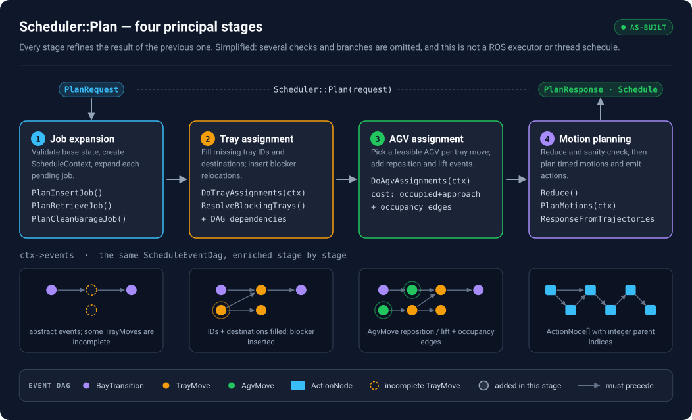

<sub>Pan / zoom: [interactive viewer](figures/viewer.html#01_pipeline) · [standalone SVG](figures/01_pipeline.svg)</sub>

*Figure 1 — The four principal stages of `Scheduler::Plan`, from `PlanRequest` to `PlanResponse`. The strip underneath shows the same `ctx->events` DAG being enriched: incomplete tray moves get IDs and destinations, blocker moves and AGV events are added, and finally the reduced DAG becomes `ActionNode[]` with parent indices. This is not a ROS thread or executor schedule.*

## 2. Where the scheduler runs: the node and its interfaces

The package builds one shared library (`libscheduler`: `scheduler.cpp`, `utils.cpp`) and one ROS 2 component (`scheduler_component.cpp`, `scheduler_ros.cpp`) that is also installed as the executable `scheduler_node`. Three layers wrap each other:

1. **`SchedulerComponent`** reads ROS parameters (`layout`, `scheduler.cost_audit`, `scheduler.bay_readiness_ratio`, and the AGV / VRC / bay / VECS performance limits in `ReadParams`), finds the layout file with `GetLayoutPathByName`, and builds a `SchedulerRos`. Missing parameters exit the process.
2. **`SchedulerRos`** owns every ROS object: the `plan` service, the `set_bay_readiness_ratio` service, the `debug/printdags` toggle, two 5 s publishers, and four clients into `/central`. It owns the `Scheduler` through a `shared_ptr`.
3. **`Scheduler`** is the planning core. Apart from a logger and `rclcpp::Time`, it knows nothing about ROS transport, which is why tests can construct it directly.

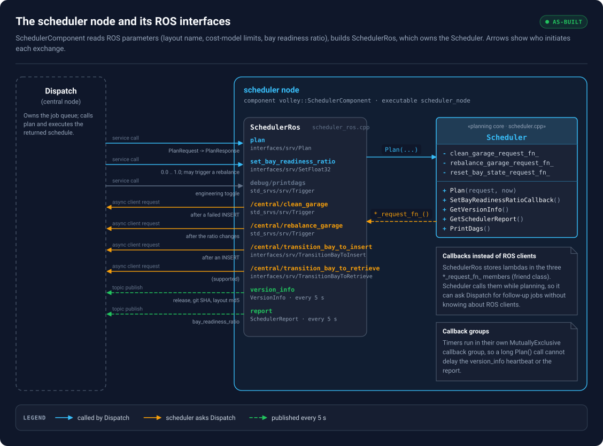

<sub>Pan / zoom: [interactive viewer](figures/viewer.html#20_system_context) · [standalone SVG](figures/20_system_context.svg)</sub>

*Figure 2 — The scheduler node and its ROS interfaces. Dispatch (in the central node) calls `plan` and executes the schedule it gets back. The scheduler calls back into `/central` to ask for follow-up jobs; it does this through three `std::function` members that `SchedulerRos` fills in, so `Scheduler` itself never holds a ROS client. Timers run in their own callback group so a long `Plan()` cannot starve them. The caller's identity (Dispatch) is inferred from comments and client topic names.*

The whole service handler is a few lines. This is the only place where ROS hands a request to the planner:

```cpp
// Where: SchedulerRos::SchedulerRos(...) in src/scheduler_ros.cpp, the "plan" service callback.
//   this        -> SchedulerRos (the ROS adapter, not the planner)
//   scheduler_  -> std::shared_ptr<volley::Scheduler>, created in this constructor
//   request     -> PlanSrv::Request::SharedPtr; request->request_data is a PlanRequestMsg
plan_srv_ = rclcppx::CreateService<PlanSrv>(node_, "plan",
    [this](PlanSrv::Request::SharedPtr request, PlanSrv::Response::SharedPtr response) {
      PlanResponseMsg response_msg = scheduler_->Plan(request->request_data, node_->now());
      rclcpp::Time now = node_->now();
      for(auto& job_data : response_msg.scheduled_jobs) {
        job_data.job.time_planned = now;          // stamp every job, failed or not
      }
      response->response_data = std::move(response_msg);
      return response;
    }, 1u);
```

Two side channels matter when you debug: `set_bay_readiness_ratio` stores a new ratio in the `std::atomic<float> bay_readiness_ratio_` and, if it changed, asks `/central/rebalance_garage` for a `REBALANCE_GARAGE` job; and a failed `INSERT` job triggers `/central/clean_garage` from inside `Plan()`.

## 3. The physical garage and its coordinate system

The supplied **Pecos** layout has **28 nodes and 37 undirected edges** in two YAML sections (`sandbox_eng` and `sandbox_qa`). It defines **two bays** (`B7`, `B21`), **three AGV charging nodes** (`C10`, `C14`, `C16`), plus parking and waypoint nodes. It does not define a VRC. Node positions come from the YAML; connectivity comes from the `edges` list, not from visual distance.

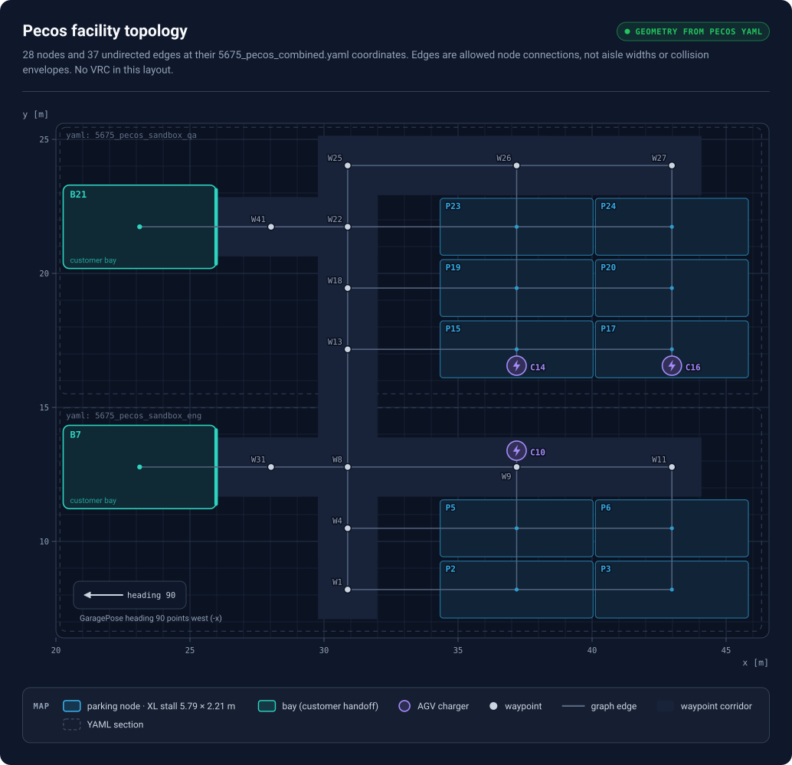

<sub>Pan / zoom: [interactive viewer](figures/viewer.html#15_facility_topology) · [standalone SVG](figures/15_facility_topology.svg)</sub>

*Figure 3 — Pecos facility graph drawn from the YAML coordinates in metres. Blue rectangles are **parking nodes**, drawn with the layout's XL parking window (5.79 m along x by 2.21 m along y) centred on the node; teal rectangles are **bays** with the customer door on the garage side; violet circles are **AGV chargers**; grey dots are **waypoints**; thin lines are **garage-graph edges**; shaded bands mark waypoint corridors; dashed outlines are the two YAML sections. No AGVs or trays are drawn: the YAML contains no occupancy.*

Notice how dense the parking block is: stalls touch along x, so a tray at `P17` can only leave through `P15` or `P20`. That is why **blocking trays** (section 13) are a core problem rather than an edge case.

### Geometric versus logical position

The continuous position vector **$\mathbf p=[x,y]^\mathsf T\in\mathbb R^2$** holds the horizontal coordinate **$x$** and vertical coordinate **$y$**, both in metres. A planar configuration **$\mathbf q=[x,y,\theta]^\mathsf T\in\mathbb R^3$** adds the heading **$\theta$**. In `GeometricPose.msg` the yaw **$\theta$** is in radians. `GaragePose.msg` is different: it holds a node identifier **$i\in\mathbb N$** and an integer heading **$h\in\mathbb Z$** in degrees. The planner works almost entirely in `GaragePose`.

```text
# msg/GeometricPose.msg          # msg/GaragePose.msg
float32 x       # metres        uint32 node_id
float32 y       # metres        int16 heading   # degrees, +CCW from local north; 90 = west
float32 yaw     # radians
```

A pose is a vertex of `gg_` only if the node allows that heading. `gg_.GetVertexFromPose(pose)` returns `std::optional<Vertex>`; an empty optional means “this node cannot hold this heading”, a common cause of “does not exist in garage graph” errors. Several code paths try the **reciprocal** heading (±180°) before giving up, because a tray facing the opposite way occupies the same footprint.

### Layout, GarageGraph and CollisionTable: three views of the same garage

The scheduler builds three static objects from the layout file, once, in its constructor, and uses them for every plan:

```cpp
// src/scheduler.cpp — Scheduler::Scheduler(std::string layout_filepath, rclcpp::Logger logger,
//                                          const SchedulerParams& params)
layout_(std::make_shared<Layout>(layout_filepath)),   // LayoutSPtr: the parsed YAML
pg_(layout_),                                         // volley::PoseGraph, built from the Layout
gg_(pg_),                                             // volley::GarageGraph, the search graph
table_(gg_, logger),                                  // volley::CollisionTable, built from the graph
// ...then InitRetrievalHeadings() stores one retrieval heading per parking node in gg_
```

They are easy to confuse because all three "describe the garage". The difference is the question each one answers.

- **`Layout` (`layout_`) is about places.** It is the YAML file in memory: nodes with an id, a type, a position in metres, the headings they allow and whether an AGV may rotate there; undirected edges between node ids; parking-window sizes; bay facts (inbound heading, prioritisation, floors). You ask it "what is node 22?" with `layout_->GetNodeById(22)`, which returns `std::optional<GarageNodeMsg>`.
- **`GarageGraph` (`gg_`) is about motion.** Its vertices are **poses**, a node *plus* a heading, and its edges are the moves between poses. A node that allows two headings, like `W22`, appears as two vertices; a heading the node does not allow has no vertex at all. Every path search runs on `gg_`. You translate between the two worlds with `gg_.GetVertexFromPose(GaragePoseMsg) -> std::optional<Vertex>` and back with `gg_.GetPoseFromVertex(v)` or `gg_.GarageNodeFromVertex(v)`.

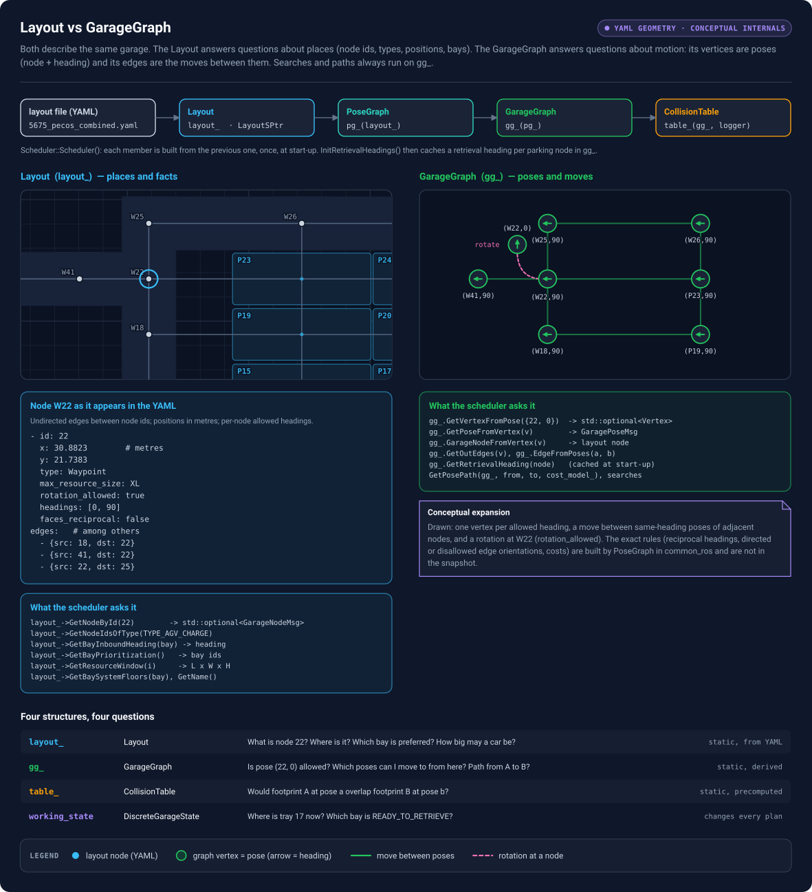

<sub>Pan / zoom: [interactive viewer](figures/viewer.html#51_layout_vs_garage_graph) · [standalone SVG](figures/51_layout_vs_garage_graph.svg)</sub>

*Figure 4 — The same corner of the Pecos garage seen as a Layout (left: nodes, positions, YAML fields) and as a GarageGraph (right: one vertex per pose, edges are moves). How `PoseGraph` expands nodes into poses lives in `common_ros` and is not in the snapshot; the right panel shows the idea, not the exact rules.*

- **`CollisionTable` (`table_`) is about space.** It answers one question: would footprint *A* at pose *a* overlap footprint *B* at pose *b*? The signature used everywhere is `table_.Query(id_a, id_b, pose_a, pose_b) -> bool`. The footprint is picked by a **collision id** (`CollisionEntityId_t`), computed from the entity's state by `CollisionEntityIdFromAgvState`, `...FromTrayState` or `...FromPayloadState`, so an empty AGV, an AGV carrying a tray and a tray with a large car get the right shapes. Because it depends on poses, not just nodes, the same two nodes can conflict at one heading and be fine at another.

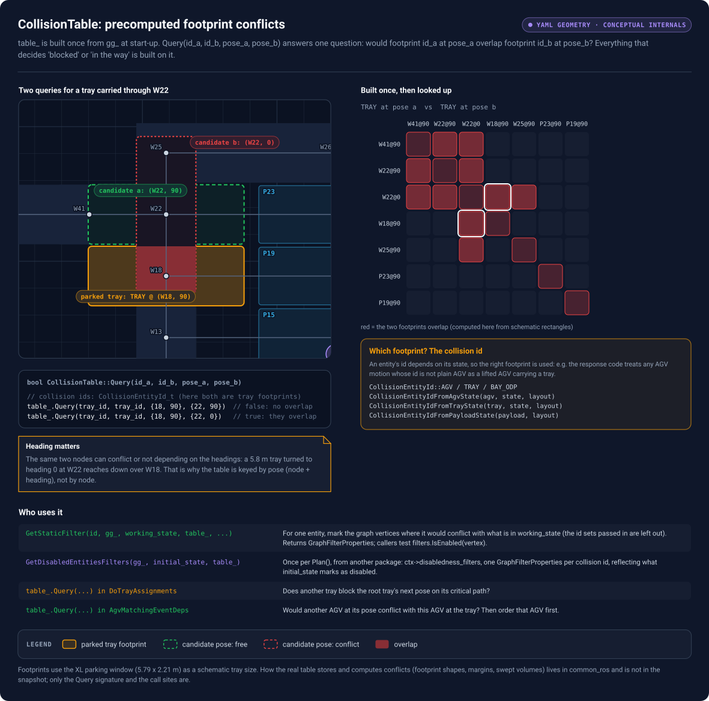

<sub>Pan / zoom: [interactive viewer](figures/viewer.html#52_collision_table) · [standalone SVG](figures/52_collision_table.svg)</sub>

*Figure 5 — Two `Query` calls for a tray at W22 against a tray parked at W18: heading 90 is clear, heading 0 overlaps. The grid on the right shows the idea of a table built once and then looked up (overlaps computed here from schematic rectangles). The real storage and footprints are in `common_ros`.*

Most code does not call `Query` directly. It asks `volley::GetStaticFilter(id, gg_, working_state, table_, ...)`, which uses the table to mark which graph vertices a given entity cannot use given everything in `working_state`, and then tests `filters.IsEnabled(vertex)`. `ctx->disabledness_filters`, built once per `Plan()`, works the same way for disabled nodes and entities. The direct `Query` calls are in `DoTrayAssignments` (is another tray in the way of the root tray's next pose?) and `AgvMatchingEventDeps` (would two AGVs conflict?).

The fourth structure is the one that changes: `DiscreteGarageState` (section 5) records **who is where right now**. Layout, graph and table never change after start-up; the state is different in every plan request.

## 4. Vocabulary

| Term | Meaning | Important distinction |
|---|---|---|
| `SchedulerJob` | A requested outcome, such as `TYPE_RETRIEVE` | Arrives in `PlanRequest.pending_jobs` |
| `DiscreteGarageState` (DGS) | Where every AGV, tray, payload, bay, VECS and VRC is, and its state | A snapshot, not a trajectory |
| `ScheduleEvent` | One discrete state change, e.g. a `TrayMove` | Abstract C++ base class in `planner_core`, not a ROS message |
| `TrayMove` | Move one tray to one pose | May start with no tray id, no destination, and no AGV |
| `AgvMove` | One AGV pose change **or** one lift change | Holds `std::variant<AgvLiftChangedMsg, AgvPoseChangedMsg>` |
| `BayTransition`, `VecsTransition` | Commands for bays and EV chargers | Created by job expansion |
| `ScheduleEventDag` | DAG of events; edge u → v means u must finish first | Lives in `ctx->events` |
| `ScheduleContext` | All mutable data for one plan call | Created in `Plan()`, dies when `Plan()` returns |
| working state | `ctx->initial_state` plus a replay of events | Recomputed many times, never stored |
| critical path | The graph path a tray takes to its destination | Trays on it are **blocking trays** |
| `freeing_moves` | A `GarageOccupancyChecker` mapping poses to the events that used them | How “shared space” becomes DAG edges |
| AMIGA | “Arguably More Intelligent aGv Assignment”: the cost functions in `DoAgvAssignments` | Bottleneck matching of AGVs to tray moves |
| CHUGG | The motion planner in `motion_planner/chugg.hpp` | Turns the event DAG into timed trajectories |
| `ActionNode` | One executable command with parent indices | The only thing Dispatch executes |

### A request is not a plan

```text
PlanRequest                                   PlanResponse
  ├── id: Guid                                  ├── success: bool, message: string, id: Guid
  ├── base_state: DiscreteGarageState           ├── schedule: Schedule -> ActionNode[]
  ├── base_schedule: Schedule (already running) └── scheduled_jobs: ScheduledJobData[]
  └── planned_jobs / active_jobs / pending_jobs: SchedulerJob[]
```

Only `pending_jobs` are planned. `base_schedule` is the immutable part of a schedule that is already executing: `Plan()` marks every AGV, node, bay and VECS used by it as **disabled** in the initial state, so the new plan cannot reuse them.

## 5. `DiscreteGarageState`: the bridge between the garage and the planner

`DiscreteGarageState` is the most important type in the system. The Scheduler never plans over geometry directly; it plans over this structured snapshot of arrays (AGVs, trays, bays, payloads, VECS, VRCs and disabled nodes). Every physical fact the planner cares about must be expressible in it.

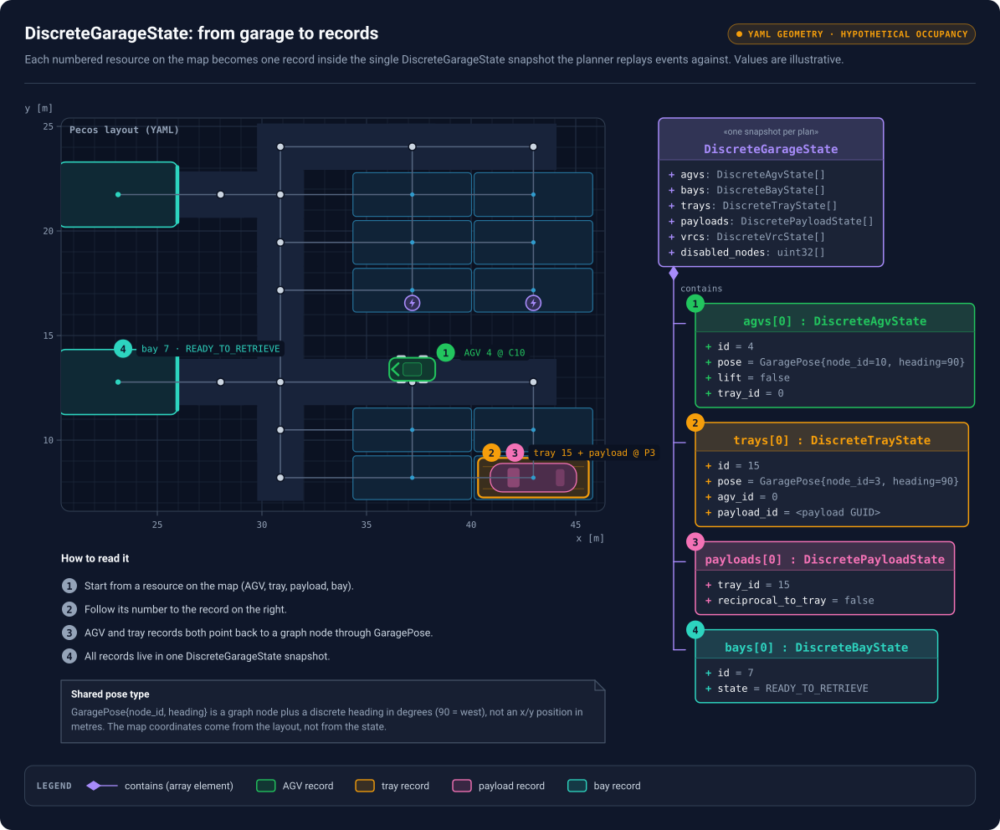

<sub>Pan / zoom: [interactive viewer](figures/viewer.html#16_discrete_garage_state_bridge) · [standalone SVG](figures/16_discrete_garage_state_bridge.svg)</sub>

*Figure 6 — `DiscreteGarageState` ties the floor layout to the planner's data structures. The left side reuses the Pecos drawing: ① AGV 4 parked at charger `C10`, ② tray 15 at parking node `P3`, ③ the payload riding on tray 15, and ④ bay 7 in `READY_TO_RETRIEVE`. Each number points to the matching record on the right; the filled diamond marks containment inside the single snapshot. Values are illustrative.*

How it is used in the scheduler:

- **Built once per call** by `ValidateBaseState(request_data.base_state, *layout_)` in `utils.cpp`. It rejects duplicate entities, payloads that fit no resource window, and AGVs or trays on poses that do not exist in the layout. It does **not** check that entities overlap.
- **Copied freely.** It is a value type. `working_state = ctx->initial_state` makes an independent copy that a function can mutate without affecting anyone else.
- **Advanced by events.** `event->Apply(working_state)` returns a `BoolStringPair` and moves entities discretely (a tray simply appears at its destination).
- **Queried constantly** with `GetAgv(id)`, `GetTray(id)`, `GetTrayOnNode(node)`, `GetPayload(guid)`, `GetBay(id)`, `GetVecs(node)`, each returning `std::optional`.

## 6. ROS messages and services

The `interfaces` package defines the wire contracts under `msg/` and `srv/`. `rosidl_generate_interfaces` turns them into C++ structs. `scheduler_msgs.hpp` gives every one of them a short alias ending in `Msg` (`PlanRequestMsg = interfaces::msg::PlanRequest`, `GaragePoseMsg = interfaces::msg::GaragePose`, …), so when you see `...Msg` in the scheduler you are looking at a generated ROS struct. When one message appears inside another, the relationship is **composition**, not inheritance.

Read the interfaces from the outside in: `srv/Plan.srv`, then `PlanRequest` and `PlanResponse`, then `DiscreteGarageState`, `Schedule`, `ActionNode` and `SchedulerJob`, and only then the utility types.

| Interface | What it contains | Why it matters |
|---|---|---|
| `srv/Plan.srv` | One `PlanRequest` and one `PlanResponse` (`request_data` / `response_data`) | The service boundary `SchedulerRos` exposes |
| `msg/PlanRequest.msg` | Request id, current `DiscreteGarageState`, immutable `base_schedule`, three job arrays | What the world looks like now, and what to plan |
| `msg/PlanResponse.msg` | Success flag, message, id, output `Schedule`, `ScheduledJobData[]` | The schedule plus per-job bookkeeping |
| `msg/SchedulerJob.msg` | Type, state, ids for AGV / bay / tray / payload, optional destination | User or dispatcher intent |
| `msg/DiscreteGarageState.msg` | Arrays of AGVs, bays, VECS (`vexen`), trays, payloads, VRCs, disabled nodes, hash | The snapshot at the start of the call |
| `msg/GaragePose.msg` | Node id and discrete heading | The pose type used almost everywhere |
| `msg/Schedule.msg` | A topologically ordered array of `ActionNode`s | What Dispatch executes |
| `msg/ActionNode.msg` | Type, parent indices, duration, status, one command payload per machine type | The final executable unit |

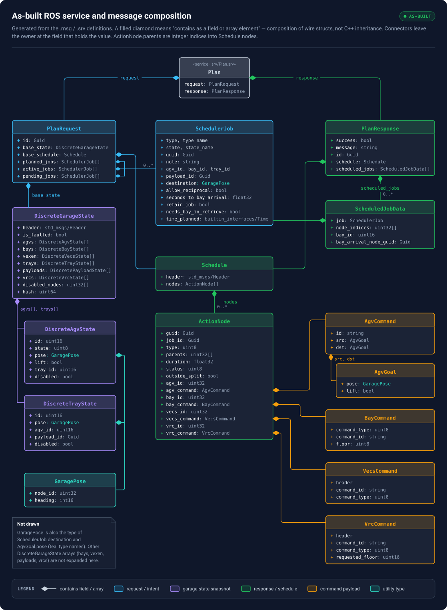

<sub>Pan / zoom: [interactive viewer](figures/viewer.html#13_uml_ros_messages) · [standalone SVG](figures/13_uml_ros_messages.svg)</sub>

*Figure 7 — As-built ROS service and message composition. A **filled diamond** means “contains as a field or array element”; each connector leaves the owning message at the field that holds the value. Blue boxes are the **request / intent** side, violet the **garage-state snapshot**, green the **response / schedule** side, amber the **command payloads**, and teal the **`GaragePose` utility type** (teal type names show where else it is used).*

Reading notes:

- `ActionNode.parents` are **integer indices** into `Schedule.nodes`, not pointers. The conversion from event objects to indices happens at the very end of `Plan()` (section 17).
- `ActionNode` is wide: it has a command field for every machine type, but only the one matching `type` is meaningful.
- `ScheduledJobData.node_indices` tells Dispatch which actions belong to which job; for `TYPE_RETRIEVE`, `bay_arrival_node_guid` names the `PROCESS_RETRIEVE` action.

## 7. Package anatomy: files and classes

| File | Lines | What to look for |
|---|---|---|
| `include/scheduler/scheduler.hpp` | ~460 | `SchedulerParams`, `ScheduleContext`, the `Scheduler` class. Read this first: every method has a comment |
| `src/scheduler.cpp` | ~4 200 | Everything in `Scheduler`. Use the function list in section 9 as a map |
| `include/scheduler/utils.hpp`, `src/utils.cpp` | ~600 | `ValidateBaseState`, bay classification and rebalancing, VRC action insertion |
| `include/scheduler/scheduler_msgs.hpp` | ~60 | The `...Msg` / `...Srv` aliases |
| `src/scheduler_ros.cpp`, `include/scheduler/scheduler_ros.hpp` | ~170 | ROS services, publishers, clients |
| `src/scheduler_component.cpp` | ~70 | Parameter reading, component registration |
| `test/*.cpp` | ~6 500 | 72 active GoogleTest cases (one more is commented out); see [03](03-verification-plan.md) for a map |
| `CMakeLists.txt`, `package.xml` | — | Build targets and package dependencies (section 19) |

| Class / type | What it does | Declared in | Key members / methods |
|---|---|---|---|
| `Scheduler` | The planner. Validates requests, expands jobs into events, assigns trays and AGVs, checks the result, runs motion planning, builds the response | `scheduler.hpp` | `Plan`, `Plan*Job`, `DoTrayAssignments`, `DoAgvAssignments`, `SanityCheckEvents`, `PlanMotions`, `ResponseFromTrajectories` |
| `SchedulerParams` | Constructor-time settings | `scheduler.hpp` | `bay_readiness_ratio`, `cost_audit`, `motion_cost` |
| `ScheduleContext` | Mutable working set for one plan call | `scheduler.hpp` | `initial_state`, `events`, `scheduled_jobs`, `last_entity_event`, `first_tray_event`, `disabledness_filters`, `UpdateLastEntityEvent`, `UpdateLeafDependencies` |
| `ScheduleEvent` and subclasses | Discrete state changes that can be replayed against a DGS | `planner_core/schedule_events.hpp` (not in snapshot) | `Apply`, `GetGarageEntityId`, `GetJobIndex`, `GetType` |
| `DagBase<T>`, `ScheduleEventDag` | Boost-graph DAG of `shared_ptr<T>`, and its event specialisation | `planner_core/event_dag.hpp` (not in snapshot) | `AddEvent`, `AddDependency`, `GetTopologicalOrdering`, `GetRootEvents`, `GetLeafEvents`, `WouldCreateCycle`, `Reduce`, `Remove`, `Apply` |
| `DiscreteGarageState` | Garage snapshot with typed accessors | `common_ros/discrete_garage_state.hpp` (not in snapshot) | `Set`, `GetAgv`, `GetTray`, `GetTrayOnNode`, `GetPayload`, `GetBay`, `GetVecs` |
| `GarageGraph`, `PoseGraph` | Pose graph for searches | `common_ros/garage_graph.hpp` (not in snapshot) | `GetVertexFromPose`, `GetPoseFromVertex`, `SetRetrievalHeading` |
| `CollisionTable` | Pairwise footprint conflicts between entity types at poses | `common_ros` (not in snapshot) | `Query(id_a, id_b, pose_a, pose_b)` |
| `GarageOccupancyChecker<T>` | Remembers which T occupied which pose | `common_ros/garage_occupancy_checker.hpp` (not in snapshot) | `AddOccupant`, `GetBlockers` |
| `MotionCostModel` | Durations from speeds, accelerations and event times | `cost_functions/motion_cost_model.hpp` (not in snapshot) | `Params()`, `Duration(transition)` |
| `SchedulerRos`, `SchedulerComponent` | ROS adapter and component wrapper | `scheduler_ros.hpp`, `scheduler_component.cpp` | see section 2 |

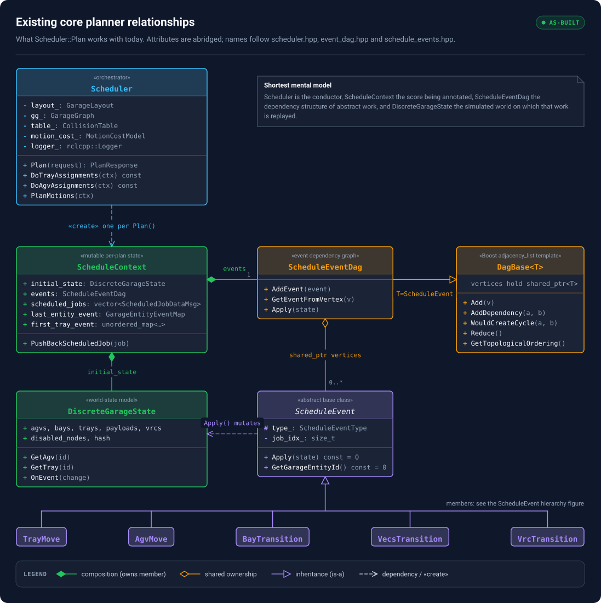

<sub>Pan / zoom: [interactive viewer](figures/viewer.html#11_uml_existing_core) · [standalone SVG](figures/11_uml_existing_core.svg)</sub>

*Figure 8 — Existing core-class relationships. `Scheduler` creates one `ScheduleContext` per `Plan()` call; the context owns the `initial_state` and the `events` DAG. `ScheduleEventDag` specialises the Boost-based `DagBase<T>` template and holds its `ScheduleEvent` vertices through `shared_ptr` (shared, not exclusive, ownership). Each event's `Apply()` mutates a `DiscreteGarageState` during replay.*

Shortest possible mental model: **`Scheduler` is the conductor, `ScheduleContext` is the score being annotated, `ScheduleEventDag` is the dependency structure of the work, and `DiscreteGarageState` is the simulated world the work is replayed on.**

## 8. Objects, ownership and lifetimes

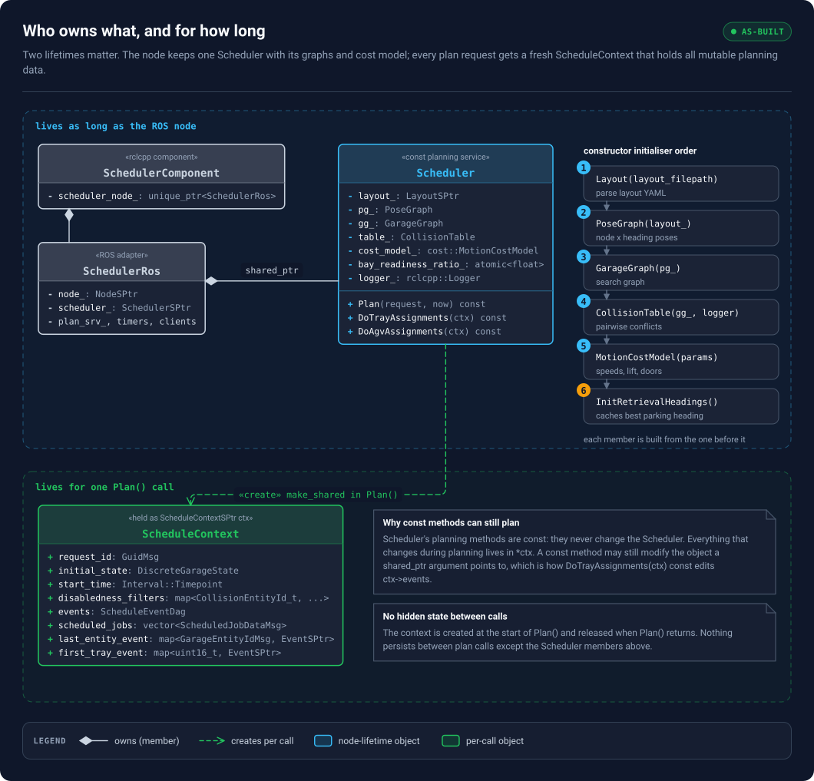

<sub>Pan / zoom: [interactive viewer](figures/viewer.html#21_runtime_objects) · [standalone SVG](figures/21_runtime_objects.svg)</sub>

*Figure 9 — Two lifetimes. The node keeps one `Scheduler` whose members are built in a fixed order, each from the one before it. Every plan request gets a fresh `ScheduleContext` that holds all mutable planning data and is released when `Plan()` returns.*

### Constructing the Scheduler

```cpp
// Where: Scheduler::Scheduler(std::string layout_filepath, rclcpp::Logger logger,
//                             const SchedulerParams& params) in src/scheduler.cpp.
// Called once, from SchedulerRos's constructor: std::make_shared<Scheduler>(layout_filepath, logger, params).
// C++ initialises members in DECLARATION order (see scheduler.hpp), which here matches this list:
Scheduler::Scheduler(std::string layout_filepath, rclcpp::Logger logger, const SchedulerParams& params) :
    layout_(std::make_shared<Layout>(layout_filepath)),   // LayoutSPtr: parse the layout YAML
    pg_(layout_),                                         // PoseGraph: every allowed (node, heading)
    gg_(pg_),                                             // GarageGraph: search graph built on pg_
    table_(gg_, logger),                                  // CollisionTable: precomputed footprint conflicts
    logger_(logger),
    cost_model_(params.motion_cost),                      // cost::MotionCostModel from ROS parameters
    bay_readiness_ratio_(params.bay_readiness_ratio),     // std::atomic<float>, changed by a service
    costaudit_(params.cost_audit) {
  InitRetrievalHeadings();   // writes a preferred parking heading into gg_ for each parking node
}
```

`InitRetrievalHeadings()` takes the bay at the **back** of `layout_->GetBayPrioritization()` (the bay a retrieve reaches for first), computes the heading a tray must face to drive into it, and caches that heading on every parking node that allows it and can still reach the bay. Later, `UseRetrievalHeading()` parks loaded trays facing that way so retrieves need fewer rotations.

### Creating the per-call context

This is the snippet that confuses most new readers, so here it is with every name explained:

```cpp
// Where: PlanResponseMsg Scheduler::Plan(const PlanRequestMsg& request_data,
//                                        const rclcpp::Time& now) const   (src/scheduler.cpp)
//   this          -> the Scheduler. There is no variable called "scheduler" here: layout_, gg_
//                    and table_ are its members. The method is const, so it cannot change them.
//   request_data  -> the PlanRequest from Dispatch (see section 4)
//   now           -> node time when the service call arrived
PlanResponseMsg result;
result.id = request_data.id;                          // echo the id so Dispatch can match the reply

// ValidateBaseState is a free function in utils.cpp. It returns
// std::pair<std::optional<DiscreteGarageState>, std::string>; the structured binding unpacks it.
auto [initial_state_opt, validate_message] = ValidateBaseState(request_data.base_state, *layout_);
if(!initial_state_opt.has_value()) {
  result.success = false;                             // the ONLY path that returns success == false
  result.message = "Invalid base state in plan request! " + validate_message;
  return result;
}
volley::DiscreteGarageState initial_state = initial_state_opt.value();   // our own copy

for(const ActionNodeMsg& node : request_data.base_schedule.nodes) {      // already-running actions
  if(node.type == ActionNodeMsg::TYPE_AGV_COMMAND) {
    initial_state.SetAgvDisabled(node.agv_id);        // that AGV is busy: do not assign it
    initial_state.SetNodeDisabled(node.agv_command.src.pose.node_id);
    initial_state.SetNodeDisabled(node.agv_command.dst.pose.node_id);
  }
  // ... TYPE_BAY_COMMAND -> SetBayDisabled, TYPE_VECS_COMMAND -> SetVecsDisabled
}

// plan_ctx is a ScheduleContextSPtr == std::shared_ptr<ScheduleContext>. Every later stage
// receives this same pointer and edits the object it points to.
ScheduleContextSPtr plan_ctx =
    std::make_shared<ScheduleContext>(request_data.id, std::move(initial_state), now);

// For each collision-entity type: which graph vertices and edges are unusable because of
// disabled AGVs / nodes / bays. A free function from another package (not in this snapshot).
plan_ctx->disabledness_filters =
    volley::GetDisabledEntitiesFilters(gg_, plan_ctx->initial_state, table_);
```

Why can a `const` method change anything at all? `Plan()` cannot modify `*this`, but `plan_ctx` is a local `shared_ptr` to a **non-const** `ScheduleContext`. The same holds for `DoTrayAssignments(ScheduleContextSPtr ctx) const` and friends: the Scheduler's graphs and tables stay fixed, and all planning state lives in `*ctx`. Do not read `const` as “thread-safe”, though: `costaudit_` and `printdags_` are `mutable`, and `CreateActionGuid()` uses a plain static counter. The `plan` service runs in the node's default callback group, so plan calls are handled one at a time today.

## 9. One `Plan()` call, step by step

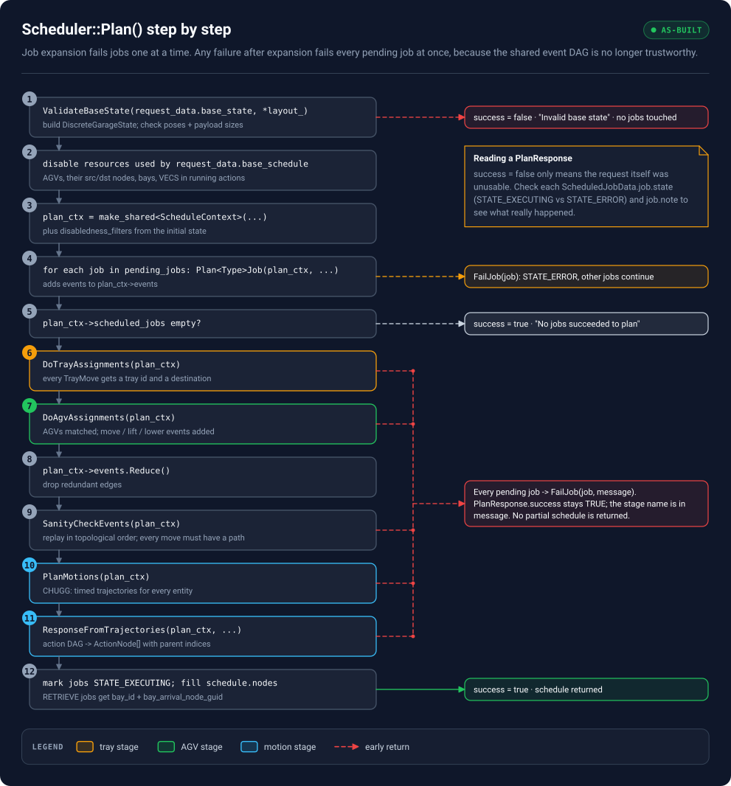

<sub>Pan / zoom: [interactive viewer](figures/viewer.html#22_plan_control_flow) · [standalone SVG](figures/22_plan_control_flow.svg)</sub>

*Figure 10 — `Scheduler::Plan()` step by step with every early return. Job expansion fails jobs one at a time. Any failure after expansion fails **every** pending job at once and returns no schedule, but `PlanResponse.success` stays `true`; only an invalid base state returns `false`.*

The job loop is a plain `switch`. Each case calls one `Plan<Type>Job` method with the index the job **will** have if it succeeds:

```cpp
// Where: Scheduler::Plan(...) const, after plan_ctx has been created.
//   job       -> const SchedulerJobMsg&, one element of request_data.pending_jobs
//   job_index -> plan_ctx->scheduled_jobs.size(): the position this job takes if planning succeeds.
//                Every event created for the job stores it (event->GetJobIndex()).
for(const SchedulerJobMsg& job : request_data.pending_jobs) {
  switch(job.type) {
  case SchedulerJobMsg::TYPE_RETRIEVE: {
    // PlanRetrieveJob returns std::tuple<bool, std::string, bool>: success, message, retain_job
    auto [success, message, retain_job] =
        PlanRetrieveJob(plan_ctx, job.payload_id, plan_ctx->scheduled_jobs.size());
    if(!success) {
      result.scheduled_jobs.push_back(FailJob(job, message, retain_job));   // STATE_ERROR, keep going
      break;
    }
    plan_ctx->PushBackScheduledJob(job);      // now job_index really is this job's position
  } break;
  // ... one case per job type, see section 12
  }
}
```

Two consequences are easy to miss:

- **A failed job leaves its partial events behind.** `FailJob` only marks the job; it does not remove events that `Plan<Type>Job` already added to `plan_ctx->events` (a `TODO(Joe)` in `FailJob` says so). Most job methods validate before adding events, so this is rare, but keep it in mind when a later stage fails mysteriously.
- **Reading a response:** check `scheduled_jobs[i].job.state` (`STATE_EXECUTING` or `STATE_ERROR`) and `job.note`, not just `success`.

The methods in `scheduler.cpp`, in file order, form a useful map:

| Group | Methods |
|---|---|
| Response helpers (anonymous namespace) | `ToActionNode`, `CollectAndCollapseTrajectoryMotions`, `BuildActionDagFromMotions`, `TransferEventDagDepsToActionDag`, `BuildScheduledActionsArray` |
| Construction | `InitRetrievalHeadings`, `Scheduler::Scheduler` |
| Entry point | `Plan` |
| Job expansion | `PlanAgvMoveJob`, `PlanRetrieveJob`, `PlanReparkTrayJob`, `PlanOpenBayDoor`, `PlanInsertJob`, `PlanReadyForInsertJob`, `PlanReadyForRetrieveJob`, `PlanCleanGarageJob`, `PlanUnstashWaypointTraysJob`, `PlanRebalanceGarageJob`, `PlanAgvChargeJob`, `PlanBayTransitionJob`, `PlanChargePayloadJob` |
| Heading policy | `UsePreferredHeading`, `UseEvChargeHeading`, `UseRetrievalHeading` |
| Tray assignment | `FindOpenSpaceForRootTray`, `TryFindBlockingTrayResolution`, `ResolveBlockingTrays`, `ApplyTransitionToFreeingMoves`, `AssignTrayIdForEmptyMove`, `AssignDestForUntargetedMove`, `DoTrayAssignments` |
| AGV assignment | `AppendAgvLiftEvent`, `PropagateEventCostToChildren`, `AddNodeArrivalDeps`, `MoveAgvToTrayPose`, `GetJustMovingCost`, `GetAgvCurrentPoseToTrayMoveCost`, `GetAgvOccupiedDuration`, `GetAgvToTrayAssignmentCost`, `AgvMatchingEventDeps`, `GetEventDag`, `FindAgvDepartureFromNode`, `TryClearBlockedAgvMove`, `RunAgvPathRepairPass`, `EnsureAgvMovePathsClear`, `DoAgvAssignments`, `AddDepsAfterAmiga` |
| Checks, motion, response | `SanityCheckEvents`, `PlanMotions`, `ResponseFromTrajectories`, `IsMovePossible`, `FailJob`, `SetBayReadinessRatioCallback` |

## 10. Event types and polymorphism

A `ScheduleEvent` is an in-memory C++ object for one discrete state change that can be replayed against a `DiscreteGarageState`. The base class is small: a virtual destructor, a pure virtual `Apply(DiscreteGarageState&)`, and queries such as `GetGarageEntityId()`, `GetJobIndex()` and `GetType()`.

The design idea is **runtime polymorphism**. `ctx->events` stores `std::shared_ptr<ScheduleEvent>`, but each pointer actually points to a `TrayMove`, `AgvMove`, `BayTransition`, `VecsTransition` or `VrcTransition`. When the Scheduler replays the DAG, virtual dispatch runs the right `Apply`. When it needs subclass-specific data it checks `event->GetType()` and then downcasts:

```cpp
// Where: the loop at the top of Scheduler::DoTrayAssignments(ScheduleContextSPtr ctx) const.
//   event_vert -> a vertex id from ctx->events.GetTopologicalOrdering() (a std::vector of vertices)
//   event      -> std::shared_ptr<volley::ScheduleEvent>; GetEventFromVertex returns an optional
auto event = ctx->events.GetEventFromVertex(event_vert).value();
if(event->GetType() != volley::ScheduleEventType::TRAY_MOVE) { /* handle bay/VECS events */ }
auto* move = dynamic_cast<volley::TrayMove*>(event.get());   // non-owning raw pointer; event keeps it alive
if(!move->GetTrayId()) { /* std::optional<uint16_t> is empty: no tray chosen yet */ }
```

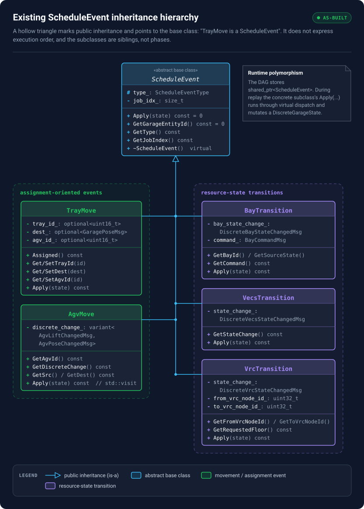

<sub>Pan / zoom: [interactive viewer](figures/viewer.html#12_uml_event_hierarchy) · [standalone SVG](figures/12_uml_event_hierarchy.svg)</sub>

*Figure 11 — Existing C++ inheritance hierarchy. The single **hollow triangle** under `ScheduleEvent` means public inheritance; every branch reads “`TrayMove` **is a** `ScheduleEvent`”, not “`ScheduleEvent` contains a `TrayMove`”. Blue marks the abstract base type, green the movement / assignment events, violet the other resource-state transitions. Members are abridged from `planner_core/schedule_events.hpp`.*

Two confusions to avoid: inheritance says nothing about execution order, and the subclasses are siblings, not phases. A `TrayMove` never “turns into” an `AgvMove`; AGV assignment adds separate `AgvMove` events around it.

What each event looks like when it is created (constructor arguments as used in `scheduler.cpp`):

| Event | Created with | Filled in later |
|---|---|---|
| `TrayMove` | `std::make_shared<TrayMove>(job_index)`, then `SetTrayId`, `SetDest` as known | tray id / destination by `DoTrayAssignments`, AGV id by `DoAgvAssignments` |
| `AgvMove` | `std::make_shared<AgvMove>(job_index, AgvPoseChangedMsg)` or `(job_index, AgvLiftChangedMsg)` | — |
| `BayTransition` | `std::make_shared<BayTransition>(job_index, DiscreteBayStateMsg, BayCommandMsg)` | — |
| `VecsTransition` | `std::make_shared<VecsTransition>(job_index, VecsStateChangedMsg)` | — |

A `TrayMove` is **not** an AGV command. Before assignment it may mean “bring *some* empty tray to this bay” (no tray id) or “put this tray *somewhere* sensible” (no destination).

## 11. Directed acyclic graphs, then `ScheduleEventDag`

**Graph theory first.** A directed graph **$\mathcal G=(\mathcal V,\mathcal E)$** has vertices **$\mathcal V$** and directed edges **$\mathcal E\subseteq\mathcal V\times\mathcal V$**. Here an edge **$(u,v)\in\mathcal E$** means event **$u$** must finish before event **$v$** may start. A DAG has no directed cycle; otherwise some event would have to finish before itself.

An ordering function **$\pi:\mathcal V\to\{0,\ldots,n-1\}$** assigns each vertex an index, where **$n=|\mathcal V|$** is the number of events. A topological order satisfies:

$$
(u,v)\in\mathcal E\quad\Longrightarrow\quad\pi(u)<\pi(v).
$$

### What a topological ordering is, in plain words

The DAG says *what must come before what*, but not *in which single sequence* to do things. A **topological ordering** is such a sequence: a list of all events in which every edge points forward, so each event appears after everything it depends on. Usually there are many valid lists, because independent events (two different jobs, say) can be interleaved in any way. If the graph has a cycle, there is no valid list at all: some event would have to come before itself.

To compute one by hand, repeatedly take any event whose prerequisites have all been taken already. "Replaying the DAG" (`events.Apply(working_state)`) means applying events in exactly such an order.

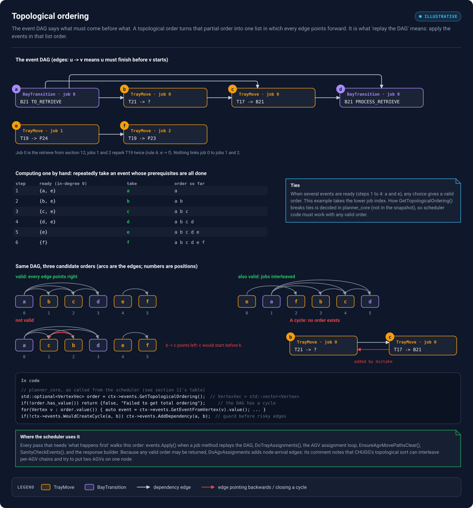

<sub>Pan / zoom: [interactive viewer](figures/viewer.html#53_topological_ordering) · [standalone SVG](figures/53_topological_ordering.svg)</sub>

*Figure 12 — The retrieve from section 12 plus two reparks of another tray. One hand computation, two valid orders, one invalid order (an edge points backwards) and a cycle, for which `GetTopologicalOrdering()` returns an empty optional.*

Two consequences for the code: a pass that walks the order must work for **any** valid order (how ties are broken is decided in `planner_core`), and any edge that would close a cycle makes every later pass fail with "Failed to get total ordering". That is why risky edges are guarded with `WouldCreateCycle(a, b)`.

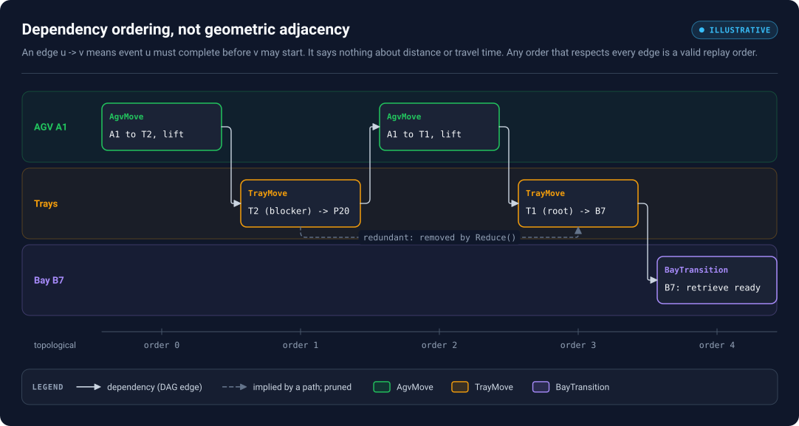

<sub>Pan / zoom: [interactive viewer](figures/viewer.html#04_dependencies) · [standalone SVG](figures/04_dependencies.svg)</sub>

*Figure 13 — Abstract prerequisite ordering. Swimlanes group events by resource; the columns give one valid topological order. The arrows express dependencies, not geometric movement or travel time. The dashed edge is implied by a longer path, which is the kind of redundant edge `Reduce()` removes.*

**Now the implementation.** `DagBase<T>` wraps a Boost `adjacency_list` whose vertices hold `std::shared_ptr<T>`; `ScheduleEventDag` is `DagBase<ScheduleEvent>` plus event helpers. The operations the scheduler uses, all seen at call sites:

| Call | Returns | Used for |
|---|---|---|
| `events.AddEvent(ev)` | — | add a vertex |
| `events.AddDependency(a, b)` | `bool` (false if it already existed) | edge a → b; does **not** check for cycles |
| `events.WouldCreateCycle(a, b)` | `bool` | ask before adding a risky edge |
| `events.GetTopologicalOrdering()` | `std::optional<VertexVec>` | empty optional means there is a cycle |
| `events.GetRootEvents()`, `GetLeafEvents()` | `std::vector<ScheduleEventSPtr>` | no in-edges / no out-edges |
| `events.Apply(state)` | `BoolStringPair` | replay every event in topological order |
| `events.Reduce()` | — | transitive reduction: drop edges implied by longer paths |
| `events.Remove(ev)` | — | used on the copy `event_dag_copy` in `DoAgvAssignments` |

How `GetTopologicalOrdering()` breaks ties between events that are ready at the same time is decided in `planner_core` (not in the snapshot). Because vertices hold `shared_ptr`s, **copying a DAG does not copy the events**: `auto event_dag_copy(ctx->events);` in `DoAgvAssignments` shares every event object with `ctx->events`, which is exactly what that loop relies on when it calls `tray_move->SetAgvId(...)`.

## 12. Job expansion: from jobs to events

**Job expansion** is the first planning stage inside `Plan()`. It turns each line of the request ("retrieve this car", "move this tray") into a handful of `ScheduleEvent` objects in `plan_ctx->events`, connected by dependency edges. It decides **what** has to happen and **in which order**. It does not decide **how** (no paths, no timing) or **by whom** (no AGV is chosen, except in one case).

A useful picture: each job method is a recipe. It writes a few cards (events) onto a shared board (the event DAG) and ties strings (edges) between cards that must happen one after another. Later stages fill in the blanks on the cards and add more cards and strings.

This section is long because every job type has its own recipe. Read it in this order:

| Part | What you learn |
|---|---|
| 12.1–12.3 | What a job is, the loop in `Plan()` that dispatches it, and the shape every job method shares |
| 12.4–12.5 | How a job method sees the garage (`working_state`) and the three rules that add edges |
| 12.6 | Which job methods are built from which others |
| 12.7–12.17 | Every job type, one at a time, each with a 2D garage example |
| 12.18–12.19 | Gotchas, a one-page cheat sheet and questions to check yourself |

### How to read the job figures

Sections 12.7 to 12.17 each have one figure with the same four parts:

1. **The map** is the Pecos layout, showing the garage as the job method sees it when it starts (`working_state`). Trays, cars and AGVs are hypothetical. **Curved dashed arrows are intent, not routes**: job expansion plans no paths. A `?` bubble means the destination is left empty for `DoTrayAssignments()` to fill. Numbered circles match the event numbers.
2. **The request card** lists the `SchedulerJob` fields the method reads, the `job_index` it receives and the exact call `Plan()` makes.
3. **The event column** lists the events the method appends, numbered in creation order. Every arrow is an edge the method adds, labelled with the rule that added it (A, B or C, see 12.5).
4. **The step table** is the method body as numbered steps, with what happens in this example and the result: `adds n` means event *n* is created, `skipped` means the branch does not apply, red means the job fails there.

### 12.1 What a job is

A job is one `interfaces/msg/SchedulerJob` message (C++ alias `SchedulerJobMsg`) in `request_data.pending_jobs`. Dispatch fills in only the fields that the job type needs:

| Field | Type | Read by |
|---|---|---|
| `type`, `type_name` | `uint8` constant (`SchedulerJobMsg::TYPE_*`), string | the `switch` in `Plan()` |
| `guid` | `GuidMsg` | the response: every action node carries its job's `guid` |
| `payload_id` | `GuidMsg` (a car) | `TYPE_RETRIEVE`, `TYPE_CHARGE_PAYLOAD` |
| `tray_id` | `uint16_t` | `TYPE_REPARK_TRAY`, `TYPE_MOVE_TRAY` |
| `destination` | `GaragePoseMsg` (node id + heading) | `TYPE_MOVE_AGV`, `TYPE_REPARK_TRAY`, `TYPE_MOVE_TRAY` |
| `allow_reciprocal` | `bool` | `TYPE_REPARK_TRAY`, `TYPE_MOVE_TRAY` |
| `agv_id` | `uint16_t` | `TYPE_MOVE_AGV`, `TYPE_CHARGE_AGV` |
| `bay_id` | `uint16_t` | `TYPE_INSERT`, `TYPE_READY_FOR_INSERT`, `TYPE_READY_FOR_RETRIEVE`, `TYPE_TRANSITION_BAY_TO_*` |
| (none) | | `TYPE_CLEAN_GARAGE`, `TYPE_REBALANCE_GARAGE` |

On the way out, each job becomes a `ScheduledJobDataMsg`: the original job plus `node_indices`, the positions of its action nodes in the response schedule. A failed job is a `ScheduledJobDataMsg` built by `FailJob()`, with `job.state = STATE_ERROR`, `job.note = <message>` and `job.retain_job` set when Dispatch should keep it and retry.

### 12.2 The loop in `Plan()`

#### What the code does, in order

`Plan()` turns one `PlanRequestMsg` into one `PlanResponseMsg`. Job expansion is the loop in the middle of it. Around the loop, `Plan()` does this:

1. **Build the starting point.** `ValidateBaseState()` turns `request_data.base_state` into a `DiscreteGarageState`. Entities used by actions that are already executing (`request_data.base_schedule`) are marked disabled. A fresh `ScheduleContext` is created: `plan_ctx`, with an empty event DAG and an empty `scheduled_jobs` list.
2. **Expand every pending job** (this section). Each job either adds its events to `plan_ctx->events` and is appended to `plan_ctx->scheduled_jobs`, or is reported as failed in `result.scheduled_jobs`.
3. **Plan all successful jobs together**: tray assignment, AGV assignment, `Reduce()`, sanity check, motion planning (sections 14 to 17). From here on the jobs are no longer separate: one DAG holds all their events, and the later stages see and optimise all of them at once.
4. **Write the response.** Every motion becomes an `ActionNode` labelled with its job's `guid`. Each successful job gets `state = STATE_EXECUTING` and `node_indices` (the positions of its actions), and is appended to `result.scheduled_jobs` after the failed ones.

The loop itself:

```cpp
// src/scheduler.cpp — inside PlanResponseMsg Scheduler::Plan(const PlanRequestMsg& request_data,
//                                                            const rclcpp::Time& now) const
// this     : const Scheduler*
// plan_ctx : ScheduleContextSPtr — built a few lines earlier from request_data.base_state
// result   : PlanResponseMsg — what Plan() will return
for(const SchedulerJobMsg& job : request_data.pending_jobs) {        // in request order
  switch(job.type) {
  case SchedulerJobMsg::TYPE_RETRIEVE: {
    auto [success, message, retain_job] =                            // the only 3-value job method
        PlanRetrieveJob(plan_ctx, job.payload_id, plan_ctx->scheduled_jobs.size());
    if(!success) {
      result.scheduled_jobs.push_back(FailJob(job, message, retain_job));  // reported now
      break;                                                         // leaves the switch, not the loop
    }
    plan_ctx->PushBackScheduledJob(job);                             // job_index is now "taken"
  } break;
  case SchedulerJobMsg::TYPE_REPARK_TRAY:
  case SchedulerJobMsg::TYPE_MOVE_TRAY: {                            // two types, one method
    auto [success, message] = PlanReparkTrayJob(plan_ctx, job.tray_id,
        plan_ctx->scheduled_jobs.size(), job.allow_reciprocal, job.destination);
    ...
  } break;
  // ... one case per job type; an unknown type is failed with "Unknown job type"
  }
}
```

#### How `job_index` works

**One job almost always creates several events.** A RETRIEVE creates up to five (stop charging, open the bay, move the tray already in the bay out, move the car's tray in, hand the car over); a REPARK_TRAY creates one (two if the tray must first stop charging); a REBALANCE_GARAGE creates a few per bay it switches. Every one of them belongs to the same job. Sections 12.7 to 12.17 list what each job type creates.

So every event needs to remember which job it belongs to, and the response needs to say "this action is part of job X". The code does not store the job's `guid` in the event. Each event is constructed with a small integer, the `job_index`, and the job is looked up from it at the end:

```cpp
// inside PlanRetrieveJob(ScheduleContextSPtr ctx, const GuidMsg& payload_id, size_t job_index)
auto bay_transition = std::make_shared<BayTransition>(job_index, *bay_opt, cmd);  // tagged with job_index
...
PlanReparkTrayJob(ctx, payload_opt->tray_id, job_index, false, dest_pose);        // its TrayMove: same tag
...
auto process = std::make_shared<BayTransition>(job_index, *bay_opt, cmd);         // same tag again
```

The relationship is **one job → many events → many actions**:

| Level | How many | How it points to the job |
|---|---|---|
| Job | one entry in `plan_ctx->scheduled_jobs` | its position in that list is the `job_index` |
| Events | all events the job method creates, **plus** the ones later stages add for it | `event->GetJobIndex()`. Tray assignment builds blocker moves as `TrayMove(move->GetJobIndex())` and AGV assignment builds approach moves as `AgvMove(root_event->GetJobIndex(), ...)`, so they inherit the index of the move that needed them |
| Actions | one `ActionNode` per motion of those events | `job_id` = the job's `guid`; the job's `node_indices` list their positions |


- **What the number is.** `job_index` is the job's position in `plan_ctx->scheduled_jobs`, the list of jobs that have **succeeded so far**. It is not the loop counter (the job's position in `request_data.pending_jobs`).
- **How it is chosen.** Just before calling the job method, `Plan()` passes `plan_ctx->scheduled_jobs.size()`. If the method succeeds, `PushBackScheduledJob(job)` appends the job at exactly that position, so `scheduled_jobs[job_index]` is now this job. If it fails, nothing is appended and the next job is offered the same number.
- **How it is used.** When the response is built, `ToActionNode(motion, ctx->scheduled_jobs[event->GetJobIndex()].job.guid, event)` turns the index back into the job's `guid`. Rule B (12.5) also compares indices to decide which events belong to the same job.

A worked example, the same one as in Figure 14 below:

| Loop counter `i` | Job in the request | `scheduled_jobs.size()` before the call = `job_index` | Result | `scheduled_jobs` afterwards |
|---|---|---|---|---|
| 0 | RETRIEVE car on T17 | 0 | success: one job, 4 events, all tagged 0 | `[RETRIEVE]` |
| 1 | INSERT bay B7 | 1 | fails, no events added | `[RETRIEVE]` (unchanged) |
| 2 | REPARK_TRAY T19 → P24 | 1 | success: one job, 1 event, tagged 1 | `[RETRIEVE, REPARK_TRAY]` |

If the code used `i` instead, the REPARK's event would carry 2, and `scheduled_jobs[2]` would not exist.

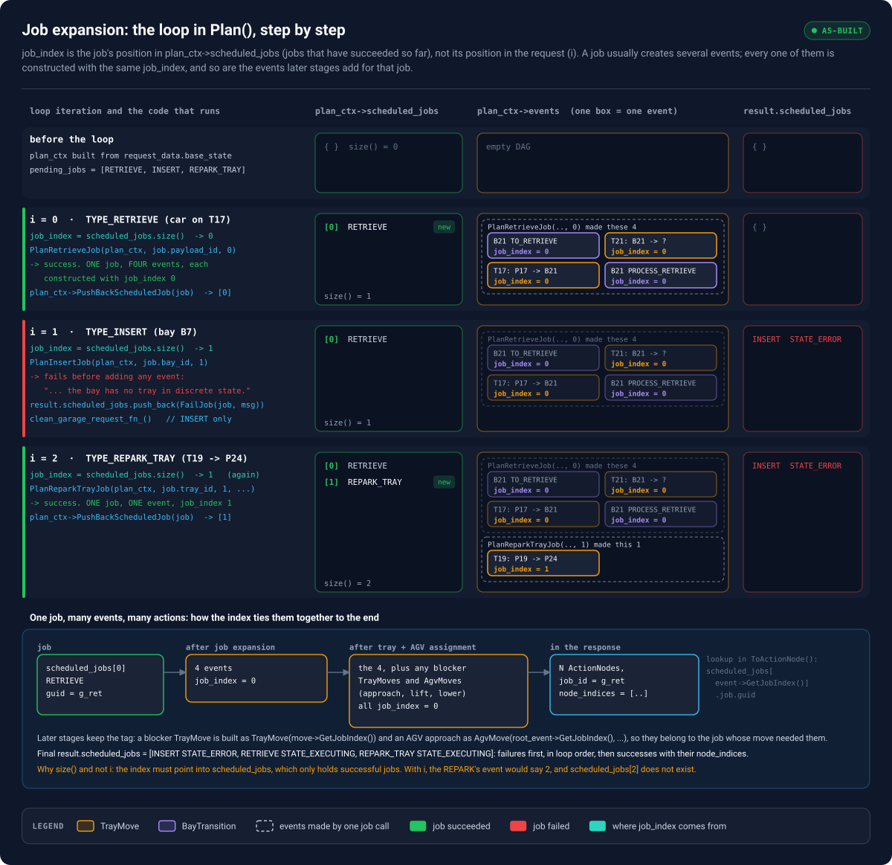

<sub>Pan / zoom: [interactive viewer](figures/viewer.html#36_expansion_loop) · [standalone SVG](figures/36_expansion_loop.svg)</sub>

*Figure 14 — The loop, one row per iteration: the code that runs, then `plan_ctx->scheduled_jobs`, `plan_ctx->events` and `result.scheduled_jobs` after it. In the events column each box is one event and each dashed group is everything one job-method call created: the RETRIEVE (job index 0) created four events, the REPARK_TRAY (job index 1) one. The bottom row shows the same index carried through later stages to the response.*

If every job fails, `plan_ctx->scheduled_jobs` is empty and `Plan()` returns right after the loop with "No jobs succeeded to plan".

#### Why it is built this way

The code has no design document, so this is a reading of the structure, with the trade-offs it implies.

- **`Plan()` is a pure function of the request.** Nothing survives between calls except the fixed layout, graph and collision table. Dispatch owns the job queue and the live garage state and sends both every time. That keeps the scheduler simple to test (build a request, call `Plan()`, inspect the response) and lets Dispatch replan whenever something changes.
- **Jobs are expanded one at a time, in request order, each seeing the garage that earlier jobs leave behind** (12.4). That is a greedy approach: easy to reason about, and later jobs automatically build on earlier ones (a second move of the same tray starts where the first one ends). The cost is that request order matters and nothing tries another order: an early job can make a later one fail, and the later one is simply reported as failed.
- **Failure is per job during expansion.** One bad job does not sink the others, so Dispatch still gets a plan for everything that was possible. `retain_job` lets RETRIEVE say "try me again later" when no bay is free.
- **After expansion, everything is one problem.** All successful jobs share one DAG, so tray assignment, AGV assignment and motion planning can share AGVs and resolve conflicts across jobs. The flip side is in section 9: if any later stage fails, every pending job is failed.
- **A small integer instead of a pointer or `guid`.** Events are `planner_core` objects that know nothing about ROS messages. A `size_t` is the cheapest way to tag them and is enough for rule B's "same job?" test.

Known issues with this design (details in 12.18):

- **No rollback.** A job method that fails after adding events leaves them in the DAG. They keep the failed job's index, which the next successful job reuses, so they are executed as part of that job (or, if no later job succeeds, `scheduled_jobs[index]` reads past the end). `FailJob()` carries a TODO to strip them.
- **Index reuse makes logs confusing.** "Job index 1" means different requests at different moments of one `Plan()` call.
- **Order dependence without a retry.** The plan depends on the order Dispatch lists the jobs, and a failed job is not retried after the others are placed.
- **Duplicate failures.** When a later stage fails, `Plan()` fails every job in `pending_jobs`, including jobs already reported failed by the loop.

Possible directions (ideas, not plans): tag events with the job's `guid` instead of a position; take a snapshot of `events`, `last_entity_event` and `first_tray_event` before each job and restore it on failure; or plan each job into a separate small DAG and merge it only on success.

### 12.3 The shape of every job method

All job methods are `const` members of `Scheduler` with the same skeleton. Here it is, with the types spelled out:

```cpp
// Shape of BoolStringPair Scheduler::Plan<Type>Job(ScheduleContextSPtr ctx, <job fields>, size_t job_index) const
// this : const Scheduler*  (reads layout_, gg_, table_, cost_model_; changes nothing in itself)
// ctx  : the same ScheduleContextSPtr as plan_ctx in Plan(); the method edits *ctx

// (1) See the garage as all earlier events leave it (12.4)
volley::DiscreteGarageState working_state = ctx->initial_state;     // a copy
auto [success, message] = ctx->events.Apply(working_state);         // replay the whole DAG

// (2) Look up what the job names. Lookups return std::optional<...Msg>
std::optional<DiscreteBayStateMsg> bay_opt = working_state.GetBay(bay_id);

// (3) Check preconditions; return early with a message if one fails
if(!bay_opt.has_value() || bay_opt->disabled) {
  return std::make_pair(false, "...");
}

// (4) Create events. Fill in what is known now; leave the rest empty for later stages
auto bay_transition = std::make_shared<volley::BayTransition>(job_index, *bay_opt, cmd);  // cmd: BayCommandMsg

// (5) Add each event and wire its edges (12.5)
ctx->events.AddEvent(bay_transition);
ctx->UpdateLastEntityEvent(bay_transition->GetGarageEntityId().value(), bay_transition);  // rule A
ctx->UpdateLeafDependencies(bay_transition, job_index);                                   // rule B

// (6) Or delegate part of the work to another job method, passing the SAME job_index
std::tie(success, message) = PlanReparkTrayJob(ctx, tray_id, job_index, /*allow_recip=*/true);

return std::make_pair(true, "");
```

What the four event types can carry at creation time:

| Event (`planner_core`) | Constructed with | Can be left empty for later |
|---|---|---|
| `TrayMove` | `job_index` only; then `SetTrayId(id)`, `SetDest(pose)`, and rarely `SetAgvId(id)` | tray id (`? -> B21`), destination (`T21 -> ?`), AGV |
| `AgvMove` | `job_index`, an `AgvPoseChangedMsg` (or a lift change) | nothing |
| `BayTransition` | `job_index`, the bay's `DiscreteBayStateMsg`, a `BayCommandMsg` | nothing |
| `VecsTransition` | `job_index`, a `VecsStateChangedMsg` (current and next state) | nothing |

Only `TrayMove` has blanks. That is why the next stage is called *tray* assignment: it fills the blanks on `TrayMove`s, and section 14 explains how.

### 12.4 Every job sees the garage through `working_state`

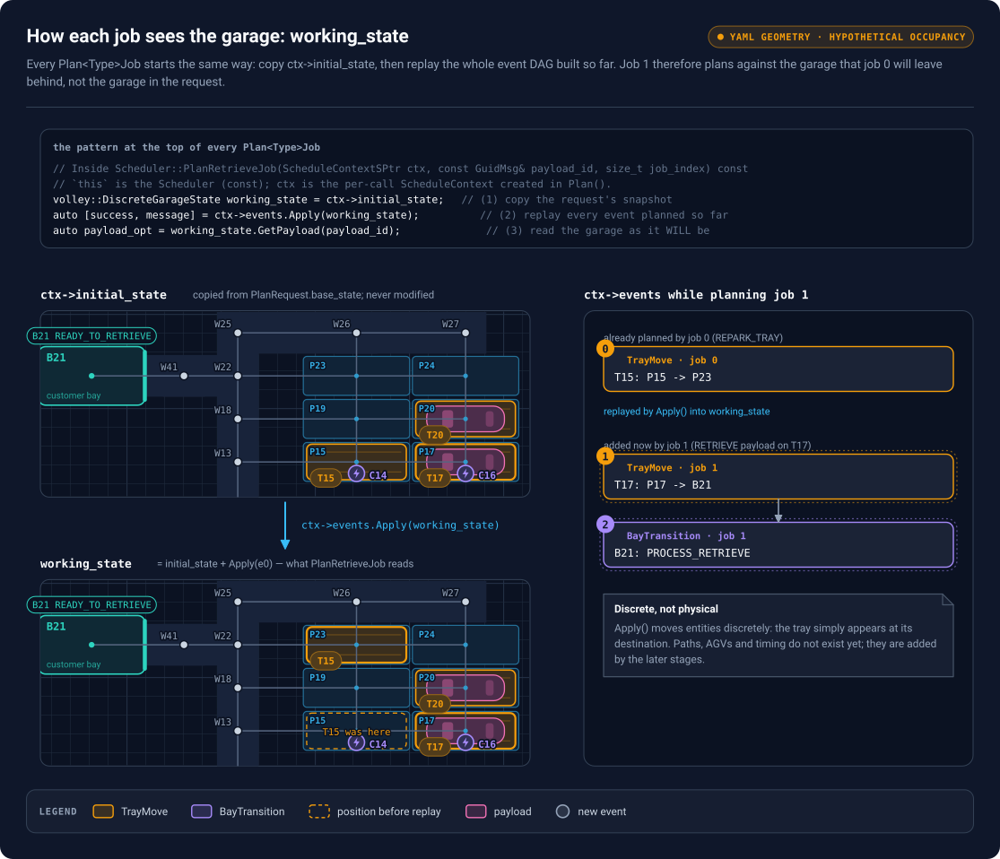

<sub>Pan / zoom: [interactive viewer](figures/viewer.html#23_working_state_replay) · [standalone SVG](figures/23_working_state_replay.svg)</sub>

*Figure 15 — Every `Plan<Type>Job` copies `ctx->initial_state` and replays the whole event DAG built so far. Job 1 (a retrieve) therefore sees tray T15 at P23, where job 0 will have put it, not at P15 as in the request.*

Three details matter in practice:

- **`Apply()` is discrete.** A tray "teleports" to its destination; time and paths do not exist yet. What `Apply()` does with a `TrayMove` whose tray or destination is still blank is defined in `planner_core` (not in this snapshot), so do not rely on where such a tray appears in a later job's `working_state`.
- **Nested calls replay again.** When `PlanRetrieveJob` calls `PlanReparkTrayJob`, the inner call copies and replays too, so it already sees the bay transition the outer method has just added.
- **The cost is repeated replay.** Each job method replays the whole DAG, and nested calls replay it again. The code accepts this for simplicity.

### 12.5 Where the edges come from

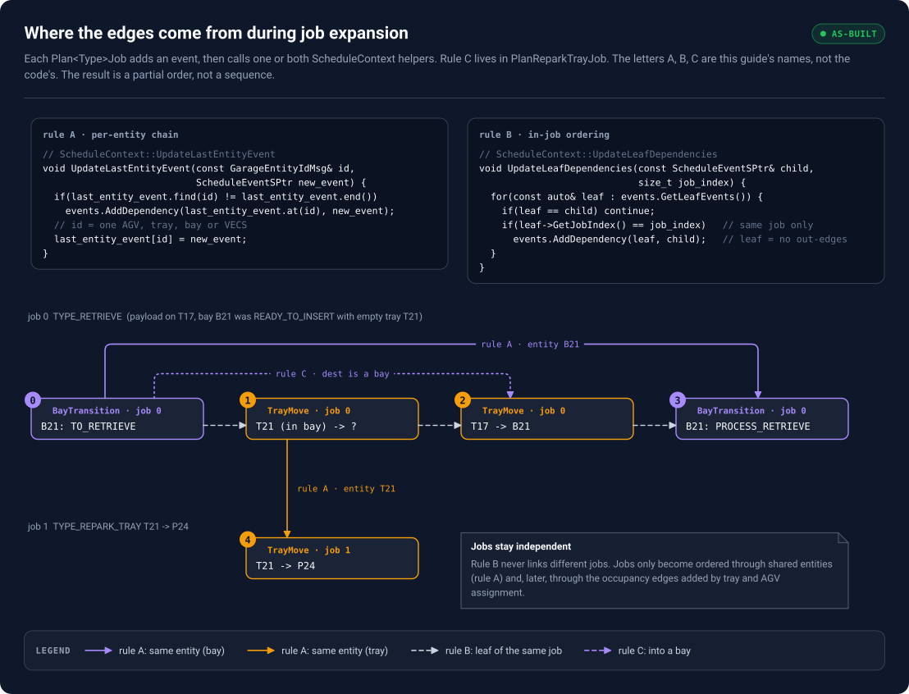

<sub>Pan / zoom: [interactive viewer](figures/viewer.html#25_dependency_rules) · [standalone SVG](figures/25_dependency_rules.svg)</sub>

*Figure 16 — The three edge rules used during job expansion. Rule A (`UpdateLastEntityEvent`) chains events that touch the same AGV, tray, bay or VECS, even across jobs. Rule B (`UpdateLeafDependencies`) makes a new event wait for the current leaf events of the **same** job. Rule C (in `PlanReparkTrayJob`) makes a tray move into a bay or VECS wait for that resource's last event.*

Precisely (the letters A, B and C are this guide's shorthand; the code uses the function names, see the FAQ in section 22):

- **Rule A — same entity.** `ctx->last_entity_event` is a map from `GarageEntityIdMsg` (which AGV, tray, bay or VECS) to the last event that touched it. `UpdateLastEntityEvent(id, e)` adds the edge `last[id] -> e` if there is one, then sets `last[id] = e`. This is the only rule that links **different jobs**: if job 0 and job 1 both move tray T19, job 1's move waits for job 0's.
- **Rule B — earlier leaves of the same job.** A *leaf* is an event with no outgoing edge anywhere in the DAG. `UpdateLeafDependencies(e, job_index)` adds `leaf -> e` for every leaf whose `GetJobIndex() == job_index`. Within one job this makes each new event wait for "everything the job has done so far that nothing else waits for". It never links different jobs.
- **Rule C — into a bay or VECS.** Only in `PlanReparkTrayJob`: if a `TrayMove`'s destination is a bay (or VECS), it gets an edge from that bay's (or VECS's) last event, so a tray never enters a bay before the bay's transition. Rule C reads `last_entity_event` but does not update it.

Not every event goes through every rule:

- **Without rule A:** a `TrayMove` with no tray yet (its tray is unknown); the "stop charging" `VecsTransition` in RETRIEVE and REPARK; and the `TrayMove` that MOVE_AGV creates for a loaded AGV is chained by tray only, not by AGV.
- **Without rule B:** the "stop charging" `VecsTransition`; RETRIEVE's `TRANSITION_TO_RETRIEVE` (so it does not wait for that stop-charging event); CHARGE_AGV's transition that frees a trapped AGV; and CLEAN_GARAGE's hide `AgvMove`s. Each of these is either the first event of its job or deliberately independent, but later events of the same job still wait for them through rule B. And none of the rules knows about geometry: whether tray T15 is *in the way* of T17's path, or whether two AGVs would meet, is discovered and turned into edges by tray and AGV assignment (sections 14 and 15).

### 12.6 Job methods are built from a few shared pieces

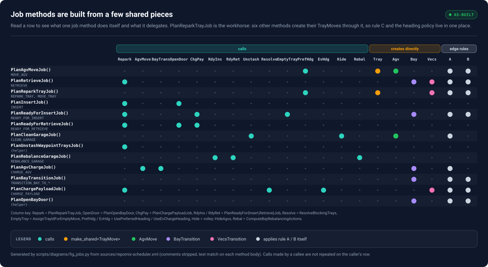

<sub>Pan / zoom: [interactive viewer](figures/viewer.html#37_job_building_blocks) · [standalone SVG](figures/37_job_building_blocks.svg)</sub>

*Figure 17 — Generated from `scheduler.cpp`: which methods each job method calls, which event types it creates itself, and whether it applies rules A and B itself. `PlanOpenBayDoor` and `PlanUnstashWaypointTraysJob` are helpers, not job types.*

Two patterns stand out:

- **`PlanReparkTrayJob` is the workhorse.** Six methods create their `TrayMove`s through it, so the heading policy, the VECS checks and rule C live in one place. That is why it is explained first (12.7).
- **Composite jobs pass their own `job_index` down.** When `PlanRetrieveJob` calls `PlanReparkTrayJob(ctx, tray, job_index, ...)`, the inner events belong to the retrieve job. Rule B then orders them with the retrieve's other events, and the response reports them as part of the retrieve.

The order of 12.7 to 12.17 follows that structure: the building blocks first, then the jobs made from them.

### 12.7 `TYPE_REPARK_TRAY` and `TYPE_MOVE_TRAY` — `PlanReparkTrayJob`

```cpp
BoolStringPair PlanReparkTrayJob(ScheduleContextSPtr ctx, std::optional<uint16_t> tray_id, size_t job_index,
    bool allow_recip, std::optional<GaragePoseMsg> dest = std::nullopt) const;
```

**When Dispatch sends it:** to move a specific tray to a specific node (an operator request, or Dispatch tidying up). Both job types call the same method with `job.tray_id`, `job.allow_reciprocal` and `job.destination`.

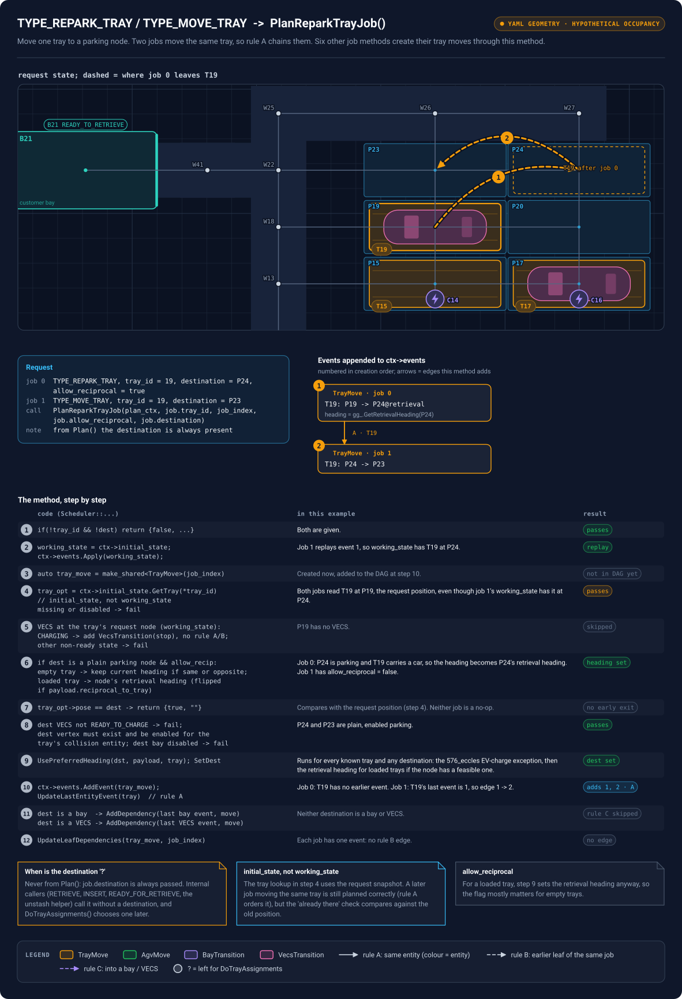

<sub>Pan / zoom: [interactive viewer](figures/viewer.html#41_job_repark_tray) · [standalone SVG](figures/41_job_repark_tray.svg)</sub>

*Figure 18 — Two jobs move tray T19: P19 → P24, then P24 → P23. Rule A chains the second move after the first.*

In words: create one `TrayMove`, set its tray and (if given) its destination with the right heading, and add it with rules A, C and B. Things to remember:

- **Either argument may be missing, not both.** Internal callers use `dest = std::nullopt` ("move this tray out of the way, anywhere") or `tray_id = std::nullopt` ("bring any empty tray here"). From `Plan()` both are always present.
- **Heading policy, in two steps.** First, only for a plain parking destination with `allow_recip`: an empty tray keeps its current heading if the requested one is the same or opposite; a loaded tray gets the node's *retrieval heading* (the heading that makes a later retrieve fastest), flipped if the car sits backwards on the tray. Second, for every destination of a known tray (parking, bay, VECS or waypoint, whatever `allow_recip` says), `UsePreferredHeading` runs: the `576_eccles` EV-charging exception (nodes 46 and 47), then `UseRetrievalHeading`, which changes the heading only if the tray is loaded and `gg_.GetRetrievalHeading(node)` gives a heading the node allows.
- **The tray is looked up in `ctx->initial_state`**, not in `working_state`. See 12.18.

### 12.8 `TYPE_MOVE_AGV` — `PlanAgvMoveJob`

```cpp
BoolStringPair PlanAgvMoveJob(ScheduleContextSPtr ctx, std::optional<uint16_t> agv_id, GaragePoseMsg dest,
    bool allow_recip, size_t job_index) const;
```

**When Dispatch sends it:** to drive a named AGV somewhere, for example out of the way for maintenance. `PlanAgvChargeJob` also uses it.

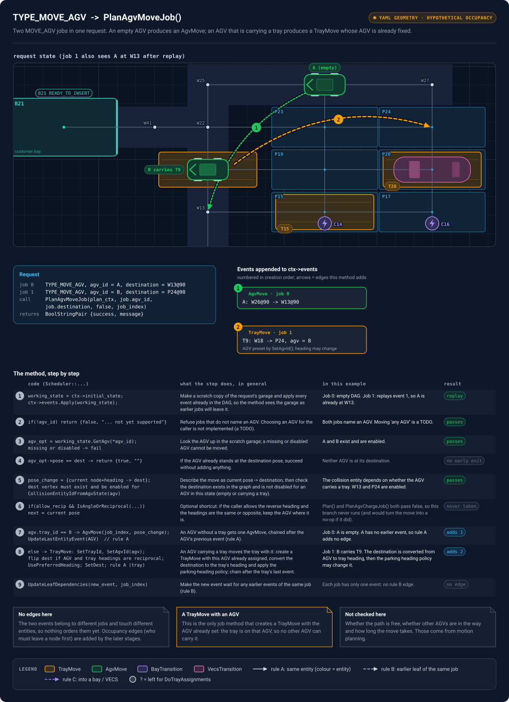

<sub>Pan / zoom: [interactive viewer](figures/viewer.html#40_job_move_agv) · [standalone SVG](figures/40_job_move_agv.svg)</sub>

*Figure 19 — An empty AGV produces an `AgvMove`; an AGV carrying a tray produces a `TrayMove` with that AGV already assigned.*

In words: check the AGV and destination, then add one event. Remember that **this is the only job that can create a `TrayMove` with its AGV already set**, and that the `allow_recip` branch is never used (both callers pass `false`).

### 12.9 `TYPE_TRANSITION_BAY_TO_INSERT` / `_TO_RETRIEVE` — `PlanBayTransitionJob`

```cpp
BoolStringPair PlanBayTransitionJob(ScheduleContextSPtr ctx, uint16_t bay_id, uint8_t command_type,
    size_t job_index) const;   // command_type = BayCommandMsg::COMMAND_TYPE_TRANSITION_TO_{INSERT,RETRIEVE}
```

**When Dispatch sends it:** to switch one bay's mode explicitly. Seen from the code, a bay has two working modes: **insert** (`READY_TO_INSERT`: an empty tray is inside and a customer can drive onto it) and **retrieve** (`READY_TO_RETRIEVE`: trays can be planned into and out of the bay, and a car can be handed over with `PROCESS_RETRIEVE`).

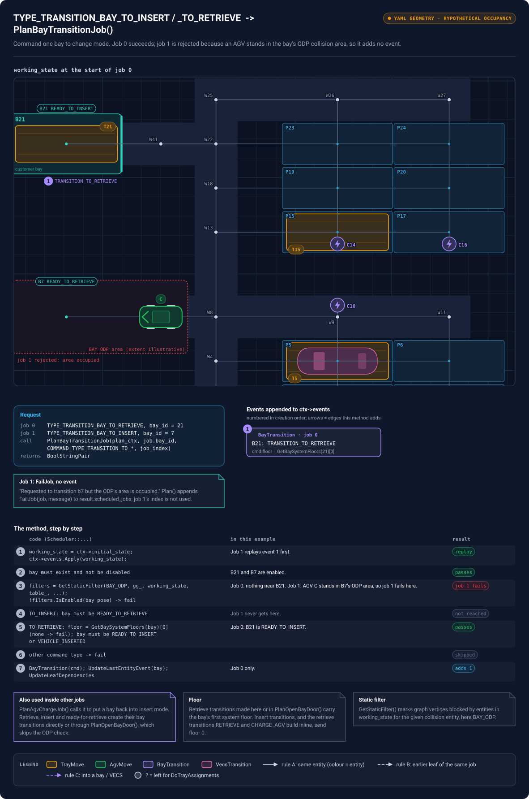

<sub>Pan / zoom: [interactive viewer](figures/viewer.html#49_job_bay_transition) · [standalone SVG](figures/49_job_bay_transition.svg)</sub>

*Figure 20 — Job 0 switches B21 to retrieve mode. Job 1 is rejected because an AGV stands in B7's ODP collision area (extent drawn for illustration).*

In words: validate (bay exists, enabled, its `BAY_ODP` area is clear, the bay is in the right starting state), then add one `BayTransition`. Retrieve transitions made here and in `PlanOpenBayDoor` carry a floor number (`GetBaySystemFloors(bay)[0]`); the ones `PlanRetrieveJob` and `PlanAgvChargeJob` build inline leave `cmd.floor` at 0.

### 12.10 `TYPE_CHARGE_PAYLOAD` — `PlanChargePayloadJob`

```cpp
BoolStringPair PlanChargePayloadJob(ScheduleContextSPtr ctx, const GuidMsg& payload_id, size_t job_index) const;
```

**When it runs:** when Dispatch asks for a car to be charged, and inside READY_FOR_INSERT / READY_FOR_RETRIEVE when the car in the bay has `payload.ev_charge_requested`. A VECS is the EV-charging unit at a `TYPE_EV_CHARGE` node; its states include `READY_TO_CHARGE` and `CHARGING`.

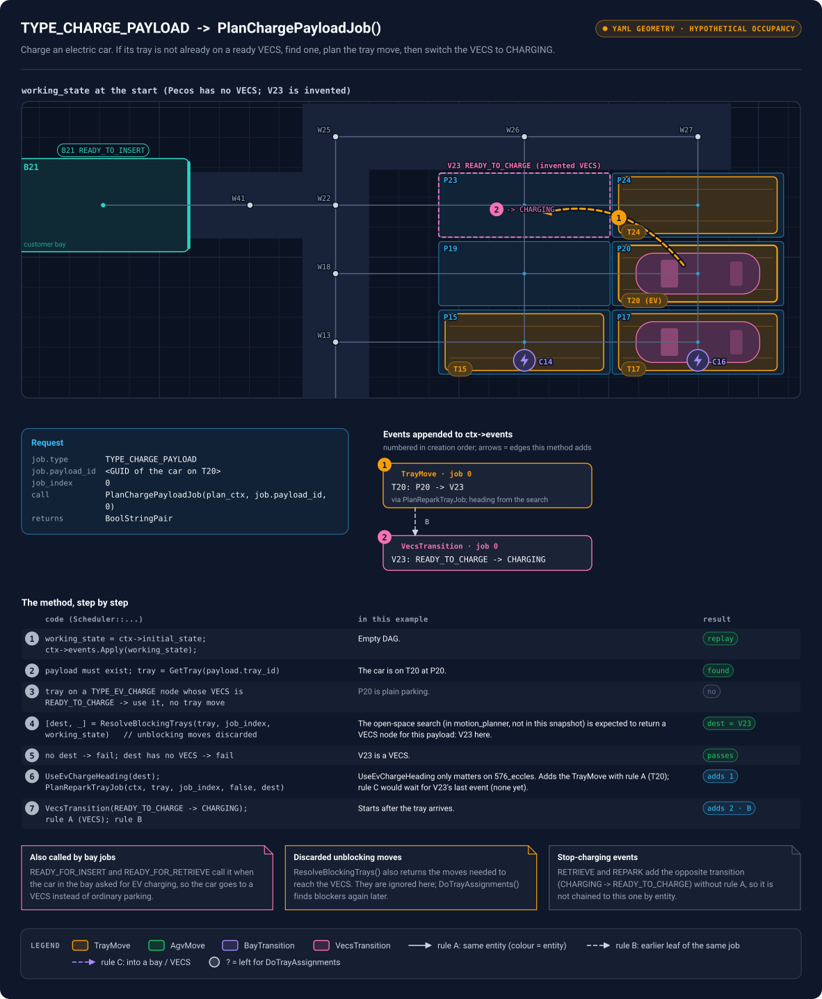

<sub>Pan / zoom: [interactive viewer](figures/viewer.html#50_job_charge_payload) · [standalone SVG](figures/50_job_charge_payload.svg)</sub>

*Figure 21 — The car on T20 is moved to a VECS (invented here; the Pecos layout has none) and the VECS is switched to CHARGING.*

In words: if the tray is not already on a ready VECS, borrow the open-space search of `ResolveBlockingTrays()` to find one, move the tray there through `PlanReparkTrayJob`, then add the `VecsTransition`.

### 12.11 `TYPE_RETRIEVE` — `PlanRetrieveJob`

```cpp
std::tuple<bool, std::string, bool> PlanRetrieveJob(ScheduleContextSPtr ctx, const GuidMsg& payload_id,
    size_t job_index) const;   // {success, message, retain_job}
```

**When Dispatch sends it:** a customer wants their car. This is the most important job and the richest method.

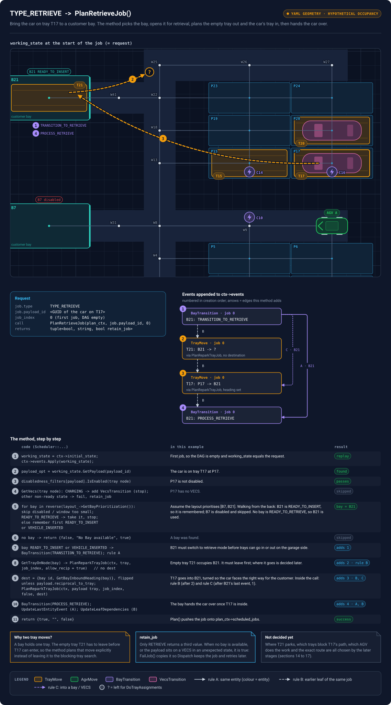

<sub>Pan / zoom: [interactive viewer](figures/viewer.html#42_job_retrieve) · [standalone SVG](figures/42_job_retrieve.svg)</sub>

*Figure 22 — Retrieving the car on T17. Bay B21 is chosen, switched to retrieve mode (1), the empty tray inside is planned out (2), T17 is planned in (3), and the bay hands over the car (4).*

In words, five decisions in order:

1. **Is the car reachable?** It must exist and its node must not be disabled. If it sits on a VECS that is charging, add a "stop charging" `VecsTransition`.
2. **Which bay?** Walk `layout_->GetBayPrioritization()` from the back. Skip disabled bays and bays whose resource window is smaller than the car. Take the first `READY_TO_RETRIEVE` bay; otherwise the first `READY_TO_INSERT` or `VEHICLE_INSERTED` bay. None: fail with `retain_job = true`.
3. **Open the bay** if it is not in retrieve mode (event 1).
4. **Empty the bay** if a tray is inside (event 2, destination left open).
5. **Bring the car in, then hand it over** (events 3 and 4). The requested heading is the bay's inbound heading, reversed unless `payload.reciprocal_to_tray`, so the car ends up facing the way the bay needs. (Inside `PlanReparkTrayJob`, `UsePreferredHeading` would still override it if the bay node had a retrieval heading.)

### 12.12 `TYPE_INSERT` — `PlanInsertJob`

```cpp
BoolStringPair PlanInsertJob(ScheduleContextSPtr ctx, uint16_t bay_id, size_t job_index) const;
```

**When Dispatch sends it:** a customer has parked on the tray in a bay that was in insert mode. The car now has to go into storage.

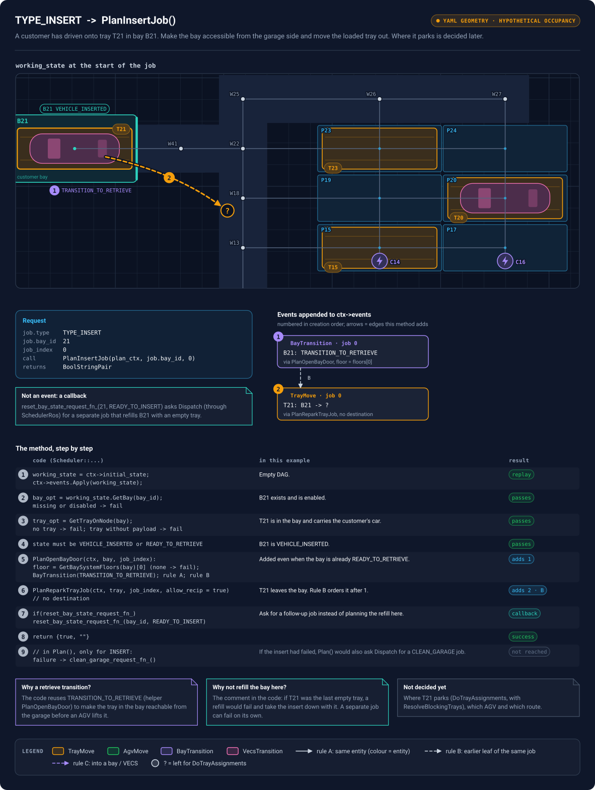

<sub>Pan / zoom: [interactive viewer](figures/viewer.html#43_job_insert) · [standalone SVG](figures/43_job_insert.svg)</sub>

*Figure 23 — The loaded tray T21 leaves bay B21. Its parking spot is chosen later. Refilling the bay is requested as a separate job through a callback.*

In words: check that the bay holds a loaded tray and is `VEHICLE_INSERTED` or `READY_TO_RETRIEVE`, switch it to retrieve mode with `PlanOpenBayDoor` (event 1), move the tray out with no destination (event 2), then call `reset_bay_state_request_fn_` so Dispatch schedules the bay's refill on its own.

### 12.13 `TYPE_READY_FOR_INSERT` — `PlanReadyForInsertJob`

```cpp
BoolStringPair PlanReadyForInsertJob(ScheduleContextSPtr ctx, uint16_t bay_id, size_t job_index) const;
```

**When it runs:** to get a bay ready for the next customer: it needs an empty tray inside and insert mode. Sent by Dispatch, and used for each bay that REBALANCE_GARAGE wants in insert mode.

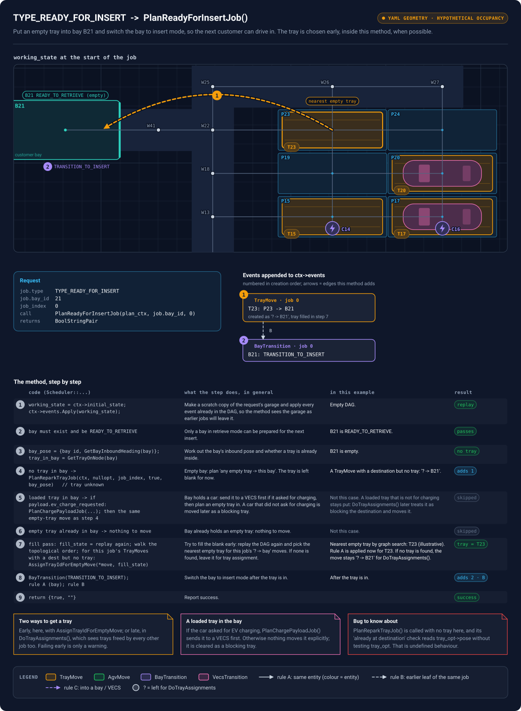

<sub>Pan / zoom: [interactive viewer](figures/viewer.html#44_job_ready_for_insert) · [standalone SVG](figures/44_job_ready_for_insert.svg)</sub>

*Figure 24 — An empty tray is planned into B21 (chosen early here: T23), then B21 switches to insert mode.*

In words: the bay must be `READY_TO_RETRIEVE`. If it is empty, or holds a loaded tray, plan "any empty tray → bay" (a `TrayMove` with no tray). If the car in the bay asked for charging, plan `PlanChargePayloadJob` first. Then try to pick the empty tray right away with `AssignTrayIdForEmptyMove`, and finish with `TRANSITION_TO_INSERT`.

This is the only job method that **fills a blank itself**. It replays the DAG once more (`fill_state`), walks the events in topological order and, for its own trays-to-be, picks the nearest empty tray. If that fails, it only logs a warning; `DoTrayAssignments()` will try again with the full picture.

### 12.14 `TYPE_READY_FOR_RETRIEVE` — `PlanReadyForRetrieveJob`

```cpp
BoolStringPair PlanReadyForRetrieveJob(ScheduleContextSPtr ctx, uint16_t bay_id, size_t job_index) const;
```

**When it runs:** to put a bay into retrieve mode ahead of time, so a later retrieve does not wait for the transition. Used mostly by REBALANCE_GARAGE.

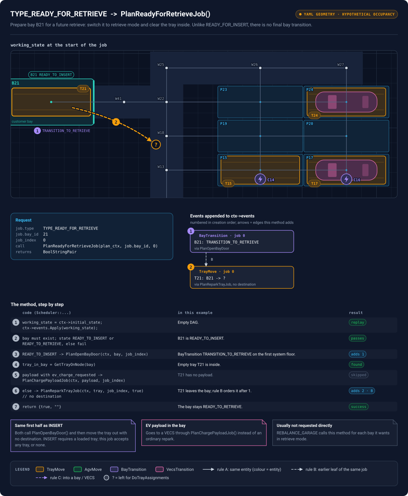

<sub>Pan / zoom: [interactive viewer](figures/viewer.html#45_job_ready_for_retrieve) · [standalone SVG](figures/45_job_ready_for_retrieve.svg)</sub>

*Figure 25 — B21 switches to retrieve mode and the empty tray inside is planned out. There is no final bay event.*

In words: the bay must be in insert or retrieve mode. If in insert mode, open it (event 1). If a tray is inside, send an EV car to a VECS, otherwise move the tray out with no destination (event 2).

### 12.15 `TYPE_CHARGE_AGV` — `PlanAgvChargeJob`

```cpp
BoolStringPair PlanAgvChargeJob(ScheduleContextSPtr ctx, uint16_t agv_id, size_t job_index) const;
```

**When Dispatch sends it:** an AGV's battery is low.

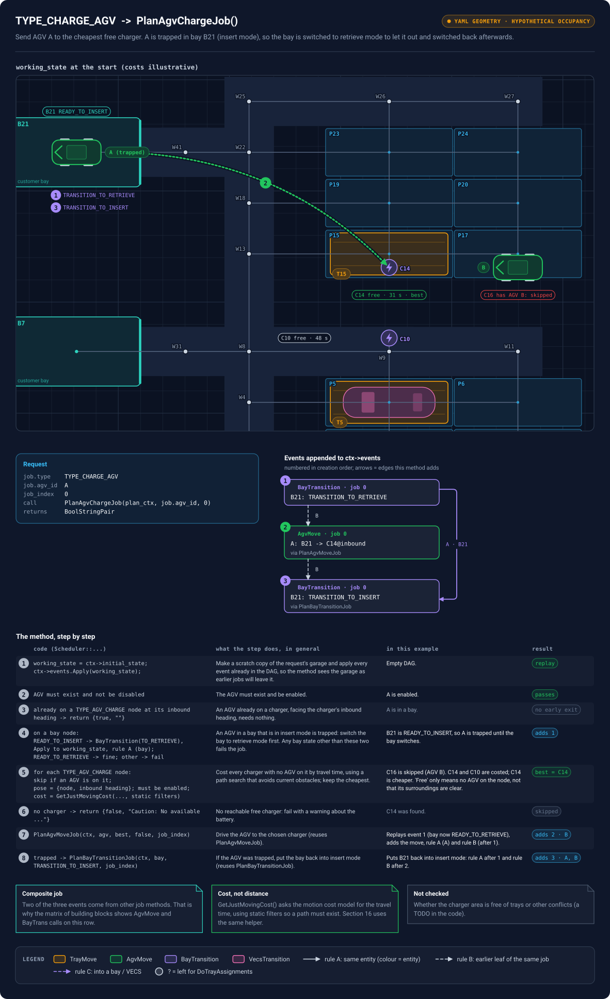

<sub>Pan / zoom: [interactive viewer](figures/viewer.html#48_job_charge_agv) · [standalone SVG](figures/48_job_charge_agv.svg)</sub>

*Figure 26 — AGV A is trapped in bay B21 (insert mode). The bay opens (1), A drives to the cheapest free charger C14 (2), and the bay returns to insert mode (3). Costs are illustrative.*

In words: free the AGV if a bay in insert mode traps it, cost every `TYPE_AGV_CHARGE` node with no AGV on it using `GetJustMovingCost`, move to the cheapest with `PlanAgvMoveJob`, and put the bay back with `PlanBayTransitionJob`.

### 12.16 `TYPE_CLEAN_GARAGE` — `PlanCleanGarageJob`

```cpp
BoolStringPair PlanCleanGarageJob(ScheduleContextSPtr ctx, size_t job_index) const;
```

**When it is requested:** Dispatch decides (the comment in `PlanInsertJob` says it can be deferred until inserts and retrieves are done), and `Plan()` asks for one through `clean_garage_request_fn_()` after a failed INSERT.

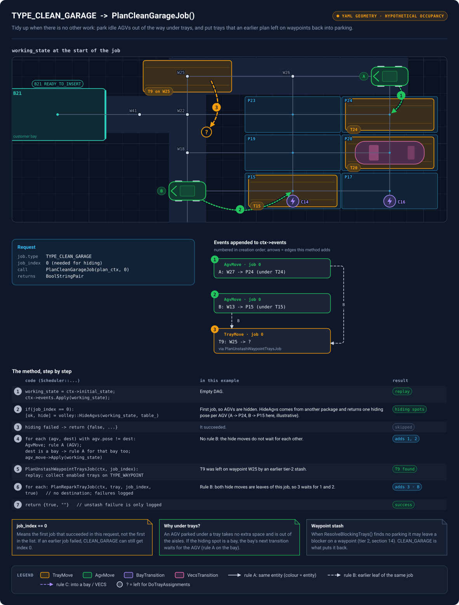

<sub>Pan / zoom: [interactive viewer](figures/viewer.html#46_job_clean_garage) · [standalone SVG](figures/46_job_clean_garage.svg)</sub>

*Figure 27 — AGVs A and B are hidden under trays (1, 2). Tray T9, left on a waypoint by an earlier plan, is planned back into parking (3).*

In words: if this is `job_index` 0, ask `volley::HideAgvs` (from another package) for one hiding pose per AGV and add an `AgvMove` for each AGV that is not already there. Then `PlanUnstashWaypointTraysJob` adds a destination-less `TrayMove` for every tray standing on a `TYPE_WAYPOINT` node. Only the hiding step (or the initial replay of the DAG) can fail the job.

### 12.17 `TYPE_REBALANCE_GARAGE` — `PlanRebalanceGarageJob`

```cpp
BoolStringPair PlanRebalanceGarageJob(ScheduleContextSPtr ctx, size_t job_index) const;
```

**When it is requested:** when the `set_bay_readiness_ratio` service changes `bay_readiness_ratio_`, `SchedulerRos` calls `rebalance_garage_request_fn_()` to ask Dispatch for this job; Dispatch can also send it on its own. Section 18 explains the ratio and how bays are classified.

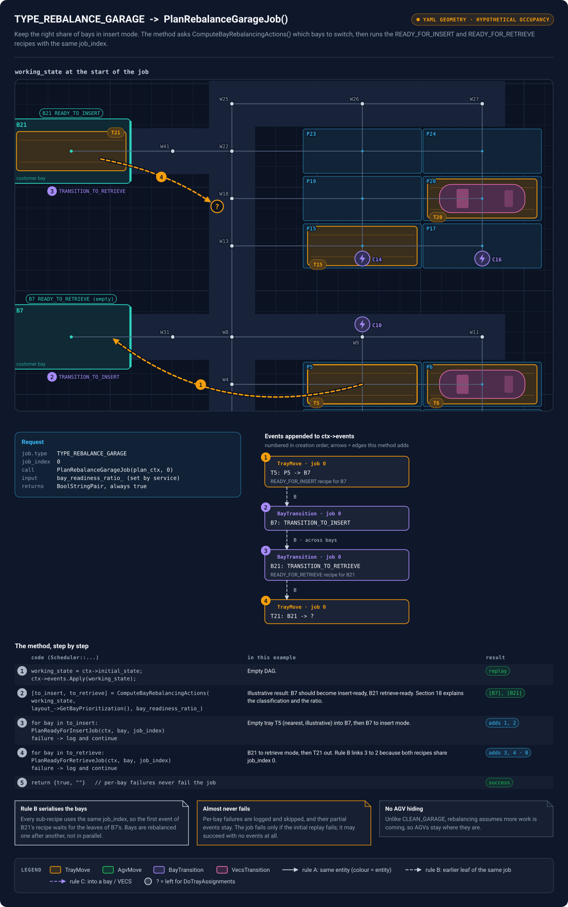

<sub>Pan / zoom: [interactive viewer](figures/viewer.html#47_job_rebalance_garage) · [standalone SVG](figures/47_job_rebalance_garage.svg)</sub>

*Figure 28 — B7 gets an empty tray and insert mode (1, 2); B21 gets retrieve mode and its tray is planned out (3, 4). One job index for both bays makes rule B run them one after the other.*

In words: `ComputeBayRebalancingActions()` returns two bay lists; run `PlanReadyForInsertJob` for the first and `PlanReadyForRetrieveJob` for the second, all with the same `job_index`. Per-bay failures are only logged; the job fails only if the initial replay of the DAG fails.

### 12.18 Gotchas

These are behaviours of the current code that surprise people. They are not fixed here; changing them changes plans.

1. **A failed job can leave events behind.** `Plan()` does not remove events when a job method fails, and `FailJob()` carries a TODO about it ("strip all the events which may be in the dag for the now failed job"). It happens when a method has already added something before a later check fails, for example:
   - RETRIEVE adds "stop charging" and then finds no bay;
   - RETRIEVE or INSERT opens a bay and then the repark fails;
   - CHARGE_AGV opens a bay and then finds no charger.

   The leftover events keep the failed job's `job_index`, which the next successful job reuses (12.2), so they are reported and executed as part of that job. Because they share the index, they also count as that job's leaves, so its first events get rule B edges from them. If an earlier job succeeded but no job from the failed one onward does, `ctx->scheduled_jobs[event->GetJobIndex()]` reads past the end of the vector when the response is built. Other places it can happen: CHARGE_AGV when the final bay transition fails, READY_FOR_INSERT when the charge-payload recipe succeeds and the empty-tray repark fails, READY_FOR_RETRIEVE when the door opens and the repark fails, and inside REBALANCE, where a bay recipe's partial events stay under the (always successful) rebalance job.
2. **`PlanReparkTrayJob` looks the tray up in `ctx->initial_state`.** The "already at destination" check therefore compares with the tray's position in the request, not after earlier jobs, and the "is it on a charging VECS" check looks at the request node too.
3. **`PlanReparkTrayJob` with no tray but a destination reads an empty optional.** The line `if(tray_opt->pose == dest.value())` runs even when `tray_id` is `std::nullopt` (READY_FOR_INSERT's "any empty tray" case). That is undefined behaviour; it should test `tray_opt` first.
4. **`job_index == 0` means "first successful job".** CLEAN_GARAGE hides AGVs only then. If earlier jobs in the request failed, a later CLEAN_GARAGE can still get index 0.
5. **Bay transitions are not always necessary ones.** `PlanOpenBayDoor` (INSERT) adds `TRANSITION_TO_RETRIEVE` even when the bay is already `READY_TO_RETRIEVE`.
6. **CHARGE_PAYLOAD throws away the unblocking moves** that `ResolveBlockingTrays()` returns (`auto [dest, _] = ...`). They are found again in tray assignment.
7. **"Free charger" only means "no AGV on the node".** The code says so, with a TODO to check for other conflicts.
8. **Rule B serialises composite jobs.** REBALANCE_GARAGE's per-bay recipes share one `job_index`, so each bay waits for the previous bay's work.
9. **Some bay commands skip the disabled check.** `PlanReadyForInsertJob`, `PlanReadyForRetrieveJob`, `PlanOpenBayDoor` and CHARGE_AGV's trapped-bay branch never test `bay.disabled` (INSERT and TRANSITION_BAY_TO_* do). `Plan()` marks bays that already have a command in `base_schedule` as disabled, so those methods can command such a bay again; READY_FOR_INSERT is only stopped indirectly, because the repark into a disabled bay fails.
10. **INSERT's callback fires before the plan is known to succeed.** `reset_bay_state_request_fn_` runs during job expansion, so Dispatch receives the refill request even if tray assignment or motion planning later fails the whole plan.
11. **Late failures duplicate failed jobs.** When a later stage fails, `Plan()` calls `FailJob` for every entry of `request_data.pending_jobs`, including jobs that already failed in the loop, so `result.scheduled_jobs` can list the same job twice.
12. **`AssignTrayIdForEmptyMove` may change the destination heading** to the chosen tray's heading when the two are the same or opposite, to avoid a rotation.

### 12.19 Cheat sheet and self-check

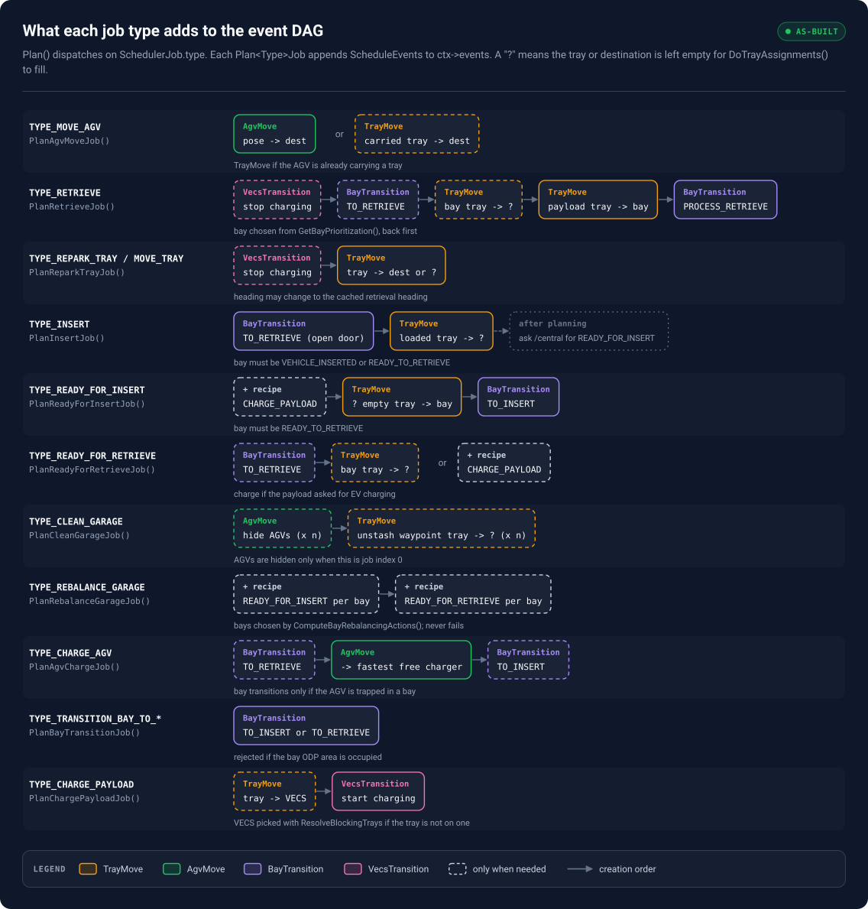

<sub>Pan / zoom: [interactive viewer](figures/viewer.html#24_job_recipes) · [standalone SVG](figures/24_job_recipes.svg)</sub>

*Figure 29 — Cheat sheet: one row per job type, **not** a sequence of scenarios. Each row lists the events that job method can add, left to right in creation order. Dashed boxes appear only when needed; "+ recipe" means the method calls another job method; "?" is a blank for `DoTrayAssignments()`. The figures in 12.7 to 12.17 show each row in a garage.*

Check yourself before moving on:

1. A request has `[RETRIEVE (fails), MOVE_AGV, REPARK_TRAY]`. What `job_index` does each successful job get?
2. Job 0 reparks T19 to P24 and job 1 reparks T19 to P23. Which rule orders the two moves, and why does rule B not?
3. In the retrieve figure, why does event 3 have edges from both 1 and 2?
4. Which job types can leave a `TrayMove` with no destination? With no tray?
5. Why can a bay's ODP check fail for TRANSITION_BAY_TO_INSERT but not for INSERT?

<details><summary>Answers</summary>

1. MOVE_AGV gets 0 and REPARK_TRAY gets 1; the failed retrieve uses no index (but see gotcha 1 if it added events first).
2. Rule A (same tray). Rule B only links events of the same job.
3. Rule B (2 was the job's only leaf) and rule C (the tray is going into bay B21, whose last event is 1).
4. No destination: RETRIEVE, INSERT, READY_FOR_RETRIEVE, CLEAN_GARAGE (and REBALANCE through READY_FOR_RETRIEVE). No tray: READY_FOR_INSERT (and REBALANCE through it) when `AssignTrayIdForEmptyMove` finds nothing.
5. The ODP check lives in `PlanBayTransitionJob`; INSERT uses `PlanOpenBayDoor`, which does not check it.

</details>

## 13. The whole journey of one job

Before the details of each stage, here is one retrieve followed through all three passes over the event DAG.

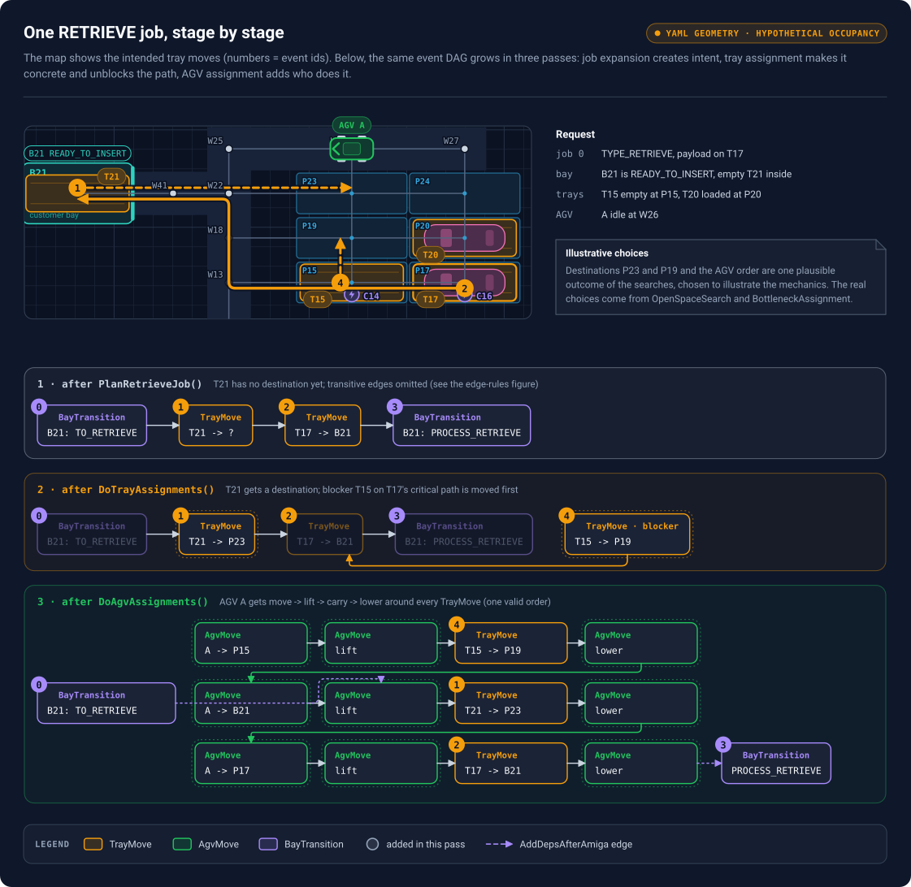

<sub>Pan / zoom: [interactive viewer](figures/viewer.html#26_retrieve_walkthrough) · [standalone SVG](figures/26_retrieve_walkthrough.svg)</sub>

*Figure 30 — One `TYPE_RETRIEVE` job on Pecos, stage by stage. Map numbers match event ids. Band 1: job expansion creates intent, including a move of the empty tray T21 out of the bay with no destination. Band 2: tray assignment gives T21 a destination and inserts a move for blocker T15, which sits on T17's critical path. Band 3: AGV assignment wraps every `TrayMove` in move → lift → carry → lower, and `AddDepsAfterAmiga` ties the bay transitions to the right lift and lower. Destinations and AGV order are illustrative.*

## 14. Tray assignment: `DoTrayAssignments`

After expansion, some `TrayMove`s lack a tray id or a destination, and many destinations are not reachable because other trays are in the way. `DoTrayAssignments(ctx)` fixes both in one pass over the DAG in topological order. When it returns, **every `TrayMove` has a tray id and a destination**, and every blocking tray has its own `TrayMove`.

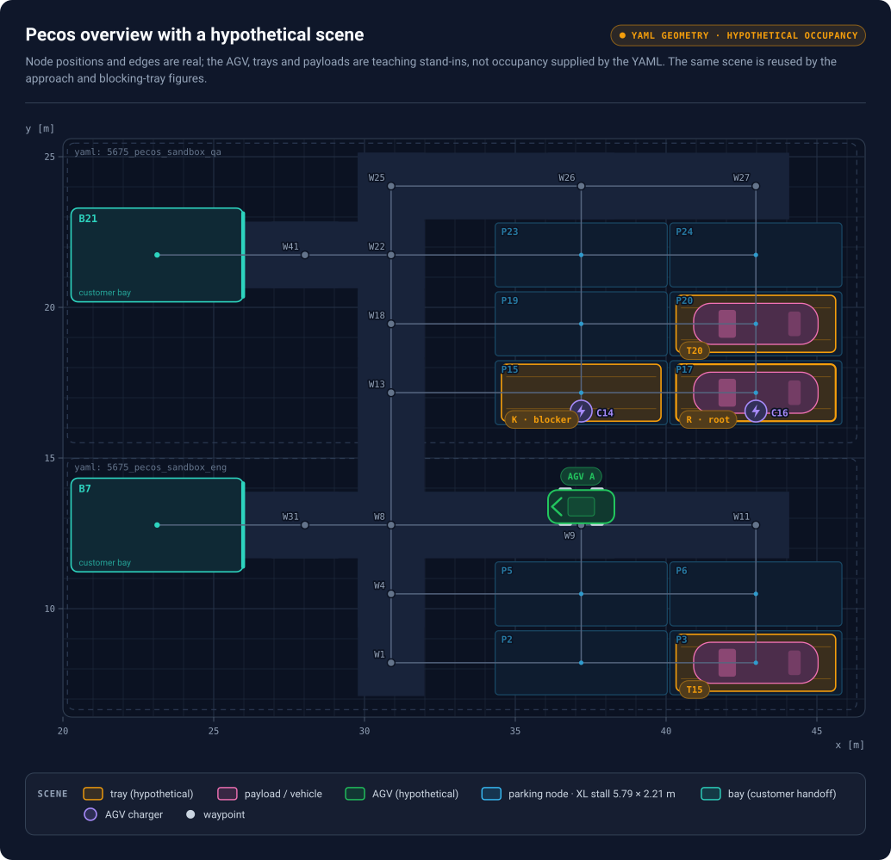

<sub>Pan / zoom: [interactive viewer](figures/viewer.html#15_facility_scenario) · [standalone SVG](figures/15_facility_scenario.svg)</sub>

*Figure 31 — The hypothetical scene reused by the next figures. Bays `B7` and `B21` sit on the customer side; AGV A at `C10`, tray T15 with a payload at `P3`, blocker K at `P15`, root tray R at `P17` and tray T20 at `P20` are explanatory stand-ins, not YAML occupancy.*

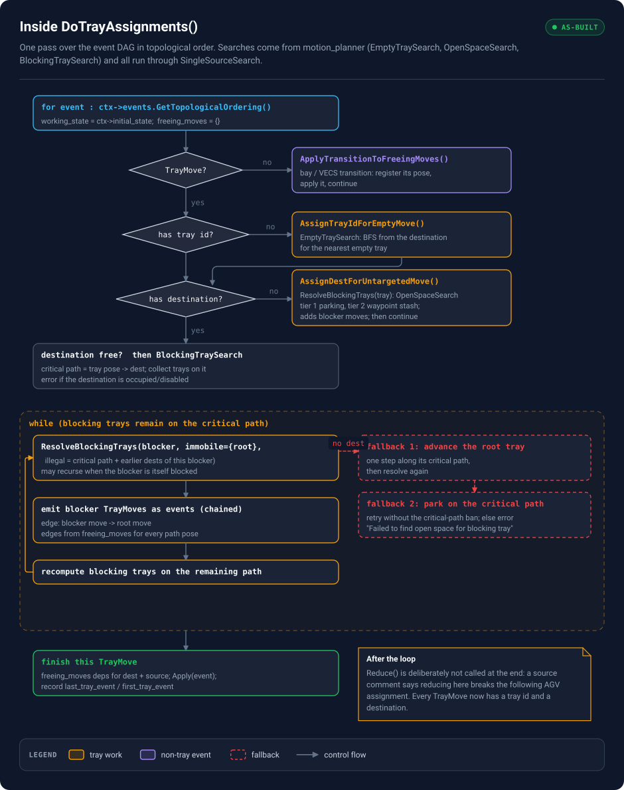

<sub>Pan / zoom: [interactive viewer](figures/viewer.html#27_tray_assignment_flow) · [standalone SVG](figures/27_tray_assignment_flow.svg)</sub>

*Figure 32 — Inside `DoTrayAssignments()`. Non-tray events register their pose with `freeing_moves` and are applied. Missing tray ids come from an empty-tray search; missing destinations from `ResolveBlockingTrays`. Moves with both go through the blocking-tray loop with two fallbacks.*

The three searches all come from `motion_planner` and run through `volley::SingleSourceSearch(source, Interval::Duration(0), environment)`; the environment object decides what counts as a goal:

| Environment | Used by | Finds |
|---|---|---|
| `EmptyTraySearchEnvironment` | `AssignTrayIdForEmptyMove` | the nearest tray without a payload, searching outward from the destination |
| `OpenSpaceSearchEnvironment` | `FindOpenSpaceForRootTray`, `TryFindBlockingTrayResolution` | a free parking spot (tier 1) or, if `allow_waypoint_stash`, a waypoint (tier 2), plus the trays blocking the way |
| `BlockingTraySearchEnvironment` | the main loop | the critical path from the tray to its destination and the trays on it |

### The blocking-tray loop

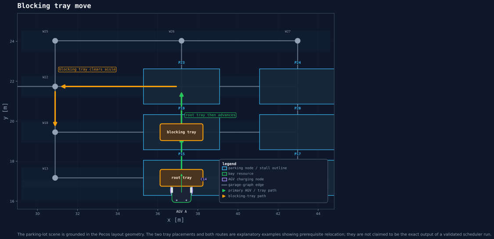

<sub>Pan / zoom: [interactive viewer](figures/viewer.html#15_blocking_tray_move) · [standalone SVG](figures/15_blocking_tray_move.svg)</sub>

*Figure 33 — Why blocking trays matter. Root tray R at `P17` must reach bay `B21`. In the Pecos graph `P17` connects only to `P15`, `P20` and charger `C16`; with K at `P15` and T20 at `P20`, every exit is occupied. AGV A therefore ① drives under K and lifts it, ② reparks K at the free stall `P19`, ③ returns unloaded to lift R, and ④ carries R out. It does **not** claim the current solver would pick this relocation target or route.*

```cpp
// Where: Scheduler::DoTrayAssignments(ScheduleContextSPtr ctx) const, inside the per-event loop,
// once `move` (volley::TrayMove*) has both a tray id and a destination.
//   tray_opt              -> std::optional<DiscreteTrayStateMsg>, the tray in working_state
//   root_collision_entity -> CollisionEntityId_t for this tray's footprint (depends on its payload)
//   filters               -> GetStaticFilter(...) ignoring every tray and AGV (they can be moved)
volley::BlockingTraySearchEnvironment blocking_search_env(move->GetTrayId().value(), root_collision_entity,
    gg_, table_, working_state, cost_model_, gg_.GetVertexFromPose(move->GetDest().value()).value(), filters);
auto blocking_solution = volley::SingleSourceSearch(source, volley::Interval::Duration(0), blocking_search_env);
auto path = blocking_solution.GetPath(blocking_solution.GetTarget().value()).value();   // the critical path

while(!blocking_trays.empty()) {
  uint16_t blocking_tray_id = blocking_trays.front();
  // Find a new home for the blocker. The root tray may not move (immobile set) and the blocker may not
  // park on the critical path or on a spot it already used during this pass (WithPriorDests).
  auto [dest, required_moves] = ResolveBlockingTrays(blocking_tray_id, move->GetJobIndex(), working_state,
      std::set<uint16_t>{move->GetTrayId().value()}, WithPriorDests(blocking_tray_id, critical_path));
  // fallback 1: advance the root tray one step along its path, then try again
  // fallback 2: allow parking on the critical path; if that fails too -> return {false, "..."}
  // emit required_moves + the blocker's own move as events, chained, each before `event` (the root move)
  // recompute blocking_trays for the rest of the path
}
```

`ResolveBlockingTrays(tray_id, job_index, base_state, immobile_trays, illegal_poses, enforce_retrieval_heading, allow_waypoint_stash)` returns `std::pair<std::optional<GaragePoseMsg>, std::vector<std::pair<std::shared_ptr<TrayMove>, std::vector<GaragePoseMsg>>>>`: an optional destination for the tray, and the ordered list of extra tray moves (each with its path) needed to get there. It **recurses** when a blocker is itself blocked, marking the parent tray immobile to avoid cycles; the test `ResolveBlockingTraysRecursivelyUnblocksChain` exercises a chain of three. Two tiers apply: first parking nodes only, then (tier 2) a waypoint “stash” that a later `CLEAN_GARAGE` job undoes through `PlanUnstashWaypointTraysJob`.

### Occupancy becomes dependencies: `freeing_moves`

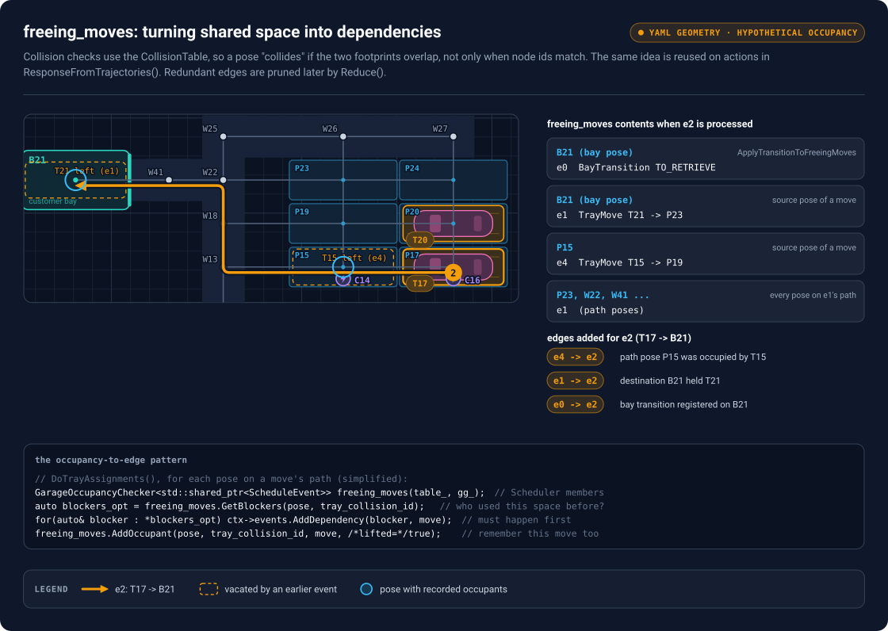

<sub>Pan / zoom: [interactive viewer](figures/viewer.html#28_freeing_moves) · [standalone SVG](figures/28_freeing_moves.svg)</sub>

*Figure 34 — `freeing_moves` is a `GarageOccupancyChecker<std::shared_ptr<ScheduleEvent>>`. Every event that used a pose (a source pose, every pose on a path, a bay pose touched by a transition) is recorded. A later move through a colliding pose gets an edge from each recorded event. The checker uses `table_`, so “colliding” means overlapping footprints, not just equal node ids.*

Two pieces of bookkeeping leave this stage:

- `last_tray_event` (a local map) chains successive moves of the same tray.
- `ctx->first_tray_event[tray_id]` remembers the **first** move that takes each tray off its initial node. `DoAgvAssignments` uses it so an AGV that must drive through that node waits for the tray to leave. Using the *last* move instead would create a cycle when one AGV moves the same tray twice (see the comment in `scheduler.hpp`).

`DoTrayAssignments` deliberately does **not** call `Reduce()` at the end; a source comment says doing so breaks the following AGV assignment.

## 15. AGV assignment: `DoAgvAssignments`

Now every `TrayMove` knows *what* moves where. `DoAgvAssignments(ctx)` decides *which AGV* does each one and adds the AGV's own events. It works on `event_dag_copy`, a copy of `ctx->events` that it consumes from the roots down:

1. **Drain non-tray roots.** Apply every root that is not a `TrayMove` (bay and VECS transitions, pre-existing `AgvMove`s) to `working_state`, chain AGV moves per AGV, add node-arrival dependencies, and remove them from the copy. Repeat until only `TrayMove` roots remain, so the matcher sees every eligible move at once (the SW2-377 comment explains why).
2. **Cost every (AGV, root move) pair** with `GetAgvToTrayAssignmentCost`. Pairs are infeasible when the AGV carries a different tray, has no path, or is trapped in a bay that is not `READY_TO_RETRIEVE`.
3. **Match** with `volley::BottleneckAssignment` and order matched AGVs that would collide with `GetEventDag`.
4. **Expand** each match into events and remove the matched `TrayMove` from the copy.
5. Repeat until the copy is empty, then run `EnsureAgvMovePathsClear`, `Reduce()`, and `AddDepsAfterAmiga` for bay and VECS transitions.

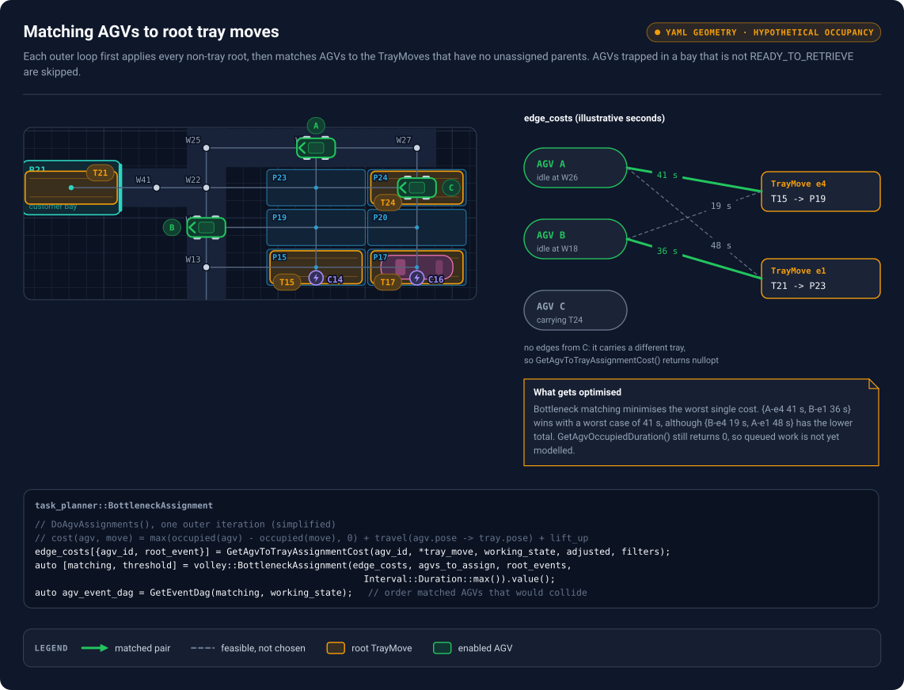

<sub>Pan / zoom: [interactive viewer](figures/viewer.html#29_agv_matching) · [standalone SVG](figures/29_agv_matching.svg)</sub>

*Figure 35 — Matching AGVs to root tray moves. Each edge is one feasible pair with its estimated cost; AGV C carries another tray, so it has no edges. Bottleneck matching minimises the **worst** single cost, so it can prefer a pairing with a higher total. Costs are illustrative.*

The cost of assigning AGV **$i$** to tray move **$j$** is

$$
c_{ij}=\max\!\left(t_i^{\mathrm{occupied}}-t_j^{\mathrm{ready}},\,0\right)+t_{ij}^{\mathrm{approach}}+t_{ij}^{\mathrm{lift}},
$$

where cost **$c_{ij}$** [s] is the estimated time until the tray is lifted, **$t_i^{\mathrm{occupied}}$** [s] is how long AGV **$i$** is already busy (`agv_occupied_durations`), **$t_j^{\mathrm{ready}}$** [s] is the earliest time move **$j$** can start given its parents (`event_occupied_durations`, filled by `PropagateEventCostToChildren`), **$t_{ij}^{\mathrm{approach}}$** [s] is `GetJustMovingCost` from the AGV's pose to the tray's pose, and **$t_{ij}^{\mathrm{lift}}$** [s] is the lift-up time when the AGV is not already holding the tray. **Caveat:** `GetAgvOccupiedDuration()` returns zero (a `TODO(isabel)`), so the occupied term only reflects work assigned earlier in the same call.

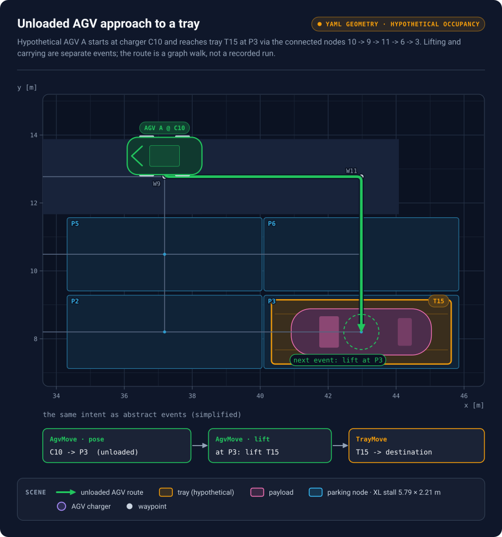

<sub>Pan / zoom: [interactive viewer](figures/viewer.html#15_agv_approach_and_pickup) · [standalone SVG](figures/15_agv_approach_and_pickup.svg)</sub>

*Figure 36 — Unloaded approach example. A hypothetical AGV at charger `C10` approaches tray T15 at `P3` via `10 → 9 → 11 → 6 → 3`, driving under the empty stall `P6`. The strip restates the intent as simplified events. The route is a graph walk, not a recorded run.*

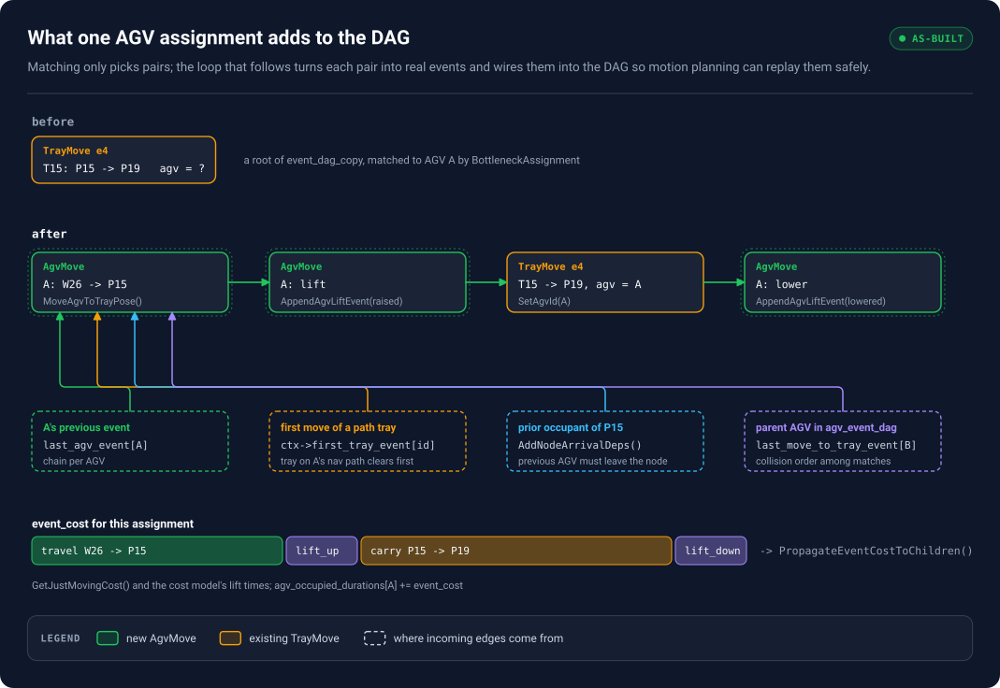

<sub>Pan / zoom: [interactive viewer](figures/viewer.html#30_agv_event_expansion) · [standalone SVG](figures/30_agv_event_expansion.svg)</sub>

*Figure 37 — What one assignment adds: `MoveAgvToTrayPose` (skipped if the AGV is already there), a lift, `SetAgvId` on the `TrayMove`, and a lower. The first event gets edges from four sources: the AGV's previous event, the first move of any tray parked on its navigation path, the previous occupant of the destination node, and matched AGVs it must follow.*

```cpp
// Where: Scheduler::DoAgvAssignments(ScheduleContextSPtr ctx) const, after BottleneckAssignment.
//   ordered_matching -> std::vector<std::pair<uint16_t, std::optional<ScheduleEventSPtr>>>: (agv id, root event)
//   working_state    -> local DiscreteGarageState advanced as events are created
for(const auto& [agv_id, root_event_opt] : ordered_matching) {
  if(!root_event_opt.has_value()) continue;                       // this AGV got nothing this round
  auto root_event = root_event_opt.value();                       // std::shared_ptr<ScheduleEvent>
  auto* tray_move = dynamic_cast<volley::TrayMove*>(root_event.get());
  const DiscreteTrayStateMsg tray = working_state.GetTray(tray_move->GetTrayId().value()).value();
  const DiscreteAgvStateMsg agv = working_state.GetAgv(agv_id).value();
  if(agv.tray_id != tray.id) {
    MoveAgvToTrayPose(agv_id, agv, tray, root_event, ...);        // AgvMove (pose) + its dependencies
    AppendAgvLiftEvent(agv_id, /*raised=*/true, ...);             // AgvMove (lift)
  }
  tray_move->SetAgvId(agv.id);                                     // edits the shared event object
  ctx->events.AddDependency(last_agv_event[agv_id], root_event);
  AddNodeArrivalDeps(tray_move->GetDest()->node_id, agv_id, root_event, ...);
  root_event->Apply(working_state);
  event_dag_copy.Remove(root_event);
  AppendAgvLiftEvent(agv_id, /*raised=*/false, ...);              // AgvMove (lower)
  PropagateEventCostToChildren(root_event, event_cost, ctx, event_occupied_durations);
  agv_occupied_durations[agv_id] += event_cost;
}
```

### Repairing paths after assignment

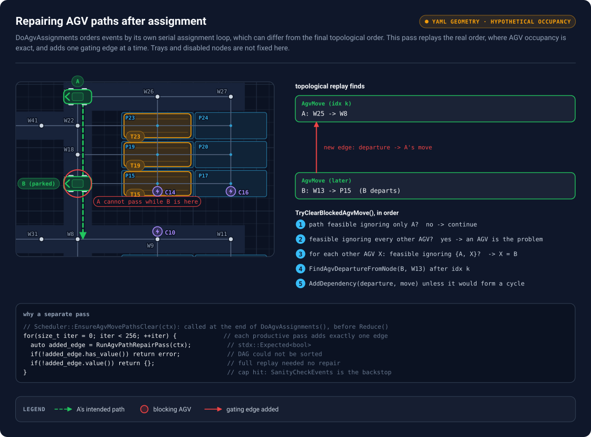

<sub>Pan / zoom: [interactive viewer](figures/viewer.html#31_agv_path_repair) · [standalone SVG](figures/31_agv_path_repair.svg)</sub>

*Figure 38 — `EnsureAgvMovePathsClear` replays the final topological order. When an AGV reposition has no collision-free path only because another AGV's body is in the way, it adds one edge from that AGV's next departure to the blocked move (unless that would form a cycle) and starts over, at most 256 times. Tray and disabled-node obstructions are left for `SanityCheckEvents` to report.*

This pass exists because `DoAgvAssignments` builds dependencies in its own serial assignment order, which can differ from the order the DAG is eventually replayed in. The source comments in `MoveAgvToTrayPose` describe an earlier, proactive attempt that both missed real blockers and added spurious edges.

`AddDepsAfterAmiga(ctx, event, node_id)` runs last for every bay and VECS transition. It moves dependencies from tray moves onto the AGV's lift and lower events: a transition that waited for a tray to arrive now waits for the **lower** after it, and a tray move out of the bay waits for the transition before its **lift**.

## 16. `Reduce()` and `SanityCheckEvents`

Back in `Plan()`, `plan_ctx->events.Reduce()` removes redundant edges (a `TODO(any)` notes that planning may fail without it, probably inside CHUGG). Then `SanityCheckEvents(ctx)` replays the DAG in topological order on a fresh copy of `initial_state` and checks each event **before** applying it:

| Event | Check |
|---|---|
| `BayTransition` | the bay's ODP (operator door) area is free (`GetStaticFilter` for `BAY_ODP`) |
| `AgvMove` with a destination | `IsMovePossible`: destination exists, is not disabled, is not occupied, and a path exists, ignoring only this AGV |
| `AgvMove` lift change | only that `Apply` succeeds |
| `TrayMove` | has a destination, and `IsMovePossible` with the carrying AGV and the tray itself ignored |

The comment explains the motivation: “The motion planner doesn't fail in the most graceful ways”, so a cheap discrete replay catches most problems with a readable message first.

## 17. Motion planning and the response

`PlanMotions(ctx)` builds the initial `ContinuousState` (everything stays where it is until `ctx->start_time`), precomputes edge durations and an all-pairs heuristic, and runs **CHUGG** (`volley::Chugg`, “v0.1” in a comment) with `SolveSequential`. With `cost_audit` on, it logs one CSV row per cost segment (`audit_csv,index,seconds,cumulative,description`). A failure returns `std::nullopt` and fails every job with “CHUGG failed to find a solution, event dag may be infeasible”.

`ResponseFromTrajectories(ctx, final_state)` then turns trajectories into the wire format:

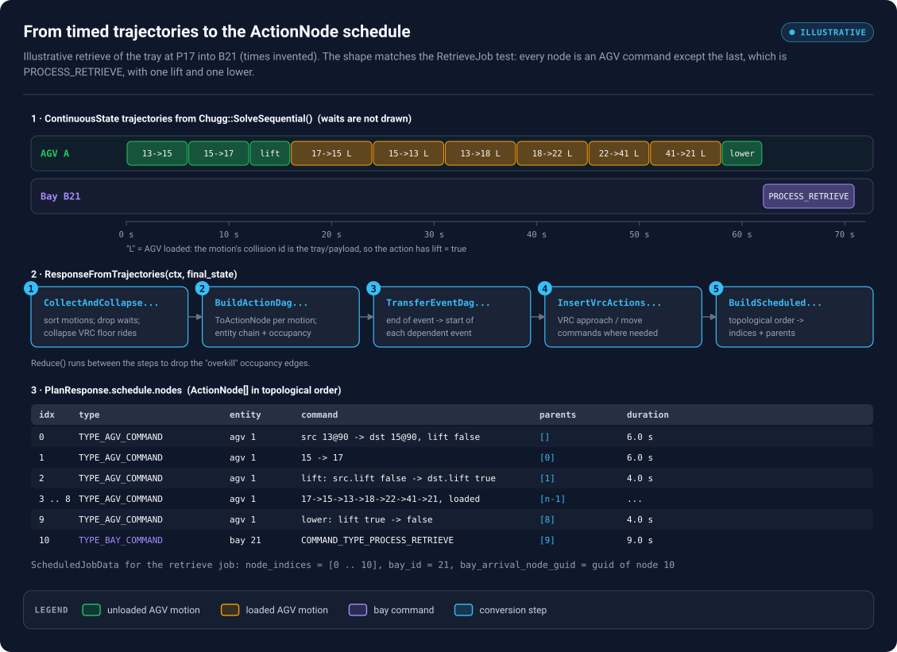

<sub>Pan / zoom: [interactive viewer](figures/viewer.html#32_motions_to_actions) · [standalone SVG](figures/32_motions_to_actions.svg)</sub>

*Figure 39 — From timed trajectories to `ActionNode[]`. Every motion with a delta (pose change, lift change, bay / VECS / VRC state change) becomes one `ActionNode`; waits are dropped. Actions are chained per entity, ordered by occupancy, given the event-level dependencies, reduced, extended with VRC commands, and finally written out in topological order with integer parent indices. Times are illustrative; the shape matches the `RetrieveJob` test.*

```cpp
// Where: anonymous-namespace helper ToActionNode(const volley::Motion& motion, GuidMsg job_id,
//        const std::shared_ptr<ScheduleEvent>& event) in src/scheduler.cpp
//   motion.GetDelta() -> optional serialized discrete change; its .type names the ROS message type
if(delta->type == "AgvPoseChanged") {
  result->type = ActionNodeMsg::TYPE_AGV_COMMAND;
  // An AGV motion whose collision id is NOT the bare AGV is carrying a tray, so lift = true on both ends.
  result->agv_command.src.lift = motion.GetCollisionId() != common::EnumInteger(volley::CollisionEntityId::AGV);
}
// "AgvLiftChanged" -> AGV command with src.lift != dst.lift; "BayStateChanged" -> TYPE_BAY_COMMAND using the
// BayTransition's own command; "VecsStateChanged" -> start/stop charging; "VrcStateChanged" -> VRC move.
```

Finally `Plan()` marks every planned job `STATE_EXECUTING`, and for `TYPE_RETRIEVE` jobs records the bay and the `PROCESS_RETRIEVE` action in `bay_id` and `bay_arrival_node_guid`.

## 18. Bays, VECS and VRCs

### Bays and rebalancing

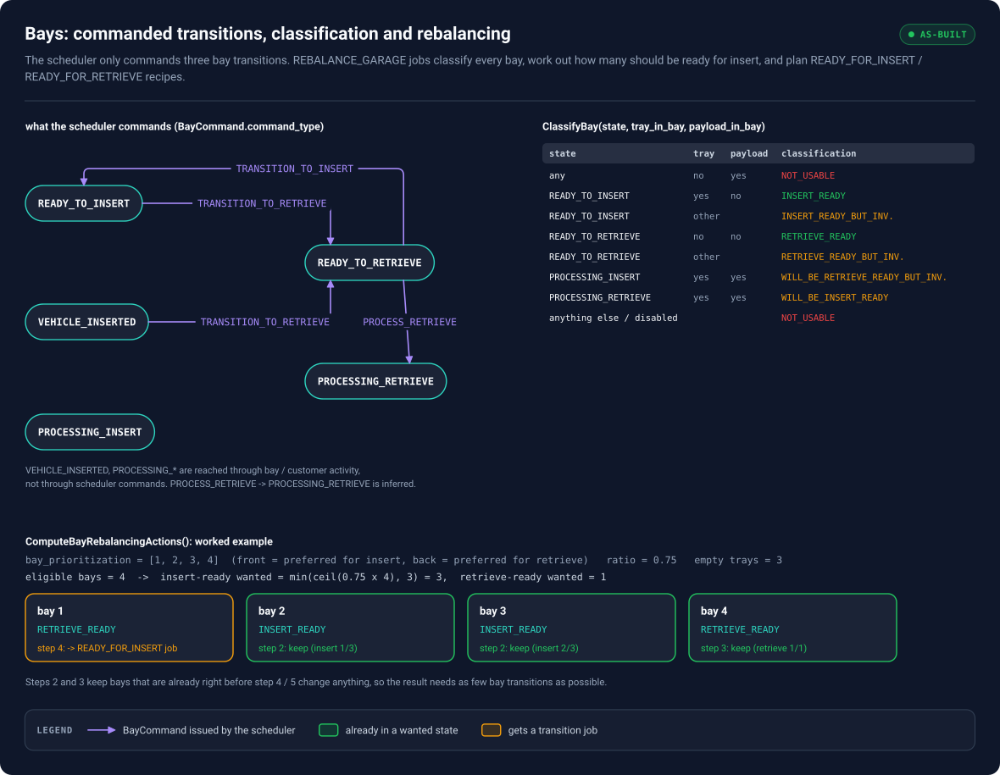

<sub>Pan / zoom: [interactive viewer](figures/viewer.html#33_bay_logic) · [standalone SVG](figures/33_bay_logic.svg)</sub>

*Figure 40 — The three bay commands the scheduler issues, the `ClassifyBay` rules from `utils.cpp`, and a worked example of `ComputeBayRebalancingActions`. Other bay states are reached through bay or customer activity outside this package.*

`bay_readiness_ratio` is the fraction of usable bays that should be ready for insert. `CalculateDesiredBaySplit` rounds up (it biases towards insert because arriving customers cannot be detected), clamps, and never asks for more insert-ready bays than there are empty trays. `ComputeBayRebalancingActions` first counts bays already moving towards a state (`WILL_BE_*`), then keeps bays already in a wanted state, and only then picks bays to change, in `bay_prioritization` order for insert and reverse order for retrieve. Bays left in an invalid state fall back to ready-for-retrieve.

### VECS (EV charging)

A VECS sits under a parking node of type `TYPE_EV_CHARGE`. Moving a tray off a VECS that is `CHARGING` first adds `VecsTransition CHARGING -> READY_TO_CHARGE`; moving onto one is refused unless it is `READY_TO_CHARGE`. `PlanChargePayloadJob` finds a VECS with `ResolveBlockingTrays` (the open-space search knows about VECS nodes) and then adds `READY_TO_CHARGE -> CHARGING`.

### VRCs (lifts between floors)

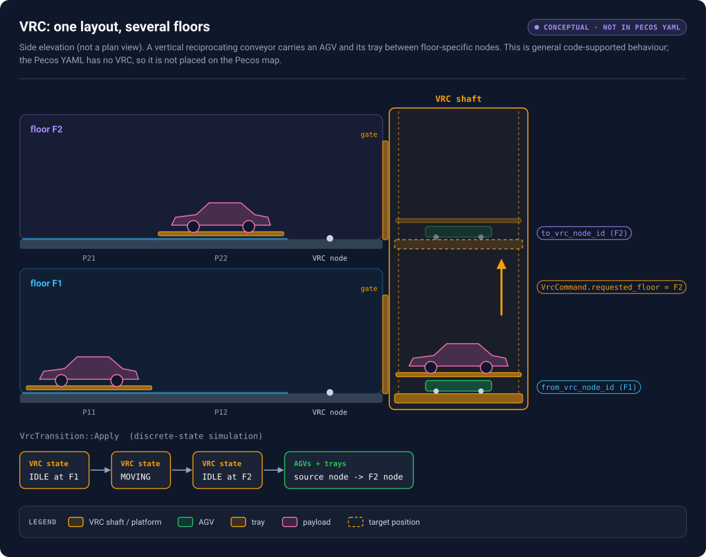

<sub>Pan / zoom: [interactive viewer](figures/viewer.html#14_vrc_floors) · [standalone SVG](figures/14_vrc_floors.svg)</sub>

*Figure 41 — Conceptual VRC connecting two floors, as a side elevation. The Pecos YAML has no VRC; this shows general code-supported behaviour.*

In this package VRCs are handled at the **action** level, after motion planning: `InsertVrcActionsIntoDag` (in `utils.cpp`) walks AGV actions in topological order, simulates the carriage floor per VRC, and inserts a `TYPE_VRC_COMMAND` *approach* when the carriage is on the wrong floor for the AGV's next action, plus a *move* command that replaces each cross-floor AGV action. Each command's duration is door close + carriage transit + door open. Consecutive cross-floor motions are first collapsed into one motion in `CollectAndCollapseTrajectoryMotions`. `VrcTransition` events and their `Apply` live in `planner_core` and were not in the snapshot.

## 19. Packages, build system and dependencies

| Target | Built from | Notes |
|---|---|---|
| `scheduler` (shared library) | `src/scheduler.cpp`, `src/utils.cpp` | Everything the tests link against |
| `scheduler_component` (+ executable `scheduler_node`) | `src/scheduler_component.cpp`, `src/scheduler_ros.cpp` | Plugin `volley::SchedulerComponent` |
| gtests | `scheduler_tests`, `scheduler_insert_orientation_tests`, `scheduler_jobs_tests` (240 s timeout), `utils_tests` | Link `yaml-cpp` and the library |

`package.xml` lists these dependencies: `common`, `common_ros`, `cost_functions`, `interfaces`, `motion_planner`, `planner_core`, `task_planner`, `vrc_interfaces`, `rclcpp`, `rclcpp_components`, `rclcppx`, `std_srvs`, `stdx`, `backward_ros` and Boost. The build uses ROS 2 `ament_cmake` with the repository's `volley_cmake` macros (`volley_package`, `volley_add_library`, `volley_add_component`, `volley_add_gtest`, `volley_ament_auto_package`). The dependency direction is `scheduler → planner_core, motion_planner, task_planner, cost_functions, common_ros`; nothing in the snapshot depends on `scheduler`.

## 20. Debugging and testing

- **Logs.** `Plan()` logs the initial DGS, each job as it is planned, the topological order after tray and after AGV assignment, and why things fail. Set the logger to DEBUG to also get every planned trajectory.
- **DAG pictures.** Call the `debug/printdags` service (or set the `printdags` parameter) to log the event DAG after each stage and the action DAG after each `Reduce()`; it needs `libgraph-easy-perl`.
- **Cost audit.** `scheduler.cost_audit` (default `true`) prints a CSV breakdown of CHUGG's cost per segment.
- **Tests.** 72 active GoogleTest cases in four files (`DoubleRetrieveDodgeAgv` is commented out). Unit tests build a `DiscreteGarageState` from inline YAML, construct a `Scheduler` with a named test layout (`tiny_lot`, `triple_pick_lot`, `576_eccles_half`, `1355_fulton`), and call one stage directly. Job tests build a full `PlanRequestMsg` and call `Plan()`. [03](03-verification-plan.md) maps every test to the stage it exercises.

```bash
colcon build --packages-up-to scheduler
colcon test --packages-select scheduler --ctest-args -R scheduler_tests
colcon test-result --verbose
```

A good first exercise: run `SchedulerJobs.RetrieveJob` under a debugger, break in `Scheduler::DoTrayAssignments` and `Scheduler::DoAgvAssignments`, and print `ctx->events` at each stop.

## 21. C++ concepts and idioms in context

| Idiom | Meaning | Where you meet it | Pitfall |
|---|---|---|---|
| `std::shared_ptr<T>` | Shared lifetime | DAG vertices, `ScheduleContextSPtr`, `LayoutSPtr` | Copying a DAG aliases the same events |
| `std::optional<T>` | A value that may be missing | `TrayMove::GetDest()`, every `GetTray(id)` | `.value()` throws if empty; many call sites assume it is set |
| Structured bindings | Unpack a pair / tuple | `auto [success, message] = ...` | `success` here is the stage result, not `PlanResponse.success` |
| `std::tie` | Assign into existing variables | `std::tie(success, message) = DoAgvAssignments(plan_ctx);` | Reuses the variables declared earlier |
| `virtual` / `dynamic_cast` | Runtime polymorphism and checked downcast | `ScheduleEvent` and subclasses | Check `GetType()` first, as the code does |
| `std::variant` / `std::visit` / `std::holds_alternative` | One of several alternatives | `AgvMove` holds a lift **or** a pose change | Lift changes have no destination (`GetDest()` empty) |
| `const` member functions | Cannot modify `*this` | Every planning method | Can still modify `*ctx` through a pointer |
| `mutable`, `std::atomic<float>` | Members changeable from const methods / threads | `costaudit_`, `printdags_`, `bay_readiness_ratio_` | `const` does not mean thread-safe here |
| `std::function` members + `friend` | Injected callbacks | `*_request_fn_` set by `SchedulerRos` | Empty in unit tests; the code checks before calling |
| Templates | Generic code | `DagBase<T>`, `GarageOccupancyChecker<T>` | Also used with `T = ActionNodeMsg` and `T = uint16_t` |
| ROS IDL aliases | Generated structs | `PlanRequestMsg`, `GaragePoseMsg` | Field names are a wire contract |

## 22. FAQ: design questions

Questions new engineers ask once they have read sections 9 to 17. The answers separate what the code does (with evidence) from opinion (marked as such).

### Is "events plus a DAG" a common way to model this problem?

Yes. Two established ideas are combined here:

1. **Precedence-constrained scheduling.** Activities with "finish before start" constraints form a DAG. This is the standard model in project scheduling (critical-path networks) and shop scheduling. The event DAG built in job expansion is exactly this: "the bay must open before the tray goes in".
2. **Action dependency graphs for multi-robot execution.** Hönig et al. ([RA-L 2019](https://act.usc.edu/publications/Hoenig_RAL2019.pdf)) turn a time-stamped multi-robot plan into a DAG of actions. One kind of edge chains the actions of one robot; the other kind orders actions of different robots that use the same location. Robots then run at their own speed and wait only on edges, which makes execution robust to delays. Later work describes it as "a directed acyclic graph representing the temporal dependencies between actions" ([Streamlining the ADG framework, 2024](https://arxiv.org/html/2412.01277v1)). The scheduler's response is close to this: `ActionNode[]` where each node lists its `parents`, chained per entity and ordered by occupancy (section 17).

What is more specific to this code base is that the DAG exists **before** any motion is planned and is handed to the motion planner as input (`volley::Chugg motion_planner(gg_, table_, ctx->events, ...)` in `PlanMotions`). The DAG first carries task logic (which tray must move before which) and only at the end becomes an execution policy.

### Open-RMF's `rmf_traffic` has no DAG; it is a database updated by events. Why is this different?

The two systems solve different problems.

| | Open-RMF `rmf_traffic` | This scheduler |
|---|---|---|
| Who plans robot paths | Each fleet or participant plans its own robots | One central planner plans every AGV |
| Shared object | A traffic **schedule database** of timed itineraries. Participants write through `schedule::Writer`: `set`, `extend`, `delay`, `reached`, `clear` ([API](https://openrmf.readthedocs.io/projects/rmf-traffic/en/latest/api/classrmf__traffic_1_1schedule_1_1Writer.html)) | A `PlanRequest` holding the current garage state and in-flight actions, answered with a full schedule |
| Conflicts | Detected between itineraries and resolved by negotiation (for example `rmf_traffic::agv::CentralizedNegotiation`, [API](https://openrmf.readthedocs.io/projects/rmf-traffic/en/latest/api/classrmf__traffic_1_1agv_1_1CentralizedNegotiation.html)) | Avoided at planning time: precedence edges plus collision-aware motion planning (CHUGG) |
| Coupling between tasks | Mostly spatial: robots share corridors | Strong and logical: moving one car can require moving several other trays first, an AGV must lift a tray, bays have modes |
| Built for | Many heterogeneous fleets from different vendors in one building | One tightly coupled automated garage |

Two nuances:

- **Open-RMF is not entirely free of dependencies.** Its routes can declare them: `DependsOnCheckpoint` is a map where "the checkpoint in the value waits for the checkpoint in the key" ([API](https://openrmf.readthedocs.io/projects/rmf-traffic/en/latest/api/typedef_Route_8hpp_1a9125a240740855280a6356bbf1591153.html)). That is a precedence edge between plans.
- **This scheduler is event-driven too, just one level up.** `Scheduler::Plan()` keeps no state between calls: everything lives in a fresh `ScheduleContext`. The live state and the job queue are held by Dispatch, which sends `base_state` (the garage now) and `base_schedule` (actions already executing; `Plan()` marks their AGVs, nodes, bays and VECS disabled) with every request. "A robot went down" or "a new car arrived" therefore means a new `PlanRequest`, not an edit to an old DAG. Dispatch is not in the snapshot, so when exactly it replans cannot be shown here.

Why a DAG fits better here (opinion): the hard part of this garage is not two robots meeting in a corridor but chains like "to retrieve T17, first move T15 out of its way, which needs a free spot, which needs the bay to switch mode". Those are precedence constraints, and a DAG states them directly. A traffic database would still need something like it to express "this tray move must finish before that one starts".

### Does a DAG and its topological order force one command at a time?

No. A DAG is a **partial order**. An edge `u -> v` only says that `v` may not start before `u` ends. Two actions with no path between them can run at the same time, and with several AGVs they usually do.

It helps to separate three things that are easy to blur: the **DAG** (the constraints), the **topological order** (one list that respects them) and the **execution** (what happens in time). The figure follows one small example through all three.

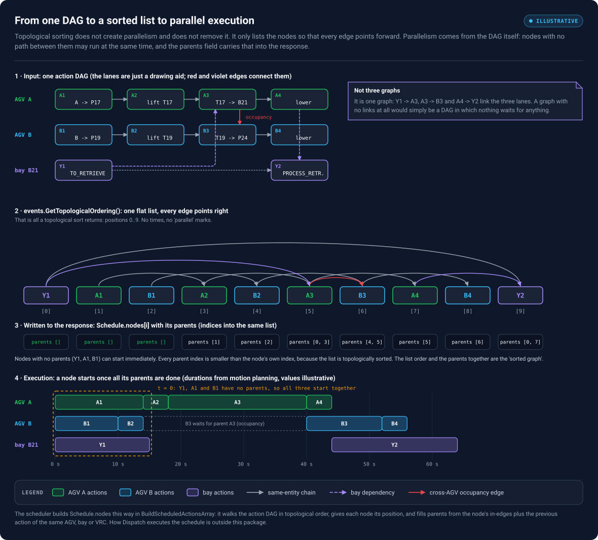

<sub>Pan / zoom: [interactive viewer](figures/viewer.html#54_partial_order_parallel) · [standalone SVG](figures/54_partial_order_parallel.svg)</sub>

*Figure 42 — (1) The input is one action DAG; its three lanes are linked by edges. (2) A topological sort lists the same ten actions so that every edge points right; it adds no information about time. (3) The response stores that list as `Schedule.nodes`, and each node keeps the indices of its parents. (4) In execution, every node whose parents are done can start, so Y1, A1 and B1 start together, and B3 waits only for its parent A3.*

Read it as a pipeline:

1. **Input: one DAG**, not several. The lanes are only a way of drawing it; the bay edges and the occupancy edge connect them. (Even a DAG with no edges between lanes would be fine: it would simply mean nothing waits for anything.)
2. **The topological sort produces a list**, `std::optional<VertexVec>`. It neither creates nor removes parallelism; it only guarantees that every node comes after its parents. The scheduler uses this list to replay events on a `DiscreteGarageState` and to number the actions.
3. **The response keeps both the list and the edges.** `BuildScheduledActionsArray` walks the action DAG in topological order, gives each action its position in `Schedule.nodes`, and fills `parents` from its in-edges plus the previous action of the same AGV, bay or VRC. So the "sorted graph" is exactly this: a sorted array in which every node points back to its parents, always at smaller indices.
4. **Execution is driven by `parents`, not by array order.** A node can start as soon as all its parents are done; nodes without a path between them run at the same time. The times themselves come from motion planning: in the `ContinuousStateToSchedule` test, AGV 1 and AGV 2 both have motions starting at `t = 0`. How Dispatch's executor consumes `parents` is outside this package.

Parallelism is still lost wherever an edge exists. Some edges are physical (one AGV does one thing at a time; a tray is in one place). Others are choices: rule B orders every step of a job even when two steps could overlap, and REBALANCE_GARAGE runs its bays one after another because they share a job index (section 12.18). Those are fair targets for improvement.

### The logic feels convoluted. Is it?

Partly. It helps to separate what the problem forces from what the code adds.

**What the problem forces.** Trays block each other, an AGV must fetch a tray before carrying it, bays and VECS have modes, and every job's plan depends on where earlier jobs leave things. Some precedence structure is unavoidable. Separating *what must happen in which order* (the event DAG) from *how and when robots move* (CHUGG) is a sound and common split.

**What the code adds** (evidence from `scheduler.cpp`):

- **One mutable DAG, edited by three passes.** Job expansion leaves blanks (`T21 -> ?`), tray assignment fills them and adds blocker moves, AGV assignment adds approach, lift and lower events. To know what an event looks like you need to know which pass you are in.
- **Edges come from many places.** `AddDependency` appears 28 times in `scheduler.cpp`, spread over ten `Scheduler` methods (`DoTrayAssignments` 7, `AssignDestForUntargetedMove` 5, `MoveAgvToTrayPose` 3, `PlanReparkTrayJob` 2, `DoAgvAssignments` 2, `AddDepsAfterAmiga` 2, and one each in `AppendAgvLiftEvent`, `AddNodeArrivalDeps`, `GetEventDag` and `TryClearBlockedAgvMove`), plus the two `ScheduleContext` helpers. An edge does not record why it was added, and `Reduce()` later removes the redundant ones, so the final DAG does not show where its edges came from.
- **Repeated replay.** Almost every step copies `initial_state` and replays the whole DAG to know the current state.
- **Implicit conventions.** `job_index` is a position in a list that only successful jobs enter; failed jobs can leave events behind (section 12.18).

**What would make it easier to follow** (suggestions, not plans): record a reason or kind on every edge; keep each kind of constraint in one function; check invariants after each pass (acyclic, every `TrayMove` complete, no leftover events); give each pass a narrow input and output. That last point is what the solver interfaces in [02](02-issue-and-proposal.md) start to do. Until then, the `debug/printdags` service (section 20), which logs the DAG after each pass, is the best way to see what the code built.

### Does the code really call them rule A, rule B and rule C?

No. The letters are this guide's shorthand, chosen to keep the figures readable. Search the code for these names instead:

| Guide | In the code | Code comment |
|---|---|---|
| Rule A | `ScheduleContext::UpdateLastEntityEvent(entity_id, new_event)` in `scheduler.hpp`, using the map `last_entity_event` | "Add a dependency on the entity's last event, if it had one" |
| Rule B | `ScheduleContext::UpdateLeafDependencies(child, job_index)` in `scheduler.hpp` | "Adding a new child event to the leafs in the DAG. Each leaf becomes a parent to the new child event." |
| Rule C | Two inline blocks at the end of `Scheduler::PlanReparkTrayJob` | "If reparking into a bay, ensure that we depend already on the last completed event for that bay -- could either be a PROCESS_RETRIEVE or TRANSITION_TO_RETRIEVE" (and the same for a VECS) |

**Why each one is needed**, by what would go wrong without it:

- **Without rule A**, two jobs that touch the same tray, AGV, bay or VECS would be unordered. If job 0 moves T19 from P19 to P24 and job 1 moves it from P24 to P23, nothing would stop the replay, or the robots, from doing job 1's move first, starting from a place the tray is not at yet.
- **Without rule B**, the steps inside one job would be unordered: the car's tray could be planned into B21 before the bay switches to retrieve mode, or `PROCESS_RETRIEVE` could run before the tray arrives.
- **Without rule C**, a tray could enter a bay before an *earlier job's* bay event finished. Rule B does not help across jobs, and rule A does not either, because a `TrayMove` is chained to its tray, not to the bay it enters. For example, a READY_FOR_INSERT job bringing an empty tray into B21 must wait for the previous job's `PROCESS_RETRIEVE` on B21; only rule C adds that edge.

The three rules are not the whole story. They only order what the job methods know about. Geometric conflicts (a tray in the way, two AGVs on one node) are turned into edges later by tray and AGV assignment (sections 14 and 15).

## 23. Known limitations and reading checkpoint

Limits of this guide: `GarageGraph`, `CollisionTable`, `GarageOccupancyChecker`, the search environments, `BottleneckAssignment`, CHUGG, `DiscreteGarageState` and the event classes live in other packages and were not in the snapshot. Dispatch, AGV firmware and the Pecos garage's real occupancy were not supplied. Do not infer those details from a schematic figure.

Limits of the code worth remembering: `GetAgvOccupiedDuration` returns zero; failed jobs can leave events in the DAG; any failure after expansion fails all jobs in the request; `Reduce()` placement is load-bearing; `UseEvChargeHeading` contains a hard-coded site rule.

**Before reading [02](02-issue-and-proposal.md), check you can answer:**

1. What is the difference between a job, an event, a motion and an action?
2. In `Scheduler::Plan`, what is `this`, what is `plan_ctx`, and why can a `const` method still change the plan?
3. Why does every `Plan<Type>Job` start by copying `ctx->initial_state` and calling `ctx->events.Apply`?
4. What makes a `TrayMove` incomplete, and which stage completes each missing part?
5. What does an edge in `ScheduleEventDag` mean, and which three rules add edges during job expansion?
6. Why is `first_tray_event` recorded in tray assignment and read in AGV assignment?
7. What does bottleneck matching optimise, and why might it not pick the lowest total cost?
8. When does `Plan()` return `success == false`, and how do you tell which jobs really failed?
9. How does a bay differ from a VECS and from a VRC in this code?

### Source index

- `include/scheduler/scheduler.hpp`: `SchedulerParams`, `ScheduleContext`, `Scheduler` declarations with comments
- `src/scheduler.cpp`: everything in `Scheduler`, plus the response-building helpers
- `include/scheduler/utils.hpp`, `src/utils.cpp`: base-state validation, bay classification and rebalancing, VRC actions
- `include/scheduler/scheduler_ros.hpp`, `src/scheduler_ros.cpp`, `src/scheduler_component.cpp`: ROS wiring and parameters
- `test/*.cpp`, `test/garage_states/double_retrieve_garage_state.yaml`: 72 active tests and one fixture
- `CMakeLists.txt`, `package.xml`: targets and dependencies
- `sources/repomix-scheduler.xml`: the snapshot all of the above was read from
- `sources/5675_pecos_combined.yaml`: coordinates, node metadata and edges for the Pecos figures
