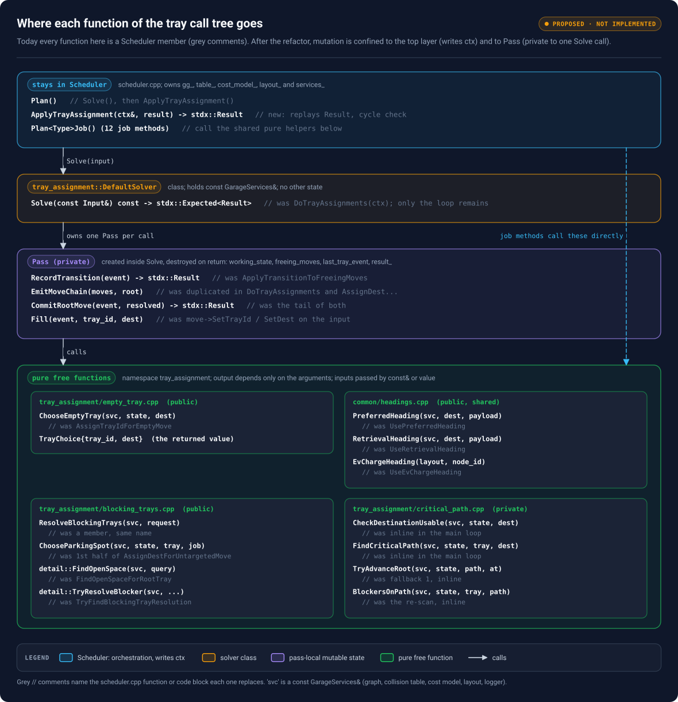

# 02 — Scheduler Core Refactor: problem statement and proposal

This document explains *what* the refactor changes and *why*, using the code in `sources/repomix-scheduler.xml` as evidence. It assumes you have read sections 7–9 and 14–15 of [01 — Software background](01-software-background.md). Code snippets follow the same conventions as doc 01: every snippet says which class it lives in, what `this` is, and the type of each variable that is not obvious. Snippets marked **proposed** do not exist in the repository.

| Name in snippets | Type | What it is |
|---|---|---|
| `this` inside `Scheduler::…` | `const volley::Scheduler*` | The one `Scheduler` object, owned by `SchedulerRos` through `SchedulerSPtr` (`std::shared_ptr<Scheduler>`) |
| `plan_ctx`, `ctx` | `ScheduleContextSPtr` = `std::shared_ptr<ScheduleContext>` | Per-`Plan()` scratch state: initial state, event DAG, job list, bookkeeping maps |
| `ctx->events` | `volley::ScheduleEventDag` | The event DAG being built (Boost graph of `std::shared_ptr<ScheduleEvent>`) |
| `ctx->initial_state` | `volley::DiscreteGarageState` | Snapshot of the garage at request time; never mutated after `Plan()` builds it |
| `working_state` | `volley::DiscreteGarageState` (local copy) | `initial_state` with already-planned events applied, used to answer "where is everything *now*?" |
| `gg_`, `table_`, `cost_model_`, `layout_`, `logger_` | `GarageGraph`, `CollisionTable`, `cost::MotionCostModel`, `LayoutSPtr`, `rclcpp::Logger` | `Scheduler` data members built once in the constructor |
| `stdx::Expected<T>`, `stdx::Result` | `tl::expected<T, std::string>`, `tl::expected<void, std::string>` (from the `stdx` package) | A value or an error message; `Result` is success or an error. Proposed replacement for `BoolStringPair` (section 6.3) |
| `svc` | `const common::GarageServices&` (**proposed**) | Bundle of const references to `gg_`, `table_`, `cost_model_`, `*layout_` plus the logger, passed to every pure helper (section 6.5) |

## Contents

<!-- toc -->
- [1. Ticket and scope](#1-ticket-and-scope)
- [2. Where the two algorithms sit today](#2-where-the-two-algorithms-sit-today)
- [3. What the two algorithms touch](#3-what-the-two-algorithms-touch)
- [4. Current versus target responsibilities](#4-current-versus-target-responsibilities)
- [5. Target architecture](#5-target-architecture)
- [6. Proposed layout and API for tray assignment](#6-proposed-layout-and-api-for-tray-assignment)
- [7. Key invariants to maintain](#7-key-invariants-to-maintain)
- [8. Staged plan](#8-staged-plan)
- [9. Decisions to resolve in review](#9-decisions-to-resolve-in-review)
- [10. Proposed UML and call sequence](#10-proposed-uml-and-call-sequence)
- [11. Next actions](#11-next-actions)
<!-- /toc -->

## 1. Ticket and scope

**Parent Jira initiative:** **Scheduler Core Refactor** (parent key not given in the supplied ticket text). **Specific tasks:** [SW2-484](https://volleyautomation.atlassian.net/browse/SW2-484) (tray solver interface, in progress), [SW2-769](https://volleyautomation.atlassian.net/browse/SW2-769) (scheduler package reorganization, marked done) and [SW2-487](https://volleyautomation.atlassian.net/browse/SW2-487) (tray benchmark set, To Do). The links follow the usual Jira URL pattern; the base domain and current status have not been verified. Related keys reported by the user: SW2-677, SW2-652, SW2-593, SW2-488, SW2-496, SW2-514, SW2-663, SW2-18, SW2-686, SW2-776 and SW2-905. **Do not assume all of them block the refactor.**

**Objective:** move tray-move planning and AGV assignment out of large `Scheduler` methods and behind generic, swappable interfaces. Default implementations must reproduce current behaviour, and each solver needs at least **10 real-customer-layout scenarios** with recorded baseline performance. **Out of scope:** changes to CHUGG/SIPP motion planning, a new optimal solver, and adding to active schedules.

**Definition of Done:** two generic interfaces; two behaviour-equivalent default implementations; 10+ site-based benchmark scenarios per solver with saved baselines; every `Scheduler` assignment call site routed through the interfaces; old code paths removed. Source: user-provided Jira text, October 2026. This describes the intended state, not the code today.

## 2. Where the two algorithms sit today

Both algorithms are `const` member functions of `Scheduler` that take the per-call context and edit it in place. They return `BoolStringPair` (`std::pair<bool, std::string>`: success flag plus a message). Section 6 proposes replacing both habits: `stdx::Expected` instead of `BoolStringPair`, and a returned result instead of editing `ctx`.

```cpp
// include/scheduler/scheduler.hpp — inside class volley::Scheduler (public section)
BoolStringPair DoTrayAssignments(ScheduleContextSPtr ctx) const;  // fills tray ids + destinations, adds blocker moves
BoolStringPair DoAgvAssignments(ScheduleContextSPtr ctx) const;   // picks AGVs, adds approach/lift/lower events
```

`const` here only means the methods do not change `Scheduler`'s own members. The real output is the mutation of `*ctx`, which the `shared_ptr` lets them reach. They are called from the middle of `Scheduler::Plan`:

```cpp
// src/scheduler.cpp — PlanResponseMsg Scheduler::Plan(const PlanRequestMsg& request_data, const rclcpp::Time& now) const
// this     : const Scheduler*  (the Scheduler that SchedulerRos owns)
// plan_ctx : ScheduleContextSPtr, created earlier in Plan() from the request's garage state
// result   : PlanResponseMsg being built; result.scheduled_jobs is std::vector<ScheduledJobDataMsg>
//   ...every pending job has already been expanded into events by a Plan<Type>Job method...

auto [success, message] = DoTrayAssignments(plan_ctx);   // same as this->DoTrayAssignments(plan_ctx)
if(!success) {
  result.success = true;                                 // the *call* succeeded...
  result.message = "Failed tray assignments: " + message;
  for(const auto& job : request_data.pending_jobs) {     // ...but every pending job is reported failed
    result.scheduled_jobs.push_back(FailJob(job, message));
  }
  return result;
}
std::tie(success, message) = DoAgvAssignments(plan_ctx); // same failure handling as above
// ...then plan_ctx->events.Reduce(), SanityCheckEvents(plan_ctx), PlanMotions(...)
```

Two consequences matter for the refactor:

- **Failure is all-or-nothing.** If either algorithm fails, every pending job fails with the same message, and `success` stays `true`. A new solver must keep that contract or `SchedulerRos` clients will see different responses.
- **Tests already call the algorithms directly.** `test/scheduler_tests.cpp` calls `scheduler.DoTrayAssignments(ctx)` 4 times, `scheduler.DoAgvAssignments(ctx)` 9 times and `scheduler.ResolveBlockingTrays(...)` once. They build a whole `Scheduler` from a layout file to do so:

```cpp
// test/scheduler_tests.cpp — TEST(Scheduler, ...) ; all objects are locals of the test body
Scheduler scheduler(layout_filepath, logger, params);  // loads the layout, builds gg_, table_, cost_model_
ScheduleContextSPtr ctx = std::make_shared<ScheduleContext>(request_id, state, rclcpp::Time());
auto tray_move = std::make_shared<TrayMove>(0u);       // job_index 0; no destination set
tray_move->SetTrayId(1);
ctx->events.AddEvent(tray_move);                       // hand-built one-event DAG
std::tie(success, msg) = scheduler.DoTrayAssignments(ctx);
```

That pattern is the baseline the refactor improves on: after the change, a test should be able to construct the solver with only the services it needs.

## 3. What the two algorithms touch

Figure 1 is generated from `scheduler.cpp`. Each row is one `Scheduler` method in the tray or AGV call tree. Each column is something its body uses. The right-hand column lists callers outside the two trees: those are the helpers you cannot simply move.


<sub>Pan / zoom: [interactive viewer](figures/viewer.html#34_coupling_matrix) · [standalone SVG](figures/34_coupling_matrix.svg)</sub>

**Figure 1 — Coupling of the tray and AGV call trees.** Filled dots mark a token found in the method body (comment-stripped). A helper that receives the DAG as a parameter rather than through `ctx` shows no `events` dot even though it edits the DAG, so read the dots as "uses directly", not "is independent of".

What the matrix tells you:

1. **Both trees need the same three services.** `gg_` (graph search), `table_` (collision checks) and `cost_model_` (travel times) appear throughout. `layout_` is used mainly for node types and headings. All four are read-only after construction, which makes constructor injection by `const&` safe as long as the `Scheduler` outlives the solver.
2. **The tray tree touches three context fields:** it edits `ctx->events`, reads `ctx->initial_state`, and fills `ctx->first_tray_event` (the first move of each tray, keyed by tray id `uint16_t`). The AGV tree reads `first_tray_event` back inside `MoveAgvToTrayPose`. That map is the hand-off between the two solvers and must be part of both contracts.
3. **Five helpers are shared with job planning.** They must stay reachable from `Scheduler` (or move to a shared utility) after the algorithms leave:

| Helper (all `Scheduler` members) | Also called by | Why |
|---|---|---|
| `ResolveBlockingTrays` (public) | `PlanChargePayloadJob`, one test | Finds a VECS node plus unblocking moves when the requested node is not a ready VECS |
| `AssignTrayIdForEmptyMove` | `PlanReadyForInsertJob` | Picks an empty tray early, best-effort |
| `UsePreferredHeading` | `PlanAgvMoveJob`, `PlanReparkTrayJob` | Chooses the parking heading that makes later retrieval fastest |
| `UseEvChargeHeading` | `PlanChargePayloadJob` | Heading for a VECS node |
| `GetJustMovingCost` | `PlanAgvChargeJob`, tests | Travel-time estimate for an AGV between two poses |

4. **External algorithms are already separate.** `SingleSourceSearch`, `GetStaticFilter`, `GetPosePath` and `BottleneckAssignment` come from other packages. The default solvers keep calling them; nothing about them changes.
5. **Some "AGV assignment" work is graph repair, not matching.** `DoAgvAssignments` ends with `EnsureAgvMovePathsClear(ctx)` (up to 256 repair passes), then `ctx->events.Reduce()`, then `AddDepsAfterAmiga(...)`. `Plan` calls `Reduce()` a second time afterwards. Keep all of these in the same order inside the default AGV solver for the first pass; see risk 2 in section 9.

## 4. Current versus target responsibilities

| Concern | Today (method in `Scheduler`) | After the refactor |
|---|---|---|
| Validate request, build `ScheduleContext` | `Plan` | Stays in `Scheduler` |
| Expand jobs into events | `Plan<Type>Job` (12 methods) | Stays in `Scheduler` |
| Choose tray and destination for each `TrayMove` | `DoTrayAssignments` → `AssignTrayIdForEmptyMove`, `AssignDestForUntargetedMove` | `tray_assignment::DefaultSolver` (the loop) + pure `ChooseEmptyTray`, `ChooseParkingSpot` (section 6.2) |
| Move blocking trays out of the way | `ResolveBlockingTrays` → `FindOpenSpaceForRootTray`, `TryFindBlockingTrayResolution` | Pure free function `tray_assignment::ResolveBlockingTrays(svc, request)`, public so job planning can call it too |
| Write the tray results into `ctx` | (done inside `DoTrayAssignments`) | `Scheduler::ApplyTrayAssignment(ctx, result)`, the only writer (section 6.4) |
| Choose parking headings | `UsePreferredHeading`, `UseRetrievalHeading`, `UseEvChargeHeading` | Pure functions in `common/headings` |
| Match AGVs to tray moves | `DoAgvAssignments` + cost helpers + `BottleneckAssignment` | `agv_assignment::DefaultSolver` |
| Add approach, lift and lower events | `MoveAgvToTrayPose`, `AppendAgvLiftEvent`, `AddNodeArrivalDeps` | Default AGV solver |
| Repair AGV path conflicts, reduce, AMIGA deps | `EnsureAgvMovePathsClear`, `Reduce`, `AddDepsAfterAmiga` (end of `DoAgvAssignments`) | Default AGV solver, same order (move later only with evidence) |
| DAG primitives | `planner_core::ScheduleEventDag` | Unchanged |
| Sanity check, motion planning, response | `SanityCheckEvents`, `PlanMotions`, `ResponseFromTrajectories` | Unchanged |

**Decision needed:** where the solver *interfaces* live. Section 6.1 proposes starting with module folders (`tray_assignment/`, `agv_assignment/`, `common/`) inside the scheduler package, each its own CMake target, which can later move to a package with a `git mv`. Options are `planner_core`, a small solver-interface package, or a new scheduler-core package. A default implementation needs `motion_planner` and `cost_functions`, so putting it in a low-level package can create dependency cycles. Check against `package.xml` and the exported CMake targets before choosing.

## 5. Target architecture


<sub>Pan / zoom: [interactive viewer](figures/viewer.html#02_target_architecture) · [standalone SVG](figures/02_target_architecture.svg)</sub>

**Figure 2 — Proposed architecture.** Solver contracts separate policy from orchestration. Both default solvers get graph, collision, cost and layout services through one `const GarageServices&`. The tray solver only reads the event DAG and returns its edits, which `Scheduler` applies; the AGV solver edits the DAG in place for the first pass (section 6.6). This is a proposal, not existing code.

## 6. Proposed layout and API for tray assignment

This section answers four questions in order: where the code lives (6.1), which of today's functions become class members and which become pure functions (6.2), how errors are reported (6.3), and how the solver returns its work instead of editing the caller's context (6.4). 6.5 puts it together as a header sketch, and 6.6 says how much of this applies to AGV assignment. Everything here is **proposed**; names are suggestions for review.

### 6.1 Source tree: one module folder per solver

Today the scheduler package is flat: `include/scheduler/{scheduler,scheduler_ros,scheduler_msgs,utils}.hpp`, `src/` with the matching `.cpp` files, and `test/`. Tray and AGV assignment are about 2,000 lines inside `src/scheduler.cpp`. The proposal is one folder per solver, each laid out like the existing `src/core/stdx` package (its own `CMakeLists.txt`, `include/`, `src/`, `test/`):

```text
scheduler/                                   # the existing ROS package (package.xml, CMakeLists.txt)
├── CMakeLists.txt                           # add_subdirectory(common tray_assignment agv_assignment)
├── package.xml                              # already has <depend>stdx</depend>
├── include/scheduler/                       # unchanged: scheduler.hpp, scheduler_ros.hpp, scheduler_msgs.hpp, utils.hpp
├── src/                                     # unchanged files; scheduler.cpp shrinks to Plan() + job expansion
├── test/                                    # existing tests; the 4 + 9 direct-call tests move to the folders below
├── common/                                  # target scheduler_common
│   ├── include/scheduler/common/
│   │   ├── garage_services.hpp              # GarageServices: const refs to graph, collision table, cost model, layout + logger
│   │   └── headings.hpp                     # PreferredHeading, RetrievalHeading, EvChargeHeading (pure)
│   └── src/headings.cpp
├── tray_assignment/                         # target scheduler_tray_assignment
│   ├── CMakeLists.txt
│   ├── include/scheduler/tray_assignment/   # PUBLIC: what Scheduler and job planning may include
│   │   ├── solver.hpp                       # Solver interface, Input, Result, TrayFill, DagEdit
│   │   ├── default_solver.hpp               # DefaultSolver
│   │   ├── apply.hpp                        # ApplyTrayAssignment(ScheduleContext&, const Result&)
│   │   ├── empty_tray.hpp                   # ChooseEmptyTray            (also used by PlanReadyForInsertJob)
│   │   └── blocking_trays.hpp               # ResolveBlockingTrays, ChooseParkingSpot (also used by job planning)
│   ├── src/                                 # PRIVATE: not installed, not on anyone else's include path
│   │   ├── default_solver.cpp               # Solve(): the per-event loop
│   │   ├── pass.hpp / pass.cpp              # Pass: working_state, freeing_moves, last_tray_event, result builder
│   │   ├── critical_path.hpp / .cpp         # CheckDestinationUsable, FindCriticalPath, TryAdvanceRoot, BlockersOnPath
│   │   ├── empty_tray.cpp
│   │   ├── blocking_trays.cpp               # + detail::FindOpenSpace, detail::TryResolveBlocker
│   │   └── apply.cpp
│   └── test/                                # empty_tray_test, blocking_trays_test, critical_path_test, default_solver_test, apply_test
└── agv_assignment/                          # target scheduler_agv_assignment, same shape
    ├── include/scheduler/agv_assignment/    # solver.hpp, default_solver.hpp, travel_cost.hpp (GetJustMovingCost, shared)
    ├── src/
    └── test/
```

Why this shape:

- **The folder is the boundary, and CMake enforces it.** Each folder is its own library target with its own include directory. `tray_assignment/src/*.hpp` are on no other target's include path, so `Scheduler` *cannot* reach `Pass` or `critical_path.hpp`, and the public headers are the whole API. Dependency rules: `tray_assignment` and `agv_assignment` depend on `common`, `planner_core`, `motion_planner`, `cost_functions` and `stdx`, never on `scheduler.hpp`; `agv_assignment` does not include `tray_assignment` (the hand-off, `first_tray_event`, is a plain map in its `Input`). A CI grep for `#include "scheduler/scheduler.hpp"` under the two folders catches the one mistake CMake cannot.
- **It can become a package later with a `git mv`.** If review decides the solvers belong in their own ROS package (the open decision in section 4), each folder already has the layout of one.
- **`tray_assignment` rather than `tray_movement`.** Job expansion also plans tray *movement* (it creates the `TrayMove`s); this module only *assigns* what expansion left open (tray ids, destinations, blockers). `tray_assignment` matches the stage name in doc 01 (`DoTrayAssignments`) and pairs with `agv_assignment`.
- **Namespaces follow folders:** `volley::tray_assignment::Solver`, `volley::agv_assignment::Solver`, `volley::common::GarageServices`. Short names inside, unambiguous outside.

### 6.2 Where each function of the tray call tree goes

No, not everything moves into the new class. The call tree splits into four groups, by one question: **what does the function change?**



<sub>Pan / zoom: [interactive viewer](figures/viewer.html#57_tray_tree_placement) · [standalone SVG](figures/57_tray_tree_placement.svg)</sub>

**Figure 3 — Where each function of the tray call tree goes.** Today all of them are `Scheduler` members, and most edit `ctx`, the `TrayMove` they are given, or both. After the refactor only two places change anything: `Scheduler::ApplyTrayAssignment` (writes `ctx`, once) and `Pass` (private, lives for one `Solve` call). The solver class is thin, and most of the logic becomes pure free functions that job planning can call too.

| Today (all `Scheduler` members) | What it changes today | After | New form | File |
|---|---|---|---|---|
| `DoTrayAssignments(ctx)` | `ctx->events`, `ctx->first_tray_event`, fields of existing `TrayMove`s | **solver class** | `DefaultSolver::Solve(const Input&) const -> stdx::Expected<Result>`: creates a `Pass`, runs the per-event loop, returns the pass's result | `default_solver.cpp` |
| `ApplyTransitionToFreeingMoves(event, ws&, freeing&)` | `working_state`, `freeing_moves` | **pass-local** | `Pass::RecordTransition(const ScheduleEventSPtr&) -> stdx::Result` | `pass.cpp` |
| `AssignTrayIdForEmptyMove(TrayMove&, const ws&)` | the `TrayMove` (tray id, maybe heading) | **pure** | `ChooseEmptyTray(svc, const DiscreteGarageState&, const GaragePoseMsg& dest) -> stdx::Expected<TrayChoice>`; the caller decides what to do with the choice | `empty_tray.cpp` (public: `PlanReadyForInsertJob` uses it) |
| `AssignDestForUntargetedMove(move*, ctx, event, ws&, freeing&, last&)` | the move, `ctx->events`, `ctx->first_tray_event`, `working_state`, `freeing_moves`, `last_tray_event` | **split** | pure `ChooseParkingSpot(svc, state, tray_id, job_index) -> stdx::Expected<ParkingPlan>` (search + heading policy), then `Pass::EmitMoveChain` and `Pass::CommitRootMove` | `blocking_trays.cpp`, `pass.cpp` |
| `ResolveBlockingTrays(tray, job, base_state, immobile, illegal, enforce, stash)` | nothing (copies `base_state`) | **pure** (already is) | `ResolveBlockingTrays(svc, const ResolveRequest&) -> stdx::Expected<BlockingResolution>` | `blocking_trays.cpp` (public: `PlanChargePayloadJob`) |
| `FindOpenSpaceForRootTray(...)` | nothing | **pure, internal** | `detail::FindOpenSpace(svc, const OpenSpaceQuery&) -> std::optional<OpenSpaceSearchResult>` | `blocking_trays.cpp` |
| `TryFindBlockingTrayResolution(...)` | nothing | **pure, internal** | `detail::TryResolveBlocker(svc, ...) -> std::optional<BlockingTrayResolution>` (mutually recursive with `ResolveBlockingTrays`, so same file) | `blocking_trays.cpp` |
| `UsePreferredHeading(pose&, payload, tray)`, `UseRetrievalHeading(pose&, payload)`, `UseEvChargeHeading(pose&) -> bool` | the pose passed by reference | **pure, shared** | `PreferredHeading(svc, GaragePoseMsg dest, payload) -> GaragePoseMsg`, `RetrievalHeading(...)`, `EvChargeHeading(const Layout&, node_id) -> std::optional<int16_t>` | `common/headings.cpp` (job planning uses them too) |
| destination check, inline in the main loop (`:2622`–`:2648`) | nothing | **pure, private** | `CheckDestinationUsable(svc, state, dest) -> stdx::Result` | `critical_path.cpp` |
| critical-path search, inline (`:2656`–`:2710`) | nothing | **pure, private** | `FindCriticalPath(svc, state, tray_id, dest) -> stdx::Expected<CriticalPath>` (`path`, `VertexCollisionIdMap`, ordered `blocking_trays`) | `critical_path.cpp` |
| fallback 1 “advance the root tray”, inline (`:2796`) | `working_state`, `critical_path` | **pure, private** | `TryAdvanceRoot(svc, state, path, position) -> std::optional<PlannedTrayMove>`; the pass applies it | `critical_path.cpp` |
| blocker re-scan, inline (`:2992`) | `blocking_trays` (local) | **pure, private** | `BlockersOnPath(svc, state, root_tray, path_from_here) -> std::vector<uint16_t>` | `critical_path.cpp` |
| event emission, written **twice** (`:2928`–`:2990` and inside `AssignDestForUntargetedMove`) | `ctx->events`, `first_tray_event`, `freeing_moves`, `last_tray_event`, `working_state` | **pass-local** | `Pass::EmitMoveChain(std::span<const PlannedTrayMove>, ...)`, written once | `pass.cpp` |
| root-move tail (freeing edges, `Apply`, chain) | same | **pass-local** | `Pass::CommitRootMove(const ScheduleEventSPtr&, const TrayMove& resolved) -> stdx::Result` | `pass.cpp` |

**What “pure” means here.** The function's result depends only on its arguments, and it writes nothing reachable from them: no member state, no `ctx`, no event objects. Inputs come in by `const&` or by value, and the answer comes back as the return value. The read-only services (`GarageGraph`, `CollisionTable`, `MotionCostModel`, `Layout`) are passed as one `const GarageServices&` (`svc`), because they never change after the `Scheduler` constructor. Logging is the one allowed side effect: it does not change what any later call computes.

Why make them pure:

- **They can be tested alone.** `ChooseEmptyTray` needs a layout, a `DiscreteGarageState` and a destination, not a `Scheduler`, not a `ScheduleContext`, not a DAG. Today the only way to test it is through `DoTrayAssignments` or `PlanReadyForInsertJob`.
- **The “shared helper” problem in section 3 goes away.** Job methods call the same free functions with the `Scheduler`'s `services_`. No back-pointer from the solver to `Scheduler`, and no copy of the helpers on both sides.
- **The recursion is easier to trust.** `ResolveBlockingTrays` ↔ `TryResolveBlocker` already work on private copies of the state; as free functions with no members to touch, that guarantee is visible in the signature.
- **One copy of the emission code.** The two emission blocks differ in three small ways today, and parity means keeping all three:
  - the main loop registers each move's source pose with the generic `TRAY` collision id, while `AssignDestForUntargetedMove` uses the tray's own id → a parameter of `EmitMoveChain`;
  - only the main loop erases the tray from `blocking_tray_set` → stays in the caller;
  - only `AssignDestForUntargetedMove` checks the result of `Apply`. The main loop *cannot* yet: on the fallback-1 path the advance move was already applied before it reaches this block and is applied a second time here (the `TODO(Gunther)` at `:2933` says so). Checking would make that path fail → a parameter for now; fix the double apply as its own reviewed change.

  The root-move tails differ too: the main loop adds `freeing_moves` edges for the root move's destination and source and registers its source (`:3024`–`:3050`); `AssignDestForUntargetedMove` does neither (doc 01, section 14). `CommitRootMove` keeps both behaviours behind a flag until someone decides whether the second is a bug.

**What stays mutable, and why that is fine.** The loop needs a garage state that changes after every move, an occupancy record and a per-tray “last move” map. Those live in `Pass`, an object created inside `Solve` and destroyed when it returns. Nothing outside can see it. Seen from the caller, `Solve` is still a pure function: same `Input`, same `Result`. This is the usual pattern of “local mutation, pure interface”: rewriting the loop to thread an immutable state through every step would add copying and noise without making the code any safer.

### 6.3 Errors: `stdx::Expected` instead of `BoolStringPair`

`BoolStringPair` (`std::pair<bool, std::string>`) and `stdx::Expected` say the same thing (“it worked, or here is why not”), but `Expected` says it in the type: a caller cannot read a value without checking, and there is no meaningless message on success or meaningless value on failure. The project already has `volley::stdx` (`src/core/stdx/include/stdx/expected.hpp`), aliases over `tl::expected`, and **the scheduler package already uses it**: `package.xml` depends on `stdx`, `EnsureAgvMovePathsClear` returns `stdx::Result`, `RunAgvPathRepairPass` returns `stdx::Expected<bool>`, and `utils.cpp`'s `InsertVrcActionsIntoDag` returns `stdx::Result`. So this is finishing a migration that has started, not adding a dependency:

- `stdx::Expected<T, E = std::string>`: a `T` or an error `E`.
- `stdx::Result` = `stdx::Expected<void>`: success or an error string.
- `stdx::Unexpected(msg)` and `stdx::Unexpected(fmt, args...)` (with `std::format`) to build the error.

| Today | With `stdx` |
|---|---|
| `BoolStringPair F(...)` that only reports success | `stdx::Result F(...)` |
| `BoolStringPair F(TrayMove& move, ...)` that reports success **and** edits its input | `stdx::Expected<TrayChoice> F(...)`: the edit becomes the return value |
| `return std::make_pair(true, "");` | `return {};` |
| `return std::make_pair(false, "Failed to find empty tray to move to " + std::to_string(dest));` | `return stdx::Unexpected("Failed to find empty tray to move to {}", std::to_string(dest));` |
| `auto [ok, msg] = F(); if(!ok) return std::make_pair(false, msg);` | `if(auto r = F(); !r) return stdx::Unexpected(r.error());` |
| `std::pair<std::optional<GaragePoseMsg>, std::vector<std::pair<std::shared_ptr<TrayMove>, std::vector<GaragePoseMsg>>>>` | `stdx::Expected<BlockingResolution>` with named fields `dest` and `required_moves` (a `std::vector<PlannedTrayMove>`, each `{move, path}`) |
| test: `std::tie(success, msg) = scheduler.DoTrayAssignments(ctx); EXPECT_TRUE(success) << msg;` | `auto r = solver.Solve(input); ASSERT_TRUE(r) << r.error();` |

Three rules keep this consistent:

1. **`stdx::Expected` / `stdx::Result` at every function that can fail for a reason someone should read.** That is every public function in 6.2 and every `Pass` method.
2. **`std::optional` stays for “searched, found nothing”** inside a module, where the caller handles the empty case itself and has no message to pass on: `detail::FindOpenSpace`, `detail::TryResolveBlocker`, `TryAdvanceRoot`. Converting these to `Expected` would invent error strings nobody reads. `ResolveBlockingTrays` is the boundary: today its failures are only logged (`WARNS` / `ERRORS`); as `Expected`, the reason travels to the caller, which still treats it as “try the next fallback”.
3. **Keep `E = std::string` for the parity pass.** Error text reaches clients through `FailJob(job, message)` and may be matched by tests. A typed error (`struct Error { Code code; std::string message; }`, which `Expected<T, E>` already allows) is a good follow-up once the benchmarks exist.

Two practical notes. `std::format` has no formatter for `GaragePoseMsg`; either pass `std::to_string(pose)` as above (identical text to today) or add a `std::formatter<GaragePoseMsg>` in `common`. And `tl::expected` has `and_then` / `transform`, which keeps call sites flat (see the `Plan()` snippet in 6.5).

### 6.4 Returning a result instead of editing the context

Today `DoTrayAssignments(ctx)` edits three things it does not own: the DAG (`ctx->events`), the hand-off map (`ctx->first_tray_event`) and the `TrayMove` objects inside the DAG (`SetTrayId`, `SetDest`). The proposal: `Solve` takes a read-only `Input` and **returns a description of the edits**; `Scheduler` applies it in one place.

**Why this is practical for tray assignment.** The tray tree reads the DAG exactly once: `GetTopologicalOrdering()` at the start (plus `GetEventFromVertex` to walk it). After that it only *writes*: `AddEvent`, `AddDependency`, the two setters, and `first_tray_event`. Nothing in the loop reads back an edge it added. So the solver never needs to see its own edits in the DAG, and recording them instead of applying them changes nothing it computes. (The garage *state* the loop does read is `working_state`, which is private to the `Pass` anyway.)

**Why not return a whole new DAG.** `ScheduleEventDag` holds `std::shared_ptr<ScheduleEvent>`. Copying it copies pointers, so a “new DAG” would share event objects with the old one, and the setters would still edit the caller's events. A deep copy needs cloning and an old → new identity map for `first_tray_event` and every later stage. An **edit log** avoids both: it refers to existing events by the same `shared_ptr`, adds new events as new objects, and never touches the caller's.

```cpp
// PROPOSED — tray_assignment/include/scheduler/tray_assignment/solver.hpp
namespace volley::tray_assignment {

// A blank field filled on an EXISTING TrayMove of the input DAG. Applied with SetTrayId / SetDest.
struct TrayFill {
  ScheduleEventSPtr event;   // the TrayMove, as the input DAG holds it (pointer identity)
  uint16_t tray_id;          // same as before if it was already set
  GaragePoseMsg dest;        // same as before if it was already set; heading may be adjusted
};

// One structural edit, in the order today's code makes it.
struct AddEvent      { ScheduleEventSPtr event; };                    // a NEW TrayMove (blocker, advance)
struct AddDependency { ScheduleEventSPtr from; ScheduleEventSPtr to; };  // from must finish before to
using DagEdit = std::variant<AddEvent, AddDependency>;

struct Result {
  std::vector<TrayFill> fills;                                       // one per TrayMove that had a blank
  std::vector<DagEdit> edits;                                        // ordered; replay in this order
  std::unordered_map<uint16_t, ScheduleEventSPtr> first_tray_event;  // hand-off to AGV assignment
};

}  // namespace volley::tray_assignment
```

**Parity depends on the order.** The DAG's vertex indices follow `AddEvent` order, and what later stages compute (topological order among unordered events, `Reduce`) can depend on that order. `edits` is therefore an ordered log, and `ApplyTrayAssignment` replays it front to back with the same `AddEvent` / `AddDependency` calls today's code makes, so the resulting DAG is the same graph built in the same order. `AddDependency`'s return value (false for a duplicate or rejected edge) is only logged today, so replaying the same calls gives the same edge set.

**The one subtle part: the loop needs filled values before they are applied.** After `ChooseEmptyTray`, the main loop plans *that* tray's path, and later `Apply`s the move to `working_state`. Today it reads the id back from the mutated event. In the new design the `Pass` makes a resolved copy, `TrayMove resolved = *move; resolved.SetTrayId(choice.tray_id);`, applies the copy to its `working_state`, records a `TrayFill`, and never touches `*move`. This assumes `TrayMove` is copyable and that `ScheduleEvent::Apply(state&)` changes only the state. The second is what `RunAgvPathRepairPass` already relies on (“Discrete Apply only updates positions for these events”), but both live in `planner_core`, which is not in this snapshot, so **verify before stage C**. If `TrayMove` is not copyable, add a small `TrayMove::WithFields(tray_id, dest)` there.

**Applying it.** One function owns every write to the context:

```cpp
// PROPOSED — tray_assignment/src/apply.cpp ; declared in tray_assignment/apply.hpp
stdx::Result ApplyTrayAssignment(ScheduleContext& ctx, const Result& result) {
  for(const auto& edit : result.edits) {                       // structure first, in recorded order
    std::visit(Overloaded{
        [&](const AddEvent& e)      { ctx.events.AddEvent(e.event); },
        [&](const AddDependency& e) { ctx.events.AddDependency(e.from, e.to); }}, edit);
  }
  for(const auto& fill : result.fills) {                       // then the blanks
    auto* move = dynamic_cast<TrayMove*>(fill.event.get());
    if(move == nullptr) return stdx::Unexpected("TrayFill on a non-TrayMove event");
    move->SetTrayId(fill.tray_id);
    move->SetDest(fill.dest);
  }
  ctx.first_tray_event = result.first_tray_event;
  if(!ctx.events.GetTopologicalOrdering()) {                   // same check DoTrayAssignments ends with today
    return stdx::Unexpected("Failed to get new total ordering");
  }
  return {};
}
```

(`Overloaded` is the usual two-line helper for `std::visit`; put it in `common`.) Applying fills after the edits gives the same DAG as long as `AddEvent` and `AddDependency` only use pointer identity and never read event fields (they take `shared_ptr`s; confirm in `planner_core`). Today the setters run earlier only because that was the convenient place.

**What this buys:**

- **A failed solve leaves `ctx` untouched.** Today a failure halfway through has already added events and edges to `ctx->events`. `Plan` throws the whole response away in that case, so it does not matter yet, but it blocks any future “drop the failing job and retry the rest” (section 2: failure is all-or-nothing).
- **Tests can assert exactly what the solver decided:** “filled tray 23 into event 1, added one move T23 → P24, one edge to event 1”, without diffing whole DAGs.
- **The benchmark (SW2-487) can time `Solve` alone**, with no DAG mutation in the measurement, and compare `Result`s between solvers.
- **A `FakeSolver` is trivial:** it returns a canned `Result`.

**Limits to be honest about.** `const ScheduleEventDag&` stops structural edits, but `GetEventFromVertex` still hands out `std::shared_ptr<ScheduleEvent>` to non-const events, so the compiler does not stop a solver from calling a setter. The rule is enforced by review and by one test: snapshot every event's fields before `Solve`, compare after. Changing `planner_core` to hand out `shared_ptr<const ScheduleEvent>` would make it a compile error, but that is outside this refactor.

### 6.5 Header sketch and call site

```cpp
// PROPOSED — common/include/scheduler/common/garage_services.hpp
namespace volley::common {
// Read-only services every search needs. Built once by Scheduler from its members; never changes.
struct GarageServices {
  const GarageGraph& graph;               // Scheduler::gg_
  const CollisionTable& collisions;       // Scheduler::table_
  const cost::MotionCostModel& costs;     // Scheduler::cost_model_
  const Layout& layout;                   // *Scheduler::layout_
  rclcpp::Logger logger;                  // copy of Scheduler::logger_
};
}  // namespace volley::common
```

```cpp
// PROPOSED — tray_assignment/include/scheduler/tray_assignment/solver.hpp (continued)
namespace volley::tray_assignment {

struct Input {                                     // everything Solve may read; nothing it may write
  const DiscreteGarageState& initial_state;        // plan_ctx->initial_state
  const ScheduleEventDag& events;                  // plan_ctx->events, after job expansion
};

class Solver {
 public:
  virtual ~Solver() = default;
  [[nodiscard]] virtual stdx::Expected<Result> Solve(const Input& input) const = 0;
};

}  // namespace volley::tray_assignment
```

```cpp
// PROPOSED — tray_assignment/include/scheduler/tray_assignment/default_solver.hpp
namespace volley::tray_assignment {
class DefaultSolver final : public Solver {
 public:
  explicit DefaultSolver(const common::GarageServices& services);   // services must outlive the solver
  [[nodiscard]] stdx::Expected<Result> Solve(const Input& input) const override;
 private:
  const common::GarageServices& services_;
};
}  // namespace volley::tray_assignment
```

```cpp
// PROPOSED — public free functions (empty_tray.hpp, blocking_trays.hpp)
namespace volley::tray_assignment {

struct TrayChoice { uint16_t tray_id; GaragePoseMsg dest; };   // dest heading may follow the tray
[[nodiscard]] stdx::Expected<TrayChoice> ChooseEmptyTray(
    const common::GarageServices& svc, const DiscreteGarageState& state, const GaragePoseMsg& dest);

struct PlannedTrayMove { std::shared_ptr<TrayMove> move; std::vector<GaragePoseMsg> path; };  // path empty if recursive
struct BlockingResolution { GaragePoseMsg dest; std::vector<PlannedTrayMove> required_moves; };

struct ResolveRequest {                       // named fields replace today's 7 positional parameters
  uint16_t tray_id;
  size_t job_index;
  const DiscreteGarageState& base_state;
  std::set<uint16_t> immobile_trays = {};
  VertexCollisionIdMap illegal_poses = {};
  bool enforce_retrieval_heading = false;
  bool allow_waypoint_stash = true;
};
[[nodiscard]] stdx::Expected<BlockingResolution> ResolveBlockingTrays(
    const common::GarageServices& svc, const ResolveRequest& request);

struct ParkingPlan { GaragePoseMsg dest; std::vector<PlannedTrayMove> required_moves; };  // dest heading final
[[nodiscard]] stdx::Expected<ParkingPlan> ChooseParkingSpot(
    const common::GarageServices& svc, const DiscreteGarageState& state, uint16_t tray_id, size_t job_index);

}  // namespace volley::tray_assignment
```

`ResolveRequest` is worth its few lines: today's main-loop call is `ResolveBlockingTrays(blocking_tray_id, move->GetJobIndex(), working_state, std::set<uint16_t>{move->GetTrayId().value()}, WithPriorDests(blocking_tray_id, critical_path))`, and the `AssignDestForUntargetedMove` call passes `{}, {}` positionally. With designated initializers the call says what each value is:

```cpp
// PROPOSED — inside Pass / DefaultSolver
auto resolution = ResolveBlockingTrays(svc, {.tray_id = blocker,
                                             .job_index = root.GetJobIndex(),
                                             .base_state = pass.State(),
                                             .immobile_trays = {root_tray},
                                             .illegal_poses = WithPriorDests(blocker, critical.vertices)});
if(!resolution) { /* fallback 1, then fallback 2, as today */ }
```

And the call site in `Plan()`, with today's failure contract unchanged (section 2):

```cpp
// PROPOSED — src/scheduler.cpp, Scheduler::Plan
// this         : const Scheduler*
// services_    : common::GarageServices, new member declared after gg_, table_, cost_model_, layout_
// tray_solver_ : std::unique_ptr<tray_assignment::Solver>, new member declared after services_
auto assigned = tray_solver_->Solve({plan_ctx->initial_state, plan_ctx->events})
                    .and_then([&](const tray_assignment::Result& r) {
                      return tray_assignment::ApplyTrayAssignment(*plan_ctx, r);
                    });
if(!assigned) {
  result.success = true;                                    // unchanged: the call succeeded...
  result.message = "Failed tray assignments: " + assigned.error();
  for(const auto& job : request_data.pending_jobs) {        // ...and every pending job fails
    result.scheduled_jobs.push_back(FailJob(job, assigned.error()));
  }
  return result;
}
```

**Lifetime rule.** `GarageServices` and `DefaultSolver` hold references into the `Scheduler`. Declare `services_` after `gg_`, `table_`, `cost_model_` and `layout_`, and `tray_solver_` after `services_`, so they are destroyed first. A test that builds a solver directly must keep the graph, table, cost model and layout alive for the solver's lifetime.

### 6.6 AGV assignment: same layout and error type now, returned result later

The `agv_assignment` folder, `stdx::Expected` and pure helpers apply directly: the cost estimates (`GetJustMovingCost`, shared with `PlanAgvChargeJob`; `GetAgvToTrayAssignmentCost`; `GetAgvOccupiedDuration`), feasibility checks and matching inputs are queries over const services and a state, and `BottleneckAssignment` is already external.

Returning a result is harder there, for reasons visible in the code:

- The AGV tree **reads the DAG it is building.** It consumes `event_dag_copy` root by root (`event_dag_copy.Remove(root_event)`), and `EnsureAgvMovePathsClear` repeatedly inspects edges added earlier in the same stage (up to 256 repair passes), followed by `Reduce()`.
- It **reads back fields it set**: `SetAgvId` on a `TrayMove`, then `GetAgvId()` on candidate moves while building later dependencies.

An edit log could still work, if the solver keeps a private *structural* copy of the DAG (copying pointers is enough for edges), applies every edit to that copy as it goes, and logs it, including a `Reduce` step. The field reads are the real obstacle: they would need either cloned events with an identity map, or a side table (`agv_of[event]`) replacing every `GetAgvId()` read, which touches parity-sensitive code. **Recommendation:** for stage F, use the same layout and `stdx` types, and give the AGV solver an `Input` plus an explicitly mutable `ScheduleEventDag&` (named as such in the signature). Convert it to a returned result after the benchmarks exist and can prove nothing changed.

```cpp
// PROPOSED — sketch only; agv_assignment/include/scheduler/agv_assignment/solver.hpp
namespace volley::agv_assignment {
struct Input {
  const DiscreteGarageState& initial_state;                                 // plan_ctx->initial_state
  const std::unordered_map<uint16_t, ScheduleEventSPtr>& first_tray_event;  // from tray_assignment::Result
};
class Solver {
 public:
  virtual ~Solver() = default;
  // events is edited in place in the first pass (see 6.6); the name says so.
  [[nodiscard]] virtual stdx::Result SolveInPlace(const Input& input, ScheduleEventDag& events) const = 0;
};
}  // namespace volley::agv_assignment
```

## 7. Key invariants to maintain

1. Every `TrayMove` that will execute has a tray id and a destination after tray assignment.
2. The DAG stays acyclic; `GetTopologicalOrdering()` must succeed after each solver.
3. Each tray's moves form a chain in physical order, and `first_tray_event[tray_id]` is that tray's first move (not its last; using the last creates cycles when one AGV moves a tray twice).
4. Blocking-tray moves are created in recursive prerequisite order, and a tray already being moved is not chosen to move again in the same resolution.
5. AGV matches respect disabled AGVs, AGVs trapped in a bay that is not `STATE_READY_TO_RETRIEVE`, reachability, collisions, lift state and AGVs already busy.
6. Arrival ordering never puts two AGVs on one node: `AddNodeArrivalDeps` and `EnsureAgvMovePathsClear` keep doing their jobs.
7. `Scheduler::Plan` output is unchanged, apart from controlled non-determinism and log text.
8. `Reduce()` and path-repair placement stay where they are during extraction.
9. `tray_assignment::Solver::Solve` changes nothing reachable from its `Input`; `ApplyTrayAssignment` is the only place tray assignment writes `ctx`. A test snapshots every event's fields before `Solve` and compares after.
10. `ApplyTrayAssignment` replays `Result::edits` in recorded order, so vertex indices and edge sets match what `DoTrayAssignments` builds today.

The tray-move example below is illustrative; real graphs and paths depend on the layout:


<sub>Pan / zoom: [interactive viewer](figures/viewer.html#03_garage_xy) · [standalone SVG](figures/03_garage_xy.svg)</sub>

**Figure 4 — Top-down garage setup.** AGV 1 faces +x and carries tray T1 toward the goal. Trays T2 and T3 sit on the route, so two prerequisite tray moves (T2 → S3, T3 → S4) must finish first; they are independent of each other. Coordinates are schematic, not a customer layout.

## 8. Staged plan

A move-only refactor is risky because the helpers in section 3 are shared with job planning. Moving them blindly either breaks those callers or recreates the coupling through a back-pointer to `Scheduler`.

| Stage | Change | Exit criterion |
|---|---|---|
| A — baseline | Pin the commit, build, run the 72 active tests; record output DAGs (`debug/printdags`) and `ScheduledJobDataMsg` lists for curated fixtures | Reproducible behaviour captured |
| B — dependency map | Confirm Figure 1 against the branch; decide where the five shared helpers live | Ownership design written down |
| C1 — pure helpers in place | Still inside `scheduler.cpp`: turn the heading helpers, `AssignTrayIdForEmptyMove` (→ `ChooseEmptyTray`), `ResolveBlockingTrays` and the inline main-loop blocks into free functions over `GarageServices` returning `stdx::Expected`; job planning calls them too. Merge the two emission blocks | All tests and DAG snapshots identical; new unit tests for each pure function |
| C2 — tray module | Create `common/` and `tray_assignment/` targets (section 6.1); move the pure functions; add `Solver`, `Input`, `Result`, `Pass`, `DefaultSolver`, `ApplyTrayAssignment` | A test constructs `DefaultSolver` without a `Scheduler`; invariant 9 test passes |
| D — tray migration | `Plan` calls `Solve` + `ApplyTrayAssignment`; keep `DoTrayAssignments` temporarily for side-by-side comparison of the two DAGs | All tests and DAG snapshots identical |
| E — tray cleanup | Delete `DoTrayAssignments` and the old members; port the 4 direct `DoTrayAssignments` tests and the `ResolveBlockingTrays` test to `tray_assignment/test` | No production call to the old methods |
| F — AGV module | `agv_assignment/` with the same layout and `stdx` types; pure cost helpers; `SolveInPlace(input, events)` (section 6.6); port the 9 direct tests | Same behaviour and coverage |
| G — benchmarks | ≥10 real-site scenarios per solver, timed in a pinned environment | Results stored with metadata, no regressions |
| H — final cleanup | Remove legacy code; run full system and advanced suites | Definition of Done demonstrable |

**Ticket mapping:** check SW2-769's package structure against the current branch. SW2-484 is the natural first implementation ticket, and C1 is a good first PR inside it: no new files outside `scheduler.cpp`, easy to review for parity. SW2-487 can start as soon as baseline capture is deterministic. No AGV-specific child tickets were supplied, so none are named here.

## 9. Decisions to resolve in review

| Decision | Initial recommendation | Evidence needed |
|---|---|---|
| Input/output style | Tray: read-only `Input`, returned `stdx::Expected<Result>` (edit log) applied by `Scheduler` (6.4). AGV: explicit `ScheduleEventDag&` for the first pass (6.6) | `TrayMove` copyable and `Apply` state-only (`planner_core`); replay order gives identical DAG snapshots |
| Error reporting | `stdx::Expected<T>` / `stdx::Result` with `std::string` errors; `std::optional` only for internal “found nothing” searches (6.3) | Tests that match error text; `std::to_string` vs a `std::formatter<GaragePoseMsg>` |
| Which functions stay members | Only the solver's `Solve` and the private `Pass`; everything else becomes a pure free function over `GarageServices` (6.2) | Each pure function's unit test passes without a `Scheduler` |
| Folder layout and names | Module folders `common/`, `tray_assignment/`, `agv_assignment/` inside the scheduler package; namespaces to match (6.1) | CMake target boundaries; CI include check |
| Virtual interface vs templates | Virtual `Solve`, owned by `Scheduler` through `std::unique_ptr` | Existing code style, whether plugins must swap solvers at runtime |
| Where interfaces live | Small, low-dependency header package | `colcon graph`, `package.xml`, exported CMake targets |
| Where default solvers live | Scheduler library sub-module first | Avoid new group-level dependency cycles |
| Benchmarks | Direct solver benchmark plus optional end-to-end `Plan` benchmark | Fixtures, harness, timing environment |
| What "same result" means | Same tray/AGV assignments, same edge set after `Reduce`, same final state and errors | Stable event identifiers and tie-breaking |

### Risks that must not be silently "fixed"

These are behaviours a reviewer may want to change. Changing them during extraction breaks parity.

1. `GetAgvOccupiedDuration` always returns `Duration::zero()` (`// TODO(isabel) implement!`). The matching costs depend on that.
2. `Reduce()` runs inside `DoAgvAssignments` *and* again in `Plan`. The `TODO` above the second call says planning may fail without it; nobody has confirmed why.
3. `DoTrayAssignments` postpones DAG reduction until after AGV assignment; moving it earlier is high risk.
4. `TrayMove::Apply` reportedly tolerates a missing tray or destination and still mutates state. `planner_core` is not in this snapshot, so confirm in that package before relying on it.
5. `ScheduleEventDag` uses pointer identity and Boost vertex indices. Removing a vertex can renumber others (verify in `planner_core`), so do not cache vertex descriptors across `Remove`.
6. Test names such as `576_eccles_half` and `1355_fulton` suggest real sites, but `tiny_lot` and `triple_pick_lot` are synthetic. Record which layouts are real before counting them toward the 10-scenario goal.
7. SW2-905 (insert fails when an AGV collides with the chosen parking node) is in the parent ticket; that does not mean the refactor causes it.
8. In fallback 1 (“advance the root tray”), the path recorded for the advance move is `std::vector<GaragePoseMsg>{gg_.GetVertexFromPose(tray_opt->pose).value(), advance_move->GetDest().value()}` (`:2842`–`:2844`). Its first element is a graph *vertex* converted to a `GaragePoseMsg`, and `tray_opt` was already refreshed to the post-advance pose. The `freeing_moves` edges built from that path may therefore be wrong. Reproduce it with a test before touching it; when `TryAdvanceRoot` returns a `PlannedTrayMove`, keep the same path until then.

## 10. Proposed UML and call sequence


<sub>Pan / zoom: [interactive viewer](figures/viewer.html#08_uml_solver) · [standalone SVG](figures/08_uml_solver.svg)</sub>

**Figure 5 — Proposed class structure.** `Scheduler` owns a `tray_assignment::Solver` and builds the read-only `Input` it passes in. `DefaultSolver` and a test double realize the interface (dashed line, hollow triangle) and return `stdx::Expected<Result>`; `Scheduler` applies the `Result` in one place. `DefaultSolver` delegates to pure free functions that job planning also calls. This is the **Strategy** pattern: `Scheduler` depends on the stable interface, not on the algorithm.


<sub>Pan / zoom: [interactive viewer](figures/viewer.html#09_sequence_tray) · [standalone SVG](figures/09_sequence_tray.svg)</sub>

**Figure 6 — Proposed tray solver interaction.** `Scheduler` calls `Solve`. The solver reads the topological event order once, then records (does not apply) tray fills, blocker moves, edges and `first_tray_event` in a `Result`, and returns `stdx::Expected<Result>`. `Scheduler` replays the result into `ctx->events` with `ApplyTrayAssignment`, which ends with the cycle check, and AGV assignment continues.

### Why the default solver needs graph and collision services

This is the start of today's tray algorithm. Note the two different garage states:

```cpp
// src/scheduler.cpp — Scheduler::DoTrayAssignments(ScheduleContextSPtr ctx) const
// this : const Scheduler* ; gg_ and table_ are Scheduler members
auto working_state = ctx->initial_state;               // DiscreteGarageState COPY; updated as moves are assigned
auto total_ordering_opt = ctx->events.GetTopologicalOrdering();  // std::optional<...>: empty if the DAG has a cycle
if(!total_ordering_opt.has_value()) {
  return std::make_pair(false, "Failed to get total ordering");
}

// Remembers which already-planned event vacates each node, so a later move INTO that
// node can depend on it. Needs the graph and collision table to know which nodes overlap.
volley::GarageOccupancyChecker<std::shared_ptr<volley::ScheduleEvent>> freeing_moves(table_, gg_);
```

`ctx->initial_state` stays untouched; `working_state` is the solver's private "garage after everything planned so far". Keeping that distinction is invariant 7 in practice.

## 11. Next actions

1. In the ROS container, build and run `colcon test --packages-select planner_core scheduler scheduler_advanced_tests`, then `colcon test-result --verbose` to capture the baseline.
2. Confirm the branch matches this snapshot; keep edits in small reviewable commits.
3. Map symbol use from the repository root: `rg -n 'ResolveBlockingTrays|DoTrayAssignments|DoAgvAssignments|first_tray_event|BottleneckAssignment'`. Compare with Figure 1, and rebuild Figure 1 (`python3 scripts/diagrams/build.py 34`) after replacing `sources/repomix-scheduler.xml` with a newer snapshot.
