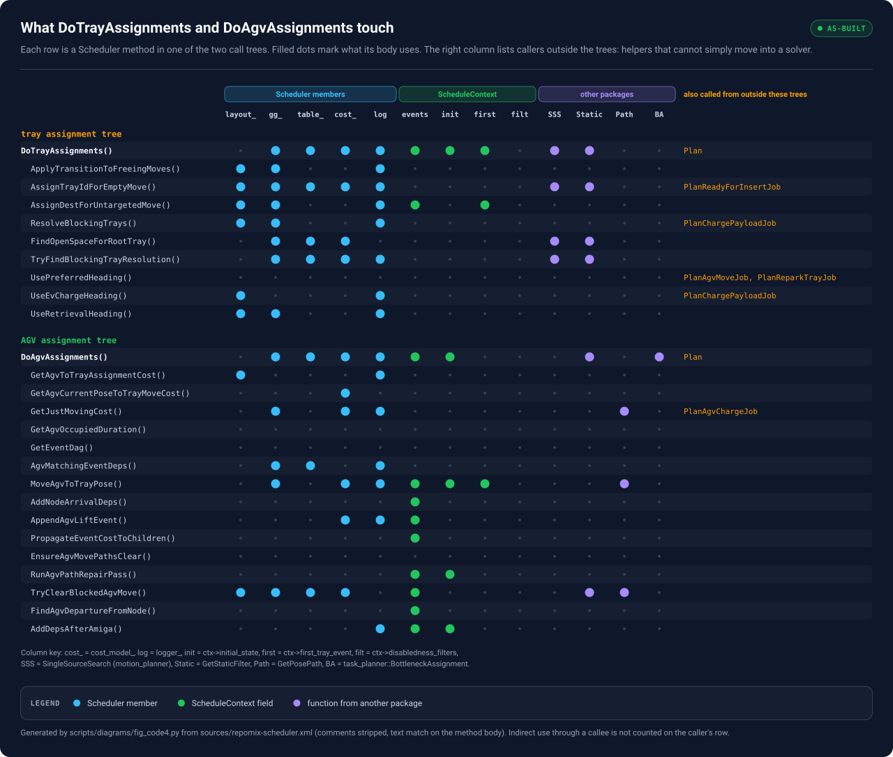
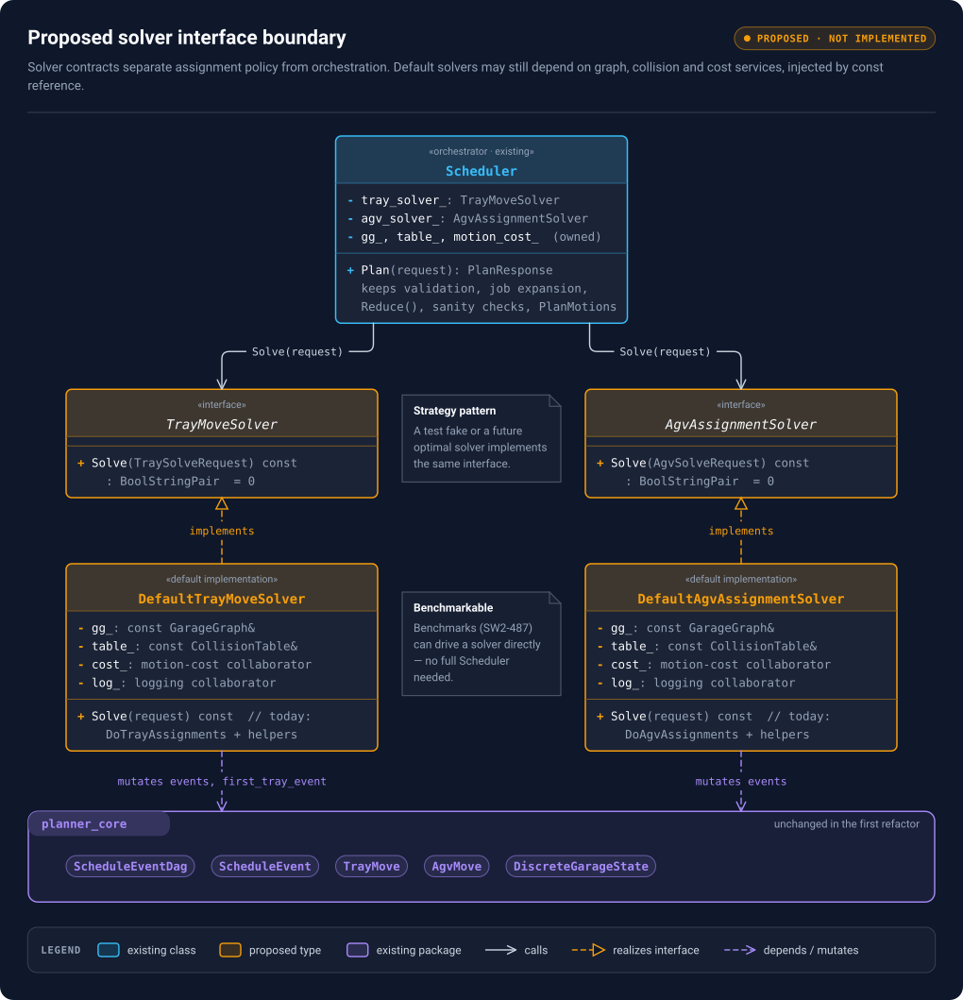
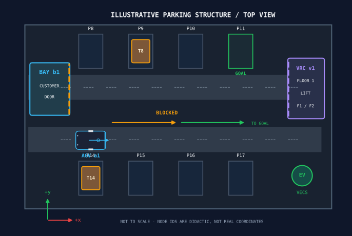
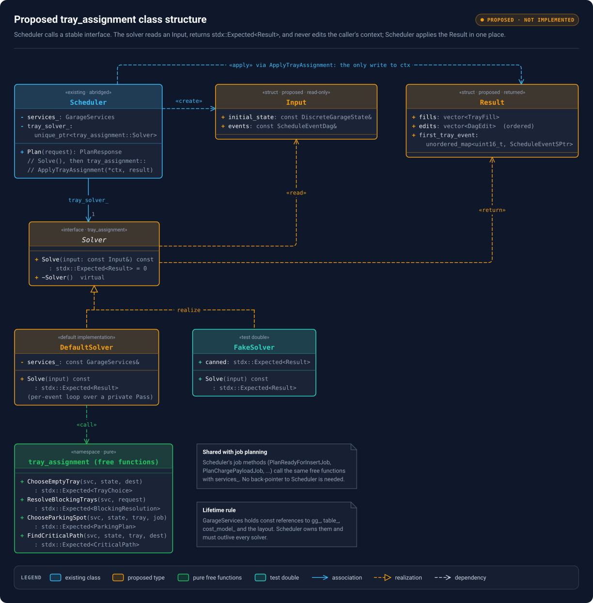
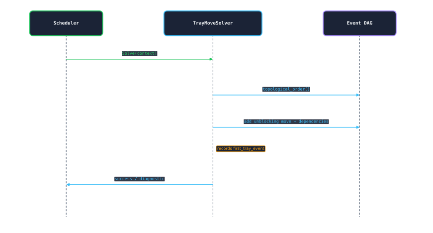

# 02 — Scheduler Core Refactor: problem statement and proposal

This document explains *what* the refactor changes and *why*, using the code in `sources/repomix-scheduler.xml` as evidence. It assumes you have read sections 7–9 and 14–15 of [01 — Software background](01-software-background.md). Code snippets follow the same conventions as doc 01: every snippet says which class it lives in, what `this` is, and the type of each variable that is not obvious. Snippets marked **proposed** do not exist in the repository.

| Name in snippets | Type | What it is |
|---|---|---|
| `this` inside `Scheduler::…` | `const volley::Scheduler*` | The one `Scheduler` object, owned by `SchedulerRos` through `SchedulerSPtr` (`std::shared_ptr<Scheduler>`) |
| `plan_ctx`, `ctx` | `ScheduleContextSPtr` = `std::shared_ptr<ScheduleContext>` | Per-`Plan()` scratch state: initial state, event DAG, job list, bookkeeping maps |
| `ctx->events` | `volley::ScheduleEventDag` | The event DAG being built (Boost graph of `std::shared_ptr<ScheduleEvent>`) |
| `ctx->initial_state` | `volley::DiscreteGarageState` | Snapshot of the garage at request time; never mutated after `Plan()` builds it |
| `working_state` | `volley::DiscreteGarageState` (local copy) | `initial_state` with already-planned events applied, used to answer "where is everything *now*?" |
| `gg_`, `table_`, `cost_model_`, `layout_`, `logger_` | `GarageGraph`, `CollisionTable`, `cost::MotionCostModel`, `LayoutSPtr`, `rclcpp::Logger` | `Scheduler` data members built once in the constructor |

## Contents

<!-- toc -->
- [1. Ticket and scope](#1-ticket-and-scope)
- [2. Where the two algorithms sit today](#2-where-the-two-algorithms-sit-today)
- [3. What the two algorithms touch](#3-what-the-two-algorithms-touch)
- [4. Current versus target responsibilities](#4-current-versus-target-responsibilities)
- [5. Target architecture](#5-target-architecture)
- [6. Proposed interface (design sketch, not compile-ready)](#6-proposed-interface-design-sketch-not-compile-ready)
- [7. Key invariants to maintain](#7-key-invariants-to-maintain)
- [8. Staged plan](#8-staged-plan)
- [9. Decisions to resolve in review](#9-decisions-to-resolve-in-review)
- [10. Proposed UML and call sequence](#10-proposed-uml-and-call-sequence)
- [11. Next actions](#11-next-actions)
<!-- /toc -->

## 1. Ticket and scope

**Parent Jira initiative:** **Scheduler Core Refactor** (parent key not given in the supplied ticket text). **Specific tasks:** [SW2-484](https://volleyautomation.atlassian.net/browse/SW2-484) (tray solver interface, in progress), [SW2-769](https://volleyautomation.atlassian.net/browse/SW2-769) (scheduler package reorganization, marked done) and [SW2-487](https://volleyautomation.atlassian.net/browse/SW2-487) (tray benchmark set, To Do). The links follow the usual Jira URL pattern; the base domain and current status have not been verified. Related keys reported by the user: SW2-677, SW2-652, SW2-593, SW2-488, SW2-496, SW2-514, SW2-663, SW2-18, SW2-686, SW2-776 and SW2-905. **Do not assume all of them block the refactor.**

**Objective:** move tray-move planning and AGV assignment out of large `Scheduler` methods and behind generic, swappable interfaces. Default implementations must reproduce current behaviour, and each solver needs at least **10 real-customer-layout scenarios** with recorded baseline performance. **Out of scope:** changes to CHUGG/SIPP motion planning, a new optimal solver, and adding to active schedules.

**Definition of Done:** two generic interfaces; two behaviour-equivalent default implementations; 10+ site-based benchmark scenarios per solver with saved baselines; every `Scheduler` assignment call site routed through the interfaces; old code paths removed. Source: user-provided Jira text, October 2026. This describes the intended state, not the code today.

## 2. Where the two algorithms sit today

Both algorithms are `const` member functions of `Scheduler` that take the per-call context and edit it in place. They return `BoolStringPair` (`std::pair<bool, std::string>`: success flag plus a message).

```cpp
// include/scheduler/scheduler.hpp — inside class volley::Scheduler (public section)
BoolStringPair DoTrayAssignments(ScheduleContextSPtr ctx) const;  // fills tray ids + destinations, adds blocker moves
BoolStringPair DoAgvAssignments(ScheduleContextSPtr ctx) const;   // picks AGVs, adds approach/lift/lower events
```

`const` here only means the methods do not change `Scheduler`'s own members. The real output is the mutation of `*ctx`, which the `shared_ptr` lets them reach. They are called from the middle of `Scheduler::Plan`:

```cpp
// src/scheduler.cpp — PlanResponseMsg Scheduler::Plan(const PlanRequestMsg& request_data, const rclcpp::Time& now) const
// this     : const Scheduler*  (the Scheduler that SchedulerRos owns)
// plan_ctx : ScheduleContextSPtr, created earlier in Plan() from the request's garage state
// result   : PlanResponseMsg being built; result.scheduled_jobs is std::vector<ScheduledJobDataMsg>
//   ...every pending job has already been expanded into events by a Plan<Type>Job method...

auto [success, message] = DoTrayAssignments(plan_ctx);   // same as this->DoTrayAssignments(plan_ctx)
if(!success) {
  result.success = true;                                 // the *call* succeeded...
  result.message = "Failed tray assignments: " + message;
  for(const auto& job : request_data.pending_jobs) {     // ...but every pending job is reported failed
    result.scheduled_jobs.push_back(FailJob(job, message));
  }
  return result;
}
std::tie(success, message) = DoAgvAssignments(plan_ctx); // same failure handling as above
// ...then plan_ctx->events.Reduce(), SanityCheckEvents(plan_ctx), PlanMotions(...)
```

Two consequences matter for the refactor:

- **Failure is all-or-nothing.** If either algorithm fails, every pending job fails with the same message, and `success` stays `true`. A new solver must keep that contract or `SchedulerRos` clients will see different responses.
- **Tests already call the algorithms directly.** `test/scheduler_tests.cpp` calls `scheduler.DoTrayAssignments(ctx)` 4 times, `scheduler.DoAgvAssignments(ctx)` 9 times and `scheduler.ResolveBlockingTrays(...)` once. They build a whole `Scheduler` from a layout file to do so:

```cpp
// test/scheduler_tests.cpp — TEST(Scheduler, ...) ; all objects are locals of the test body
Scheduler scheduler(layout_filepath, logger, params);  // loads the layout, builds gg_, table_, cost_model_
ScheduleContextSPtr ctx = std::make_shared<ScheduleContext>(request_id, state, rclcpp::Time());
auto tray_move = std::make_shared<TrayMove>(0u);       // job_index 0; no destination set
tray_move->SetTrayId(1);
ctx->events.AddEvent(tray_move);                       // hand-built one-event DAG
std::tie(success, msg) = scheduler.DoTrayAssignments(ctx);
```

That pattern is the baseline the refactor improves on: after the change, a test should be able to construct the solver with only the services it needs.

## 3. What the two algorithms touch

Figure 1 is generated from `scheduler.cpp`. Each row is one `Scheduler` method in the tray or AGV call tree. Each column is something its body uses. The right-hand column lists callers outside the two trees: those are the helpers you cannot simply move.



<sub>Pan / zoom: [interactive viewer](figures/viewer.html#34_coupling_matrix) · [standalone SVG](figures/34_coupling_matrix.svg)</sub>

**Figure 1 — Coupling of the tray and AGV call trees.** Filled dots mark a token found in the method body (comment-stripped). A helper that receives the DAG as a parameter rather than through `ctx` shows no `events` dot even though it edits the DAG, so read the dots as "uses directly", not "is independent of".

What the matrix tells you:

1. **Both trees need the same three services.** `gg_` (graph search), `table_` (collision checks) and `cost_model_` (travel times) appear throughout. `layout_` is used mainly for node types and headings. All four are read-only after construction, which makes constructor injection by `const&` safe as long as the `Scheduler` outlives the solver.
2. **The tray tree touches three context fields:** it edits `ctx->events`, reads `ctx->initial_state`, and fills `ctx->first_tray_event` (the first move of each tray, keyed by tray id `uint16_t`). The AGV tree reads `first_tray_event` back inside `MoveAgvToTrayPose`. That map is the hand-off between the two solvers and must be part of both contracts.
3. **Five helpers are shared with job planning.** They must stay reachable from `Scheduler` (or move to a shared utility) after the algorithms leave:

| Helper (all `Scheduler` members) | Also called by | Why |
|---|---|---|
| `ResolveBlockingTrays` (public) | `PlanChargePayloadJob`, one test | Finds a VECS node plus unblocking moves when the requested node is not a ready VECS |
| `AssignTrayIdForEmptyMove` | `PlanReadyForInsertJob` | Picks an empty tray early, best-effort |
| `UsePreferredHeading` | `PlanAgvMoveJob`, `PlanReparkTrayJob` | Chooses the parking heading that makes later retrieval fastest |
| `UseEvChargeHeading` | `PlanChargePayloadJob` | Heading for a VECS node |
| `GetJustMovingCost` | `PlanAgvChargeJob`, tests | Travel-time estimate for an AGV between two poses |

4. **External algorithms are already separate.** `SingleSourceSearch`, `GetStaticFilter`, `GetPosePath` and `BottleneckAssignment` come from other packages. The default solvers keep calling them; nothing about them changes.
5. **Some "AGV assignment" work is graph repair, not matching.** `DoAgvAssignments` ends with `EnsureAgvMovePathsClear(ctx)` (up to 256 repair passes), then `ctx->events.Reduce()`, then `AddDepsAfterAmiga(...)`. `Plan` calls `Reduce()` a second time afterwards. Keep all of these in the same order inside the default AGV solver for the first pass; see risk 2 in section 9.

## 4. Current versus target responsibilities

| Concern | Today (method in `Scheduler`) | After the refactor |
|---|---|---|
| Validate request, build `ScheduleContext` | `Plan` | Stays in `Scheduler` |
| Expand jobs into events | `Plan<Type>Job` (12 methods) | Stays in `Scheduler` |
| Choose tray and destination for each `TrayMove` | `DoTrayAssignments` → `AssignTrayIdForEmptyMove`, `AssignDestForUntargetedMove` | `DefaultTrayMoveSolver` |
| Move blocking trays out of the way | `ResolveBlockingTrays` → `FindOpenSpaceForRootTray`, `TryFindBlockingTrayResolution` | Default tray solver, or a shared `BlockingTrayResolver` that job planning can also use |
| Match AGVs to tray moves | `DoAgvAssignments` + cost helpers + `BottleneckAssignment` | `DefaultAgvAssignmentSolver` |
| Add approach, lift and lower events | `MoveAgvToTrayPose`, `AppendAgvLiftEvent`, `AddNodeArrivalDeps` | Default AGV solver |
| Repair AGV path conflicts, reduce, AMIGA deps | `EnsureAgvMovePathsClear`, `Reduce`, `AddDepsAfterAmiga` (end of `DoAgvAssignments`) | Default AGV solver, same order (move later only with evidence) |
| DAG primitives | `planner_core::ScheduleEventDag` | Unchanged |
| Sanity check, motion planning, response | `SanityCheckEvents`, `PlanMotions`, `ResponseFromTrajectories` | Unchanged |

**Decision needed:** where the solver *interfaces* live. Options are `planner_core`, a small solver-interface package, or a new scheduler-core package. A default implementation needs `motion_planner` and `cost_functions`, so putting it in a low-level package can create dependency cycles. Check against `package.xml` and the exported CMake targets before choosing.

## 5. Target architecture



<sub>Pan / zoom: [interactive viewer](figures/viewer.html#02_target_architecture) · [standalone SVG](figures/02_target_architecture.svg)</sub>

**Figure 2 — Proposed architecture.** Solver contracts separate policy from orchestration. Default solvers still depend on graph, collision and cost services, injected by `const` reference at construction. Both solvers edit the `planner_core` event DAG through their request. This is a proposal, not existing code.

## 6. Proposed interface (design sketch, not compile-ready)

The lowest-risk first step keeps today's "edit the context in place" behaviour but narrows *what* a solver can reach:

```cpp
// PROPOSED — new header, e.g. include/scheduler/tray_move_solver.hpp
namespace volley {

// Everything one Solve() call may read or write. Built by Scheduler::Plan from plan_ctx.
// References, not copies: the solver edits the caller's DAG and map directly.
struct TraySolveRequest {
  const DiscreteGarageState& initial_state;                           // read-only: plan_ctx->initial_state
  ScheduleEventDag& events;                                           // read-write: plan_ctx->events
  std::unordered_map<uint16_t, ScheduleEventSPtr>& first_tray_event;  // write: plan_ctx->first_tray_event
};

class TrayMoveSolver {
 public:
  virtual ~TrayMoveSolver() = default;
  // Same result type as today's DoTrayAssignments: {success, diagnostic message}.
  virtual BoolStringPair Solve(TraySolveRequest request) const = 0;
};

// Default implementation = today's DoTrayAssignments tree, moved, with the services injected.
class DefaultTrayMoveSolver final : public TrayMoveSolver {
 public:
  DefaultTrayMoveSolver(const GarageGraph& gg, const CollisionTable& table,
                        const cost::MotionCostModel& cost_model, LayoutSPtr layout,
                        rclcpp::Logger logger);  // gg/table/cost_model are Scheduler members: Scheduler must outlive this
  BoolStringPair Solve(TraySolveRequest request) const override;
 private:
  const GarageGraph& gg_;
  const CollisionTable& table_;
  const cost::MotionCostModel& cost_model_;
  LayoutSPtr layout_;
  rclcpp::Logger logger_;
};

}  // namespace volley
```

And the call site inside `Plan`:

```cpp
// PROPOSED — src/scheduler.cpp, Scheduler::Plan
// this         : const Scheduler*
// tray_solver_ : std::unique_ptr<TrayMoveSolver>, new Scheduler member created in the constructor
// plan_ctx     : ScheduleContextSPtr (unchanged)
TraySolveRequest request{plan_ctx->initial_state, plan_ctx->events, plan_ctx->first_tray_event};
auto [success, message] = tray_solver_->Solve(request);
// failure handling identical to today (section 2)
```

**Lifetime rule:** a solver holds references into the `Scheduler`. The `Scheduler` must therefore own the solver (`std::unique_ptr` member declared *after* `gg_`, `table_` and `cost_model_`, so it is destroyed first). A test that builds a solver directly must keep the graph, table and cost model alive for the solver's lifetime.

The AGV contract is analogous. It needs the same three context fields plus the AGV-specific inputs the tree reads today. Settle its exact shape only after splitting the AGV tree into four parts: matching policy, cost estimation, event expansion and path repair.

```cpp
// PROPOSED — sketch only
struct AgvSolveRequest {
  const DiscreteGarageState& initial_state;                                 // plan_ctx->initial_state
  ScheduleEventDag& events;                                                 // plan_ctx->events
  const std::unordered_map<uint16_t, ScheduleEventSPtr>& first_tray_event;  // produced by the tray solver
};
```

### Why not return a new DAG instead?

An immutable request with a returned `SolveResult` is cleaner, but harder than it looks. `ScheduleEventDag` stores `std::shared_ptr<ScheduleEvent>`, so copying it copies pointers, not events. `DoAgvAssignments` already relies on this:

```cpp
// src/scheduler.cpp — Scheduler::DoAgvAssignments(ScheduleContextSPtr ctx) const
auto event_dag_copy(ctx->events);  // ScheduleEventDag; same event objects as ctx->events
// ...the loop removes roots from event_dag_copy (a work queue) while
// ctx->events gains new events and edges. TrayMove::SetAgvId() on a root
// changes the object that BOTH graphs point to.
```

A transactional result would need deep cloning and stable event identity. **Recommendation:** keep mutation semantics for the parity pass, and revisit after the benchmarks exist.

## 7. Key invariants to maintain

1. Every `TrayMove` that will execute has a tray id and a destination after tray assignment.
2. The DAG stays acyclic; `GetTopologicalOrdering()` must succeed after each solver.
3. Each tray's moves form a chain in physical order, and `first_tray_event[tray_id]` is that tray's first move (not its last; using the last creates cycles when one AGV moves a tray twice).
4. Blocking-tray moves are created in recursive prerequisite order, and a tray already being moved is not chosen to move again in the same resolution.
5. AGV matches respect disabled AGVs, AGVs trapped in a bay that is not `STATE_READY_TO_RETRIEVE`, reachability, collisions, lift state and AGVs already busy.
6. Arrival ordering never puts two AGVs on one node: `AddNodeArrivalDeps` and `EnsureAgvMovePathsClear` keep doing their jobs.
7. `Scheduler::Plan` output is unchanged, apart from controlled non-determinism and log text.
8. `Reduce()` and path-repair placement stay where they are during extraction.

The tray-move example below is illustrative; real graphs and paths depend on the layout:



<sub>Pan / zoom: [interactive viewer](figures/viewer.html#03_garage_xy) · [standalone SVG](figures/03_garage_xy.svg)</sub>

**Figure 3 — Top-down garage setup.** AGV 1 faces +x and carries tray T1 toward the goal. Trays T2 and T3 sit on the route, so two prerequisite tray moves (T2 → S3, T3 → S4) must finish first; they are independent of each other. Coordinates are schematic, not a customer layout.

## 8. Staged plan

A move-only refactor is risky because the helpers in section 3 are shared with job planning. Moving them blindly either breaks those callers or recreates the coupling through a back-pointer to `Scheduler`.

| Stage | Change | Exit criterion |
|---|---|---|
| A — baseline | Pin the commit, build, run the 72 active tests; record output DAGs (`debug/printdags`) and `ScheduledJobDataMsg` lists for curated fixtures | Reproducible behaviour captured |
| B — dependency map | Confirm Figure 1 against the branch; decide where the five shared helpers live | Ownership design written down |
| C — tray interface | Add `TrayMoveSolver`, `DefaultTrayMoveSolver`, constructor injection | A test constructs the solver without a `Scheduler` |
| D — tray migration | `Plan` calls the solver; keep the old method temporarily for side-by-side comparison | All tests and DAG snapshots identical |
| E — tray cleanup | Move remaining tray-only helpers; port the 4 direct `DoTrayAssignments` tests | No production call to the old method |
| F — AGV interface | Repeat for AGV assignment, including cost helpers and path repair; port the 9 direct tests | Same behaviour and coverage |
| G — benchmarks | ≥10 real-site scenarios per solver, timed in a pinned environment | Results stored with metadata, no regressions |
| H — final cleanup | Remove legacy code; run full system and advanced suites | Definition of Done demonstrable |

**Ticket mapping:** check SW2-769's package structure against the current branch. SW2-484 is the natural first implementation ticket. SW2-487 can start as soon as baseline capture is deterministic. No AGV-specific child tickets were supplied, so none are named here.

## 9. Decisions to resolve in review

| Decision | Initial recommendation | Evidence needed |
|---|---|---|
| Input/output style | Restricted mutable request for parity | Shared-pointer aliasing (section 6), behaviour on partial failure |
| Virtual interface vs templates | Virtual `Solve`, owned by `Scheduler` through `std::unique_ptr` | Existing code style, whether plugins must swap solvers at runtime |
| Where interfaces live | Small, low-dependency header package | `colcon graph`, `package.xml`, exported CMake targets |
| Where default solvers live | Scheduler library sub-module first | Avoid new group-level dependency cycles |
| Benchmarks | Direct solver benchmark plus optional end-to-end `Plan` benchmark | Fixtures, harness, timing environment |
| What "same result" means | Same tray/AGV assignments, same edge set after `Reduce`, same final state and errors | Stable event identifiers and tie-breaking |

### Risks that must not be silently "fixed"

These are behaviours a reviewer may want to change. Changing them during extraction breaks parity.

1. `GetAgvOccupiedDuration` always returns `Duration::zero()` (`// TODO(isabel) implement!`). The matching costs depend on that.
2. `Reduce()` runs inside `DoAgvAssignments` *and* again in `Plan`. The `TODO` above the second call says planning may fail without it; nobody has confirmed why.
3. `DoTrayAssignments` postpones DAG reduction until after AGV assignment; moving it earlier is high risk.
4. `TrayMove::Apply` reportedly tolerates a missing tray or destination and still mutates state. `planner_core` is not in this snapshot, so confirm in that package before relying on it.
5. `ScheduleEventDag` uses pointer identity and Boost vertex indices. Removing a vertex can renumber others (verify in `planner_core`), so do not cache vertex descriptors across `Remove`.
6. Test names such as `576_eccles_half` and `1355_fulton` suggest real sites, but `tiny_lot` and `triple_pick_lot` are synthetic. Record which layouts are real before counting them toward the 10-scenario goal.
7. SW2-905 (insert fails when an AGV collides with the chosen parking node) is in the parent ticket; that does not mean the refactor causes it.

## 10. Proposed UML and call sequence



<sub>Pan / zoom: [interactive viewer](figures/viewer.html#08_uml_solver) · [standalone SVG](figures/08_uml_solver.svg)</sub>

**Figure 4 — Proposed class structure.** `Scheduler` owns a `TrayMoveSolver` and builds the `TraySolveRequest` it passes in. `DefaultTrayMoveSolver` and a test double realize the interface (dashed line, hollow triangle). This is the **Strategy** pattern: `Scheduler` depends on the stable interface, not on the algorithm.



<sub>Pan / zoom: [interactive viewer](figures/viewer.html#09_sequence_tray) · [standalone SVG](figures/09_sequence_tray.svg)</sub>

**Figure 5 — Proposed tray solver interaction.** `Scheduler` delegates to the solver, which walks the topological event order, fills tray ids and destinations, inserts blocker moves and edges when a route is blocked, records `first_tray_event`, and returns `{success, message}`. AGV assignment then continues.

### Why the default solver needs graph and collision services

This is the start of today's tray algorithm. Note the two different garage states:

```cpp
// src/scheduler.cpp — Scheduler::DoTrayAssignments(ScheduleContextSPtr ctx) const
// this : const Scheduler* ; gg_ and table_ are Scheduler members
auto working_state = ctx->initial_state;               // DiscreteGarageState COPY; updated as moves are assigned
auto total_ordering_opt = ctx->events.GetTopologicalOrdering();  // std::optional<...>: empty if the DAG has a cycle
if(!total_ordering_opt.has_value()) {
  return std::make_pair(false, "Failed to get total ordering");
}

// Remembers which already-planned event vacates each node, so a later move INTO that
// node can depend on it. Needs the graph and collision table to know which nodes overlap.
volley::GarageOccupancyChecker<std::shared_ptr<volley::ScheduleEvent>> freeing_moves(table_, gg_);
```

`ctx->initial_state` stays untouched; `working_state` is the solver's private "garage after everything planned so far". Keeping that distinction is invariant 7 in practice.

## 11. Next actions

1. In the ROS container, build and run `colcon test --packages-select planner_core scheduler scheduler_advanced_tests`, then `colcon test-result --verbose` to capture the baseline.
2. Confirm the branch matches this snapshot; keep edits in small reviewable commits.
3. Map symbol use from the repository root: `rg -n 'ResolveBlockingTrays|DoTrayAssignments|DoAgvAssignments|first_tray_event|BottleneckAssignment'`. Compare with Figure 1, and rebuild Figure 1 (`python3 scripts/diagrams/build.py 34`) after replacing `sources/repomix-scheduler.xml` with a newer snapshot.
