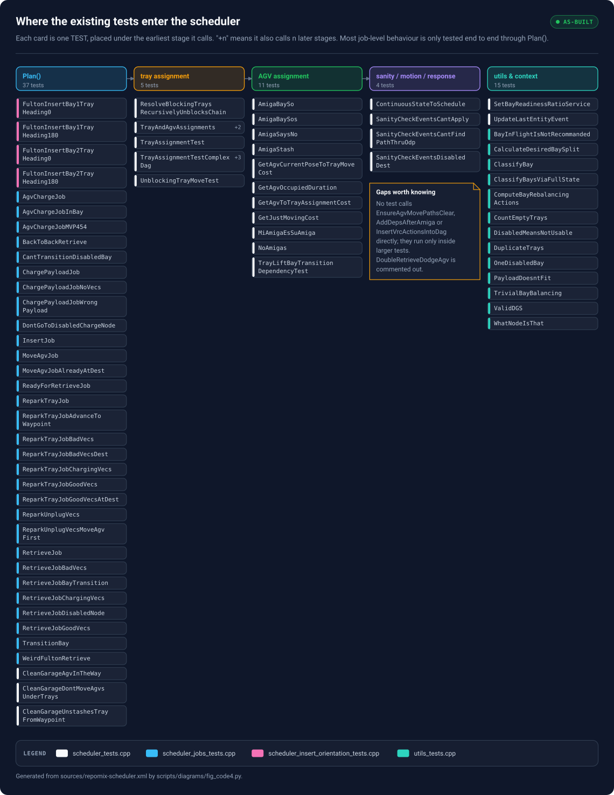

# 03 — Regression and benchmark plan

This document says how to prove the refactor in [02](02-issue-and-proposal.md) changed nothing, and how to measure it. It starts with what the existing tests already cover (computed from `sources/repomix-scheduler.xml`), then defines the parity comparison and the benchmark method.

## Contents

<!-- toc -->
- [1. Two separate goals](#1-two-separate-goals)
- [2. What the existing tests cover](#2-what-the-existing-tests-cover)
- [3. Proposed benchmark dataset (requirements, not completed scenarios)](#3-proposed-benchmark-dataset-requirements-not-completed-scenarios)
- [4. Compare meaning, not pointers or GUIDs](#4-compare-meaning-not-pointers-or-guids)
- [5. Benchmark method](#5-benchmark-method)
- [6. Build and run commands](#6-build-and-run-commands)
- [7. Acceptance checklist](#7-acceptance-checklist)
- [8. Evidence limits](#8-evidence-limits)
<!-- /toc -->

## 1. Two separate goals

**Behavioural equivalence** asks whether the extracted default solver makes the same decisions and adds the same constraints as the old `Scheduler` method. **Performance benchmarking** asks whether run time or resource use changes for comparable inputs. A passing GoogleTest is neither: it shows the code still meets that test's assertions, not that output is identical or equally fast.

## 2. What the existing tests cover

The package has **72 active `TEST` cases** in four files (a 73rd, `DoubleRetrieveDodgeAgv`, sits inside a `/* … */` block). Figure 1 places each one under the earliest pipeline stage it calls directly.



<sub>Pan / zoom: [interactive viewer](figures/viewer.html#35_test_entry_points) · [standalone SVG](figures/35_test_entry_points.svg)</sub>

**Figure 1 — Test entry points.** Columns follow the `Plan()` pipeline from doc 01, section 9. A card's colour stripe shows its file; "+n" means the test also calls n later stages directly.

| File | Active tests | Style |
|---|---|---|
| `scheduler_insert_orientation_tests.cpp` | 4 | Full `Plan()` on `1355_fulton`; checks the tray heading after an insert |
| `scheduler_jobs_tests.cpp` | 30 | Full `Plan()` per job type; checks job state, notes and node indices. CMake timeout 240 s |
| `scheduler_tests.cpp` | 25 | Mostly calls one stage directly on a hand-built `ScheduleContext` |
| `utils_tests.cpp` | 13 | Pure functions in `utils.cpp`: state validation, bay classification, rebalancing |

By stage: 37 tests enter through `Plan()`, 5 through tray assignment, 11 through AGV assignment (including the four cost-helper tests), 4 through sanity/motion/response, and 15 through utilities and context helpers. The layouts used are `tiny_lot` (37 references), `1355_fulton` (9), `576_eccles_half` (7) and `triple_pick_lot` (3).

### How a stage-level test is built

Read this before writing parity tests; the new tests will look the same, with the solver call swapped in.

```cpp
// test/scheduler_tests.cpp — inside TEST(Scheduler, AmigaStash) (abridged); all names are test locals
volley::DiscreteGarageState state;                         // garage snapshot
auto [success, msg] = state.Set(YAML::Load(R"YML(...)YML"));  // inline YAML: AGVs, trays, bays, payloads

Scheduler scheduler(layout_filepath, logger, params);      // the object under test; loads tiny_lot
ScheduleContextSPtr ctx =                                  // std::shared_ptr<ScheduleContext>
    std::make_shared<ScheduleContext>(request_id, state, rclcpp::Time());

auto tray_move_1 = std::make_shared<TrayMove>(0u);         // std::shared_ptr<volley::TrayMove>, job_index 0
tray_move_1->SetTrayId(2);
GaragePoseMsg end_pose;                                    // interfaces message: node_id + heading
end_pose.node_id = 5;
end_pose.heading = 0;
tray_move_1->SetDest(end_pose);
ctx->events.AddEvent(tray_move_1);
// ...tray_move_2 (tray 1) and tray_move_3 (tray 2 again), chained with AddDependency

std::tie(success, msg) = scheduler.DoAgvAssignments(ctx);  // mutates ctx->events and the TrayMove objects
EXPECT_EQ(tray_move_1->GetAgvId().value(), 1);             // read results back through the same shared_ptrs
EXPECT_EQ(tray_move_2->GetAgvId().value(), 1);
EXPECT_EQ(tray_move_3->GetAgvId().value(), 8);             // hand-over to a second AGV
EXPECT_FALSE(ctx->events.HasDependency(tray_move_1, tray_move_2));  // direct edge removed by Reduce()
```

Note the last line: the test checks that `Reduce()` *removed* an edge it added itself, which is exactly the kind of detail a parity check must preserve. The test keeps its own `shared_ptr` to each event, so it can inspect the event after the algorithm has changed it. A parity harness can use the same trick on both the old and the new path.

### Tests most relevant to the two solvers

| Test | Layout | What it asserts |
|---|---|---|
| `TrayAssignmentTest` | `tiny_lot` | One `TrayMove` with a tray but no destination; asserts only success |
| `TrayAssignmentTestComplexDag` | `triple_pick_lot` | "Moving t13 to b1, lots of cycles"; tray, AGV and motion planning all succeed |
| `UnblockingTrayMoveTest` | `tiny_lot` | Tray to bay with a blocker; asserts only success |
| `ResolveBlockingTraysRecursivelyUnblocksChain` | `triple_pick_lot` | Calls `ResolveBlockingTrays` directly; ≥ 2 required moves, every move has a destination, all destinations distinct |
| `TrayAndAgvAssignments` | `tiny_lot` | Both stages; topological order exists; final continuous state computable |
| `MiAmigaEsSuAmiga` | `tiny_lot` | Closer AGV is disabled; AGV 1 is assigned |
| `AmigaSaysNo` | `tiny_lot` | Disabled AGV blocks the other's path; assignment fails, no AGV set |
| `AmigaStash` | `tiny_lot` | Three chained tray moves get AGVs 1, 1 and 8; the original tray-to-tray edges are gone after `Reduce()` because longer chains imply them; applying all events reaches the expected state |
| `NoAmigas` | `tiny_lot` | No feasible AGV; fails, no edge added, still 2 vertices |
| `AmigaBaySos` / `AmigaBaySo` | `tiny_lot` | A `BayTransition` root traps or frees the AGV; edge bay → tray move present |
| `TrayLiftBayTransitionDependencyTest` | `tiny_lot` | The bay transition has the AGV lift move as an out-edge |
| `CleanGarageUnstashesTrayFromWaypoint` | `tiny_lot` | Through `Plan()`: one job, `STATE_EXECUTING`, an unstash move exists |

### Gaps

1. **Assertions are mostly success flags.** Four of the five tray tests do not check which tray moved where. They will not catch a behaviour change; the parity harness in section 4 must.
2. **No direct tests** for `EnsureAgvMovePathsClear`, `AddDepsAfterAmiga` or `InsertVrcActionsIntoDag`. They run only inside larger tests, so a regression there shows up (if at all) as a downstream failure.
3. **`DoubleRetrieveDodgeAgv` is commented out.** It uses the only YAML fixture in `test/garage_states/` and `576_eccles_half`. Find out why before relying on that scenario.
4. **Layout-specific code.** `UseEvChargeHeading` checks `strstr(layout_->GetName().c_str(), "576_eccles")` and forces heading 0 on nodes 46 and 47. Benchmarks on that layout exercise a branch others never reach.
5. **No benchmark code.** Nothing in the snapshot times the solvers, and no Google Benchmark target exists in `CMakeLists.txt`.

## 3. Proposed benchmark dataset (requirements, not completed scenarios)

The parent ticket requires **at least 10 scenarios based on real customer site layouts for each solver**. The matrix below is coverage to aim for, **not** a claim that the cases exist. Each row needs an approved real-site fixture or a documented, anonymized derivative of one. `tiny_lot` and `triple_pick_lot` are test layouts and do not count; `576_eccles_half` and `1355_fulton` look site-derived, but record their provenance first.

| ID | Tray solver characteristic | AGV solver characteristic | Existing test to start from |
|---|---|---|---|
| 01 | Low occupancy, short move | One nearby feasible AGV | `TrayAssignmentTest`, `MiAmigaEsSuAmiga` |
| 02 | Occupied destination, repark | Several candidates, distance tie | `ReparkTrayJob` |
| 03 | Single blocking tray | Candidate with a raised lift | `UnblockingTrayMoveTest` |
| 04 | Recursive chain of blockers | Closer candidate disabled | `ResolveBlockingTraysRecursivelyUnblocksChain` |
| 05 | Narrow aisle with cycles | AGV trapped in a bay | `TrayAssignmentTestComplexDag`, `AmigaBaySos` |
| 06 | High occupancy, no repark spot | AGV route unreachable | `AmigaSaysNo` |
| 07 | Waypoint-stash fallback (tier 2) | Non-tray root gates a tray root | `CleanGarageUnstashesTrayFromWaypoint` (the reverse step), `AmigaBaySo` |
| 08 | Different payload footprints | Node-arrival ordering between AGVs | `CleanGarageAgvInTheWay` |
| 09 | Several jobs, independent moves | Bottleneck matching across many roots | `BackToBackRetrieve` |
| 10 | One tray moved several times | Same AGV across a chain, then a hand-over | `AmigaStash` |

Each fixture records: site/layout identifier, layout file hash, initial `DiscreteGarageState` (YAML), request (`PlanRequestMsg` or the hand-built DAG), expected result, code SHA, and whether it is anonymized.

## 4. Compare meaning, not pointers or GUIDs

Events have no stable id across runs: a `shared_ptr` address changes every run, and GUIDs come from a static counter. Compare a canonical description instead. For each scenario $k\in\{1,\ldots,K\}$, where $K\in\mathbb N$ is the number of scenarios, capture:

- Success flag and a stable error class (compare raw message strings separately).
- For each `TrayMove`: tray id, destination node and heading, assigned AGV id, job index.
- Event identity as (type, job index, entity id, destination, occurrence number among identical events).
- The edge set after `Reduce()` (the transitive reduction is unique for a DAG), plus reachability between every pair of events.
- `first_tray_event` mapped to canonical event identities.
- The final `DiscreteGarageState` after applying all events to `initial_state`.
- For end-to-end tests: the `ScheduledJobDataMsg` list and the action-node schedule.

Let $e_k\in\{0,1\}$ be 1 only when every rule above passes for scenario $k$. The pass proportion $p\in[0,1]$ is:

$$
p=\frac{1}{K}\sum_{k=1}^{K}e_k.
$$

The release gate is $p=1$, with every deviation investigated. If a stage is non-deterministic (for example, ties in `BottleneckAssignment` broken by hash-map order), define the accepted equivalence classes **before** measuring, not after a difference appears.

A parity check could look like this. `Canonicalize` and `CanonicalDag` are **proposed** helpers, not existing code:

```cpp
// PROPOSED — test/solver_parity_tests.cpp
// reference_ctx, candidate_ctx : ScheduleContextSPtr built from the same YAML state and the same events
//                                (events cloned, not shared — otherwise both paths mutate the same objects)
// scheduler                    : volley::Scheduler (old path)
// tray_solver                  : tray_assignment::DefaultSolver (new path, built from the scheduler's GarageServices)
auto [ref_ok, ref_msg] = scheduler.DoTrayAssignments(reference_ctx);           // BoolStringPair (old API)
stdx::Result cand = tray_solver.Solve({candidate_ctx->initial_state, candidate_ctx->events})  // stdx::Expected<Result>
                        .and_then([&](const tray_assignment::Result& r) {
                          return tray_assignment::ApplyTrayAssignment(*candidate_ctx, r);
                        });
ASSERT_EQ(ref_ok, cand.has_value()) << ref_msg << " vs " << (cand ? std::string{} : cand.error());
if(!ref_ok) { EXPECT_EQ(ref_msg, cand.error()); }   // error text reaches clients through FailJob

CanonicalDag ref  = Canonicalize(*reference_ctx);   // sorted events + reduced edge set + first_tray_event
CanonicalDag cand = Canonicalize(*candidate_ctx);
EXPECT_EQ(ref.events, cand.events);                 // tray ids, destinations, AGV ids, job indices
EXPECT_EQ(ref.edges, cand.edges);                   // after Reduce() on a copy
EXPECT_EQ(ref.first_tray_event, cand.first_tray_event);
EXPECT_EQ(ref.final_state, cand.final_state);
```

Note the comment on cloning: because the DAG holds `shared_ptr`s (doc 02, section 6.4), the two contexts must be built independently from the same inputs. `Solve` itself changes nothing, but `ApplyTrayAssignment` and the old `DoTrayAssignments` both set fields on the event objects. A second, cheaper check needs no clone: call `Solve` twice on the same `Input` and assert the two `Result`s are equal and the input events are unchanged (doc 02, invariant 9).

## 5. Benchmark method

Time the solver call alone, after fixture construction, and separately time `Scheduler::Plan` end to end. Keep layout loading, YAML parsing, ROS component start-up and `debug/printdags` output out of solver timings. Use the same optimized build flags, hardware, ROS distribution, dependency versions and thread count for every run.

Let $t_{k,r}\in\mathbb R_{\ge0}$ [ms] be the duration of scenario $k$ on repetition $r\in\{1,\ldots,R\}$, where $R\in\mathbb N$ is the repetition count. For each scenario record the median $\widetilde t_k\in\mathbb R_{\ge0}$ [ms], the 95th percentile $t_{k,0.95}$ [ms] when there are enough repetitions, and the baseline median $\widetilde t_k^{(0)}$ [ms] from the original code. The runtime ratio $q_k\in\mathbb R_{\ge0}$ is:

$$
q_k=\frac{\widetilde t_k}{\widetilde t_k^{(0)}}.
$$

$q_k$ is defined only when $\widetilde t_k^{(0)}>0$ [ms]; a value above 1 means the candidate is slower. Agree on a threshold with the team after measuring run-to-run variance, not before. Save raw timings as CSV or JSON:

```text
solver,scenario_id,site_fixture,layout_hash,code_sha,build_type,host,iteration,elapsed_ms,success,event_count,edge_count,semantic_hash
```

`semantic_hash` is a hash of the canonical description from section 4, never of pointer values or hash-map iteration order.

## 6. Build and run commands

Inside the configured ROS 2 container and workspace:

```bash
colcon build --packages-up-to scheduler scheduler_advanced_tests --event-handlers console_direct+
colcon test --packages-select planner_core scheduler scheduler_advanced_tests --event-handlers console_direct+
colcon test-result --verbose
```

To run one test under a debugger, use the gtest binary in the build tree, for example `build/scheduler/scheduler_tests --gtest_filter=Scheduler.AmigaStash`. If the workspace uses wrappers (`poe`, `.colcon` profiles, a virtual environment), follow them. A successful build does not mean the tests ran; read `colcon test-result` and the logs.

## 7. Acceptance checklist

- [ ] Baseline captured: all 72 active tests pass on the pinned commit; canonical outputs saved for every fixture.
- [ ] Default tray solver gives the same canonical result as `DoTrayAssignments` on every fixture.
- [ ] Default AGV solver does the same, including non-tray root draining, node-arrival edges, path repair and the AMIGA dependencies.
- [ ] Both solvers can be constructed in a test without a `Scheduler`.
- [ ] Direct tests added for `EnsureAgvMovePathsClear` and `AddDepsAfterAmiga` (gap 2).
- [ ] `Scheduler::Plan` uses only the new interfaces for both assignment phases.
- [ ] The 4 direct `DoTrayAssignments` and 9 direct `DoAgvAssignments` call sites in `scheduler_tests.cpp` ported; legacy methods removed.
- [ ] At least 10 approved real-site scenarios for **each** solver, with recorded provenance.
- [ ] Baselines from the original code stored with code SHA, environment and raw samples.
- [ ] Unit tests, advanced scenarios and applicable system tests pass.

## 8. Evidence limits

The snapshot contains the `scheduler` package only. `planner_core`, `motion_planner`, `task_planner` and `scheduler_advanced_tests` are referenced but not included, so statements about them come from earlier notes and need checking. Customer-site geometry and AGV dimensions were not supplied; the 2D figures use illustrative coordinates. No timing in this document is a measured value.
