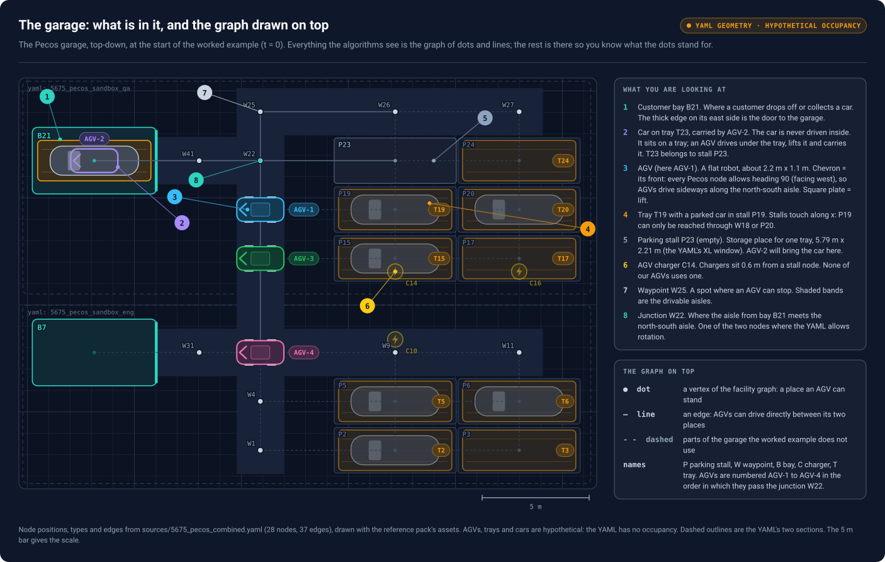
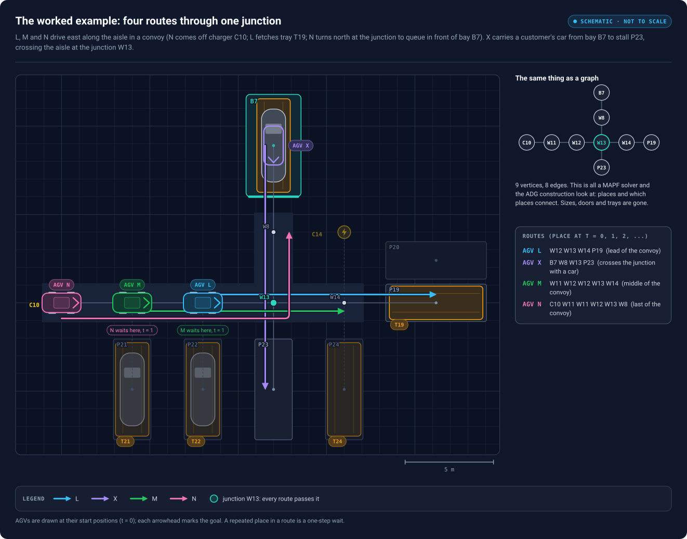
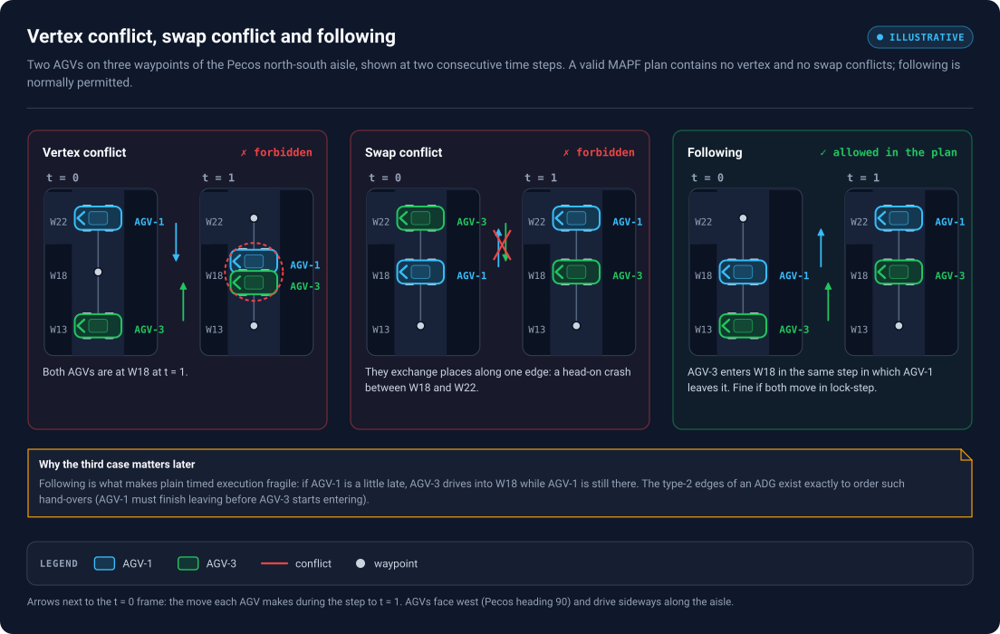
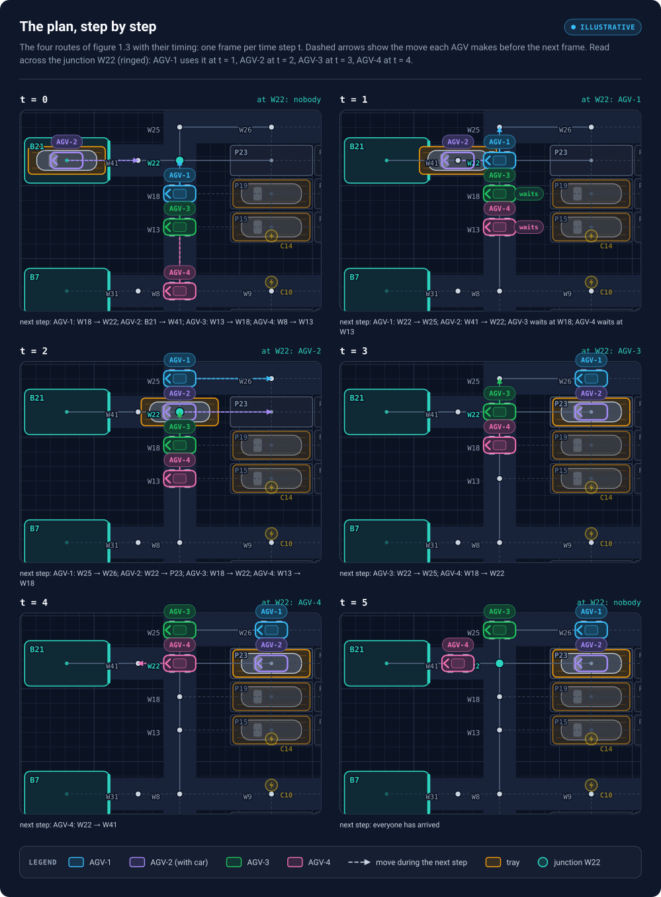
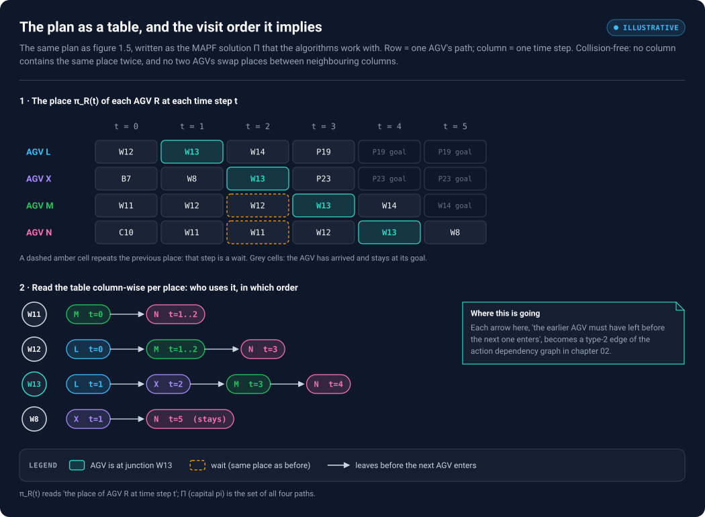

# 01 — Visual foundations: the garage, its graph, time, and the worked example

*Chapter 1 of 3. About 40 minutes. Next: [02 — From CBS to an action dependency graph](02-cbs-to-adg.md).*

> **One example, all the way through.** Every figure and table in chapters 01–03 uses the same small scene: four AGVs (L, M, N and X) in one corner of an automated parking garage, all of which have to cross the same junction. Every path, conflict, dependency edge and timing you see was computed by [`scripts/adg/adg.py`](../scripts/adg/adg.py), not drawn by hand, so you can re-run and check the numbers.

> **Every figure explains itself.** Each figure ends with a key ("What you are looking at", "Symbols in this figure" or "How to read …") that defines every name and mark it uses. If something in a figure is unclear, look there first.

> **Viewing the figures.** Markdown previews show the SVGs as static images sized for the reading column. For pan and zoom, open [`figures/viewer.html`](../figures/viewer.html) in a browser (scroll to zoom, drag to pan, ← → to switch figures), or open any `.svg` file directly.

## What you will be able to do after this chapter

- Explain what an automated garage contains (bays, trays, AGVs, stalls, chargers, waypoints) and how it becomes a **facility graph**.
- Tell apart the three graphs in this topic: the **facility graph**, the **timed plan** and the **Action Dependency Graph (ADG)**.
- Read a multi-robot plan as a filmstrip and as a table, and check by hand that it is collision-free.
- Turn an AGV's path into the paper's **actions** $\langle s, g, t, R\rangle$, and spot which ones are **waits**.

---

## 1. The setting: an automated parking garage

A customer drives into a **bay**, gets out and leaves. From then on the car is never driven. It stands on a **tray**, a flat steel platform. An **AGV** (automated guided vehicle, a low flat robot) drives *under* the tray, lifts it and carries tray and car to a **parking stall**. When the customer returns, an AGV fetches the tray and brings it back to a bay. AGVs recharge at **chargers**, and drive along **aisles** between named stopping points called **waypoints**.

Pan / zoom: [interactive viewer](../figures/viewer.html#01-garage) · [standalone SVG](../figures/01-garage.svg)

*Figure 1.1 — The corner of the garage used throughout the kit, top-down, at the start of the example (t = 0). The numbered callouts are explained in the panel on the right. The dots and thin lines drawn on the floor are the **facility graph**: the only part of this picture the planning algorithms ever see.*

Names follow the convention of the reference material: **P** = parking stall, **W** = waypoint, **B** = customer bay, **C** = AGV charger, **T** = tray (a tray is named after the stall it belongs to). The number is only an identifier. The four AGVs are called **L, M, N** and **X** precisely so that no AGV name can be confused with a place.

At t = 0:

- **AGV X** stands in **bay B7** under tray T7 with a customer's car on it. Its job: carry the car to the empty stall **P23**.
- **AGV L** stands on the aisle at **W12**. Its job: fetch the empty tray **T19** parked at stall **P19**.
- **AGV M** stands behind it at **W11** and has to move up to **W14**, where it will wait for its next job.
- **AGV N** is on **charger C10** and has to go to **W8**, in front of bay B7, ready for the next customer.

The junction **W13** is where the east–west aisle meets the lane from the bay. All four routes pass it. The rest of the garage (dashed lines, faded stalls P20–P24, charger C14) is drawn only for context.

> **Schematic, not measured.** The stall and bay sizes are the Pecos XL dimensions from the reference pack, and the drawing assets are the reference pack's. The *positions* are invented: the Pecos layout YAML was not part of the reference material, so this is a Pecos-style corner, not a real Volley facility.

## 2. The big picture: planning, then execution

Two separate jobs must be done before anything moves safely.

1. **Planning.** A *Multi-Agent Path Finding* (MAPF) solver decides, for every AGV, which place it occupies at every time step, so that no two AGVs ever meet. The output is a set of **timed paths**.
2. **Execution.** Those paths are handed to real AGVs. Real AGVs are never exactly on time: one stops for a person, one carries a heavier car, one gets its command late. If each AGV simply followed its own timetable, a single delay could put two of them on the same place.

The **Action Dependency Graph** sits between the two. It throws the timetable away and keeps only what matters for safety: *which action must be finished before which other action may start*. AGVs then advance as fast or as slowly as they can, and the order of every hand-over is still preserved.

Pan / zoom: [interactive viewer](../figures/viewer.html#02-pipeline) · [standalone SVG](../figures/02-pipeline.svg)

*Figure 1.2 — The five stages, with examples from the garage of figure 1.1. Planning (1–2) produces timed paths that are only correct if every AGV keeps a shared clock. Post-processing (3–4) cuts the paths into actions and links them by precedence. The executor (5) starts an action as soon as everything it depends on has reported "done". The paper studied in this kit, Dunkel (2024), changes only stage 4. Every symbol in the cards is defined in the panel under them.*

Read the example lines in the cards from left to right, all about AGV M:

1. **Problem:** M has to get from W11 to W14.
2. **MAPF solver:** M's path is $\pi_M$ = `W11 W12 W12 W13 W14` — its place at t = 0, 1, 2, 3, 4. W12 appears twice: M stands still for one step.
3. **Actions:** the path is cut into steps. `M1` = ⟨W12, W12, 1, M⟩ is that standing still (a *wait*); `M2` = ⟨W12, W13, 2, M⟩ drives into the junction.
4. **ADG:** `M0 → M2` (M does its own steps in order) and `X2 → M2` (X must have left W13 before M may enter it).
5. **Executor:** start M2 as soon as M0 and X2 have reported "done". No clock involved.

## 3. Three graphs that are easy to confuse

The single most common mistake when learning this material is to mix up three different graphs.

| | Facility graph | Timed plan | Action Dependency Graph |
|---|---|---|---|
| **Vertex** | a place: `W12`, `W13`, `P19`, … | a place *at a time*: (W13, 2) | an action: `M2` = "M drives W12 → W13 in step 2" |
| **Edge** | an AGV *may drive* between two places | an AGV *may move or wait* from one step to the next | the target action *must not start* before the source action is done |
| **Built by** | the garage layout | the MAPF solver (CBS, prioritized planning, …) | ADG construction (Algorithm 1, CP or SCP) |
| **Question it answers** | Where can AGVs go? | Where is each AGV at each step? | In what order must things happen? |
| **Has a clock?** | no | yes, discrete steps $t = 0, 1, 2, \dots$ | **no** — only "before / after" |

A line `W12 — W13` in the facility graph says "you can drive there". An arrow `L1 → X1` in the ADG says "X may not start driving into W13 until L has finished leaving W13". They are different kinds of statement.

## 4. The facility graph of the worked example

Formally, the garage is a graph $\mathcal{G} = (\mathcal{V}, \mathcal{E})$. $\mathcal{V}$ is the set of **vertices**: places where an AGV can stand (waypoints, stalls, bays, chargers). $\mathcal{E}$ is the set of **edges**: pairs of places an AGV can drive between directly. Our example uses nine vertices and eight edges:

- the aisle `C10 – W11 – W12 – W13 – W14 – P19`,
- the lane `B7 – W8 – W13 – P23`,
- crossing at the **junction W13**.

Pan / zoom: [interactive viewer](../figures/viewer.html#03-facility) · [standalone SVG](../figures/03-facility.svg)

*Figure 1.3 — The four routes drawn in the garage, and the same nine places as a bare graph (top right). L, M and N drive east along the aisle in a convoy; N turns north at W13 towards the bay. X carries the car south from the bay, across the aisle, into stall P23. The routes panel lists each AGV's place at every time step.*

Three things to notice:

1. **Every route uses W13.** The four AGVs must take turns at the junction. The plan will fix one order (L, X, M, N); the ADG will make sure that order is respected even when AGVs are late.
2. **The convoy shares W11 and W12.** M drives into W12 right after L leaves it, and N into W11 right after M leaves it. These "follow-the-leader" hand-overs also need protecting.
3. **What the graph leaves out.** In this model an AGV is a point on a vertex, and a collision means "two AGVs on the same vertex at the same time" (or swapping along an edge, below). A real AGV has a heading, a footprint that can overlap a neighbouring stall, and a swept area when it turns; a loaded AGV is as long as the tray. The paper uses the simple vertex model; transferring its results to a richer collision model means re-checking its assumptions (chapter 03, section 7).

## 5. Adding time: paths, waits and conflicts

### 5.1 Paths

Time is discrete: $t \in \{0, 1, 2, \dots\}$. For each AGV $R$, the plan gives a **path**

$$
\pi_R = \big(\pi_R(0), \pi_R(1), \pi_R(2), \dots\big), \qquad \pi_R(t) \in \mathcal{V},
$$

where $\pi_R(t)$ is the place AGV $R$ occupies at step $t$. Between step $t$ and step $t+1$ an AGV either **moves** to a neighbouring place ($\pi_R(t+1) \ne \pi_R(t)$, and the two are joined by an edge) or **waits** ($\pi_R(t+1) = \pi_R(t)$). After reaching its goal, an AGV stays there.

### 5.2 What "collision-free" means

A MAPF solver must avoid two kinds of conflict between any two AGVs $i \ne j$:

- **Vertex conflict** — both on the same place at the same step: $\pi_i(t) = \pi_j(t)$.
- **Swap (edge) conflict** — they exchange places along one edge: $\pi_i(t) = \pi_j(t+1)$ **and** $\pi_j(t) = \pi_i(t+1)$. On a single-lane aisle this is a head-on crash.

A third pattern is normally **allowed**: **following**, where one AGV enters a place in the same step in which another leaves it.

Pan / zoom: [interactive viewer](../figures/viewer.html#04-conflicts) · [standalone SVG](../figures/04-conflicts.svg)

*Figure 1.4 — Two AGVs, L and M, on three waypoints of the aisle at two consecutive steps. Left: both end up on W12 (vertex conflict). Middle: they swap W12 and W13 (swap conflict). Right: M moves into W12 while L moves out (following) — legal in the plan, but only safe if L really leaves before M really arrives.*

Following is worth a second look because it is exactly where timed execution breaks. In the plan, L leaves W12 and M arrives at W12 "at the same moment". On the floor, if L starts a second late, M drives into W12 while L is still there. Chapter 02 shows this happening in the example and how the ADG prevents it.

The paper encodes the "no conflict" requirement as its **Definition 2**: in a valid solution, no two actions *start or end at the same vertex at the same time step*. (Its displayed formula, $a.s \ne b.s \lor a.g \ne b.g$, is literally weaker — it only forbids sharing both — but the sentence and the proofs use the stronger reading, which is exactly "no vertex conflict". This kit uses that reading.) The proofs lean on this fact repeatedly.

## 6. The worked example's plan

Here is the plan used in the rest of the kit. (Chapter 02 shows how Conflict-Based Search finds it.) First as a filmstrip, so you can see it move:

Pan / zoom: [interactive viewer](../figures/viewer.html#05-filmstrip) · [standalone SVG](../figures/05-filmstrip.svg)

*Figure 1.5 — One frame per time step. Each AGV is drawn where the plan puts it; the dashed arrow shows the move it makes before the next frame; "waits" marks an AGV that stands still for that step. The label at the top right of each frame says who is at the junction W13.*

Then as the table the algorithms actually work with:

Pan / zoom: [interactive viewer](../figures/viewer.html#06-plan-table) · [standalone SVG](../figures/06-plan-table.svg)

*Figure 1.6 — Top: one row per AGV, one column per time step; the cell is $\pi_R(t)$. Teal cells are visits to the junction, dashed amber cells are waits, grey cells mean "already at goal". Bottom: the same table read per place — for each shared place, which AGV uses it, in which order.*

### 6.1 Read the plan AGV by AGV

- **L** (`W12 W13 W14 P19`) starts closest to the junction and simply drives through. It is first at W13 (step 1) and arrives under tray T19 at step 3.
- **X** (`B7 W8 W13 P23`) leaves the bay with the car and reaches W13 at step 2, the step after L leaves it.
- **M** (`W11 W12 W12 W13 W14`) would like to be at W13 at step 2, but X is there. So M **waits at W12 for one step** and enters W13 at step 3.
- **N** (`C10 W11 W11 W12 W13 W8`) is stuck behind M: W12 is occupied by M at step 2, so N **waits at W11 for one step**, then follows M through W12 and W13 and turns north into W8, which X left long ago.

### 6.2 Check it yourself

You can verify a plan by hand with two scans of figure 1.6.

1. **Columns (vertex conflicts).** In each column all entries must be different (count goal cells too — a parked AGV still occupies its place). Column $t = 2$ reads `W14, W13, W12, W11`: all different. Do the same for the other columns.
2. **Neighbouring columns (swap conflicts).** For every pair of AGVs, check that they never trade places between column $t$ and $t + 1$. Here nobody ever drives *towards* another AGV on the same edge, so there is no swap.

This is exactly what `conflicts()` in `scripts/adg/adg.py` does, and it returns an empty list for this plan.

### 6.3 Read the table per place: visit order

The lower half of figure 1.6 regroups the same information by place. For the junction **W13** the order is L (step 1) → X (step 2) → M (step 3) → N (step 4). For **W12** it is L → M → N. Each arrow there means *the earlier AGV must have left before the next one arrives*. Hold on to that sentence: in chapter 02 every one of those arrows becomes a **type-2 dependency** of the ADG.

## 7. From paths to actions

The paper does not work with paths directly. It cuts each path into **actions**. Its Definition 1: an action $a$ is the four-tuple

$$
a = \langle s, g, t, R \rangle,
$$

with **start** place $s$, **goal** place $g$, **time step** $t$ and **robot** (AGV) $R$. The action at step $t$ takes AGV $R$ from $\pi_R(t)$ to $\pi_R(t+1)$, so $s = \pi_R(t)$ and $g = \pi_R(t+1)$. If $s = g$, the action is a **wait**. Code and later chapters write the parts as `a.s`, `a.g`, `a.t` and `a.R`.

In this kit an action is named by its AGV and time step: `M2` is AGV M's action at $t = 2$. The worked example has 15 actions:

| Action | AGV $R$ | start $s$ | goal $g$ | step $t$ | Kind |
|---|---|---|---|---|---|
| L0 | L | W12 | W13 | 0 | move |
| L1 | L | W13 | W14 | 1 | move |
| L2 | L | W14 | P19 | 2 | move |
| X0 | X | B7 | W8 | 0 | move |
| X1 | X | W8 | W13 | 1 | move |
| X2 | X | W13 | P23 | 2 | move |
| M0 | M | W11 | W12 | 0 | move |
| **M1** | M | W12 | W12 | 1 | **wait** |
| M2 | M | W12 | W13 | 2 | move |
| M3 | M | W13 | W14 | 3 | move |
| N0 | N | C10 | W11 | 0 | move |
| **N1** | N | W11 | W11 | 1 | **wait** |
| N2 | N | W11 | W12 | 2 | move |
| N3 | N | W12 | W13 | 3 | move |
| N4 | N | W13 | W8 | 4 | move |

Two conventions to internalise now, because the rest depends on them:

- **An action "enters" its goal and "leaves" its start.** `X1` = ⟨W8, W13, 1, X⟩ enters the junction; `X2` = ⟨W13, P23, 2, X⟩ leaves it. X occupies W13 from the end of `X1` until the end of `X2`.
- **A wait neither enters nor leaves anything.** `M1` starts and ends at W12. The paper's first improvement (chapter 03) is the observation that, for this reason, waits never contribute a unique dependency.

## Checkpoint

Try each question before opening the answer.

1. The line W12 — W13 exists in the facility graph. Is there an edge between L0 and L1 in the ADG, and does it mean the same thing?

There is an ADG edge L0 → L1 (a *type-1* edge: consecutive actions of one AGV), but it means something different. The facility edge says "an AGV can drive from W12 to W13". The ADG edge says "L's second action may not start until its first one is done". One describes possible motion, the other required order.

2. Why does M wait at W12 at t = 1 instead of driving into the junction?

Because X is at W13 at $t = 2$. If M drove W12 → W13 during step 1 → 2, both would be at W13 at $t = 2$: a vertex conflict.

3. At t = 0, L drives W12 → W13 and M drives W11 → W12. Is that a conflict?

No. At $t = 1$ L is at W13 and M at W12: different places, and they did not swap. It is *following*: M enters W12 as L leaves it. Legal in the plan, but exactly the situation that needs a dependency (L0 must finish before M0 may start) when executed on real AGVs.

4. Which actions enter the junction W13, and which leave it?

Enter W13 ($g$ = W13): L0, X1, M2, N3. Leave W13 ($s$ = W13): L1, X2, M3, N4. Each AGV enters the junction with one action and leaves with the next one.

5. Is (W13, 2) the same thing as W13?

No. W13 is a vertex of the facility graph, a place. (W13, 2) means "W13 at step 2", a vertex of the timed view. The MAPF solver reasons about places at times; the ADG reasons about actions.

6. AGV X carries a car on a tray. Does the ADG know about the car or the tray?

No. It only sees X's actions (B7 → W8 → W13 → P23). Whether an AGV is loaded matters for its speed and footprint in the real garage, which is exactly the kind of thing the vertex-only model leaves out (section 4, point 3).

