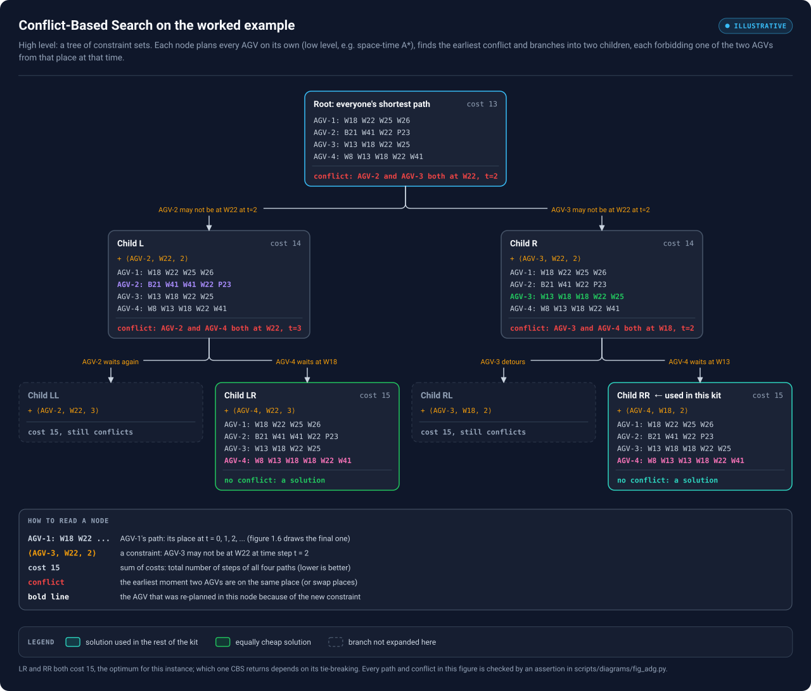
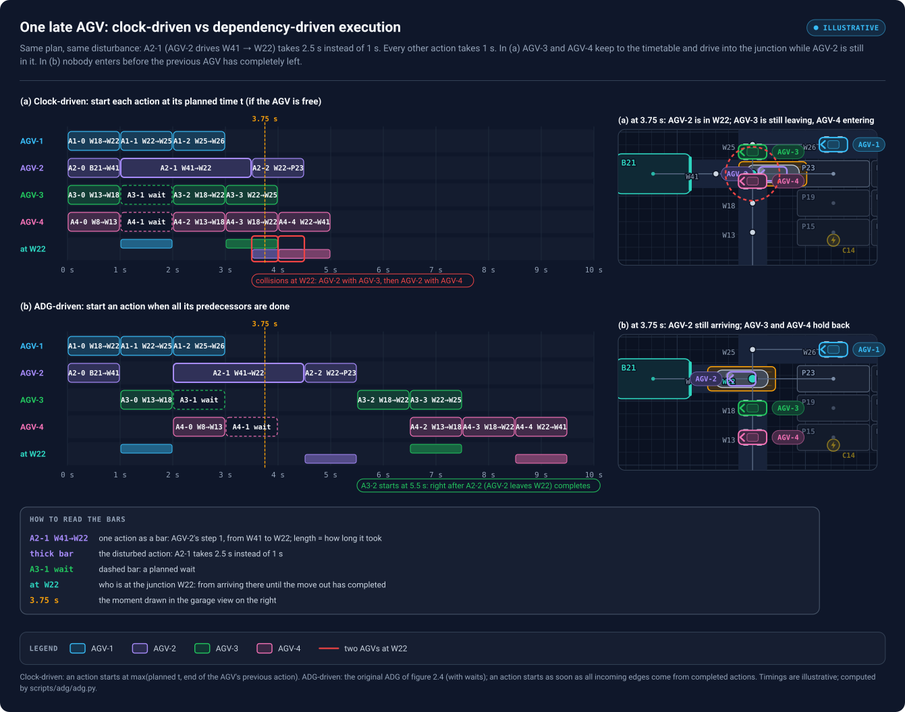
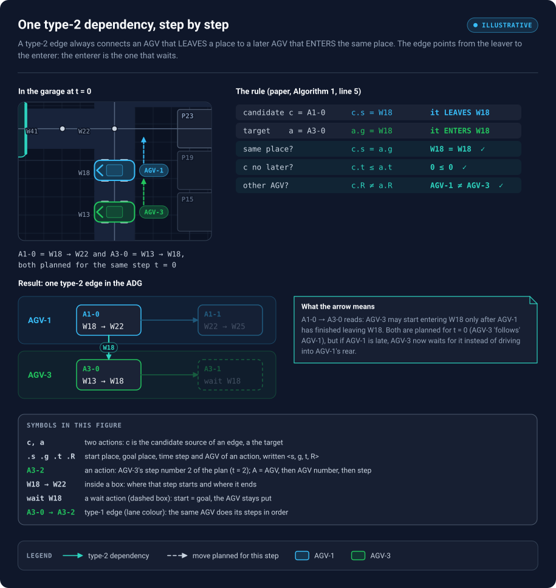
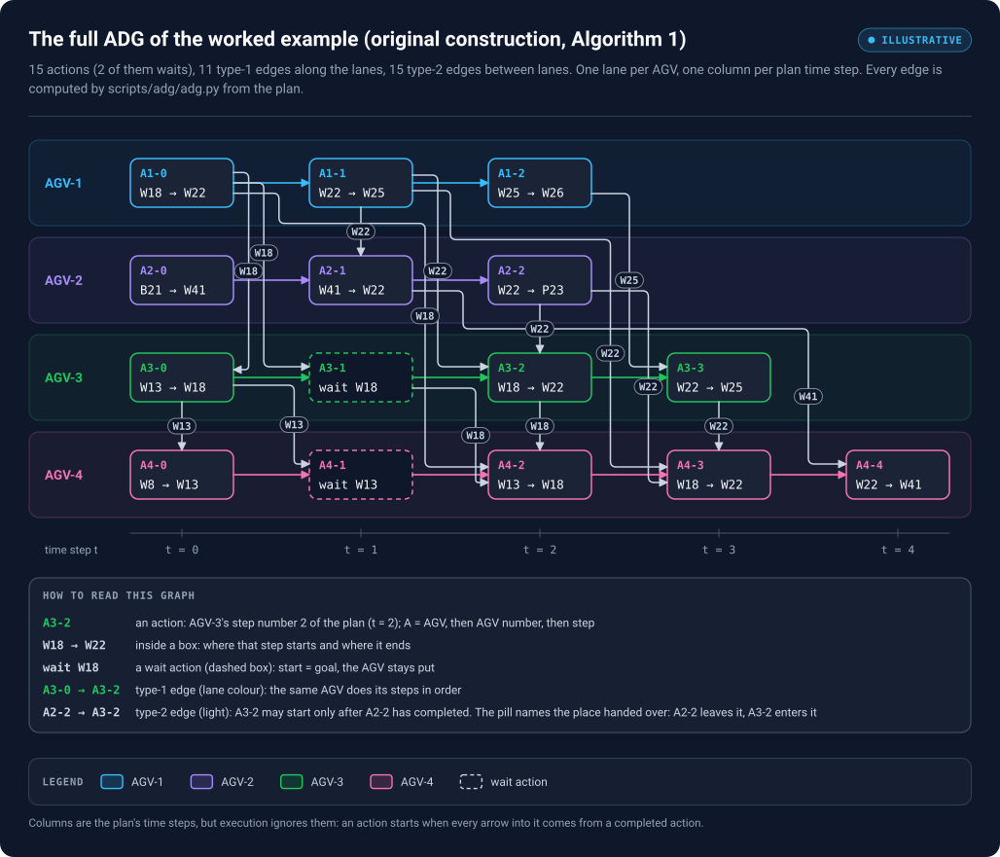

# 02 — From Conflict-Based Search to an action dependency graph

*Chapter 2 of 3. About 45 minutes. Previous: [01 — Visual foundations](01-visual-foundations.md). Next: [03 — The two improvements](03-scp-illustrated.md).*

## What you will be able to do after this chapter

- Trace Conflict-Based Search (CBS) by hand on a small instance, and explain why its output is still not safe to execute "by the clock".
- State the two edge rules of an Action Dependency Graph and apply them to a plan.
- Build the complete ADG of the worked example with the paper's original algorithm, and explain every one of its edges.

---

## 1. How the plan was found: Conflict-Based Search

### 1.1 The idea in two levels

CBS splits MAPF into two searches that call each other.

- The **low level** plans *one* robot at a time, ignoring the others, with a single-agent search such as space-time A*. It respects a list of **constraints** of the form $\langle R, v, t\rangle$: "robot $R$ may not be at vertex $v$ at step $t$".
- The **high level** searches a binary tree of constraint sets, the **constraint tree**. Each tree node holds a set of constraints, one low-level path per robot, and a cost (here the *sum of costs*: total number of steps over all robots).

The high level repeatedly takes the cheapest unexplored node and looks for the earliest conflict between its paths. If there is none, the node is a solution. If robots $i$ and $j$ collide at $(v, t)$, the node gets **two children**: one adds $\langle i, v, t\rangle$, the other $\langle j, v, t\rangle$. Exactly one of the two robots must yield, and CBS tries both possibilities. In each child only the newly constrained robot is re-planned.

### 1.2 CBS on the worked example



<sub>Pan / zoom: [interactive viewer](../figures/viewer.html#08-cbs) · [standalone SVG](../figures/08-cbs.svg)</sub>

*Figure 2.1 — The constraint tree for the worked example. Every node lists all four paths; the bold coloured line is the one the low level just re-planned. Two leaves are conflict-free at cost 15; the kit uses RR. The dashed nodes would also cost 15 but still contain conflicts, so CBS would have to keep expanding them.*

Walk through it node by node.

1. **Root (cost 13).** Every robot takes its shortest path as if it were alone. Scanning time steps in order, the first conflict is at $t = 2$: AGV-2 (`B21 W41 W22 …`, carrying the car out of the bay) and AGV-3 (`W13 W18 W22 …`, driving along the aisle) are both at the junction W22.
2. **Two children (cost 14 each).**
   - *L* forbids AGV-2 at $(W22, 2)$. AGV-2's new shortest path waits one step at W41. That pushes AGV-2 into W22 at $t = 3$, where it now collides with AGV-4.
   - *R* forbids AGV-3 at $(W22, 2)$. AGV-3 waits one step at W18 — but AGV-4, right behind, wants W18 at $t = 2$. New conflict: AGV-3 and AGV-4 at $(W18, 2)$.
3. **Grandchildren (cost 15).**
   - *RR* forbids AGV-4 at $(W18, 2)$. AGV-4 waits at W13 for one step. Every column of the table is now conflict-free: **solution**. This is the plan of figures 1.6 and 1.7.
   - *LR* forbids AGV-4 at $(W22, 3)$. AGV-4 waits at W18 instead; also conflict-free and also cost 15.

Both LR and RR are optimal. Which one a given CBS implementation returns depends on how it breaks ties between equally cheap nodes; nothing in what follows depends on that choice.

### 1.3 What CBS hands over

The result of CBS is only the four paths. It does not record *why* AGV-3 waits (because of AGV-2) or *why* AGV-4 waits (because of AGV-3). That information is implicit in the timing — AGV-3 is scheduled to reach W22 exactly one step after AGV-2 leaves. As long as everybody keeps the clock, that works. Section 2 shows what happens when somebody doesn't.

> **CBS versus prioritized planning.** Prioritized planning (PP) plans robots one after another in a fixed priority order, each avoiding the already-planned ones. It is much faster than CBS but neither complete nor optimal. The paper notes that its faster ADG construction matters most in systems using fast planners like PP, because there the ADG step is a larger fraction of the total time. The ADG itself does not care which planner produced the paths.

## 2. Why a timed plan is not enough

Suppose we execute the plan by the clock: each action starts at its planned time (one second per step), or as soon as the robot has finished its previous action if it is running late. Now disturb one robot: **A2-1 (W41 → W22) takes 2.5 s instead of 1 s.**



<sub>Pan / zoom: [interactive viewer](../figures/viewer.html#09-delay) · [standalone SVG](../figures/09-delay.svg)</sub>

*Figure 2.2 — The same plan executed two ways. Each bar is one action; the row "at W22" shows who is at the junction (from arriving until fully gone). The garage views on the right freeze both runs at 3.75 s (the dashed amber line). In (a), AGV-2 reaches W22 at 3.5 s instead of 2 s, but AGV-3 and AGV-4 keep to their timetable and drive into the junction on top of it. In (b), nobody enters W22 until the previous occupant's move out of it has completed; AGV-3 simply holds at W18.*

Follow panel (a) carefully:

- AGV-2 starts A2-1 at 1 s and, being slow, only reaches W22 at 3.5 s. It leaves W22 with A2-2, which ends at 4.5 s.
- AGV-3's timetable says "A3-2 (W18 → W22) at 2 s". AGV-3's previous action (the wait A3-1) ended at 2 s, so A3-2 starts on time and AGV-3 is at W22 from 3 s to 4 s. **AGV-2 and AGV-3 are both at W22 between 3.5 s and 4 s.**
- AGV-4 follows its own timetable into W22 at 4 s, while AGV-2 is still there until 4.5 s. **Second collision.**

The plan was perfectly valid; the disturbance was small and local. The timetable simply has no way to express "AGV-3 must wait for AGV-2". Panel (b) does: A3-2 starts at 5.5 s, the moment A2-2 has completed, and AGV-4 follows AGV-3. All robots arrive later, but no two are ever at W22 together.

> **The trade-off.** Dependency-driven execution never collides (under the model's assumptions), but robots may wait longer than the timetable said. In the paper's words, the ADG turns a plan into a *time-independent execution policy*. The other families of approaches it mentions are planning with built-in slack ($k$-robust plans) and predictive control during execution.

## 3. Building the Action Dependency Graph

An **Action Dependency Graph** $G_{\mathrm{ADG}}$ has one vertex per action and a directed edge $a \to b$ whenever *$b$ may only start after $a$ has completed*. There are exactly two kinds of edge.

### 3.1 Type-1: a robot does its own actions in order

**Definition 3 (paper).** Consecutive actions of the same robot are joined: if $a.R = b.R$ and $a.t = b.t - 1$, then $a \to b$.

These edges are obvious, and they form one chain per robot: `A1-0 → A1-1 → A1-2`, `A3-0 → A3-1 → A3-2 → A3-3`, and so on. In the worked example there are 11 of them (15 actions minus one chain start per robot).

### 3.2 Type-2: whoever leaves a vertex goes before whoever enters it next

Type-2 edges link **different** robots. The paper states them through Algorithm 1:

```text
Algorithm 1 — original ADG construction (type-2 part)
for each action a_i in A:
    for each action a_j in A:
        if a_i.R == a_j.R: continue
        if a_j.s == a_i.g and a_j.t <= a_i.t:
            add type-2 edge  a_j -> a_i
```

Read the condition in plain words. Call the source $c$ (for *candidate*, the paper's later name) and the target $a$:

| Condition | Meaning |
|---|---|
| $c.s = a.g$ | $c$ **leaves** some vertex $v$, and $a$ **enters** the same $v$ |
| $c.t \le a.t$ | in the plan, $c$ leaves no later than $a$ enters |
| $c.R \ne a.R$ | they are different robots |

Then $c \to a$: robot $a.R$ may not start driving into $v$ until robot $c.R$ has finished driving out of it. That is precisely the "earlier robot must have left before the next one arrives" arrow of figure 1.7, now attached to specific actions.



<sub>Pan / zoom: [interactive viewer](../figures/viewer.html#10-type2-rule) · [standalone SVG](../figures/10-type2-rule.svg)</sub>

*Figure 2.3 — The first type-2 edge of the example, A1-0 → A3-0. Top left: the two AGVs on the aisle at $t = 0$, AGV-1 about to drive W18 → W22 while AGV-3 drives W13 → W18 right behind it. All three conditions of the rule hold, so A3-0 depends on A1-0: AGV-3 may only start moving into W18 once AGV-1 has completely left it. The key at the bottom explains every symbol.*

Two details that confuse almost everyone the first time:

- **Why "$\le$" and not "$<$"?** Because of following. A1-0 and A3-0 have the same time step; the plan has them happen simultaneously. The dependency turns "simultaneously" into "AGV-1 first, then AGV-3", which is what makes it safe when AGV-1 is slow.
- **Why does the edge point from the *earlier* action to the *later* one, even though it is the later robot that waits?** Because an edge $c \to a$ means "$a$ depends on $c$". The waiting robot is the one at the arrowhead.

### 3.3 All type-2 edges of the example

Applying Algorithm 1 to all 15 actions gives 15 type-2 edges. Each line names the vertex being handed over.

| Edge | Vertex | Leaver | Enterer | Note |
|---|---|---|---|---|
| A1-0 → A3-0 | W18 | AGV-1 leaves W18 ($t$=0) | AGV-3 enters W18 ($t$=0) | following |
| A3-0 → A4-0 | W13 | AGV-3 leaves W13 ($t$=0) | AGV-4 enters W13 ($t$=0) | following |
| A1-1 → A2-1 | W22 | AGV-1 leaves W22 ($t$=1) | AGV-2 enters W22 ($t$=1) | following |
| A1-0 → A3-1 | W18 | AGV-1 leaves W18 ($t$=0) | A3-1 is a wait at W18 ($t$=1) | involves a wait |
| A3-0 → A4-1 | W13 | AGV-3 leaves W13 ($t$=0) | A4-1 is a wait at W13 ($t$=1) | involves a wait |
| A1-1 → A3-2 | W22 | AGV-1 leaves W22 ($t$=1) | AGV-3 enters W22 ($t$=2) | |
| A2-2 → A3-2 | W22 | AGV-2 leaves W22 ($t$=2) | AGV-3 enters W22 ($t$=2) | following |
| A1-0 → A4-2 | W18 | AGV-1 leaves W18 ($t$=0) | AGV-4 enters W18 ($t$=2) | |
| A3-1 → A4-2 | W18 | A3-1 is a wait at W18 ($t$=1) | AGV-4 enters W18 ($t$=2) | involves a wait |
| A3-2 → A4-2 | W18 | AGV-3 leaves W18 ($t$=2) | AGV-4 enters W18 ($t$=2) | following |
| A1-2 → A3-3 | W25 | AGV-1 leaves W25 ($t$=2) | AGV-3 enters W25 ($t$=3) | |
| A1-1 → A4-3 | W22 | AGV-1 leaves W22 ($t$=1) | AGV-4 enters W22 ($t$=3) | |
| A2-2 → A4-3 | W22 | AGV-2 leaves W22 ($t$=2) | AGV-4 enters W22 ($t$=3) | |
| A3-3 → A4-3 | W22 | AGV-3 leaves W22 ($t$=3) | AGV-4 enters W22 ($t$=3) | following |
| A2-1 → A4-4 | W41 | AGV-2 leaves W41 ($t$=1) | AGV-4 enters W41 ($t$=4) | |

Notice that a wait action technically has $s = g$, so the rule treats it as both "leaving" and "entering" its vertex. That is how waits pick up type-2 edges (rows marked *involves a wait*), and it is why chapter 03 can remove them.

Notice also how much repetition there is. A4-3 (AGV-4 enters W22) gets three incoming edges: from A1-1, A2-2 and A3-3, everyone who left W22 before. But A3-3 can only happen after A3-2, which already waited for A2-2; and AGV-2 only got into W22 (A2-1) after A1-1. The edges A1-1 → A4-3 and A2-2 → A4-3 add nothing new. Chapter 03 turns this observation into the SCP algorithm.

### 3.4 The full graph



<sub>Pan / zoom: [interactive viewer](../figures/viewer.html#11-adg-full) · [standalone SVG](../figures/11-adg-full.svg)</sub>

*Figure 2.4 — The complete ADG built by Algorithm 1. One lane per AGV; columns are plan time steps (for reading only — execution ignores them). Each box is one action, e.g. `A3-2 / W18 → W22` = AGV-3's step 2, driving from W18 to W22. Coloured arrows along a lane are type-1 edges; light arrows between lanes are type-2 edges, with the handed-over place in the pill. Dashed boxes are the two waits.*

How to read it:

- Pick any action and look at the arrows *into* it. It may start only after all their sources have completed. A3-2 has three: A3-1 (its own previous action), A1-1 and A2-2 (both left W22 before AGV-3 enters).
- Follow arrows forward to see who is held up by whom. Everything downstream of A2-1 — A3-2, A3-3, A4-2, A4-3, A4-4 — is delayed if A2-1 is slow. That is exactly the cascade in figure 2.2(b).
- Columns help you check the rule $c.t \le a.t$: a type-2 arrow never points to an earlier column.

## 4. Executing an ADG

The executor needs almost no logic.

1. For every action, count its unfinished predecessors.
2. Dispatch every action whose count is 0 to its robot.
3. When a robot reports an action as completed, decrement the count of each successor; repeat step 2.

This is Kahn's topological-sort algorithm run "live", driven by completion messages. It only works if the graph has **no cycle**: in a cycle every action waits for another and nothing is ever dispatched. For a valid MAPF plan and this edge rule the graph is normally acyclic, but not automatically — the paper reports that some pre-computed benchmark plans produced cyclic ADGs and had to be excluded. A production system should check for cycles before dispatching (`is_acyclic()` in `scripts/adg/adg.py` does it the slow, obvious way).

## 5. CBS and the ADG are different artefacts

| | CBS | ADG |
|---|---|---|
| **Vertices** | constraint-tree nodes (a constraint set plus one path per robot) | actions $\langle s, g, t, R\rangle$ |
| **Edges** | "child adds one constraint to parent" | "target must not start before source completes" |
| **Purpose** | find a collision-free, low-cost *timed* plan | execute a *given* plan safely when timing is off |
| **Runs** | once per planning call, can be expensive (MAPF is NP-hard to solve optimally) | built once per plan; queried continuously during execution |
| **Can change routes?** | yes, that is its job | no; it only orders actions on the routes it is given |
| **What this paper changes** | nothing | removes waits, builds the edges faster and with fewer of them |

CBS decides that AGV-3 goes through W22 *after* AGV-2. The ADG makes sure that decision survives a slow AGV-2.

## Checkpoint

<details><summary>1. In the root node of figure 2.1, why is the conflict at (W22, 2) reported and not (W18, 2) between AGV-3 and AGV-4?</summary>

In the root, AGV-3 is at W22 at $t = 2$ (it did not wait yet) and AGV-4 is at W18 at $t = 2$. They are on different vertices, so there is no AGV-3–AGV-4 conflict at $t = 2$ in the root. The AGV-3–AGV-4 conflict only appears after AGV-3 is forced to wait at W18 (child R).
</details>

<details><summary>2. Which type-2 edges point into A2-1, and what do they protect?</summary>

Only A1-1 → A2-1: AGV-2 may not start moving into W22 until AGV-1 has finished leaving W22. Nobody else leaves W22 before step 1.
</details>

<details><summary>3. Suppose AGV-3 waited at W13 for one step and drove into W18 at t = 1 instead of t = 0. Would AGV-1 still have an edge to AGV-3's move into W18?</summary>

Yes. AGV-3's move into W18 would now be A3-1 (and A3-0 a wait at W13), but the rule only needs $c.t \le a.t$, and $0 \le 1$ holds, so the edge would be A1-0 → A3-1. The edge does not care how much time the plan left between the two actions.
</details>

<details><summary>4. Why is there no type-2 edge into A1-0?</summary>

A1-0 enters W22. The actions leaving W22 are A1-1, A2-2, A3-3 and A4-4, all at $t \ge 1$, so none satisfies $c.t \le 0$. AGV-1 is the first robot at W22.
</details>

<details><summary>5. In figure 2.2(a), would the collision disappear if AGV-2 were 0.5 s late instead of 1.5 s?</summary>

With A2-1 taking 1.5 s, AGV-2 arrives at W22 at 2.5 s and leaves at 3.5 s, while AGV-3 arrives at 3 s: still overlapping. A timetable tolerates *no* lateness at a following hand-over, because the plan leaves zero slack there. That is the general point: you cannot pick a "safe enough" delay for clock-driven execution of a plan with following.
</details>
