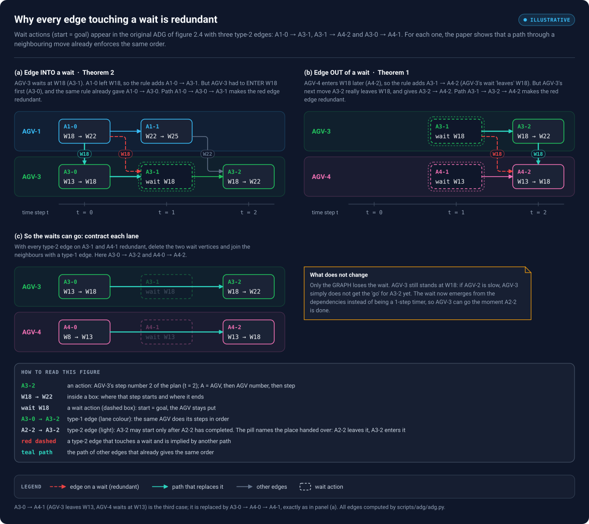
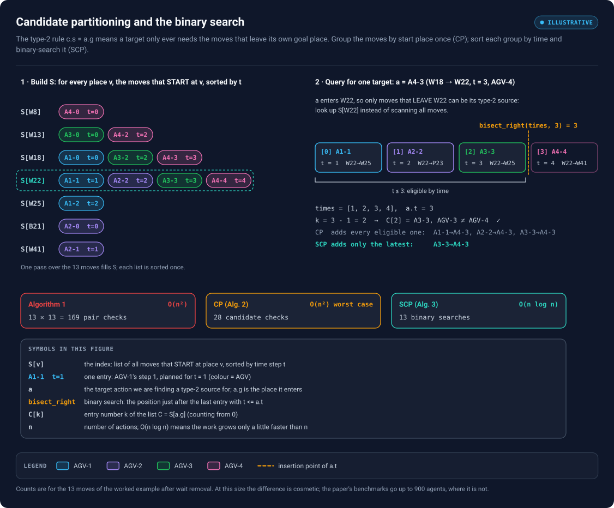
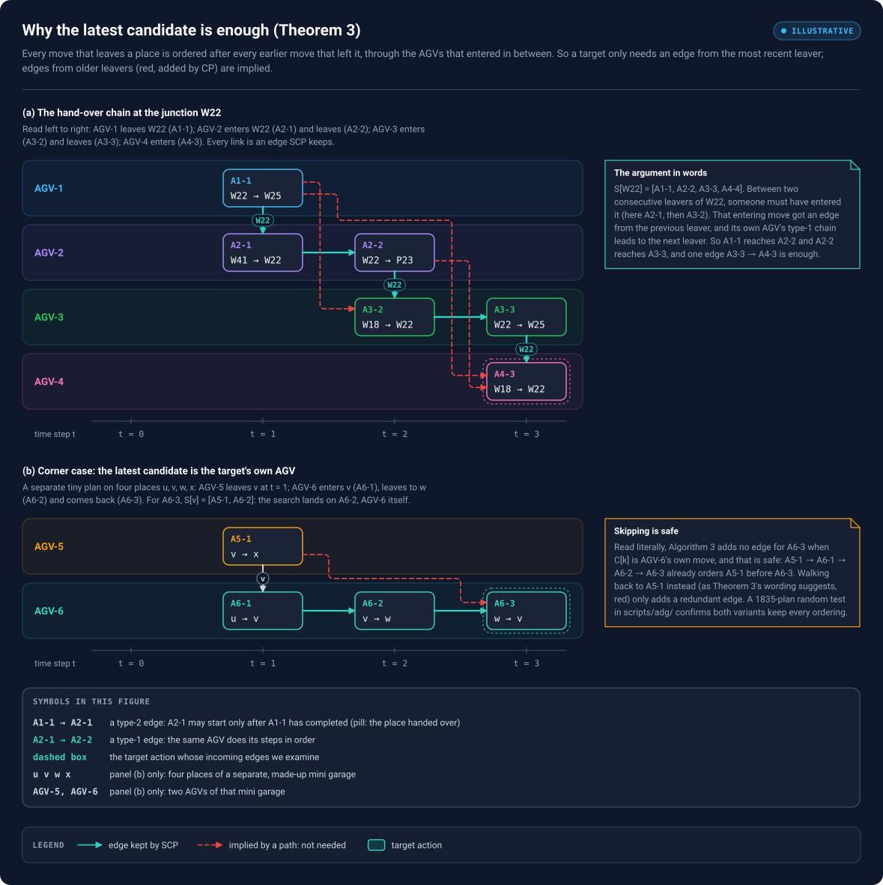
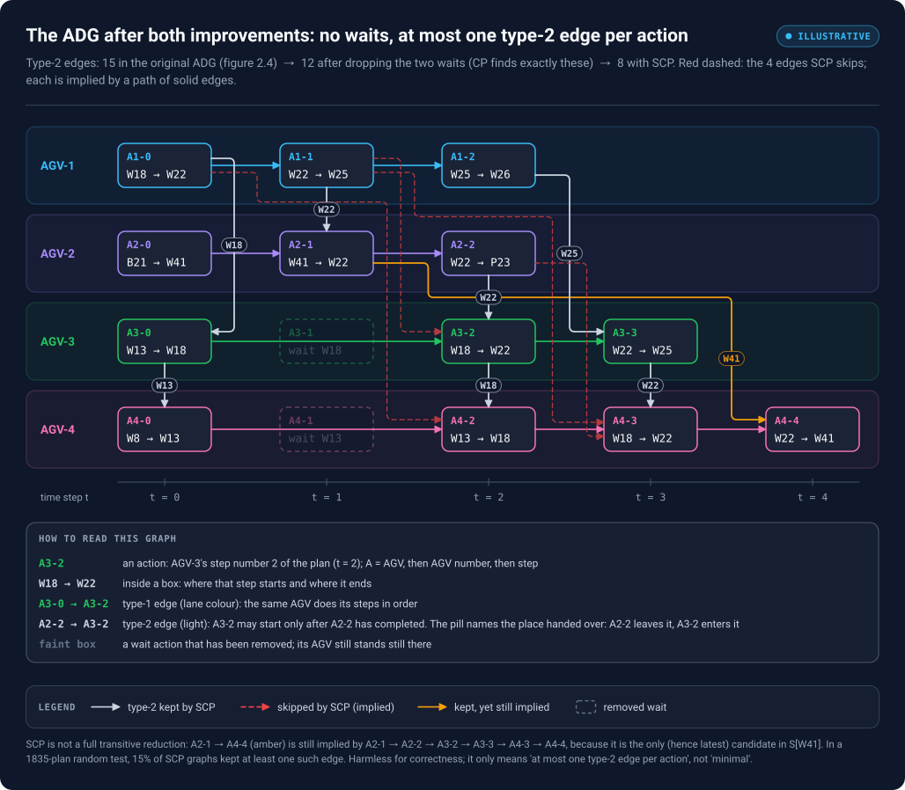
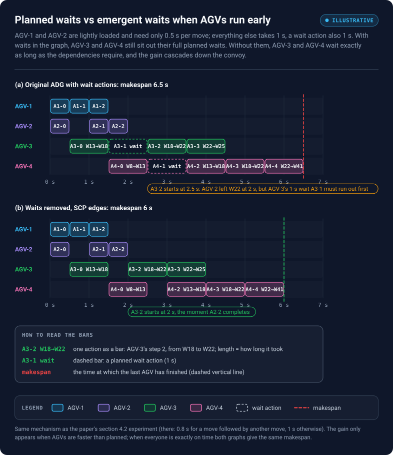
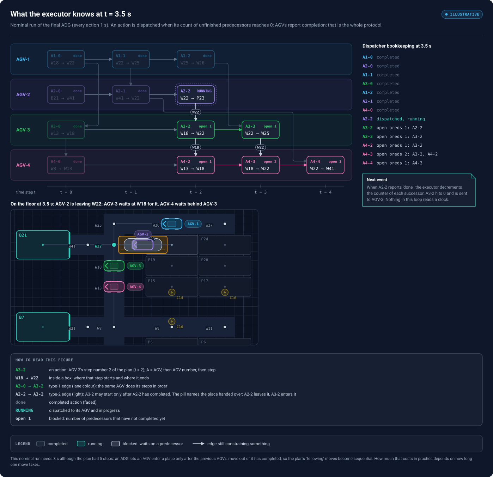

# 03 — The paper's two improvements, step by step

*Chapter 3 of 3. About 60 minutes. Previous: [02 — From CBS to an ADG](02-cbs-to-adg.md). For full derivations, C++ and exercises: [04 — Complete mathematical tutorial](04-complete-mathematical-tutorial.md).*

## What the paper claims

Dunkel (2024) makes two contributions to ADG construction:

1. **Wait actions are redundant.** Every type-2 edge that touches a wait is implied by other edges, so waits can be dropped from the graph. Bonus: execution can get *faster*, because a robot no longer sits out a fixed-length wait when the robot it is waiting for is early.
2. **Sparse Candidate Partitioning (SCP).** A construction algorithm that runs in $O(n \log n)$ instead of $O(n^2)$ for $n$ actions, and gives every action **at most one** incoming type-2 edge.

## What you will be able to do after this chapter

- Explain, on the worked example, why each wait edge is redundant (Theorems 1 and 2).
- Run Candidate Partitioning and SCP by hand: build the index, binary-search it, pick the edge.
- Explain why the latest candidate is enough (Theorem 3), including the corner case where it belongs to the target's own robot.
- Say what SCP does *not* guarantee, and what still has to be checked in a real system.

---

## 1. Starting point: what is wrong with Algorithm 1?

Algorithm 1 (chapter 02, section 3.2) compares every action with every other action: $n^2$ checks. For the 15 actions of the worked example that is 225 checks, which is nothing. The paper's benchmarks have up to 900 robots with long plans, i.e. tens of thousands of actions, and lifelong systems rebuild the graph every time new tasks arrive.

The graph it produces is also **bloated**. Figure 2.4 has 15 type-2 edges for 15 actions; A4-3 alone has three incoming ones. Every edge costs memory and, in a distributed system, a message ("tell AGV-4 when A3-3 is done"). The paper's question: which of these edges are really needed?

The tool for answering it is **reachability**. The paper writes $a \to b$ for a direct edge and $a \leadsto b$ for a path of one or more edges.

- **Definition 4.** $b$ is *reachable* from $a$ if there is a path $a \leadsto b$.
- **Definition 5.** An edge $a \to b$ is *redundant* if $b$ is still reachable from $a$ after deleting that edge.

A redundant edge can be deleted without changing *any* ordering the executor enforces: if $a$ must come before $c$ and $c$ before $b$, then $a$ comes before $b$ anyway.

## 2. Improvement 1: remove wait actions

### 2.1 The two cases on the worked example

A wait $w$ has $s = g$, so it can get type-2 edges in two ways: *into* it (someone left its vertex earlier) and *out of* it (someone enters its vertex later). The worked example has both.



<sub>Pan / zoom: [interactive viewer](../figures/viewer.html#12-wait-removal) · [standalone SVG](../figures/12-wait-removal.svg)</sub>

*Figure 3.1 — (a) The edge into AGV-3's wait, A1-0 → A3-1, is implied by A1-0 → A3-0 → A3-1. (b) The edge out of AGV-3's wait, A3-1 → A4-2, is implied by A3-1 → A3-2 → A4-2. (c) With all their edges redundant, the waits disappear and their neighbours are joined directly.*

**Edge into a wait (paper's Theorem 2).** AGV-3 waits at W18 (A3-1, $t = 1$). AGV-1 left W18 at $t = 0$ (A1-0), so the type-2 rule adds A1-0 → A3-1. But to be waiting at W18, AGV-3 first had to *enter* W18 — that is A3-0, the action just before A3-1. A3-0 also satisfies the rule with A1-0 (A1-0 leaves W18, A3-0 enters W18, $0 \le 0$), so A1-0 → A3-0 exists already. Together with the type-1 edge A3-0 → A3-1 we have the path A1-0 → A3-0 → A3-1. The direct edge is redundant.

**Edge out of a wait (paper's Theorem 1).** AGV-4 enters W18 at $t = 2$ (A4-2). AGV-3's wait A3-1 "leaves" W18 at $t = 1$, so the rule adds A3-1 → A4-2. But AGV-3 physically leaves W18 with its *next move*, A3-2 at $t = 2$, and A3-2 → A4-2 also satisfies the rule ($2 \le 2$). Path: A3-1 → A3-2 → A4-2. Redundant again.

The third wait edge, A3-0 → A4-1, is the same pattern as (a) on vertex W13: AGV-4 had to enter W13 with A4-0, and A3-0 → A4-0 exists.

### 2.2 Why this works in general

The paper's two proofs follow exactly the moves you just made.

- **Theorem 2 (into a wait).** If $a' \to w$ for a wait $w$ of robot $R$, take $R$'s previous action $p$. It ends where the wait is ($p.g = w.g$) and is no later than $w$, so $a'$ satisfies the type-2 rule for $p$ as well: $a' \to p \to w$. *(Such a $p$ always exists: Definition 2 forces $a'.t < w.t$, so $w.t \ge 1$ and $R$ has an action at $w.t - 1$, which ends on the wait's vertex.)*
- **Theorem 1 (out of a wait).** If $w \to a'$, take $R$'s next action $m$. It starts where the wait is ($m.s = w.s = a'.g$), and it is not later than $a'$: Definition 2 forces $a'.t > w.t$, and $m.t = w.t + 1$. So $a'$ satisfies the rule for $m$: $w \to m \to a'$. If $m$ is another wait, repeat until a move.

So no wait contributes an ordering that the moves don't already contribute, and the waits can be dropped. After dropping them, each robot's remaining moves are re-chained with type-1 edges (A3-0 → A3-2, A4-0 → A4-2). In the worked example the type-2 count goes from 15 to 12: exactly the three wait edges disappear.

### 2.3 What removing a wait does *not* mean

The robot still stands still. In the graph, AGV-3 now goes straight from A3-0 to A3-2, but A3-2 has an incoming edge from A2-2, so AGV-3 is not dispatched until AGV-2 has left W22. **The wait is now emergent**: it lasts exactly as long as the dependencies require, instead of a planned fixed duration. Section 6.1 shows why that is faster. What the ADG still does not model is anything outside its vertex-occupancy rule — see section 7.

## 3. Improvement 2a: Candidate Partitioning (CP)

### 3.1 The key observation

Look at the type-2 condition again: $c.s = a.g$. For a target $a$, only actions that **start at $a$'s goal vertex** can possibly be its source. Algorithm 1 checks all $n$ actions for every target and throws almost all of them away. The paper calls the useful ones **candidates** (Definition 6).

So group the actions by start vertex once:

$$
S[v] = \{\, c \in A : c.s = v \,\}.
$$

For each target $a$, only look at $S[a.g]$.

```text
Algorithm 2 — Candidate Partitioning (CP)
S = {}                                  # vertex -> list of actions starting there
for each action a in A:  S[a.s].append(a)
for each action a in A:
    for each c in S[a.g]:
        if c.R != a.R and c.t <= a.t:
            add type-2 edge c -> a
```

CP produces **exactly the same edges** as Algorithm 1; it only skips checks that could never succeed.



<sub>Pan / zoom: [interactive viewer](../figures/viewer.html#13-candidate-index) · [standalone SVG](../figures/13-candidate-index.svg)</sub>

*Figure 3.2 — Left: the index S for the 13 moves of the worked example (waits already removed), each list sorted by time. Right: the query for A4-3 (AGV-4 enters W22 at $t = 3$). Only S[W22] is consulted; the binary search finds the boundary of "$t \le 3$"; CP would add three edges, SCP adds one. Bottom: work done by each algorithm on this example.*

### 3.2 Cost

Building $S$ is one pass over the actions. The query cost is the length of the list consulted. If actions are spread over $x$ distinct start vertices, a list has about $n / x$ entries and CP costs roughly $O(n^2 / x)$ — a big practical win. In the **worst case** (many actions starting at the same vertex) it is still $O(n^2)$. On the worked example: 28 candidate checks instead of $13 \times 13 = 169$.

## 4. Improvement 2b: Sparse Candidate Partitioning (SCP)

### 4.1 The algorithm

SCP adds two things to CP: sort each list by time, and keep only one edge per target — from the **latest** eligible candidate.

```text
Algorithm 3 — SCP (the paper's pseudocode, tidied; lines 9-11 read as "skip")
S = {}
for each action a in A:  S[a.s].append(a)
for each list C in S:     sort C by t ascending
for each action a in A:
    C = S[a.g]
    k = bisect_right(C.times, a.t) - 1     # last candidate with c.t <= a.t
    if k < 0 or C[k].R == a.R:
        continue                           # no edge for a
    add type-2 edge C[k] -> a
```

`bisect_right(times, x)` returns the position *after* the last entry $\le x$ in a sorted list, so subtracting 1 gives the last candidate that is not later than $a$.

The printed lines 9–11 are ambiguous: they decrement $k$ and then `continue` to the next action, so the decrement has no effect. The text of Theorem 3, on the other hand, defines $c_k$ as the latest candidate **of a different robot**, which suggests walking back past $a$'s own robot. Section 4.5 shows both readings are correct; the version above (skip) adds fewer edges.

### 4.2 Worked query: A4-3

Follow the right half of figure 3.2.

1. A4-3 = $\langle W18, W22, 3, AGV-4\rangle$ enters W22, so look up $S[W22]$ = [A1-1 ($t$=1), A2-2 ($t$=2), A3-3 ($t$=3), A4-4 ($t$=4)].
2. `bisect_right([1, 2, 3, 4], 3)` = 3, so $k = 2$.
3. $C[2]$ = A3-3, robot AGV-3 ≠ AGV-4. Add **A3-3 → A4-3**. Done.

CP would have added A1-1 → A4-3, A2-2 → A4-3 and A3-3 → A4-3. SCP keeps only the last one.

### 4.3 All 13 queries

| Target | Enters | $S[\text{goal}]$ (sorted) | Eligible (CP adds all) | SCP adds |
|---|---|---|---|---|
| A1-0 | W22 | A1-1@1, A2-2@2, A3-3@3, A4-4@4 | — | — |
| A2-0 | W41 | A2-1@1 | — (own robot) | — |
| A3-0 | W18 | A1-0@0, A3-2@2, A4-3@3 | A1-0 | A1-0 → A3-0 |
| A4-0 | W13 | A3-0@0, A4-2@2 | A3-0 | A3-0 → A4-0 |
| A1-1 | W25 | A1-2@2 | — | — |
| A2-1 | W22 | A1-1@1, A2-2@2, A3-3@3, A4-4@4 | A1-1 | A1-1 → A2-1 |
| A1-2 | W26 | (empty) | — | — |
| A2-2 | P23 | (empty) | — | — |
| A3-2 | W22 | A1-1@1, A2-2@2, A3-3@3, A4-4@4 | A1-1, A2-2 | A2-2 → A3-2 |
| A4-2 | W18 | A1-0@0, A3-2@2, A4-3@3 | A1-0, A3-2 | A3-2 → A4-2 |
| A3-3 | W25 | A1-2@2 | A1-2 | A1-2 → A3-3 |
| A4-3 | W22 | A1-1@1, A2-2@2, A3-3@3, A4-4@4 | A1-1, A2-2, A3-3 | A3-3 → A4-3 |
| A4-4 | W41 | A2-1@1 | A2-1 | A2-1 → A4-4 |

CP: 12 edges. SCP: 8 edges. The four it skips are A1-1 → A3-2, A1-0 → A4-2, A1-1 → A4-3 and A2-2 → A4-3.

### 4.4 Why the latest candidate is enough (Theorem 3)

Skipping edges is only allowed if the skipped orderings still hold through paths. The paper's argument is a chain along the sorted list.



<sub>Pan / zoom: [interactive viewer](../figures/viewer.html#14-why-latest) · [standalone SVG](../figures/14-why-latest.svg)</sub>

*Figure 3.3 — (a) The hand-over chain at W22: A1-1 → A2-1 → A2-2 → A3-2 → A3-3 → A4-3, alternating type-2 edges ("next robot enters W22") and type-1 edges ("same robot then leaves W22"). Every red edge added by CP is implied by this chain. (b) The corner case where the latest candidate is the target's own robot.*

Take two **consecutive** candidates in a sorted list, $c_i$ and $c_{i+1}$ (both leave vertex $v$, $c_i$ first). Robot $c_{i+1}.R$ can only leave $v$ if it entered $v$ before — call that entering action $b$. (It cannot simply have started on $v$: then it would share $v$ with $c_i$'s robot at time $c_i.t$, a conflict, unless both are the same robot, in which case its type-1 chain already links $c_i$ to $c_{i+1}$.) Because the plan is collision-free, $b$ cannot have entered while $c_i$'s robot was still on $v$, so $c_i.t \le b.t$, and no other candidate lies between them. So when SCP processes $b$, the latest candidate it finds in $S[v]$ is $c_i$, and it adds $c_i \to b$. (If $c_i$ happens to be $b$'s own robot, SCP adds nothing, but then $c_i \leadsto c_{i+1}$ holds through that robot's type-1 chain anyway; see 4.5.) The type-1 chain of $b$'s robot then gives $b \leadsto c_{i+1}$. Hence

$$
c_i \to b \leadsto c_{i+1}, \qquad\text{so}\qquad c_0 \leadsto c_1 \leadsto \dots \leadsto c_k \to a .
$$

In figure 3.3(a): $S[W22]$ = [A1-1, A2-2, A3-3, …]. Between A1-1 and A2-2, AGV-2 entered W22 with A2-1, and SCP added A1-1 → A2-1; A2-1 → A2-2 is type-1. Between A2-2 and A3-3, AGV-3 entered with A3-2: A2-2 → A3-2, then A3-2 → A3-3. So for A4-3, the single edge A3-3 → A4-3 orders it after A1-1 and A2-2 as well.

The paper's proof adds one more step: it relies on the plan being a valid MAPF solution (Definition 2 and Proposition 1). This is not a fact about arbitrary DAGs. You cannot take any dependency graph and keep only the latest edge per target.

### 4.5 The corner case: the latest candidate is the target's own robot

What if $C[k]$ belongs to the same robot as $a$? That happens when a robot leaves a vertex and later comes back to it. Figure 3.3(b) builds the smallest example on a separate, made-up mini garage with four places $u, v, w, x$ and two AGVs, AGV-5 and AGV-6. AGV-5 leaves $v$; AGV-6 enters $v$ (A6-1), leaves it (A6-2) and comes back (A6-3). For A6-3, $S[v]$ = [A5-1, A6-2] and the search lands on A6-2, AGV-6 itself.

Read literally, Algorithm 3 then adds **no** edge for A6-3 (the "skip" reading of lines 9–11). That is correct: A5-1 → A6-1 was added when A6-1 was processed, and A6-1 → A6-2 → A6-3 are type-1, so A5-1 $\leadsto$ A6-3 already. In general, $C[k]$ is an earlier action of $a$'s own robot, so $C[k] \leadsto a$ by type-1 edges, and every older candidate reaches $C[k]$ by the chain above.

Walking back to the latest *different-robot* candidate, which is what the wording of Theorem 3 describes, is also correct; it just adds an edge that is already implied (red in figure 3.3b).

> **Correction to an earlier version of this kit.** The previous edition (and [chapter 04, section 12.3](04-complete-mathematical-tutorial.md#123-important-pseudocode-detail-engineering-analysis)) said a robust implementation *must* walk backwards, and that skipping "can miss a valid older candidate". It cannot: the skipped ordering is always implied, as argued above. `scripts/adg/adg.py` contains both variants; a randomised test on 1835 valid plans found both preserve every ordering of the exhaustive ADG, with the skip variant never adding more edges. (An independent exhaustive search over about 1.4 million small valid plans found no counterexample either.) Skipping also keeps each query at one binary search, which is what the $O(n \log n)$ bound needs.

### 4.6 Complexity

- Building $S$: $O(n)$ with a hash map.
- Sorting all lists: $\sum_v O(q_v \log q_v) \le O(n \log n)$, where $q_v$ is the length of $S[v]$ and $\sum_v q_v = n$.
- One binary search per action: $O(\log n)$ each, $O(n \log n)$ total.
- Output: at most one type-2 edge per action, so at most $n$ type-2 edges, plus fewer than $n$ type-1 edges.

Total: $O(n \log n)$ time and $O(n)$ edges, against $O(n^2)$ for both Algorithm 1 and CP in the worst case.

## 5. The result



<sub>Pan / zoom: [interactive viewer](../figures/viewer.html#15-adg-scp) · [standalone SVG](../figures/15-adg-scp.svg)</sub>

*Figure 3.4 — The final ADG: 13 moves, 9 type-1 edges and 8 type-2 edges, at most one type-2 edge into any action. Faint boxes mark where the two waits used to be. Red dashed: the four edges CP would add and SCP skips. Amber: A2-1 → A4-4, kept by SCP although it is implied by a longer path.*

| | Actions | Type-2 edges | Work on this example |
|---|---|---|---|
| Algorithm 1 (with waits) | 15 | 15 | $15^2 = 225$ pair checks |
| Waits removed, Algorithm 1 or CP | 13 | 12 | 169 pair checks, or 28 candidate checks |
| Waits removed, SCP | 13 | 8 | 13 binary searches |

### 5.1 "Sparse", not "minimal"

The paper says SCP produces a graph "without any redundant dependencies". That is stronger than what its proof shows, and the worked example contains a counterexample. A2-1 → A4-4 (AGV-4 enters W41 after AGV-2 left it) is the *only* candidate in $S[W41]$, so SCP must add it. Yet it is implied by A2-1 → A2-2 → A3-2 → A3-3 → A4-3 → A4-4, because AGV-4 goes through W22 after AGV-2 anyway. SCP removes redundancy *within each candidate list*; it does not compute a full **transitive reduction** (the smallest graph with the same reachability). In the randomised test, 15% of the SCP graphs still had at least one such edge. This does not affect correctness, only the size claim: the guarantee is "at most one type-2 edge per action".

## 6. Consequences for execution

### 6.1 Emergent waits are faster than planned waits



<sub>Pan / zoom: [interactive viewer](../figures/viewer.html#16-waits-throughput) · [standalone SVG](../figures/16-waits-throughput.svg)</sub>

*Figure 3.5 — AGV-1 and AGV-2 run early (0.5 s per move instead of 1 s). (a) With waits in the graph, AGV-3 still has to complete its 1-s wait A3-1 before A3-2 may start, even though AGV-2 left W22 at 2 s. (b) Without waits, A3-2 starts at 2 s; AGV-4 benefits in turn. Makespan 6.5 s → 6 s.*

This is the paper's third argument for removing waits. A planned wait is a guess at how long a robot must hold back; an emergent wait is exactly as long as needed. The paper's own experiment (section 4.2) uses a slightly different timing model — 0.8 s for a move that is directly followed by another move, 1 s otherwise — and reports that removing waits generally finishes a few seconds earlier. The gain only appears when robots are faster than planned; on a perfectly punctual run both graphs give the same makespan.

### 6.2 What the executor does



<sub>Pan / zoom: [interactive viewer](../figures/viewer.html#17-execution-snapshot) · [standalone SVG](../figures/17-execution-snapshot.svg)</sub>

*Figure 3.6 — A nominal run of the final ADG, frozen at 3.5 s. Seven actions are done, A2-2 is running (AGV-2 is carrying the car out of the junction towards P23), the rest are blocked. The garage view shows the same moment on the floor: AGV-3 stands at W18 waiting for AGV-2, AGV-4 stands behind AGV-3. The right column is all the executor stores: for each action, how many predecessors are still unfinished.*

```text
executor (event-driven; no clock)
open[a] = number of incoming edges of a
dispatch every a with open[a] == 0
on "a completed":
    for each successor b of a:
        open[b] -= 1
        if open[b] == 0: dispatch b
```

With SCP each action has at most two incoming edges (one type-1, one type-2), so `open[a] ≤ 2` and each completion message triggers at most a handful of updates.

Note the footnote of figure 3.6: the nominal ADG run takes 8 s for a 5-step plan. In this model a robot may enter a vertex only after the previous robot's move out of it has *completed*, so every "following" pair of the plan becomes sequential. That is the price of robustness in the simple ADG model. How much it costs in practice depends on how long one move takes; it is a property of ADG execution in general, not of SCP.

## 7. Before you use this in a real system

The paper's results hold inside its model. When adapting them, check each assumption explicitly.

1. **Collision model.** The type-2 rule protects *one vertex at a time*. Real AGV conflicts can involve neighbouring stalls, headings, swept areas, lifts or bays. Wait removal and Theorem 3 both rely on the vertex-only rule and on the plan being conflict-free under it (Definition 2). A richer occupancy model needs its own dependency rule and its own proof.
2. **Plan validity.** SCP's correctness argument uses the fact that the plan is collision-free. Feed it an invalid plan and it can silently drop needed orderings. Validate plans before building the graph.
3. **Acyclicity.** Check for cycles before dispatching. The paper excluded benchmark plans that produced cyclic ADGs.
4. **Persistent occupancy.** A robot parked at its goal, or standing still where a wait used to be, still occupies the vertex. The graph orders *actions*; whatever owns parked robots and stopped robots in your system must still be correct.
5. **Testing.** Build both the exhaustive ADG and the SCP ADG on many plans and compare reachability, as `scripts/adg/adg.py` does. It is cheap and catches indexing mistakes (off-by-one in the binary search, wrong vertex in the index) that are otherwise very hard to see.
6. **Safety layer.** An ADG is a coordination layer, not a safety system. Local obstacle detection and emergency stops are still required.

## 8. Summary

| Method | Core idea | Time | Type-2 edges |
|---|---|---|---|
| Algorithm 1 | compare all pairs | $O(n^2)$ | up to $O(n^2)$ |
| + drop waits | waits add no unique ordering (Theorems 1, 2) | fewer actions | fewer edges |
| CP | only look at $S[a.g]$ | $O(n^2)$ worst, about $O(n^2/x)$ typical | same as Algorithm 1 |
| SCP | sort $S[v]$, binary-search the latest candidate | $O(n \log n)$ | at most one per action |

## Checkpoint

<details><summary>1. Why can A3-1 → A4-2 be dropped, but A3-2 → A4-2 cannot?</summary>

A3-1 → A4-2 is implied by A3-1 → A3-2 → A4-2. A3-2 → A4-2 is the edge that says "AGV-4 may not enter W18 before AGV-3 has left it". In the SCP graph A4-2's only other predecessor is AGV-4's own previous action A4-0, which does not depend on A3-2, so deleting the edge would allow AGV-4 into W18 while AGV-3 is still there.
</details>

<details><summary>2. For target A3-2, S[W22] = [A1-1@1, A2-2@2, A3-3@3, A4-4@4]. What do bisect_right and SCP return?</summary>

`bisect_right([1,2,3,4], 2)` = 2, so $k = 1$, $C[1]$ = A2-2, robot AGV-2 ≠ AGV-3. SCP adds A2-2 → A3-2. A1-1 → A3-2 is implied by A1-1 → A2-1 → A2-2 → A3-2.
</details>

<details><summary>3. Why must the candidate list be indexed by START vertex and queried with the target's GOAL vertex, and not the other way round?</summary>

Because the hazard is a robot entering a vertex that another robot is still leaving. The source of a type-2 edge leaves $v$ (its start is $v$); the target enters $v$ (its goal is $v$). Indexing by goal would list the robots that *enter* $v$, which is the wrong set.
</details>

<details><summary>4. Does SCP give the same reachability as Algorithm 1 restricted to move actions?</summary>

Yes, for valid plans under the paper's model: every ordering of the exhaustive ADG is still present (as a path), and no new ordering is added, because every SCP edge is either an Algorithm 1 edge or (the re-chained type-1 edges such as A3-0 → A3-2) a path through a removed wait in Algorithm 1's graph. On the worked example, `test_adg.py` checks this directly.
</details>

<details><summary>5. A colleague says "SCP computes the transitive reduction of the ADG". True?</summary>

No. It guarantees at most one type-2 edge per action, but an edge can still be implied by a longer path through other robots, as A2-1 → A4-4 is in figure 3.4.
</details>
