# Action Dependency Graphs and Sparse Candidate Partitioning — From First Principles

*A mathematical and algorithmic tutorial of Joachim Dunkel, “Streamlining the Action Dependency Graph Framework: Two Key Enhancements,” arXiv:2412.01277v1 (2024).*

> **Scope and reading convention.** Sections marked **[Paper]** explain what the supplied six-page paper states. Sections marked **[Background]** build prerequisites not developed in the paper. Sections marked **[Engineering analysis]** offer independent interpretation, safeguards, or critique; they are **not** claims proved by the paper. The paper improves **execution-graph construction after MAPF planning**; it does not introduce a new MAPF path-search solver.
>
> **Rendering:** Written for VS Code Markdown Preview with ordinary fenced `mermaid` diagrams and MathJax-style `$...$` / `$$...$$` mathematics. Use a Markdown extension that enables Mermaid if the default preview does not show diagrams. Avoid LaTeX inside Markdown tables; mathematical notation is explained below the tables instead.

## Table of contents

1. [Learning roadmap and the complete pipeline](#1-learning-roadmap-and-the-complete-pipeline)
2. [Mathematical language: scalars, vectors, matrices, sets](#2-mathematical-language-scalars-vectors-matrices-sets)
3. [Graph theory from first principles](#3-graph-theory-from-first-principles)
4. [Time, paths, collisions, and MAPF](#4-time-paths-collisions-and-mapf)
5. [How MAPF is solved: A*, prioritized planning, CBS](#5-how-mapf-is-solved-a-prioritized-planning-cbs)
6. [Why a collision-free plan is not enough to execute](#6-why-a-collision-free-plan-is-not-enough-to-execute)
7. [From a MAPF solution to an Action Dependency Graph](#7-from-a-mapf-solution-to-an-action-dependency-graph)
8. [Worked example: occupancy becomes a dependency](#8-worked-example-occupancy-becomes-a-dependency)
9. [Original exhaustive construction](#9-original-exhaustive-construction)
10. [Improvement one: eliminate wait-action vertices](#10-improvement-one-eliminate-wait-action-vertices)
11. [Improvement two: candidate partitioning](#11-improvement-two-candidate-partitioning)
12. [Sparse Candidate Partitioning (SCP)](#12-sparse-candidate-partitioning-scp)
13. [Why sparse edges can preserve the required order](#13-why-sparse-edges-can-preserve-the-required-order)
14. [Complexity and storage analysis](#14-complexity-and-storage-analysis)
15. [Implementation sketch in C++](#15-implementation-sketch-in-c)
16. [Execution semantics and real-world safeguards](#16-execution-semantics-and-real-world-safeguards)
17. [Connecting SCP and ADGs to Conflict-Based Search](#17-connecting-scp-and-adgs-to-conflict-based-search)
18. [Connections to other algorithms](#18-connections-to-other-algorithms)
19. [Paper results and limitations](#19-paper-results-and-limitations)
20. [Exercises with solutions](#20-exercises-with-solutions)
21. [Glossary and references](#21-glossary-and-references)

---

## 1. Learning roadmap and the complete pipeline

Imagine a warehouse with many robots and narrow aisles. A route planner produces paths that are collision-free **if every robot moves on the assumed clock**. But physical robots do not share perfectly predictable execution times: one robot brakes late, another waits for a safety interlock, and a third reaches an intersection early.

The paper asks: **How do we turn timed paths into a compact network of “do this only after that completes” constraints? And how do we build that network efficiently?**

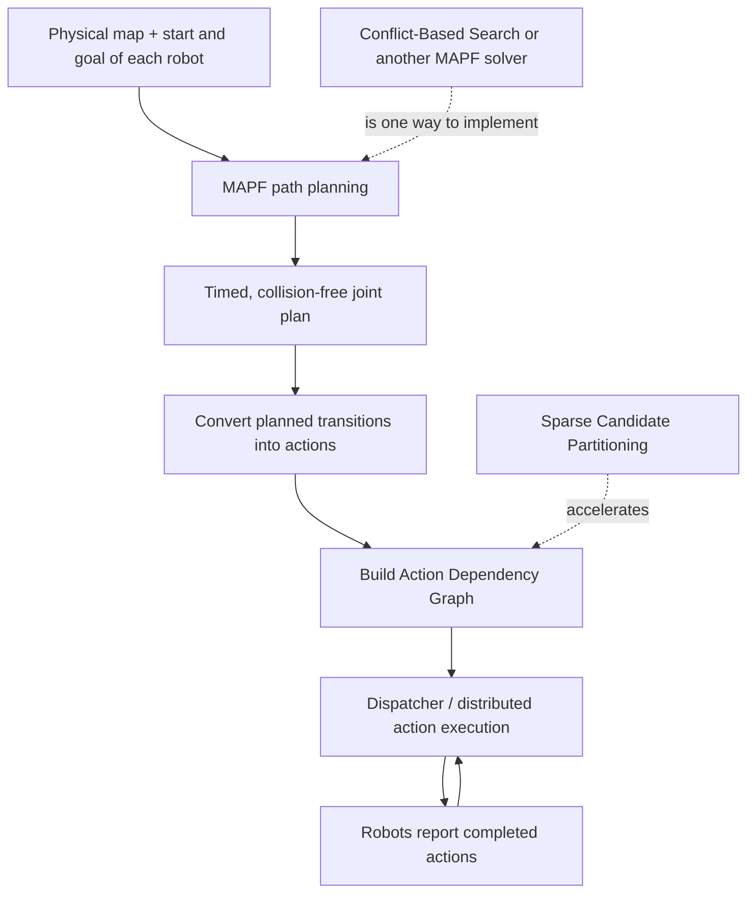

**Separate these three different problems:**

- **Path finding:** Where and when should robots go? Solved by MAPF algorithms such as CBS, prioritized planning, or large-neighborhood search.
- **Dependency extraction:** Which planned actions must precede other actions to protect shared resources? Solved here by ADG construction; **SCP** is the paper's optimized method.
- **Execution:** Which actions are enabled right now, given actual completions? Determined by the dependency graph and physical safety mechanisms.

**Learning objectives:** By the end you should be able to formulate MAPF, identify vertex/edge conflicts, build both ADG edge types, derive SCP's lookup-and-binary-search procedure, compare $O(n^2)$ with $O(n\log n)$, and explain precisely how an ADG differs from CBS's constraint tree.

## 2. Mathematical language: scalars, vectors, matrices, sets

### 2.1 Notation and dimensionality [Background]

We adopt the requested convention consistently **for mathematical variables**: *italic lowercase* for scalars, **bold lowercase** for vectors, and **bold uppercase** for matrices. Graphs and sets use calligraphic capitals; indices such as $i,j,k$ are italic scalars. Algorithm names such as `SCP` are ordinary text.

| Object | Example | Meaning / dimension |
|---|---|---|
| Scalar | $t, n, i, c$ | Single number in $\mathbb{R}$, or in $\mathbb{N}$ for counts |
| Vector | $\mathbf{p},\mathbf{x}$ | Ordered list of components, e.g. $\mathbb{R}^{2}$ or $\mathbb{R}^{d}$ |
| Matrix | $\mathbf{A},\mathbf{M}$ | Rectangular array, e.g. $\mathbb{R}^{m\times n}$ |
| Set | $\mathcal{V},\mathcal{E},\mathcal{A}$ | Collection of vertices, edges, or actions; no vector dimension implied |
| Graph | $\mathcal{G}=(\mathcal{V},\mathcal{E})$ | Vertices together with edges |
| Sequence | $\pi_i=(v_i^0,\ldots,v_i^T)$ | Ordered states of robot $i$ |
| Function | $f:\mathcal{X}\to\mathcal{Y}$ | Maps objects in one set to another |

An expression such as

$$
\mathbf{p}\in\mathbb{R}^{2}
$$

means that **$\mathbf{p}$ is a two-dimensional real-valued vector**. For example,

$$
\mathbf{p}=\begin{bmatrix}2\\3\end{bmatrix}\in\mathbb{R}^{2},\qquad
\mathbf{x}=\begin{bmatrix}x_1\\x_2\\\vdots\\x_d\end{bmatrix}\in\mathbb{R}^{d}.
$$

Here $x_j\in\mathbb{R}$ denotes the $j$-th scalar coordinate. The notation $\mathbb{R}^{m\times n}$ means an $m$-row, $n$-column real matrix, for example

$$
\mathbf{M}=\begin{bmatrix}1&0&0\\0&1&1\end{bmatrix}\in\mathbb{R}^{2\times3}.
$$

**Important distinction:** $\mathcal{V}$ is a *set* of discrete map vertices, not necessarily a vector space. A robot may occupy a graph vertex $v\in\mathcal{V}$ whose associated physical location is a vector $\mathbf{p}(v)\in\mathbb{R}^{2}$. The two are related, but not interchangeable.

### 2.2 Occupancy vectors and matrices [Background]

For $m=|\mathcal{V}|$ map vertices, one possible encoding of robot $i$'s position at step $t$ is a one-hot vector

$$
\mathbf{o}_i^t\in\{0,1\}^{m}\subset\mathbb{R}^{m},\quad
[\mathbf{o}_i^t]_j=\begin{cases}1,&v_i^t=v_j,\\0,&\text{otherwise.}\end{cases}
$$

For $r$ robots, stack columns to obtain an occupancy matrix

$$
\mathbf{O}^t=
\begin{bmatrix}\mathbf{o}_1^t&\mathbf{o}_2^t&\cdots&\mathbf{o}_r^t\end{bmatrix}
\in\{0,1\}^{m\times r}.
$$

Its dimension is **map vertices by robots**. Under the usual “at most one robot per map vertex” rule,

$$
\sum_{i=1}^{r}[\mathbf{O}^t]_{ji}\le1
\quad\text{for each vertex }j\text{ and time }t.
$$

This matrix is a **teaching representation**, not a data structure specified by the paper. It makes collision constraints algebraically visible.

### 2.3 Basic sets and logic [Background]

- $a\in\mathcal{A}$: action $a$ belongs to the action set.
- $\forall$: “for all”; $\exists$: “there exists.”
- $p\land q$: both conditions hold; $p\lor q$: at least one holds.
- $\mathcal{C}(v)=\{a\in\mathcal{A}:s(a)=v\}$: a candidate list filtered by start vertex.
- $|\mathcal{A}|=n$: number of actions is $n$.

### 2.4 Discrete versus continuous time [Background]

An MAPF plan often uses $t\in\mathbb{N}$ and transition duration one *planning* step. A real action completes at a wall-clock time $\tau\in\mathbb{R}_{\ge0}$. They are different quantities:

$$
t\in\{0,1,\ldots,T\},\qquad \tau\in\mathbb{R}_{\ge0}.
$$

The ADG uses planned ordering to allow correct execution when actual completion times deviate from those planning steps.

## 3. Graph theory from first principles

### 3.1 Map graph versus dependency graph [Background]

The **physical map graph** is

$$
\mathcal{G}_{\mathrm{map}}=(\mathcal{V}_{\mathrm{map}},\mathcal{E}_{\mathrm{map}}).
$$

A vertex is a spatial location and an edge is a legal motion between locations. In contrast, the **action dependency graph** is

$$
\mathcal{G}_{\mathrm{ADG}}=(\mathcal{A},\mathcal{D}),
$$

where a vertex is an *action*, and $(a,b)\in\mathcal{D}$ means “action $a$ must finish before action $b$ can start.” The graphs represent **different kinds of things**.

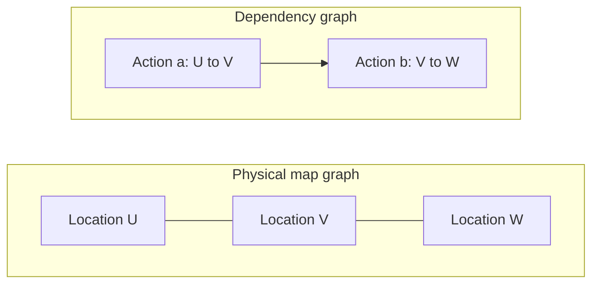

### 3.2 Directed paths, reachability, and redundant edges [Background]

A **directed path** $a\leadsto b$ consists of zero or more aligned edges from $a$ to $b$. An edge $a\to b$ is redundant if removing it leaves another directed path $a\leadsto b$.

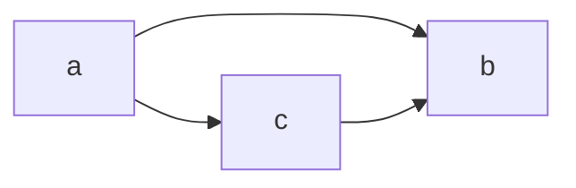

Here the direct edge $a\to b$ is redundant because $a\to c\to b$ already forces the same order. A **transitive reduction** of a DAG removes reachability-redundant edges while preserving reachability. SCP exploits related structure but **is not presented as a generic arbitrary-DAG transitive-reduction algorithm**.

### 3.3 DAGs and topological ordering [Background]

A **directed acyclic graph (DAG)** has no directed cycle. Its actions can be placed in a topological order. The following is invalid as an executable dependency graph:

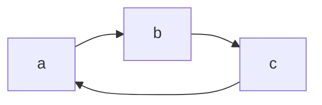

Each action waits for another: none can start. A scheduler should test ADG acyclicity before execution; see Section 16.

### 3.4 Enabled actions [Background]

Write $\operatorname{pred}(a)=\{b:(b,a)\in\mathcal{D}\}$. Given the set $\mathcal{F}$ of finished actions, an action is **enabled** exactly when

$$
\operatorname{pred}(a)\subseteq\mathcal{F}.
$$

If $a$ has zero predecessors, it is initially enabled. A straightforward implementation stores an unsatisfied-predecessor counter and decrements it when its predecessor finishes.

## 4. Time, paths, collisions, and MAPF

### 4.1 Problem formulation [Background]

Multi-Agent Path Finding (**MAPF**) receives a map graph, $r$ agents, a start vertex $s_i\in\mathcal{V}_{\mathrm{map}}$ and goal vertex $g_i\in\mathcal{V}_{\mathrm{map}}$ for each robot $i$. It produces timed discrete trajectories

$$
\pi_i=(v_i^0,v_i^1,\ldots,v_i^{T_i}),\qquad v_i^0=s_i,\quad v_i^{T_i}=g_i.
$$

A legal step either waits or traverses a physical-map edge:

$$
v_i^{t+1}=v_i^{t}\quad\text{or}\quad
(v_i^t,v_i^{t+1})\in\mathcal{E}_{\mathrm{map}}.
$$

The joint solution is $\Pi=\{\pi_1,\ldots,\pi_r\}$. To compare trajectories after arrival, the usual **stay-at-goal** convention extends the final state forward in time, although other variants exist. You must choose the convention explicitly in a real planner.

### 4.2 Vertex collision [Background]

Two distinct agents cannot occupy the same vertex at the same planning instant:

$$
\forall t,\ \forall i\ne j:\quad v_i^t\ne v_j^t.
$$

### 4.3 Head-on edge collision [Background]

Under the standard MAPF conflict model, agents cannot swap ends of the same edge in opposite directions at the same step:

$$
\neg\bigl(v_i^t=v_j^{t+1}\land v_i^{t+1}=v_j^t\bigr)
\quad(i\ne j).
$$

Additional systems may forbid following too closely, simultaneous traversal of shared geometry, or intersection conflicts. These **physical safety constraints exceed basic vertex/edge MAPF rules**.

### 4.4 Objectives [Background]

Two common optimization objectives are:

$$
C_{\mathrm{sum}}=\sum_{i=1}^{r}T_i
\quad\text{(sum of costs)},\qquad
C_{\max}=\max_i T_i
\quad\text{(makespan)}.
$$

The paper later measures **simulated execution makespan**, which differs from nominal planned makespan.

### 4.5 Small collision example [Background]


If robot 1 enters C from L and robot 2 simultaneously enters C from R, they have a vertex conflict. If robot 1 transitions L→C while robot 2 transitions C→L in the same tick, they have a head-on edge conflict.

## 5. How MAPF is solved: A*, prioritized planning, CBS

### 5.1 Single-agent A* [Background]

A* finds one robot's shortest path using

$$
f(v)=g(v)+h(v),
$$

where $g(v)$ is the cost so far, $h(v)$ is an admissible lower bound to the goal, and $f(v)$ is the estimated total cost. In time-aware MAPF low-level search, a state can be $(v,t)$ instead of only $v$.

### 5.2 Prioritized planning [Background]

Choose a robot ordering; plan the highest-priority robot first, reserve its space-time trajectory, and plan lower-priority robots around it. Often fast but priority ordering can sacrifice completeness or optimality. The paper specifically notes that faster MAPF planners make ADG-construction overhead more relevant (Introduction).

### 5.3 Conflict-Based Search (CBS) [Background]

CBS has two levels:

1. **Low-level search:** For each robot, find a shortest path satisfying its current constraints, often with A*.
2. **High-level search:** Detect an inter-agent conflict. Branch into two child problems: forbid one robot from making the conflicting occupancy/transition in one child, and forbid the other in the other child. Replan only the affected robot(s).

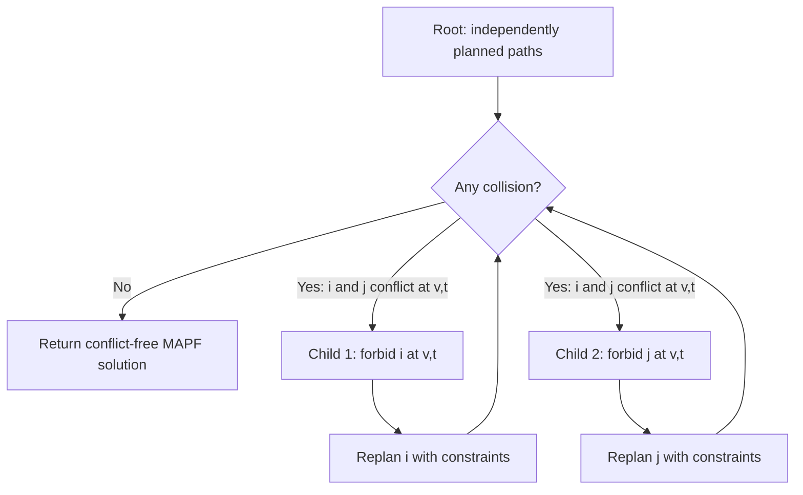

For a vertex conflict $(i,j,v,t)$, the two alternative added constraints are

$$
(i,v,t)\notin\mathrm{occupancy}
\qquad\text{or}\qquad
(j,v,t)\notin\mathrm{occupancy}.
$$

The actual notation in implementations is often a forbidden *agent–vertex–time* triple. Edge conflicts instead produce corresponding forbidden transitions. **CBS returns timed paths; it does not itself define the ADG's runtime completion-precedence edges.**

## 6. Why a collision-free plan is not enough to execute

Suppose the planner expects robot A to leave a corridor at step 3, after which B will enter at step 4. If A is delayed and B slavishly follows its own nominal clock, they can collide. The key distinction:

$$
\text{feasible at planned times}\quad\not\Rightarrow\quad
\text{safe under arbitrary execution delays}.
$$

One strategy is to pad schedules with delay robustness; another is to enforce **event-driven precedences**. In an ADG, B's entrance becomes enabled when A **actually completes** the action freeing the necessary resource, instead of simply when the planned time is reached.

**Caveat [Engineering analysis]:** Precedence-only dispatch is not an unconditional collision-avoidance guarantee. It assumes the chosen action model, reservation semantics, completion feedback, and physical geometry correctly capture relevant hazards.

## 7. From a MAPF solution to an Action Dependency Graph

### 7.1 Paper's action representation [Paper, §2]

An action is a tuple

$$
a=\langle s(a),g(a),t(a),R(a)\rangle,
$$

where $s(a),g(a)\in\mathcal{V}_{\mathrm{map}}$ are start and goal vertices, $t(a)\in\mathbb{N}$ is the planned step, and $R(a)$ identifies its robot. A **wait** satisfies $s(a)=g(a)$; a **move** satisfies $s(a)\ne g(a)$.

For later C++ implementation, it is helpful to give each action a distinct identifier, so the tuple is not itself necessarily its storage key.

### 7.2 Type-1: same-robot sequence edges [Paper, §2.1]

For consecutive actions of robot $i$,

$$
a_{i,k}\to a_{i,k+1}.
$$

They protect the robot's own action order. After omitting waits, “consecutive” must be understood in the **remaining ordered move sequence**, which might have gaps in original timestamps.

### 7.3 Type-2: cross-robot resource-order edges [Paper, Algorithm 1]

For different-robot actions $c$ and $a$, the paper's exhaustive test can be rewritten as

$$
R(c)\ne R(a),\quad s(c)=g(a),\quad t(c)\le t(a)
\quad\Longrightarrow\quad c\to a.
$$

Interpretation: $c$ is an earlier action that **departs from** the vertex into which $a$ is trying to **arrive**. $a$ cannot enter until that earlier occupant has departed.

This is a graph conversion rule, not a new path-planning collision test. The original paper's notation uses the start and goal components of its action tuples.

## 8. Worked example: occupancy becomes a dependency

Consider locations L, C and R, plus robot 1 (blue) and robot 2 (orange). Robot 2 must exit C before robot 1 can enter it.

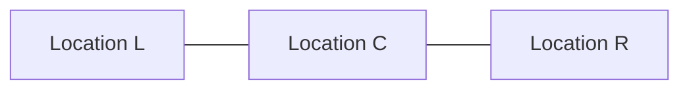

**Illustrative MAPF output:**

| Robot | Planned time | Action ID | Transition |
|---|---:|---|---|
| 2 | 0 | $c$ | C → R |
| 1 | 1 | $a$ | L → C |
| 1 | 2 | $b$ | C → R (only if R has been cleared by then) |

For the conflict-relevant pair $(c,a)$, $s(c)=\mathrm{C}=g(a)$, $t(c)=0\le1=t(a)$, and $R(c)\ne R(a)$. Consequently $c\to a$.

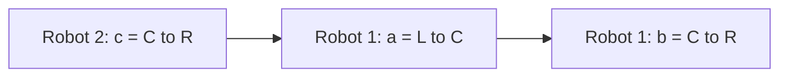

The edge $c\to a$ is type 2; $a\to b$ is type 1. **This miniature excerpt is about individual dependencies, not a complete validated two-robot full-horizon MAPF scenario**: R must be unoccupied when robot 1 enters, and the omitted remainder of robot 2's plan must ensure this. Avoid treating a local example as proof of global collision freedom.

### 8.1 Execution-time example

Suppose the plan expects $c$ to finish at wall-clock $\tau=2.0\,\mathrm{s}$, but it actually finishes at $\tau=2.7\,\mathrm{s}$. The ADG requires

$$
\tau_{\mathrm{start}}(a)\ge\tau_{\mathrm{finish}}(c)=2.7\,\mathrm{s},
$$

regardless of $a$'s nominal planning timestamp.

## 9. Original exhaustive construction

### 9.1 Procedure [Paper, Algorithm 1]

1. Insert all same-agent type-1 edges.
2. For each ordered pair of actions, check whether the type-2 rule holds.
3. If it holds, insert the corresponding directed dependency.

```text
for each action a:
    for each action c:
        if robot(c) == robot(a):
            continue
        if start(c) == goal(a) and time(c) <= time(a):
            add edge c -> a
```

### 9.2 Why quadratic? [Background]

If there are $n$ actions, there are up to $n^2$ ordered pairs (or $n(n-1)$ after skipping identical pairs). With $O(1)$ tests per pair,

$$
T_{\mathrm{exhaustive}}(n)=O(n^2).
$$

The output itself may also contain many redundant edges, increasing memory, communication, and successor bookkeeping even when the execution policy is unchanged.

## 10. Improvement one: eliminate wait-action vertices

### 10.1 Statement [Paper, §3.1]

The paper's first contribution is a proof that wait actions ($s(w)=g(w)$) do not contribute **unique** dependency ordering in its ADG formulation. Their type-2 edges can be represented through nearby move actions and same-robot chains.

### 10.2 Outgoing edge from a wait [Paper, Theorem 1; simplified intuition]

If a wait $w$ must precede another robot's action $b$, the later move $m$ that finally leaves the waiting robot's vertex can be used as the relevant cross-robot prerequisite. The chain

$$
w\to\cdots\to m\to b
$$

already implies $w\leadsto b$; a direct $w\to b$ is unnecessary.

### 10.3 Incoming edge into a wait [Paper, Theorem 2; simplified intuition]

If another robot's action $c$ must precede a wait $w$, that ordering is already captured by the move through which the waiting robot arrived, followed by its own type-1 chain:

$$
c\to a\to\cdots\to w.
$$

Thus one can omit the wait vertices **while preserving the move-action precedence structure**, provided the paper's modelling assumptions hold.

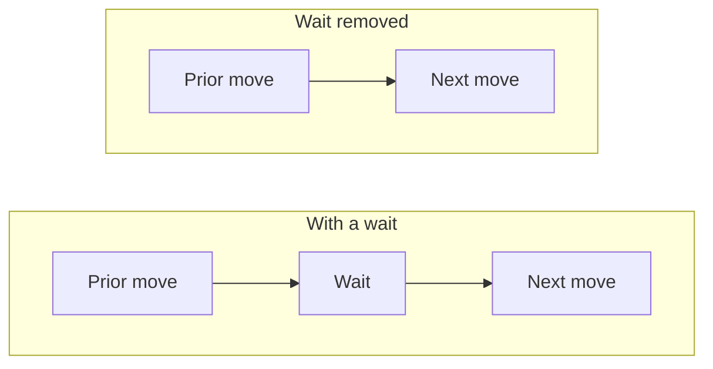

**Do not confuse “wait action is redundant as an ADG node” with “the robot no longer needs to stop or wait.”** A robot still waits if a physical resource or cross-robot prerequisite has not cleared. The graph no longer forces it to sit through a predetermined *artificial waiting action* after the true prerequisite has finished.

### 10.4 Boundary assumptions [Engineering analysis]

An operational implementation must decide how to represent waiting **before the first move**, **after the final move**, and **at a goal held indefinitely**. The paper's proof speaks in terms of previous/next actions; it is not a complete specification of goal-occupancy policies, persistent parking reservations, or non-MAPF robot activity. Treat those as separate requirements.

## 11. Improvement two: candidate partitioning

### 11.1 Key observation [Paper, §3.2]

When searching for predecessors of an action $a$, only actions that **depart from $g(a)$** can possibly satisfy the type-2 rule. Create a map

$$
\mathcal{S}:v\mapsto\mathcal{C}(v),\qquad
\mathcal{C}(v)=\{c\in\mathcal{A}:s(c)=v\}.
$$

Each candidate list is a partition bucket keyed by a physical-map vertex.

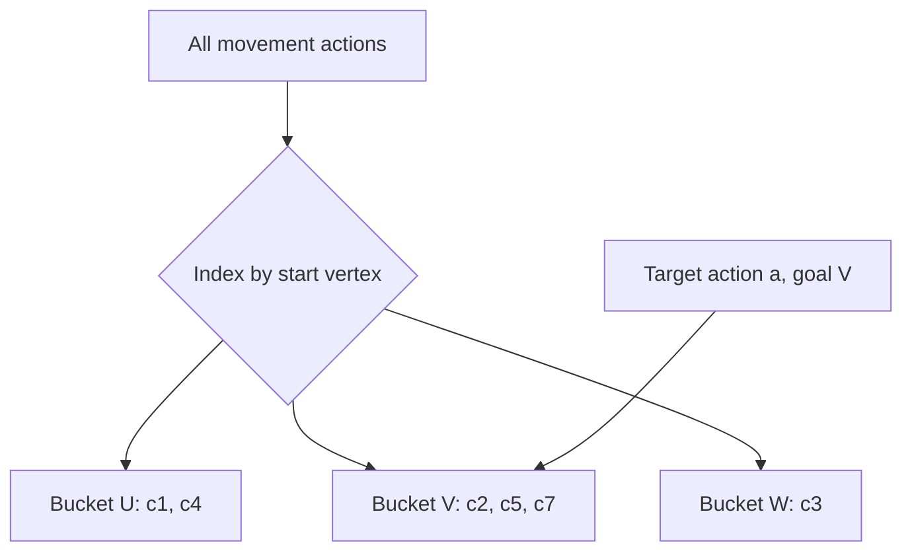

Rather than comparing $a$ to **all** $n$ actions, compare it to its relevant bucket $\mathcal{C}(g(a))$.

### 11.2 Candidate Partitioning, CP [Paper, Algorithm 2]

```text
for each move action c:
    bucket[start(c)].append(c)
for each move action a:
    for each c in bucket[goal(a)]:
        if robot(c) != robot(a) and time(c) <= time(a):
            add edge c -> a
```

If $q_v$ denotes the number of actions starting at vertex $v$ and $p_v$ the number arriving at $v$, then total candidate comparisons are

$$
\sum_{v\in\mathcal{V}_{\mathrm{map}}}p_vq_v.
$$

This is often much smaller than $n^2$. But in the worst case, if many arrivals and departures concentrate at one vertex, it is still $O(n^2)$. The paper gives an average-case intuition of roughly $O(n^2/x)$ for $x$ distinct start vertices under approximately even distribution; that is **not** a worst-case guarantee.

## 12. Sparse Candidate Partitioning (SCP)

### 12.1 Insight [Paper, §3.3]

CP may add several edges into the same target action. SCP instead keeps only the **latest relevant departure** from the target's goal vertex. Earlier departures should already precede that latest departure *by paths elsewhere in the ADG*, making their direct edges into the target unnecessary.

Let the bucket for a vertex be ordered by planning time:

$$
\mathcal{C}(v)=[c_0,c_1,\ldots,c_{q_v-1}],\qquad
t(c_0)<t(c_1)<\cdots<t(c_{q_v-1}).
$$

For target $a$, look up $\mathcal{C}(g(a))$ and find the latest $c_k$ satisfying

$$
t(c_k)\le t(a),\qquad R(c_k)\ne R(a).
$$

When such a candidate exists, insert just

$$
c_k\to a.
$$

### 12.2 Binary search [Background applied to Paper, Algorithm 3]

The bucket is sorted by $t(c)$. We need the last candidate time $\le t(a)$:

$$
k=\operatorname{upper\_bound}(\{t(c_j)\}_j,t(a))-1.
$$

Here `upper_bound` returns the insertion position **after** all equal timestamps; subtracting one finds the last timestamp at most the query. The paper writes `bisect_right` for the same idea. Checking the robot ID then removes same-agent false candidates.

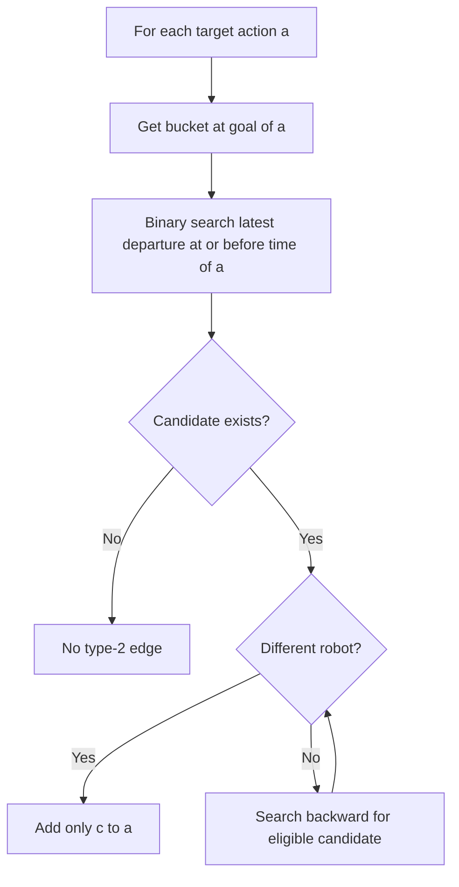

### 12.3 Important pseudocode detail [Engineering analysis]

> **Correction (revised kit).** The analysis below is overly cautious. When the latest time-eligible candidate $c_k$ belongs to the target's own robot, reading lines 9–11 of Algorithm 3 literally (decrement, then `continue` to the next action) adds no edge, and that is **safe**: $c_k$ is an earlier action of the same robot, so $c_k \leadsto a$ through type-1 edges, and every older candidate reaches $c_k$ through the hand-over chain of Theorem 3. Walking backwards to a different-robot candidate is also correct but only adds a redundant edge. See [chapter 03, section 4.5](03-scp-illustrated.md#45-the-corner-case-the-latest-candidate-is-the-targets-own-robot) for a worked example and `scripts/adg/test_adg.py` for a randomised check of both variants. Keeping the "skip" also keeps every query at a single binary search, so the $O(n\log n)$ concern raised below does not arise.

The printed **Algorithm 3** has an ambiguous / problematic control-flow segment around lines 9–11: it decrements $k$ on an invalid candidate and says `continue` without clearly enclosing a repeated validation loop. The surrounding prose says to find the latest **different-robot** valid candidate. A literal implementation with a single decrement and `continue` at the outer action loop can **miss a valid older candidate**. An implementation should explicitly loop backward (or otherwise search by robot-aware indexing) until a valid candidate is found. It should also check the boundary **before dereferencing** a negative index.

Below is a conservative engineering interpretation of the intended candidate-selection step:

```text
k = upper_bound(bucket.times, time(a)) - 1
while k >= 0 and robot(bucket[k]) == robot(a):
    k -= 1
if k >= 0:
    add edge bucket[k] -> a
```

Note that worst-case repeated backward scanning is **not automatically $O(\log n)$ per action**. To obtain the claimed $O(n\log n)$ bound in an implementation, one must justify why it is sufficient to examine only a bounded number of same-agent entries (under the MAPF/ADG structure), or use an index that can return the latest **different-agent** candidate efficiently. For example, when queries exclude exactly one robot, an augmented ordered bucket can store the two most recent distinct robot IDs for each prefix, enabling an $O(\log q_v)$ prefix query and $O(1)$ robot exclusion. This is an **implementation improvement supplied here**, not the algorithmic data structure in the paper.

### 12.4 Concrete bucket example [Background]

Suppose $\mathcal{C}(V)$ contains the following departing actions:

| Candidate | Planned step | Robot | Start |
|---|---:|---|---|
| $c_0$ | 1 | A | V |
| $c_1$ | 4 | B | V |
| $c_2$ | 7 | C | V |
| $c_3$ | 10 | A | V |

For a target action $a$ on robot D with $g(a)=V$ and $t(a)=8$, CP would add $c_0\to a$, $c_1\to a$, and $c_2\to a$. SCP adds only $c_2\to a$. If $a$ belonged to robot C, the latest eligible candidate would be $c_1$ (not $c_2$) under the walk-back reading; under the literal "skip" reading SCP adds no edge, which is also correct (see the correction note in §12.3).

**This table illustrates lookup mechanics only.** Whether those candidate actions and target form a complete valid MAPF solution requires the remaining trajectories and occupancy conditions; the paper's correctness argument relies on such global structure.

## 13. Why sparse edges can preserve the required order

### 13.1 Reachability is what really matters [Background]

To force $c_0$ to finish before $a$, the graph need not include $c_0\to a$ if some path $c_0\leadsto a$ already exists. Thus the goal is to preserve a precedence **partial order**, not an arbitrary set of direct edges.

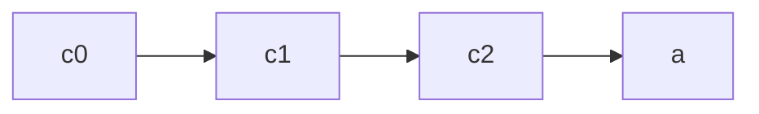

If paths $c_0\leadsto c_1\leadsto c_2$ are already established, adding only $c_2\to a$ makes the two earlier dependencies on $a$ implicit.

### 13.2 Paper's Theorem 3 [Paper, §3.3.2]

Theorem 3 claims that connecting a target action to only its latest qualifying candidate preserves reachability from earlier candidates. The proof strategy considers two successive actions $c_i$ and $c_{i+1}$ that depart from the **same** map vertex at different times. The previous action $b_{i+1}$ of the later departing robot **arrives** at that vertex. Applying the dependency rule to $b_{i+1}$ connects a preceding departure to that arrival; the robot's own type-1 edge then links arrival to its subsequent departure. Repeating gives a chain connecting the candidate departures.

The conceptual chain is

$$
c_i\;\leadsto\; b_{i+1}\;\to\;c_{i+1}\;\leadsto\;a.
$$

The proof depends on the structure and validity of the complete MAPF trajectories, not merely on sorting an arbitrary list of action records. This is why one cannot safely delete all but the latest edges of an arbitrary dependency graph.

### 13.3 What the paper does *not* establish universally [Engineering analysis]

- A graph extracted from *any* set of robot trajectories is necessarily acyclic. In fact, the authors report excluding some benchmark plans whose ADGs had cycles (§4.2).
- Every application-specific resource conflict (intersections, lifts, bays, timing margins) is represented by the paper's single-vertex start/goal rule.
- SCP is a generic exact transitive-reduction algorithm for arbitrary DAGs.
- A zero-wait ADG can ignore persistent occupancy at destinations or parking positions.

For a different action model, revisit the proof before reusing the simplification.

## 14. Complexity and storage analysis

Let $n=|\mathcal{A}|$ be the number of **move actions after wait removal**, $x$ the number of distinct start vertices, $q_v=|\mathcal{C}(v)|$, and $p_v$ the number of target actions arriving at $v$.

| Approach | Main work | Worst-case time | Type-2 edges |
|---|---|---|---|
| Exhaustive | All ordered action pairs | $O(n^2)$ | Can be $O(n^2)$ |
| CP | All pairs within relevant vertex buckets | $O(n^2)$ | Can be $O(n^2)$ |
| SCP (paper's claimed bound) | Bucket sorting + indexed latest candidate | $O(n\log n)$ | At most $n$ |

### 14.1 Derive the SCP bound [Paper, §3.3.3, with detail]

Building the buckets costs expected $O(n)$ with a hash map under ordinary hash-map assumptions, or $O(n\log x)$ with an ordered map. Sorting each bucket costs

$$
\sum_v O(q_v\log q_v)\le O(n\log n),\qquad\sum_v q_v=n.
$$

A binary search within the relevant bucket costs $O(\log q_v)$, giving

$$
\sum_{a\in\mathcal{A}}O(\log q_{g(a)})\le O(n\log n).
$$

If latest **different-robot** selection is also bounded logarithmically (see §12.3), the total is $O(n\log n)$. With the "skip" reading (correction note in §12.3) every query is a single binary search, so the bound holds directly. There is at most one incoming type-2 edge per action, so at most $n$ type-2 edges. Type-1 chains contain fewer than $n$ edges in total, giving **$O(n)$ graph-edge storage**, in addition to the buckets and action records.

### 14.2 Why $O(n\log n)$ matters [Background]

For an illustration with $n=100{,}000$,

$$
n^2=10^{10},\qquad n\log_2n\approx1.66\times10^6.
$$

These are **operation-growth proxies**, not measured CPU times. Constants, layout, hashing, actual bucket distributions, and memory behavior determine wall-clock performance.

## 15. Implementation sketch in C++

**[Engineering analysis]** The following is a **design sketch**, not a copy of the paper's released source code. It demonstrates typed action records, vertex-indexed buckets, same-robot chains, and a logarithmic “latest different robot” query using prefix summaries.

### 15.1 Data structures

```cpp
#include <algorithm>
#include <cstddef>
#include <unordered_map>
#include <utility>
#include <vector>

using ActionId = std::size_t;
using VertexId = int;
using RobotId = int;

struct Action {
    ActionId id;
    VertexId start;
    VertexId goal;
    int step;
    RobotId robot;
};

struct Edge {
    ActionId before;
    ActionId after;
};
```

Unlike a geometric state $\mathbf{p}\in\mathbb{R}^2$, a `VertexId` is a **discrete integer key**. `step` is a **discrete planning index**, not elapsed wall-clock time. We intentionally separate the two types conceptually.

### 15.2 Latest candidate excluding one robot

After sorting each bucket, store at every prefix the two **latest actions with distinct robot IDs**. Then a query excluding robot $r$ either returns the latest one (if its robot is not $r$) or the second latest one. This gives $O(\log q_v)$ lookup time without unbounded backward scanning.

```cpp
struct LastTwo {
    // Each entry identifies an action (not a vector index).
    // Entries, when present, have different robot IDs.
    std::vector<ActionId> ids; // size 0, 1, or 2
};

struct Bucket {
    std::vector<ActionId> actions; // sorted by Action::step
    std::vector<int> steps;
    std::vector<LastTwo> prefix;
};

// For each prefix, build the two latest actions with different robots.
// This straightforward version checks up to the previous two representatives.
void build_prefix(Bucket& bucket, const std::vector<Action>& all) {
    bucket.prefix.clear();
    LastTwo latest;
    for (ActionId id : bucket.actions) {
        LastTwo next;
        next.ids.push_back(id); // the newest one
        for (ActionId old : latest.ids) {
            if (all[old].robot != all[id].robot) {
                next.ids.push_back(old);
                break;
            }
        }
        latest = next;
        bucket.prefix.push_back(latest);
    }
}

// Requires action IDs to index `all`; ensure that in your storage layer.
// Returns true and writes `result` if an eligible predecessor exists.
bool latest_other_robot(const Bucket& bucket,
                        const std::vector<Action>& all,
                        int time, RobotId robot, ActionId& result) {
    auto it = std::upper_bound(bucket.steps.begin(),
                               bucket.steps.end(), time);
    if (it == bucket.steps.begin()) return false;
    const auto k = static_cast<std::size_t>(it - bucket.steps.begin() - 1);
    for (ActionId id : bucket.prefix[k].ids) {
        if (all[id].robot != robot) {
            result = id;
            return true;
        }
    }
    return false;
}
```

**Why two distinct robots suffice:** If the latest action belongs to excluded robot $r$, the best alternative must be the latest action of some *other* robot, which is the second distinct-robot representative. If the latest action does not belong to $r$, use it. This makes prefix queries both correct with respect to the candidate-selection predicate and $O(1)$ after the upper bound. It does **not by itself prove the MAPF-to-ADG reachability theorem**; that remains dependent on the paper's modelling assumptions.

### 15.3 Construction outline

```cpp
// Preconditions:
// 1) `all[id]` is the action whose ID is `id`.
// 2) Waiting actions have been filtered out.
// 3) Input is a validated MAPF plan appropriate for ADG conversion.
// 4) `robotActions[r]` is sorted by planned step.

std::vector<Edge> edges;

// Type 1: chain the remaining moves of each robot.
for (const auto& [robot, ids] : robotActions) {
    for (std::size_t j = 1; j < ids.size(); ++j)
        edges.push_back({ids[j - 1], ids[j]});
}

// Prepare vertex buckets (omitted: fill, sort, steps, build_prefix).
// Type 2: at most one predecessor of each action.
for (const Action& a : all) {
    auto it = buckets.find(a.goal);
    if (it == buckets.end()) continue;
    ActionId predecessor{};
    if (latest_other_robot(it->second, all, a.step, a.robot,
                           predecessor)) {
        edges.push_back({predecessor, a.id});
    }
}

// IMPORTANT: Detect cycles before using the graph to dispatch robots.
```

`robotActions` and `buckets` are maps from robot IDs / map vertices to per-robot / per-vertex data; their declarations and population are omitted intentionally to keep the example focused. For production code, also validate time conventions, IDs, duplicates, start occupancy, final goal occupancy, and edge correctness.

### 15.4 Unit-test invariants

- Every dependency endpoint is a valid action ID.
- Every type-1 edge respects the remaining sequence order for one robot.
- Every type-2 edge has distinct robot IDs and matches the start/goal/time predicate.
- No action has more than one **incoming type-2** edge under SCP.
- The resulting directed graph is acyclic for plans you intend to execute.
- On small supported examples, the **reachability relation** of the reference CP graph and SCP graph is identical over retained move actions (not just edge counts).
- Plans with first/last actions, long waits, held goals, and unusual interleavings are tested explicitly.

## 16. Execution semantics and real-world safeguards

### 16.1 State transitions [Background]

A typical action state machine is:

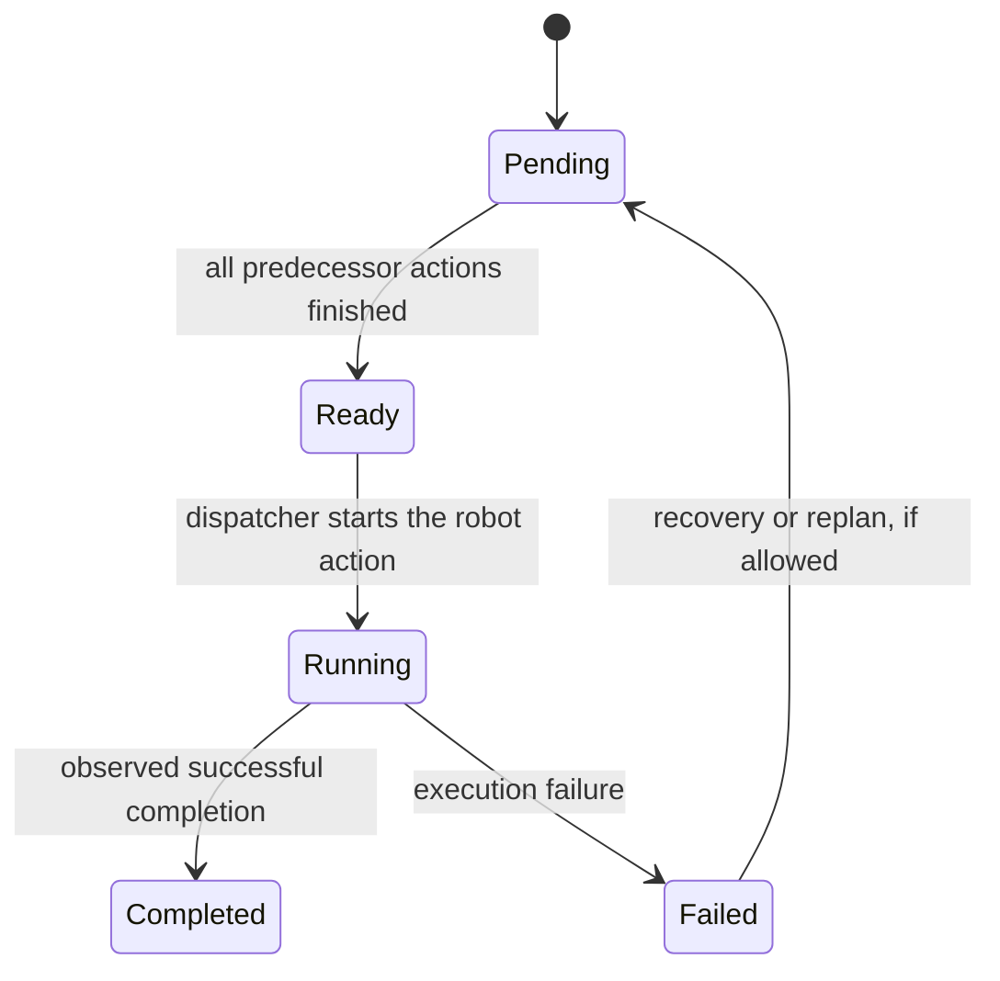

The paper notes ADG action statuses such as `pending`, `enqueued`, and `completed` but deliberately excludes implementation details (§2). The above is **one possible** state machine, not the paper's definitive state model.

### 16.2 Ready queue and dependency counters [Background]

Maintain an integer $d(a)$ equal to the number of unfinished predecessors. When action $b$ completes, decrement $d(a)$ for each outgoing neighbor $a$; if $d(a)=0$, the dispatcher may enqueue it. This runs in $O(|\mathcal{A}|+|\mathcal{D}|)$ over a complete execution (excluding physical actuation time and communications).

### 16.3 Important non-algorithmic safety conditions [Engineering analysis]

An execution controller should separately cover communication loss, robot localization uncertainty, emergency stops, kinematic limits, stale completion reports, resource reservations spanning more than one discrete vertex, goal occupancy, and safe behavior after action failure. SCP reduces **graph-construction and dependency overhead**; it is not a replacement for these safeguards.

**Cycles matter.** The paper itself says some benchmark solutions produced cycles when converted to ADGs and those plans were excluded from its execution study (§4.2). Practical implementations need either an ADG-compatible planner, a reject-and-replan loop, or a formally justified policy for resolving such cases.

## 17. Connecting SCP and ADGs to Conflict-Based Search

### 17.1 Two different graphs that people often confuse

CBS's **constraint tree** contains alternative **planning problems**. Its branches describe mutually exclusive decisions about which robot must avoid a space-time conflict. An ADG contains **execution actions** and hard **precedence constraints** for **one selected MAPF solution**.

| Concept | CBS | ADG + SCP |
|---|---|---|
| When used | During route planning | After route planning / during execution |
| Main graph | Constraint tree | Action precedence DAG |
| Node means | Search state with prohibitions and paths | Physical robot action |
| Edge means | Search branch adding a constraint | “Finish predecessor before successor” |
| Time treatment | Explicit discrete space-time prohibitions | Planned step used to infer order; actual execution is event-driven |
| Main optimization | Find conflict-free (often minimum-cost) paths | Extract fewer, cheaper-to-build dependencies |
| Collision handling | Resolves conflicting planned trajectories | Enforces safe order assuming compatible paths and action model |

### 17.2 Same conflict, two different responsibilities

Suppose A and B want vertex C at time $t=4$.

**CBS:** Branches: in child 1 forbid A at $(C,4)$; in child 2 forbid B at $(C,4)$. One of the resulting plans may have B use C earlier and leave before A arrives.

**SCP:** Receives the completed, collision-free result. It does **not** revisit the CBS branch. It instead creates an edge “B's move out of C finishes before A's move into C begins” wherever the corresponding action predicates require it.

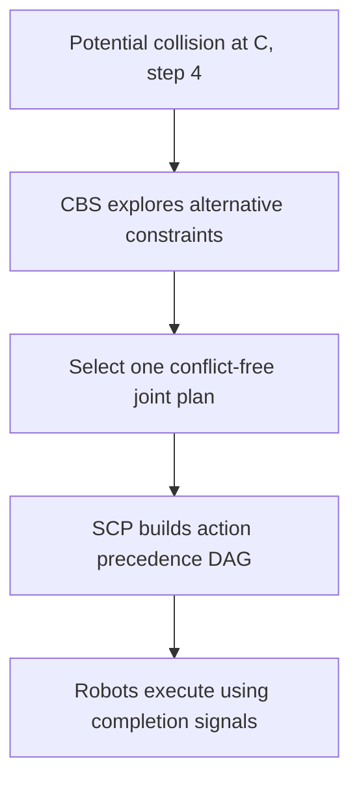

### 17.3 Can CBS always feed SCP? [Engineering analysis]

**Not unconditionally.** The paper's execution evaluation explicitly excludes MAPF solutions that yield cyclic ADGs. Therefore, “CBS produced collision-free timed paths” does **not** imply “SCP will always produce an acyclic, dispatchable ADG.” Plan selection may need additional execution-feasibility constraints. You should validate the graph before issuing commands.

### 17.4 CBS vs prioritized planning vs SCP: common performance confusion

CBS search difficulty is tied to exploring path alternatives under collisions. SCP complexity is tied to converting an **already chosen plan** of $n$ actions. The paper's $O(n\log n)$ claim is **ADG-construction complexity**, not the total complexity of solving MAPF with CBS.

A useful conceptual total cost is

$$
T_{\mathrm{pipeline}}
= T_{\mathrm{MAPF}}+T_{\mathrm{ADG}}+T_{\mathrm{execution\ overhead}}.
$$

SCP attacks the second term; reducing unnecessary dependency messages can also help the third. It does not directly reduce CBS's high-level search tree.

## 18. Connections to other algorithms

### 18.1 Topological sorting / Kahn's algorithm [Background]

Given a DAG, Kahn's algorithm repeatedly selects indegree-zero vertices and removes them. The same principle powers a dispatcher's ready queue, except removal occurs when a **real action finishes**, not immediately after a simulated graph traversal. Complexity is $O(|\mathcal{A}|+|\mathcal{D}|)$.

### 18.2 Transitive reduction [Background]

Given a DAG, transitive reduction removes edges that do not change reachability. SCP achieves similar sparsification through the **spatial and temporal structure of MAPF action lists**. Do not assume a generic transitive-reduction algorithm has the same $O(n\log n)$ behavior on arbitrary input DAGs.

### 18.3 Database indexes and joins [Background]

The type-2 predicate has the flavor of a join:

$$
\texttt{candidate.start = target.goal}
\ \land\ \texttt{candidate.step <= target.step}.
$$

Exhaustive construction resembles a nested-loop join. CP resembles a hash join by vertex. SCP resembles an **indexed predecessor query** on a composite key (vertex, time), with robot exclusion and only one selected output. This is a particularly useful mental model for implementing the algorithm.

### 18.4 Partial-order planning and precedence-constrained scheduling [Background]

An ADG describes a **partial order**: actions on independent resources may proceed concurrently. A total order forces every action one after another and is unnecessarily restrictive. In mathematical terms, the precedence relation is

$$
a\prec b\quad\Longleftrightarrow\quad a\leadsto b
$$

for distinct actions in a valid DAG. Execution becomes a precedence-constrained scheduling problem with changing actual action durations.

### 18.5 Temporal networks [Background]

If durations or resource-release delays matter, one can express constraints on real completion times:

$$
\tau_{\mathrm{start}}(b)\ge\tau_{\mathrm{finish}}(a)+\delta_{ab},
$$

where $\delta_{ab}\ge0$ is an extra safety margin. An ordinary ADG edge is the special case $\delta_{ab}=0$ coupled to a finish-before-start rule. Extensions may use Simple Temporal Networks or richer scheduling formalisms, but those are **not evaluated in the paper**.

### 18.6 Lifelong MAPF and incremental scheduling [Background / connection]

In lifelong MAPF, tasks keep arriving. Re-solving paths and converting them into executable dependencies occurs repeatedly. The paper explicitly motivates faster ADG construction for lifelong settings (Introduction). However, it does **not** supply an incremental algorithm for inserting new work into a currently running ADG. An incremental dispatcher additionally needs to respect actions already running and resources already reserved.

## 19. Paper results and limitations

### 19.1 What the paper reports [Paper, §4]

The authors compare exhaustive construction, CP, and SCP on established MAPF benchmark maps and precomputed plans, with C++ implementations of the construction variants. The plots on **page 4 (Figure 1)** compare all three approaches for the Paris map and show the exhaustive algorithm scaling much worse. On **page 5, Figures 2 and 3**, SCP is typically faster than CP and creates markedly fewer type-2 edges. The paper reports experiments with agent counts varying by benchmark map; do not interpret its plotted milliseconds as universal guarantees.

For wait removal, the authors run a **discrete-event simulation** over Paris and warehouse plans. A wait or single move takes 1 second; a move followed immediately by another move is modelled as taking 0.8 seconds. **Figure 4 on page 6** shows generally reduced simulated makespan without explicit wait actions. These are simulation results under stated duration assumptions, not a full physical-robot validation.

### 19.2 Distinguish evidence from interpretation

| Claim | Status |
|---|---|
| Original exhaustive ADG construction can be quadratic | [Paper] Formal asymptotic analysis |
| Wait actions are redundant in the specified ADG model | [Paper] Theorems 1 and 2 |
| CP partitions candidates by departure vertex | [Paper] Algorithm 2 |
| SCP keeps at most one incoming type-2 edge per action | [Paper] Algorithm 3 and §4 |
| SCP construction scales as $O(n\log n)$ | [Paper] Claimed asymptotic result; robot-filter lookup implementation must be checked |
| All collision-free MAPF solutions yield executable acyclic ADGs | **Not supported**; paper reports excluded cyclic cases |
| All industrial collision geometries are handled by a vertex-based rule | **Not supported** |
| Wait omission reduces real-robot execution time in all hardware | **Not established**; paper evaluates a discrete-event model |

### 19.3 Critical engineering questions

1. How are actions spanning multiple map cells or physical zones represented?
2. Are goal vertices kept reserved after a robot finishes its last action?
3. What happens when a graph cycle is detected?
4. How are delayed, interrupted, cancelled, or partially completed actions represented?
5. Does the action graph remain safe if a robot deviates from its planned geometric trajectory?
6. Does binary-search candidate filtering actually preserve the intended asymptotic bound in the selected implementation?
7. Which parts must be recomputed when new tasks arrive during execution?

These are excellent design-review questions precisely because the paper focuses on **static graph construction** rather than specifying an entire production control architecture.

## 20. Exercises with solutions

### Exercise 1: Vector dimensionality

A robot's 2-D location is represented by $\mathbf{p}=[3,5]^{\mathsf T}$. Another state records $x,y,\theta,v$.

**Question:** State both vector spaces and the dimensionality of a matrix containing 10 robot state vectors as columns.

<details><summary>Solution</summary>

$\mathbf{p}\in\mathbb{R}^2$. A four-component state is $\mathbf{x}\in\mathbb{R}^4$. With one column per robot, $\mathbf{X}\in\mathbb{R}^{4\times10}$. A heading angle $\theta$ is conventionally a scalar with angular wraparound; representing it in $\mathbb{R}$ is a local coordinate convention rather than a statement that angles have no topology.

</details>

### Exercise 2: Identify a vertex collision

Robot A has $\pi_A=(U,V,W)$ and robot B has $\pi_B=(X,V,Y)$.

<details><summary>Solution</summary>

Both robots occupy V at $t=1$. The joint plan violates the vertex exclusion constraint $v_A^1\ne v_B^1$.

</details>

### Exercise 3: Determine a type-2 edge

Action $c=\langle P,Q,2,\mathrm{robot\ B}\rangle$, and action $a=\langle R,P,5,\mathrm{robot\ A}\rangle$.

<details><summary>Solution</summary>

$s(c)=P=g(a)$, $t(c)=2\le5=t(a)$, and robots differ. The ADG rule yields $c\to a$.

</details>

### Exercise 4: Find a redundant edge

You have $a\to b$, $b\to c$, and $a\to c$.

<details><summary>Solution</summary>

The direct $a\to c$ is redundant: deleting it leaves $a\to b\to c$.

</details>

### Exercise 5: Compare all-pairs and bucket searches

Suppose 1,000 actions are uniformly distributed among 100 start-vertex buckets, and each vertex receives roughly the same number of arrivals.

<details><summary>Solution</summary>

An exhaustive search uses around $10^6$ ordered comparisons. Approximate CP comparisons are $100\cdot10\cdot10=10^4$, a factor of roughly 100 fewer. This is illustrative; arrival counts and departure counts need not be uniform.

</details>

### Exercise 6: Find the SCP predecessor

A candidate bucket contains departures at steps 1 (robot A), 4 (robot B), 7 (robot C), 10 (robot A). Target action $a$ has step 8 and robot C.

<details><summary>Solution</summary>

Binary search yields the candidate at 7 first, but it has the same robot ID as the target, so it is excluded. The latest different-robot candidate is at step 4 (robot B). Select its type-2 edge into $a$.

</details>

### Exercise 7: Distinguish CBS from SCP

A plan generated by CBS passes all ordinary space-time collision tests, but its action dependency graph is cyclic. Can SCP safely dispatch it?

<details><summary>Solution</summary>

No. Space-time collision-freedom does not guarantee an executable, acyclic ADG. The paper itself excluded cyclic-ADG solutions from its execution study. The plan must be revised or handled with a separately justified compatible execution approach.

</details>

### Exercise 8: Critique time complexity

If a bucket contains 30 actions by robot A followed by a single older action by robot B, and the target robot is A, how many items can a naive backward scan inspect?

<details><summary>Solution</summary>

As many as 31. Consequently, `upper_bound` plus an unrestricted backward scan does not alone guarantee worst-case $O(\log n)$ per target. A prefix summary of the latest two distinct robot IDs gives logarithmic index search plus constant-time exclusion.

</details>

## 21. Glossary and references

| Term | Meaning |
|---|---|
| MAPF | Multi-Agent Path Finding; plan joint robot routes without specified conflicts |
| CBS | Conflict-Based Search; high-level conflict-constraint search with low-level single-agent replanning |
| A* | Heuristic shortest-path search using $f=g+h$ |
| ADG | Action Dependency Graph; precedence edges between planned robot actions |
| DAG | Directed Acyclic Graph |
| Type-1 dependency | Same-robot consecutive action precedence |
| Type-2 dependency | Cross-robot precedence induced by occupancy order |
| Wait action | A planned step with unchanged map vertex |
| Candidate bucket | Actions indexed by their start vertex |
| CP | Candidate Partitioning; checks relevant bucket members |
| SCP | Sparse Candidate Partitioning; selects the latest qualifying bucket member |
| Reachability | Existence of a directed path from one action to another |
| Transitive reduction | Removal of reachability-redundant edges in a DAG |
| Makespan | Completion time of the last agent/action |
| Lifelong MAPF | Repeated multi-agent path planning as tasks arrive over time |

### Primary source

- Joachim Dunkel, **“Streamlining the Action Dependency Graph Framework: Two Key Enhancements,”** arXiv:2412.01277v1, 2024. Supplied PDF. Main claims: §3.1 wait removal, §3.2 CP, §3.3 SCP, §4 benchmarks. https://arxiv.org/abs/2412.01277
- Author's evaluation code, as cited in the paper: https://github.com/JoachimDunkel/streamlining_the_action_dependency_graph_framework

### Related reading (for background, not analyzed as primary sources here)

- Sharon et al., **“Conflict-Based Search for Optimal Multi-Agent Pathfinding”** (original CBS methodology).
- Hönig et al., **“Persistent and Robust Execution of MAPF Schedules in Warehouses”** (the ADG framework; cited as [8] in the supplied paper).
- Stern et al., **“Multi-Agent Pathfinding: Definitions, Variants, and Benchmarks”** (MAPF foundations; cited as [12] in the supplied paper).
- A standard algorithms text on DAG topological sorting, binary search, hashing, and graph reachability.

---

**Final mental model:** CBS (or another MAPF algorithm) **chooses conflict-free paths**. The ADG **encodes the dependencies needed to execute the chosen paths amid timing variation**. The paper's first enhancement **removes planned wait nodes** from that execution graph. Its second enhancement, SCP, **uses vertex-indexed, time-sorted candidate lists to build a sparse dependency graph quickly**. The most important correctness question is not “How many direct edges did we remove?” but **“Does the resulting graph preserve the required action reachability and remain executable?”**
