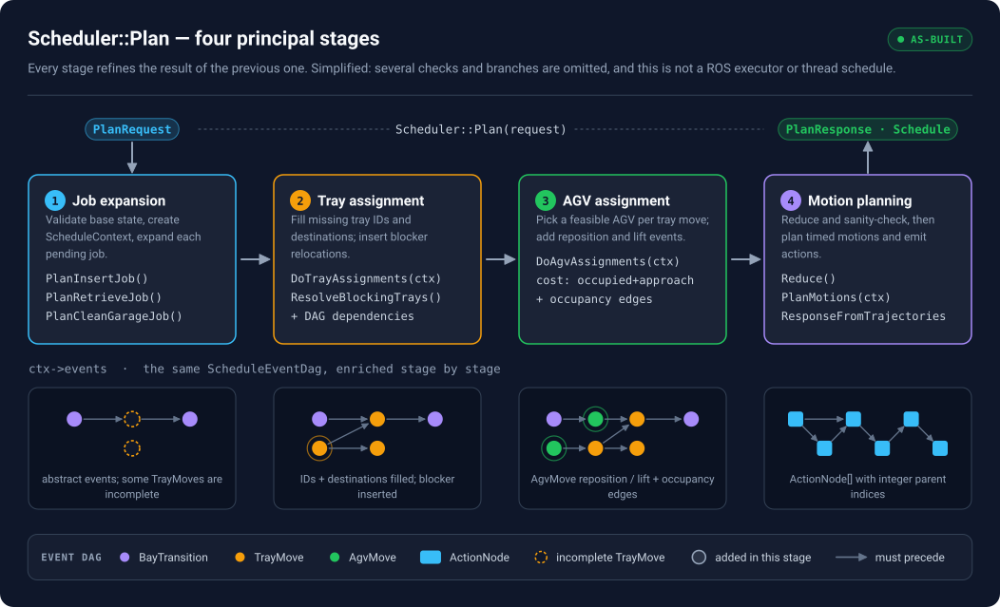

# Scheduler Core Refactor — engineering study pack

A study pack for an engineer joining the scheduler team. It explains how the `scheduler` ROS 2 package turns a list of jobs into a timed, dependency-ordered schedule, and then what the Scheduler Core Refactor changes.

| Read | For | Time |
|---|---|---|
| [01 — Software background](site/src/content/01-software-background.html) | How the software works: node and interfaces, garage model (layout, pose graph and what a `Vertex` is, collision table, with their containers and lookup costs), `Plan()` step by step, events and the DAG, job expansion (with a 2D garage example for every job type), tray and AGV assignment, motion planning, bays, plus full sections on `ScheduleContext` and `ScheduleEventDag`. Grouped into four parts that match the reading plan: orientation (1–5), data and objects (6–13), algorithms (14–20), working with the code (21–26). 68 figures, hover windows that show the source definition of every type, annotated code snippets, a call trace with file:line for every function, a design FAQ (DAGs vs Open-RMF, parallelism, why the logic is shaped this way), checkpoint questions | 4–5 h in three passes |
| [02 — Issue and proposed design](site/src/content/02-issue-and-proposal.html) | What the two assignment algorithms are coupled to today (generated matrix); naming and the ROS boundary (renames in `scheduler` and `planner_core`, a translation header for `common_ros` names, internal types instead of messages); the proposed `tray_assignment`, `agv_assignment` and `common` subfolders, which functions become pure, `stdx::Expected` errors and a returned result instead of editing the context; staged plan and risks | 1 h |
| [03 — Verification and benchmarks](site/src/content/03-verification-plan.html) | What the 72 existing tests cover, gaps, the parity comparison and benchmark method | 30 min |
| [04 — Naming and small struct refactors](site/src/content/04-naming.html) | Rename and small struct-refactor recommendations across the stack (ROS messages, `common_ros`, `planner_core`, `scheduler`), each with a cost tier (private C++, shared C++ API, ROS interface). Naming rules, one word per concept, headline renames, before/after structs, decisions for review and a rollout order. 1 figure | 45 min, then keep open while refactoring |
| [05 — Action dependency graphs: a primer](site/src/content/05-adg-primer.html) | ADGs from scratch: DAGs as partial orders, topological orders and transitive reduction; the Type 1 / Type 2 construction (Hönig et al. 2019); the dispatch rule with safety and liveness arguments; earliest start, critical path and slack; switchable ADGs and related work; then how `ResponseFromTrajectories` builds the scheduler's action DAG, how it differs from the textbook rule, `Schedule`/`ActionNode` as the wire format, and `base_schedule`; where parallelism comes from (work, span, width); topological orders versus parallel execution; the space-time-table-to-ADG algorithm in pseudocode and C++/Boost.Graph (`examples/adg/`). 7 figures, exercises | 1 h |

**Read it as a website.** The documents are HTML sources in `site/src/content/`, the single source of truth (there are no Markdown copies to keep in sync). `site/` builds them into one page: a tab per document, a sticky contents sidebar that follows your position, search across all five (`Ctrl K`), figure pan/zoom, and links computed at build time for section and figure references and for keywords (`ScheduleContext`, `Vertex`, `first_tray_event`, CHUGG, ...). Section and figure numbers are computed too, so moving a section never leaves a stale reference. Build with `cd site && npm ci && npm run build`, then open `site/dist/index.html`; see [`site/README.md`](site/README.md) for editing conventions.

Doc 01 opens with a reading plan and a table of the names and types used in every code snippet. Each snippet says which class it is in and what `this` refers to.

Images in `figures/` are self-contained SVG files generated by `scripts/diagrams/build.py`. On the website every figure opens full screen with pan and zoom; [`figures/viewer.html`](figures/viewer.html) is the offline gallery of all of them.



> **Evidence status:** Code and test observations come from six snapshots: `sources/repomix-scheduler.xml` (the `scheduler` package: headers, sources, tests, CMake, `package.xml`), `sources/repomix-planner-core.xml` (`planner_core`: `event_dag.hpp/.cpp`, `schedule_events.hpp/.cpp`, CMake, `package.xml`; tests excluded) `sources/repomix-interfaces.xml` (every `.msg`/`.srv` of `interfaces`, `vrc_interfaces`, `bay_interfaces`, `agv_interfaces`) `sources/repomix-motion-planner.xml` (`motion_planner`: CHUGG, SIPP, safe-interval table, `ContinuousState`, the searches and static filters; tests excluded), `sources/repomix-cost-functions.xml` (`cost_functions`: trapezoid timing, `MotionCostModel` with parameter defaults, motion runs; tests excluded) and `sources/repomix-common-ros.xml` (`common_ros`: `DiscreteGarageState`, `Layout`, `PoseGraph`, `GarageGraph`, `CollisionTable`, `GarageOccupancyChecker` and utilities; tests excluded). `task_planner`, `common` and the advanced tests are referenced but not included; statements about them are marked as needing confirmation. Ticket scope and Jira status come from the issue text supplied in conversation. Nothing here claims a solver has been implemented, a benchmark run, or a real-site layout validated. Maps use the Pecos layout geometry with hypothetical occupancy; other garage drawings are schematic.

## Conventions

Math is TeX inside `<span class="math">` (inline) or `<div class="math">` (display), rendered to MathML at build time; *italic lowercase* symbols are scalars, **bold lowercase** symbols are vectors, and **bold uppercase** symbols are matrices. Each new quantity is defined in the surrounding text or symbol table. A symbol is written immediately next to its descriptive noun, e.g., “the travel time $t_{ij}$”. Code identifiers are kept in code font because they are literal C++ names, not mathematical variables. Units are shown for geometry and time. All figure axes and scales are marked illustrative unless grounded in layout source data.

## Sources

- `sources/repomix-scheduler.xml` — the `scheduler` package snapshot: `include/scheduler/{scheduler,scheduler_ros,scheduler_msgs,utils}.hpp`, `src/{scheduler,scheduler_ros,scheduler_component,utils}.cpp`, `test/*.cpp`, `test/garage_states/double_retrieve_garage_state.yaml`, `CMakeLists.txt`, `package.xml`. Figures 34, 35 and 37 are computed from it, so replacing it and rebuilding refreshes them.
- `sources/repomix-planner-core.xml` — the `planner_core` snapshot: `include/planner_core/{event_dag,schedule_events,planner_core_msgs}.hpp`, `src/{event_dag,schedule_events}.cpp`, CMake and `package.xml` (tests excluded). Source for the doc 01 sections on events and the event DAG.
- `sources/repomix-common-ros.xml` — the `common_ros` snapshot: headers and sources for `DiscreteGarageState`, `Layout`, `PoseGraph`, `GarageGraph`, `CollisionTable` (`collision_geometry`), `GarageOccupancyChecker`, `GarageSafetyChecker`, pose utilities, CMake and `package.xml` (tests excluded). Source for the doc 01 section on the garage model.
- `sources/repomix-interfaces.xml` — the ROS message and service definitions. Source for every message field, type and constant in the docs and figures (for example `GaragePose.heading` is `int16` in [-179, 180]).
- `sources/5675_pecos_combined.yaml` — the layout used by the map figures (28 nodes, 37 edges).

## Figures

All figures are generated by one script and share one visual system:

```bash
pip install fonttools brotli pyyaml
python3 scripts/diagrams/build.py          # every figure + figures/viewer.html
python3 scripts/diagrams/build.py 13 15_   # only figures whose file name starts with these
```

- **Hand-authored SVG, measured text.** Labels are measured with the real font metrics and the canvas is sized from what was drawn, so nothing is clipped or runs past the border. The build prints a warning if any two labels overlap.
- **Fonts embedded.** The used glyphs of JetBrains Mono (code) and IBM Plex Sans (prose) are subset and embedded as WOFF2, so a figure looks the same everywhere. Licences: `scripts/diagrams/fonts/`.
- **Pan / zoom.** The website opens any figure full screen with pan and zoom. `figures/viewer.html` is an offline gallery with scroll/pinch zoom, drag to pan and arrow-key navigation; any `.svg` opened directly in a browser also gets zoom controls.
- **Theme.** Palette from the ui-ux-pro-max-skill *Developer Tool / IDE* colour set (dark slate surfaces, green accent) with sky / violet / amber / teal / pink as categorical colours; typography from its *Developer Mono* pairing. Tokens live in `scripts/diagrams/theme.py`.
- **Status badges.** Every figure says what it is: `AS-BUILT`, `PROPOSED · NOT IMPLEMENTED`, `ILLUSTRATIVE`, `SCHEMATIC`, `CONCEPTUAL · NOT IN PECOS YAML`, or `YAML GEOMETRY · HYPOTHETICAL OCCUPANCY`.
- **Pecos maps** read `sources/5675_pecos_combined.yaml` directly (28 nodes, 37 edges). Stalls are drawn with the layout's XL parking window; AGVs, trays and payloads are always hypothetical.

| Module | Draws |
|---|---|
| `fig_flow.py` | 01 pipeline, 02 proposed architecture, 04 dependency DAG |
| `fig_uml.py` | 08 solver UML, 09 sequence, 11 core classes, 12 event hierarchy, 13 ROS messages |
| `fig_facility.py` | 15 Pecos topology / scenario / approach / blocking, 16 DiscreteGarageState bridge |
| `fig_misc.py` | 03 schematic garage, 14 VRC elevation |
| `fig_code.py` | 20 system context, 21 runtime objects, 22 `Plan()` control flow, 24 job recipes |
| `fig_code2.py` | 23 working-state replay, 25 dependency rules, 26 retrieve walkthrough |
| `fig_code3.py` | 27 tray assignment flow, 28 freeing moves, 29 AGV matching, 30 AGV event expansion, 31 AGV path repair |
| `fig_code4.py` | 32 motions to actions, 33 bay logic, 34 coupling matrix and 35 test map (both parsed from the snapshot) |
| `fig_jobs.py` | 36 expansion loop, 37 job building blocks, 38 job-method data flow (parsed from the snapshot), 40–50 one 2D scenario per job type |
| `fig_trace.py` | 39 call traces: start-up and one `Plan()` call; inside tray and AGV assignment (file:line for each call) |
| `fig_concepts.py` | 51 Layout vs GarageGraph (vertex numbers from the PoseGraph rules), 52 CollisionTable, 53 topological ordering, 54 partial order and parallel execution |
| `fig_garagemodel.py` | 75 the four garage-model classes, their containers and value types, 78 the heading convention, 79 node, pose, vertex, 80 asset types, 81 inside `BoostPoseGraph` (the seven `adjacency_list` template parameters and what Boost stores per vertex and edge), 76 what a `GarageGraph` `Vertex` is (storage and lookups on Pecos), 77 `CollisionTable` storage and build (doc 01) |
| `fig_trayassign.py` | 55 `AssignTrayIdForEmptyMove`, 56 `AssignDestForUntargetedMove` (tray-assignment helpers on a 2D garage) |
| `fig_proposal.py` | 58 tray-assignment data flow today vs proposed, 59 tray call tree today (UML), 60 proposed `tray_assignment` module (UML), 83 naming and the ROS boundary (doc 02) |
| `fig_naming.py` | 82 one concept, many names today (doc 04) |
| `fig_adg.py` | 84 why a timed plan needs an ADG, 85 building an ADG, 86 earliest start, critical path and slack, 87 the action DAG the scheduler builds, 88 executing an ADG: statuses over time, 89 where parallelism comes from, 90 topological orders and parallelism (doc 05) |
| `fig_motion.py` | 91 event DAG, CHUGG and the action DAG in pipeline order, 92 a ContinuousState as a timeline, 93 SolveSequential step by step with a safe-interval table, 94 trapezoid timing and three ways to time a run (doc 01) |
| `fig_context.py` | 61 `ScheduleContext` anatomy, 62 lifecycle across the `Plan()` stages, 69 `scheduled_jobs`, 70 `last_entity_event`, 71 `first_tray_event`, 72 CHUGG inputs and outputs, 73 `ScheduledJobData` UML, 74 `ScheduledJobData` on the Pecos map (doc 01) |
| `fig_eventdag.py` | 63 `DagBase` / `ScheduleEventDag` classes, 64 storage and event identity, 65 the operations on one example, 66 the shallow copy as a work queue, 67 `TrayMove::Apply` branch by branch, 68 the job-index topological sort (doc 01) |
| `svgkit.py`, `components.py`, `facility.py`, `theme.py` | SVG engine, shared components (UML boxes, event boxes, code panels, legends), YAML map renderer, colour tokens |
| `registry.py`, `build.py`, `viewer.py` | Figure registry, build entry point, offline pan/zoom gallery (figure order and numbers are read from `site/src/content/*.html`) |

All modules are in `scripts/diagrams/`. File-name numbers are stable IDs, not the figure numbers in the documents; each document numbers its own figures in reading order.

The Matplotlib scripts from earlier versions are kept in `scripts/legacy/` for reference only; they are superseded and refer to the Markdown documents that no longer exist, so do not run them.
