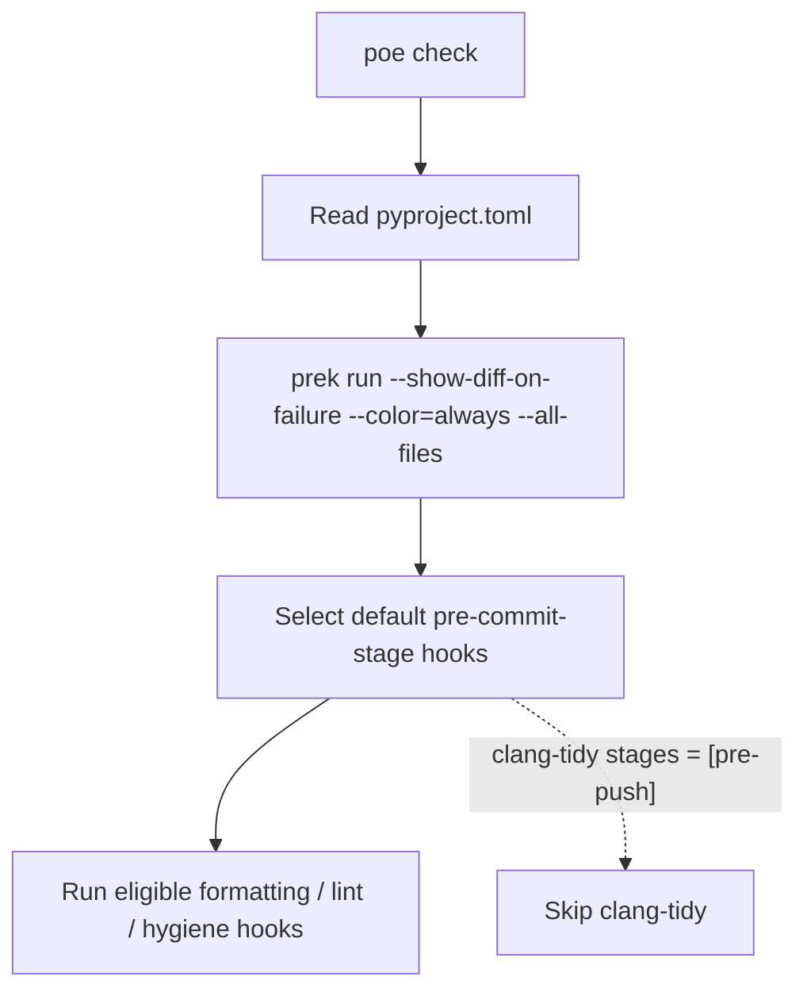
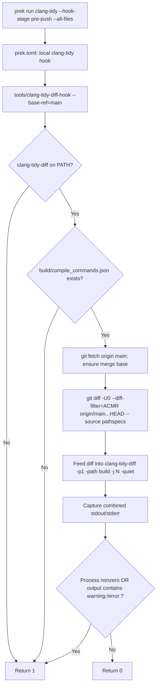
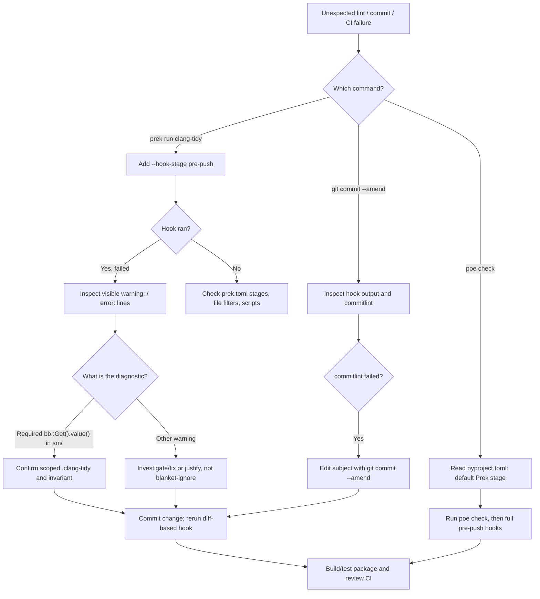

# Volley ROS 2 Workspace: Poe, Prek, and clang-tidy Troubleshooting Guide

> **Scope:** `~/volley`, the Volley Automation ROS 2 workspace. This guide records the complete investigation: Poe/Prek stages, clang-tidy diagnostics, state-machine blackboard policy, directory-scoped lint configuration, amended commits, commitlint, and pre-PR verification.
>
> **Status (October 12, 2026):** `prek run clang-tidy --hook-stage pre-push --all-files` **passed** after adding `src/agvhito/src/sm/.clang-tidy`. Other CI/build/test results are not established unless independently run.
>
> **Evidence:** The `pyproject.toml`, `prek.toml`, `tools/clang-tidy-diff-hook`, `.clang-tidy`, and terminal output supplied during the investigation. Commands are examples, not evidence that they have been executed in this document.

## Table of contents

- [How to read examples in this guide](#how-to-read-examples-in-this-guide)

1. [Quick diagnosis and resolution](#1-quick-diagnosis-and-resolution)
2. [Tooling glossary](#2-tooling-glossary)
3. [Files and their responsibilities](#3-files-and-their-responsibilities)
4. [Execution flow](#4-execution-flow)
5. [Understanding `prek.toml`](#5-understanding-prektoml)
6. [Understanding the custom Python wrapper](#6-understanding-the-custom-python-wrapper)
7. [Understanding `.clang-tidy`](#7-understanding-clang-tidy)
8. [Interpreting the observed failure](#8-interpreting-the-observed-failure)
9. [Reproduction and troubleshooting commands](#9-reproduction-and-troubleshooting-commands)
10. [Potential improvements](#10-potential-improvements)
11. [FAQ and checklist](#11-faq-and-checklist)
12. [External references](#12-external-references)
13. [Final resolution: state-machine directory-specific clang-tidy policy](#13-final-resolution-state-machine-directory-specific-clang-tidy-policy)
14. [Understanding the blackboard optional idiom](#14-understanding-the-blackboard-optional-idiom)
15. [Git staging, amend, reflog, and restoring only one file](#15-git-staging-amend-reflog-and-restoring-only-one-file)
16. [Commitlint: why amend was blocked](#16-commitlint-why-amend-was-blocked)
17. [Pre-push and CI readiness playbook](#17-pre-push-and-ci-readiness-playbook)
18. [PR description and commit-message lessons](#18-pr-description-and-commit-message-lessons)
19. [Fast troubleshooting decision tree](#19-fast-troubleshooting-decision-tree)

## How to read examples in this guide

**Start here if you're new to the tools.** Every snippet is introduced with its **location** and **purpose**:

- **Repository file:** a checked-in file under `/home/jon-gonzales/volley/` (abbreviated as `~/volley/`). Snippets are usually **excerpts**, not entire files. Use the listed surrounding section, key, or function to find them.
- **Terminal command:** type or paste into a shell **from `~/volley/`**, unless a different location is stated. A shell command is not code to paste into TOML, YAML, Python, or C++.
- **Observed output:** text printed by a tool; it is **not** something to execute or add to a file.
- **Conceptual / proposed example:** an illustration or optional change, **not existing Volley code**. Where a snippet proposes a modification, the destination and insertion point are specified.

**Syntax map:** `toml` is configuration syntax used by `pyproject.toml` and `prek.toml`; `yaml` is configuration syntax used by `.clang-tidy`; `python` is the language of `tools/clang-tidy-diff-hook`; `cpp` is C++ source; `bash` is a shell command; `mermaid` draws diagrams in Markdown renderers such as VS Code Markdown Preview (if Mermaid is enabled).

**Reading a diagnostic:** `file.cpp:121:22` means **file path : line number : column number**. The bracketed value like `[bugprone-unchecked-optional-access]` is the specific clang-tidy check that generated the warning. Paths in observed diagnostics may be absolute, but this guide generally uses paths relative to `~/volley/`.

## 1. Quick diagnosis and resolution

### Why didn't `poe check` run clang-tidy?

The Poe task is defined as:

**Existing file — `~/volley/pyproject.toml`, under `[tool.poe.tasks]`.** This is the current definition of the `check` task. The snippet is an excerpt; the file also defines other Poe tasks.

```toml
[tool.poe.tasks]
check = { help = "Run prek hooks on all workspace files", cmd = "prek run --show-diff-on-failure --color=always --all-files" }
```

But the local clang-tidy hook has:

**Existing file — `~/volley/prek.toml`, inside the local `clang-tidy` hook (`[[repos.hooks]]`).** This single field selects the Git lifecycle stage; it is not a command.

```toml
stages = ["pre-push"]
```

Therefore the ordinary `prek run` invocation made by `poe check` does not select that hook: it runs the default **pre-commit** stage, whereas clang-tidy is eligible for **pre-push**. `--all-files` widens the candidate tracked files, not the hook stages.

**Run the hook explicitly:**

**Terminal — run from `~/volley/`.** Explicitly invoke the pre-push-only `clang-tidy` hook without changing any file.

```bash
cd ~/volley
prek run clang-tidy --hook-stage pre-push --all-files
```

To invoke all hooks eligible for pre-push:

**Terminal — run from `~/volley/`.** Invoke all hooks eligible for the pre-push stage; more than one hook may run.

```bash
prek run --hook-stage pre-push --all-files
```

### Why did the explicit invocation fail?

The command actually ran and produced warnings. In `tools/clang-tidy-diff-hook`, the return policy is:

**Existing file — `~/volley/tools/clang-tidy-diff-hook`, inside `main()` near the end.** This excerpt shows the wrapper’s pass/fail decision. `RETURN_SUCCESS` and `EXIT_FAILURE` are constants defined near the start of that Python file.

```python
failed = exit_code != RETURN_SUCCESS or "warning:" in output or "error:" in output
return EXIT_FAILURE if failed else EXIT_SUCCESS
```

The initial observed output included three visible diagnostics, so the script deliberately returned status `1`. **This failure was later resolved** (see Section 13). This is **not evidence of a crash**. The script treats *any `warning:` or `error:` substring in the collected output* as a failure, even if the underlying `clang-tidy-diff` process itself exits successfully.

Observed visible diagnostics:

| Location | Check | Summary |
|---|---|---|
| `src/agvhito/include/agvhito/sm/detail/stop_pause_settle.hpp:21` | `readability-identifier-naming` | Local `constexpr` identifier `kCancelPollPeriod` violates effective naming rule. |
| `src/agvhito/src/sm/error_state.cpp:121` | `bugprone-unchecked-optional-access` | `.value()` is called on an optional without a proven presence check. |
| `src/agvhito/src/sm/error_state.cpp:176` | `bugprone-unchecked-optional-access` | Same risk at a different access site. |

**Important:** The output also showed counts such as `41556 warnings generated.` and `114525 warnings generated.` These are clang-tidy invocation counts, *not* a verified count of unique actionable Volley findings. Output filtering and repeated translation-unit analysis can make these numbers much larger than the final reported diagnostics.

## 2. Tooling glossary

| Tool or concept | Language / format | Role |
|---|---|---|
| **Poe the Poet** (`poe`) | Task definitions in TOML | General task runner; exposes friendly workspace commands such as `poe check`, `poe build`, `poe test`. |
| **Prek** (`prek`) | Rust implementation; TOML or pre-commit YAML config | Runs pre-commit-style hooks, selects stages/files, manages upstream hooks and local commands. Not Volley-specific and not owned by Poe. Its name is a shortened form of *pre-commit*. |
| **pre-commit** | Git hook ecosystem / framework | The established hook configuration and lifecycle that prek is designed to be compatible with; not synonymous with the `pre-commit` *stage*. |
| **clang-format** | C/C++ formatter | Changes whitespace/layout; local hook runs it with `-i`. |
| **clang-tidy** | C/C++ static analyzer | Examines source with compiler configuration, applies enabled checks, reports diagnostics. |
| **clang-tidy-diff** | Executable for diff-aware clang-tidy | Takes a unified diff on stdin, identifies changed line ranges, and uses clang-tidy on relevant compilation units. |
| **`tools/clang-tidy-diff-hook`** | Python 3 script | Volley-specific wrapper around Git and `clang-tidy-diff`; defines fetch/diff, build preconditions, parallelism, output and failure policy. |
| **Colcon** (`colcon`) | ROS 2 build orchestration | Builds packages and produces build artifacts. |
| **CMake compilation database** (`compile_commands.json`) | JSON | Records per-translation-unit compiler flags, includes, standards and compile commands used by clang tools. |
| **Git hook stage** | Git / prek lifecycle | A point such as `pre-commit`, `pre-push`, or `commit-msg` when hooks may run. |
| **Translation unit (TU)** | C/C++ compilation model | A `.cpp` file plus its included content as compiled with specific flags. Clang-tidy often parses complete TUs even when only diff-line warnings are reported. |
| **Git merge base** | Git commit graph | Common ancestor used by three-dot comparison; determines which committed branch changes are included. |

## 3. Files and their responsibilities

**Repository layout — paths relative to `~/volley/`.** This is a selected tree of relevant files, not a complete directory listing. `build/compile_commands.json` is generated build output, not checked-in source.

```text
~/volley/
├── pyproject.toml                # Project metadata, Python groups, Poe tasks
├── prek.toml                     # Prek repositories, hook definitions, stages/filters
├── .clang-tidy                   # Enabled C++ analysis checks and naming rules
├── .clang-format                 # C/C++ formatting policy (different tool)
├── tools/
│   └── clang-tidy-diff-hook      # Python wrapper invoked by the local prek hook
├── build/
│   └── compile_commands.json     # Explicitly required by the wrapper
├── src/
│   └── agvhito/
│       ├── include/agvhito/sm/detail/stop_pause_settle.hpp
│       └── src/sm/error_state.cpp
└── .git/                         # Git history, refs and hook installation
```

- `pyproject.toml` **does not** specify which clang-tidy checks run. The selected Poe command delegates to prek.
- `prek.toml` determines **whether/when** the custom hook is invoked, along with file eligibility and its entry command.
- `.clang-tidy` determines **what warnings** the underlying analyzer generates; its mere existence does **not** schedule analysis.
- `tools/clang-tidy-diff-hook` determines **which committed diff** goes to clang-tidy-diff and **whether diagnostic text fails the hook**.
- `build/compile_commands.json` must exist for this particular wrapper: it explicitly tests this exact path before launching analysis. It passes `-path build` to clang-tidy-diff.
- A `build/<package>/compile_commands.json` alone would **not** satisfy the wrapper's root database existence check.

## 4. Execution flow

### `poe check` path (clang-tidy is excluded)

**Execution diagram — conceptual view of `~/volley/pyproject.toml` and `~/volley/prek.toml`.** This Mermaid source documents the existing `poe check` path; it is not a shell command.



### Explicit clang-tidy path

**Execution diagram — conceptual view of `~/volley/prek.toml` and `~/volley/tools/clang-tidy-diff-hook`.** This Mermaid diagram follows the Python wrapper’s actual major branches, while omitting minor implementation details.



`prek` selects this local hook because its `stages` includes `pre-push`. Its `pass_filenames = false` means that prek does not append its selected source filenames to the command: the script computes its **own Git diff**.

**Caveat:** `types_or = ["c", "c++"]` still controls prek's eligibility when `always_run` is absent. It does not restrict what the Python wrapper independently chooses after launch.

## 5. Understanding `prek.toml`

### TOML syntax and nesting

`[[repos]]` starts an element of an array of tables. `[[repos.hooks]]` defines a hook associated with the current repository. Remote repositories can instead contain an inline `hooks = [{ id = ... }, ...]` array that selects upstream-defined hooks.

Example of an upstream repository:

**Existing file — `~/volley/prek.toml`, first remote `[[repos]]` entry (abridged).** This illustrates an externally maintained hook repository; hook IDs identify upstream hooks.

```toml
[[repos]]
repo = "https://github.com/pre-commit/pre-commit-hooks"
rev = "v6.0.0"
hooks = [
  { id = "check-merge-conflict" },
  { id = "trailing-whitespace" },
  { id = "end-of-file-fixer" },
]
```

Local hooks in this workspace:

**Existing file — `~/volley/prek.toml`, `repo = "local"` section, `[[repos.hooks]]` for `clang-tidy`.** This is the full relevant hook entry; edit this section if you intentionally change which stage executes it.

```toml
[[repos]]
repo = "local"

[[repos.hooks]]
id = "clang-tidy"
name = "clang-tidy"
description = "Static analysis linter for changed lines in C and C++ source files"
entry = "tools/clang-tidy-diff-hook"
language = "script"
types_or = ["c", "c++"]
args = ["--base-ref=main"]
exclude = '(^build/|^install/)'
stages = ["pre-push"]
require_serial = true
pass_filenames = false
```

| Property | Interpretation in this hook |
|---|---|
| `id` | Name passed to `prek run clang-tidy`. |
| `name` | Label printed during hook execution. |
| `description` | Human-oriented description. |
| `entry` | Local Python script to execute. |
| `language = "script"` | Run checked-in script; its shebang is `#!/usr/bin/env python3`. |
| `types_or` | File-type eligibility for triggering the hook. |
| `args` | Arguments supplied to the script; `main` is the base-branch name. |
| `exclude` | File-selection regex; excludes top-level `build/` and `install/`. |
| `stages` | Eligible only for pre-push, not ordinary pre-commit runs. |
| `require_serial` | Prek should not invoke this hook multiple times concurrently. **Does not limit the script's own `-j` parallel workers.** |
| `pass_filenames` | Prevents prek from appending selected filenames. |

### Hooks in the provided config (high-level)

- External: pre-commit hygiene hooks, uv lock verification, markdownlint, commitlint (`commit-msg`), gersemi, yamllint (path-limited).
- Local: black, clang-format, clang-tidy (`pre-push` only), mypy, text-marker and CMake policy checks, `.yml` extension restriction, shellcheck, and branch-name validation (`pre-push`).

### Why `--all-files` doesn't override the stage

Selection is conceptually independent:

**Conceptual pseudocode — not a Volley file or executable expression.** It illustrates that stage selection and file eligibility are different filters.

```text
eligible hook = matches requested stage AND hook-selection rules
eligible file = tracked/candidate file AND file type/path filters
```

The flag `--all-files` affects which tracked files are candidates. It doesn't change the requested hook stage, and here the wrapper receives **no file arguments** anyway.

### Git hook installation versus manual invocation

`prek run ...` manually invokes hooks and does not require a Git hook to have been installed. For automatic checks on `git push`, the relevant pre-push hook must actually be installed in the active Git hooks directory. Check, rather than assume:

**Terminal — run from `~/volley/`.** Inspect Git hook installation; these commands are read-only. The second path assumes the default `.git/hooks` location.

```bash
git config --get core.hooksPath || true
ls -l .git/hooks/pre-push 2>/dev/null || true
```

If hooks live in a custom `core.hooksPath`, inspect that directory instead of `.git/hooks`.

## 6. Understanding the custom Python wrapper

File: `tools/clang-tidy-diff-hook`.

### Language and runtime

- Uses Python 3 (`#!/usr/bin/env python3`), with standard-library modules only: `argparse`, `logging`, `os`, `shutil`, `subprocess`, `sys`, `pathlib`.
- Python type hints such as `list[str] | None`, `tuple[int, str]`, and `subprocess.CompletedProcess` document expected data types.
- `argparse` defines `--base-ref`, `--jobs`/`-j`, and `--output-log`.
- `subprocess.run(..., text=True)` invokes external commands with text input/output.
- `shutil.which("clang-tidy-diff")` checks availability on `PATH`.
- `Path("build/compile_commands.json").exists()` checks a required build artifact relative to the current working directory: **run from the repository root**.

### Arguments and defaults

| Argument | Default | Function |
|---|---|---|
| `--base-ref` | `main` | Branch name used as `origin/<base-ref>`. |
| `--jobs`, `-j` | `os.cpu_count() or 1` | Number of parallel clang-tidy-diff jobs. |
| `--output-log` | None | Write combined captured analyzer output to a file in addition to terminal logging. |

### Git diff semantics

The script first runs:

**Terminal — command issued by `resolve_merge_base()` in `~/volley/tools/clang-tidy-diff-hook`.** Shown to explain behavior; running it manually fetches `main` from `origin`.

```bash
git fetch origin main --quiet
```

Then checks if a common ancestor exists using:

**Terminal — command used by `merge_base_resolves()` in `~/volley/tools/clang-tidy-diff-hook`.** A successful exit means Git can find a common ancestor of `origin/main` and `HEAD`.

```bash
git merge-base origin/main HEAD
```

If missing, it attempts progressively deeper fetches (`50`, `100`, `200`, `400`, `800` commits), and may fall back to full history. These operations can require network access and modify remote-tracking metadata; they do **not** modify checked-out source files.

The main diff command is equivalent to:

**Terminal — equivalent of the Git diff assembled in `run_clang_tidy_diff()` in `~/volley/tools/clang-tidy-diff-hook`.** Quoted pathspecs belong to Git; `HEAD` excludes uncommitted edits.

```bash
git diff -U0 --diff-filter=ACMR origin/main...HEAD -- \
  'src/*.c' 'src/*.cc' 'src/*.cpp' 'src/*.cxx' \
  'src/*.h' 'src/*.hh' 'src/*.hpp' 'src/*.hxx'
```

- `-U0`: no unchanged context lines in unified diff.
- `--diff-filter=ACMR`: include Added, Copied, Modified and Renamed entries; excludes deleted paths.
- `origin/main...HEAD`: compare the **merge base of origin/main and HEAD** with HEAD. It represents committed changes introduced on the branch, not all differences between tip commits.
- `HEAD`: excludes uncommitted staged and unstaged changes.
- Git pathspecs such as `'src/*.cpp'` are evaluated by **Git**, not the shell. They may match files in nested directories under `src/`, subject to Git's pathspec semantics.

### Analyzer command

The wrapper pipes Git diff text to:

**Terminal — command assembled by `run_clang_tidy_diff()` in `~/volley/tools/clang-tidy-diff-hook`.** Here `<jobs>` is a placeholder for the integer from `--jobs`; the actual Python function pipes Git diff text to the command’s standard input.

```bash
clang-tidy-diff \
  -p1 \
  -path build \
  -j <jobs> \
  -extra-arg=-Wno-unknown-warning-option \
  -quiet
```

Note the **two different `-p` meanings**: `clang-tidy-diff -p1` strips one leading path component from diff paths (`a/src/...` -> `src/...`); `-path build` supplies the compilation database directory. By contrast, a direct `clang-tidy -p build` means the compilation database location.

`-quiet` suppresses some ancillary information, not necessarily all counts or warnings.

### Failure handling

The wrapper merges analyzer stderr into stdout, holds the output in memory, and uses this logic:

**Existing file — `~/volley/tools/clang-tidy-diff-hook`, in `main()` (simplified equivalent).** Unlike `clang-tidy` configuration, this Python condition enforces failing on visible warning/error text.

```python
failed = exit_code != 0 or "warning:" in output or "error:" in output
```

Consequences:

1. Any visible warning or error string makes prek report failure.
2. No `WarningsAsErrors:` setting is required in `.clang-tidy` for the wrapper to fail on warnings.
3. This is a textual test, not parsing structured diagnostics. It could match incidental text containing those substrings.
4. When failed, output is logged via `logger.error` (stderr); when successful, via `logger.info` (stdout).
5. `--output-log=...` writes the combined analyzer output regardless of pass/fail, but only after the analyzer has returned.

### Parallelism detail

`require_serial = true` means prek itself executes the hook serially. The wrapper **independently sets** `-j` for clang-tidy-diff, defaulting to CPU count. Large ROS 2 translation units may consume substantial resources: for debugging, reduce to `--jobs=4` or even `--jobs=1`.

## 7. Understanding `.clang-tidy`

The `.clang-tidy` file uses **YAML**, not TOML. It configures the analyzer, not how hooks are scheduled.

### Check selection

The order of `Checks` patterns matters:

**Existing file — `~/volley/.clang-tidy`, top-level `Checks` YAML key (abridged).** Ellipsis stands for the further disabled checks shown in the real file; do not paste the ellipsis into production config.

```yaml
Checks: |
  -*,
  bugprone-*,
  cppcoreguidelines-*,
  clang-analyzer-*,
  google-*,
  modernize-*,
  readability-identifier-naming,
  -clang-analyzer-cplusplus.Move,
  ...
```

- `-*` initially disables checks.
- Positive glob patterns enable groups.
- Later `-check-name` entries disable selected checks within those groups.
- This workspace documents disabled-check rationales in comments and points to Jira `SW2-750`, `.ClangTidyChecks-findings.md` for the broader review; **the contents of that attachment were not inspected here**.

Key explicitly enabled families include `bugprone-*`, `cppcoreguidelines-*`, `clang-analyzer-*`, `google-*`, `modernize-*`, and `readability-identifier-naming`, with numerous exclusions noted in the supplied file.

### Header filter

**Existing file — `~/volley/.clang-tidy`, top-level `HeaderFilterRegex` YAML key.** This is a regular expression controlling which headers have diagnostics reported, not a command to run.

```yaml
HeaderFilterRegex: (^|/)src/
```

This is meant to focus emitted header diagnostics on paths containing `src/`, rather than generated build/install headers. It does **not** mean clang-tidy stops parsing other included headers. Main-file diagnostics and diff filtering also affect what is visible.

### Naming rules: the important distinction

| Category | Setting | Intended example |
|---|---|---|
| `ConstantCase` | `CamelCase`, prefix `k` | `kStopPausePeriod` |
| `ClassConstantCase` | `CamelCase`, prefix `k` | `kStopPausePeriod` |
| `GlobalConstantCase` | `CamelCase`, prefix `k` | `kStopPausePeriod` |
| `StaticConstantCase` | `CamelCase`, prefix `k` | `kStopPausePeriod` |
| `LocalConstantCase` | `lower_case`, empty prefix | `cancel_poll_period` |
| `ConstantParameterCase` | `lower_case`, empty prefix | `poll_period` |
| `EnumConstantCase` | `UPPER_CASE`, empty prefix | `CANCELLED` |
| `FunctionCase` / `MethodCase` | `CamelCase` | `GetIfNotStale` |
| `ParameterCase` / `VariableCase` | `lower_case` | `poll_period` |
| `PrivateMemberCase` | `lower_case`, suffix `_` | `state_` |

A reported suggestion for the `constexpr` local in this case was `k_cancel_poll_period`, **not** the obvious `cancel_poll_period` implied by `LocalConstantCase` + an empty prefix. Do not assume the explanation is solely the local-constant configuration: more specific constexpr-related categories or version-specific fallback/precedence may be involved. Verify against the effective config and the exact installed clang-tidy version before changing policies.

**Terminal — run from `~/volley/`.** Inspect the installed clang-tidy version and computed options, to explain the exact identifier-naming suggestion.

```bash
clang-tidy --version
clang-tidy --dump-config | grep -E -A 2 'LocalConstant|LocalConstexpr|WarningsAsErrors|HeaderFilterRegex'
```

### Warnings as errors

The provided file contains no `WarningsAsErrors:` entry. In this case it is the **Python wrapper**, not a demonstrated `WarningsAsErrors:` setting, that escalates visible warnings to hook failure.

## 8. Interpreting the observed failure

The command was:

**Terminal — command the user ran from `~/volley/`.** It manually selects the `pre-push` stage and invokes the hook described in `prek.toml`.

```bash
prek run clang-tidy --hook-stage pre-push --all-files
```

The reported result was:

**Observed terminal output — printed by Prek and clang-tidy, not editable source.** `Failed` and `exit code: 1` refer to the custom wrapper’s exit status; the warning counts are not unique Volley findings.

```text
clang-tidy...............................................................Failed
- hook id: clang-tidy
- exit code: 1

41556 warnings generated.
39320 warnings generated.
...
114525 warnings generated.
```

### Why are the counts huge?

Clang-tidy performs analysis on whole C++ translation units and may produce thousands of suppressed diagnostics in dependencies/headers. Multiple source files can repeat parts of the same included code and produce overlapping counts. The count lines alone cannot establish how many distinct actionable warnings exist, how many unique source locations are affected, or whether every listed diagnostic was analyzed. The relevant visible evidence is the location-qualified `warning:` lines.

### Diagnostic 1: naming

**Observed diagnostic — `~/volley/src/agvhito/include/agvhito/sm/detail/stop_pause_settle.hpp`, line 21, column 18.** The text was printed by clang-tidy and names the triggered rule.

```text
src/agvhito/include/agvhito/sm/detail/stop_pause_settle.hpp:21:18:
warning: invalid case style for local constant 'kCancelPollPeriod'
[readability-identifier-naming]
```

Code:

**Existing C++ source excerpt — `~/volley/src/agvhito/include/agvhito/sm/detail/stop_pause_settle.hpp`, near line 21.** This local `constexpr` definition is the diagnostic target; the code shown is deliberately limited to the offending declaration.

```cpp
constexpr auto kCancelPollPeriod = std::chrono::milliseconds {10};
```

Clang-tidy suggested `k_cancel_poll_period`. This is a style rule, not evidence of a runtime defect. Confirm which naming category applies to local `constexpr` variables; do not blindly apply a repository-wide naming change.

### Diagnostics 2 and 3: unchecked optionals (initial observation; later intentionally suppressed in `src/sm/`)

**Observed diagnostics — `~/volley/src/agvhito/src/sm/error_state.cpp`, lines 121 and 176.** These are messages emitted by clang-tidy; they are not C++ code.

```text
src/agvhito/src/sm/error_state.cpp:121:22:
warning: unchecked access to optional value [bugprone-unchecked-optional-access]

src/agvhito/src/sm/error_state.cpp:176:36:
warning: unchecked access to optional value [bugprone-unchecked-optional-access]
```

Representative code:

**Existing C++ source excerpt — `~/volley/src/agvhito/src/sm/error_state.cpp`, near line 121 (similar expression at line 176).** The `.value()` call is the point under analysis; inspect the surrounding function for its invariants and error paths.

```cpp
const auto state =
    yasminx::bb::Get(*blackboard, bb::kKeyState).value()->GetIfNotStale();
```

`yasminx::bb::Get(...)` appears to return an optional-like object. Calling `.value()` on an empty `std::optional` throws `std::bad_optional_access`. This checker cannot prove presence at the reported access sites. The correct response depends on the blackboard contract and error-state invariants. **The team lead subsequently confirmed that using `.value()` on required blackboard entries is an intentional Volley idiom**, and opted for a directory-scoped checker exclusion instead of repetitive presence guards. See Sections 13–14. This does not mean that arbitrary optional `.value()` calls are safe.

A conceptual pattern **if absence is a valid case** (not a drop-in patch without checking actual return types):

**Illustrative C++ pattern — not an existing Volley patch.** If a missing blackboard value is legitimate, an explicit presence test may be appropriate; this must be adapted to the actual return type and state-machine contract before editing `error_state.cpp`.

```cpp
const auto maybe_state = yasminx::bb::Get(*blackboard, bb::kKeyState);
if (!maybe_state.has_value()) {
  // Handle missing state according to the state-machine contract.
  // E.g., return an error transition, log and recover, or propagate an error.
} else {
  const auto state = maybe_state.value()->GetIfNotStale();
  // Continue using state.
}
```

**Do not replace `.value()` with unchecked `*maybe_state`** simply to silence the warning: dereferencing a disengaged `std::optional` is undefined behavior, whereas `.value()` throws.

## 9. Reproduction and troubleshooting commands

Run from repository root unless otherwise specified.

### A. Verify the configuration

**Terminal — run from `~/volley/`.** Read the three relevant configuration files. `sed` displays only the portion of `pyproject.toml` between the given table headings.

```bash
cd ~/volley
sed -n '/\[tool.poe.tasks\]/,/\[tool.poe.tasks.build-pkg\]/p' pyproject.toml
cat prek.toml
cat .clang-tidy
```

### B. See which hooks run at which stage

**Terminal — run from `~/volley/`.** Compare the default Poe check with explicitly selecting the pre-push stage; running these can invoke linters and formatters that modify files.

```bash
poe check
prek run clang-tidy --hook-stage pre-push --all-files
prek run --hook-stage pre-push --all-files
```

Avoid running `poe check` just to test clang-tidy: it won't select pre-push-only hooks unless the configuration changes.

### C. Verify installed executables

**Terminal — run from `~/volley/`.** Confirm tool executables are on `PATH` and identify the analyzer version. The wrapper specifically requires `clang-tidy-diff`.

```bash
command -v prek
command -v clang-tidy
command -v clang-tidy-diff
clang-tidy --version
```

The wrapper demands `clang-tidy-diff` on `PATH`, not merely `clang-tidy`.

### D. Verify compilation databases

**Terminal — run from `~/volley/`.** Examine the root compilation database and other package databases. `jq` prints the first JSON entry and requires `jq` to be installed.

```bash
ls -lh build/compile_commands.json
find build -name compile_commands.json -print
jq '.[0]' build/compile_commands.json
```

If the root database is absent, the wrapper stops before analysis and prints `No build/compile_commands.json found. Run 'poe build' first.` A package-level database is insufficient for the script's explicit existence check. Investigate how the Colcon/CMake setup creates or combines the workspace-level database rather than assuming plain `colcon build` always creates it.

A CMake package can usually generate its own database with `-DCMAKE_EXPORT_COMPILE_COMMANDS=ON`; its location may be `build/<package>/compile_commands.json`. Consolidating those databases into `build/compile_commands.json` is a separate workspace-level concern.

### E. Inspect the Git diff actually analyzed

**Terminal — run from `~/volley/`.** Inspect branch identity, working-tree changes, merge base, and the committed C++ files selected by the wrapper.

```bash
git status --short
git branch --show-current
git merge-base origin/main HEAD
git diff --name-only --diff-filter=ACMR origin/main...HEAD -- \
  'src/*.c' 'src/*.cc' 'src/*.cpp' 'src/*.cxx' \
  'src/*.h' 'src/*.hh' 'src/*.hpp' 'src/*.hxx'
```

If a newly edited line is not yet committed, the hook's `origin/main...HEAD` diff will **not** include it. You may need to commit changes before testing this exact wrapper; using direct clang-tidy is an alternative while editing.

### F. Capture diagnostics and reduce parallelism

**Terminal — run from `~/volley/`.** Invoke `tools/clang-tidy-diff-hook` directly with four analysis jobs; raw output is saved outside the repository under `/tmp/`.

```bash
tools/clang-tidy-diff-hook \
  --base-ref=main \
  --jobs=4 \
  --output-log=/tmp/volley-clang-tidy.log

echo "exit status: $?"
rg -n 'warning:|error:|Error while processing|warnings generated' \
  /tmp/volley-clang-tidy.log
```

This avoids burying the relevant warnings in count messages. `--output-log` logs analyzer output, not necessarily the wrapper's earlier precondition/fetch logs.

### G. Run clang-tidy directly on one translation unit

**Terminal — run from `~/volley/`.** Analyze one translation unit directly, using the compilation database in `build/`; unlike diff mode, this may show findings outside changed lines.

```bash
clang-tidy -p build src/agvhito/src/sm/error_state.cpp
```

Direct clang-tidy is **not equivalent** to diff mode: it need not restrict reported findings to the lines modified on the branch. It is useful to test compilation configuration and a specific file independently.

### H. Check relevant ROS/CMake integrations

**Terminal — run from `~/volley/`.** Search relevant directories for any separate CMake/ROS clang-tidy integration. This search reads files and does not change them.

```bash
rg -n 'clang-tidy|clang_tidy|CMAKE_CXX_CLANG_TIDY|CXX_CLANG_TIDY' \
  src .github scripts tools .colcon
```

A `clang-tidy` setting in CMake may enable analysis during `colcon build`; it does not imply that `poe check` runs the pre-push hook.

### I. Check whether the Git pre-push hook is installed

**Terminal — run from `~/volley/`.** Check whether automatic `git push` triggering is installed, as distinct from a manual `prek run`.

```bash
git config --get core.hooksPath || true
ls -l .git/hooks/pre-push 2>/dev/null || true
```

If a different hooks directory is configured, inspect that instead. Manual `prek run` works even when Git hooks are not installed.

## 10. Potential improvements

These are **suggested changes**, not existing repository behavior.

### Add an explicit Poe task

**Proposed edit — add the `tidy` key to `~/volley/pyproject.toml` under the existing `[tool.poe.tasks]` table.** Do not create a second `[tool.poe.tasks]` table; the heading is included here only to show placement.

```toml
[tool.poe.tasks]
tidy = { help = "Run changed-line clang-tidy analysis", cmd = "prek run clang-tidy --hook-stage pre-push --all-files" }
```

Then use:

**Terminal — run from `~/volley/` after applying the proposed Poe edit above.** These commands show the intended developer workflow. `poe tidy` does not exist in the provided configuration until you add it.

```bash
poe check   # Default pre-commit hooks, fast feedback
poe tidy    # Explicit clang-tidy on committed branch changes
poe build   # Build workspace
poe test    # Run tests
```

### Make diagnostics easier to review

- Report the unique `file:line:column` diagnostics separately from `N warnings generated.` messages.
- Continue to save complete raw output via `--output-log` for investigation.
- Distinguish analyzer/process errors from policy violations in the final summary.
- Consider a structured diagnostics format for robust parsing instead of matching `"warning:"` anywhere in text.

### Improve resource management

Benchmark a conservative default `--jobs` value (for example four workers) on the largest ROS 2 packages. `require_serial = true` in prek does not prevent internal subprocess parallelism.

### Document compilation database generation

Define clearly which build step creates the **combined** `build/compile_commands.json`, how it remains current after changes to CMake or dependency configuration, and which host/container versions of clang-tidy are supported.

### Be precise about changed lines

As written, the script analyzes committed branch changes since the merge base with `origin/main`, not uncommitted code or necessarily only the most recent commit. Make that scope clear in developer documentation and CI descriptions.

## 11. FAQ and checklist

**Is prek a Volley-specific name?** No. It is a standalone, Rust-based alternative to pre-commit. `prek.toml` is its native configuration, not a Poe-only file.

**Does `poe check` read `.clang-tidy`?** No, it invokes prek. The `.clang-tidy` config is used later, *if* clang-tidy is actually invoked.

**Does `--all-files` force every hook to execute?** No. Stages and hook eligibility still apply; a hook with `pass_filenames = false` can select its own analysis scope.

**Does `Failed` mean clang-tidy crashed?** Not here. The wrapper deliberately fails on any detected warning/error substring, even when the analyzer process exits normally.

**Are 114,525 unique code problems present?** Not established. The lines count analyzer-generated warnings for individual invocations, including diagnostics that may be suppressed from visible output.

**Will `poe tidy` include my uncommitted edits?** Not with the proposed task and the current wrapper: its diff ends at `HEAD`.

**Will Git automatically run clang-tidy on push?** Only if the appropriate pre-push hook is installed/configured in the actual Git hooks directory.

**What should I check when this issue recurs?**

- [ ] Am I using `poe check` (default pre-commit stage) or `prek run clang-tidy --hook-stage pre-push --all-files`?
- [ ] Is `clang-tidy-diff` on `PATH`?
- [ ] Does `build/compile_commands.json` exist and describe current sources?
- [ ] Does `origin/main...HEAD` contain the commits/lines I intend to check?
- [ ] Are reported diagnostics naming issues, correctness issues, or compiler/configuration errors?
- [ ] Is the failure due to the Python wrapper's substring-based warning policy?
- [ ] If output is overwhelming, can I rerun with `--jobs=4 --output-log=...` and extract location-qualified diagnostics?
- [ ] If I expect automatic checks on push, is a Git `pre-push` hook actually installed?

## 12. External references

- Prek project: <https://github.com/j178/prek>
- Prek documentation: <https://prek.j178.dev/>
- Pre-commit configuration concepts: <https://pre-commit.com/>
- Clang-tidy documentation: <https://clang.llvm.org/extra/clang-tidy/>
- Clang-tidy naming check: <https://clang.llvm.org/extra/clang-tidy/checks/readability/identifier-naming.html>
- Clang-tidy diff script documentation: <https://clang.llvm.org/extra/clang-tidy/> (see `clang-tidy-diff.py`)
- CMake compile commands: <https://cmake.org/cmake/help/latest/variable/CMAKE_EXPORT_COMPILE_COMMANDS.html>

---

**Repository-specific limitation:** This guide reflects the supplied file contents and diagnostic sample. It does not independently inspect the rest of the workspace, determine the precise provenance of `build/compile_commands.json`, or verify the installed clang-tidy version and effective naming-check precedence.


## 13. Final resolution: state-machine directory-specific clang-tidy policy

### What ultimately passed

**Observed terminal output — command run from `~/volley/` after the change was committed:**

```bash
prek run clang-tidy --hook-stage pre-push --all-files
```

```text
clang-tidy...............................................................Passed
```

This proves the custom hook ran successfully against its **committed branch diff at that point**. It does not prove that every file or uncommitted change in the workspace was analyzed.

### New configuration file and location

**New repository file — `~/volley/src/agvhito/src/sm/.clang-tidy`.** This file is located *beside* `error_state.cpp`, `localizing_state.cpp`, and other state implementation `.cpp` files. The following is the recommended documented content, not a claim to have inspected the final on-disk bytes:

```yaml
# This directory contains AGV state-machine implementations.
# Required blackboard entries are guaranteed to exist by state-machine
# initialization. The code intentionally uses yasminx::bb::Get(...).value().
# Clang-tidy cannot infer that application-level invariant.
#
# Scope: this directory and descendants, not the entire repository.
# Tradeoff: this disables the check for ALL optional accesses in this scope,
# not exclusively calls to yasminx::bb::Get().
InheritParentConfig: true
Checks: |
  -bugprone-unchecked-optional-access
```

**Language:** YAML. **Relationship to existing file:** the repository-root `~/volley/.clang-tidy` enables broad check groups including `bugprone-*`. `InheritParentConfig: true` retains that configuration; the later `-bugprone-unchecked-optional-access` pattern excludes exactly this *check name* for source files governed by the nested configuration. Other checks still run.

**File tree — conceptual subset (not a full workspace listing):**

```text
~/volley/
├── .clang-tidy                            # root default rules
└── src/agvhito/
    ├── src/
    │   ├── sm/
    │   │   ├── .clang-tidy                 # new narrower scope
    │   │   ├── error_state.cpp
    │   │   ├── localizing_state.cpp
    │   │   └── ...
    │   ├── agv.cpp                         # root rules
    │   └── comms/                          # root rules
    └── include/agvhito/sm/                 # separate tree, root rules
```

**Important limitation:** The exception is **directory-specific, not API-specific**. It will also hide genuine unchecked optional accesses unrelated to the blackboard in translation units using this configuration. Header diagnostics can be affected by the configuration chosen for the translation unit, so do not assume every included header has a perfectly independent policy based on its own path. Keep this tradeoff explicit in code review.

### Confirm the effective scope

**Terminal — from `~/volley/`.** The first command should print nothing (excluded in `sm`); the second should print the check name (enabled elsewhere, assuming no further overrides):

```bash
clang-tidy --list-checks src/agvhito/src/sm/error_state.cpp |
  grep -F 'bugprone-unchecked-optional-access'

clang-tidy --list-checks src/agvhito/src/agv.cpp |
  grep -F 'bugprone-unchecked-optional-access'
```

To inspect inherited configuration rather than infer from the results:

```bash
clang-tidy --dump-config src/agvhito/src/sm/error_state.cpp | grep -A 40 '^Checks:'
```

Then run the actual repository policy check:

```bash
prek run clang-tidy --hook-stage pre-push --all-files
```

### Other alternatives considered, and why they were not selected

| Option | Scope | Tradeoff |
|---|---|---|
| `// NOLINT(bugprone-unchecked-optional-access)` on each call | Individual statement | Precise, but many repeated comments pollute the state-machine code. |
| `// NOLINTBEGIN(...)` / `// NOLINTEND(...)` in each file | Annotated source range | No repeated per-call comments, but requires boilerplate in every affected file. |
| Nested `.clang-tidy` **(chosen)** | Implementation directory | One centralized exception, but also disables this check for non-blackboard optionals in the directory. |
| `GetRequired()` blackboard helper | Specific API with invariant check | Semantically narrow, but requires an API design and changes call sites; behavior on broken invariants must be defined. |
| `IgnoreValueCalls` where supported | `.value()` generally | Too broad: not restricted to blackboard; version dependent. |
| Disable the rule in root `.clang-tidy` | Whole repository | Broadest regression risk; not selected. |

**Do not assert that the standard checker supports a pattern like `IgnoreFunction: yasminx::bb::Get`.** No such configured callee-specific exception was identified for `bugprone-unchecked-optional-access`.

## 14. Understanding the blackboard optional idiom

### Two layers of optionality

**Existing source — `~/volley/src/agvhito/src/sm/error_state.cpp`, inside `ErrorState::OnExit()`:**

```cpp
const auto state =
    yasminx::bb::Get(*blackboard, bb::kKeyState).value()->GetIfNotStale();
if(!state.has_value()) {
  return yasminx::MakeUnexpected(
      kOutcomeErrored, yasminx::Error {
                           .type = kErrorStateStale,
                           .message = "State became stale before software E-stop recovery release",
                       });
}
```

Read the chain as two operations with different contracts:

1. `yasminx::bb::Get(*blackboard, bb::kKeyState)` retrieves a **required blackboard entry** wrapped in an optional-like result. Its `.value()` assumes the state-machine construction contract has populated that entry.
2. `->GetIfNotStale()` retrieves the **latest usable telemetry** and may legitimately produce an empty optional. The subsequent `state.has_value()` deals with that expected runtime condition.

This is why `state.has_value()` does not prove that the preceding `bb::Get(...).value()` was checked. The linter reports the first access; the state machine guards the second. The team lead's contract means that adding a missing-entry branch to every `bb::Get` is not necessarily the desired behavior.

**Another matching idiom — `~/volley/src/agvhito/src/sm/localizing_state.cpp`, inside `LocalizingState::Step()`:**

```cpp
const auto state_or =
    yasminx::bb::Get(*blackboard, bb::kKeyState).value()->GetIfNotStale();
if(!state_or.has_value()) {
  return yasminx::LifecycleState::Continue {};
}
```

The original diff hook did not flag this line because it reports findings associated with **committed changes in the branch diff**, not every existing line. An absence of diff diagnostics is therefore not proof that unchanged code passed the same check.

### Why the check originally failed

**Existing wrapper — `~/volley/tools/clang-tidy-diff-hook`, inside `run_clang_tidy_diff()`:**

```python
f"origin/{base_ref}...HEAD"
```

Its Git diff compares the merge base of `origin/main` and `HEAD` with `HEAD`; it does not use the working tree or staging index. The reportable changed-line set can therefore include new `error_state.cpp` lines while excluding unchanged `localizing_state.cpp` lines.

### Choosing between guarding and suppressing

A missing entry can be either a valid runtime scenario or a violated construction invariant. **Do not change runtime error handling merely to silence static analysis.** In this case the team chose to preserve the existing required-entry access idiom; the exception should remain documented and limited in scope. Other `.value()` operations still merit review, especially in code outside `sm/`.

### Identifier-naming issue that was fixed separately

**Existing source — `~/volley/src/agvhito/include/agvhito/sm/detail/stop_pause_settle.hpp`, inside `WaitForStopPauseSettle()`:**

```cpp
// Earlier name, warned by readability-identifier-naming:
constexpr auto kCancelPollPeriod = std::chrono::milliseconds {10};

// Updated local name consistent with lower_case local constant style:
constexpr auto cancel_poll_period = std::chrono::milliseconds {10};
```

The reference in `duration_cast` must be renamed too. The original diagnostic suggested `k_cancel_poll_period`; that is not evidence that a `k` prefix is required, since effective config showed `LocalConstantPrefix: ''`. Root naming policy for **local** constants differs from namespace/global constants, which use `k` + CamelCase. This header fix is separate from the `sm/` optional-check exception.

## 15. Git staging, amend, reflog, and restoring only one file

### The three Git states to distinguish

| State | Inspect | Included by `origin/main...HEAD`? |
|---|---|---|
| Working tree (unstaged edits) | `git diff` | No |
| Index (staged edits) | `git diff --cached` | No |
| `HEAD` (committed state) | `git show HEAD`; `git log -1` | Yes, if changed since merge base |

**Terminal — from `~/volley/`:**

```bash
git status --short
git diff -- src/agvhito/src/sm/error_state.cpp
git diff --cached -- src/agvhito/src/sm/error_state.cpp
git show --stat HEAD
```

The custom `clang-tidy-diff` hook uses **committed** branch changes. Ordinary formatting hooks may inspect staged file contents; do not confuse that with the custom clang-tidy wrapper's diff behavior. For uncommitted work, run `clang-tidy -p build src/agvhito/src/sm/error_state.cpp` directly, which reads the current source file on disk.

### Why staged files remained after `git commit --amend --no-edit`

In the observed case, the amend **failed** because `commitlint` rejected the commit subject. Git did not complete a new commit, so the staged changes remained. This was not a clang-tidy failure. See Section 16.

**Terminal — from `~/volley/`:**

```bash
git commit --amend                 # edit commit message in configured editor
# OR (only if current commit message already passes hooks):
git commit --amend --no-edit

git status --short
git log -1 --format='%h %s'
git reflog -8
```

If you amend a commit that was already pushed, the remote history no longer matches the rewritten local commit. Discuss team workflow before using `git push --force-with-lease`; do not use plain `--force` casually.

### Safely reverse **one file** after an amend

The observed reflog at one point was:

```text
7118a84f HEAD@{0}: commit (amend): fix(agvhito): refine pause and e-stop recovery policy
5e2d2ff3 HEAD@{1}: commit (amend): fix(agvhito): refine pause and e-stop recovery policy
47706ed2 HEAD@{2}: commit (amend): fix(agvhito): refine pause and e-stop recovery policy
caa5014c HEAD@{3}: checkout: moving from main to jg/SW2-876/agvhito-pause-estop-policy
```

These are **historical example identifiers from this investigation**; subsequent amends changed `HEAD`. Prefer a **verified commit hash**, not a moving `HEAD@{1}` selector, especially after more commands.

**Terminal — from `~/volley/`:**

```bash
# Inspect what would change (historical example):
git diff 5e2d2ff3 HEAD -- src/agvhito/src/sm/error_state.cpp

# Only if that old version is the one you want:
git restore --source=5e2d2ff3 --worktree -- \
  src/agvhito/src/sm/error_state.cpp

git diff -- src/agvhito/src/sm/error_state.cpp
```

`git restore --source=... --worktree -- FILE` replaces only that file in the working tree; it does not reset the entire branch or automatically stage/commit the result. **Inspect the full diff before restoring**: a historical file may be missing later legitimate changes. If it is, undo individual hunks (`git restore -p`) or manually edit instead.

After restoring the original `bb::Get(...).value()` form, adding the nested `.clang-tidy` is preferable to retaining the temporary per-file `NOLINT` block:

```bash
# Terminal — ~/volley/, after editing and reviewing both files:
git add src/agvhito/src/sm/error_state.cpp src/agvhito/src/sm/.clang-tidy
git diff --cached --check
git diff --cached --stat
git commit --amend --no-edit
```

If `commitlint` fails, edit the message with `git commit --amend` instead.

## 16. Commitlint: why amend was blocked

### Which hook and when

**Existing configuration — `~/volley/prek.toml`, remote `commitlint` hook:**

```toml
{ id = "commitlint", stages = ["commit-msg"], additional_dependencies = [
  "@commitlint/config-conventional",
] }
```

A Git commit can run multiple stages: source-file checks at `pre-commit`, then message validation at `commit-msg`. `clang-tidy` is separately restricted to `pre-push`. Running `poe check` does not validate a commit message.

### Observed error

```text
commitlint...............................................................Failed
✖ subject must not be sentence-case, start-case, pascal-case, upper-case [subject-case]
⚠ body must have leading blank line [body-leading-blank]
```

The original subject began with an uppercase verb after the Conventional Commits type/scope:

```text
fix(agvhito): Remove MakeSoftEStopAction(true) from StoppedState::OnEntry()
```

**Corrected subject (actual later convention):**

```text
fix(agvhito): refine pause and e-stop recovery policy
```

Conventional Commits structure: `type(scope): subject`; the subject should obey the repository's configured casing. Separate a body from the subject with a blank line. In the observed output, subject-case was the explicit error and body-leading-blank was a warning; the warning alone may not block commits depending on policy.

**Terminal — from `~/volley/`:**

```bash
git commit --amend              # open editor and change message
# After editor save and successful hooks:
git status --short
git log -1 --format=full
```

For checking all branch commit subjects, commitlint supports range-based validation where an executable is available; verify tooling installation first:

```bash
command -v commitlint
# If installed:
commitlint --from origin/main --to HEAD
```

The user's successful subsequent amendment demonstrated the earlier blocker was resolved; it was not evidence that the CI pipeline had run.

## 17. Pre-push and CI readiness playbook

**Terminal — all commands from `~/volley/`.** This checklist separates linting from C++ build/test validation.

| Order | Command | Coverage / caveat |
|---|---|---|
| 1 | `poe check` | Default-stage Prek hooks across eligible tracked files: formatting, whitespace, static checks, etc.; may modify files. |
| 2 | `prek run --hook-stage pre-push --all-files` | Full pre-push-eligible set, including `clang-tidy` **and** `check-branch-name`; more than the single-hook run. |
| 3 | `commitlint --from origin/main --to HEAD` | All commit messages in the branch **if** `commitlint` CLI is installed; previous successful amend only proves the amended message passed. |
| 4 | `poe build-pkg agvhito` | Build `agvhito` and colcon dependencies via `colcon build --packages-up-to agvhito`. |
| 5 | `poe test-pkg agvhito` | `colcon test --packages-up-to agvhito` followed by `colcon test-result --verbose`. |
| 6 | `git status --short` | Inspect uncommitted modifications created by formatter hooks or other operations. |

**Poe definitions — existing `~/volley/pyproject.toml`:**

```toml
[tool.poe.tasks]
check = { help = "Run prek hooks on all workspace files", cmd = "prek run --show-diff-on-failure --color=always --all-files" }

[tool.poe.tasks.build-pkg]
cmd = "colcon build --packages-up-to ${pkg}"

[tool.poe.tasks.test-pkg]
sequence = [
  { cmd = "colcon test --packages-up-to ${pkg}" },
  { cmd = "colcon test-result --verbose" },
]
```

Above is an **excerpt assembled from existing separate sections**, not a complete replacement for `pyproject.toml`.

**What was actually demonstrated:** the specific clang-tidy pre-push hook passed. Builds, tests, full `poe check`, and full pre-push hook execution were recommended, but their passing results were not furnished in the conversation. Robot validation of pause/E-stop behavior remains separate from static analysis.

### Git hooks may run checks more than once

One observed failed amend showed groups of hooks repeated, then `commitlint`. This can happen when Git invokes several configured stages for the same commit (`pre-commit`, then `commit-msg`). Repetition is not proof of a bug. Diagnose by examining `stages` in `prek.toml` and actual installed Git hooks.

### Why CI might still fail when clang-tidy passes

- Build errors or incorrect compile-database generation.
- Failing unit/system tests or robot/firmware behaviors.
- Commitlint violations in earlier branch commits.
- Formatting changes generated by a hook but not staged/committed.
- CI-only workflows, environment differences, or branch-name checks.

Review `.github/workflows/` and the PR's actual checks for the authoritative CI matrix; Prek isn't the whole pipeline.

## 18. PR description and commit-message lessons

**Context:** SW2-876, AGV pause/E-stop policy refinement. These notes summarize what should be recorded in review descriptions; they are **not verification of runtime correctness**.

### Core feature change summary

- `StoppedState::OnEntry()`: remove automatic Soft-EStop activation.
- `IdleState::OnEntry()`: remove E-stop release, exception clearing, and pause actions that interfere with charging/standby behavior.
- `ExecutingOrderState`: remove `VerifiedUnpause()`; reject new orders when controller mode is not appropriate rather than silently changing it.
- `ExecutionRecoveryState`: remove pause-mode actions while retaining telemetry freshness checks.
- `BootingState` / `ExecutionPausedState`: use `StopPauseAndSettle()`; issue `stopPause`, verify `FINISHED`, wait **at least 200 ms** using steady time, and verify fresh no-pause/no-E-stop state.
- `ErrorState`: preserve Soft-EStop activation on entry; during normal recovery, verify hardware E-stop/traversal conditions, release software E-stop, clear retained pause, and verify final state before reporting recovery. Cancellation does not authorize release.
- `src/agvhito/src/sm/.clang-tidy`: document the scoped optional-check exception and its wider-than-blackboard tradeoff.

**Why the settle delay exists:** HITO firmware can report `stopPause` as `FINISHED` before transitioning to `auto_run`; submitting new work in the gap can produce `agv run state error`. The delay is a temporary mitigation pending a firmware readiness signal.

### Useful PR layout

```markdown
# What
- State-by-state behavior changes
- Error recovery ordering and conditions
- Static-analysis exception and exact directory

# Why
- Firmware stopPause FINISHED / auto_run timing gap
- Charging and standby interactions

# Testing
- [x] clang-tidy diff/pre-push hook (observed passed)
- [ ] poe check (mark only after running)
- [ ] agvhito build and tests (mark only after running)
- [ ] Robot validation (pending until performed)

Refs: SW2-876
```

The commit subject used successfully was:

```text
fix(agvhito): refine pause and e-stop recovery policy
```

In the body, group design changes by state or responsibility, and mention the scoped lint exception because it is a deliberate quality-policy change. Avoid overclaiming that a failed recovery re-engages an E-stop that was already released; the code may report failure **after** the release command has been issued.

## 19. Fast troubleshooting decision tree



**Five-minute diagnostic commands — terminal, from `~/volley/`:**

```bash
# 1. Git state and committed diff
git status --short
git log -1 --oneline
git diff --name-only origin/main...HEAD

# 2. Effective check policy for the affected translation unit
clang-tidy --list-checks src/agvhito/src/sm/error_state.cpp |
  grep -F bugprone-unchecked-optional-access

# 3. Reproduce complete stages
poe check
prek run --hook-stage pre-push --all-files

# 4. Check code behavior, not just static analysis
poe build-pkg agvhito
poe test-pkg agvhito
```

**Interpretation:** no output for the grep in step 2 is expected when the nested exclusion is active. The observed `Passed` status confirms one lint workflow, not the entire delivery pipeline.
