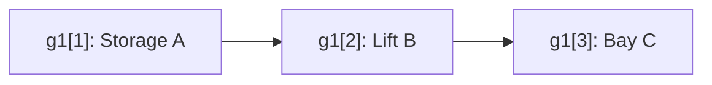

# Step 1 — Agents, tasks, goals, and notation

**Paper location:** Section II, _Problem Definition_. [Author Portable Document Format (PDF) paper](https://jiaoyangli.me/files/2022-ICRA.pdf).

## 1. One task contains an ordered sequence of goals

The paper writes a task as

$$
\boxed{g_j=\langle g_j[1],g_j[2],\ldots,g_j[K_j]\rangle}.
$$

- $j$ identifies the task.
- $k$ identifies a **position within the task**.
- $g_j[k]$ is the $k$-th required goal location (a vertex in the navigation graph).
- $K_j$ is the number of required goals in task $j$.
- $\langle\cdots\rangle$ denotes **order**; a set $\{\cdots\}$ does not.

**The paper uses $g_j$ to name a task, not an individual goal pose.** This is the source of much terminology confusion.

A robotics analogy:

- Goal: a destination location, roughly analogous to a Robot Operating System (ROS) goal pose, but represented by a graph vertex rather than a full pose.
- Task: a multi-waypoint mission consisting of those goal locations in order.
- Agent: an automated guided vehicle (AGV) responsible for the entire assigned task.

## 2. Symbols

| Symbol | Meaning | Example |
|---|---|---|
| $m$ | Number of agents **and** tasks in the paper | $m=5$ |
| $A=\{a_1,\ldots,a_m\}$ | Agent set | Five AGVs |
| $a_i$ | Agent with index $i$ | $a_3$ |
| $s_i$ | Initial graph vertex of $a_i$ | $s_3=U$ |
| $\mathcal G=\{g_1,\ldots,g_m\}$ | Task set (notation used for exposition) | Five tasks |
| $g_j$ | Task number $j$ | Pickup-and-delivery mission |
| $g_j[k]$ | Goal number $k$ *within task $j$* | $g_1[2]=Q$ |
| $K_j$ | Number of goals in task $j$ | $K_1=2$ |

## 3. A concrete example

Suppose one task visits three graph locations:

$$
\begin{aligned}
g_1 &=\langle g_1[1],g_1[2],g_1[3]\rangle\\
g_1[1]&=\text{Storage A}\\
g_1[2]&=\text{Lift B}\\
g_1[3]&=\text{Delivery Bay C}\\
K_1&=3.
\end{aligned}
$$

All three locations belong to a **single** task $g_1$. If AGV 3 is chosen for it, AGV 3 visits all three in order; the planner does not independently reassign each goal to a different AGV.

## 4. Task assignment

The paper uses an **exactly-one-to-one assignment** between $m$ agents and $m$ tasks.

For explanation, let $\sigma$ denote this mapping:

$$
\sigma:A\rightarrow\mathcal G,\qquad\sigma(a_3)=g_1.
$$

That reads: "Agent 3 gets Task 1." It **does not** mean Agent 3 gets only Goal 1.

Agent 3 is required to travel along some valid path visiting

$$
s_3\longrightarrow g_1[1]\longrightarrow g_1[2]\longrightarrow g_1[3].
$$

The actual path can include extra graph vertices and waiting. These arrows mean *required visitation order*, not necessarily adjacent edges.

The one-to-one condition can be expressed with binary variables $x_{ij}$:

$$
x_{ij}=\begin{cases}
1 & \text{if agent }a_i\text{ is assigned task }g_j,\\
0 & \text{otherwise.}
\end{cases}
$$

$$
\sum_{j=1}^{m}x_{ij}=1\quad\forall i,
\qquad
\sum_{i=1}^{m}x_{ij}=1\quad\forall j.
$$

These binary variables are an equivalent explanatory formulation. They are **not** the exact data structure used by the paper's Algorithm 1.

## 5. Why this solves the same-agent requirement

For one task $g_1=\langle P,Q\rangle$, assignment $\sigma(a_4)=g_1$ means:

- $a_4$ is responsible for $P$ **and** $Q$.
- $P$ must be visited before $Q$ counts as the final required goal.
- No other AGV can be assigned only the second half of $g_1$ under the definition of a task.

This is fundamentally different from two independently assignable goals connected by a precedence edge. A precedence edge constrains order but does **not**, by itself, force shared ownership.

## 6. Sets, sequences, and indices

| Expression | Interpretation |
|---|---|
| $\{a_1,a_2,a_3\}$ | Unordered agent set |
| $\{g_1,g_2,g_3\}$ | Unordered set of *tasks* |
| $\langle P,Q,R\rangle$ | Ordered sequence of locations |
| $g_2[3]$ | Third goal within task number two |
| $g_2=\langle P,Q,R,S\rangle$ | Task 2 has four goals: $K_2=4$ |

In general,

$$
\langle P,Q,R\rangle\ne\langle R,Q,P\rangle.
$$

## 7. Assumptions to keep in mind

The model has the same number of tasks and agents, and one task per agent. A typical deployed garage scheduler may need dynamic job arrivals, multiple jobs per AGV, and non-navigation actions; those are **outside the paper's bare problem definition**.

## Quick check

If $g_2=\langle P,Q,R,S\rangle$ and $\sigma(a_4)=g_2$:

- $K_2=4$.
- $g_2[3]=R$.
- AGV 4 is assigned the **entire** sequence $P,Q,R,S$.

**One sentence to remember:** The *task* is the unit of assignment; a *goal* is one ordered waypoint within that task.

**Next:** [Step 2 — Paths, time, and collisions](02-paths-time-collisions.md)
