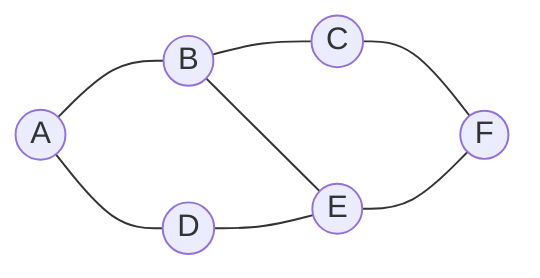

# Step 2 — Paths, time, collisions, and the objective

**Paper location:** Section II, _Problem Definition_. [Author Portable Document Format (PDF) paper](https://jiaoyangli.me/files/2022-ICRA.pdf).

Previously, a task was an ordered sequence $g_j=\langle g_j[1],\ldots,g_j[K_j]\rangle$. This chapter adds a path, so the automated guided vehicle (AGV) can satisfy that sequence while sharing the environment with other AGVs.

## 1. Environment graph

The environment is an undirected, unit-weight graph:

$$
G=(V,E).
$$

| Symbol | Meaning |
|---|---|
| $G$ | Navigation graph |
| $V$ | Locations (vertices) |
| $E$ | Allowed transitions (edges) |
| $u,v\in V$ | Example locations |
| $(u,v)\in E$ | AGV can traverse between $u$ and $v$ |

A movement across one edge takes one timestep. An AGV may also **wait** for one timestep.

This is a graph model, not a full continuous trajectory with vehicle footprint and orientation.

## 2. A path is indexed by time

For agent $a_i$:

$$
\boxed{\pi_i(t)=\text{location of agent }a_i\text{ at time }t}.
$$

A complete path is a sequence:

$$
\pi_i=\langle\pi_i(0),\pi_i(1),\pi_i(2),\ldots\rangle.
$$

For example,

$$
\pi_1=\langle A,B,E,E,F,F,\ldots\rangle.
$$

| Timestep $t$ | 0 | 1 | 2 | 3 | 4 | 5 | ... |
|---|---|---|---|---|---|---|---|
| $\pi_1(t)$ | A | B | E | E | F | F | ... |

Since $\pi_1(2)=\pi_1(3)=E$, the agent waits at E for a timestep.

## 3. What makes a single-agent path valid?

**Start at the correct vertex:**

$$
\pi_i(0)=s_i.
$$

**At each timestep, move to an adjacent vertex or wait:**

$$
\bigl(\pi_i(t),\pi_i(t+1)\bigr)\in E
\quad\text{or}\quad
\pi_i(t+1)=\pi_i(t).
$$

**Visit the task goals in order.** If $g_1=\langle B,E,F\rangle$, then $\langle A,B,E,E,F,F,\ldots\rangle$ is a path that respects that required order.

The agent is *allowed* to pass through a location that is a later goal before formally reaching an earlier goal, but such an early encounter does not by itself fulfill the ordered sequence. This becomes explicit with the Multi-Label A-star (MLA*) label in Step 3.

## 4. Finish time and persistent occupancy

The finish time $T_i$ is the earliest time after which the agent remains at its final task goal forever:

$$
\boxed{T_i=\min\left\{t: \forall t'\ge t,\ \pi_i(t')=g_j[K_j]\right\}}.
$$

If $\pi_1=\langle A,B,E,E,F,F,\ldots\rangle$ and $F$ is its last goal, then $T_1=4$.

**Important modeling assumption:** The AGV **does not disappear** after reaching the last goal; it continues to occupy that graph vertex indefinitely. This can affect the feasibility of other AGVs' paths.

## 5. Two collision types

### Vertex collision

Agents $a_i$ and $a_j$ collide if they occupy the same vertex at the same timestep:

$$
\pi_i(t)=\pi_j(t).
$$

For example, both occupy X at $t=1$.

### Edge collision (head-on swap)

Agents collide if they attempt to traverse the same undirected edge in opposite directions during the same timestep:

$$
\begin{aligned}
\pi_i(t)&=u, & \pi_i(t+1)&=v,\\
\pi_j(t)&=v, & \pi_j(t+1)&=u.
\end{aligned}
$$

**Note:** The PDF's extracted text contains an apparent typographic/optical character recognition (OCR) inconsistency in the edge-collision variables. The equations above express the standard opposite-direction swap the authors describe in words.

The paper prevents vertex and edge collisions in this *discrete graph model*. It does not automatically prevent two vehicles' physical swept footprints from intersecting between vertices, or occupancy conflicts involving external equipment.

## 6. Objective: sum of finish times (flowtime)

The optimization objective is:

$$
\boxed{C=\sum_{i=1}^{m}T_i\quad\longrightarrow\quad\min}.
$$

For example:

| AGV | Finish time |
|---|---:|
| $a_1$ | 4 |
| $a_2$ | 7 |
| $a_3$ | 5 |
| **Total flowtime** | **16** |

An alternative objective would be **makespan**:

$$
C_{\max}=\max_i T_i=7.
$$

The paper **optimizes flowtime**, not makespan. Minimizing the total completion times favors finishing many agents early, whereas makespan focuses on the last agent's finish.

## 7. Summary notation

| Symbol | Meaning |
|---|---|
| $G=(V,E)$ | Navigation graph |
| $\pi_i$ | Entire time-indexed path for AGV $i$ |
| $\pi_i(t)$ | Position of AGV $i$ at timestep $t$ |
| $s_i$ | Start location |
| $T_i$ | Finish time of agent $i$ |
| $C=\sum_i T_i$ | Total flowtime |
| $C_{\max}=\max_i T_i$ | Makespan (not the paper's main objective) |

## Quick check

If AGV 1 and AGV 2 both try to enter X at time 3, that's a vertex collision. If they try to swap adjacent vertices U and V during $t=3\to4$, that's an edge collision. Both cases are forbidden.

**Next:** [Step 3 — Multi-Label A*](03-multi-label-a-star.md)
