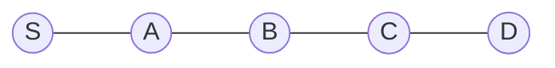

# Step 3 — Multi-Label A-star (MLA*) and its heuristic

**Paper location:** Section IV-B, _Low Level: MLA\*_. [Author Portable Document Format (PDF) paper](https://jiaoyangli.me/files/2022-ICRA.pdf).

**Prerequisite:** Familiarity with ordinary A-star (A*) and Step 2's time-indexed paths.

## 1. Why ordinary A* needs an extension

In ordinary A* with a fixed destination $D$, we can represent a state with a graph vertex $v$, estimate $h(v)=\operatorname{dist}(v,D)$, and search for a shortest route.

When another robot's path creates *time-dependent* restrictions, Space-Time A* must also store the timestep:

$$
n=(v,t).
$$

Now consider a **single task with two ordered goals**:

$$
g_1=\langle B,D\rangle.
$$

An automated guided vehicle (AGV) can be at the **same vertex at the same timestep** in two conceptually different situations:

- It has **not yet** visited B; it must still visit B before D.
- It **has already** visited B; it can proceed to D.

The state $(v,t)$ does not distinguish these situations.

## 2. The label $k$ identifies the *current target goal* (the next required goal)

MLA* augments the search state:

$$
\boxed{n=\langle v,t,k\rangle}.
$$

| Component | Meaning |
|---|---|
| $v$ | Current navigation graph vertex |
| $t$ | Current discrete timestep |
| $k$ | **Index of the current target goal** (the next goal not yet completed) in the assigned task |

**The label $k$ identifies the current target goal (the next goal that has not yet been completed).** When the agent reaches $g_j[k]$, the label advances to $k+1$. Thus, $k$ represents the next required goal, **not the most recently completed goal**. In this context, *current target goal* and *next required goal* mean the same thing.

For $g_1=\langle B,D\rangle$:

| Label | Meaning |
|---|---|
| $k=1$ | Current target: $B=g_1[1]$ (no goals completed yet) |
| $k=2$ | B is completed; current target: $D=g_1[2]$ |
| $k=3=K_1+1$ | All required goals have been completed; no remaining target |

The initial state is $\langle s_i,0,1\rangle$. The finished label is $K_j+1$.

## 3. A complete short state trace

Suppose the navigation graph is a line:

Our task is $g_1=\langle B,D\rangle$, and the AGV starts at S.

| Time $t$ | Location $v$ | Label $k$ | State | Next required goal |
|---:|---|---:|---|---|
| 0 | S | 1 | $\langle S,0,1\rangle$ | B |
| 1 | A | 1 | $\langle A,1,1\rangle$ | B |
| 2 | B | 2 | $\langle B,2,2\rangle$ | D |
| 3 | C | 2 | $\langle C,3,2\rangle$ | D |
| 4 | D | 3 | $\langle D,4,3\rangle$ | None; finished |

Notice that **B is counted as completed on arrival**, so the state recorded at B has $k=2$.

### State transition

From $\langle u,t,k\rangle$, MLA* can transition to $\langle v,t+1,k'\rangle$ only if the AGV moves along an edge $(u,v)\in E$ or waits with $u=v$.

While $1\le k\le K_j$, the label update is:

$$
\boxed{
k'=\begin{cases}
k+1 & \text{if }v=g_j[k],\\
k & \text{otherwise.}
\end{cases}
}
$$

This is the entire mechanism for ensuring the ordered sequence.

**Subtle point:** Physically passing through D before B does **not** satisfy the second goal. If $k=1$ when the robot reaches D, it must still reach B and then visit D **afterward**.

## 4. Does the heuristic change when the label advances?

**Yes.** More precisely, the search uses **one heuristic function with the label as an argument**:

$$
\boxed{h(v,k)}.
$$

This is not a restart of A*. A* continuously evaluates states in the larger state space $(v,t,k)$.

Let $\operatorname{dist}(u,v)$ be the shortest path distance on the graph **ignoring time-dependent collision constraints**. For an agent assigned task $g_j$, the paper uses:

$$
\boxed{
h(v,k)=\operatorname{dist}\bigl(v,g_j[k]\bigr)
+\sum_{\ell=k}^{K_j-1}\operatorname{dist}\bigl(g_j[\ell],g_j[\ell+1]\bigr)
}
\qquad(1\le k\le K_j).
$$

It consists of:

1. Distance from current vertex $v$ to the **next** required goal $g_j[k]$.
2. Sum of shortest distances along all **remaining legs** between consecutive task goals.

Once all goals are visited ($k=K_j+1$), we can take $h(v,k)=0$.

**Why admissible?** The AGV cannot complete the remaining goals using fewer moves than those shortest-path distances; extra waits and detours to avoid collisions can only increase time. Therefore $h$ never overestimates the remaining travel time.

## 5. Work through the heuristic numerically

On the five-vertex line S-A-B-C-D, the task is $\langle B,D\rangle$ and each edge costs 1.

Before the first goal is visited ($k=1$):

$$
h(v,1)=\operatorname{dist}(v,B)+\operatorname{dist}(B,D).
$$

After B is visited ($k=2$):

$$
h(v,2)=\operatorname{dist}(v,D).
$$

| State | $t$ | $h(v,k)$ | $f=t+h$ |
|---|---:|---:|---:|
| $\langle S,0,1\rangle$ | 0 | $2+2=4$ | 4 |
| $\langle A,1,1\rangle$ | 1 | $1+2=3$ | 4 |
| $\langle B,2,2\rangle$ | 2 | $2$ | 4 |
| $\langle C,3,2\rangle$ | 3 | $1$ | 4 |
| $\langle D,4,3\rangle$ | 4 | $0$ | 4 |

Since each move or wait costs one timestep, MLA* uses $g(n)=t$:

$$
\boxed{f(v,t,k)=t+h(v,k)}.
$$

### A nuance at the moment a goal is completed

At B, immediately *before* marking the first goal complete, the heuristic formula gives

$$
h(B,1)=\operatorname{dist}(B,B)+\operatorname{dist}(B,D)=0+2=2.
$$

After marking B complete:

$$
h(B,2)=\operatorname{dist}(B,D)=2.
$$

The **number need not jump** when $k$ advances. What changes is the *meaning of remaining work*. The label is semantic state, not just a selector for a numeric heuristic.

## 6. Why two states with the same vertex and time can differ

Consider two search states at location D and timestep 4:

| State | Interpretation | Heuristic |
|---|---|---:|
| $\langle D,4,1\rangle$ | Haven't fulfilled B; must still do B, then D | $\operatorname{dist}(D,B)+\operatorname{dist}(B,D)=4$ |
| $\langle D,4,3\rangle$ | Already fulfilled B and D | $0$ |

A search that deduplicated these by $(v,t)$ would be wrong: identical position and time do not imply identical remaining requirements.

## 7. Where Conflict-Based Search (CBS) constraints enter MLA*

MLA* receives a set of constraints from the high-level search:

- Vertex constraint $\langle a_i,u,t\rangle$: the agent cannot occupy $u$ at time $t$.
- Edge constraint $\langle a_i,u,v,t\rangle$: the agent cannot traverse $u\to v$ from time $t$ to $t+1$.

These remove forbidden states or transitions from the low-level search. The label still enforces task-goal order.

A candidate end state $\langle g_j[K_j],t,K_j+1\rangle$ is accepted only if the agent can remain at its last goal forever without violating later vertex constraints.

The paper precomputes shortest distances to the goal vertices by running backward graph searches from goal locations, making $h(v,k)$ cheap to evaluate.

## Summary

Ordinary Space-Time A*:

$$
n=(v,t).
$$

Multi-Label A*:

$$
\boxed{n=(v,t,k),\quad f(v,t,k)=t+h(v,k).}
$$

**What to remember:** $k$ stores which ordered goals are still outstanding. It is essential to the correctness of the state representation; the changing heuristic is a consequence.

**Next:** [Step 4 — Conflict-Based Search](04-conflict-based-search.md)
