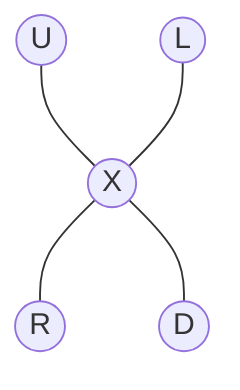
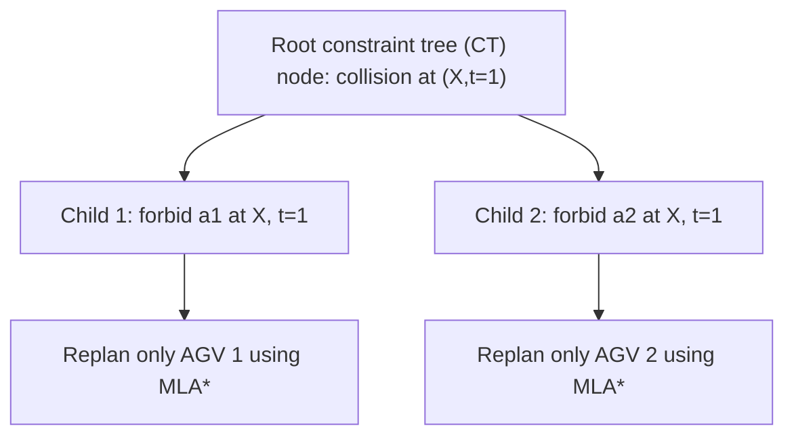
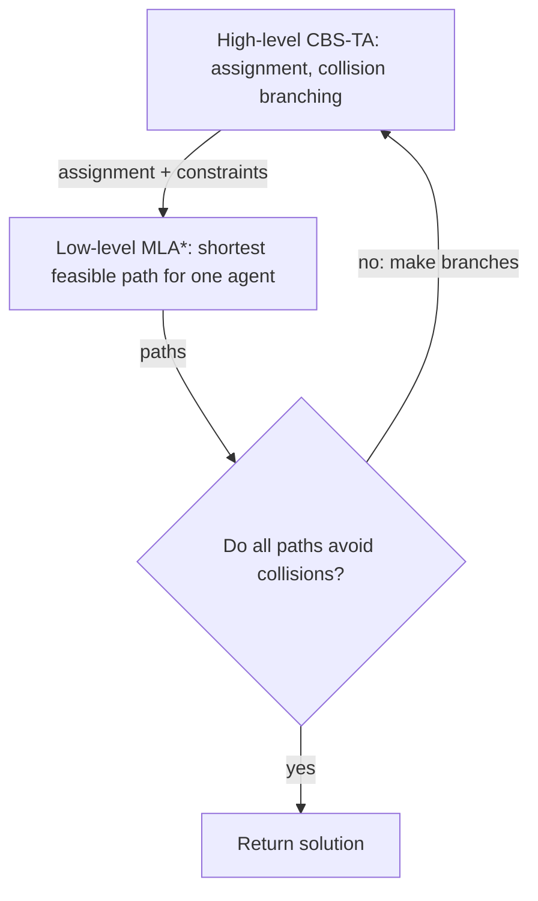

# Step 4 — Conflict-Based Search (CBS): what happens when paths collide?

**Paper location:** Section IV-A, _High Level: Conflict-Based Search with Task Assignment (CBS-TA)_, especially Algorithm 1. [Author Portable Document Format (PDF) paper](https://jiaoyangli.me/files/2022-ICRA.pdf).

This chapter focuses on **collision resolution for a fixed assignment**. The extra task-assignment dimension begins in Step 5.

## 1. Why independent Multi-Label A-star (MLA*) calls are insufficient

Each agent can receive an individually shortest path from MLA*. Nevertheless, independently planned paths can collide.

Consider two automated guided vehicles (AGVs) approaching a common vertex X on a cross-shaped graph:



- Agent $a_1$ starts at L, assigned task $g_1=\langle X,R\rangle$.
- Agent $a_2$ starts at U, assigned task $g_2=\langle X,D\rangle$.

Without constraints, MLA* can return:

| Time | AGV 1 | AGV 2 |
|---:|---|---|
| 0 | L | U |
| 1 | X | X |
| 2 | R | D |

Both agents occupy X at time $t=1$:

$$
\pi_1(1)=\pi_2(1)=X.
$$

The paths are individually valid, but the joint plan is **not** collision-free.

## 2. CBS branches on a collision

Rather than immediately choosing who must wait, CBS creates two alternative **constraints**:

- **Left branch:** ban $a_1$ from X at time 1.
- **Right branch:** ban $a_2$ from X at time 1.



The vertex constraint syntax is:

$$
\langle a_i,X,1\rangle.
$$

It means the agent **may not occupy X at that timestep**. It does **not** dictate exactly whether to wait or detour; MLA* makes that choice optimally subject to the constraints.

For an edge swap collision, CBS creates analogous **directed edge constraints**, with the prohibited traversal reversed for the other agent.

## 3. Replan a single agent in each child

Take the second child: ban AGV 2 from X at $t=1$.

MLA* can let AGV 2 wait at U, then enter X at time 2:

| Time | AGV 1 | AGV 2 |
|---:|---|---|
| 0 | L | U |
| 1 | X | U (wait) |
| 2 | R | X |
| 3 | R (stays) | D |

This plan is collision-free under the graph abstraction, and both agents complete their tasks in the required order.

Before the branch, the *infeasible* plan had total finish-time cost $2+2=4$.

After the repair:

$$
C=T_1+T_2=2+3=5.
$$

The other child could instead force AGV 1 to wait. CBS keeps both possibilities because a locally plausible priority decision might exclude the globally cheapest solution in a more complex environment.

## 4. What is stored in a high-level constraint-tree node?

A node $N$ stores:

| Data | Meaning |
|---|---|
| `N.root` | Whether this node is the root of an assignment's constraint tree |
| `N.assignment` | Which task each agent owns |
| `N.constraints` | Time-specific vertex / directed-edge prohibitions |
| `N.paths` | MLA* paths satisfying the assignment and constraints |
| `N.cost` | Sum of those paths' finish times |
| `N.collisions` | Detected collisions (and/or collision count) |

For a fixed task assignment, a branch adds one prohibition and replans only the affected agent. Other agents' paths can be reused.

## 5. The high-level search loop

In simplified pseudocode:

```text
OPEN = {initial constraint-tree root}
while OPEN is not empty:
    N = remove lowest-cost candidate from OPEN
    if N has no collisions:
        return its assignment and paths
    collision = choose an earliest collision in N
    for each involved agent:
        child = copy N
        child.constraints += constraint forbidding that agent's collision
        child.paths[affected_agent] = MLA*(...)
        if replanning succeeds:
            recompute cost and collisions
            insert child into OPEN
return no solution
```

**One important qualification:** The paper's full Algorithm 1 also creates **new assignment roots** while searching. The pseudocode above isolates the CBS collision-resolution part of the method. It is not a literal copy of the full algorithm.

The full high level expands candidates in order of increasing flowtime cost, breaking ties by favoring fewer collisions. Its search can try both different collision resolutions **and** different task assignments.

## 6. Two-level architecture



The low level solves *one-agent, ordered-goal routing*. The high level coordinates paths by branching on conflicts.

## Why the branches matter

It may be tempting to insert a wait for whichever robot has the lower priority, but CBS's systematic branching retains the possibility of a better answer under the paper's cost objective. Branches act on **constraints**, not on hard-coded steering commands.

**One idea to retain:** A collision creates alternative high-level constraints, and MLA* repairs the affected agent's path under each alternative.

**Next:** [Step 5 — Task assignment and the cost matrix](05-task-assignment-cost-matrix.md)
