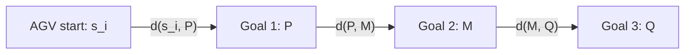
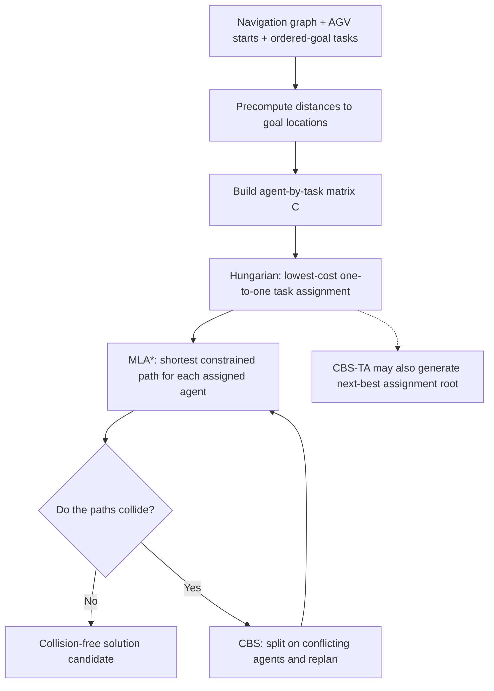

# Step 5 — Task assignment: cost matrices and the Hungarian algorithm

> **Paper:** Xinyi Zhong, Jiaoyang Li, Sven Koenig, and Hang Ma, *Optimal and Bounded-Suboptimal Multi-Goal Task Assignment and Path Finding*, International Conference on Robotics and Automation (ICRA), 2022.  
> **Read alongside:** Section IV-A, **High Level: Conflict-Based Search with Task Assignment (CBS-TA)**, especially Algorithm 1 and the paragraph immediately after the algorithm on page 3 of the Portable Document Format (PDF) edition.  
> **Source:** [Author PDF](https://jiaoyangli.me/files/2022-ICRA.pdf) · [Digital Object Identifier (DOI)](https://doi.org/10.1109/ICRA46639.2022.9812020)

**One question for this chapter:** Before we account for robot-to-robot collisions, which entire multi-goal task should each automated guided vehicle (AGV) execute?

We will derive an actual $5\times5$ cost matrix from a small navigation graph, solve the assignment with the Hungarian algorithm by hand, and connect the result to CBS-TA. The coordinates, tasks, and numerical matrices below are **our teaching example**, not experimental data from the paper.

## 1. Recall what is being assigned

There are $m$ agents and $m$ tasks in the paper's formulation:

$$
A=\{a_1,\ldots,a_m\},\qquad
\mathcal G=\{g_1,\ldots,g_m\}.
$$

A **task** is an ordered list of goal vertices, not a single goal pose:

$$
 g_j=\langle g_j[1],g_j[2],\ldots,g_j[K_j]\rangle.
$$

For example, the agent assigned $g_3=\langle P_3,M_3,Q_3\rangle$ must visit $P_3$, then $M_3$, then $Q_3$. **The task is the indivisible unit of assignment**: the algorithm cannot assign the first goal of $g_3$ to one robot and the second goal to another robot.

The paper assumes one task per agent and one agent per task *within one problem instance*. That is a modeling restriction, not necessarily how a production garage dispatcher will operate across time.

## 2. A matrix assignment is exactly one choice per row AND column

Let $C_{ij}$ be the cost of giving task $g_j$ to agent $a_i$. With five agents, the cost matrix has shape $5\times5$:

$$
C=\begin{bmatrix}
C_{11}&C_{12}&C_{13}&C_{14}&C_{15}\\
C_{21}&C_{22}&C_{23}&C_{24}&C_{25}\\
C_{31}&C_{32}&C_{33}&C_{34}&C_{35}\\
C_{41}&C_{42}&C_{43}&C_{44}&C_{45}\\
C_{51}&C_{52}&C_{53}&C_{54}&C_{55}
\end{bmatrix}.
$$

- **Row $i$:** all choices available to AGV $a_i$.
- **Column $j$:** all possible AGVs that could own task $g_j$.
- **Selected cell $(i,j)$:** AGV $a_i$ is assigned the **entire** task $g_j$.

Define an assignment matrix $X\in\{0,1\}^{m\times m}$:

$$
x_{ij}=\begin{cases}
1 &\text{if }a_i\text{ is assigned }g_j,\\
0 &\text{otherwise}.
\end{cases}
$$

The optimization problem is

$$
\boxed{\begin{aligned}
\min_{X}\quad & \sum_{i=1}^{m}\sum_{j=1}^{m}C_{ij}x_{ij}\\
\text{subject to}\quad
&\sum_{j=1}^{m}x_{ij}=1 &&\forall i\quad\text{(one task per AGV)},\\
&\sum_{i=1}^{m}x_{ij}=1 &&\forall j\quad\text{(one AGV per task)},\\
&x_{ij}\in\{0,1\}.
\end{aligned}}
$$

**Yes:** this means picking exactly one *entry* in each row and exactly one *entry* in each column. The resulting $X$ is a **permutation matrix**. It is *not* sufficient to take the cheapest number in every row independently, because two rows may prefer the same column.

## 3. Where does the initial cost matrix come from?

### 3.1 Start with shortest-path distances on the map

The paper's environment is an undirected, unit-weight graph $G=(V,E)$. Every edge traversal takes one timestep, and robots can wait. For two vertices $u,v\in V$, let

$$
d(u,v)=\text{length of a shortest graph path from }u\text{ to }v.
$$

To calculate **$C_{ij}$**, imagine assigning $g_j$ to $a_i$, but **ignore every other AGV for now**. The robot must travel from its initial location $s_i$ to the first goal and then visit all the remaining goals in order:

$$
\boxed{C_{ij}=d(s_i,g_j[1])+\sum_{k=1}^{K_j-1}d\bigl(g_j[k],g_j[k+1]\bigr).}
$$

Break it into two terms:

$$
\underbrace{d(s_i,g_j[1])}_{\text{depends on agent }i\text{ and task }j}
+\underbrace{L_j}_{\text{task-internal travel}} ,\qquad
L_j=\sum_{k=1}^{K_j-1}d(g_j[k],g_j[k+1]).
$$

**Important:** This is *not* simply the distance from the AGV start to the **last** task goal. It includes every mandatory intermediate goal in the required order. Also, each pairwise distance is a shortest **graph** path, not necessarily Euclidean straight-line distance.



### 3.2 Does the paper run Multi-Label A-star (MLA*) $m^2$ times to fill this matrix?

**No, that is not necessary.** The paper says it **precomputes distances** from every vertex to the goal locations by searching backward from each goal. On an undirected, unweighted map, ordinary **breadth-first search (BFS)** from a goal vertex gives those distances; a weighted or directed extension would need an appropriate shortest-path algorithm (for example, Dijkstra for nonnegative weights).

A useful implementation outline for the paper's unit-weight graph:

1. For every **distinct goal vertex** $q$, run a backward shortest-path search to obtain $d(v,q)$ for all $v\in V$.
2. For each task $g_j$, add up distances between consecutive goals to precompute $L_j$.
3. For each agent $a_i$ and task $g_j$, fill $C_{ij}=d(s_i,g_j[1])+L_j$.
4. Send $C$ to a minimum-cost assignment algorithm, such as the Hungarian method.

In the absence of robot collisions and time-dependent constraints, this is the **exact minimum possible travel time** for that particular agent/task pair under the paper's graph model. Once Conflict-Based Search (CBS) introduces constraints, the actual finish time may be larger.

This is also exactly the initial lower-bound heuristic from Step 3:

$$
C_{ij}=h(s_i,1)\quad\text{when task }g_j\text{ is assigned tentatively to }a_i.
$$

If a required goal is unreachable, the corresponding cost can be treated as $+\infty$ (or forbidden), subject to a suitable assignment-solver implementation. This is a practical extension of the straightforward finite-cost illustration.

## 4. Fully worked example: five AGVs, five multi-goal tasks

### 4.1 The map

Consider an obstacle-free **$8\times6$** grid. Vertices are integer coordinates $(x,y)$ with $0\le x\le7$ and $0\le y\le5$; edges connect horizontally or vertically adjacent vertices. Because every edge costs one step,

$$
d\bigl((x_1,y_1),(x_2,y_2)\bigr)=|x_1-x_2|+|y_1-y_2|
$$

for this particular **obstacle-free** grid. With walls or blocked corridors we would use the actual graph distance instead.

The five AGVs start at:

| Agent | Start $s_i$ |
|---|---|
| $a_1$ | $(0,0)$ |
| $a_2$ | $(0,4)$ |
| $a_3$ | $(4,0)$ |
| $a_4$ | $(4,4)$ |
| $a_5$ | $(7,2)$ |

Each task below must be executed **entirely by one AGV**:

| Task | Ordered goal vertices | Internal distance $L_j$ |
|---|---|---:|
| $g_1$ | $(3,0)\rightarrow(3,4)$ | $4$ |
| $g_2$ | $(1,3)\rightarrow(4,3)$ | $3$ |
| $g_3$ | $(7,5)\rightarrow(4,5)\rightarrow(1,5)$ | $3+3=6$ |
| $g_4$ | $(0,4)\rightarrow(7,4)$ | $7$ |
| $g_5$ | $(7,0)\rightarrow(2,0)$ | $5$ |

This example has four two-goal tasks and one three-goal task. We intentionally allow multiple agents to prefer the same task so that the matching problem is nontrivial.

### 4.2 Compute a single entry in detail

What is the cost of assigning **task $g_3$ to AGV $a_4$**?

The robot starts at $s_4=(4,4)$. Task $g_3$ is:

$$
g_3=\langle(7,5),(4,5),(1,5)\rangle.
$$

Its cost is:

$$
\begin{aligned}
C_{43}
&=d((4,4),(7,5))\\
&\quad+d((7,5),(4,5))\\
&\quad+d((4,5),(1,5))\\
&=(3+1)+3+3\\
&=\boxed{10}.
\end{aligned}
$$

The **first** distance depends on where AGV 4 starts. The two remaining distances are the same no matter which AGV owns $g_3$.

### 4.3 Fill every entry of $C$

First calculate only the distances from agent starts to the **first** goals:

$$
D=\begin{bmatrix}
3&4&12&4&7\\
7&2&8&0&11\\
1&6&8&8&3\\
5&4&4&4&7\\
6&7&3&9&2
\end{bmatrix}.
$$

The task-internal lengths are

$$
\mathbf{L}=\begin{bmatrix}4&3&6&7&5\end{bmatrix}^{\mathsf T}.
$$

We add $L_j$ to **every entry in column $j$**:

$$
C_{ij}=D_{ij}+L_j.
$$

The result is:

$$
\boxed{C=\begin{bmatrix}
7&\boxed{\mathbf{7}}&18&11&12\\
11&5&14&\boxed{\mathbf{7}}&16\\
\boxed{\mathbf{5}}&9&14&15&8\\
9&7&\boxed{\mathbf{10}}&11&12\\
10&10&9&16&\boxed{\mathbf{7}}
\end{bmatrix}}
$$

Or as a labeled table, with the **five optimal assignment entries highlighted**:

| AGV / task | $g_1$ | $g_2$ | $g_3$ | $g_4$ | $g_5$ |
|---|---:|---:|---:|---:|---:|
| $a_1$ | 7 | <mark><strong>7 ✓</strong></mark> | 18 | 11 | 12 |
| $a_2$ | 11 | 5 | 14 | <mark><strong>7 ✓</strong></mark> | 16 |
| $a_3$ | <mark><strong>5 ✓</strong></mark> | 9 | 14 | 15 | 8 |
| $a_4$ | 9 | 7 | <mark><strong>10 ✓</strong></mark> | 11 | 12 |
| $a_5$ | 10 | 10 | 9 | 16 | <mark><strong>7 ✓</strong></mark> |

> **Legend:** A boxed entry in the LaTeX matrix or a highlighted **✓** cell in the table is part of the **optimal one-to-one assignment**. There is exactly **one selected cell per row and per column**. We derive and verify this matching in Section 6; its original-cost total is $7+7+5+10+7=36$.

For instance, $C_{24}=d((0,4),(0,4))+d((0,4),(7,4))=0+7=7$. Starting *already at the first goal* is allowed, and the full task still takes seven steps.

### 4.4 Why selecting the smallest number in each row fails

The row minima are $[7,5,5,7,7]$. They sum to $31$, but the locally preferred assignments are:

| Agent | Cheapest choice(s) | Cost |
|---|---|---:|
| $a_1$ | $g_1$ **or** $g_2$ | 7 |
| $a_2$ | $g_2$ | 5 |
| $a_3$ | $g_1$ | 5 |
| $a_4$ | $g_2$ | 7 |
| $a_5$ | $g_5$ | 7 |

Both $a_2$ and $a_4$ want $g_2$. Meanwhile $g_3$ and $g_4$ would go unassigned. So $31$ is a **lower bound**, not the cost of a valid assignment. We need to make **globally coordinated choices**.

## 5. Hungarian algorithm: the conceptual outline

The Hungarian algorithm solves the **minimum-cost perfect matching** problem on a bipartite graph: agents on the left, tasks on the right, and edge weight $C_{ij}$ between every eligible pair.

A classical matrix-based presentation uses these steps:

1. **Row reduction:** subtract the smallest number in each row from every entry of that row.
2. **Column reduction:** subtract the smallest number in each column from every entry of that column.
3. **Find an independent set of zeros:** try to choose one zero in each row and each column.
4. **If there are $m$ independent zeros, stop.** These zeros specify an optimal assignment in the original matrix.
5. **Otherwise, cover all zeros with as few row/column lines as possible.** If fewer than $m$ lines suffice, a complete zero matching is not yet possible.
6. **Adjust the reduced matrix:** find the smallest uncovered value $\delta$; subtract it from each uncovered entry; add it to entries covered twice; leave entries covered once unchanged.
7. Return to Step 3 until an independent set of $m$ zeros exists.

**Why is reduction legitimate?** Because a complete assignment uses exactly one entry from each row *and* each column. Subtracting the same constant from an entire row subtracts that constant from **every possible assignment total**. It therefore cannot change *which assignment is optimal*. The same reasoning applies to column reduction. The adjustments in Step 6 preserve a valid lower-bound / matching structure while creating additional candidate zeros.

This is an **outline of the classical Hungarian method**, not a reproduction of its implementation in the Multi-Goal Task Assignment and Path Finding (MG-TAPF) paper. The paper invokes the Hungarian method as a subroutine and refers to the original reference for its details.

## 6. Work through Hungarian on our $5\times5$ example

### 6.1 Row reduction

Subtract the smallest entry of each row. The row minima are:

$$
r=\begin{bmatrix}7&5&5&7&7\end{bmatrix}^{\mathsf T},\qquad \sum_i r_i=31.
$$

The row-reduced matrix is

$$
R=\begin{bmatrix}
0&0&11&4&5\\
6&0&9&2&11\\
0&4&9&10&3\\
2&0&3&4&5\\
3&3&2&9&0
\end{bmatrix}.
$$

At least one entry in each row is now zero. However, those zeros still compete for columns.

### 6.2 Column reduction

The minimum value in each column of $R$ is:

$$
c=\begin{bmatrix}0&0&2&2&0\end{bmatrix}^{\mathsf T},\qquad\sum_j c_j=4.
$$

Subtract these column minima to obtain:

$$
Z=\begin{bmatrix}
0&0&9&2&5\\
6&0&7&0&11\\
0&4&7&8&3\\
2&0&1&2&5\\
3&3&0&7&0
\end{bmatrix}.
$$

The accumulated lower bound is now $31+4=35$: since every full assignment selects one entry from each row and column, the original assignment cost is the cost in the reduced matrix plus $35$.

### 6.3 Try to select five independent zeros

We can select four nonconflicting zeros, for example:

$$
(a_3,g_1),\ (a_1,g_2),\ (a_5,g_3),\ (a_2,g_4).
$$

But we cannot select a fifth: the remaining AGV $a_4$ has a zero only in column $g_2$, which is already taken. **There is no perfect zero matching** yet. The objective is not "as many zeros as possible"; it is **exactly one zero per row and column**.

### 6.4 Cover zeros and adjust

All the zeros of $Z$ can be covered by **four lines**:

- Rows $a_2$ and $a_5$.
- Columns $g_1$ and $g_2$.

Four is the minimum number of covering lines, matching the four independent zeros. The smallest **uncovered** entry is $\delta=1$, at $(a_4,g_3)$.

Apply the adjustment: subtract $1$ from every uncovered entry, add $1$ where a covered row crosses a covered column, and leave singly covered entries unchanged:

$$
Z'=\begin{bmatrix}
0&\boxed{\mathbf{0}}&8&1&4\\
7&1&7&\boxed{\mathbf{0}}&11\\
\boxed{\mathbf{0}}&4&6&7&2\\
2&0&\boxed{\mathbf{0}}&1&4\\
4&4&0&7&\boxed{\mathbf{0}}
\end{bmatrix}.
$$

The new zero at $(a_4,g_3)$ lets us choose **five independent zeros**. The **boxed zeros in $Z'$** correspond to the same AGV-task pairs as the boxed costs in $C$ above:

$$
\boxed{(a_1,g_2),\ (a_2,g_4),\ (a_3,g_1),\ (a_4,g_3),\ (a_5,g_5).}
$$

We have a valid minimum-cost assignment. For this example the lower bound rises by $1$ to $35+1=36$, which is exactly the original cost of that zero matching.

### 6.5 Recover the actual assignment from the ORIGINAL costs

Read the chosen cells from **$C$**, not from the zero-valued reduced matrix. These are exactly the **boxed / highlighted entries in Section 4.3**:

| AGV | Assigned task | Original cost |
|---|---|---:|
| $a_1$ | $g_2$ | 7 |
| $a_2$ | $g_4$ | 7 |
| $a_3$ | $g_1$ | 5 |
| $a_4$ | $g_3$ | 10 |
| $a_5$ | $g_5$ | 7 |
| **Total** | | **36** |

The binary assignment matrix is

$$
\boxed{X^*=\begin{bmatrix}
0&1&0&0&0\\
0&0&0&1&0\\
1&0&0&0&0\\
0&0&1&0&0\\
0&0&0&0&1
\end{bmatrix}}
$$

Check it yourself: **each row sums to 1, and each column sums to 1**. For contrast, assigning tasks in their original diagonal order costs

$$
7+5+14+11+7=44,
$$

so optimizing the assignment improves the collision-ignorant total from $44$ to $36$ on this example.

### 6.6 Computational complexity

There are $m!$ possible one-to-one assignments. Even with $m=10$, this is $3{,}628{,}800$ permutations, so checking every assignment is undesirable. Standard implementations of Hungarian / Kuhn–Munkres run in $O(m^3)$ time for an $m\times m$ matrix. This is for the assignment **subproblem**, not for solving collision-free MG-TAPF as a whole.

## 7. Reproduce the result in Python

The code below reproduces the *cost matrix and assignment* (it does not implement MLA* or CBS). It requires `scipy`; it uses the widely available `linear_sum_assignment` implementation rather than coding the Hungarian reductions by hand.

```python
import numpy as np
from scipy.optimize import linear_sum_assignment

starts = [(0, 0), (0, 4), (4, 0), (4, 4), (7, 2)]
tasks = [
    [(3, 0), (3, 4)],
    [(1, 3), (4, 3)],
    [(7, 5), (4, 5), (1, 5)],
    [(0, 4), (7, 4)],
    [(7, 0), (2, 0)],
]

# Only valid for the obstacle-free grid in this teaching example.
def d(u, v):
    return abs(u[0] - v[0]) + abs(u[1] - v[1])

def cost(start, goals):
    return d(start, goals[0]) + sum(
        d(u, v) for u, v in zip(goals, goals[1:])
    )

C = np.array([[cost(s, goals) for goals in tasks] for s in starts])
rows, cols = linear_sum_assignment(C)
X = np.zeros_like(C)
X[rows, cols] = 1

print("costs:\n", C)
print("assignment:\n", X)
print("total:", int(C[rows, cols].sum()))  # 36

assert np.all(X.sum(axis=0) == 1)
assert np.all(X.sum(axis=1) == 1)
assert C[rows, cols].sum() == 36
```

For a garage with walls, replace `d` with **graph shortest-path distance**. In the actual paper, such goal distances are precomputed by backward searches on the graph rather than calculated with this Manhattan-distance shortcut.

## 8. Where Hungarian stops and CBS-TA begins

**The assignment of cost 36 is optimal only when AGV interactions are ignored.** In particular, $C$ contains **no information** about:

- Two AGVs reaching the same grid vertex at the same timestep.
- Two AGVs trying to traverse an edge in opposite directions.
- Waits or detours needed to resolve those collisions.
- Additional temporal or physical-resource constraints that are outside this paper's basic model.

The high-level Conflict-Based Search with Task Assignment and Multi-Label A-star (CBS-TA-MLA) algorithm follows this pattern:



In the **initial root node**, the high-level constraints are empty. MLA* plans the shortest individual paths for the chosen assignment, and the cost of those paths is initially the collision-ignorant total when all necessary paths exist. CBS then detects collisions. If constraints force extra waiting, a search node's **actual path flowtime** can exceed the corresponding cost-matrix sum.

**Crucially, the algorithm does not freeze the Hungarian assignment forever.** CBS-TA maintains a *forest* of constraint trees, one per assignment, and can lazily introduce the next-best assignment. This is why the paper can find an optimal collision-free solution rather than merely a collision-free repair of one assignment. That assignment-forest mechanism is reserved for Step 6.

## 9. Common confusions and quick checks

| Question | Answer |
|---|---|
| Does each AGV choose the nearest goal pose? | No. A matrix entry includes **every ordered goal in a complete task**. |
| Is the cost just the distance to the task's last goal? | No. It is the sum of start-to-first and all consecutive goal-to-goal distances. |
| Exactly one matrix entry per row? | Yes. Each AGV gets one task. |
| Exactly one matrix entry per column? | Yes. Each task gets one AGV. |
| Does Hungarian account for robot collisions? | No. It solves the independent-cost assignment problem. |
| Are cost matrix entries exact or heuristic? | Exact for one robot in the paper's unconstrained, unit-weight graph; **lower bounds** once other robots and time constraints matter. |
| Does Hungarian solve MG-TAPF by itself? | No. CBS-TA and MLA* are needed for coordinated collision-free paths. |
| What if there are five AGVs and only one task? | The paper assumes equal numbers of agents/tasks. Dummy or idle-task modeling would be an adaptation, not the original formulation. |

### Check your understanding

1. In the $5\times5$ matrix above, why is $31$ not a valid assignment cost? (Hint: look at the column for $g_2$.)
2. Why does the internal cost $L_3=6$ get added to **every** row of the $g_3$ column?
3. For the final $X^*$, can you verify that every AGV and every task appears exactly once?
4. If the collision-free cost of our chosen assignment rises to $40$, could another assignment whose collision-ignorant cost is $37$ win overall? (**Yes.** That's why CBS-TA considers alternatives.)

## The idea to retain

> **Hungarian selects entire multi-goal tasks for AGVs using one chosen cost-matrix entry per row and per column. The matrix is built from shortest graph distances through every task's ordered goals, initially ignoring collisions. CBS-TA handles collisions and can consider other assignments.**

**Next:** Step 6 — the CBS-TA *search forest*: why different assignments have different constraint trees, how the next-best assignment appears, and how all of those possibilities compete in a single best-first search.
