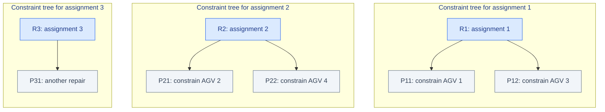
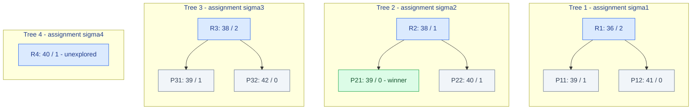
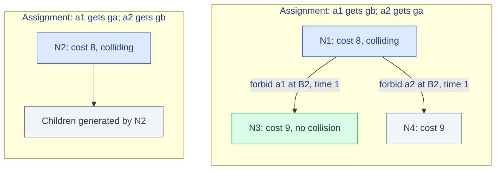

# Step 6 - The Search Forest: How Alternative Assignments Compete with Collision Repairs

> **Paper:** Xinyi Zhong, Jiaoyang Li, Sven Koenig, and Hang Ma, *Optimal and Bounded-Suboptimal Multi-Goal Task Assignment and Path Finding*, International Conference on Robotics and Automation (ICRA), 2022.  
> **Read alongside:** Section IV-A, *High Level: Conflict-Based Search with Task Assignment*, and Algorithm 1 (PDF page 3); Section IV-D, *Example*, and Figures 1-2 (PDF page 4).  
> **Paper:** https://jiaoyangli.me/files/2022-ICRA.pdf  
> **Previous chapter:** [05-task-assignment-cost-matrix.md](05-task-assignment-cost-matrix.md)

**The question:** Suppose the cheapest task assignment gives individually short paths, but those paths collide. Should we repair the paths for that assignment, or switch to a slightly more expensive assignment with fewer collisions?

**The paper's answer:** Explore **both kinds of candidates in one best-first search**. Each assignment receives its own *constraint tree* (CT); all the nodes across all CTs share a priority queue named `OPEN`. The resulting collection of CTs is a **search forest**.

This chapter slows the explanation down and follows every step of a complete, **illustrative** five-automated-guided-vehicle (AGV) queue trace before revisiting the **actual** two-agent example in the paper. The illustrative collision and repair costs are teaching assumptions, not numbers measured from a specified garage graph.

## 1. First, separate the two decisions

Conflict-Based Search (CBS) assumes each agent already has an assigned task. It handles **one kind of choice**: how to resolve collisions between the agent paths. Its high-level search structure is one constraint tree.

Conflict-Based Search with Task Assignment (CBS-TA) additionally chooses **which whole task** each agent executes. It now has **two kinds of choices**:

| Decision | Example | What changes? | Search structure |
|---|---|---|---|
| **Assignment choice** | Give Task 2 to AGV 1 rather than Task 4 | Complete task-to-agent assignment | **Different CT root / different tree** |
| **Collision-resolution choice** | Forbid AGV 1 from occupying vertex X at time 4 | A spatiotemporal constraint and perhaps one AGV path | **Child within the same CT** |

A fundamental invariant is:

> **A parent and its collision-resolution children always have the same task assignment.** Children inherit the assignment, but have different constraints and potentially different paths and costs.

A different assignment does **not** appear as a child of a colliding node. It enters the search as the **root of another tree**.

### 1.1 A picture of the two separate dimensions



*Figure 6.1 - Three trees, each with its own assignment. A solid arrow means **add a collision-resolution constraint**. There are **no parent-child arrows between roots R1, R2, and R3** because the assignment choices are enumerated separately.*

There may be many nodes within a given tree and many trees across the forest. The key is that a node in any tree can be the next node to expand.

## 2. What exactly is a high-level node?

Let $N$ denote a high-level search node. Its important fields are:

| Field | Interpretation | Is it inherited by collision children? |
|---|---|---|
| `N.root` | Whether the node is a root of a CT | No - a child has `root = false` |
| `N.assignment` | A one-to-one mapping from AGVs to complete multi-goal tasks | **Yes - unchanged** |
| `N.constraints` | Rules forbidding agent/vertex/time or agent/edge/time combinations | Yes, **plus one new rule** |
| `N.paths` | One planned path per AGV under its assignment and constraints | Other agents' paths are copied; one affected AGV is replanned |
| `N.cost` | Sum of finish times of the currently stored paths | Recomputed; may stay equal or increase |
| `N.collisions` | Collisions among the currently stored paths | Recomputed |

The flowtime cost is

$$
\boxed{N.\mathrm{cost}=\sum_{i=1}^{m}T_i(N)}
$$

where $T_i(N)$ is the finish time of AGV $a_i$ in the path stored at node $N$.

**A subtle but vital point:** A node may have a perfectly valid *individual* path for every AGV while still containing **collisions between those paths**. Such a node is a *candidate*, not yet a collision-free solution.

### 2.1 What happens when a node branches?

Suppose paths in node $R_1$ collide because AGVs $a_1$ and $a_3$ both occupy location $X$ at time $t=4$:

$$
\pi_1(4)=\pi_3(4)=X.
$$

CBS-TA creates two children:

$$
\begin{aligned}
P_{11}:&\quad \mathrm{constraints}(R_1)\cup\{\langle a_1,X,4\rangle\},\\
P_{12}:&\quad \mathrm{constraints}(R_1)\cup\{\langle a_3,X,4\rangle\}.
\end{aligned}
$$

In $P_{11}$, Multi-Label A-star (MLA*) replans **AGV 1** subject to its new constraint. In $P_{12}$, it replans **AGV 3**. In both cases, the assigned tasks of **all** AGVs are unchanged.

If a replanned path cannot be found, that child is discarded. Otherwise, the child's cost and collisions are recalculated and the child is inserted into `OPEN`.

**Nothing executes on the robots yet.** Branches and replanning are hypothetical plans being evaluated in software.

## 3. Now define `OPEN` precisely

Think of `OPEN` as a **shared waiting room for candidate plans**. It is **not** a queue of AGVs, not a queue of tasks, and not a queue of physical motions to dispatch.

It may simultaneously hold:

- An unconstrained root for **Assignment 2**;
- A partially repaired child for **Assignment 1**;
- A different partially repaired child for **Assignment 1**;
- A root or child for **Assignment 3**.

All are comparable because each has a **flowtime** cost for its stored set of AGV paths.

For the basic optimal version in Algorithm 1, select

$$
\boxed{N^*=\arg\min_{N\in\mathrm{OPEN}}N.\mathrm{cost}}
$$

and, among equal-cost nodes, prefer the node with **fewer collisions**. That is the paper's high-level ordering. A node is removed from `OPEN` when it is expanded.

### 3.1 Does the algorithm require candidates to be collision-free before entering `OPEN`?

**No.** Colliding candidates belong in `OPEN`, too. Their costs tell us how promising they are *before* fully resolving collisions. If a node is popped and has no collisions, it can be returned as the solution. If it collides, the algorithm must branch.

### 3.2 Why compare colliding paths with repaired ones?

Because a colliding node's cost is a **lower bound** for paths in its descendant branches. Adding a prohibition to one agent cannot make that agent's *shortest feasible constrained path* shorter than before.

For example, `R2:38, colliding` could lead to a collision-free child costing **39**. It would be premature to return a collision-free candidate costing **41** while `R2:38` remains waiting in `OPEN`.

Put differently:

> `OPEN` compares **how cheaply a branch might still lead to a solution**, rather than only comparing plans that are already collision-free.

This is analogous to ordinary A*: a frontier state with low $f$-value is expanded before returning a more expensive goal state. The difference is that a high-level CBS-TA state is a **multi-agent candidate plan with constraints**, not a vertex on one robot's route.

## 4. Where do the different roots come from?

Revisit the cost matrix from Step 5. Its entries represent the minimum travel time for an AGV to visit all goals of one task in order, **ignoring collisions with other agents**:

$$
C=\begin{bmatrix}
7&7&18&11&12\\
11&5&14&7&16\\
5&9&14&15&8\\
9&7&10&11&12\\
10&10&9&16&7
\end{bmatrix}.
$$

For a one-to-one assignment $\sigma$ (here $\sigma(i)$ is the index of the task assigned to AGV $i$), its collision-ignorant lower bound is

$$
\boxed{L(\sigma)=\sum_{i=1}^{5}C_{i,\sigma(i)}.}
$$

There are $5!=120$ possible assignments. The first few, obtained by enumerating this example's assignment permutations, are:

| Assignment rank | $\sigma=(\sigma(1),\ldots,\sigma(5))$ | Meaning: tasks assigned to AGVs 1-5 | Lower bound $L(\sigma)$ |
|---:|---|---|---:|
| 1 | **$(2,4,1,3,5)$** | AGV 1 gets Task 2, AGV 2 gets Task 4, etc. | **36** |
| 2 | $(1,4,5,2,3)$ | A different complete assignment | 38 |
| 3 | $(4,2,1,3,5)$ | Another complete assignment | 38 |
| 4 | $(1,2,5,4,3)$ | Another complete assignment | 40 |

*Table 6.1 - Costs calculated from the Step 5 teaching matrix. Assignment rank 2 and 3 tie, so a real next-best assignment generator might return them in the opposite order.*

The Hungarian algorithm finds the first assignment, $\sigma_1=(2,4,1,3,5)$, with lower bound 36. A **next-best assignment enumerator** can then produce the second assignment, then the third, and so forth, in nondecreasing order of $L(\sigma)$.

Crucially, **CBS-TA does not create all 120 roots in advance.** It starts with only the first root and creates later roots *lazily*.

### 4.1 Exactly when does a new root appear?

Follow Algorithm 1, lines 11-24:

1. Pop the cheapest node $N$ from `OPEN`.
2. **If $N$ has no collisions, return it immediately.**
3. Otherwise, if $N$ is a **root**, create a new root for the next-best assignment, plan its individual paths with MLA*, and insert the root into `OPEN`.
4. Resolve a collision in $N$ by creating two constraint children and inserting feasible children into `OPEN`.

This ordering matters in three ways:

- **Only a root expansion creates the next assignment root.** Expanding a child does not advance the assignment enumeration.
- **A collision-free root terminates the search immediately.** No next-best root is generated in that case.
- **A colliding root creates the next root and also gets its own collision-resolution children.** The algorithm explores alternative assignments and repairs side by side.

The next-best assignment routine is inherited from an earlier CBS-TA reference ([28] in the paper). **It is not simply rerunning the Hungarian algorithm on the unchanged matrix**, since that would produce the same minimum assignment again.

## 5. Full five-AGV walkthrough: watch `OPEN` change

We will now **invent one plausible set of collision outcomes** for the real Step 5 matrix. The assignment costs of 36, 38, 38, and 40 are calculated from the matrix; the collision counts, forbidden locations, and increased costs of child nodes below are **illustrative**, since we have not defined a full five-AGV map or run MLA* on it.

The purpose of this example is to understand **forest control flow and queue ordering**, not to claim these are physically verified paths.

### 5.1 Naming our nodes

We will use the notation `name : cost / collision-count`.

| Node | Assignment | Meaning |
|---|---|---|
| $R_1$ | $\sigma_1$ | Root of the cheapest assignment's tree |
| $P_{11}$, $P_{12}$ | $\sigma_1$ | Two different collision-resolution children of $R_1$ |
| $R_2$ | $\sigma_2$ | Root of the second assignment's tree |
| $P_{21}$, $P_{22}$ | $\sigma_2$ | Two different collision-resolution children of $R_2$ |
| $R_3$ | $\sigma_3$ | Root of the third assignment's tree |
| $P_{31}$, $P_{32}$ | $\sigma_3$ | Two different children of $R_3$ |
| $R_4$ | $\sigma_4$ | Root of a fourth assignment; may never be expanded |

Notice that the first subscript of $P_{ij}$ identifies the **assignment tree**, not an AGV index. This is a teaching naming convention, not a special variable from the paper.

### 5.2 Initial state: only the cheapest assignment exists

Compute the Hungarian assignment $\sigma_1$ and use MLA* to find a time-optimal path for each assigned AGV, ignoring other agents when planning each path. Suppose the combined paths have **2 collisions**.

$$
R_1: \quad \mathrm{cost}=36,\quad \mathrm{collisions}=2.
$$

`OPEN`, from highest priority to lowest:

| Priority | Node | Cost | Collisions | Assignment |
|---:|---|---:|---:|---|
| 1 | **$R_1$** | **36** | 2 | $\sigma_1$ |

**Action:** Pop $R_1$. Since it collides, we cannot return it.

### 5.3 Expand root R1: create a new assignment *and* repair branches

Because $R_1$ is a **root**, the algorithm asks for the next-best assignment $\sigma_2$ and creates $R_2$ with independently planned paths. Suppose $R_2$ has one collision:

$$R_2: 38\,/\,1.$$

The algorithm **also** splits one collision in $R_1$ between AGVs 1 and 3 at location $X$, time 4:

- Child $P_{11}$ forbids AGV 1 at $(X,4)$. Replanning gives cost **39**, with **1 collision** left.
- Child $P_{12}$ forbids AGV 3 at $(X,4)$. Replanning gives cost **41**, with **0 collisions** left.

The queue is now:

| Priority | Candidate | Cost | Collisions | Assignment | Status |
|---:|---|---:|---:|---|---|
| 1 | **$R_2$** | **38** | 1 | $\sigma_2$ | Different, unmodified assignment |
| 2 | $P_{11}$ | 39 | 1 | $\sigma_1$ | First repair of assignment 1 |
| 3 | $P_{12}$ | 41 | 0 | $\sigma_1$ | Already collision-free |

**Question:** $P_{12}$ is collision-free. Why not return it immediately?

**Answer:** Because $R_2$ costs **38**, and it might produce a collision-free solution cheaper than **41**. The next node to expand is therefore **$R_2$**, not $P_{12}$.

This is the first key example of the **shared `OPEN` queue**: it chooses a node from Assignment 2 ahead of a valid candidate from Assignment 1.

### 5.4 Expand root R2: add assignment 3 and repair assignment 2

Now pop $R_2:38/1$.

Because it is a colliding **root**, generate $R_3$ for the next-best assignment $\sigma_3$. Its collision-ignorant path cost also happens to be 38; assume it has 2 collisions:

$$R_3:38\,/\,2.$$

Then suppose we split a collision in $R_2$ involving AGVs 2 and 4 at location $Y$, time 5:

- $P_{21}$ forbids AGV 2 at $(Y,5)$: cost **39**, **0 collisions**.
- $P_{22}$ forbids AGV 4 at $(Y,5)$: cost **40**, **1 collision**.

Now `OPEN` contains:

| Priority | Candidate | Cost | Collisions | Assignment | Status |
|---:|---|---:|---:|---|---|
| 1 | **$R_3$** | **38** | 2 | $\sigma_3$ | Another unmodified assignment |
| 2 | $P_{21}$ | 39 | **0** | $\sigma_2$ | Already collision-free |
| 3 | $P_{11}$ | 39 | 1 | $\sigma_1$ | Still colliding |
| 4 | $P_{22}$ | 40 | 1 | $\sigma_2$ | Still colliding |
| 5 | $P_{12}$ | 41 | 0 | $\sigma_1$ | Collision-free but expensive |

**Question:** We have a collision-free plan $P_{21}$ of cost 39. Why not stop now?

**Answer:** $R_3$ has cost **38**. If it can resolve its collisions with no more than one additional timestep, it could match or beat 39. To be sure of optimality, the algorithm must expand $R_3$ first.

Notice that we have **three assignment trees in play** even though none of the existing paths has been executed.

### 5.5 Expand root R3: introduce assignment 4, then branch

Pop $R_3:38/2$. Because it is a colliding root, generate $R_4$ for $\sigma_4$, with assignment cost 40 (assume its independently planned paths have one collision).

Suppose the two children from $R_3$ are:

- $P_{31}:39/1$ - cost 39, still one collision.
- $P_{32}:42/0$ - cost 42, collision-free.

The combined queue becomes:

| Priority | Candidate | Cost | Collisions | Assignment |
|---:|---|---:|---:|---|
| 1 | **$P_{21}$** | **39** | **0** | $\sigma_2$ |
| 2-3 | $P_{11}$, $P_{31}$ | 39 | 1 | $\sigma_1$, $\sigma_3$ |
| 4-5 | $P_{22}$, $R_4$ | 40 | 1 | $\sigma_2$, $\sigma_4$ |
| 6 | $P_{12}$ | 41 | 0 | $\sigma_1$ |
| 7 | $P_{32}$ | 42 | 0 | $\sigma_3$ |

The tie at cost 39 is resolved in favor of **fewer collisions**. Thus $P_{21}$, with zero collisions, ranks ahead of $P_{11}$ and $P_{31}$.

**Action:** Pop $P_{21}$. It is collision-free, so return its assignment $\sigma_2$ and AGV paths. The result has total flowtime **39**.

### 5.6 The entire expansion history in one table

| Iteration | Node popped | Why that node? | What is added to `OPEN`? | Outcome |
|---:|---|---|---|---|
| 0 | -- | Initialize | $R_1:36/2$ | Start |
| 1 | $R_1:36/2$ | Lowest cost 36 | $R_2:38/1$, $P_{11}:39/1$, $P_{12}:41/0$ | Continue |
| 2 | $R_2:38/1$ | 38 beats costs 39 and 41 | $R_3:38/2$, $P_{21}:39/0$, $P_{22}:40/1$ | Continue |
| 3 | $R_3:38/2$ | 38 beats cost 39 | $R_4:40/1$, $P_{31}:39/1$, $P_{32}:42/0$ | Continue |
| 4 | **$P_{21}:39/0$** | Lowest cost; fewest collisions among ties | Nothing | **Return flowtime 39** |

*Table 6.2 - Completely illustrative high-level search trace. The assignment lower bounds are from the real Step 5 teaching matrix. The collision counts, constraint locations/times, and child costs are hypothetical.*

### 5.7 A complete picture of the forest after iteration 3



*Figure 6.2 - Forest after several expansions. Each node label is **flowtime / collision count**, not a fraction. The roots are separate and have no connecting tree edges. The green node is the first popped collision-free candidate.*

### 5.8 What did we learn from the five-AGV example?

1. **Cheapest assignment is not necessarily cheapest executable solution.** Assignment $\sigma_1$ has initial cost 36, but the winning collision-free example uses assignment $\sigma_2$ at cost 39.
2. **A known feasible candidate is not automatically returned.** $P_{12}:41/0$ exists, but other cheaper candidates still have to be considered.
3. **A different assignment root can overtake a collision-resolution child.** $R_2:38/1$ is expanded before $P_{11}:39/1$.
4. **A further root can overtake a collision-free child.** $R_3:38/2$ is expanded before $P_{21}:39/0$.
5. **Children never change task ownership.** $P_{21}$ inherits $\sigma_2$ from $R_2$, even though MLA* changes one AGV's route.
6. **We did not enumerate every possible assignment.** The fourth root costs 40; the algorithm can return a cost-39 solution before expanding it.

## 6. The exact example from the paper (two AGVs)

Let's connect the larger teaching trace to **Section IV-D and Figures 1-2** in the actual paper. Unlike the hypothetical five-AGV collision costs, the following node names and order are reported by the authors.

The starting locations are

$$s_1=B1,\qquad s_2=A2,$$

and the two tasks are

$$g_a=\langle C2,A2\rangle,\qquad g_b=\langle B3,B1\rangle.$$

There are exactly two task assignments:

| Root | Assignment | Root cost |
|---|---|---:|
| $N_1$ | $a_1\mapsto g_b$, $a_2\mapsto g_a$ | 8 |
| $N_2$ | $a_1\mapsto g_a$, $a_2\mapsto g_b$ | 8 |

The paper describes the following sequence:

**Initialization.** Put $N_1:8$ into `OPEN`. Its independently planned paths collide twice, both at vertex $B2$: at times 1 and 3.

**Pop $N_1$.** It is a colliding root, so create the second assignment root $N_2:8$ and add it to `OPEN`. Then split the earliest collision, at $B2$ and time 1.

- $N_3$ inherits $N_1$'s assignment and adds $\langle a_1,B2,1\rangle$.
- $N_4$ inherits $N_1$'s assignment and adds $\langle a_2,B2,1\rangle$.

MLA* replans the affected agents. Both children have cost 9 in Figure 2.

**Now inspect `OPEN`:**

| Candidate | Cost |
|---|---:|
| **$N_2$** | **8** |
| $N_3$ | 9 |
| $N_4$ | 9 |

The algorithm pops **$N_2$** next, even though $N_3$ and $N_4$ are repairs of the original assignment.

**Pop $N_2$.** It collides, so it also generates two collision-resolution children. But it does **not** produce a third assignment root, because only two different assignments exist.

**Pop $N_3$.** The paper says $N_3$ is selected next and has no collisions; its assignment and paths are returned with flowtime 9. (For other equal-cost nodes, the exact tie resolution depends on the paper's priority rule.)



*Figure 6.3 - Recreated topology of the paper's Figure 2; not the original printed figure. Note again: $N_2$ is **not** a child of $N_1$. It represents a separate assignment.*

**The central moment in the paper is the queue `N2:8, N3:9, N4:9`.** It makes the abstract sentence "all trees share one `OPEN` queue" concrete: the best-first search picks a *different assignment root* instead of immediately continuing the first assignment's collision repairs.

## 7. Why can the first collision-free node popped be optimal?

Two lower-bound properties explain the intuition, under the paper's model and exact low-level search:

**Within a tree:** Each added constraint removes possible individual-agent paths, never adds new ones. Therefore the shortest feasible individual path under the child constraints cannot improve over the parent. Consequently, its node flowtime is a lower bound for any feasible solution in that descendant branch.

$$N_{\mathrm{child}}.\mathrm{cost}\geq N_{\mathrm{parent}}.\mathrm{cost}.$$

**Across trees:** The next-best task-assignment generator enumerates assignment roots by nondecreasing collision-ignorant cost. Future, not-yet-generated assignments cannot have a root lower bound cheaper than the next one in that sequence.

Together, these let one priority queue systematically cover both (a) cheaper repairs of already-generated assignments and (b) potentially better assignments not yet fully explored.

In the five-AGV teaching trace, we return a feasible plan costing 39 while the next not-yet-explored assignment has a lower bound of 40 and all remaining branches in `OPEN` cost at least 39. We therefore do not need to expand the cost-40 root to prove that a cost-39 solution is best for that illustrative search.

This is intuition for the paper's optimality claim, **not a replacement for its proof**. The paper establishes optimality and completeness in Theorem 3 of Section IV-C.

### 7.1 Two common misconceptions

**Misconception A: The forest searches all assignments first, and only then fixes collisions.**  
No. Assignment enumeration is interleaved with collision resolution. A new root is created **only when a colliding root is expanded**.

**Misconception B: A root chooses its children based on which assignment is cheaper.**  
No. Collision children **never choose new assignments**. They only add agent-specific spatiotemporal constraints, and replan the affected agent.

## 8. Algorithm 1 translated into conceptual pseudocode

This is a pedagogical rewrite, not a verbatim transcription of the paper:

```text
OPEN = priority queue ordered by (flowtime, number_of_collisions)

first = make_root(best_assignment())
    // make_root uses MLA* to plan all agents, then detects collisions
OPEN.push(first)

while OPEN is not empty:
    N = OPEN.pop_min()

    if N has no collisions:
        return N.assignment, N.paths

    if N.is_root:
        if another assignment exists:
            R = make_root(next_best_assignment())
            OPEN.push(R)

    conflict = choose_collision(N)
    for constrained_agent in the two involved agents:
        child = copy(N)                 // inherits same assignment
        child.is_root = false
        child.add_constraint(constrained_agent, conflict)
        child.replan_only(constrained_agent, MLA_star)
        if child's path exists:
            child.update_cost_and_collisions()
            OPEN.push(child)

return NO_SOLUTION
```

In the published pseudocode, the `nextAssignment()` function appears in the root-expansion block (lines 15-23), and the two-child branching appears in lines 24-34. The authors refer to their earlier CBS-TA work for how the ranked assignment enumeration itself is implemented.

## 9. Implications for an AGV garage scheduler

In a garage, an AGV that is closest to a tray may still be the wrong choice because its route would block other AGVs. The forest lets the planner consider a farther AGV whose assignment is individually less attractive but whose combined collision-free plan is better.

Do not equate this directly with a production dispatcher, however. The paper assumes one task per agent per planning instance, unit-time movements on a graph, and AGVs remaining at their final goal. Arbitrary inter-task precedence, lift/bay reservations, tray-pickup mechanics, and online schedule updates require additional modeling.

## 10. Check your understanding

1. If $P_{11}$ is a child of root $R_1$, can $P_{11}$ assign a different task to AGV 1? **No.** It inherits $R_1$'s assignment.
2. If `OPEN` contains $R_2:38/1$ and $P_{12}:41/0$, which is expanded? **$R_2$** - even though $P_{12}$ is collision-free.
3. If `OPEN` contains $R_3:38/2$ and $P_{21}:39/0$, can we return $P_{21}$ now? **Not yet.** The cost-38 root must first be considered.
4. When does a **new assignment** enter the search? **When a colliding CT root is expanded.**
5. When does the algorithm reassign tasks as part of a collision branch? **Never** in this CBS-TA forest formulation.

## Summary

> **Different assignments create different constraint-tree roots. Collision constraints create children inside a fixed-assignment tree. A single best-first priority queue, `OPEN`, mixes nodes from every tree and always expands the currently cheapest candidate plan.**

**Next chapter:** Step 7 - High-level heuristics: how the algorithm predicts whether resolving a collision will necessarily increase cost, and why that can speed up search.
