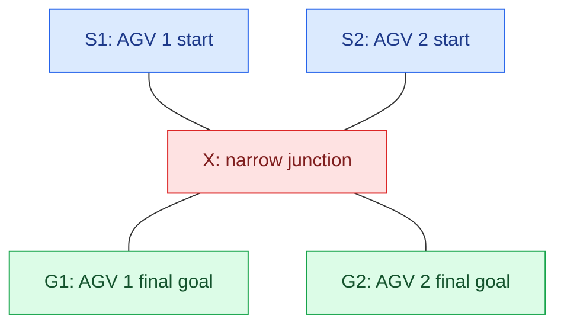
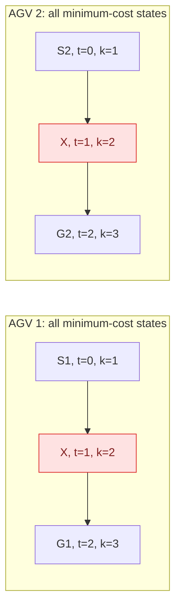
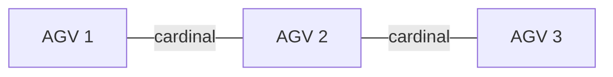
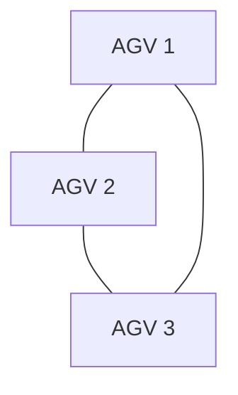
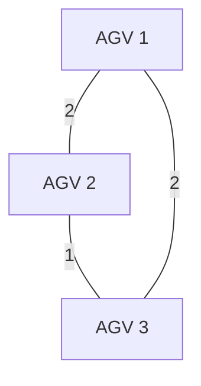
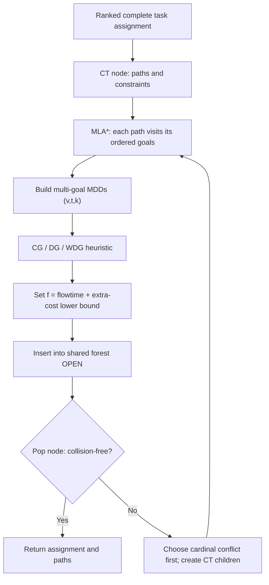

# Step 7 - High-Level Heuristics: Predicting the Cost of Resolving Collisions

> **Paper:** Xinyi Zhong, Jiaoyang Li, Sven Koenig, and Hang Ma, *Optimal and Bounded-Suboptimal Multi-Goal Task Assignment and Path Finding*, International Conference on Robotics and Automation (ICRA), 2022.  
> **Read alongside:** Section V-A, *CBS-TA-MLA with Heuristics (CBSH-TA-MLA)*, and Figure 3 (PDF page 5; zero-based PDF page index 4).  
> **Main paper:** https://jiaoyangli.me/files/2022-ICRA.pdf  
> **Underlying heuristic paper:** Jiaoyang Li et al., *Improved Heuristics for Multi-Agent Path Finding with Conflict-Based Search*, International Joint Conference on Artificial Intelligence (IJCAI), 2019: https://www.cs.sfu.ca/~hangma/pub/ijcai19.pdf  
> **Previous chapter:** [06-search-forest.md](06-search-forest.md)

**Question for this chapter:** The search forest holds candidate plans for many automated guided vehicle (AGV) assignments. We know that a colliding node with flowtime 36 cannot itself be executed. Can we predict that every valid repair will cost *at least* 38, so that the search does not waste time treating 36 as an achievable solution?

**Answer:** Yes. The paper adds an *admissible high-level heuristic* that predicts unavoidable *extra flowtime* caused by interactions between agents. We will develop this idea gradually, beginning with a single forced collision. The three heuristics are called the **Cardinal-Conflict Graph (CG)**, **Dependency Graph (DG)**, and **Weighted Dependency Graph (WDG)** heuristics.

> **Scope:** This chapter studies the improved **optimal** version called Conflict-Based Search with Task Assignment and Multi-Label A-star with Heuristics (CBSH-TA-MLA). The later **bounded-suboptimal** version uses a different high/low-level queue arrangement; we will cover it in the next chapter rather than conflating the two.

## 1. What we already know: `N.cost` is optimistic

Recall the search forest from Step 6. Each high-level **constraint-tree (CT)** node `N` specifies a complete assignment, a set of constraints, and one individually shortest feasible path per agent. The paths do not necessarily avoid *each other*.

Define the flowtime stored at node $N$ as

$$
\boxed{c(N)=N.\mathrm{cost}=\sum_{i=1}^{m}T_i(N).}
$$

Here $m$ is the number of agents and $T_i(N)$ is the finish time of agent $a_i$ on its current path. Since these paths were optimized individually, **their sum is a lower bound on the best collision-free solution that can be obtained by further constraining this particular CT branch**.

Suppose a hypothetical node has:

- Stored flowtime $c(N)=36$.
- Three detected collisions.
- No collision-free realization with flowtime 36 or 37.

A search that orders nodes only by $c(N)$ still treats this node as if cost 36 might work. That is safe but potentially inefficient.

Our new information is:

$$
\text{Any collision-free descendant of }N\text{ costs at least }38.
$$

That is a **lower bound** of 2 additional units. We encode it with

$$
\boxed{h_{\mathrm{HL}}(N)=2,\qquad f_{\mathrm{HL}}(N)=c(N)+h_{\mathrm{HL}}(N)=38.}
$$

The subscript `HL` means *high level*. It is added here for teaching clarity, not as a special notation in the paper. The paper writes `N.h_val` and `N.f_val`.

### 1.1 Don't confuse the two A* heuristics

The paper uses a heuristic at **two different search levels**:

| Search level | Search state | Heuristic estimates | Example |
|---|---|---|---|
| Low level: Multi-Label A-star (MLA*) | $\langle v,t,k\rangle$ for one agent | Remaining travel distance through the current target goal and later goals | $h_{\mathrm{LL}}(v,k)=d(v,g_j[k])+\cdots$ |
| High level: CBSH-TA-MLA | CT node $N$ containing all AGV paths | Additional total cost **forced by inter-agent collisions** | $h_{\mathrm{HL}}(N)\geq 0$ |

The low-level label $k$ still means **the current target goal (the next uncompleted goal)**. The high-level heuristic is an entirely different quantity. It does *not* change the task goals or their ownership.

### 1.2 A numerical priority-queue example

Imagine these two nodes are already in the common `OPEN` queue (possibly from different assignment trees):

| Node | Stored path cost $c(N)$ | High-level heuristic $h_{\mathrm{HL}}(N)$ | Priority $f_{\mathrm{HL}}(N)$ |
|---|---:|---:|---:|
| $P_{11}$, a repaired node for Assignment 1 | 37 | 3 | **40** |
| $R_2$, root for Assignment 2 | 38 | 1 | **39** |

**Without** the new heuristic, `P11` wins because $37<38$. **With** the heuristic, `R2` wins because $39<40$. Both values of $h$ must be valid lower bounds; the numbers here illustrate queue ordering and are not calculated from the five-AGV grid in Step 5.

The roots are still generated in the ranked-assignment manner explained in Step 6. The heuristic does **not** replace assignment enumeration, and collision-resolution children **still keep their parent's assignment**.

---

## 2. Start with one collision: is an increase unavoidable?

A collision between currently chosen paths does **not** automatically imply an additional unit of cost. Sometimes one agent can take an *equally short* alternative route.

To classify a collision, imagine adding one of the two standard CBS constraints and re-optimizing the affected agent with MLA*.

| Collision type | Child constraining agent $a_i$ | Child constraining agent $a_j$ | Intuition |
|---|---|---|---|
| **Cardinal** | Cost goes **up** | Cost goes **up** | Whichever agent yields must pay extra |
| **Semi-cardinal** | Cost goes **up** | Cost can stay the same | At least one agent has a free bypass |
| **Non-cardinal** | Cost can stay the same | Cost can stay the same | Both agents have a free bypass for *this* collision |

The paper chooses **cardinal collisions first**, then semi-cardinal, then non-cardinal; ties favor the earliest collision. This is the high-level collision-selection policy used in its heuristic-enhanced version, not a change to task assignment.

### 2.1 A fully worked cardinal collision

Consider this undirected, unit-length graph:



*Figure 7.1 - Both agents have to pass through junction X. This is a teaching graph, not a figure copied from the paper.*

To keep the **multi-goal** aspect explicit, give each agent a two-goal task:

$$
\begin{aligned}
\sigma(a_1)&=g_1=\langle X,G_1\rangle,\\
\sigma(a_2)&=g_2=\langle X,G_2\rangle.
\end{aligned}
$$

Without collision constraints, the individually shortest paths are:

| Time | AGV 1 | AGV 2 | Result |
|---:|---|---|---|
| 0 | $S_1$ | $S_2$ | Distinct starting positions |
| 1 | $X$ | $X$ | **Vertex collision** |
| 2 | $G_1$ | $G_2$ | Both tasks finished if we ignore the collision |

Thus $c(N)=T_1+T_2=2+2=4$. But no collision-free solution can retain cost 4: both individually shortest paths **must** occupy $X$ at time 1.

CBS can impose either of the following constraints:

$$
\begin{aligned}
\text{Child }N_1:&\quad \langle a_1,X,1\rangle,\\
\text{Child }N_2:&\quad \langle a_2,X,1\rangle.
\end{aligned}
$$

For $N_1$, AGV 1 waits at $S_1$ and then visits $X,G_1$. AGV 2 keeps its original path. Finish times become $(3,2)$, so $c(N_1)=5$.

For $N_2$, AGV 2 waits at $S_2$ and then visits $X,G_2$. Finish times become $(2,3)$, so $c(N_2)=5$.

**Both branches cost at least 5**, regardless of which agent yields. The collision is **cardinal**:

$$
\boxed{c(N)=4,\quad c(N_1)=c(N_2)=5,\quad h_{\mathrm{HL}}(N)\geq 1.}
$$

In this example, either child is already collision-free. We have found the true optimum 5. The useful generalization is that one cardinal collision certifies that **at least one additional unit** is unavoidable in any collision-free descendant.

### 2.2 Why the other collision types matter

Now imagine AGV 2 has a different route that reaches *all of its ordered goals* in the same total time without using $X$ at the contested timestep. Constraining AGV 2 might then leave its finish time unchanged. If AGV 1 has no such option, the conflict is **semi-cardinal**.

If both agents have equally short bypasses for that *one* conflict, the conflict is **non-cardinal**. But this does **not** prove there is a globally collision-free combination of individually shortest paths: the bypasses might create another collision later. That observation leads us to dependency graphs.

---

## 3. How do we know whether an equally short bypass exists? Multi-Valued Decision Diagrams

A **Multi-Valued Decision Diagram (MDD)** is a compact directed acyclic graph of **all cost-minimal paths of one agent** that satisfy the current CT node's constraints. It is not just the single path MLA* happened to return.

At time $t$, an MDD records which agent states are possible at that time **on some optimal path**. The edges connect states that can follow one another.

In ordinary single-goal MAPF, an MDD state can be described by $(v,t)$. For **multi-goal** tasks, the authors add the MLA* label:

$$
\boxed{(v,t,k),\quad k=\text{index of current target goal}.}
$$

Why include $k$? Two paths can reach the same vertex at the same time yet have completed **different prefixes** of their assigned goal sequences. Such states are not interchangeable when constructing the set of optimal continuations.

### 3.1 MDD for the junction example

Both tasks have $K_j=2$ goals. The next-goal label begins at 1, advances to 2 upon reaching $X$, and advances to 3 after reaching the final goal.

| Time | AGV 1 MDD states | AGV 2 MDD states |
|---:|---|---|
| 0 | $(S_1,0,1)$ | $(S_2,0,1)$ |
| 1 | **$(X,1,2)$ only** | **$(X,1,2)$ only** |
| 2 | $(G_1,2,3)$ | $(G_2,2,3)$ |

Each MDD has **exactly one possible vertex at time 1**, namely $X$. Therefore **every** minimum-finish-time route for either agent occupies $X$ at $t=1$. This certifies the cardinal collision without searching every possible collision-resolution descendant.



*Figure 7.2 - The MDDs have only one vertex at the contested time. The two red states are incompatible because the agents would occupy the same location simultaneously.*

**Connection to the original paper:** Its Figure 3 also shows per-agent MDDs and a **joint MDD**. That particular example uses different grid locations and assigned goals. The important contribution for this paper is the added **goal-progress label** on MDD nodes.

### 3.2 A joint MDD answers a stronger question

Take the MDDs for two agents and form a *joint* MDD whose states are pairs of their states at each timestep. Keep a joint transition only if both agents can move without a vertex collision or opposite-direction edge collision.

- If the joint MDD reaches a pair of valid terminal states, **some combination of individually shortest paths is collision-free** for this agent pair.
- If no valid terminal state can be reached, **every combination of individually shortest paths collides somewhere**. One or both agents must pay additional cost.

For the junction example, the only attempted joint state at time 1 is $(X,X)$. That state is invalid; the joint MDD has no complete path.

This second question is stronger than checking whether *one currently chosen collision* is cardinal. A pair of agents may have **no cardinal collisions in the current paths**, yet still have **no collision-free pair of equally short alternatives**.

---

## 4. Three high-level heuristics, one idea at a time

All three heuristics estimate the extra flowtime needed beyond the sum of the current individually optimal paths. They differ in the evidence they use.

| Heuristic | Full name | What makes an edge between agents? | What an edge says |
|---|---|---|---|
| **CG** | Cardinal-Conflict Graph | A cardinal collision in the current paths | At least one agent in the pair must increase its cost by 1 or more |
| **DG** | Dependency Graph | **Every** combination of individually optimal paths for the pair collides | At least one agent in the pair must increase its cost by 1 or more |
| **WDG** | Weighted Dependency Graph | Same dependencies as DG, with a minimum extra-cost weight | The **sum** of extra costs for that agent pair is at least the edge weight |

The paper states that WDG dominates DG, which dominates CG: for the same CT node, the stronger heuristic cannot give a *smaller* lower bound. The definitions are inherited from the 2019 heuristic paper by Li and colleagues, with multi-goal MDDs added here.

### 4.1 CG: only obviously forced collisions

Construct an **undirected graph** $G_{\mathrm{CG}}$:

- One vertex represents each AGV.
- Connect $a_i$ to $a_j$ if their current paths have a **cardinal collision**.

Suppose three agents produce this graph:



The two edges say:

$$
\begin{aligned}
&\text{At least one of AGVs 1 and 2 must pay extra.}\\
&\text{At least one of AGVs 2 and 3 must pay extra.}
\end{aligned}
$$

**Do not simply add the number of edges.** One additional unit paid by **AGV 2** might resolve the cost-increase requirement of *both* edges.

The correct bound uses a **minimum vertex cover (MVC)**: choose the fewest AGV vertices so that every graph edge touches at least one chosen vertex.

For this graph, selecting AGV 2 covers both edges. Therefore:

$$
\boxed{h_{\mathrm{CG}}(N)=\operatorname{MVC}(G_{\mathrm{CG}})=1.}
$$

The lower bound is 1, **not** 2. The search need not actually decide that AGV 2 should be delayed; this is just a proof that at least one unit of extra path cost is unavoidable.

### 4.2 DG: detect unavoidable pairwise conflicts, even without a cardinal collision

DG builds a broader **pairwise dependency graph**. An edge $(i,j)$ exists whenever the two agents **cannot** find a collision-free pair of individually minimum-cost paths, taking the current constraints into account.

A joint MDD can test this condition. Crucially, DG can add an edge even if the current pair of paths has only non-cardinal collisions.

Suppose the joint-MDD tests for our three agents find dependencies for all three pairs:



Now the graph is a triangle. A minimum vertex cover requires **two** vertices, so

$$
\boxed{h_{\mathrm{DG}}(N)=2.}
$$

**Important:** This triangle is an *illustrative collection of pairwise dependency-test results*. We have not specified a full navigation graph that generates it. Its purpose is to show how dependency reasoning can strengthen the lower bound from 1 to 2.

### 4.3 WDG: how expensive is each unavoidable interaction?

DG knows only that a pair must pay **at least one** additional unit. But some bottlenecks require a detour or wait of two, three, or more steps.

For agents $a_i,a_j$, define

$$
\boxed{
\Delta_{ij}
=
\underbrace{\min_{\text{collision-free paths for }i,j}(T_i+T_j)}_{\text{joint two-agent optimum under current CT constraints}}
-
\underbrace{\left(T_i(N)+T_j(N)\right)}_{\text{sum of current individually optimal costs}}.
}
$$

The assignment and existing CT constraints are **held fixed** during this two-agent calculation. Other agents are ignored for the *pairwise bound*; their interactions are accounted for when combining all pairwise bounds.

- $\Delta_{ij}=0$: the agents can coexist at no extra cost; no DG/WDG dependency edge is needed.
- $\Delta_{ij}=1$: they require at least one extra unit of combined path cost.
- $\Delta_{ij}=3$: their combined cost must increase by at least three units.

WDG gives edge $(i,j)$ weight $\Delta_{ij}$.

For illustration, suppose the pairwise calculations for three AGVs return:

$$
\boxed{\Delta_{12}=2,\quad \Delta_{23}=1,\quad \Delta_{13}=2.}
$$



Let $x_i\in\mathbb{Z}_{\geq0}$ represent a **lower-bound variable** for the extra cost attributed to AGV $i$. The weighted dependency lower bound is the solution of:

$$
\boxed{
\begin{aligned}
\min\quad &x_1+x_2+x_3\\
\text{subject to}\quad
&x_1+x_2\geq2,\\
&x_2+x_3\geq1,\\
&x_1+x_3\geq2,\\
&x_1,x_2,x_3\in\mathbb{Z}_{\geq0}.
\end{aligned}
}
$$

**Solve it step by step:**

1. Add the three inequalities: $2(x_1+x_2+x_3)\geq 5$.
2. Because the $x_i$ are nonnegative integers, their sum is at least $\lceil 5/2\rceil=3$.
3. The assignment $(x_1,x_2,x_3)=(1,1,1)$ satisfies all three inequalities, with sum 3.

Hence

$$
\boxed{h_{\mathrm{WDG}}(N)=3.}
$$

For **this illustrative collection of graphs**, we have

$$
\boxed{h_{\mathrm{CG}}(N)=1\;\leq\;h_{\mathrm{DG}}(N)=2\;\leq\;h_{\mathrm{WDG}}(N)=3.}
$$

Do not interpret $(x_1,x_2,x_3)$ as an execution schedule, a selected task assignment, or actual robot wait times. These variables are used only to **prove a lower bound** on the extra cost of any collision-free completion. The underlying 2019 paper calls this problem an **edge-weighted minimum vertex cover**; despite that name, its vertex variables can take nonnegative integer values rather than only 0 or 1.

---

## 5. How do the heuristics change `OPEN`?

In the basic search forest of Step 6, we sorted by current path cost:

$$
\text{priority}_{\mathrm{basic}}(N)=c(N).
$$

In the heuristic-enhanced search, every node also carries

$$
\boxed{N.f\_val=N.cost+N.h\_val.}
$$

We expand the node with the smallest **provable lower bound** $f_{\mathrm{HL}}(N)$, rather than simply the smallest current path cost.

For a concrete (illustrative) queue, suppose these nodes have already been generated:

| Node | Assignment | $c$ | $h$ | $f=c+h$ | Has collisions? |
|---|---|---:|---:|---:|---|
| $P_{11}$ | Assignment 1 | 37 | 3 | 40 | Yes |
| **$R_2$** | **Assignment 2** | **38** | **1** | **39** | Yes |
| $P_{12}$ | Assignment 1 | 39 | 1 | 40 | Yes |
| $Q$ | Assignment 3 | 41 | 0 | 41 | No |

The next expansion is **$R_2$**, because its $f$-value 39 is smallest.

Even though $P_{11}$ has the lowest **stored path cost**, the heuristic says that any collision-free descendant of $P_{11}$ must pay **at least** 40. Therefore trying $R_2$ first is sensible.

### 5.1 Why this still permits an optimal solution

The crucial guarantee is **admissibility**:

$$
\boxed{h_{\mathrm{HL}}(N)\leq\text{actual extra flowtime required for any feasible descendant of }N.}
$$

As long as the bound never overestimates the unavoidable additional cost, the algorithm can use $c+h$ for best-first search without excluding a better solution. A collision-free node has no remaining inter-agent conflict, so its additional-cost heuristic can be zero and its $f$-value equals its actual solution cost.

The search forest still considers alternative assignments. The high-level heuristics affect which **already generated** node is most promising; they do not grant permission to ignore ungenerated assignments with lower possible costs. The paper maintains `min_f_val` during this search, in addition to `N.h_val` and `N.f_val`.

### 5.2 What is the price of a stronger heuristic?

The bounds grow more informative, but their computations get more expensive:

| Heuristic | Main extra computation | Tradeoff |
|---|---|---|
| CG | Build a graph of cardinal conflicts and find a minimum vertex cover | Relatively cheap; can miss unavoidable pairwise problems |
| DG | Build/merge per-agent MDDs to test pairwise dependencies; solve vertex cover | Stronger bound, extra graph work |
| WDG | In addition, solve restricted **two-agent routing problems** to compute pairwise cost increases; solve weighted cover | Strongest bound of the three but most expensive to evaluate |

This is not just a theoretical concern. In Table I of the 2022 paper, WDG expands the fewest CT nodes, but DG has the lowest average runtime in the tested settings. Fewer expanded nodes do not necessarily mean less wall-clock time when the heuristic itself is expensive.

---

## 6. How the ideas fit into the actual multi-goal algorithm

The original paper combines these parts:



*Figure 7.3 - Conceptual flow emphasizing the new high-level heuristic. The actual algorithm also creates the next assignment root when a colliding tree root is expanded; see Step 6. This diagram is a teaching summary, not line-by-line pseudocode.*

### 6.1 A compact conceptual implementation

```text
# Conceptual CBSH-TA-MLA node evaluation (not the paper's source code)

evaluate_high_level_node(N, heuristic_kind):
    # MLA* has already produced shortest constrained paths
    # for N's fixed task assignment.
    N.cost = sum(agent_finish_time for path in N.paths)
    N.collisions = detect_collisions(N.paths)

    if heuristic_kind == CG:
        graph = cardinal_conflict_graph(N)
        N.h_val = minimum_vertex_cover_size(graph)

    if heuristic_kind == DG:
        graph = pairwise_dependency_graph_using_MDDs(N)
        N.h_val = minimum_vertex_cover_size(graph)

    if heuristic_kind == WDG:
        weighted_graph = pairwise_extra_cost_graph(N)
        N.h_val = edge_weighted_minimum_vertex_cover(weighted_graph)

    N.f_val = N.cost + N.h_val
    return N
```

The real paper refers to earlier heuristic research for the details of these graph computations. It does **not** present the above code as an implementation listing.

---

## 7. Check your understanding

1. **Is $h_{\mathrm{HL}}(N)$ the same as MLA*'s $h(v,k)$?** No. MLA* predicts *one agent's remaining goal travel*; the high-level heuristic predicts *unavoidable extra cost from conflicts among agents*.
2. **If each of three collisions is cardinal, can we simply set $h=3$?** No. One agent's extra cost might satisfy several collision edges. Use minimum vertex cover on the cardinal-conflict graph.
3. **If two agents have a non-cardinal collision, can DG still connect them?** Yes. Their alternate shortest paths might all collide somewhere else.
4. **What does the WDG weight $\Delta_{ij}=2$ mean?** Any collision-free solution for that pair, given its current assignment and constraints, has combined path cost at least 2 larger than the sum of their individually shortest paths.
5. **Does a heuristic-enabled branch reassign tasks?** No. A collision child retains the parent's assignment. Another assignment enters as a new root elsewhere in the search forest.

## 8. The one idea to retain

> The high-level heuristic is **not trying to guess which AGV should move first**. It is proving a lower bound on how much extra total travel/waiting cost must be paid to remove collisions. CBS-TA can then compare candidate plans across its search forest using $f(N)=N.cost+N.h_val$, much like A* compares states using $f=g+h$.

**Next:** Step 8 will explain **Enhanced Conflict-Based Search with Task Assignment and Multi-Label A-star (ECBS-TA-MLA)**: what *bounded-suboptimal* means, how `OPEN` differs from `FOCAL`, and why allowing a small factor above the optimum can reduce search time.

## Source notes

- **Primary paper, Section V-A and Figure 3:** https://jiaoyangli.me/files/2022-ICRA.pdf (PDF page 5). This is the source for the three heuristics, their multi-goal MDD extension, the queue fields, collision priorities, and the reported comparison of graph heuristics.
- **Heuristic foundations, Sections 2.4, 4 and 5:** https://www.cs.sfu.ca/~hangma/pub/ijcai19.pdf (2019). This gives the detailed conflict-graph, pairwise-dependency, joint-MDD, and edge-weighted cover formulations that the 2022 paper cites.
- **All AGV junction examples, dependency triangles, weights, matrix values, and queue snapshots in this chapter are pedagogical illustrations.** They are not presented as experimental results or instances from the published papers.
