# AGV parking-lot functional requirements, illustrated

Companion to HITO's workbook [CN&EN停车场功能需求20261109_V1.1.xlsx](https://docs.google.com/spreadsheets/d/1--QLW1pHXLbJCk7dSXgfBFyFTqcWJEO8/edit?gid=1204834442#gid=1204834442) (V1.1, 9 Nov 2026), which lists 52 requirements from **Volley** (the customer) for a magnetic-tape-guided AGV that talks to the fleet manager over **VDA5050 / MQTT**, with **HITO** ([苏州海通机器人系统有限公司](http://www.hitorobotic.com/), 海通 in Volley's Chinese text)'s response and effort estimate for each, plus Volley's remarks of 9 Nov from testing the current firmware. This document restates every requirement with a diagram, HITO's answer, the quoted effort and Volley's view.

Every requirement id in the tables has a ↗ link that opens that row in the sheet, which holds the verbatim English text on the EN tab and the Chinese original on the CN tab (客户需求 / hito建议及措施 / 备注; the links open the EN tab, so switch tabs for Chinese). Each figure panel also shows the Chinese text under 中文原文. The requirement and HITO-response columns here are paraphrases; Volley's remarks are quoted verbatim. The earlier version is [Functional_requirements-停车场功能需求20261013_V1_0_1.pdf](https://mail.google.com/mail/?authuser=jon@volleyautomation.com#all/thread-f:1878945626799308276) (v1.0.1, 13 Oct 2026, email attachment).

Estimates are business days, written *development + testing*. A `/` means the source gave no number. Field names inside diagrams are illustrative unless the source names them.

## HITO contract

**There is no signed agreement with HITO yet.** The live document is Volley's [Software Agreement Proposal From Volley 10.5.2026](https://docs.google.com/document/d/1RYQ08xsiU6IrbNiLp4Xqp3qNIR3mJ5d08AnT788HJJQ/edit) (5 Oct 2026; Chinese first, where HITO is 海通, then English). Its [acceptance criteria](https://docs.google.com/document/d/1RYQ08xsiU6IrbNiLp4Xqp3qNIR3mJ5d08AnT788HJJQ/edit#heading=h.z31ox5olqy3f) (验收标准) are the 52 requirements on this page, group for group and in the same order, so HITO's answers in the sheet decide whether the $50,000 QA payment can be released. Each figure panel links its requirement to the matching clause.

Volley's proposed payments, out of HITO's $100,000 price (which must include the spare-parts package agreed with Sylvia):

- **$25,000** on signing the software agreement.
- **$50,000** after QA, once every acceptance criterion is met.
- **$25,000** a HITO engineer on site in the US for three more months (Volley pays salary, room and board).

| Date | Who | What | Source |
|---|---|---|---|
| 1 Oct 2026 | Anne Lu | asks Brandon and Dan for the functional and performance criteria behind the deposit and final payment | [Slack](https://volleyautomation.slack.com/archives/C0C60EUR3T4/p1790867040257479) |
| 3 Oct 2026 | Sam Richardson | sets the terms: $25k on signing, the last $25k is inside the $100k and pays for an extended HITO developer stay, and the $50k waits for the QA acceptance list | [Slack](https://volleyautomation.slack.com/archives/C08F7BDG69Z/p1791043835771169?thread_ts=1790874735.178549&cid=C08F7BDG69Z) |
| 5 Oct 2026 | Volley | proposal sent, with the 52 acceptance criteria | [Doc](https://docs.google.com/document/d/1RYQ08xsiU6IrbNiLp4Xqp3qNIR3mJ5d08AnT788HJJQ/edit) |
| 9 Oct 2026 | HITO | replies: the full $100,000 in one payment before the source code is delivered (it licenses the source code); features built by HITO engineers are separate custom work, priced by scope; about three weeks on site, not three months; then revise "version 3.0" of the agreement | [Slack](https://volleyautomation.slack.com/archives/C0C60EUR3T4/p1791578124787379) |
| 13 Oct 2026 | Both | meeting: HITO accepts handing over the source code and extra engineer support, and will write Volley's feature list into the contract; target source code in November and an engineer on site in January 2027 | [Slack](https://volleyautomation.slack.com/archives/C0C60EUR3T4/p1791920277306039?thread_ts=1791920277.306039&cid=C0C60EUR3T4) |
| 10 Nov 2026 | Volley | internal sync (Anne, Dan, Jon) on the exact wording of the acceptance criteria and on how Volley needs to access the source code | [Email](https://mail.google.com/mail/?authuser=jon@volleyautomation.com#all/thread-f:1881422959464826965) |

Not found on Drive, Slack or email: HITO's "version 3.0" agreement draft, or any signed version. Clause links: [1 Order execution and rotation at nodes · 一、旋转](https://docs.google.com/document/d/1RYQ08xsiU6IrbNiLp4Xqp3qNIR3mJ5d08AnT788HJJQ/edit#heading=h.3q9m81yzsbqo); [2 MQTT connection, factsheet and action reporting · 二、VDA5050 合规性](https://docs.google.com/document/d/1RYQ08xsiU6IrbNiLp4Xqp3qNIR3mJ5d08AnT788HJJQ/edit#heading=h.z6yznylkiuek); [3 Cancellation, release horizon and stopping precision · 三、订单执行](https://docs.google.com/document/d/1RYQ08xsiU6IrbNiLp4Xqp3qNIR3mJ5d08AnT788HJJQ/edit#heading=h.sadlkac4sywd); [4 Message publishing frequency · 四、配置](https://docs.google.com/document/d/1RYQ08xsiU6IrbNiLp4Xqp3qNIR3mJ5d08AnT788HJJQ/edit#heading=h.2evqnrhjvckn); [5 State, commonMessage and error reporting · 五、状态监测及错误信息](https://docs.google.com/document/d/1RYQ08xsiU6IrbNiLp4Xqp3qNIR3mJ5d08AnT788HJJQ/edit#heading=h.tc19m0sbifh4); [6 Rotation direction set by actions · 六、订单执行——旋转方向](https://docs.google.com/document/d/1RYQ08xsiU6IrbNiLp4Xqp3qNIR3mJ5d08AnT788HJJQ/edit#heading=h.wuo62ycifea); [7 Magnetic tape tracking and deceleration · 七、控制](https://docs.google.com/document/d/1RYQ08xsiU6IrbNiLp4Xqp3qNIR3mJ5d08AnT788HJJQ/edit#heading=h.b3dm91ary2em); [8 Lidar fields, payload, coupling and remote control · 八、安全](https://docs.google.com/document/d/1RYQ08xsiU6IrbNiLp4Xqp3qNIR3mJ5d08AnT788HJJQ/edit#heading=h.qic6mzlwel48).

## Where things stand

**As of 10 Nov 2026, HITO has not answered Volley's 9 Nov remarks.** No email from HITO since the 3 Nov firmware V2.2.3 thread, and nothing in Slack. Update this section when they reply.

- **13 Oct 2026**: HITO sends its first response, the v1.0.1 PDF.
- **9 Nov 2026**: HITO's [V1.1 workbook](https://docs.google.com/spreadsheets/d/1--QLW1pHXLbJCk7dSXgfBFyFTqcWJEO8/edit?gid=1204834442#gid=1204834442): EN and CN tabs, rows colour-coded by category, a remarks column and revised estimates.
- **9 Nov 2026**: Volley adds remarks to 20 rows (column G), mostly results of testing the v2.x firmware against HITO's "already implemented" answers.

**What changed from v1.0.1 to V1.1 (HITO's side)**

- 3.1 estimate doubled to 20 + 20 days, and HITO needs a Volley test vehicle to test it.
- 5.9 and 6.1 now have estimates (10 + 5 each). 5.9 is still marked "meaning unclear"; 6.1 needs a detailed spec from Volley first.
- 7.7 now carries HITO's "hardware customization required" tag (red), but keeps its 30 + 30 estimate.
- 5.8 moved to the joint working mechanism (blue), still without an estimate.
- 3.7's answer now offers a hardware upgrade or gyroscope as future paid development.
- 6.2 is renumbered 6.1.1.
- HITO's colour legend: red = needs hardware (3.7, 7.3, 7.6, 7.7, 8.3, 8.5); green = done or existing behaviour; blue = joint working mechanism (2.9, 5.6, 5.7, 5.8); white = software work for Volley. Yellow, not in the legend, marks 2.3, 2.4 as "not related to HITO".

**Volley's position (9 Nov remarks)**

- **Fails Volley test** (HITO says it's done; testing says not): 1.2, 2.5, 3.3, 3.5, 3.6, 5.11, 5.12.
- **Partly works**: 2.4, 5.10, 5.14.
- **Volley disagrees** with HITO's "needs hardware" or "too demanding" answer: 3.7, 7.3, 7.6, 7.7.
- **Accepted as is**: 2.3. **Volley agrees**: 3.2, 3.4, 7.1, 8.3, 8.5.

The "fails" and "partly works" items carry no estimate in V1.1, because HITO counts them as done.

## Reading the diagrams

Figures are labelled after the first requirement they illustrate, so Figure 5.10 shows requirement 5.10 (its caption lists any others it also covers, here 5.11, 5.12 and 5.14). Figure *n*.S is the message structure for group *n*, and Figures 0.1–0.4 are the general figures before the groups.

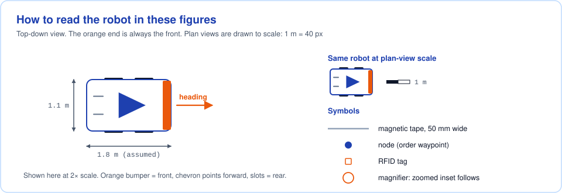

**Figure 0.1. How to read the robot, and the drawing scale.** Every plan view is drawn to the same scale: 1 m = 40 px, with a scale bar in each figure. The AGV is assumed to be 1.8 m × 1.1 m because the source gives no dimensions; change svgkit.AGV_L / AGV_W and rebuild if the real size differs. The orange bumper marks the front, the chevron points forward and the two slots mark the rear. Tape is drawn at its real 50 mm width (never thinner than 2.5 px); nodes and RFID tags are symbols and are drawn larger than real. Millimetre-level details are shown in zoomed insets, marked by an orange magnifier circle with dashed leader lines.

Every requirement carries a status taken from HITO's reply. The letter repeats the colour so the meaning survives greyscale printing:

| Letter | Status | Meaning |
|---|---|---|
| **W** | Works today | HITO says the AGV already behaves this way. |
| **I** | Will implement | HITO agrees to build it. |
| **C** | Conditional / to discuss | Agreed only after testing, discussion, or a counter-proposal. |
| **D** | Closed as duplicate | HITO closed it as a repeat of another item. |
| **P** | Process / outside AGV | Joint approval rule, or behaviour HITO places outside the AGV (MQTT broker). |
| **B** | Needs hardware / clarification | Needs new hardware, or HITO didn't understand it. |
| **R** | Not feasible | HITO says the current vehicle can't achieve it. |

The status is HITO's position. The **Volley 9 Nov** column gives Volley's view where the remarks column has one, and links to the full remark under each table:

| Volley 9 Nov | Meaning |
|---|---|
| Fails Volley test | HITO says it already works; Volley's testing shows it doesn't. |
| Partly works | Some of it works; Volley lists what is still missing. |
| Accepted as is | Behaviour differs from the wording but Volley accepts it. |
| Volley disagrees | Volley rejects HITO's reason for not doing it (usually 'needs hardware'). |
| Volley agrees | Volley accepts HITO's answer. |

## Scale and data structure conventions

All plan views share one scale, 1 m = 40 px, and carry a scale bar. Where a requirement is in millimetres or fractions of a degree, an orange magnifier marks the spot and a zoomed inset shows it at its own stated scale. Numbers labelled *example values* (speeds, braking rate, field sizes, AGV size) are assumptions for illustration; the source document doesn't specify them.

Each section that involves VDA5050 messages ends with a structure figure in UML composition style, showing where each relevant field sits inside its message. The field set follows VDA 5050 version 2.0, abbreviated; check it against the version the two companies agree on.

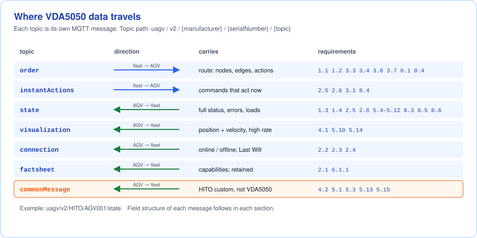

**Figure 0.2. Where VDA5050 data travels.** VDA5050 splits communication into separate MQTT topics. Each row is one topic: blue arrows are messages from the fleet manager to the AGV, green arrows go the other way. The last column lists the requirements that touch each topic. commonMessage (orange) is HITO's own addition and not part of the standard. The topic path follows the pattern interfaceName / majorVersion / manufacturer / serialNumber / topic, for example uagv/v2/HITO/AGV001/state.

## Overview

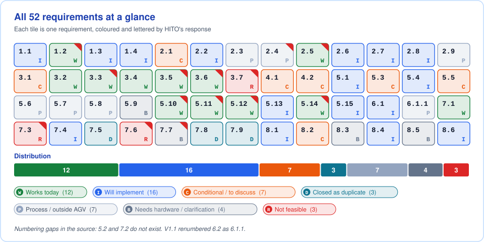

**Figure 0.3. Status of all 52 requirements.** One tile per requirement, coloured and lettered by how HITO answered it in V1.1. Read the bar underneath for the totals: 12 already work, 16 will be built, 7 are conditional (they depend on testing, discussion or a counter-proposal), and 17 are closed without new work for different reasons — 3 as duplicates, 7 as process items, 4 blocked on hardware or clarification, and 3 rejected as not feasible. A red corner marks the 14 tiles where Volley's 9 Nov remarks contest HITO's answer: testing shows the behaviour is missing or partial, or Volley rejects HITO's reason.

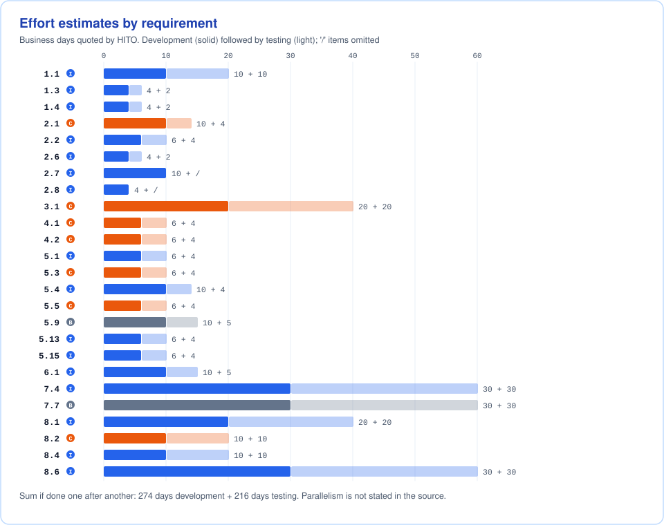

**Figure 0.4. How long HITO says the work takes.** Each bar is one requirement that has an estimate in V1.1. The solid part is development days, the pale part is testing days. Three items dominate at 30 + 30 days: speed-based tracking parameters (7.4), early braking for a short final edge (7.7) and remote joystick recovery (8.6). Adding every bar end to end gives 274 + 216 days, but the source doesn't say how much can run in parallel, so treat that as an upper bound, not a schedule.

## 1. Order execution and rotation at nodes

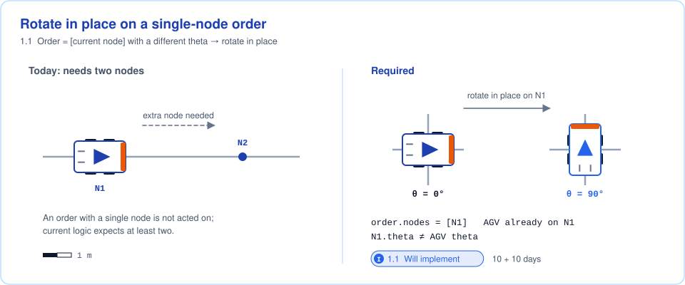

**Figure 1.1. Turning on the spot when the order has only one node.** Volley wants to send an order that contains only the node the AGV is already standing on, with a new heading, so the AGV simply turns in place. On the left is today's behaviour: the firmware ignores a one-node order and needs a second node before it moves. On the right is the requirement: the same AGV on N1 turns from facing right (0°) to facing up (90°) without driving anywhere.

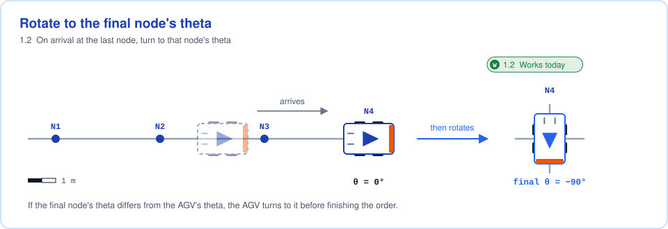

**Figure 1.2. Turning to the final node's heading.** The AGV drives along N1 → N4. When it reaches N4 it is still facing the direction it drove in (0°). If the order says N4's heading is −90° (facing down), the AGV must turn to that heading before the order counts as done. HITO says this already works.

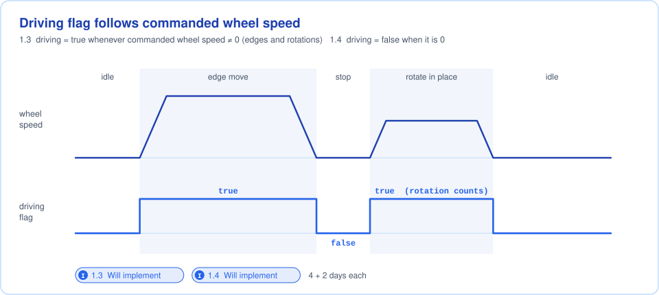

**Figure 1.3. When the 'driving' flag is true.** Time runs left to right. The top trace is the wheel speed the controller commands; the bottom trace is the driving flag the AGV reports. The flag must be true whenever the wheels are commanded to turn — including during an in-place rotation, where the AGV isn't changing position but its wheels are moving (1.3). It must drop to false as soon as the commanded speed is zero (1.4).

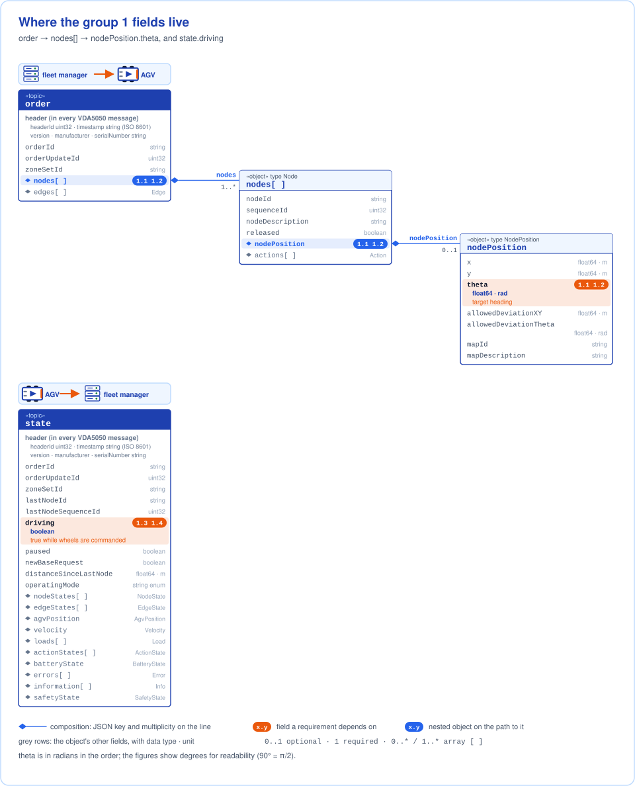

**Figure 1.S. Message structure for group 1.** How to read these structure figures. The badge above each message shows who publishes it and who receives it: here the fleet manager sends order to the AGV, and the AGV sends state back. Each box lists every field of one JSON object with its data type and unit (for example float64 · m). Nested objects are fields too, marked with a small diamond; the ones on the path to a requirement are highlighted in blue, and a line runs from that row to the object's own box. The line is labelled with the JSON key and how many there can be ([ ] means an array). Fields a requirement depends on are highlighted in orange. So 1.1 and 1.2 read order → nodes[ ] → nodePosition → theta (float64, radians), and 1.3 / 1.4 read state → driving (boolean).

| ID | Requirement | HITO response | Status | Effort | Volley 9 Nov |
|---|---|---|---|---|---|
| **1.1** [↗](https://docs.google.com/spreadsheets/d/1--QLW1pHXLbJCk7dSXgfBFyFTqcWJEO8/edit?gid=1204834442#gid=1204834442&range=A2 "Row 2 of the V1.1 sheet") | When the AGV receives an order containing only a single node, and that node is the AGV's current node, if the theta in the order differs from the current theta, the AGV must rotate in place to the commanded theta. | Can be implemented. Current logic requires two nodes. Firmware update after successful testing. | I · Will implement | 10 + 10 | — |
| **1.2** [↗](https://docs.google.com/spreadsheets/d/1--QLW1pHXLbJCk7dSXgfBFyFTqcWJEO8/edit?gid=1204834442#gid=1204834442&range=A3 "Row 3 of the V1.1 sheet") | When the AGV reaches the final node of an order and that node's theta differs from the current theta, the AGV must rotate to the theta specified for the final node. | Already how it works. | W · Works today | / | Fails Volley test |
| **1.3** [↗](https://docs.google.com/spreadsheets/d/1--QLW1pHXLbJCk7dSXgfBFyFTqcWJEO8/edit?gid=1204834442#gid=1204834442&range=A4 "Row 4 of the V1.1 sheet") | During all edge movements and rotational movements, the AGV must report its driving state as true whenever the commanded wheel speed is non-zero. | Can be implemented. | I · Will implement | 4 + 2 | — |
| **1.4** [↗](https://docs.google.com/spreadsheets/d/1--QLW1pHXLbJCk7dSXgfBFyFTqcWJEO8/edit?gid=1204834442#gid=1204834442&range=A5 "Row 5 of the V1.1 sheet") | When the commanded wheel speed is zero, the AGV must report its driving state as false. | Can be implemented. | I · Will implement | 4 + 2 | — |

**Volley remarks, 9 Nov 2026** (verbatim from column G of the sheet)

1.2 — Fails Volley test
:   Not implemented in the current v2.x firmware.

    Test: we sent an order whose final node has a nodePosition.theta different from the heading of the last edge. The AGV accepts the order with no entry in state.errors, drives to the final node and completes the order, but it does not rotate. The agvPosition.theta it reports at the end matches the edge heading, not the commanded theta. Changing the theta value has no effect on the AGV's behavior, which suggests the theta field is ignored. The only rotations we see at nodes come from a change in edge direction. Since single-node orders aren't supported yet either (see 1.1), the fleet currently has no way to command a final heading.

    Please confirm whether nodePosition.theta is used at all.

    PT and team are still actively working on this.

## 2. MQTT connection, factsheet and action reporting

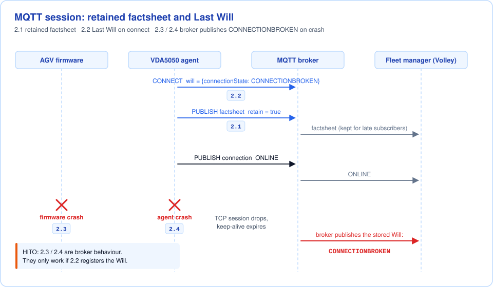

**Figure 2.1. Who tells the fleet manager that an AGV has dropped off.** Read top to bottom as a message sequence between four parties. When the VDA5050 agent connects, it hands the MQTT broker a 'Last Will': a message the broker should publish on its behalf if the connection dies (2.2). It then publishes the factsheet with the retained flag, so the broker keeps a copy for any subscriber that connects later (2.1). If the firmware or the agent crashes, the connection drops and the broker — not the AGV — publishes CONNECTIONBROKEN (2.3, 2.4). That's why HITO says 2.3 and 2.4 aren't its responsibility, and why they only work once 2.2 is done.

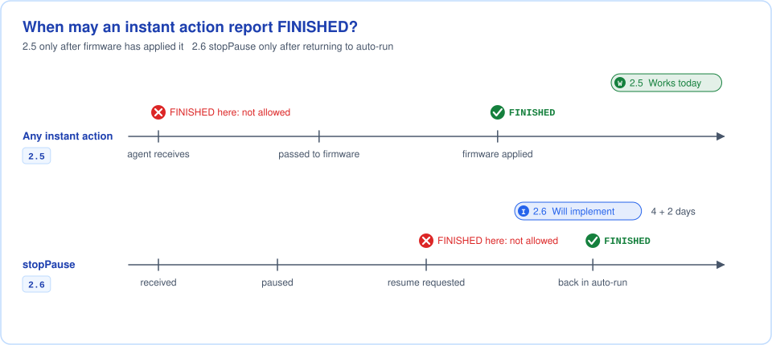

**Figure 2.5. When an instant action may be reported as finished.** Each line is the life of one instant action, left to right. The red cross marks the moment the AGV must not yet say FINISHED; the green tick marks the earliest moment it may. For any instant action (2.5), merely receiving the command isn't enough — the firmware has to have actually applied it. For stopPause (2.6), the AGV may only report FINISHED once it is back in automatic driving mode, not when the resume was merely requested.

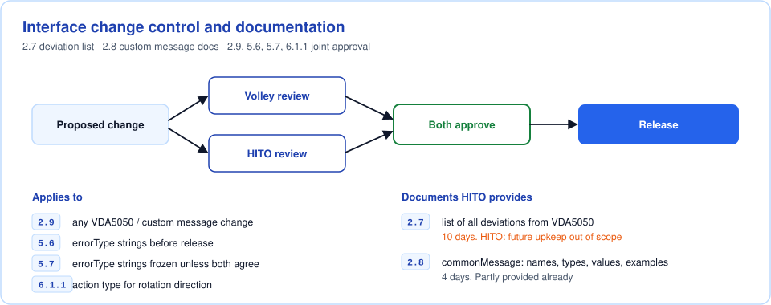

**Figure 2.7. Interface documentation and joint sign-off.** The flow chart shows the approval rule both parties agreed to: any change goes through both Volley and HITO before release. The left list names which requirements this rule covers (interface changes, the error-type strings and the rotation action type). The right list shows the two documents HITO owes: a list of every place it departs from the VDA5050 standard (2.7) and full documentation of its custom messages (2.8). Note HITO's remark that keeping 2.7 up to date in future is outside its scope.

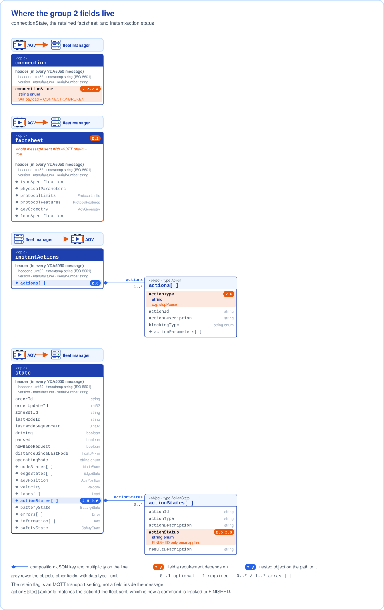

**Figure 2.S. Message structure for group 2.** connection.connectionState carries ONLINE, OFFLINE or CONNECTIONBROKEN; the Last Will registered in 2.2 is a connection message with CONNECTIONBROKEN. 2.1 concerns the whole factsheet message, which is sent with MQTT's retain flag (a transport setting, not a field). For 2.5 and 2.6, a command sent in instantActions.actions[] is tracked through state.actionStates[]: the actionId matches, and actionStatus may only become FINISHED once the firmware has applied the action.

| ID | Requirement | HITO response | Status | Effort | Volley 9 Nov |
|---|---|---|---|---|---|
| **2.1** [↗](https://docs.google.com/spreadsheets/d/1--QLW1pHXLbJCk7dSXgfBFyFTqcWJEO8/edit?gid=1204834442#gid=1204834442&range=A6 "Row 6 of the V1.1 sheet") | The AGV must publish the factsheet message with the MQTT retained flag set to true. | Factsheet already published (sent twice at startup). Volley to list which topics need the retained flag. | C · Conditional / to discuss | 10 + 4 | — |
| **2.2** [↗](https://docs.google.com/spreadsheets/d/1--QLW1pHXLbJCk7dSXgfBFyFTqcWJEO8/edit?gid=1204834442#gid=1204834442&range=A7 "Row 7 of the V1.1 sheet") | The AGV must register an MQTT Last Will message on the connection topic, with connectionState set to CONNECTIONBROKEN. | No issues. Firmware update after successful testing. | I · Will implement | 6 + 4 | — |
| **2.3** [↗](https://docs.google.com/spreadsheets/d/1--QLW1pHXLbJCk7dSXgfBFyFTqcWJEO8/edit?gid=1204834442#gid=1204834442&range=A8 "Row 8 of the V1.1 sheet") | When the AGV's main firmware shuts down or crashes, the AGV must ensure that the MQTT broker publishes CONNECTIONBROKEN. | Built-in MQTT broker mechanism, unrelated to AGV firmware shutting down or crashing. | P · Process / outside AGV | / | Accepted as is |
| **2.4** [↗](https://docs.google.com/spreadsheets/d/1--QLW1pHXLbJCk7dSXgfBFyFTqcWJEO8/edit?gid=1204834442#gid=1204834442&range=A9 "Row 9 of the V1.1 sheet") | When the AGV's VDA5050 agent shuts down or crashes, the AGV must ensure that the MQTT broker publishes CONNECTIONBROKEN. | AGV cannot guarantee this; governed by the broker's built-in mechanism. | P · Process / outside AGV | / | Partly works |
| **2.5** [↗](https://docs.google.com/spreadsheets/d/1--QLW1pHXLbJCk7dSXgfBFyFTqcWJEO8/edit?gid=1204834442#gid=1204834442&range=A10 "Row 10 of the V1.1 sheet") | For an instant action, the AGV may report FINISHED only after the firmware has actually executed and applied the request, not merely because the VDA5050 agent received it. | Already how it works. | W · Works today | / | Fails Volley test |
| **2.6** [↗](https://docs.google.com/spreadsheets/d/1--QLW1pHXLbJCk7dSXgfBFyFTqcWJEO8/edit?gid=1204834442#gid=1204834442&range=A11 "Row 11 of the V1.1 sheet") | For the stopPause instant action, the AGV may report FINISHED only after the firmware has returned to the auto-run state. | No issues. Firmware update after successful testing. | I · Will implement | 4 + 2 | — |
| **2.7** [↗](https://docs.google.com/spreadsheets/d/1--QLW1pHXLbJCk7dSXgfBFyFTqcWJEO8/edit?gid=1204834442#gid=1204834442&range=A12 "Row 12 of the V1.1 sheet") | HITO must provide updated interface documentation listing all deviations from the current VDA5050 specification. | Future maintenance is outside HITO's scope. Documentation can be updated. | I · Will implement | 10 + / | — |
| **2.8** [↗](https://docs.google.com/spreadsheets/d/1--QLW1pHXLbJCk7dSXgfBFyFTqcWJEO8/edit?gid=1204834442#gid=1204834442&range=A13 "Row 13 of the V1.1 sheet") | HITO must fully document all custom messages, including commonMessage: field names, field types, permitted values and example payloads. | Documentation already provided; can be updated later. | I · Will implement | 4 + / | — |
| **2.9** [↗](https://docs.google.com/spreadsheets/d/1--QLW1pHXLbJCk7dSXgfBFyFTqcWJEO8/edit?gid=1204834442#gid=1204834442&range=A14 "Row 14 of the V1.1 sheet") | Any change to the VDA5050 interface or custom messages must be jointly reviewed and approved by Volley and HITO before release. | No issues. | P · Process / outside AGV | / | — |

**Volley remarks, 9 Nov 2026** (verbatim from column G of the sheet)

2.3 — Accepted as is
:   Implemented as OFFLINE.

    Test: systemctl stop rc-local → the agent publishes OFFLINE (retained) after [~5 s]. This is acceptable under VDA5050, since the broker connection is still up.

    Fleet management will treat an unplanned OFFLINE as a fault.

2.4 — Partly works
:   Partially implemented.

    Test: hard power-off → live subscribers get CONNECTIONBROKEN only after [~45 s], and a new subscriber still sees ONLINE as the retained state.

    Required: send the last-will CONNECTIONBROKEN with the retained flag, and set the MQTT keepalive so the broker detects the loss within [5–10 s].

2.5 — Fails Volley test
:   Not implemented.

    Instant actions are reported FINISHED as soon as the AGV receives them, before they have been carried out. RUNNING is never reported.

    Examples:

    - downloadMap reports FINISHED, but the map never appears in state.maps. The firmware log shows "EnableMap failed ... target map does not exist".
    - startPause reports FINISHED and paused: true while the AGV is still decelerating.
    - exceptionClear reports FINISHED while the errors are still in state.errors.

    Required: report RUNNING while the action is in progress, FINISHED only once its effect is visible in state, and FAILED with a resultDescription otherwise.

## 3. Cancellation, release horizon and stopping precision

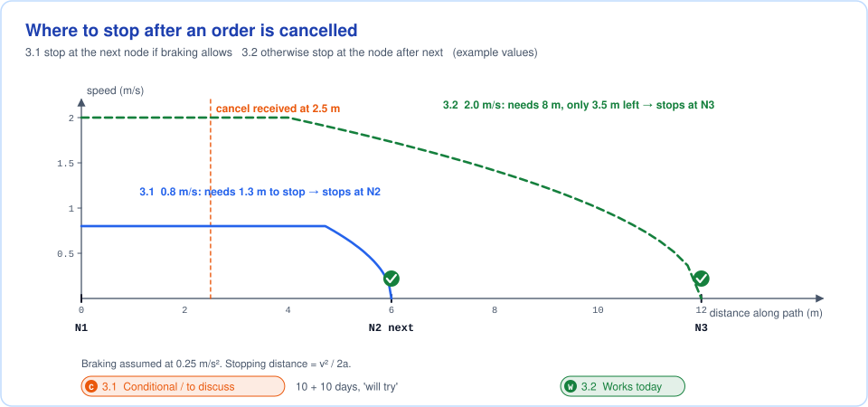

**Figure 3.1. Where the AGV stops after its order is cancelled.** Speed (m/s) against distance (m), using example values: braking at 0.25 m/s², nodes 6 m apart, cancel arriving at 2.5 m. Stopping distance is v² / 2a. The blue AGV at 0.8 m/s needs only 1.3 m, so it keeps going and brakes to stop exactly at the next node N2 (3.1, HITO will try). The green AGV at 2.0 m/s needs 8 m but only 3.5 m remain before N2, so it passes N2 and stops at N3 instead (3.2, already works).

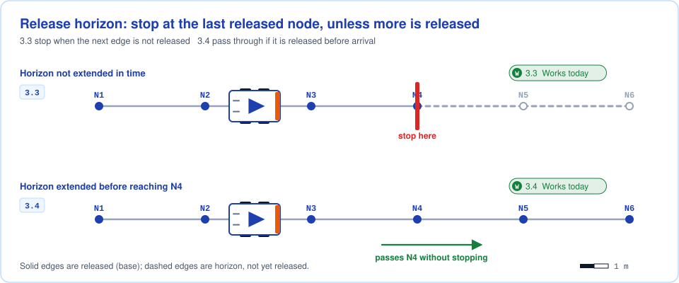

**Figure 3.3. Stopping at the edge of the released path.** Fleet managers release a route in pieces: solid edges are released and the AGV may drive them; dashed edges are planned but not yet released. Top row: nothing beyond N4 has been released by the time the AGV gets there, so it must stop at N4 (3.3). Bottom row: the fleet manager releases the next stretch before the AGV arrives, so it must drive straight through N4 without stopping (3.4). Both already work.

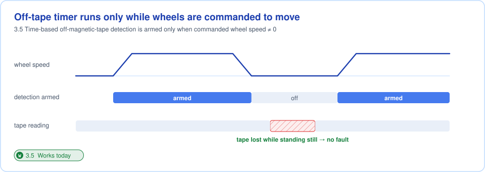

**Figure 3.5. Off-tape detection only while moving.** Time runs left to right. The AGV raises an off-tape fault if it loses the tape for too long, but that timer should only run while the wheels are commanded to move (blue 'armed' blocks). In the middle the AGV is standing still and the sensor briefly loses the tape (red hatched block); because the timer is off, no fault is raised. HITO says this already works.

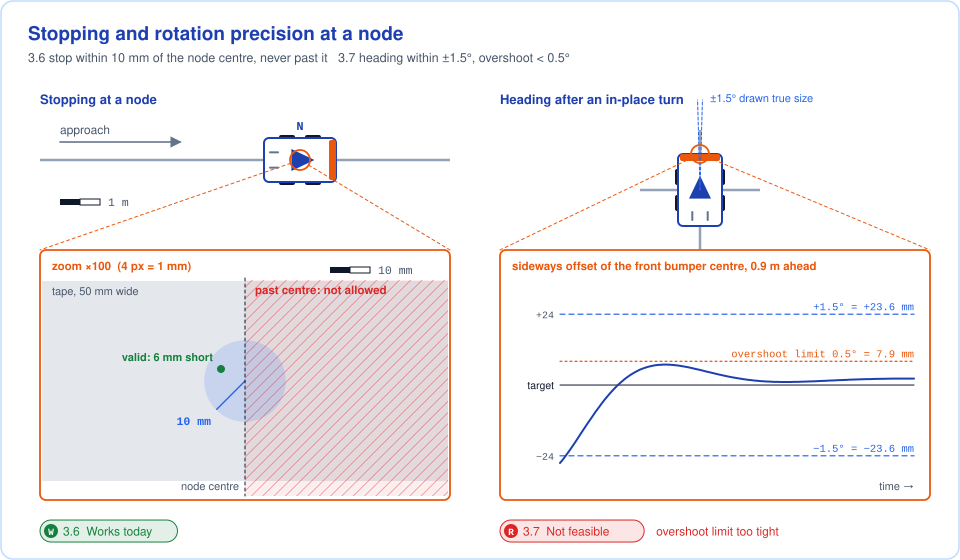

**Figure 3.6. How precisely the AGV must stop and turn.** Top row: the AGV at true scale, where both tolerances are far too small to see. Left inset (100× zoom, 4 px = 1 mm): the tape is 50 mm wide; the AGV's reference point must end inside the 10 mm circle around the node centre and must never cross the centre line (red hatching), so a stop 6 mm short is valid (3.6). Right inset: an angle error is easier to judge as sideways movement of the front bumper, 0.9 m ahead of the turning centre. There ±1.5° becomes ±23.6 mm and 0.5° becomes 7.9 mm. The curve shows the bumper swinging past the target during the turn, peaking under the 7.9 mm overshoot limit and settling inside the ±1.5° band. HITO rejected the 0.5° overshoot limit (3.7).

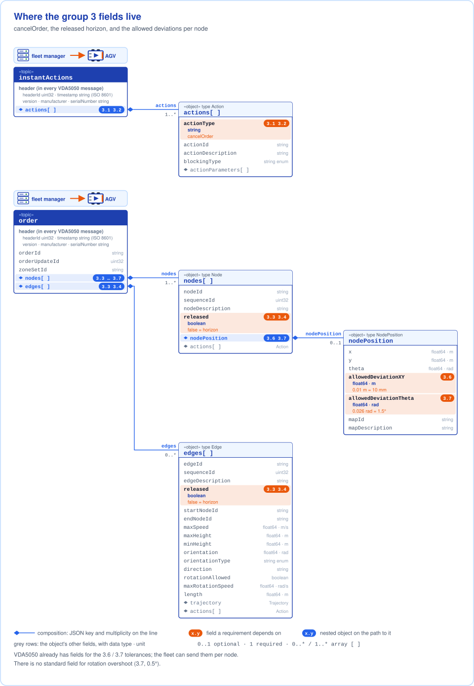

**Figure 3.S. Message structure for group 3.** cancelOrder (3.1, 3.2) is an actionType sent through instantActions. The release horizon (3.3, 3.4) is the released flag on each node and edge of the order. VDA5050 already has per-node tolerance fields: allowedDeviationXY (metres) and allowedDeviationTheta (radians) in nodePosition, so the 10 mm and 1.5° of 3.6 and 3.7 can be sent as 0.01 and about 0.026. There is no standard field for the 0.5° overshoot limit.

| ID | Requirement | HITO response | Status | Effort | Volley 9 Nov |
|---|---|---|---|---|---|
| **3.1** [↗](https://docs.google.com/spreadsheets/d/1--QLW1pHXLbJCk7dSXgfBFyFTqcWJEO8/edit?gid=1204834442#gid=1204834442&range=A15 "Row 15 of the V1.1 sheet") | When an order is canceled, if the AGV can decelerate to zero at the next node (given speed, deceleration, remaining edge distance), it must stop at the next node. | Challenging; will try, and update if testing succeeds. Needs a Volley test vehicle. (V1.1 doubled the estimate from 10 + 10.) | C · Conditional / to discuss | 20 + 20 | — |
| **3.2** [↗](https://docs.google.com/spreadsheets/d/1--QLW1pHXLbJCk7dSXgfBFyFTqcWJEO8/edit?gid=1204834442#gid=1204834442&range=A16 "Row 16 of the V1.1 sheet") | When an order is canceled and the AGV cannot decelerate to zero at the next node, it must stop at the node after the next node. | Already how it works. | W · Works today | / | Volley agrees |
| **3.3** [↗](https://docs.google.com/spreadsheets/d/1--QLW1pHXLbJCk7dSXgfBFyFTqcWJEO8/edit?gid=1204834442#gid=1204834442&range=A17 "Row 17 of the V1.1 sheet") | When the AGV reaches the last released node while the following edge is not yet released, it must stop at that last released node. | Already how it works. | W · Works today | / | Fails Volley test |
| **3.4** [↗](https://docs.google.com/spreadsheets/d/1--QLW1pHXLbJCk7dSXgfBFyFTqcWJEO8/edit?gid=1204834442#gid=1204834442&range=A18 "Row 18 of the V1.1 sheet") | If the following edge and node are released before the AGV reaches the last released node, the AGV must pass through without stopping. | Already how it works. | W · Works today | / | Volley agrees |
| **3.5** [↗](https://docs.google.com/spreadsheets/d/1--QLW1pHXLbJCk7dSXgfBFyFTqcWJEO8/edit?gid=1204834442#gid=1204834442&range=A19 "Row 19 of the V1.1 sheet") | The AGV must perform time-based off-magnetic-tape detection only when the commanded wheel speed is non-zero. | Already how it works. | W · Works today | / | Fails Volley test |
| **3.6** [↗](https://docs.google.com/spreadsheets/d/1--QLW1pHXLbJCk7dSXgfBFyFTqcWJEO8/edit?gid=1204834442#gid=1204834442&range=A20 "Row 20 of the V1.1 sheet") | At any node where a stop is required, the AGV must stop within a 10 mm radius of the node center and must not overshoot the node center. | Standard operating procedure, achieved with the lateral magnetic strip. Abnormal conditions to be discussed separately. | W · Works today | / | Fails Volley test |
| **3.7** [↗](https://docs.google.com/spreadsheets/d/1--QLW1pHXLbJCk7dSXgfBFyFTqcWJEO8/edit?gid=1204834442#gid=1204834442&range=A21 "Row 21 of the V1.1 sheet") | After an in-place rotation at a node, the AGV must stop within ±1.5° of the target angle with rotational overshoot of less than 0.5°. | Overshoot below 0.5° is too demanding for the current configuration; in-place rotation at a node is not meant for positioning and depends on floor and environment. A hardware upgrade or gyroscope could be explored later at extra cost (future custom development). | R · Not feasible | / | Volley disagrees |

**Volley remarks, 9 Nov 2026** (verbatim from column G of the sheet)

3.2 — Volley agrees
:   Agree, was a requirement to ensure behavior for 3.1.

3.3 — Fails Volley test
:   Not implemented.

    When the edge after the last released node is not yet released and continues in the same direction, the AGV does not slow down to stop at the last released node. It approaches at the speed of the next (unreleased) edge and only brakes after passing the node, so it overshoots. When the unreleased edge turns or changes travel mode, the AGV stops correctly at the node.

    Required: when the following edge is not released, decelerate to stop at the last released node within the 3.6 tolerance.

3.4 — Volley agrees
:   Agree, was a requirement to ensure behavior for 3.3.

3.5 — Fails Volley test
:   Not implemented.

    The time-based off-tape check runs regardless of wheel speed. In testing, when the AGV is paused (wheel speed zero) at a position where a magnetic sensor is off the tape, it raises "lost magtape too many." after about 4 seconds. The firmware log shows "Agv may lost mage tape for time!" even though the AGV is stationary.

    Required: only count off-tape time while the commanded wheel speed is non-zero.

3.6 — Fails Volley test
:   Not implemented in all cases.

    The AGV overshoots the stop node in two situations we can reproduce:

    - cancelOrder: when cancelOrder is sent while the AGV is on an edge and the next edge has an orientation change, the AGV does not stop at the next node. It crosses the node and only brakes afterwards.
    - Short final edge: when the AGV passes through a node onto a short final edge, it enters at the speed of that edge and cannot decelerate to zero within the edge length, so it overshoots the final node. The speed planning does not appear to account for the length of the following edge.

    Required: plan deceleration so the AGV can always stop within 10 mm of the stop node, taking into account the remaining edge lengths and any route change from cancelOrder.

3.7 — Volley disagrees
:   We partially agree.

    In-place rotations at nodes end on the magnetic tape, and the AGV already uses the tape sensors to decide where to stop. The tape is an absolute heading reference at the node, so ±1.5° is achievable with the existing sensors; ground surface and wheel slip only affect the coarse part of the rotation. The overshoot comes from the stop logic: the wheels are commanded to stop while still turning at the minimum rotation speed, and any overshoot is not corrected afterwards.

    Reducing it is a software change (slower final approach, deceleration based on the tape offset, and a correction step if the AGV overshoots the tape centre). A gyroscope would only be needed for rotations to headings that have no tape reference.

## 4. Message publishing frequency

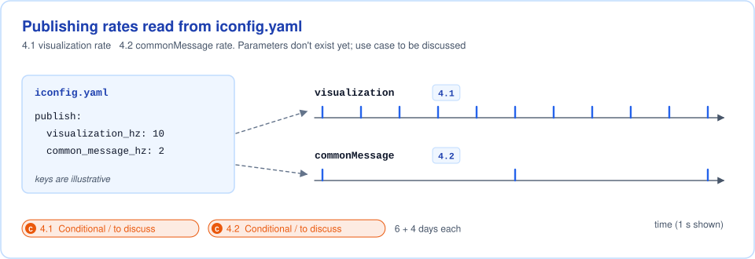

**Figure 4.1. Making message rates configurable.** Each tick mark is one message sent during a one-second window. Volley wants the rates of the visualization message (4.1) and of commonMessage (4.2) read from the AGV's iconfig.yaml file, so they can be tuned without new firmware. Here 10 Hz and 2 Hz are example values. These settings don't exist today; HITO wants to discuss the use case first.

*The message structure for group 4 is shown with group 5, which uses the same messages.*

| ID | Requirement | HITO response | Status | Effort | Volley 9 Nov |
|---|---|---|---|---|---|
| **4.1** [↗](https://docs.google.com/spreadsheets/d/1--QLW1pHXLbJCk7dSXgfBFyFTqcWJEO8/edit?gid=1204834442#gid=1204834442&range=A22 "Row 22 of the V1.1 sheet") | The AGV must publish visualization messages at the frequency set by parameters in iconfig.yaml. | Parameter not currently available. Use case to be discussed. | C · Conditional / to discuss | 6 + 4 | — |
| **4.2** [↗](https://docs.google.com/spreadsheets/d/1--QLW1pHXLbJCk7dSXgfBFyFTqcWJEO8/edit?gid=1204834442#gid=1204834442&range=A23 "Row 23 of the V1.1 sheet") | The AGV must publish commonMessage messages at the frequency set by parameters in iconfig.yaml. | Parameter not currently available. Use case to be discussed. | C · Conditional / to discuss | 6 + 4 | — |

## 5. State, commonMessage and error reporting

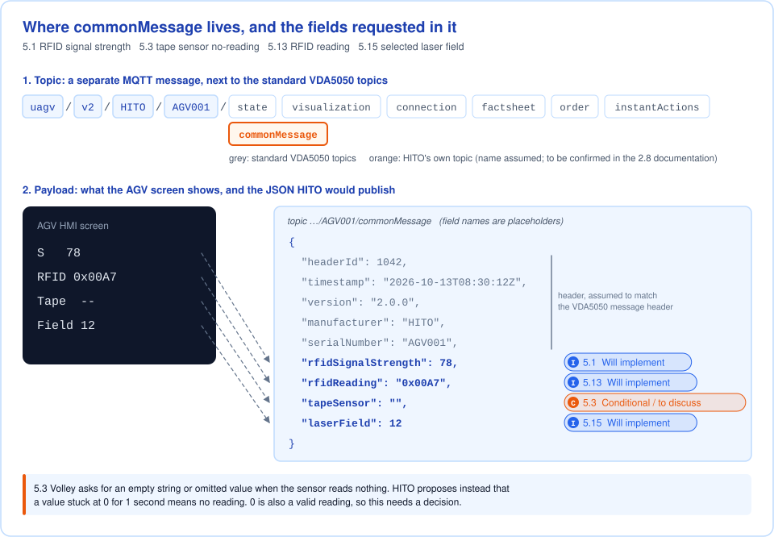

**Figure 5.1. Where commonMessage lives, and the fields requested in it.** Part 1 answers where the message travels. commonMessage is not one of the six standard VDA5050 topics (grey); it is HITO's own extra MQTT topic (orange), published by the AGV under the same topic path as the others: uagv / v2 / manufacturer / serialNumber / commonMessage. The source doesn't give the exact topic name or payload format, so both are assumptions until HITO delivers the documentation promised in 2.8. Part 2 shows the payload. The dark panel is what the AGV's own screen shows today; the light panel is the JSON message, starting with the same header fields every VDA5050 message carries (assumed), followed by the four new fields. The dashed arrows show which on-screen value each field carries: RFID signal strength (5.1), the RFID tag read (5.13), the tape sensor reading (5.3) and the active laser field (5.15). The tape sensor reads nothing here, so the field is an empty string, as Volley asked. The note explains HITO's different proposal. The structure figure at the end of section 5 shows commonMessage next to state and visualization.

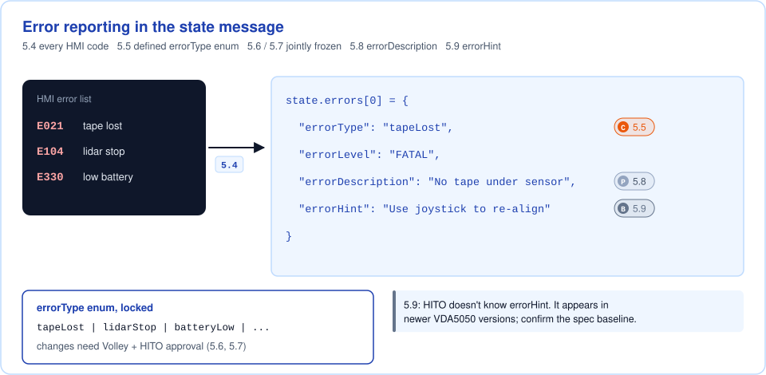

**Figure 5.4. How errors should be reported.** Every error code shown on the AGV's screen (left) must also appear in the state message sent to the fleet manager (5.4). Each error entry should use an agreed name from a fixed list rather than free text (5.5), always include a readable description (5.8), and may include a hint for the operator (5.9). The fixed list of names can only change if both companies agree (5.6, 5.7). HITO said it didn't understand what errorHint means, though V1.1 quotes 10 + 5 days for it.

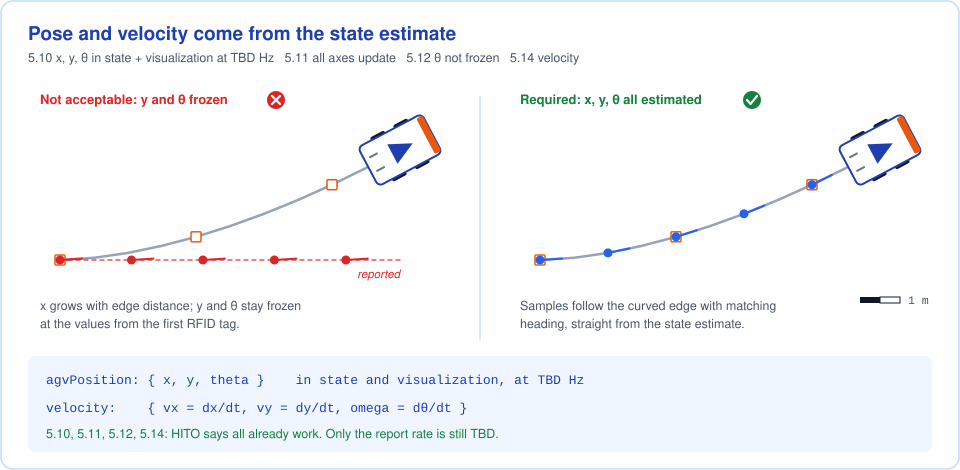

**Figure 5.10. Reporting where the AGV actually is.** Both panels show an AGV following a curved stretch of tape; dots are the positions it reports, and the short line on each dot is the heading it reports. Left, the wrong way: the AGV only adds the distance travelled to x and keeps y and the heading frozen at whatever the first RFID tag said, so its reported track runs in a straight line away from where it really is. Right, the required way: x, y and heading all come from the AGV's position estimate, so the reported dots follow the real path. Velocity is then the rate of change of those values. HITO says all of this already works; only the reporting rate is still to be agreed.

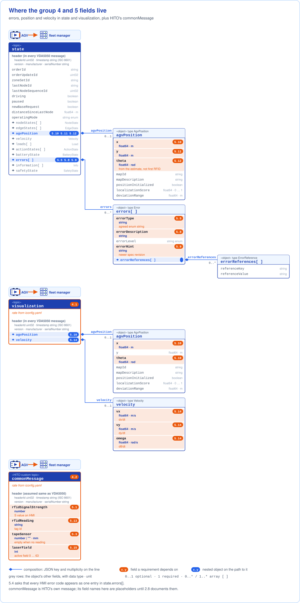

**Figure 5.S. Message structure for groups 4 and 5.** Position appears twice: state.agvPosition and visualization.agvPosition, both holding x, y and theta from the state estimate (5.10–5.12). Velocity for 5.14 sits in visualization.velocity as vx, vy and omega. Each error in 5.4–5.9 is one entry in state.errors[], with errorType, errorDescription and the optional errorHint, which comes from a newer revision of the standard. The visualization rate (4.1) and the whole commonMessage (4.2, 5.1, 5.3, 5.13, 5.15) are on separate topics; commonMessage is HITO's own format, so its field names here are placeholders.

| ID | Requirement | HITO response | Status | Effort | Volley 9 Nov |
|---|---|---|---|---|---|
| **5.1** [↗](https://docs.google.com/spreadsheets/d/1--QLW1pHXLbJCk7dSXgfBFyFTqcWJEO8/edit?gid=1204834442#gid=1204834442&range=A24 "Row 24 of the V1.1 sheet") | The AGV must report RFID signal strength in commonMessage, matching the S value on the AGV's screen. | Not currently available but can be added. | I · Will implement | 6 + 4 | — |
| **5.3** [↗](https://docs.google.com/spreadsheets/d/1--QLW1pHXLbJCk7dSXgfBFyFTqcWJEO8/edit?gid=1204834442#gid=1204834442&range=A25 "Row 25 of the V1.1 sheet") | When the magnetic tape sensor has no reading, the AGV must report it in commonMessage as an empty string or an optional value. | Counter-proposal: a value that stays at 0 for 1 second means the sensor has no reading. | C · Conditional / to discuss | 6 + 4 | — |
| **5.4** [↗](https://docs.google.com/spreadsheets/d/1--QLW1pHXLbJCk7dSXgfBFyFTqcWJEO8/edit?gid=1204834442#gid=1204834442&range=A26 "Row 26 of the V1.1 sheet") | The AGV must report all error codes shown on the HMI screen in the errors field of the state message. | Missing information will be added later. | I · Will implement | 10 + 4 | — |
| **5.5** [↗](https://docs.google.com/spreadsheets/d/1--QLW1pHXLbJCk7dSXgfBFyFTqcWJEO8/edit?gid=1204834442#gid=1204834442&range=A27 "Row 27 of the V1.1 sheet") | The AGV must use defined string enumeration values for errorType rather than undefined raw strings. | Can be added after discussion and agreement. | C · Conditional / to discuss | 6 + 4 | — |
| **5.6** [↗](https://docs.google.com/spreadsheets/d/1--QLW1pHXLbJCk7dSXgfBFyFTqcWJEO8/edit?gid=1204834442#gid=1204834442&range=A28 "Row 28 of the V1.1 sheet") | The errorType string values must be jointly reviewed and approved by Volley and HITO before release. | No issues. | P · Process / outside AGV | / | — |
| **5.7** [↗](https://docs.google.com/spreadsheets/d/1--QLW1pHXLbJCk7dSXgfBFyFTqcWJEO8/edit?gid=1204834442#gid=1204834442&range=A29 "Row 29 of the V1.1 sheet") | The errorType string values must not change unless both Volley and HITO agree. | No issues. | P · Process / outside AGV | / | — |
| **5.8** [↗](https://docs.google.com/spreadsheets/d/1--QLW1pHXLbJCk7dSXgfBFyFTqcWJEO8/edit?gid=1204834442#gid=1204834442&range=A30 "Row 30 of the V1.1 sheet") | The AGV must populate errorDescription for every reported error. | No issues; can be added later. V1.1 files it under the joint working mechanism (blue). (No estimate given.) | P · Process / outside AGV | / | — |
| **5.9** [↗](https://docs.google.com/spreadsheets/d/1--QLW1pHXLbJCk7dSXgfBFyFTqcWJEO8/edit?gid=1204834442#gid=1204834442&range=A31 "Row 31 of the V1.1 sheet") | The AGV may populate errorHint for any reported error. | HITO does not understand what this means, yet V1.1 quotes 10 + 5 days. | B · Needs hardware / clarification | 10 + 5 | — |
| **5.10** [↗](https://docs.google.com/spreadsheets/d/1--QLW1pHXLbJCk7dSXgfBFyFTqcWJEO8/edit?gid=1204834442#gid=1204834442&range=A32 "Row 32 of the V1.1 sheet") | The AGV must report state-estimated x, y and theta in agvPosition in both state and visualization messages, at a TBD Hz frequency to be agreed. | Already how it works. (Frequency still TBD.) | W · Works today | / | Partly works |
| **5.11** [↗](https://docs.google.com/spreadsheets/d/1--QLW1pHXLbJCk7dSXgfBFyFTqcWJEO8/edit?gid=1204834442#gid=1204834442&range=A33 "Row 33 of the V1.1 sheet") | The AGV must continuously update x, y and theta from its state estimate, not update one axis by edge distance while keeping the other unchanged. | Already how it works. | W · Works today | / | Fails Volley test |
| **5.12** [↗](https://docs.google.com/spreadsheets/d/1--QLW1pHXLbJCk7dSXgfBFyFTqcWJEO8/edit?gid=1204834442#gid=1204834442&range=A34 "Row 34 of the V1.1 sheet") | The AGV must report theta from its state estimate, not a fixed value derived from the first RFID reading. | Already how it works. | W · Works today | / | Fails Volley test |
| **5.13** [↗](https://docs.google.com/spreadsheets/d/1--QLW1pHXLbJCk7dSXgfBFyFTqcWJEO8/edit?gid=1204834442#gid=1204834442&range=A35 "Row 35 of the V1.1 sheet") | The AGV must report the actual RFID reader reading in commonMessage, matching the RFID value on the AGV's screen. | No issues; can be added later. | I · Will implement | 6 + 4 | — |
| **5.14** [↗](https://docs.google.com/spreadsheets/d/1--QLW1pHXLbJCk7dSXgfBFyFTqcWJEO8/edit?gid=1204834442#gid=1204834442&range=A36 "Row 36 of the V1.1 sheet") | The AGV must report velocity in visualization: the derivatives of x, y and theta. | Already available. | W · Works today | / | Partly works |
| **5.15** [↗](https://docs.google.com/spreadsheets/d/1--QLW1pHXLbJCk7dSXgfBFyFTqcWJEO8/edit?gid=1204834442#gid=1204834442&range=A37 "Row 37 of the V1.1 sheet") | The AGV must report the currently selected laser protective field in commonMessage. | No issues; can be added later. | I · Will implement | 6 + 4 | — |

**Volley remarks, 9 Nov 2026** (verbatim from column G of the sheet)

5.10 — Partly works
:   Partially implemented.

    x, y and theta are reported in both state and visualization, but visualization is published at only about 1 Hz and state about every 2 s (plus event-driven updates).

    The values reported are not a state estimate (see 5.11 and 5.12).

    Required: publish at the agreed rate (we propose at least 5 Hz for visualization).

5.11 — Fails Volley test
:   Not implemented.

    The reported position follows the ideal edge line based only on distance travelled. On a straight edge aligned with a map axis, only one coordinate changes and the other stays exactly at the map value, even when the magnetic sensors show the AGV off-centre on the tape. At the start of each edge the position jumps to the start node's map coordinates.

    Required: report x and y from the AGV's state estimate, including the lateral deviation measured by the magnetic sensors.

5.12 — Fails Volley test
:   Not implemented.

    On every edge, the reported theta is fixed at the edge's map heading for the whole edge and does not reflect the AGV's actual heading relative to the tape. Theta only changes during in-place rotations. After relocation it is taken from the RFID tag reading and held until the AGV moves.

    Required: report theta from the AGV's state estimate (e.g. using the heading error measured by the front and rear magnetic sensors).

5.14 — Partly works
:   Partially implemented.

    The visualization velocity only ever contains vx, and only while the AGV is driving along an edge. vy and omega are never reported: during in-place rotation and sideways travel the message shows "velocity": {} or only vx. When stationary the velocity is also reported as {} instead of zeros. vx appears to be the commanded speed rather than a measured value.

    Required: report vx, vy and omega in the vehicle frame from the state estimate (derivatives of x, y and theta), including rotation and sideways travel, and send explicit zeros when stationary.

## 6. Rotation direction set by actions

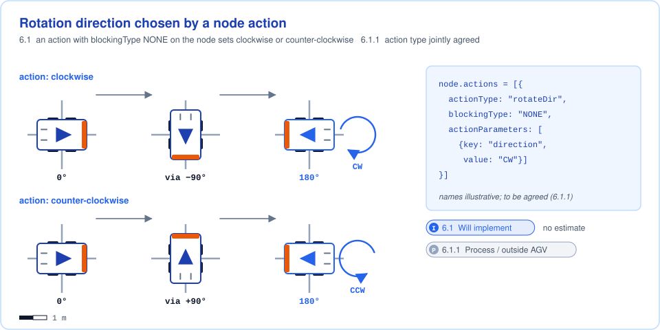

**Figure 6.1. Choosing which way the AGV turns.** Both rows show the AGV turning from 0° to 180° on the same spot, but in opposite directions. Turning clockwise it passes through facing down; turning counter-clockwise it passes through facing up. Volley wants to pick the direction by attaching an action to the node (example on the right) — useful when one side of the AGV would hit something during the turn. 'blockingType NONE' means the action doesn't pause anything else. The action's name and fields still have to be agreed (6.1.1).

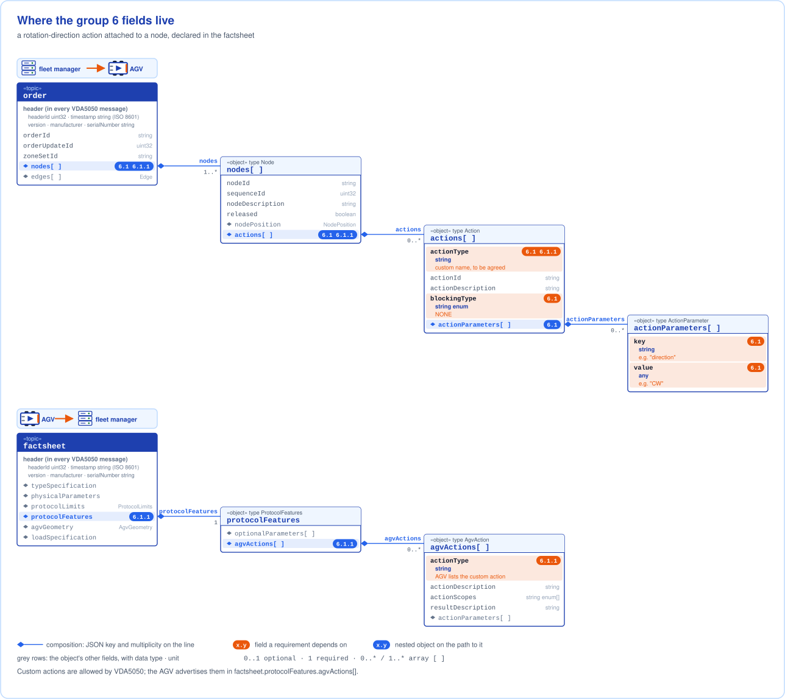

**Figure 6.S. Message structure for group 6.** The rotation-direction request of 6.1 is an action inside the node: order.nodes[i].actions[j], with blockingType NONE and the direction passed as a key/value pair in actionParameters[]. The action's name is custom, so 6.1.1 asks both sides to agree it. VDA5050 expects the AGV to advertise every custom action it supports in factsheet.protocolFeatures.agvActions[].

| ID | Requirement | HITO response | Status | Effort | Volley 9 Nov |
|---|---|---|---|---|---|
| **6.1** [↗](https://docs.google.com/spreadsheets/d/1--QLW1pHXLbJCk7dSXgfBFyFTqcWJEO8/edit?gid=1204834442#gid=1204834442&range=A38 "Row 38 of the V1.1 sheet") | The AGV must rotate to a node's theta in the direction given by an action attached to that node with blockingType NONE. | Can be added; detailed requirements to be discussed with Volley first. Firmware update after successful testing. | I · Will implement | 10 + 5 | — |
| **6.1.1** [↗](https://docs.google.com/spreadsheets/d/1--QLW1pHXLbJCk7dSXgfBFyFTqcWJEO8/edit?gid=1204834442#gid=1204834442&range=A39 "Row 39 of the V1.1 sheet") | The action type used to specify rotation direction must be jointly reviewed and approved by Volley and HITO. | No issues. | P · Process / outside AGV | / | — |

## 7. Magnetic tape tracking and deceleration

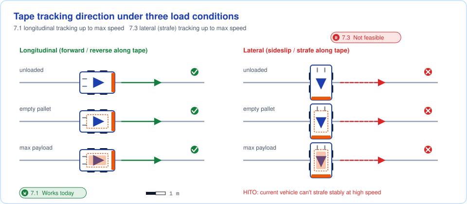

**Figure 7.1. Following the tape forwards versus sideways.** Each row is one load condition: no load, an empty pallet (dashed box), and the heaviest allowed load (filled box). Left column: the AGV drives forwards along the tape, which must stay stable up to full speed in every case — HITO says it already does (7.1). Right column: the AGV is turned crossways and slides sideways along the tape (strafing). HITO says this vehicle can't do that stably at high speed (7.3).

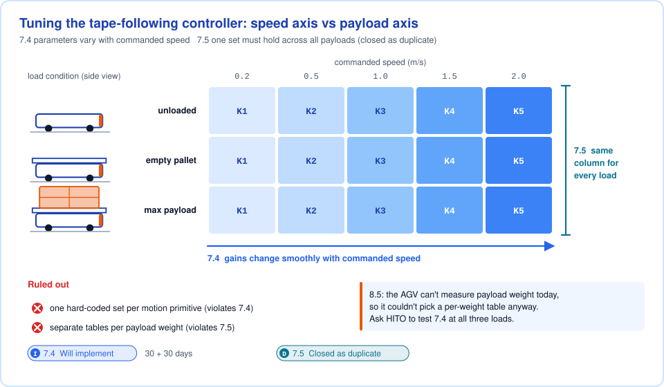

**Figure 7.4. Tuning the tape-following controller.** Each row is one load condition, drawn on the left as a side view of the AGV: empty, carrying an empty pallet, and carrying a full load. The grid shows which controller settings (K1 to K5) the AGV uses at each combination of commanded speed (columns) and load (rows). Moving left to right, the settings change with speed, which is 7.4. Moving top to bottom they stay the same whatever the load, which is 7.5. The two requirements constrain different directions of the grid, so meeting one doesn't guarantee the other, even though HITO closed 7.5 as a duplicate. The note explains why one set for all loads is the only practical option: the AGV can't weigh its load (8.5).

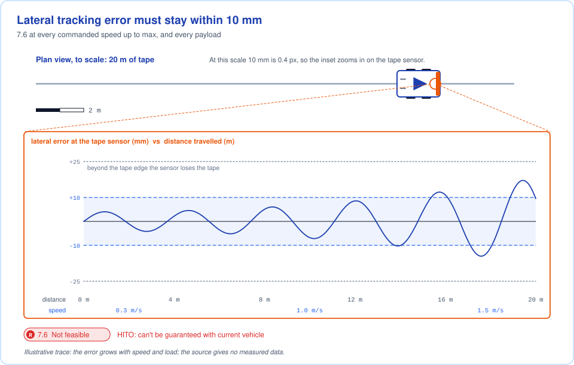

**Figure 7.6. How far the AGV may drift from the tape.** Top: 20 m of tape and the AGV at true scale. A 10 mm error would be 0.4 px here, which is why the requirement can't be seen at this scale. The inset zooms in on the tape sensor at the front of the AGV (4 px = 1 mm) and plots its sideways error along the whole 20 m run. The blue band is the ±10 mm limit; the grey dotted lines are the tape edges at ±25 mm, beyond which the sensor would lose the tape altogether. In this illustrative trace the error grows as speed rises from 0.3 to 1.5 m/s and breaks the limit near the end. HITO says it can't guarantee ±10 mm at every speed and load.

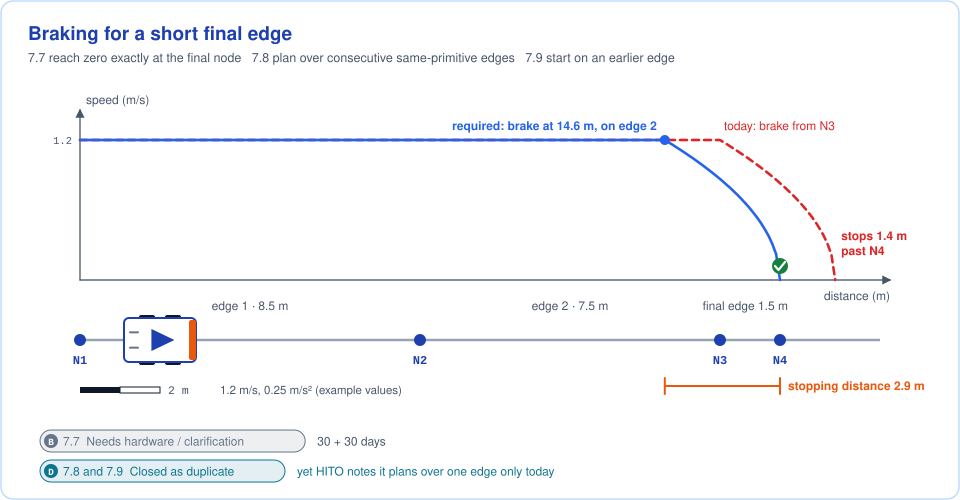

**Figure 7.7. Braking early enough for a short last edge.** Drawn to scale with example values: speed 1.2 m/s, braking 0.25 m/s², which gives a 2.9 m stopping distance (orange bracket). The final edge N3 → N4 is only 1.5 m. The chart above plots speed against the same distance axis. Red dashed: today the AGV brakes only once it reaches the final edge, so it stops 1.4 m past N4. Blue: the requirement is to start braking at 14.6 m, back on edge 2, so speed reaches zero exactly at N4 (7.7). That needs the stopping point worked out across several edges, not just the last one (7.8, 7.9).

*Group 7 is internal control behaviour and adds no VDA5050 fields, so it has no structure figure.*

| ID | Requirement | HITO response | Status | Effort | Volley 9 Nov |
|---|---|---|---|---|---|
| **7.1** [↗](https://docs.google.com/spreadsheets/d/1--QLW1pHXLbJCk7dSXgfBFyFTqcWJEO8/edit?gid=1204834442#gid=1204834442&range=A40 "Row 40 of the V1.1 sheet") | Unloaded, with empty pallet and at max payload, the AGV must stably track the tape at all longitudinal speeds up to its maximum. | Expected behavior under normal conditions. | W · Works today | / | Volley agrees |
| **7.3** [↗](https://docs.google.com/spreadsheets/d/1--QLW1pHXLbJCk7dSXgfBFyFTqcWJEO8/edit?gid=1204834442#gid=1204834442&range=A41 "Row 41 of the V1.1 sheet") | Unloaded, with empty pallet and at max payload, the AGV must stably track the tape at all lateral (sideslip / strafe) speeds up to its maximum. | Cannot be implemented: current vehicle model can't do stable high-speed lateral movement. | R · Not feasible | / | Volley disagrees |
| **7.4** [↗](https://docs.google.com/spreadsheets/d/1--QLW1pHXLbJCk7dSXgfBFyFTqcWJEO8/edit?gid=1204834442#gid=1204834442&range=A42 "Row 42 of the V1.1 sheet") | The AGV must schedule tape tracking control parameters dynamically from the commanded speed, not hard-code them per motion primitive. | Feasible. Update after successful testing. | I · Will implement | 30 + 30 | — |
| **7.5** [↗](https://docs.google.com/spreadsheets/d/1--QLW1pHXLbJCk7dSXgfBFyFTqcWJEO8/edit?gid=1204834442#gid=1204834442&range=A43 "Row 43 of the V1.1 sheet") | The AGV must schedule tape tracking parameters so a single set covers all payload conditions, not hard-coded per payload weight. | Duplicates a requirement above. | D · Closed as duplicate | / | — |
| **7.6** [↗](https://docs.google.com/spreadsheets/d/1--QLW1pHXLbJCk7dSXgfBFyFTqcWJEO8/edit?gid=1204834442#gid=1204834442&range=A44 "Row 44 of the V1.1 sheet") | Across all commanded speeds and all payloads, the AGV must keep lateral tape tracking error within 10 mm. | Cannot be guaranteed with the current vehicle model. | R · Not feasible | / | Volley disagrees |
| **7.7** [↗](https://docs.google.com/spreadsheets/d/1--QLW1pHXLbJCk7dSXgfBFyFTqcWJEO8/edit?gid=1204834442#gid=1204834442&range=A45 "Row 45 of the V1.1 sheet") | Regardless of the final edge's length, the AGV must start decelerating early enough to reach zero at the final node without overshooting. | Difficult. Will attempt later; update if testing succeeds. V1.1 also marks it as needing hardware customization (red), while keeping the 30 + 30 estimate. | B · Needs hardware / clarification | 30 + 30 | Volley disagrees |
| **7.8** [↗](https://docs.google.com/spreadsheets/d/1--QLW1pHXLbJCk7dSXgfBFyFTqcWJEO8/edit?gid=1204834442#gid=1204834442&range=A46 "Row 46 of the V1.1 sheet") | The AGV must compute the deceleration start point from the total remaining distance across consecutive edges with the same motion primitive, not only the final edge. | Duplicate. Currently calculations only work along one edge. | D · Closed as duplicate | / | — |
| **7.9** [↗](https://docs.google.com/spreadsheets/d/1--QLW1pHXLbJCk7dSXgfBFyFTqcWJEO8/edit?gid=1204834442#gid=1204834442&range=A47 "Row 47 of the V1.1 sheet") | If the final edge is shorter than the stopping distance, the AGV must begin decelerating on an earlier edge. | Duplicates a requirement above. | D · Closed as duplicate | / | — |

**Volley remarks, 9 Nov 2026** (verbatim from column G of the sheet)

7.1 — Volley agrees
:   Agree, just want to maintain it as a requirement

7.3 — Volley disagrees
:   Disagree; having a different PID control loop will allow tuning of the sideslip movements

7.6 — Volley disagrees
:   Disagree, see comment to 7.3. AGV is capable of following this accuracy in longitudinal direction

7.7 — Volley disagrees
:   We disagree that this requires a hardware change.

    The AGV already decelerates at its configured rate; the problem is that braking starts too late. The braking point is currently calculated per edge (as stated in the response to 7.8), so when the final edge is shorter than the stopping distance at the current speed, the AGV enters it too fast and overshoots (see 3.6). This is a software change to the speed planning: look ahead across the remaining edges and start decelerating on an earlier edge when needed, so that speed reaches zero at the final node.

    No change to the drive hardware or the braking capability is required.

## 8. Lidar fields, payload, coupling and remote control

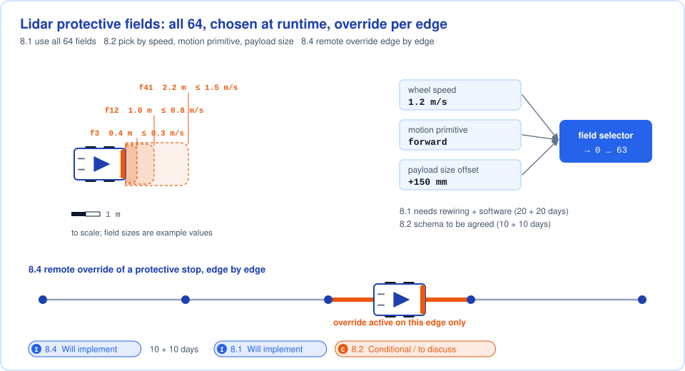

**Figure 8.1. Choosing and overriding the lidar safety zone.** Top left, to scale: the orange outlines are three of the scanner's protective fields, reaching 0.4 m, 1.0 m and 2.2 m ahead of the bumper (example values); faster driving needs a longer field. If anything enters the active field, the AGV stops. Volley wants all 64 fields usable (8.1) and chosen automatically from speed, type of motion and load overhang (8.2), shown by the selector on the right. Bottom: an operator may remotely override a protective stop, and the override is limited to one edge (orange) before it switches off again (8.4).

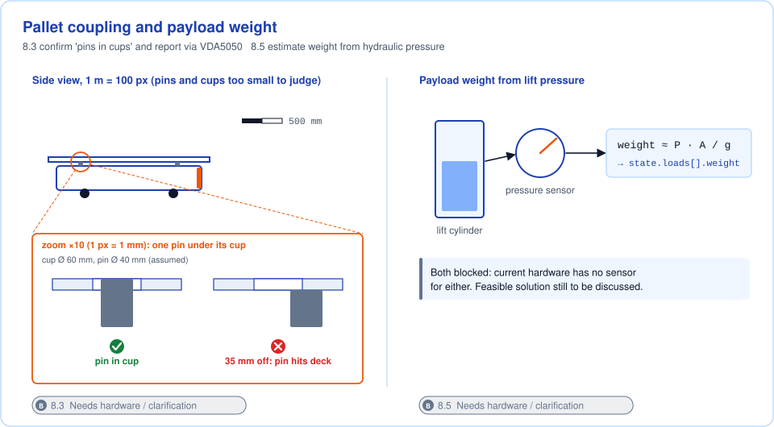

**Figure 8.3. Confirming the pallet is seated and knowing its weight.** Top left: side view at 1 m = 100 px. At this scale the pins and cups are only a few pixels, so the inset zooms ten times (1 px = 1 mm) on one of them, assuming a 60 mm cup and a 40 mm pin. When the AGV is centred, the pin enters the cup. When it is 35 mm off, the pin lands on the pallet deck beside the cup. Volley wants the AGV to tell these apart and report it (8.3). Right: Volley wants the load's weight estimated from lift-cylinder pressure (8.5). HITO says the current hardware has no sensor for either.

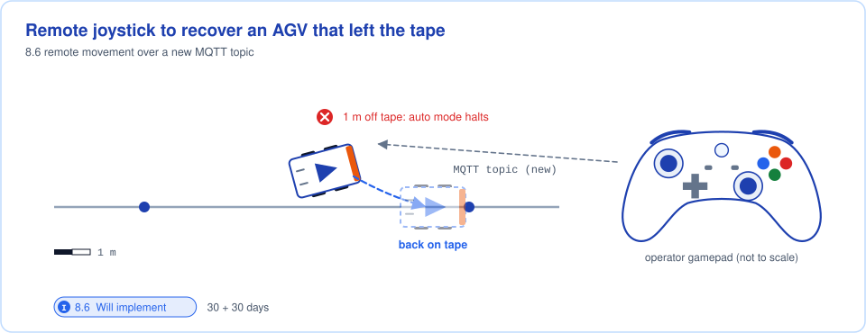

**Figure 8.6. Driving the AGV back onto the tape by remote control.** To scale: the AGV has drifted about 1 m off the tape, so automatic mode stops. An operator drives it back with a handheld gamepad whose commands travel to the AGV over a new MQTT topic (blue dashed path). The gamepad is not drawn to scale. HITO agreed, at 30 + 30 days. While driven this way, the AGV would normally report operatingMode MANUAL in its state message.

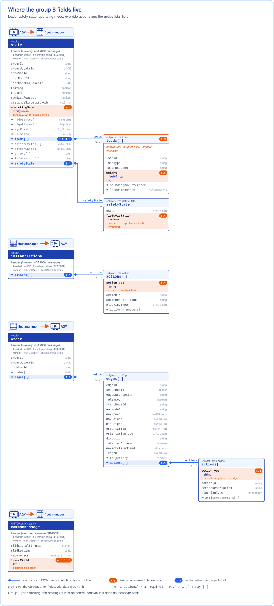

**Figure 8.S. Message structure for group 8.** Payload weight (8.5) has a standard home in state.loads[].weight. Pallet coupling (8.3) has no standard field, so it would need an agreed extension. A protective-field breach shows as state.safetyState.fieldViolation; the override for 8.4 would be a custom action, sent either as an instant action or attached to one edge (order.edges[].actions[]) so it expires with that edge. Joystick driving (8.6) would show as operatingMode MANUAL. The active lidar field (5.15, 8.2) goes in HITO's commonMessage. Group 7 has no structure figure because it adds no message fields.

| ID | Requirement | HITO response | Status | Effort | Volley 9 Nov |
|---|---|---|---|---|---|
| **8.1** [↗](https://docs.google.com/spreadsheets/d/1--QLW1pHXLbJCk7dSXgfBFyFTqcWJEO8/edit?gid=1204834442#gid=1204834442&range=A48 "Row 48 of the V1.1 sheet") | The AGV must use all 64 available laser protective (lidar) fields. | Can be implemented by changing the electrical wiring and adding software. | I · Will implement | 20 + 20 | — |
| **8.2** [↗](https://docs.google.com/spreadsheets/d/1--QLW1pHXLbJCk7dSXgfBFyFTqcWJEO8/edit?gid=1204834442#gid=1204834442&range=A49 "Row 49 of the V1.1 sheet") | The AGV must select the lidar field from wheel speed, motion primitive and a runtime-configurable payload size offset. Schema to be agreed. | Good idea; can be added after discussion. | C · Conditional / to discuss | 10 + 10 | — |
| **8.3** [↗](https://docs.google.com/spreadsheets/d/1--QLW1pHXLbJCk7dSXgfBFyFTqcWJEO8/edit?gid=1204834442#gid=1204834442&range=A50 "Row 50 of the V1.1 sheet") | The AGV must actively confirm whether a pallet is correctly coupled ('pins in cups') and report it via VDA5050. | Current hardware doesn't support it; feasible solution to be discussed. | B · Needs hardware / clarification | / | Volley agrees |
| **8.4** [↗](https://docs.google.com/spreadsheets/d/1--QLW1pHXLbJCk7dSXgfBFyFTqcWJEO8/edit?gid=1204834442#gid=1204834442&range=A51 "Row 51 of the V1.1 sheet") | The AGV must support remote override of a laser protective stop during operation, applied edge by edge. | Can be implemented as part of the instant action function. | I · Will implement | 10 + 10 | — |
| **8.5** [↗](https://docs.google.com/spreadsheets/d/1--QLW1pHXLbJCk7dSXgfBFyFTqcWJEO8/edit?gid=1204834442#gid=1204834442&range=A52 "Row 52 of the V1.1 sheet") | The AGV must estimate payload weight from hydraulic pressure and publish it as payload data in state. | Current hardware doesn't support it; feasible solution to be discussed. | B · Needs hardware / clarification | / | Volley agrees |
| **8.6** [↗](https://docs.google.com/spreadsheets/d/1--QLW1pHXLbJCk7dSXgfBFyFTqcWJEO8/edit?gid=1204834442#gid=1204834442&range=A53 "Row 53 of the V1.1 sheet") | The AGV may support remote joystick / remote movement for recovery, e.g. when off the magnetic tape. | Can be implemented with a new topic interface. Update after successful testing. | I · Will implement | 30 + 30 | — |

**Volley remarks, 9 Nov 2026** (verbatim from column G of the sheet)

8.3 — Volley agrees
:   Agree, ideally for V3 or V2.x hardware to be deployed

8.5 — Volley agrees
:   Agree, ideally for V3 or V2.x hardware to be deployed

## Points to raise with HITO

**"Already implemented" answers that fail testing.** HITO marks 1.2, 2.5, 3.3, 3.5, 3.6, 5.11, 5.12, 2.4, 5.10, 5.14 as done, so they have no estimate in V1.1. Volley's 9 Nov remarks describe tests that show otherwise. Ask HITO to reproduce each test and give an estimate, starting with 1.2 (is nodePosition.theta read at all?) and 2.5 (FINISHED reported on receipt; RUNNING never reported).

**7.7 is a software change.** V1.1 tags 7.7 as needing hardware, while keeping its 30 + 30 estimate. The AGV already brakes at its configured rate; the problem is that braking is planned one edge at a time, which is exactly the gap 7.8 and 7.9 describe, and HITO closed those as duplicates of 7.7. Get it in writing that 7.7 includes planning across several edges, and that it also fixes the short-final-edge overshoot reported under 3.6.

**7.5 is not a duplicate of 7.4.** 7.4 asks for parameters that vary with commanded speed; 7.5 asks for one parameter set that holds across every payload. A speed-scheduled table kept separately per payload would meet 7.4 and fail 7.5. Because the AGV can't measure payload weight (8.5), a single robust set is the only workable design anyway. Ask HITO to confirm that the 7.4 work uses one set for all loads and that its 30 + 30 days include tests at unloaded, empty-pallet and max-payload conditions.

**Hardware answers need numbers.** For 3.7, 7.3 and 7.6, Volley's remarks argue the limits are in the control software (stop logic, PID tuning), not the vehicle. Either way, ask what HITO *can* guarantee today: rotation tolerance, lateral tracking error, and the top speed for stable strafing.

**5.3 counter-proposal changes the contract.** "0 for one second" is ambiguous because 0 can be a real reading. Decide between an empty / omitted value and HITO's rule.

**5.8 is firmware work, not a process item.** V1.1 moves it to the joint working mechanism (blue), but filling errorDescription on every error is a firmware change and needs an estimate.

**2.3 / 2.4 depend on 2.2.** The broker publishes CONNECTIONBROKEN only if the Will is registered. Volley's test found it arrives about 45 s after a power-off and isn't retained; ask for a retained Will and a keepalive short enough to detect the loss in 5–10 s. Test the three together.

**Open items without owner or date:** reporting frequency in 5.10 (TBD Hz; Volley proposes at least 5 Hz for visualization), retained-topic list for 2.1, lidar schema for 8.2, rotation-direction spec for 6.1, hardware options for 8.3 and 8.5, the meaning of errorHint in 5.9 (check which VDA5050 version is the baseline), and an estimate for 5.8. 2.7's "future maintenance out of scope" should be settled contractually.

**Source housekeeping:** IDs 5.2 and 7.2 are missing; V1.1 renumbered 6.2 as 6.1.1; 3.2's Chinese text still has a typo (先在 → 现在); the test-days cell is blank instead of `/` for 5.7 and 7.9.

## Hardware and grid reference

Several requirements depend on the vehicle's sensors and on how the floor grid is laid out (RFID tags, magnetic tape). HITO has sent no grid installation spec for the V2, so the numbers below come from Volley's own testing, vendor documents and Slack. Each links to its source; check the date before relying on one.

### HITO AGV hardware

| Topic | What the sources say | Source | Hardware | Related |
|---|---|---|---|---|
| RFID reader | Hinson CNS RFID 1S, one unit, on the side of the AGV; it reads tags only in certain orientations. Maker's spec: 13.56 MHz, read range up to 140 mm (depends on the card), IP54, 12–36 VDC, reports signal strength (an Rssi LED), relative speed under 3.5 m/s. | [Volley component list-20250506.xlsx, row RFID Reader](https://drive.google.com/file/d/17tWNeVoV8WKC5vVFpZUuN-Gaz-BkrIDv/view) (May 2026) [Grid Tape Layout '24, Assembly Steps, step 3](https://docs.google.com/document/d/1sW4LwkGhCzGyy3z-IjhpkehFwO-chK1KRxYLTGzAB3o/edit#heading=h.hnsy58gurdmq) (3 Jul 2025) [Hinson CNS-RFID sensor manual, §2.3, p. 7](https://a.storyblok.com/f/298593/x/9486728474/cns-rfid-sensor-manual-0922.pdf#page=7) (Sep 2022) [Hinson CNS-RFID sensor manual, §3.3–3.4, p. 12](https://a.storyblok.com/f/298593/x/9486728474/cns-rfid-sensor-manual-0922.pdf#page=12) (Sep 2022) | [Hinson CNS-RFID sensor manual (maker PDF)](https://a.storyblok.com/f/298593/x/9486728474/cns-rfid-sensor-manual-0922.pdf) [Hinson CNS-RFID communication manual (maker PDF)](https://a.storyblok.com/f/298593/x/ff2f0e6637/cns-rfid-sensor-communication-manual-0922.pdf) | 5.1, 5.13 |
| RFID tags | HITO quotes WYN tags: HF 13.56 MHz, ISO 15693, Ø35 × 3.2 mm, IP67, $0.56 each (高频，工业载码体ISO15693，AGV站点定位地标卡13.56MHz). | [HITO quotation: tape and RFID tags (导航辅料), p. 1, item 1.3](https://drive.google.com/file/d/1b_hzDnk_DcTUAfTXxPf3yPheSEBDHIXn/view#page=1) (12 Feb 2026) | — | 5.13 |
| Reader output | Volley's agvctl view shows the reader on /dev/ttyS3 at about 50 reads/s with a signal value ("Signal 7/7"). The node-accuracy runs record S values of 1, 2 and 7; the scale's meaning is undocumented. | [Slack, Brandon Peterson](https://volleyautomation.slack.com/archives/C0AJ0PBMNSJ/p1780090726961909) (29 May 2026) [AGV performance evaluation (sheet), Node Accuracy tab, column L](https://docs.google.com/spreadsheets/d/12mzsrw7jmrrpu8DHFdZU1AIJoWyJlYvC8ZsA5Fu72UM/edit#gid=0&range=L2:L57) (31 Aug 2026) | [Hinson CNS-RFID communication manual (maker PDF)](https://a.storyblok.com/f/298593/x/ff2f0e6637/cns-rfid-sensor-communication-manual-0922.pdf) | 5.1 |
| Tag format | The V2 tag format was undocumented; Volley decoded it. AGVs 16 and 17 arrived without tags or tape. | [Hito V2 AGV (16 & 17): Issues Summary and Lessons Learned, Integration, 3rd bullet; Unboxing, 2nd bullet](https://docs.google.com/document/d/1hg3qedRF_EkAa1SaeswDQSghDDirhweNrIq9TtGN2pw/edit) (16 Oct 2026) | — | 5.13 |
| RFID stop tuning | Stopping on a tag uses pre_stop_distance: 15 and tag_predetect_dis: 30 (closed item 26). | [HITO-Volley Action Tracker, Closed Items, row 14](https://docs.google.com/spreadsheets/d/1_RTpfjN_4MobrjKxKEjdYx8WTaqPK-7x7mJ_CR6YBoc/edit#gid=243080004&range=A14:F14) (30 Sep 2026) | — | 3.6, 7.7 |
| Early tag read | Strafing with the reader leading, the AGV reads the tag early and stops about 100 mm after detection (open item). | [HITO-Volley Action Tracker, Software-Dan tab, row 6](https://docs.google.com/spreadsheets/d/1_RTpfjN_4MobrjKxKEjdYx8WTaqPK-7x7mJ_CR6YBoc/edit#gid=1599846865&range=A6:K6) (30 Sep 2026) | — | 3.6 |
| Heading at start-up | The screen's card-read indicator turns green on a tag read (§6.2.2). Initial positioning takes a hand-entered "Current Angle" (§6.4.2). The manual calls the landmark both "QR code" and "RFID card". | [AGV Manual and Maintenance Guide V3.4, §6.2.2, p. 30](https://drive.google.com/file/d/1CNMOWxIpAE6TKLzAlh1p2PLdbp1Zib1y/view) (29 Oct 2026) [AGV Manual and Maintenance Guide V3.4, §6.4.2, p. 70](https://drive.google.com/file/d/1CNMOWxIpAE6TKLzAlh1p2PLdbp1Zib1y/view) (29 Oct 2026) | — | 5.12 |
| Magnetic sensors | Four Hinson CNS-MGS-160N sensors (front, back, left, right): 16 points at 10 mm pitch, 150 mm range, 1 mm accuracy, 5 ms response, mounted 20–40 mm above a 30 mm strip. HITO's component list spells it CNS-MSG-160N. | [Volley component list-20250506.xlsx, row Magnetic Navigation Sensor](https://drive.google.com/file/d/17tWNeVoV8WKC5vVFpZUuN-Gaz-BkrIDv/view) (May 2026) [AGV Manual and Maintenance Guide V3.4, §6.4.1, p. 66](https://drive.google.com/file/d/1CNMOWxIpAE6TKLzAlh1p2PLdbp1Zib1y/view) (29 Oct 2026) [CNS-MGS-160N magnetic sensor manual (Google-translated), §1.2, p. 4](https://drive.google.com/file/d/1cIlDd0ZhLgWJJZ3BQiLSRmMQ_vprqn3o/view#page=4) (10 Feb 2026) [CNS-MGS-160N magnetic sensor manual (Google-translated), §3.5, p. 11](https://drive.google.com/file/d/1cIlDd0ZhLgWJJZ3BQiLSRmMQ_vprqn3o/view#page=11) (10 Feb 2026) | [Hinson CNS-MLS manual (maker PDF; sister model, no 160N page found)](https://a.storyblok.com/f/298593/x/23d805c5f4/cns-mls-manual-v1-2-1-20231212_.pdf) | 3.5, 5.3, 7.6 |
| Sensor spacing | Utilities tab: Distance F/B 2454 mm, Distance L/R 1494 mm (unlabelled; probably between opposite sensors). | [AGV performance evaluation (sheet), Utilities tab, A1:B2](https://docs.google.com/spreadsheets/d/12mzsrw7jmrrpu8DHFdZU1AIJoWyJlYvC8ZsA5Fu72UM/edit#gid=1126988253&range=A1:B2) (31 Aug 2026) | — | 3.7 |
| Offset saturation | The reported magnetic offset (MagDias) tops out at ±75 mm, so a larger deviation reads as 75. | [Hito Dst Node Accuracy Investigation, Method](https://docs.google.com/document/d/1AYT7-MjBx6Gnh8tBlbthG0vc3N93MiuDbKxVKfqYFs0/edit#heading=h.5k82eyhuoqny) (Aug 2026) [Hito Dst Node Accuracy Investigation, Results](https://docs.google.com/document/d/1AYT7-MjBx6Gnh8tBlbthG0vc3N93MiuDbKxVKfqYFs0/edit#heading=h.yfvq61dcqbil) (Aug 2026) | — | 5.3, 7.6 |
| Stopping accuracy | Spec table: parking accuracy ±20 mm. Troubleshooting: "excessive positional deviation" (alarm 30) means more than 5 cm. Requirement 3.6 asks for 10 mm. | [AGV Manual and Maintenance Guide V3.4, §3.3 spec table, p. 9](https://drive.google.com/file/d/1CNMOWxIpAE6TKLzAlh1p2PLdbp1Zib1y/view) (29 Oct 2026) [AGV Manual and Maintenance Guide V3.4, §6.11, p. 100, row 16](https://drive.google.com/file/d/1CNMOWxIpAE6TKLzAlh1p2PLdbp1Zib1y/view) (29 Oct 2026) | — | 3.6 |
| Gyroscope | None named in the manual or the component list; HITO's 3.7 answer offers one as a paid upgrade. | [Volley component list-20250506.xlsx, whole list](https://drive.google.com/file/d/17tWNeVoV8WKC5vVFpZUuN-Gaz-BkrIDv/view) (May 2026) [AGV Manual and Maintenance Guide V3.4, §3.3, p. 9](https://drive.google.com/file/d/1CNMOWxIpAE6TKLzAlh1p2PLdbp1Zib1y/view) (29 Oct 2026) | — | 3.7 |
| Rotation steering | Rotation steers the wheels to −85° against +90° for strafe, a 175° sweep of about 3 s at 60°/s; the AGV loses its rotation direction on 90° turns (HW006). | [HITO-Volley Action Tracker, Hardware-Brandon tab, HW006](https://docs.google.com/spreadsheets/d/1_RTpfjN_4MobrjKxKEjdYx8WTaqPK-7x7mJ_CR6YBoc/edit#gid=284631547&range=A7:H7) (30 Sep 2026) | — | 3.7, 6.1 |
| Drive and speed | Drive wheel per the component list: Tongy TYD200-SM30030BG-32-9814-SM040BB-45; the manual's spares table names steering wheel TEC198P302SP40-32-22HS-C and servo SMC-0100-30MAK-5DSU. Speed: up to 1.2 m/s unloaded, 1 m/s loaded (manual); HITO says 1.0 m/s is a hardware cap. | [Volley component list-20250506.xlsx, row Drive Wheel](https://drive.google.com/file/d/17tWNeVoV8WKC5vVFpZUuN-Gaz-BkrIDv/view) (May 2026) [AGV Manual and Maintenance Guide V3.4, §3.3, p. 9; §7 spares, p. 104](https://drive.google.com/file/d/1CNMOWxIpAE6TKLzAlh1p2PLdbp1Zib1y/view) (29 Oct 2026) [Hito V2 AGV (16 & 17): Issues Summary and Lessons Learned, Integration, 5th bullet](https://docs.google.com/document/d/1hg3qedRF_EkAa1SaeswDQSghDDirhweNrIq9TtGN2pw/edit) (16 Oct 2026) | [TYD200 drive wheel (distributor listing; maker unconfirmed)](https://www.directindustry.com/prod/suzhou-honpine-precision-industry-co-ltd/product-4614476-2861089.html) [Kinco SMC80S-0100-30M servo (similar model; match unconfirmed)](https://anaheimautomation.com/media/anaheim/literature/manuals/servo/L011921%20-%20SMC80S-0100-30M%20Servo%20Motor.pdf) | 7.7 |
| Lidar | Hinson SE-1026, front and rear: 270°, 64 detection patterns. HITO says the wiring limits Volley to 16. | [Volley component list-20250506.xlsx, row Lidar](https://drive.google.com/file/d/17tWNeVoV8WKC5vVFpZUuN-Gaz-BkrIDv/view) (May 2026) [AGV Manual and Maintenance Guide V3.4, §3.3, p. 9; §4.2, p. 13](https://drive.google.com/file/d/1CNMOWxIpAE6TKLzAlh1p2PLdbp1Zib1y/view) (29 Oct 2026) [Hito V2 AGV (16 & 17): Issues Summary and Lessons Learned, Integration, 4th bullet](https://docs.google.com/document/d/1hg3qedRF_EkAa1SaeswDQSghDDirhweNrIq9TtGN2pw/edit) (16 Oct 2026) | [Hinson SE-1026 (distributor page)](https://aifitlab.com/products/hinson-se-1026-lidar) | 8.1, 8.2 |
| Controller and screen | Main controller: HITO-customised EX5510 "Linglong" board, firmware GalaxyBattleShip_Qr V0.5. Touchscreen: Kinco GL070E, the HMI whose values 5.1, 5.4 and 5.13 ask to have reported. | [Volley component list-20250506.xlsx, rows Main Control Board, TouchScreen, Firmware](https://drive.google.com/file/d/17tWNeVoV8WKC5vVFpZUuN-Gaz-BkrIDv/view) (May 2026) [AGV Manual and Maintenance Guide V3.4, §6.3.5, p. 46](https://drive.google.com/file/d/1CNMOWxIpAE6TKLzAlh1p2PLdbp1Zib1y/view) (29 Oct 2026) | [Kinco GL070 flyer (distributor PDF)](https://www.gotronik.pl/images/Flyer_GL070_EN_M202106.pdf) | 5.1, 5.4, 5.13 |
| Network | TP-Link (普联技术有限公司) TL-CPE1300D工业级 wifi bridge, a China-only industrial model. | [AGV Manual and Maintenance Guide V3.4, §6.3.2–6.3.4, pp. 43–46](https://drive.google.com/file/d/1CNMOWxIpAE6TKLzAlh1p2PLdbp1Zib1y/view) (29 Oct 2026) | [TP-Link TL-CPE1300D quick-install guide (maker PDF, Chinese)](https://service.tp-link.com.cn/download/20239/TL-CPE1300D%E5%B7%A5%E4%B8%9A%E7%BA%A7%20V1.1%E5%BF%AB%E9%80%9F%E5%AE%89%E8%A3%85%E6%8C%87%E5%8D%97%201.0.1.pdf) | 2.3, 2.4 |
| Lift | HITO-customised lifting mechanism M0-050010-D2; no pressure or coupling sensor is named. | [Volley component list-20250506.xlsx, row Lifting Mechanism](https://drive.google.com/file/d/17tWNeVoV8WKC5vVFpZUuN-Gaz-BkrIDv/view) (May 2026) | — | 8.3, 8.5 |
| Power | Battery: Jinyuan JYHYLFP-PH 48 V 100 Ah LiFePO4 per the component list, "48V 96AH" per the manual. Wireless charger: DC-WICS2000-048, listed as "Daocho"; the maker is 宁波道充科技有限公司 (Ningbo Douch Power Technology). 24 V supply: SD-350C-24. | [Volley component list-20250506.xlsx, rows LiFePO4 Battery, Wireless Charging](https://drive.google.com/file/d/17tWNeVoV8WKC5vVFpZUuN-Gaz-BkrIDv/view) (May 2026) [AGV Manual and Maintenance Guide V3.4, §3.3, p. 9; §6.7.2, p. 90](https://drive.google.com/file/d/1CNMOWxIpAE6TKLzAlh1p2PLdbp1Zib1y/view) (29 Oct 2026) [AGV Charger DC-WICS2000-4830Y V1.0, p. 1](https://drive.google.com/file/d/1g1vXk7S9dOfLzWRekYp3P0mtwgQ-BAJZ/view#page=1) (undated) | [Mean Well SD-350C-24 (DigiKey)](https://www.digikey.com/en/products/detail/mean-well-usa-inc/SD-350C-24/7706520) | — |

**Documents: hito agv hardware**

- [AGV Manual and Maintenance Guide V3.4](https://drive.google.com/file/d/1CNMOWxIpAE6TKLzAlh1p2PLdbp1Zib1y/view), HITO, 29 Oct 2026. Specs (model MDL-70), initial positioning, navigation screen, alarm list. §6.2.2 and §6.4 cover the card-read indicator and the four magnetic sensors. Related: 3.6, 3.7, 5.1, 5.4, 5.12, 5.13.
- [CNS-MGS-160N magnetic sensor manual (Google-translated)](https://drive.google.com/file/d/1cIlDd0ZhLgWJJZ3BQiLSRmMQ_vprqn3o/view), CNS (sensor vendor), 10 Feb 2026. Sensing points, range, accuracy and mounting height of the tape sensors. Related: 3.5, 5.3, 7.4, 7.6.
- [HITO quotation: tape and RFID tags (导航辅料)](https://drive.google.com/file/d/1b_hzDnk_DcTUAfTXxPf3yPheSEBDHIXn/view), HITO to Mike Beebe, 12 Feb 2026. Part specs and prices for the RFID tags, magnetic tape and protective strip HITO supplies; bilingual (Quotation-Consumables-导航辅料). The PDF is a scanned image. Related: 5.1, 5.13.
- [Hinson CNS-RFID sensor manual](https://a.storyblok.com/f/298593/x/9486728474/cns-rfid-sensor-manual-0922.pdf), Foshan Hinson Robot Technology (maker), Sep 2022. Maker's manual for the reader HITO fits (CNS RFID 1S): read range, mounting height, tag spacing, signal-strength LED. Generic guidance, not HITO's grid spec; its diagram keeps the Chinese labels RFID传感器 / RFID标签. Related: 5.1, 5.13.
- [AGV Charger DC-WICS2000-4830Y V1.0](https://drive.google.com/file/d/1g1vXk7S9dOfLzWRekYp3P0mtwgQ-BAJZ/view), 宁波道充科技有限公司 (Ningbo Douch Power Technology), undated. Maker's manual for the wireless charger; Chinese company header on every page.
- [HITO website (苏州海通机器人系统有限公司)](http://www.hitorobotic.com/), HITO, live site. HITO's own site; the header gives the Chinese company name.
- [Hito V2 AGV (16 & 17): Issues Summary and Lessons Learned](https://docs.google.com/document/d/1hg3qedRF_EkAa1SaeswDQSghDDirhweNrIq9TtGN2pw/edit), Brandon Peterson, 16 Oct 2026. What arrived without documentation (tags, tape, tag format, API), speed cap, lidar pattern limit. Related: 5.12, 5.13, 7.7, 8.1, 8.2.
- [Hito Dst Node Accuracy Investigation](https://docs.google.com/document/d/1AYT7-MjBx6Gnh8tBlbthG0vc3N93MiuDbKxVKfqYFs0/edit), Volley engineering, Aug 2026. How the AGV decides it is on a node; magnetic offset method and results; a TODO list that includes describing how HITO uses RFID and tape to stop. Related: 3.6, 5.1, 5.3, 5.12, 7.7.
- [AGV performance evaluation (sheet)](https://docs.google.com/spreadsheets/d/12mzsrw7jmrrpu8DHFdZU1AIJoWyJlYvC8ZsA5Fu72UM/edit), Volley engineering, 31 Aug 2026. Node-accuracy runs per AGV and parameter set, with the RFID S value per stop. Related: 3.6, 3.7, 5.1.
- [HITO-Volley Action Tracker](https://docs.google.com/spreadsheets/d/1_RTpfjN_4MobrjKxKEjdYx8WTaqPK-7x7mJ_CR6YBoc/edit), Karen Ahle, 30 Sep 2026. Running list of open issues with HITO, including RFID early-read undershoot and rotation steering (HW006). Related: 3.6, 3.7, 6.1.
- [Volley component list-20250506.xlsx](https://drive.google.com/file/d/17tWNeVoV8WKC5vVFpZUuN-Gaz-BkrIDv/view), HITO, May 2026. HITO's list of key components with model and brand (RFID reader, magnetic sensors, lidar, drive wheel, controller, battery, charger, touchscreen, lift). Logged as received on 13 May in the Action Tracker; the later version with the wifi parts is not on Drive. Related: 5.1, 5.13, 8.1, 8.2.
- [HITO AGV Bringup Guide (Confluence)](https://volleyautomation.atlassian.net/wiki/spaces/VG/pages/3094970369), Dan Ambrosio, Aug 2026. Steps used to bring up AGVs 16 and 17 at Pecos.

### Grid deployment

| Topic | What the sources say | Source | Related |
|---|---|---|---|
| Tape width | **Not settled; the sources conflict.** HITO's install guide and quote: 30 mm (× 1.2 mm). Matt heard HITO's standard is 50 mm; PT: "30mm, 50mm, it's doing the same thing". Karen: use 25 mm for now; the homebrew used 50 mm, and 30 mm costs $1.20/m against $4.86/m (13 Apr). Brandon: 25 mm looks best, though 30 mm with retuned gains is "incrementally improved" (28 Jul). Grid Tape Layout '24: 2 in (50 mm). | [Magnetic Strip Installation Requirements, §1.1, p. 3](https://drive.google.com/file/d/1AiJ4MiWO5IlyyAbac6hc5ZedGK0GYvtG/view#page=3) (24 Jul 2023 (rev A/0)) [HITO quotation: tape and RFID tags (导航辅料), p. 1, item 1.1](https://drive.google.com/file/d/1b_hzDnk_DcTUAfTXxPf3yPheSEBDHIXn/view#page=1) (12 Feb 2026) [Slack, Matt Johannes](https://volleyautomation.slack.com/archives/C0AJ0PBMNSJ/p1776262140881589) (15 Apr 2026) [Slack, PT (HITO), relayed](https://volleyautomation.slack.com/archives/C0AJ0PBMNSJ/p1776269662377909?thread_ts=1776269654.861309&cid=C0AJ0PBMNSJ) (15 Apr 2026) [Slack, Karen Ahle](https://volleyautomation.slack.com/archives/C0AJ0PBMNSJ/p1776098465028989) (13 Apr 2026) [Slack, Karen Ahle](https://volleyautomation.slack.com/archives/C0AJ0PBMNSJ/p1776099189513519?thread_ts=1776098465.028989&cid=C0AJ0PBMNSJ) (13 Apr 2026) [Slack, Brandon Peterson](https://volleyautomation.slack.com/archives/C0AJ0PBMNSJ/p1785258849373909) (28 Jul 2026) [Slack, Brandon Peterson](https://volleyautomation.slack.com/archives/C0AJ0PBMNSJ/p1785259484461059?thread_ts=1785258849.373909&cid=C0AJ0PBMNSJ) (28 Jul 2026) [Grid Tape Layout '24, Assembly Steps, step 1](https://docs.google.com/document/d/1sW4LwkGhCzGyy3z-IjhpkehFwO-chK1KRxYLTGzAB3o/edit#heading=h.hnsy58gurdmq) (3 Jul 2025) | 7.6 |
| Tape at a node | Tape must reach to or past all four magnetic sensors. Bay node stubs are 4 in long, centred on the nominal sensor position, assuming ±1 in landing. | [Slack, Karen Ahle](https://volleyautomation.slack.com/archives/C0AJ0PBMNSJ/p1776132380499999) (13 Apr 2026) | 3.6 |
| Parallel strips | Keep parallel strips more than 50 mm apart. | [CNS-MGS-160N magnetic sensor manual (Google-translated), §4.2, p. 14](https://drive.google.com/file/d/1cIlDd0ZhLgWJJZ3BQiLSRmMQ_vprqn3o/view#page=14) (10 Feb 2026) | — |
| Installing tape | HITO: dry, clean floor; cover with a wider protective strip; joints under 2 mm; keep magnets away; wear damage under 10 cm is tolerated. Volley: professional floor clean, alcohol wipe, laser line, continuous tape node to node; turn circles (20.5 in radius) are no longer needed. | [Magnetic Strip Installation Requirements, §2.3, p. 4](https://drive.google.com/file/d/1AiJ4MiWO5IlyyAbac6hc5ZedGK0GYvtG/view#page=4) (24 Jul 2023 (rev A/0)) [Magnetic Strip Installation Requirements, §2.4–2.5, p. 5](https://drive.google.com/file/d/1AiJ4MiWO5IlyyAbac6hc5ZedGK0GYvtG/view#page=5) (24 Jul 2023 (rev A/0)) [Grid Tape Layout '24, Assembly Steps](https://docs.google.com/document/d/1sW4LwkGhCzGyy3z-IjhpkehFwO-chK1KRxYLTGzAB3o/edit#heading=h.hnsy58gurdmq) (3 Jul 2025) [Slack, Brandon Peterson](https://volleyautomation.slack.com/archives/C07K5F069U2/p1781545102203429?thread_ts=1781544484.104409&cid=C07K5F069U2) (15 Jun 2026) | — |
| Reader height and tag spacing | Maker's guidance for the reader: mount 30–40 mm above the tags; keep tags more than 100 mm apart, because the reader can't read two at once and close tags give wrong data. Generic Hinson advice, not HITO's grid spec, and drawn with Hinson's own tag (CNS-CRFID-01), not the WYN tag HITO supplies. | [Hinson CNS-RFID sensor manual, §3.2, p. 10](https://a.storyblok.com/f/298593/x/9486728474/cns-rfid-sensor-manual-0922.pdf#page=10) (Sep 2022) | 3.6, 5.1 |
| RFID tags per node | One tag at each intersection, placed with a template. Sandbox nodes 4, 8, 13, 18, 22 and 25 carry all four tags, so the AGV can stop there in any heading. Several tags per node with an offset reader was proposed for heading localisation. | [Grid Tape Layout '24, Assembly Steps, step 3](https://docs.google.com/document/d/1sW4LwkGhCzGyy3z-IjhpkehFwO-chK1KRxYLTGzAB3o/edit#heading=h.hnsy58gurdmq) (3 Jul 2025) [Slack, Brandon Peterson](https://volleyautomation.slack.com/archives/CQM1MABHD/p1782255530318999?thread_ts=1782254928.415049&cid=CQM1MABHD) (23 Jun 2026) [Slack, Paul Miller](https://volleyautomation.slack.com/archives/C02MB7YCPAL/p1758473555572589) (21 Sep 2025) | 5.12 |
| Node spacing | **Not settled.** 24 in minimum from the RFID side (23.6 in absolute, measured with non-production tags; 13 May). 8 in "theoretical minimum" for charge nodes (14 Sep). Whether short spacing works depends on fixing the overshoot on close nodes, and the new tags are not yet characterised (28 Sep). | [Slack, Brandon Peterson](https://volleyautomation.slack.com/archives/C09M2PGBE4Q/p1778695948466339?thread_ts=1778631575.528069&cid=C09M2PGBE4Q) (13 May 2026) [Slack, Brandon Peterson](https://volleyautomation.slack.com/archives/C0AJ0PBMNSJ/p1789423163809949) (14 Sep 2026) [Slack, Brandon Peterson](https://volleyautomation.slack.com/archives/C0AVCL4DRFZ/p1790622859129519?thread_ts=1790011121.875789&cid=C0AVCL4DRFZ) (28 Sep 2026) | 3.6, 7.7 |
| Clearance | 45 in either side of the tape centreline when carrying a tray, including a 1 in buffer. | [Slack, Brandon Peterson](https://volleyautomation.slack.com/archives/C09U7EHABUL/p1781122284524789) (10 Jun 2026) | — |

**Documents: grid deployment**

- [Magnetic Strip Installation Requirements](https://drive.google.com/file/d/1AiJ4MiWO5IlyyAbac6hc5ZedGK0GYvtG/view), HITO, 24 Jul 2023 (rev A/0). HITO's tape installation rules: strip size, floor prep, joints, protective cover. The only grid document from HITO. Related: 7.1, 7.6.
- [Grid Tape Layout '24](https://docs.google.com/document/d/1sW4LwkGhCzGyy3z-IjhpkehFwO-chK1KRxYLTGzAB3o/edit), Volley operations, 3 Jul 2025. Volley's taping and RFID-tag procedure: tools, floor prep, laser alignment, tag template. Written for the homebrew AGV (2-inch tape). Related: 5.12, 7.6.
- [Grid Layout (Confluence)](https://volleyautomation.atlassian.net/wiki/spaces/~71202010b7d5fea11e4a499d23a3ffa76d6146/pages/3102474241/Grid+Layout), Brandon Peterson, undated. Brandon's page, meant to become the authority on grid layout. Not readable from here; check it before relying on the Slack numbers below. Related: 3.6, 7.7.

### Not documented

- The RFID reader's actual mounting height on the HITO AGV, and the read range with HITO's WYN tags. Only the maker's generic figures (30–40 mm, up to 140 mm) are known.
- What the S signal value means and its scale (5.1 asks for it to be reported).
- How the AGV derives heading from the first tag it reads (5.12).
- Any HITO spec for tag spacing, tag offset from the node centre, or tags per node. Volley's decoding of the V2 tag format isn't written down either.
- A gyroscope or IMU on the V2: neither the manual nor the component list names one. Only the V3 (Raven) spec sheet lists inertial navigation.
- The hydraulic pump and any pressure sensor (relevant to 8.5), and the wifi antenna.
- How far tape should run past a node, other than the 4 in bay stubs.
- Chinese originals: the CNS-MGS-160N manual exists on Drive only as a Google-translated copy (original title CNS-MGS-160N使用手册V1.6.6); HITO's manual, strip guide and component list are English only. No Chinese name was found for Hinson, Tongy, Jinyuan, Yufeng, WYN or Kinco.
- The CN tab's direct link: the workbook is an .xlsx, so its CN tab has no stable gid; open the sheet and switch tabs.
- The Confluence "Grid Layout" and "Layout Design Constraints" pages could not be read from here; the second has no known link.

## Glossary

VDA5050
: Open interface standard from the German automotive and machinery associations (VDA and VDMA) for communication between AGVs and a fleet manager. Messages are JSON documents sent over MQTT, one topic per message type. See Figure 0.2.

MQTT
: Lightweight publish/subscribe messaging protocol. Clients publish messages to named topics through a broker, and every client subscribed to that topic receives them.

MQTT broker
: The server that receives every published message and forwards it to the subscribers of its topic. It also stores retained messages and publishes Last Will messages.

Last Will
: A message a client hands to the broker when it connects. If the client later disconnects without saying goodbye (crash, network loss), the broker publishes that message for it. VDA5050 uses it to announce CONNECTIONBROKEN.

Retained message
: A message published with MQTT's retain flag. The broker keeps the latest one per topic and hands it to any client that subscribes later, so a fleet manager that starts after the AGV still gets the factsheet.

Fleet manager
: The central server that plans routes and sends orders to AGVs. VDA5050 calls it master control; in this project it is Volley's system.

Topic
: The address a message is published to, for example uagv/v2/HITO/AGV001/state.

order (topic)
: VDA5050 message from the fleet manager giving the AGV its route as nodes and edges, with optional actions on each. Structure: Figure 1.S.

instantActions (topic)
: VDA5050 message carrying commands the AGV must act on immediately, such as cancelOrder, startPause or stopPause. Structure: Figure 2.S.

state (topic)
: The AGV's full status report: order progress, position, loads, action progress, battery, errors and safety state. Structure: Figure 5.S.

visualization (topic)
: A lighter, higher-rate message with just position and velocity, meant for live display. Structure: Figure 5.S.

connection (topic)
: Reports ONLINE, OFFLINE or CONNECTIONBROKEN. The CONNECTIONBROKEN version is registered as the Last Will. Structure: Figure 2.S.

factsheet (topic)
: The AGV's self-description: type, physical limits, supported features and the custom actions it understands. Structure: Figure 2.S.

commonMessage (topic)
: HITO's own extra topic, not part of VDA5050, carrying RFID, tape-sensor and lidar-field values. See Figure 5.1.

Instant action
: An action sent on the instantActions topic rather than attached to a node or edge, so it runs as soon as it arrives.

Node
: A waypoint in an order. The AGV drives from node to node along edges; nodes can carry a target heading and actions.

Edge
: The path segment between two nodes in an order.

Base and horizon
: The released part of an order (base) may be driven. The unreleased part (horizon) is a preview the AGV must not enter until the fleet manager releases it.

blockingType
: Says whether an action stops other things while it runs: NONE (nothing waits), SOFT (driving waits) or HARD (everything waits).

theta (θ)
: Heading angle in radians, measured counter-clockwise from the map's x axis.

State estimate
: The AGV's best estimate of its position and heading, fused from wheel odometry, RFID reads and the tape sensor.

Magnetic tape
: A strip on the floor, here assumed 50 mm wide, that the AGV's sensor array follows to stay on its path.

RFID tag
: Floor tags the AGV reads to know exactly which node it is at.

HMI
: Human-machine interface: the AGV's own on-board screen.

Motion primitive
: One kind of movement the controller handles as a unit, such as straight driving, a curve, an in-place turn or strafing.

Protective field
: An area watched by the safety laser scanner (lidar). If anything enters the active field, the AGV stops. Larger fields are needed at higher speeds.

Strafe / sideslip
: Moving sideways without turning, possible on vehicles with omnidirectional wheels.

UML composition
: A diagram line with a filled diamond meaning the object on the right only exists inside the object on the left; in JSON, it is a nested object or array.

---

Diagrams are generated by `generator/build.py` (pure Python) from `generator/data.py`. Visual tokens follow the design system produced by [UI UX Pro Max](https://github.com/nextlevelbuilder/ui-ux-pro-max-skill) (Minimalism & Swiss Style, tracking blue + delivery orange, IBM Plex Sans / JetBrains Mono), saved in `design-system/agv-spec/MASTER.md`.
