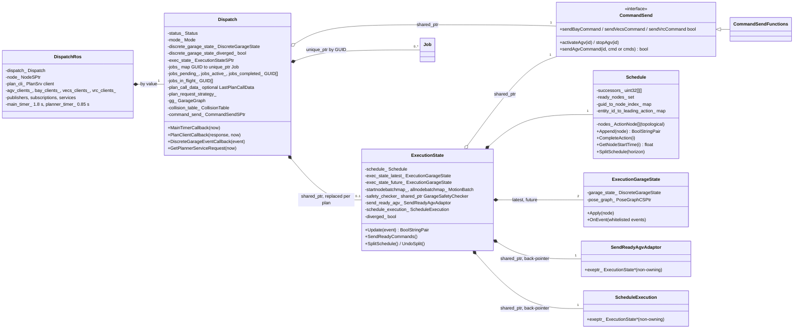
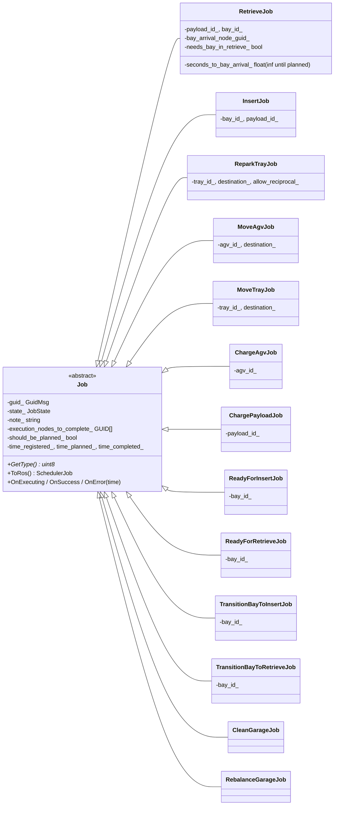
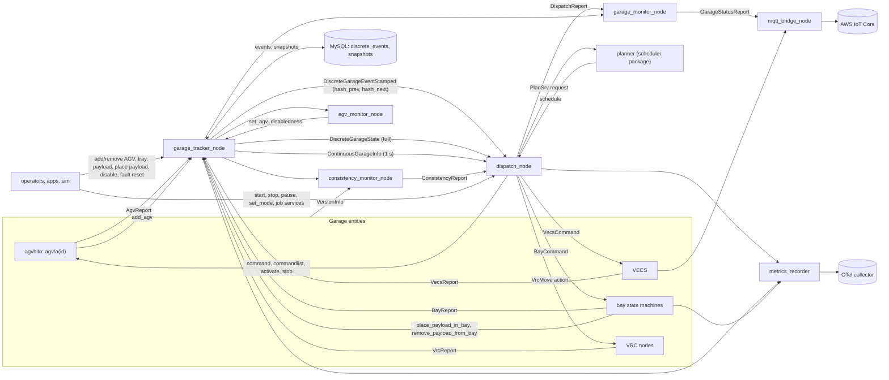
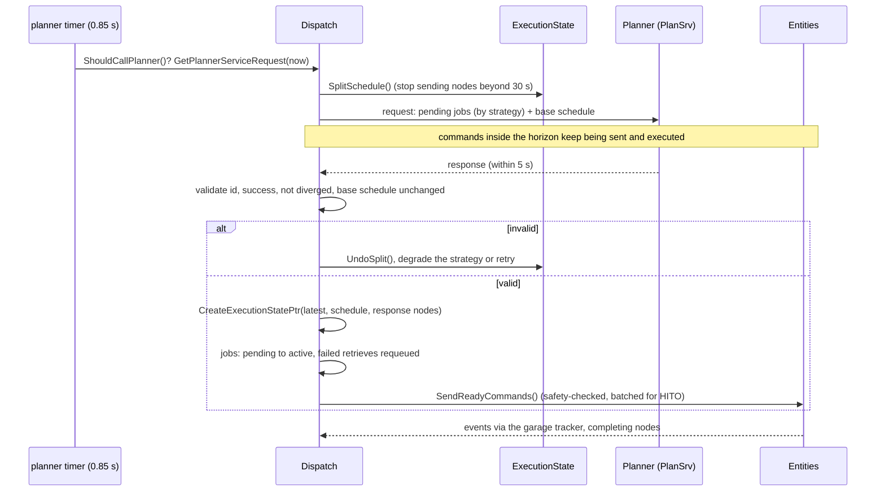
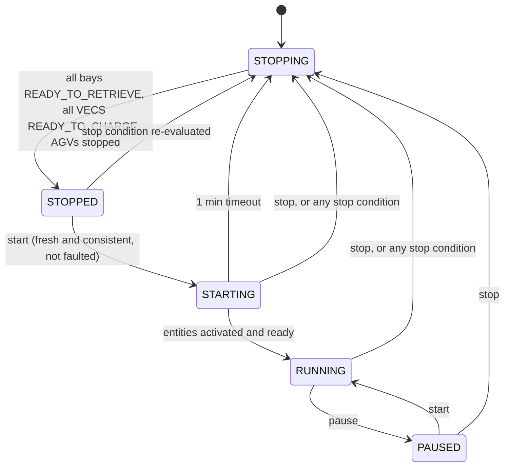
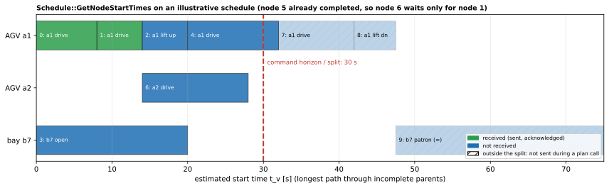

# 24 — `central`

| Generated | Revision | Source pack | Status |
|---|---|---|---|
| 2026-10-07 | 4 | `P24-central-part1of4.md` to `-part4of4.md` (all 4 parts) | **Complete** (all parts). Draft, generated by Claude, not yet reviewed by the team |

Package 24 of 37 (bottom-up) · dependency depth 7

**Abbreviations used in this document.** Each is also explained in context where it first matters.

| Abbreviation | Meaning |
|---|---|
| AGV (`agv` in names) | Automated Guided Vehicle |
| `agvhito` | AGV software for HITO vehicles (inferred from the name) |
| API (`api` in names) | Application Programming Interface |
| AWS | Amazon Web Services |
| CA | Certificate Authority |
| DAG | Directed Acyclic Graph |
| EV | Electric Vehicle |
| `gtest` | GoogleTest |
| GUID | Globally Unique Identifier |
| HITO | name of the AGV vendor; not expanded in the code |
| ID | identifier |
| IoT | Internet of Things |
| JSON (`json` in names) | JavaScript Object Notation |
| KaTeX | a math-typesetting library used to check the formulas (a name, not an acronym) |
| MD5 | Message-Digest algorithm 5 |
| MQTT (`mqtt` in names) | Message Queuing Telemetry Transport |
| MySQL | a relational database (product name: My + SQL, the Structured Query Language) |
| NaN | Not a Number |
| OTel | OpenTelemetry |
| `otel` | OpenTelemetry (Volley package name) |
| `rclcpp` | ROS Client Library for C++ |
| `rclcppx` | "rclcpp extensions" (Volley package) |
| ROS (`ros` in names) | Robot Operating System |
| SHA | Secure Hash Algorithm |
| `sim` | simulation / simulator (also the `sim` package) |
| TLS | Transport Layer Security |
| VECS (`vecs` in names) | not expanded in the code; Volley's vehicle EV-charging subsystem (inferred) |
| VRC (`vrc` in names) | Vertical Reciprocating Conveyor (a freight lift between floors) |
| YAML (`yaml` in names) | YAML Ain't Markup Language |

Workspace dependencies: agv_interfaces (06), common (01), common_ros (18), interfaces (11), launcher (not yet documented), otel (08), rclcppx (02), vrc_interfaces (04).
Used by: sim.

Related documents:
- `11-interfaces.md`: the event-sourced discrete state, the schedule as a DAG (Directed Acyclic Graph) of `ActionNode`s, jobs and plan messages;
- `18-common_ros.md`: `DiscreteGarageState`, its events and hash, `GarageGraph`, `CollisionTable`, `GarageSafetyChecker`;
- `21-planner_core.md`: the planners' side of schedules;
- `22-agvhito.md` and `23-bay.md`: the AGV proxy and the bays that the dispatcher commands;
- `08-otel.md`: the metrics library.

**Missing input.** The task mentions an attached `central.md` (repository docs, possibly stale), but it **was not included in the upload**.

**Coverage.** This revision covers **all four parts**: every header and source (parts 1–3) and the 15 test files (part 4). The part-4 test sources were compressed to names and comments, so section 8 describes coverage and intent, not exact assertions. Revision 2 corrected the persistence model; revision 3 added the schedule math, the HITO batch sending, R19–R24 and a revised R3; revision 4 adds the tests and relates them to the RISK items.

**How to read the evidence markers.**
- **[read]** means the conclusion comes from reading the source.
- **[probed]** means it was confirmed by running code: `Schedule::GetNodeStartTimes` was re-implemented and run on an illustrative schedule (Figure 7.1).

The package needs ROS, MySQL and the planner, so nothing was built for this part. The Mermaid diagrams pass the Mermaid 11 parser, and the formulas pass KaTeX.

---

## A. External dependencies

`central` is the **garage's central control**: it tracks the authoritative garage state, accepts jobs, asks the planner for schedules, dispatches the resulting commands to AGVs (Automated Guided Vehicles), bays, VECS (Volley's vehicle EV-charging subsystem) and VRCs (Vertical Reciprocating Conveyors), and monitors the whole system.

| Name | Description | Version | Link | Usage in this package |
|---|---|---|---|---|
| rclcpp, rclcpp_action, rclcpp_components, std_srvs | ROS 2 client library, actions, composable nodes, standard services. | Same distribution (Kilted or newer). | https://github.com/ros2/rclcpp | Nine components; VRC move actions; trigger services. |
| MySQL Connector/C++ (`libmysqlcppconn-dev`) | Client library for MySQL. | System. | https://dev.mysql.com/doc/connector-cpp/en/ | The garage tracker's event and snapshot tables. |
| Eclipse Paho MQTT C++ (`mqtt::async_client`) | MQTT (Message Queuing Telemetry Transport) client. | **Not declared** in `package.xml`. | https://github.com/eclipse/paho.mqtt.cpp | `MqttBridge` to AWS IoT; separate from the workspace `mqtt` package (document 07). |
| `otel` (workspace) | OpenTelemetry metrics (document 08). | Workspace. | — | `MetricsRecorder`. |
| `common_ros` (workspace) | Discrete state, graphs, collision and safety checking (document 18). | Workspace. | — | The dispatcher's and tracker's state; `GarageGraph`, `CollisionTable`, `GarageSafetyChecker`. |
| `common`, `rclcppx`, `interfaces`, `agv_interfaces`, `vrc_interfaces` (workspace) | Documents 01, 02, 11, 06, 04. | Workspace. | — | Utilities, topics, messages. |
| yaml-cpp, nlohmann/json, Boost | YAML snapshots, JSON for the IoT bridge, utilities. | System. | — | Snapshot format; MQTT payloads. |
| AWS IoT Core | Amazon's managed MQTT broker. | — | https://docs.aws.amazon.com/iot/ | Remote garage status. Certificates come from environment variables set by deployment (Terraform). |
| GoogleTest | Unit tests. | Not pinned. | https://github.com/google/googletest | 197 tests in 15 files (section 8). |

---

## B. Glossary

| Term | Meaning | Where it shows up |
|---|---|---|
| Dispatcher | The component that turns jobs into planner requests and planner schedules into commands. | `Dispatch`, `dispatch_node` |
| Garage tracker | The source of truth for the discrete garage state: it applies and publishes events, and persists them in MySQL (a full snapshot per event, section 3.4). | `GarageTracker`, `garage_tracker_node` |
| Job | A unit of work given to the planner (retrieve, insert, move a tray, charge an AGV, clean the garage, …). | `Job` and subclasses |
| Pending / active / completed | Job lists: waiting to be planned; planned and executing; finished (success or error). | `jobs_pending_`, `jobs_active_`, `jobs_completed_` |
| Plan request / response | The call to the planner (`PlanSrv`): the pending jobs plus the *base schedule* that must be kept; the answer is a new schedule. | `GetPlannerServiceRequest`, `PlanClientCallback` |
| Base schedule | The part of the current schedule inside the command horizon, which may already be executing during the plan call, and which the new schedule must contain unchanged. | `LastPlanCallData` |
| Schedule split | Marking schedule nodes outside the 30 s command horizon so they are not sent while a plan call is in flight. | `SplitSchedule`, `UndoSplit` |
| Execution state | The current schedule, with a *latest* state (what has happened) and a *future* state (after the schedule completes). | `ExecutionState` |
| Divergence | The dispatcher's view no longer matches reality: a state hash mismatch or an unexpected event. | `discrete_garage_state_diverged_`, `IsDiverged` |
| Motion batch | Consecutive AGV action nodes with collinear motion, sent to a HITO AGV as one command list. | `MotionBatch` |
| Status / mode | The dispatcher's lifecycle (`STARTING`, `RUNNING`, `PAUSED`, `STOPPING`, `STOPPED`) and job source (`AUTO` or `MANUAL`). | `Status`, `Mode` |
| Clean / rebalance | Background jobs that reorganize the garage when idle; clean also hides AGVs under trays. | `CleanGarageJob`, `RebalanceGarageJob` |
| Garage dirtiness | Fraction of waypoint nodes occupied by trays. | `GarageDirtiness` |
| Consistency | All entities run the dispatcher's software version (git SHA) and layout. | `ConsistencyMonitor` |
| Snapshot | A serialized discrete state. The design keeps one every 1000 events and replays later events; the code now stores one per event (section 3.4). | `garage_tracker_mysql_io.hpp` |

---

## 1. Summary

`central` provides **nine ROS components** and one command-line tool:

| Component (executable) | Role |
|---|---|
| `garage_tracker_node` | **Source of truth** for the discrete garage state. Turns entity reports into events, applies and publishes them with state hashes, persists every new state in MySQL, and offers the manual services (add or remove AGVs, trays and payloads; place and remove payloads in bays; enable and disable resources; set tray poses; fault reset). |
| `dispatch_node` | **The dispatcher**: accepts jobs, calls the planner, keeps the execution state, dispatches commands, and runs the start/stop lifecycle. |
| `consistency_monitor_node` | Clears the dispatcher to start only when every entity reports the same git SHA and layout. |
| `agv_monitor_node` | Disables AGVs whose battery falls below a threshold. |
| `garage_monitor_node` | Computes whether the garage is up or down, with uptime and downtime. |
| `mqtt_bridge_node` | Publishes garage status and VECS reports to AWS IoT. |
| `metrics_recorder` | Publishes OpenTelemetry metrics computed from ROS topics. |
| `safety_hardware_monitor_node` | Watches the garage status report *(behavior pending)*. |
| `garage_tracker_recovery` (executable) | Downloads, repairs and re-uploads snapshots (`get`, `upload`, `update`). |

**The dispatcher in one paragraph.** Every 1.8 s, the main loop checks for reasons to stop (stale garage info, a timed-out AGV or bay, divergence, a faulted garage, inconsistency), then acts on its status. While `RUNNING`, it:
- creates an execution state if needed (queuing clean and rebalance jobs in `AUTO` mode);
- sends ready commands;
- completes jobs whose nodes are done;
- tracks idleness, after which it queues charge, clean and rebalance jobs.

Every 0.85 s, if appropriate, it sends the planner a request with the pending jobs and the base schedule. It validates the response strictly (call id, success, unchanged base schedule), then builds a new execution state from it. Commands are only sent for actions expected to start within a **30 s horizon**. Garage events advance the execution state; an unexpected event makes it diverge, and the dispatcher stops.

**How it fits with the earlier documents.** The tracker implements the event-sourced state of documents 11 and 18. Every event carries `hash_prev`, and a subscriber whose state hash differs knows it has diverged and resynchronizes from the full state topic. The dispatcher's execution state uses `common_ros`'s `GarageSafetyChecker` (document 18, section 3.3) to send only collision-free commands. `SendReadyAgvAdaptor` batches collinear motions for HITO AGVs, matching `agvhito`'s order segmentation (document 22).

**What parts 1–3 show about quality.** The dispatcher is defensive about plan responses (every node of the base schedule must come back unchanged) and about stale data (it stops). The plan-request strategy degrades gradually when the planner keeps failing, and retrieve jobs are re-queued rather than dropped. The findings so far:
- **A stale VECS never stops the dispatcher**, although the stop check computes it (R1).
- **After resynchronizing, the dispatcher clears its divergence flag even when the rebuilt state's hash does not match** (R2).
- **On divergence, the execution state is discarded while AGVs may still be executing commands** (R3).
- **The `installation_id` silently defaults to 0** (R4).
- **The low-battery monitor acts on a single report**, and never re-enables an AGV (R5).
- **Paho MQTT is used without being declared**, and the IoT private key is written to `/tmp` (R6).

Part 2 adds:
- **Commands are sent with blocking calls, one entity at a time** (R12).
- **The safety checker ignores commands that were sent but not yet acknowledged** (R13).
- **The tracker writes a full snapshot to MySQL for every event**, before publishing it, so one failed write makes every subscriber diverge (R14).
- **The database password is written to the log** (R15).

Part 3 adds:
- **A HITO motion batch is sent after safety-checking only its first edge** (R19).
- **The VECS lift interlock fails silently, printing to standard output** (R20).
- **The safety-hardware monitor and the VECS part of the IoT bridge were left unfinished at the company's wind-down** (R21).
- **Divergence while running marks every active job as succeeded**, because the stop check misses a discarded execution state and missing nodes count as completed (R3, revised).
- **Stopping errors every pending and active job**, including retrieves (R24).

---

## 2. Files

The package has 81 files: 66 headers, sources and build files (parts 1–3) and 15 test files (part 4). Line counts are from the packs, which have blank lines removed.

| Path (under `src/central/`) | Lines | Role |
|---|---:|---|
| `include/central/agv_monitor_ros.hpp` | 18 | ROS wrapper of the AGV monitor. |
| `include/central/agv_monitor.hpp` | 27 | `AgvMonitor`: disables AGVs whose battery falls below a threshold. |
| `include/central/central_msgs.hpp` | 172 | Short aliases for about 80 message and service types. |
| `include/central/charge_agvs.hpp` | 15 | `ChargeAgvs`, `OnChargeNode` declarations. |
| `include/central/command_send.hpp` | 62 | `CommandSend` interface (AGV, bay, VECS, VRC commands) and a function-object implementation. |
| `include/central/consistency_monitor_ros.hpp` | 27 | ROS wrapper of the consistency monitor. |
| `include/central/consistency_monitor.hpp` | 45 | `ConsistencyMonitor`: all entities must run the dispatcher's git SHA and layout. |
| `include/central/dispatch_ros.hpp` | 113 | `DispatchRos`: every publisher, subscription, service, client and timer of the dispatcher. |
| `include/central/execution_garage_state.hpp` | 43 | `ExecutionGarageState`: a discrete state advanced by action nodes and a subset of events. |
| `include/central/execution_state_util.hpp` | 47 | Matching rules between sent commands and observed events. |
| `include/central/execution_state.hpp` | 112 | `ExecutionState`: the schedule, latest and future states, motion batches, safety checker. |
| `include/central/garage_monitor_ros.hpp` | 20 | ROS wrapper of the garage monitor. |
| `include/central/garage_monitor.hpp` | 30 | `GarageMonitor`: garage up/down status, uptime and downtime. |
| `include/central/garage_tracker_mysql_io.hpp` | 125 | MySQL tables for events and snapshots; snapshot (de)serialization. |
| `include/central/garage_tracker_recovery_args.hpp` | 30 | Command-line options of the recovery tool (get, upload, update). |
| `include/central/garage_tracker_ros.hpp` | 59 | `GarageTrackerRos`: subscriptions per entity, services, publishers, timers. |
| `include/central/garage_tracker.hpp` | 164 | `GarageTracker`: the source of truth for the discrete garage state. |
| `include/central/mqtt_bridge_constants.hpp` | 19 | AWS IoT certificate environment variables, file paths, connection constants. |
| `include/central/mqtt_bridge_ros.hpp` | 18 | ROS wrapper of the MQTT bridge. |
| `include/central/mqtt_bridge.hpp` | 35 | `MqttBridge`: publishes garage status and VECS reports to AWS IoT over Paho MQTT. |
| `include/central/safety_hardware_monitor_ros.hpp` | 17 | Subscribes to the garage status report *(behavior pending)*. |
| `include/central/schedule_execution.hpp` | 24 | `ScheduleExecution`: replacement for `SendReadyCommands`. |
| `include/central/schedule.hpp` | 119 | `Schedule` (DAG of action nodes with ready set) and `MotionBatch`. |
| `include/central/send_ready_agv_adaptor.hpp` | 24 | `SendReadyAgvAdaptor`: sends batched motions to HITO AGVs. |
| `src/agv_monitor_component.cpp` | 29 | `agv_monitor_node`. |
| `src/agv_monitor_ros.cpp` | 30 | Subscriptions and the disable-AGV client. |
| `src/agv_monitor.cpp` | 45 | Low-battery check without debouncing. |
| `src/charge_agvs.cpp` | 83 | Choose which AGVs to send to charge when idle. |
| `src/command_send.cpp` | 48 | Forwarding to the stored functions. |
| `src/consistency_monitor_component.cpp` | 17 | `consistency_monitor_node`. |
| `src/consistency_monitor_ros.cpp` | 52 | Dynamic version-info subscriptions per entity. |
| `src/consistency_monitor.cpp` | 135 | Consistency evaluation (git SHA, layout MD5, 5 min freshness). |
| `src/dispatch_component.cpp` | 53 | `dispatch_node`: loads the layout and pose graph, creates `DispatchRos`. |
| `src/dispatch_jobs.cpp` | 193 | Job state changes and ROS conversions. |
| `include/central/central_timing.hpp` | 37 | All dispatcher and tracker periods, timeouts and staleness limits. |
| `include/central/dispatch_jobs.hpp` | 323 | `Job` and its 13 subclasses. |
| `include/central/dispatch.hpp` | 279 | `Dispatch`: status, mode, jobs, plan requests, execution state. |
| `include/central/metrics_recorder.hpp` | 122 | `MetricsRecorder`: OpenTelemetry gauges, counters and histograms from ROS topics. |
| `src/dispatch.cpp` | 1834 | The dispatcher: events, services, plan handling, main loop, job bookkeeping. |
| `CMakeLists.txt` | 222 | `central_lib`, nine components, the recovery tool, unit tests. |
| `package.xml` | 33 | Dependencies (MySQL Connector/C++, otel, yaml-cpp, …; Paho MQTT C++ is not declared). |

The part-2 files follow.

| Path (under `src/central/`) | Lines | Role |
|---|---:|---|
| `src/execution_garage_state.cpp` | 279 | Applying action nodes and whitelisted events; creation checks. |
| `src/execution_state_util.cpp` | 136 | Command/event matching (with VRC-member equivalence). |
| `src/execution_state.cpp` | 1038 | Building execution states from plan responses; motion-batch coalescing; event handling and divergence; sending bay, VECS and VRC commands. |
| `src/garage_monitor_component.cpp` | 28 | `garage_monitor_node`. |
| `src/garage_monitor_ros.cpp` | 29 | Subscriptions and the status publisher. |
| `src/garage_monitor.cpp` | 140 | Garage up/down from AGVs, bays and the dispatcher (3 s staleness), uptime and downtime. |
| `src/garage_tracker_component.cpp` | 72 | `garage_tracker_node`: layout and `garage_tracker.mysql.*` parameters (the password is logged). |
| `src/garage_tracker_mysql_io.cpp` | 460 | Table creation, snapshot write (compressed YAML), latest snapshot and legacy event replay. |
| `src/garage_tracker_recovery_args.cpp` | 212 | Argument parsing for the recovery tool. |
| `src/garage_tracker_recovery.cpp` | 301 | `get`, `upload`, `update` of snapshots, with annotated YAML for manual repair. |
| `src/metrics_recorder_component.cpp` | 17 | `metrics_recorder`. |
| `src/mqtt_bridge_component.cpp` | 17 | `mqtt_bridge_node`. |
| `src/mqtt_bridge.cpp` | 227 | Certificates from environment variables to `/tmp`, TLS connection to AWS IoT, JSON publishing with reconnects. |
| `src/garage_tracker_ros.cpp` | 218 | Per-entity report subscriptions, services, 1 s garage info, 50 ms snapshots, retrieval-code registration with `/rest_api`. |
| `src/garage_tracker.cpp` | 1095 | Reports and services → events; VRC node resolution; snapshot capture; pose validation. |
| `src/metrics_recorder.cpp` | 302 | Topic discovery every 5 s; gauges, counters, histograms. |
| `src/dispatch_ros.cpp` | 474 | Timers, services, per-entity clients; blocking command calls; VRC action goals; asynchronous plan calls. |

The part-3 files follow.

| Path (under `src/central/`) | Lines | Role |
|---|---:|---|
| `src/mqtt_bridge_ros.cpp` | 71 | Subscriptions to garage status and VECS reports; the bridge is skipped without certificates; a hard-coded `/vecs/v45/report` subscription. |
| `src/safety_hardware_monitor_component.cpp` | 22 | `safety_hardware_monitor_node`. |
| `src/safety_hardware_monitor_ros.cpp` | 21 | Logs each garage status report; nothing else. |
| `src/schedule_execution.cpp` | 25 | `ScheduleExecution::SendReadyCommands`: AGVs through the HITO adaptor, then bays, VECS, VRCs. |
| `src/schedule.cpp` | 410 | Appending with validation, ready and chaining rules, completion and receipt, start times, split, Graphviz. |
| `src/send_ready_agv_adaptor.cpp` | 118 | Choosing the AGV command to send (chaining), the VECS-plugged lift interlock, the safety check, sending the whole motion batch. |

The test files (part 4) follow; line counts are for the compressed sources.

| Path (under `src/central/`) | Lines | Role |
|---|---:|---|
| `test/agv_monitor_tests.cpp` | 31 | 1 test: low-battery AGVs are disabled. |
| `test/charge_agvs_tests.cpp` | 39 | 8 tests: charge-node detection, capacity, AGVs trapped in bays, AGVs already heading to charge. |
| `test/consistency_monitor_ros_tests.cpp` | 21 | 1 test: consistent reports pass through the ROS wrapper. |
| `test/consistency_monitor_tests.cpp` | 98 | 14 tests: git SHA, layout MD5 (and its exemptions for bays and VECS), names, timeouts, adding and removing entities, disabled entities. |
| `test/dispatch_jobs_tests.cpp` | 51 | 13 tests: base job behavior and every job type's conversion. |
| `test/dispatch_tests.cpp` | 664 | 12 tests (one more commented out): start sequence, unique bay command ids, job services, plan timeout and id matching, base-schedule modification, disabled bay, background job queuing and de-duplication. |
| `test/execution_garage_state_tests.cpp` | 215 | 37 tests: construction checks (overlaps, invalid poses, payload sizes, disabled nodes), applying each command type, payload events, copying. |
| `test/execution_state_tests.cpp` | 401 | 35 tests: command/event matching, building from plans, ready commands (chaining, horizon, VECS lift interlock), bay errors, collisions, manual tray poses. |
| `test/garage_monitor_tests.cpp` | 58 | 10 tests: garage up/down for each input. |
| `test/garage_tracker_mysql_io_tests.cpp` | 14 | 1 test: snapshot serialize/deserialize round trip. |
| `test/garage_tracker_recovery_args_tests.cpp` | 68 | 13 tests: recovery-tool argument parsing. |
| `test/garage_tracker_ros_tests.cpp` | 8 | 1 test: the node initializes. |
| `test/garage_tracker_tests.cpp` | 311 | 32 tests: adding and removing every entity, payload placement, disabledness, fault reset, manual tray poses, layout validation, VRC floor resolution and tray settling. |
| `test/mqtt_bridge_tests.cpp` | 7 | 2 tests: JSON conversion of garage status and VECS reports. |
| `test/schedule_tests.cpp` | 129 | 17 tests: append validation, lift sequences, bay and VECS commands, infinite durations, splitting. |

---

## 3. Public API

Everything is in namespace `volley` (constants in `central`). The rest of Volley uses the ROS interfaces in sections 3.1–3.3; `sim` also uses `Dispatch` and `GarageTracker` directly through `CommandSend`.

### 3.1 The dispatcher's ROS interface — `DispatchRos` (`dispatch_ros.hpp`)

| Kind | Interfaces | Notes |
|---|---|---|
| Subscriptions | consistency report, continuous garage info, discrete garage events, discrete garage state | The state topic is used only after divergence (section 3.2). |
| Basic services | `get_job_state`, `set_mode` (`SetUInt8`), `start`, `stop`, `pause` | Mode can change only while stopped or stopping. |
| Job services | `retrieve`, `charge_payload`, `move_agv`, `move_tray`, `repark_tray`, `transition_bay_to_insert`, `transition_bay_to_retrieve`, `clean_garage`, `rebalance_garage` | Each registers a job, if the status and mode allow it. |
| Simulation and testing services | `stop_planner`, `start_planner`, `trigger_plan`, `debug_printdags` | — |
| Client | the planner (`PlanSrv`), asynchronous | One call in flight at a time, with a 5 s deadline. |
| Per-entity clients | AGV: activate, command, command list, stop. Bay: command. VECS: command. VRC: `VrcMove` action. | Each entity has its own callback group. |
| Publishers | heartbeat, dispatch report, schedule, version info, AGV command sequences, pending/active/completed job lists, plan request/response echoes | — |
| Timers | main 1.8 s, planner 0.85 s, version info 5 s, job culling 300 s | Section 5. |

**How commands are sent** (`dispatch_ros.cpp`):
- **AGV commands and command lists, and bay and VECS commands,** use the blocking `volley::Call` (up to 1 s waiting for the service, 5 s for the response; document 18), from the main timer through `SendReadyCommands`.
- **VRC moves** send an action goal and wait for acceptance.
- **Activation and stop** are asynchronous.

Entities are served one after another, so an unresponsive AGV delays commands to every other entity in the same tick (R12).

### 3.2 `Dispatch` — status, jobs and plans (`dispatch.hpp`, `dispatch.cpp`)

**Status and mode.**
- **Starting:** `start` is accepted only from `STOPPED` or `PAUSED`, with a fresh consistency report that says consistent, fresh continuous garage info, and an unfaulted garage. From `STOPPED`, the dispatcher enters `STARTING`; from `PAUSED`, it resumes `RUNNING`.
- **Stopping:** `stop` enters `STOPPING` from any other status. `pause` is allowed only while `RUNNING`.
- **Jobs:** auto jobs are accepted in `AUTO` mode and manual jobs in `MANUAL` mode, in both cases only while `RUNNING` or `STARTING`.

**Events and divergence.** Each `DiscreteGarageEventStamped` is checked against the local state hash ($H(S) = $ `hash_prev`, document 18, section 7.3), turned into jobs (`CreateJobsFromEvents`), applied, and then passed to the execution state.
- **On a hash mismatch or a failed apply,** the dispatcher marks itself diverged and **discards the execution state**. It stays `RUNNING`, rebuilds an empty execution state on the next tick, and marks the active jobs successful (R3).
- **While diverged,** the next full `DiscreteGarageState` message rebuilds the local state, and the flag is cleared, even if the rebuilt hash does not match (R2).

**Jobs** (`dispatch_jobs.hpp`): `Job` (GUID, state `UNPLANNED` → `EXECUTING` → `SUCCESS` or `ERROR`, note, execution nodes to complete, timestamps) and 13 subclasses:

| Mode | Jobs |
|---|---|
| Manual | `MoveAgvJob`, `MoveTrayJob`, `TransitionBayToInsertJob`, `TransitionBayToRetrieveJob` |
| Auto | `RetrieveJob` (estimated seconds to bay arrival), `InsertJob`, `ReparkTrayJob`, `ReadyForInsertJob`, `ReadyForRetrieveJob`, `ChargePayloadJob` |
| Background (dispatcher-created) | `ChargeAgvJob`, `CleanGarageJob`, `RebalanceGarageJob` |

`RetrieveJob` carries the bay it was planned to, the node whose start time estimates the patron's wait, and a flag for "needs a bay in `READY_TO_RETRIEVE`". A `ReadyForRetrieveJob` on a bay in `READY_TO_INSERT` must be planned twice: once to send the bay command, then again to remove the tray, because the planner cannot plan past the bay's infinite-duration patron interaction.

**Plan requests** (`ShouldCallPlanner`, `GetPlannerServiceRequest`):
- **Which jobs:** the pending jobs that should be planned, limited by a strategy that degrades after failures. The strategies are, in order: all jobs; as many as there are active AGVs; as many as there are AGVs that are not busy; one job at a time.
- **What else is sent:** the base schedule, which is recorded for validation.
- **Timing:** one plan call at a time.

**Plan responses** (`PlanClientCallback`) are rejected, with the schedule split undone, when:
- there is no execution state, or no call is in flight;
- the response's call id differs;
- the plan failed;
- the execution state has diverged;
- any base-schedule node is missing or changed.

If *every* job in a multi-job response failed, the first pending job's retry count increases; after 4 retries it moves to the back of the queue. Otherwise, a new execution state is built from the response:
- **Executing jobs** move from pending to active.
- **Failed retrieves** are re-queued, up to 10 times, before they error (patrons should not have to ask twice).
- **Other failed jobs** error out unless the planner says to retain them.

**Background work when idle** (`AUTO` mode). The garage counts as idle when no pending or active job is anything but a charge or clean job, and no bay holds a payload in the future state. After 1 min idle, the dispatcher sends the AGVs that need it most to charge (`ChargeAgvs`). After 10 min idle, it queues a clean if the garage's dirtiness reaches its threshold (default 0.10), and a settling rebalance.

### 3.3 Monitors

- **`ConsistencyMonitor`.** Subscribes to every entity's version info. Entities are added and removed as the discrete garage state changes. The garage is *consistent* when:
  - version info exists for every entity, including the dispatcher;
  - every message is younger than 5 min;
  - every git SHA equals the dispatcher's;
  - every layout MD5 (Message-Digest algorithm 5) equals the dispatcher's, except for entities whose names start with `b` (bays) or `v` (VECS), which do not load layouts.

  The release string is deliberately ignored.
- **`AgvMonitor`.** On each continuous-garage-info message, asks the garage tracker to disable any enabled AGV whose battery fraction is below the threshold. It acts on the first low report, without debouncing (R5).
- **`GarageMonitor`.** The garage is *up* when the dispatcher's report is fresh (3 s) and running, and the AGVs and bays are active and fresh (3 s). It accumulates uptime and downtime, and publishes a `GarageStatusReport` with per-AGV and per-bay status.
- **`MqttBridge`.** Writes the AWS IoT certificate, private key and root CA from environment variables to files in `/tmp` (Paho accepts only paths), connects over TLS (Transport Layer Security), with up to 10 connection attempts of 5 s, and publishes the garage status and VECS reports as JSON.
- **`MetricsRecorder`.** Discovers bay, AGV and node-accuracy topics every 5 s, and records state transitions, completed jobs, job pending and active durations, bay and dispatch state durations, node-accuracy offsets, battery levels, staleness, and counts of cars, trays and pending and active jobs.
- **`SafetyHardwareMonitorRos`.** Subscribes to the garage status report and logs it; it does nothing else (a placeholder, with an empty "Create Publishers" section).
- **`MqttBridgeRos`.** Skips the bridge entirely when the certificates are not in the environment (simulation). Besides the garage status, it subscribes to VECS reports, including a hard-coded `/vecs/v45/report`, with the comment "due to company wind down, this was not completed". `MetricsRecorder`'s header documents a deliberate member order, so that the OTel (OpenTelemetry) client is destroyed before the maps its gauge callbacks read. That addresses document 08's R4 for this user.

### 3.4 The garage tracker — `GarageTracker` (`garage_tracker.hpp`)

The tracker turns AGV, bay, VECS and VRC reports, and manual service calls, into events. For each event it:
1. applies the event to its `DiscreteGarageState`;
2. serializes it;
3. publishes it with the previous hash, after writing a snapshot of the new state to MySQL (below).

A failure to apply one of its *own* events issues a fault event (`ApplyAndPublishEventOrFault`). It "does not validate all changes against a layout", except for manual requests. It also:
- maps VRC floors to virtual nodes, and corrects the poses of uncarried trays on a VRC;
- captures snapshots for the `GarageSnapshot` topic every 50 ms.

**Persistence, as implemented** (`garage_tracker.cpp`, `garage_tracker_mysql_io.cpp`). For every event, `PublishSerializedEvent`:
1. increments the sequence number;
2. writes a **complete snapshot** of the new state to the `snapshots` table (versioned YAML, compressed by MySQL's `COMPRESS`), over a new database connection;
3. publishes the event, only if the write succeeded.

The `discrete_events` table is still created and read, for the latest sequence number and to replay events after a snapshot during recovery, but nothing inserts into it any more, and `kNumEventsBetweenSnapshots` (1000) is unused. Recovery therefore reduces to loading the latest snapshot. The snapshots table grows by one compressed state per event, and nothing deletes old rows (R14).

**Other tracker behavior:**
- **Simulation:** MySQL is skipped entirely when `garage_tracker.write_to_mysql` is false.
- **Pose validation:** `ValidatePosesForLayout` lists AGVs (except unlocalized ones at node 0), bays and trays whose poses are not in the layout.
- **Retrieval codes:** after a payload is placed in a bay, a retrieval code is registered asynchronously with `/rest_api/register_retrieval_code`.
- **Snapshot topic:** `CaptureGarageSnapshot` publishes the combined garage snapshot at 20 Hz.

### 3.5 Execution — `ExecutionState`, `Schedule`, `ExecutionGarageState` (headers)

- **`Schedule`** stores the plan's action nodes in topological order, with successor lists, a *ready set* (nodes whose parents are all complete), a GUID index, and each entity's *leading* (first incomplete) action. It can estimate each node's start time from the durations of its incomplete ancestors, and split itself at the command horizon. `Append` either fully succeeds or leaves the schedule unchanged.
- **`ExecutionState`** holds:
  - the schedule;
  - the *latest* state (advanced by events) and the *future* state (the latest state with every remaining action applied);
  - motion batches;
  - a `GarageSafetyChecker`.

  It sends ready commands through two replaceable strategies, `ScheduleExecution` and `SendReadyAgvAdaptor`, for HITO AGVs. Every event must match a sent command (`execution_state_util.hpp`): exactly for AGV lifts and poses (VRC members counting as one node), and as "completed", "in progress" or "unexpected" for bay, VECS and VRC state changes. An unexpected event makes the execution state diverge.
- **`ExecutionGarageState`** applies action nodes, and only a whitelisted subset of events (bay, payload existence, VECS, VRC, AGV pose, manual tray pose). Its creation fails if, for example, two AGVs overlap.

**Building an execution state from a plan** (`CreateExecutionStatePtr`). The new execution state starts from the *latest* state. Each response node, in topological order, is processed as follows:
- **Completed nodes are skipped**, since a node may complete between the request and the response.
- **Parent indices are remapped** to the new schedule, dropping completed parents; a parent index not smaller than its child's is rejected.
- **AGV commands get their source and destination completed** from the future state: the planner sends only the changing part.
- **Status is inherited**, so a node already received by its entity keeps that status. Only received nodes are applied to the new safety checker, with a TODO noting that a *sent but not yet received* status is missing (R13).
- **The node is appended** to the schedule, and applied to the future state.

Motion batches are then coalesced. Any failure rejects the whole response, and the old execution state continues.

**Event handling** (`UpdateInternal`):
- **AGV lift and pose events** must match a *received* action of that AGV, searched from its leading action onwards, because reports are asynchronous and several actions may complete between two reports. All matched actions up to the match are completed.
- **VRC rides** (a pose change between nodes of one VRC) skip the schedule, but still update the safety checker.
- **A temporary workaround** (ticket SW2-275) ignores mismatches for rotations in the wrong direction until the final heading is reached.
- **Bay state changes** without a leading action are accepted, except from `READY_TO_RETRIEVE` or into `BOOTING` or `ERROR` on an enabled bay.
- **State changes of disabled AGVs** are ignored unless the AGV could move.

Any unexpected event marks the execution state diverged.

**Sending AGV commands to HITO** (`ScheduleExecution`, `SendReadyAgvAdaptor`). `ScheduleExecution::SendReadyCommands` visits every AGV, then every bay, VECS and VRC. For an AGV:
1. Take its leading action; it must be ready, and inside the split.
2. If it is already received, walk forward through received successors to the first unreceived one. That one is *chained* if it is inside the horizon and the split, is ready for chaining (at most one incomplete parent, which is a received action of the same entity), and is not a move following a lift.
3. Refuse a **lift** at a node whose VECS is not `READY_TO_CHARGE` (the tray is plugged in), using the node id as the VECS id.
4. Apply the chosen node to the `GarageSafetyChecker`; refuse if unsafe.
5. If the node starts a **motion batch** (collinear moves coalesced by `CoalesceMotionBatches`), send the **whole batch** as one command list, and mark every node of the batch received.

Only the batch's *first* node passes the safety checker before sending (R19). Refusals are printed with `std::cout`, not to the ROS log.

---

## 4. Diagrams

### 4a. Class diagrams (ownership on edges)

**The dispatcher.**

**Jobs.**

### 4b. Data flow

**One plan cycle:**

### 4c. State machines

**Dispatcher status** (from `dispatch.cpp`; the `STARTING` and `STOPPING` details are in `ActOnStarting` and `ActOnStoppedOrStopping`):

The *stop conditions*, checked on every main tick:
- continuous garage info older than 60 s;
- an enabled, active AGV silent for 90 s;
- an enabled bay silent for 60 s;
- a diverged execution state;
- a faulted garage;
- an inconsistent consistency report.

A silent VECS is computed but not included (R1).

**Job lifecycle:**

```mermaid
%%{init: {"fontFamily": "JetBrainsMono Nerd Font, FiraCode Nerd Font, Hack Nerd Font, DejaVu Sans Mono, Menlo, Consolas, monospace", "themeVariables": {"fontFamily": "JetBrainsMono Nerd Font, FiraCode Nerd Font, Hack Nerd Font, DejaVu Sans Mono, Menlo, Consolas, monospace"}}}%%
stateDiagram-v2
    direction LR
    [*] --> Pending : RegisterPendingJob (UNPLANNED)
    Pending --> Active : plan response EXECUTING (OnExecuting)
    Pending --> Pending : all jobs failed (retry; after 4, move to the back)
    Pending --> Pending : retrieve failed (requeue, up to 10)
    Pending --> Completed : failed and not retained (OnError)
    Active --> Completed : all execution nodes complete (OnSuccess)
    Active --> Completed : error
    Completed --> [*] : culled after 1 h
```

---

## 5. Behavior

**Construction** (`dispatch_node`):
1. read `installation_id` and `layout` (R4);
2. resolve the layout in the `launcher` share directory;
3. load it, and build the pose graph;
4. create `DispatchRos`, whose `Dispatch` builds a `GarageGraph` and a `CollisionTable`. The collision table is loaded from the disk cache, or built, which can take minutes (document 18, R2 and R8).

The initial status is `STOPPING`, in `MANUAL` mode, diverged until the first full state arrives.

**Periods and limits** (`central_timing.hpp`):

| Quantity | Value |
|---|---|
| Main loop | 1.8 s |
| Planner call period / deadline | 0.85 s / 5 s |
| Command send horizon | 30 s |
| Garage info publication (tracker) | 1 s |
| Snapshot publication (tracker) | 50 ms |
| AGV / bay / VECS report staleness | 90 s / 60 s / 60 s |
| Consistency report staleness | 5 s |
| Version info staleness (consistency monitor) | 5 min |
| Idle time before charging / cleaning | 1 min / 10 min |
| Starting timeout | 1 min |
| Terminal jobs kept for | 1 h, culled every 5 min |
| Plan retries / retrieve requeues | 4 / 10 |
| Events between snapshots | 1000 |

**Threads and executors.** `DispatchRos` gives each entity's clients their own callback group. Which executor the components run in is set by the launch configuration, outside this package. The dispatcher itself has no locks: its timers, subscriptions and services must not run concurrently with each other, which the default mutually exclusive group guarantees.

---

## 6. Ownership and safety

### 6.1 Lifetimes

- **`DispatchRos`** holds `Dispatch` by value.
- **`Dispatch`** owns:
  - its jobs (`unique_ptr` by GUID);
  - the execution state (`shared_ptr`, replaced on every accepted plan and reset on divergence);
  - its own `GarageGraph` and `CollisionTable`.
- **`ExecutionState`** owns two strategy objects (`SendReadyAgvAdaptor`, `ScheduleExecution`) holding a **raw back-pointer** to it. That is safe while the execution state is only ever used through its `shared_ptr`. A copy of an `ExecutionState`, however, would share strategy objects that point to the original (no copies were seen; R17).

### 6.2 Callbacks capturing `this`

`MetricsRecorder` documents its member order so that the OTel client's destructor, which removes its gauge callbacks, runs before the maps those callbacks read are destroyed.

### 6.3 Locks and atomics

`Dispatch` has none and relies on a single callback group. `MetricsRecorder` uses a `shared_mutex` for its maps, and atomics for values read by the export thread. `GenerateGuid` uses a function-local `static` counter shared by every `Dispatch` instance in the process, without synchronization (R7).

### 6.4 Error handling

| Style | Where |
|---|---|
| `BoolStringPair` | Schedule, execution state, events, job services |
| Stop the dispatcher | Stale data, divergence, fault, inconsistency |
| Divergence → resynchronize | Hash mismatch on events |
| Reject plan response, retry or requeue | Planner failures |
| `exit(EXIT_FAILURE)` | Component parameter or layout errors |

### 6.5 RISK items

| Item | Risk | Evidence |
|---|---|---|
| R1 | **A silent VECS never stops the dispatcher.** `MainTimerCallback` computes `any_enabled_vecs_timed_out` and includes it in the log message, but the condition that sets `STOPPING` omits it. Stale AGVs and bays stop the dispatcher; a stale VECS does not. | **[read]** |
| R2 | **Resynchronization accepts a mismatching state.** In `DiscreteGarageStateCallback`, after `Set(*garage_state)` the dispatcher compares hashes, logs an error on mismatch, and then **clears the divergence flag anyway**. The next event's `hash_prev` will not match either, so the dispatcher diverges and resynchronizes again on every event, while the execution state is repeatedly discarded. A persistent mismatch can come from the hash's integer truncation of payload dimensions, or from a version difference (document 18, R9). | **[read]** |
| R3 | **Divergence while running completes jobs that never ran.** On a hash mismatch or a failed apply, `DiscreteGarageEventCallback` calls `exec_state_.reset()` and returns. The main timer's stop check tests `exec_state_ != nullptr && exec_state_->IsDiverged()`, which is *false* once the execution state is gone, so the dispatcher **stays `RUNNING`**. `ActOnRunning` then creates a fresh execution state, possibly from the still-diverged local state, and `CompleteJobs` looks up each active job's nodes in the new, empty schedule. Because "if lookup fails, we can assume the item was completed", **every active job is marked `SUCCESS`**, including retrieves whose AGVs never arrived, while commands already sent keep executing without a schedule. Jobs are also created from events (`CreateJobsFromEvents`) before divergence is acted on. | **[read]** |
| R4 | **Required parameters default silently.** `installation_id` and `layout` are read with `Param` inside a `try` block that never fires (document 18, R7). An empty layout fails later with a clear message, but a missing `installation_id` becomes 0 in every heartbeat. | **[read]** + document 18 |
| R5 | **The low-battery monitor is a one-shot.** One report below the threshold disables the AGV (no debouncing, as the code notes), and nothing re-enables it after charging; an operator must. A spurious zero battery reading (for example from a default-constructed report) disables a healthy AGV. | **[read]** |
| R6 | **Undeclared Paho dependency; private key in `/tmp`.** `MqttBridge` uses `mqtt::async_client` from Paho MQTT C++, which `package.xml` does not declare. It writes the AWS IoT certificate *and private key* from environment variables to fixed paths in `/tmp` with a plain `std::ofstream`, so the files get the process's default permissions (typically readable by every user in the container). | **[read]** |
| R7 | **GUID generation.** `GenerateGuid` combines a function-local `static` counter with the current time. The counter is shared by all `Dispatch` instances in a process, such as in `sim` or tests, and is not thread-safe. IDs are unique in practice, but not random, as the comment notes. | **[read]** |
| R8 | **Strategy helpers do not match their comments.** `MinimumAgvsAndBays()` returns only the number of active AGVs, not the minimum of AGVs and bays its comment describes; `MinimumNonBusyAgvsAndBays()` likewise returns only non-busy AGVs. | **[read]** |
| R9 | **The idle checks disagree on rebalance.** `IsIdleBackgroundJobType` treats charge, clean *and rebalance* as background work, but `UpdateIdleStartTime` treats only charge and clean as compatible with idleness. A pending rebalance therefore resets the idle timer, delaying charging. | **[read]** |
| R10 | **An unchecked queue access.** When every job in a multi-job plan response failed, the dispatcher reads `jobs_pending_.front()` without checking that the pending list is non-empty, which is undefined behavior if the response only re-planned active jobs. | **[read]** |
| R11 | **Long detection times.** An active AGV must be silent for 90 s, and a bay for 60 s, before the dispatcher stops, while commands continue to be dispatched to others meanwhile. | **[read]** |
| R12 | **Commands are sent with blocking calls, one entity after another.** `SendAgvCommand`, `SendAgvCommandList`, `SendBayCommand` and `SendVecsCommand` use `volley::Call`, which waits up to 1 s for the service and 5 s for the response, from the 1.8 s main timer. An AGV whose service has disappeared (for example during rediscovery in `agvhito`, document 22) delays every other entity's commands in that tick by up to 6 s, and the timer overruns. | **[read]** |
| R13 | **The safety checker does not know about sent-but-unacknowledged commands.** When a new execution state is built from a plan, only nodes with status `RECEIVED` are applied to the new `GarageSafetyChecker`. A command that was sent but whose acknowledgment has not yet arrived is treated as not happening, so a conflicting action could be judged safe. The code's TODO says so: "we probably need a SENT status". | **[read]** |
| R14 | **One full snapshot per event, written before publishing.** Each event opens a new MySQL connection and inserts a compressed full state, synchronously in the tracker's callback. The table grows without bound, and the documented design (snapshots every 1000 events plus an events table) is no longer what runs. The event has already been applied in memory when the write fails, and is then not published, so the tracker's hash runs ahead of every subscriber, and all of them diverge (section 7.1). Its `ApplyAndPublishEventOrFault` then tries to publish a fault event, which needs the same database. | **[read]** |
| R15 | **The database password is logged.** `garage_tracker_component.cpp` logs the MySQL host, user *and password* at INFO level at startup, so they end up in `/rosout` and every log sink. | **[read]** |
| R16 | **A known workaround accepts wrong-direction rotations.** For `AgvPoseChanged`, mismatches for rotations in the wrong direction are ignored (ticket SW2-275) until the final heading is reached. An AGV that turns the long way is not detected as diverging, although the collision checking assumed the other direction. | **[read]** |
| R17 | **Back-pointers in `ExecutionState` are patched for only one strategy.** `SendReadyCommands` contains `send_ready_agv_->exeptr_ = this; // because of copy and move, the pointer could be different`, which shows that copies were anticipated. `ScheduleExecution`, which is always used, keeps the pointer from construction, and on every call copies *its own* pointer into the adaptor (`exeptr_->send_ready_agv_->exeptr_ = exeptr_`), so after a copy both would point at the original. No copy of an `ExecutionState` was seen, since the dispatcher holds it by `shared_ptr`. | **[read]** |
| R18 | **Garage-up thresholds differ from the dispatcher's.** `GarageMonitor` considers AGVs, bays and the dispatcher down after 3 s of silence, while the dispatcher tolerates 90 s or 60 s (R11). The garage can therefore be reported down to AWS IoT while the dispatcher is still running, and vice versa. | **[read]** |
| R19 | **Only the first node of a motion batch is safety-checked.** `SendReadyAgvAdaptor` applies the chosen node to the `GarageSafetyChecker`, then sends the **whole batch**, often several edges of collinear motion, and marks every node of the batch received. The later edges of the batch are never checked against the occupancy before the AGV is told to drive them. Safety then rests on the planner's schedule being collision-free. The later nodes are applied to a safety checker only when a new execution state is built from the next plan (section 3.5). | **[read]** |
| R20 | **A silent interlock.** A lift at a node whose VECS is not `READY_TO_CHARGE` is refused with a `std::cout` message, on every tick, with no error state or timeout. The AGV simply waits. The check also assumes that the VECS id equals the node id. | **[read]** |
| R21 | **Unfinished functions from the company's wind-down.** `safety_hardware_monitor_node` only logs the garage status. The MQTT bridge subscribes to one hard-coded VECS (`/vecs/v45/report`), with the comment "due to company wind down, this was not completed". | **[read]** |
| R22 | **Start-time edge cases.** NaN durations pass validation, and such nodes are never sent. The horizon (`<`) and the split (`>`) disagree at exactly 30 s. Start times are recomputed from scratch for each query, $O(\lvert V\rvert^2)$ per tick in the worst case (section 7.2). | **[read]** |
| R23 | **A possible infinite loop.** In `CompleteJobs`, an active job GUID missing from `jobs_` logs an error and `continue`s *without advancing the index*, so the main timer callback would loop forever and the dispatcher would hang. It requires an active GUID without a job, which normal bookkeeping prevents, but nothing enforces it. | **[read]** |
| R24 | **Any stop errors every job, including patrons' retrieves.** `ActOnStoppedOrStopping` moves every pending and active job to `ERROR`. Any stop condition, for example a bay silent for 60 s, therefore cancels all waiting retrieves, and patrons must request them again, unlike the planner-failure path, which requeues retrieves (section 7.4). | **[read]** |

---

## 7. Math

### 7.1 Event sourcing and divergence

The tracker's state evolves by events, $S_k = \operatorname{apply}(S_{k-1}, e_k)$, and each published event carries $h_{k-1} = H(S_{k-1})$ (document 18, section 7.3). A subscriber with local state $\hat S$ checks

$$
H(\hat S) \overset{?}{=} h_{k-1}.
$$

It is *diverged* if this fails or if $\operatorname{apply}(\hat S, e_k)$ fails, and it resynchronizes by replacing $\hat S$ with the full state message $S^\star$. Resynchronization is sound only if $H(\hat S) = H(S^\star)$ after `Set`. The dispatcher does not require that (R2).

**Recovery after a restart.** The design (`kNumEventsBetweenSnapshots`, the `discrete_events` table) restores

$$
S_k = \operatorname{apply}\big(\cdots\operatorname{apply}(S_{s}, e_{s+1})\cdots, e_k\big),\qquad k - s < N = 1000,
$$

from the latest snapshot $S_s$. As implemented, the tracker writes $S_k$ itself for every $k$, so recovery is $S_k$ = the latest snapshot, with nothing to replay. The cost moves to normal operation: one database connection and one compressed full-state write per event, and storage growing linearly with the number of events,

$$
\text{storage}(k) \approx \sum_{i \le k} \lvert \operatorname{compress}(\operatorname{yaml}(S_i)) \rvert ,
$$

with no deletion of old rows (R14).

**Write-then-publish ordering.** The tracker applies $e_k$ to its in-memory state *before* writing the snapshot, and publishes $e_k$ only if the write succeeds. A failed write therefore leaves the in-memory state at $S_k$, while subscribers and the database stay at $S_{k-1}$. The next published event carries $h_k = H(S_k) \ne H(S_{k-1})$, so every subscriber diverges (R14).

### 7.2 The schedule, ready nodes and the command horizon

A schedule is a DAG $\mathcal{G} = (V, E)$ of action nodes stored in topological order (document 21, section 7.1), with durations $d_v \ge 0$ (possibly $+\infty$ for a patron interaction at a bay) and completion flags $c_v$. The ready set is

$$
R = \{ v : c_v = 0 \ \wedge\ \forall (u, v) \in E: c_u = 1 \}.
$$

**Start times** (`GetNodeStartTimes`). Taking the nodes in topological order, each incomplete node starts when its last incomplete parent ends:

$$
t_v = \max\Big(0,\ \max_{(u, v) \in E,\ c_u = 0} \big(t_u + d_u\big)\Big),
$$

the longest path through incomplete ancestors. Two properties follow:
- **Elapsed time is ignored:** an in-progress parent counts with its full duration, so start times are upper bounds.
- **Infinite durations propagate:** every descendant of a patron interaction gets $t_v = +\infty$, and is never inside the horizon.

`GetNodeStartTime(i)` recomputes the prefix $0 \dots i$ on every call, costing $O(i + \lvert E\rvert)$. It is called for each candidate AGV action on every tick, so a tick can cost $O(\lvert V\rvert^2)$ in the worst case.

**Sending and splitting.** A node is sendable when

$$
\big(v \in R \ \vee\ \text{chainable}(v)\big) \ \wedge\ t_v < T_h,\qquad T_h = 30\ \text{s},
$$

where chainable means at most one incomplete parent, which is a received action of the same entity. During a plan call, `SplitSchedule` marks nodes with $t_v > T_h$ as outside the split; the nodes inside form the base schedule $B$. The two tests differ only at $t_v = T_h$ exactly ($<$ against $>$).

**Durations are validated** only by `duration < 0`, which a NaN passes; a NaN start time fails both comparisons, so such a node is inside the split but never sent (R22).

*Figure 7.1 — `GetNodeStartTimes`, re-implemented, on an illustrative schedule for two AGVs and a bay. Received nodes are green, unreceived blue; hatched nodes start after 30 s and are outside the split during a plan call. Node 6 depends on node 5 (completed, so ignored) and node 1 (8 + 6 = 14 s). The bay's patron interaction has infinite duration, so the AGV drive that depends on it (node 10) gets $t = +\infty$ and is not drawn.*

### 7.3 Accepting a plan response

With $B$ the base schedule sent in the request (nodes by GUID) and $\mathcal{N}$ the response's nodes, a response $r$ is accepted only if

$$
\text{id}(r) = \text{id}_\text{call} \ \wedge\ \text{success}(r) \ \wedge\ \neg\text{diverged} \ \wedge\ \forall b \in B\ \exists n \in \mathcal{N}: \text{guid}(n) = \text{guid}(b) \wedge n = b .
$$

The new schedule must therefore contain every node that may have started during the call, unchanged, so that commands already in flight remain valid.

### 7.4 Retries and requeues

- **All jobs in a multi-job response failed:** the first pending job's retry counter $\rho$ increases. When $\rho > 4$, the job moves to the back of the queue (round-robin), so a single unplannable job cannot block the queue indefinitely.
- **A retrieve job fails:** its requeue counter $q$ increases, and the job is re-planned until $q > 10$, after which it errors. A retrieve therefore gets at most 11 planning attempts after its first failure, plus any round-robin passes.

The request size $m$ follows the degrading strategy

$$
m \in \big(\infty,\ \max(1, n_\text{AGV, active}),\ \max(1, n_\text{AGV, not busy}),\ 1\big),
$$

moving one step to the right whenever planning fails (`NextSimplerPlanRequestStrategy`).

### 7.5 Idleness, dirtiness and charging

The garage is idle at time $t$ if every pending and active job is a charge or clean job, and no bay in the future state holds a payload. With $t_0$ the start of idleness, in `AUTO` mode:

$$
t - t_0 \ge 1\ \text{min} \Rightarrow \text{charge AGVs},\qquad
t - t_0 \ge 10\ \text{min} \ \wedge\ \delta \ge \theta \Rightarrow \text{clean},\qquad
\delta = \frac{\lvert\{w \in \mathcal{W} : \text{tray on } w\}\rvert}{\lvert\mathcal{W}\rvert},
$$

where $\mathcal{W}$ is the set of waypoint nodes, and $\theta$ = 0.10 by default.

**Charge selection** (`ChargeAgvs`). With $C$ charge nodes in the layout, and $a_1, \dots, a_n$ the AGVs sorted by increasing battery fraction, the number of free charge nodes is

$$
k = C - \lvert\{ a_i : \text{future pose of } a_i \text{ is a charge node at its primary heading}\}\rvert,
$$

and the first $k$ AGVs in that order that are not already charging (and below the threshold, *pending*) are sent to charge.

### 7.6 Freshness

With $\Delta$ the age of each input, the dispatcher stops when

$$
\Delta_\text{garage info} > 60\ \text{s}\ \vee\ \max_{\text{active AGVs}} \Delta > 90\ \text{s}\ \vee\ \max_{\text{enabled bays}} \Delta > 60\ \text{s}\ \vee\ \text{diverged} \vee \text{faulted} \vee \neg\text{consistent},
$$

and refuses to start unless $\Delta_\text{consistency} \le 5$ s. The garage-info threshold is $\min(90, 60)$ s, because `IsContinuousGarageInfoStale` tests against both the AGV and the bay limit.

---

## 8. Tests

There are **197 test functions** in 15 files (one more, `SplitScheduleTest`, is commented out). The sources are compressed to names and comments, so the table describes coverage and intent.

| Area (tests) | What is covered | What it reveals about intended behavior |
|---|---|---|
| Dispatcher (12) | Start sequence; unique bay command ids; bays' state while starting; every job service; plan call timeout and id matching; base-schedule modification; disabled bays; queuing clean then rebalance at startup and after insert/retrieve completion; rebalance de-duplication | Plan responses that alter the base schedule must be rejected. Two chained nodes become one AGV command batch, marked received together. |
| Execution state (35 + 37) | Command/event matching for every entity; building from plans (repeated nodes, invalid parents, failures); sending ready AGV commands (lift then move, move then lift, four moves within and beyond the horizon, refusing to lift a charging payload); bay errors, enabled and disabled; collisions the safety checker must catch; manual tray poses | Several assertions are commented out "for Hito command compatibility" (for example the exact source pose of a sent command), so batching changed what the tests check. A comment records a past divergence bug: an unexpected `TrayPoseSetManually`. |
| Schedule (17) | Append validation (empty GUID, unknown type, negative duration, duplicates, invalid or missing entity parents); lift sequences; infinite durations; splitting with infinite durations | NaN durations are not tested (R22). |
| Garage tracker (32 + 1 + 1 + 13) | Every service and report path; disabledness; fault reset; manual tray poses; layout validation; VRC floor resolution and tray settling; snapshot round trip; recovery-tool arguments | The tracker tests run without MySQL; only serialization is tested, not the per-event write or its failure (R14). |
| Monitors and bridges (1 + 15 + 10 + 2), jobs (13), charging (8) | Battery disabling; consistency rules; garage up/down; JSON for AWS IoT; job conversions; charge selection | `GarageUpStaleAgv` and `GarageUpStaleBay` encode the 3 s thresholds that differ from the dispatcher's (R18). |

**How the RISK items relate to the tests.**

| Item | Covered? |
|---|---|
| R1 (VECS staleness) | No. |
| R2, R3 (resynchronization, divergence while running) | `TestStartSequence` checks that the dispatcher leaves the diverged state after a full state message, but nothing tests a hash mismatch after `Set`, or divergence while jobs are active. |
| R5 (battery one-shot) | The test checks disabling only. |
| R12 (blocking sends) | No: tests use `CommandSendFunctions`, not ROS services. |
| R13, R19 (safety checker gaps) | `ScheduleWouldCauseCollision` tests collision detection for single nodes; batches and sent-but-unacknowledged nodes are not tested. |
| R14 (per-event snapshot writes) | No database test beyond serialization. |
| R16 (SW2-275) | No test of wrong-direction rotations. |
| R20 (VECS lift interlock) | `GetReadyAgvCommandCannotLiftChargingPayload` tests the refusal; the silent waiting is the tested behavior. |
| R23 (`CompleteJobs` loop), R24 (stop errors all jobs) | No. |

**Gaps beyond those:** no tests of `DispatchRos` services or blocking calls, the MQTT connection, the metrics recorder, or the recovery tool's database operations; and `SplitScheduleTest` is disabled in the dispatcher tests (the schedule-level split is tested).

---

## 9. Idioms to reuse, and open questions

### 9.1 Idioms

- **One writer for the truth.** Only the garage tracker changes the discrete state; everyone else follows its events, checks the hash chain, and resynchronizes from the full state.
- **Strict plan acceptance.** A new schedule must contain the in-flight base schedule unchanged, otherwise it is rejected and the old schedule continues.
- **A command horizon:** send only what will start soon, so a replan can still change the rest.
- **Fail toward stopped** on stale data, divergence or inconsistency.
- **Never drop a patron's retrieve** after a single planning failure; requeue it with a bound.
- **Inject command sending** (`CommandSend`), so the dispatcher runs unchanged in tests, simulation and production.

### 9.2 Open questions for the team

1. Could `central.md` be shared?
2. Should a stale VECS stop the dispatcher like a stale AGV or bay (R1)?
3. Should `DiscreteGarageStateCallback` keep the divergence flag set when the rebuilt hash does not match, and raise an alarm instead (R2)?
4. Should divergence stop the dispatcher (for example by including `discrete_garage_state_diverged_` in the stop check), and should `CompleteJobs` treat a missing node as *not* completed (R3)?
5. Should the low-battery monitor debounce, and re-enable AGVs after charging (R5)?
6. Should Paho MQTT C++ be declared, and the IoT credentials written with restrictive permissions, or kept in memory (R6)?
7. Are the 90 s and 60 s staleness limits intended (R11)?
8. Should command sending be asynchronous, or parallel per entity (R12)?
9. Should the execution state track a `SENT` status, and apply sent nodes to the safety checker (R13)?
10. Is one snapshot per event intended? Should events be written to `discrete_events` again, with periodic snapshots and pruning, and the in-memory state committed only after a successful write (R14)?
11. Can the MySQL password be removed from the startup log (R15)?
12. What is the status of SW2-275 (R16)?
13. Should every node of a motion batch pass the safety checker before the batch is sent (R19)?
14. Should a refused lift at a plugged-in VECS raise an error or a job failure, rather than wait silently (R20)?
15. Should stopping keep retrieve jobs (re-queued) rather than erroring them (R24)?
16. Can the commented-out `SplitScheduleTest` and the "Hito command compatibility" assertions be restored, or replaced with tests of batching?
