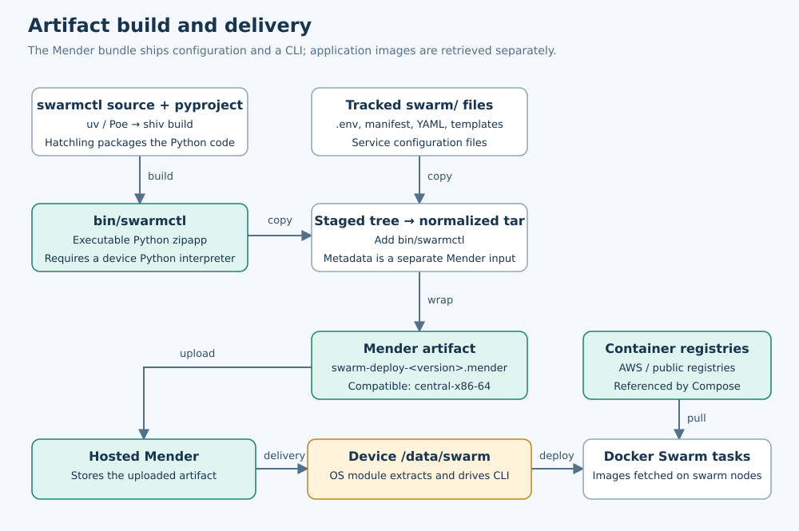
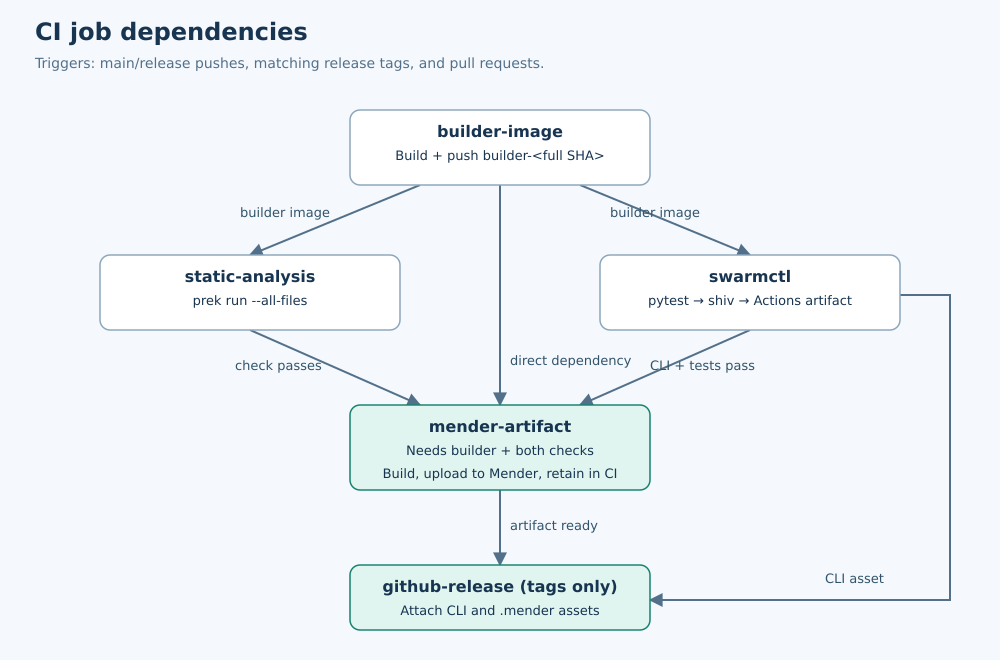
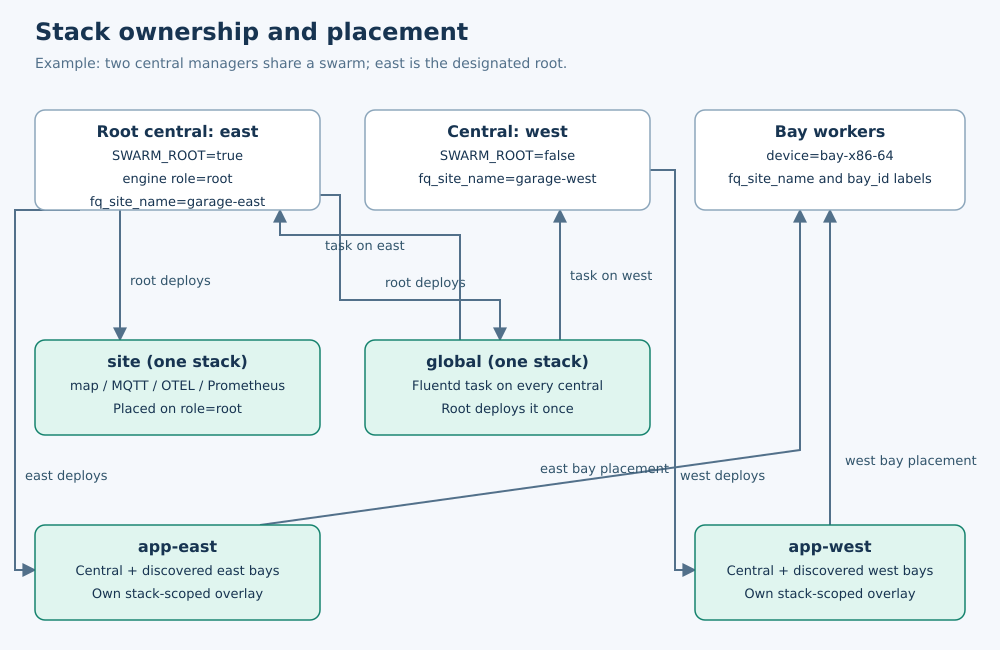
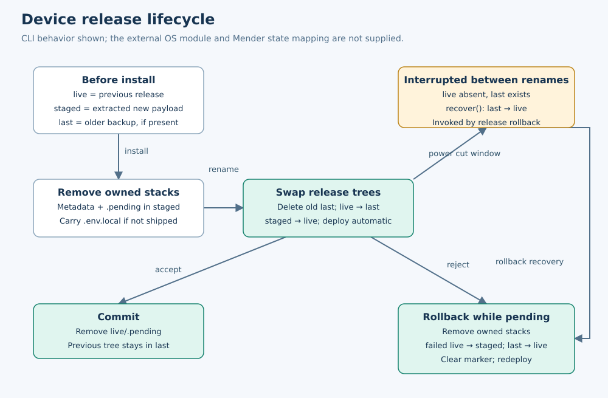

# swarm-deploy: architecture and engineering reference

An onboarding guide to artifact production, release orchestration, and device deployment.

**Evidence:** the supplied `swarm-deploy-repomix.md` snapshot, analyzed on 2026-10-09. This describes the supplied code, not a verified live deployment. Repository paths below are source references that can be searched in the snapshot. No build, deployment, or remote API operation was executed.

## Table of contents

Start with [Background: containers, Swarm, and Mender](#background-containers-swarm-and-mender), then read the repository overview. The detailed implementation sections follow that overview.

1. [What this repository does](#1-what-this-repository-does)
2. [Repository map and reading order](#2-repository-map-and-reading-order)
3. [Artifacts and their lifecycle](#3-artifacts-and-their-lifecycle)
4. [Python packaging and developer tooling](#4-python-packaging-and-developer-tooling)
   - [Repository tools inventory](#43-repository-tools-inventory)
5. [CI/CD and release versioning](#5-cicd-and-release-versioning)
6. [Runtime architecture and service dependencies](#6-runtime-architecture-and-service-dependencies)
7. [Configuration, stack selection, and templates](#7-configuration-stack-selection-and-templates)
8. [The deployment call flow](#8-the-deployment-call-flow)
9. [Mender install, rollback, and commit](#9-mender-install-rollback-and-commit)
10. [Operator commands and troubleshooting](#10-operator-commands-and-troubleshooting)
    - [What swarmctl is and who owns it](#101-what-swarmctl-is-and-who-owns-it)
11. [Tests, guarantees, and engineering considerations](#11-tests-guarantees-and-engineering-considerations)
12. [Missing files and context requested](#12-missing-files-and-context-requested)
13. [Technical terms and acronyms](#13-technical-terms-and-acronyms)
14. [Source index](#14-source-index)

## Background: containers, Swarm, and Mender

This section supplies the vocabulary used in the overview. Read it first if Docker clustering or device software updates are new to you; the complete glossary remains available in section 13.

### Containers and tooling containers

A **container image** is the packaged filesystem and execution configuration used to start a container. A **container** is an instance running from that image. For example, an application image can include application code and libraries; a container started from it executes that application.

A **builder image** or **build container** uses the same Docker mechanisms as an application container. “Builder” describes its job, not a special category of container. It contains the tools needed to produce and check deliverables. In this repository that includes Python, uv, Mender tools, and shell/Dockerfile checking tools. CI starts a container from this image and runs tests, packages the CLI, or constructs an update file inside it.

| Container role | What it does here | Typical lifetime/output |
| --- | --- | --- |
| CI builder/tooling container | Runs checks and packaging commands | Exists for a CI job; produces files such as `swarmctl` and `.mender` artifacts |
| Development container | Gives an engineer a similar toolchain locally | Exists during development; extends the builder with user/shell setup |
| Application container | Runs central, bay, map-server, or other production services | Runs as a Swarm task; produces application behavior and runtime data |

Building the tooling image is therefore different work from building the production application images. The supplied Dockerfile defines the tooling environment. Production images are referenced in service configuration and are built in other repositories.

### Docker Swarm, managers, workers, and the leader

A **Docker Swarm** is a group of Docker nodes managed together. A node is a participating Docker Engine, typically on one of the garage computers. Managers maintain cluster configuration and assign tasks; workers execute those tasks. Managers can also run application tasks, so the central can both manage the swarm and host services.

With multiple managers, Docker selects one **leader** automatically to coordinate orchestration. This is “election” by a distributed algorithm, not an engineer selecting a machine in the UI. Docker's managers use **Raft**, a protocol for agreeing on shared cluster state. Leader availability and election depend on sufficient managers participating. See [Docker's Swarm concepts](https://docs.docker.com/engine/swarm/key-concepts/) and [Raft overview](https://docs.docker.com/engine/swarm/raft/).

In this repository, a **service** describes a workload such as central or MySQL; a **task** is one scheduled service instance; a **stack** groups related services and resources described by Compose YAML. These YAML files tell Docker which images to run and which placement constraints, mounts, ports, and settings to use.

There are three different meanings of “root” or “leader” to keep separate:

| Name | Who determines it | Meaning in this codebase |
| --- | --- | --- |
| Swarm manager leader | Docker's manager election | Coordinates Docker orchestration; visible in manager status |
| Volley swarm root | Device configuration and engine labels | Central designated to own shared `site`/`global` stacks |
| Unix root user | Operating system user account | Privileged user, normally UID 0 |

The Volley root is a project policy role. A change in Docker's elected leader does not automatically transfer that role or rewrite `SWARM_ROOT`/`role=root`. A garage with just one manager has no second manager to take over its management role.

### swarmctl: the internal application in this repository

**`swarmctl` is Volley's internal Python command-line application for operating these deployments.** Its source is included under `swarmctl/src/swarmctl/`. It reads garage configuration and prepares Docker operations—for example, selecting the correct stacks, generating bay services, and creating missing declared secrets. Docker Swarm carries out the scheduling and container execution.

Engineers use commands such as `swarmctl info` and `swarmctl deploy app`. The update system uses its hidden release commands. It is packaged into a single executable Python archive using the third-party tool shiv; it still requires Python on the device. The detailed command/API explanation is in section 10.1.

### Mender and a Mender artifact

**Mender** is a third-party device software update platform. Its server manages update delivery, and device-side software applies updates. This repository uploads its release bundles to Hosted Mender. Uploading makes software available; a deployment is the separate decision to deliver it to particular devices.

A **Mender artifact** is an update package in the `.mender` format. It carries an update payload and metadata used to identify and apply it, including compatibility information. For this repository:

| Part of the update package | Concrete contents/settings |
| --- | --- |
| Payload | Tar archive of tracked `swarm/` configuration files plus packaged `bin/swarmctl` |
| Identity/metadata | Deployment version, branch, commit, and dirty-worktree flag |
| Compatible device type | `central-x86-64` |
| Update-module type | `swarm-deploy` |

The package is not a Docker image. Here it delivers configuration and an operator application; the running services' images are retrieved separately by Docker. A software **artifact** is a general name for a build output; a Mender artifact is one particular update format. See [Mender artifact documentation](https://docs.mender.io/overview/artifact).

### Update modules and state transitions

A **Mender update module** is device-side code that knows how to apply a particular payload type. The artifact's type identifies the module to use. Here the module named `swarm-deploy` ships with vngOS, the device OS, and its source is not included in this repository.

An update proceeds through **states**, meaning stages of the update process. A **state transition** is movement from one stage to another after an action succeeds, fails, or requires recovery. For example, finishing installation allows the process to continue toward acceptance; a failure can take it toward rollback. The stages describe the update, not whether a Docker task is running or whether the garage is idle.

| Stage / representative Mender state | Meaning | Repository connection |
| --- | --- | --- |
| Download and preparation | Obtain the package and prepare its files | Staging/extraction belongs to the external device integration |
| `ArtifactInstall` | Apply the incoming payload | This repo implements `swarmctl release install` |
| `ArtifactCommit` | Accept the installed update | `release commit` clears the local pending marker |
| `ArtifactRollback` | Attempt to undo an unsuccessful update | `release rollback` can restore the previous release tree |

These names explain the standard module lifecycle and the README's intended integration. They are not a verified trace of this device's module: its exact invocation mapping, checks, retries, and reboot behavior remain unknown. See [Mender update modules](https://docs.mender.io/artifact-creation/create-a-custom-update-module). The table omits additional lifecycle states; commit does not prove that this CLI itself checked application health.

## 1. What this repository does

`swarm-deploy` is the codebase that packages and operates a garage's deployment configuration. It ships two things together: **the files describing what Docker should run**, and **`swarmctl` (Volley's internal Python CLI that reads those files and invokes Docker)**.

The deployed configuration is a directory tree at `/data/swarm`. It contains stack definitions, service configuration files, templates, and baseline environment settings such as image versions and ports. The bundle also supplies `bin/swarmctl`. It describes the desired application deployment; it does not include the container image layers or replace the whole device OS.

### The garage it operates

Central computers are Swarm managers and host central application services. Bay computers are workers and run bay workloads assigned through Swarm. Most garages have a single central, which also owns shared services. With multiple centrals, each can operate its own sub-site application stack, while the designated **Volley swarm root** owns the common stacks.

That designated root is separate from Docker's automatically elected manager leader and from the Unix root user, as explained above. `swarmctl` checks the root setting to decide which stacks it may operate; the stack definitions use engine labels to decide where services run.

### The three responsibilities

| Responsibility | What happens | Where to find the implementation |
| --- | --- | --- |
| **Build and publish release files** | Build a tooling image, run checks, package `swarmctl`, combine it with the configuration tree into a `.mender` update file, and upload it. Tag builds also publish GitHub release assets. | `docker/`, `swarmctl/pyproject.toml`, `tools/swarm-artifact`, `.github/workflows/` |
| **Provide device installation operations** | Expose hidden `swarmctl release` commands that remove owned stacks, promote a staged tree to `/data/swarm`, retain the previous tree for rollback, and redeploy automatic stacks. The external Mender module drives those commands. | `commands/release.py`, `release_tree.py`; external OS module required for complete integration |
| **Operate and inspect running workloads** | Read environment/manifest, select this central's stacks, create missing declared resources, render bay definitions, submit deployment/removal commands, and display status/logs. | `swarmctl/src/swarmctl/`, `swarm/stacks/` |

### What a release changes

For example, the supplied `.env` selects `VOLLEY_VERSION=26.41.1`, and the app definition references an image tag such as `central-26.41.1`. This repository chooses that image and supplies its settings; the image is built elsewhere. A later release could change that version, alter a service setting, update a mounted config, or fix `swarmctl` itself. A release can also keep the same application image version and change only deployment tooling/configuration.

The **builder container** is the ordinary Docker container that provides the tools for making these release files. It is not the central application's production container. The repository's Dockerfile builds that tooling image and its development variant.

### Where the repository hands off to other systems

The sequence is: CI produces an update package → Hosted Mender stores it → an external rollout delivers it to a central → the OS update module stages it and calls the release commands → `swarmctl` submits stack specifications → Docker schedules containers and retrieves referenced images.

Only the build/upload and the Python release/deployment operations are supplied here. The CI workflow does not choose a fleet or initiate a Mender device deployment. The device module's download/staging behavior, exact state transitions, and acceptance checks require its missing source. Section 12 lists those inputs explicitly.

## 2. Repository map and reading order

| Path | Responsibility | Read it to understand |
| --- | --- | --- |
| `README.md` | Maintainer overview | Intended operating model and release procedure |
| `swarm/.env` | Shipped environment defaults | Image versions, registries, addresses, paths, ports |
| `swarm/stacks/manifest.yaml` | Stack registry | Root-only ownership and external resources |
| `swarm/stacks/{site,global,app}/` | Compose specifications and mounted configs | Service placement, images, networks, storage |
| `swarm/stacks/app/bay.yaml.j2` | Dynamic Compose template | One bay service and guidance service per bay ID |
| `swarmctl/pyproject.toml` | Python project and task definitions | Dependencies, packaging, tests, typing, shiv build |
| `swarmctl/src/swarmctl/cli.py` | CLI entry point | Commands, context, user-facing error boundary |
| `swarmctl/src/swarmctl/{env,manifest,selection}.py` | Deployment policy | How a node chooses and names stacks |
| `swarmctl/src/swarmctl/{docker,aws,template}.py` | External adapters | Docker CLI, Secrets Manager, Jinja rendering |
| `swarmctl/src/swarmctl/commands/release.py`, `release_tree.py` | Release transitions | Directory swapping, rollback, pending marker |
| `tools/swarm-artifact` | Artifact build/upload entry point | Payload staging, tar normalization, Mender wrapper |
| `docker/Dockerfile`, `docker/docker-bake.hcl` | Tooling containers | Shared CI builder and local devcontainer |
| `.github/workflows/` | Pipeline orchestration | Build dependencies, releases, retention |
| `.github/scripts/` | Release support | Week-based codenames and Mender pruning |
| `schemas/manifest.schema` | Manifest JSON Schema | Editor-visible shape; not runtime validation |
| `prek.toml` | Development checks | Python, Docker, shell, YAML, Markdown, commit checks |
| `artifacts/` | Local output directory | Generated `.mender` files; ignored by Git |

Recommended first pass: `.env` → manifest → stack YAML → `deploy.py` → `tools/swarm-artifact` → `ci.yml` → release commands/tree. Read `docker.py` when tracing a concrete Docker operation.

## 3. Artifacts and their lifecycle



### 3.1 Artifact inventory

| Artifact | Producer | Identity | Storage and consumer |
| --- | --- | --- | --- |
| Builder image | Buildx Bake `builder` target | `ghcr.io/volleyautomation/swarm-deploy:builder-<full github.sha>` | GHCR; reusable CI jobs run inside it |
| Development image | Bake `user-develop` target | Local `<workspace-basename>:user-develop-local` | Local Docker; VS Code devcontainer |
| `swarmctl` | `uv run poe build` → shiv | Python project metadata `0.1.0`; release association comes from its containing build/release | `swarmctl/bin/swarmctl`, CI artifact, GitHub release asset, installed `bin/swarmctl` |
| Payload tar | `tools/swarm-artifact` | Temporary `swarm-deploy.tar` | Temporary build directory; input to Mender artifact writer |
| Build metadata | Artifact script | Branch, full/short commit, dirty flag, deployment version | Temporary `meta-data.json`; supplied as Mender metadata; copied on-device to `metadata.json` |
| Mender artifact | `mender-artifact write module-image` | `swarm-deploy-<version>.mender`; artifact name `swarm-deploy-<version>` | Local `artifacts/`, Hosted Mender, CI artifact, tagged GitHub release |
| Application images | External producers, not supplied | Role tag plus `VOLLEY_VERSION`; separate guidance version | Referenced via AWS registry values; executed by Swarm nodes |
| Infrastructure images | External producers | Mix of version tags and SHA-256 digests | Public registries and configured AWS registry |
| ROS run artifacts and collected logs | Running services | Timestamped paths/service names | `/data/artifacts/ros`, NFS-backed bay storage, `/data/logs/stack` |

The last row is runtime output, separate from software release artifacts.

### 3.2 Payload assembly

`tools/swarm-artifact` runs the following stages with Bash strict mode (`set -euo pipefail`):

1. Resolve arguments, Git branch/commit, dirty status, and version.
2. Build `swarmctl`, unless `--skip-build` was supplied.
3. Create a temporary working directory and register cleanup on exit.
4. Copy files selected by `git ls-files` from `swarm/`, excluding `.gitignore`, preserving relative paths.
5. Install the generated CLI at staged `bin/swarmctl`, executable mode `0755`.
6. Produce a normalized tar and write the metadata JSON separately.
7. Wrap the tar in a Mender module artifact and write the result under `artifacts/`.
8. With `--push`, upload it to Hosted Mender; with a nonempty `--tag`, replace the corresponding Mender release's tags.

**Tracked paths, working-tree bytes:** `git ls-files` chooses tracked paths, while `cp` reads their current working-tree contents. Untracked files are omitted, but modified tracked files are included. `.env.local` is normally absent because it is ignored and untracked. A tracked `.env.local` would be selected; ignore rules are not an absolute packaging exclusion for already tracked files.

The bundle contains YAML, templates, configuration files, `.env`, and the CLI. It does not embed application image layers, database data, Docker secrets, or host credentials. The on-device software therefore still depends on registry access or cached images.

### 3.3 Reproducibility and metadata

The tar writer sorts names and normalizes owner/group to zero, mode, and modification times to epoch. Shiv uses `--compressed --reproducible`. These are deliberate reproducibility controls, but they do not prove that the entire `.mender` output is reproducible: dependency resolution, tool versions, and Mender wrapper behavior also matter.

`swarmctl/uv.lock` is referenced by CI caching but absent from the snapshot. Exact resolved dependencies cannot be established. The workflows use `uv run` without an explicit `--locked`/`--frozen` flag.

Build metadata records:

```json
{
  "branch": "release/26.41",
  "commit_short": "a1b2c3d",
  "commit": "<full Git commit>",
  "dirty": false,
  "version": "26.41.1"
}
```

This is illustrative, not metadata from an actual build. Artifact construction sets module type `swarm-deploy`, compatible device type `central-x86-64`, software filesystem `data-partition`, software name `swarm`, and software version to the resolved deployment version. Compression is `zstd_fast`.

## 4. Python packaging and developer tooling

### 4.1 Packaging model

The Python project uses a `src/` layout with Hatchling as its PEP 517 build backend. Its console entry point is `swarmctl = "swarmctl.cli:main"`; wheel packaging selects `src/swarmctl`. Python is required at version **3.14 or later**.

The release build task is:

```sh
shiv --console-script swarmctl --python '/usr/bin/env python3' \
  --compressed --reproducible -o bin/swarmctl .
```

The output is an executable Python **zipapp** containing packaged code and dependencies. The repository calls it a “binary,” but it is not a native executable or a bundled Python interpreter. A suitable device interpreter and the external Docker CLI are still required. Hatchling enables Python package building for this process; the shown release pipeline publishes the zipapp rather than separate wheel/sdist assets. There is no shown PyPI upload, Twine, Poetry, setuptools configuration, pip-tools, or Fabric workflow.

### 4.2 Tools and libraries

| Tool/library | Role in this repository |
| --- | --- |
| `uv` | Run project tasks and manage project environments/dependencies; cache reused in CI |
| Hatchling | Python package build backend |
| `shiv` | Build the executable zipapp |
| Poe the Poet (`poethepoet`) | Named tasks: build, test, lint, typecheck, static-analysis |
| Click | Command groups/options, context passing, shell completion, error rendering |
| Rich | Tables, styled output, live watch dashboard |
| `python-on-whales` | Docker CLI-backed operations, wrapped by `SwarmClient` |
| PyYAML | Manifest parsing with `safe_load` |
| `python-dotenv` | Environment file loading and interpolation |
| Jinja2 | Strict template rendering for bay services |
| `requests`, `requests-aws4auth` | Direct Secrets Manager HTTP calls signed with AWS SigV4 |
| pytest, pytest-mock | Unit testing and test doubles |
| Ruff, mypy | Lint/import/style checks and strict static typing |
| `pdoc` | Declared development dependency; no documentation-generation task shown |
| `prek` | Git hook/check runner, also used for CI static analysis |

`py.typed` marks the package as typed. Frozen dataclasses model shared context, stack definitions, environment settings, and Docker summaries. `TYPE_CHECKING` imports and lazy imports reduce loading of heavy dependencies until a command needs them. Expected operator failures use `SwarmError`; the CLI translates these into clean Click errors with optional tips. Unexpected exceptions retain tracebacks outside specific display/retry boundaries.

### 4.3 Repository tools inventory

This table covers build/deployment tools, developer tooling, and infrastructure services. **Used** means an invocation, dependency, or service definition is visible in the supplied snapshot. **External** means a required component is documented but its implementation is not included. Versions below come from source configuration, not an inspection of installed devices.

| Tool or platform | Where it runs | Purpose in this repository | Evidence / configured version |
| --- | --- | --- | --- |
| swarmctl — internal Volley tool | Central device managers; developer environments | Apply Volley-specific stack policy, prepare resources, invoke Docker, inspect workloads, and expose release transitions for Mender | Its implementation is in this repository: `swarmctl/src/swarmctl/`; built into `bin/swarmctl` |
| Docker Engine / Docker CLI | Developers, CI builder hosts, device swarm nodes | Build/run containers; manage stacks, services, secrets, configs, nodes, volumes | `docker.py`, stack YAML, devcontainer scripts; device version external |
| Docker Swarm | Garage central managers and bay workers | Schedule distributed service tasks; apply placement labels and stack ownership conventions | `swarm/stacks/`, `selection.py`, `docker.py` |
| Docker Buildx / BuildKit / Bake | CI and local developers | Build the tooling container with named targets and caches | `docker-bake.hcl`, `.call-builder-image.yml`; `linux/amd64` |
| Compose specification | Interpreted by Docker stack deployment | Describe and merge services/networks/configs; standalone `docker compose` is not invoked here | `*.yaml`, rendered `bay.yaml.j2`, `stack.deploy` |
| Mender artifact writer (`mender-artifact`) | Builder container / local build environment | Wrap payload tar and metadata as a compatible module artifact | Dockerfile and `tools/swarm-artifact`; installed from stable Mender APT repository |
| Mender CLI (`mender-cli`) | Builder container / local publisher | Upload `.mender` files to Hosted Mender | `push_artifact`; package version not pinned |
| Hosted Mender | External service | Store artifacts, associate release labels, expose management APIs for cleanup | Artifact upload/tag calls and pruning script |
| Mender device client + vngOS update module | Device OS; external implementation | Retrieve/apply updates and invoke hidden release commands | README contract; client/module source absent |
| Git | CI, developer checkout, artifact builder | Select tracked payload paths, record revisions/dirty state, resolve patch tags | Artifact script and release workflow |
| GitHub Actions | Hosted CI runners | Orchestrate checks, builds, artifacts, cleanup, release creation | `.github/workflows/` |
| GitHub CLI (`gh`) | GitHub release job | Publish release notes and attach CLI/Mender assets | `.call-github-release.yml`: `gh release create` |
| GitHub App token / `github-script` | Release-trigger job | Create release branches and Git tags through the API | `release-trigger.yml`; App installation/permissions external |
| GHCR | External container registry | Store per-commit builder images | Bake default registry and builder workflow |
| AWS container registry reference | Devices; upstream image production external | Supply Volley, guidance, and discovery images | `${AWS_REGISTRY}` references; endpoint/service and login provisioning not supplied |
| Python | CI builder, developer environment, device | Implement CLI and release support scripts; execute zipapp | Project requires `>=3.14`; builder uses Python 3.14 |
| uv | CI/development | Manage Python environments and run project tasks | Digest-pinned builder base `uv:0.12.0-python3.14-trixie`; `uv run` |
| Hatchling | Python packaging build environment | Build the Python package consumed by shiv | `pyproject.toml` build backend; exact resolved version absent |
| shiv | CI/development | Package CLI and dependencies into one executable zipapp | `poe build`; requirement `shiv>=1.0.6` |
| Poe the Poet | CI/development | Name and compose build/test/lint/typecheck tasks | `pyproject.toml`; `poethepoet>=0.29` |
| Bash / GNU tar / core utilities | Artifact builder and devcontainer | Stage payload, normalize tar bytes, install executable, manage temporary files | `tools/swarm-artifact`, shell scripts |
| curl / GnuPG / APT | Builder/container build; publishing | Fetch tooling, verify Mender repository key fingerprint, install packages, tag Mender release | Dockerfile and artifact script |
| AWS Secrets Manager | External service; CLI calls from device | Retrieve JSON fields for missing Docker secrets | `aws.py`, manifest; HTTP SigV4 via requests libraries |
| Jinja2 | Device CLI | Generate services for discovered or overridden bay IDs | `template.py`, `bay.yaml.j2`; `jinja2>=3.1` |
| prek | CI/development | Run repository checks and install Git hooks | Dockerfile `0.4.11`; `prek.toml` |
| pytest / pytest-mock | CI/development | Run unit tests and mocks | `poe test`; minimum versions `8.0` / `3.12` |
| Ruff / mypy | CI/development | Lint code and run strict static typing | `poe static-analysis`; minimum versions `0.6` / `1.10` |
| Hadolint | CI/development | Lint Dockerfile | Dockerfile/hook `2.14.0` |
| ShellCheck / shfmt | CI/development | Check and format shell scripts | Dockerfile packages and prek hooks |
| yamllint / markdownlint-cli2 | CI/development | Check YAML and Markdown formatting | `prek.toml`, associated config files |
| Commitlint | Developer commit-message hook | Check Conventional Commit message format | `prek.toml`; hook stage `commit-msg` |
| pre-commit-hooks collection | CI/development via prek | Whitespace, conflicts, symlinks, large files, private-key checks | `prek.toml`; this is the hook collection, not a shown invocation of the `pre-commit` runner |
| VS Code Dev Containers | Local development | Share the builder toolchain and match host UID/GID | `.devcontainer/` |
| pdoc | Declared development dependency | Documentation generator available to developers; no invoked generation task shown | `pyproject.toml`: `pdoc>=14.0` |
| Fluentd | Global stack, every eligible central | Receive container log traffic and write service-grouped files | Global stack/config; `v1.19.3-1.0` plus digest |
| OpenTelemetry Collector | Site root | Receive OTLP metrics and expose Prometheus scrape data | Site stack/config; `0.156.0` plus digest |
| Prometheus / Grafana Cloud | Site root / external service | Scrape, persist, and remotely store metrics | Site stack/config; Prometheus `v3.13.1` plus digest |
| Mosquitto | Site root | Shared MQTT broker with persistent storage | Site stack/config; `2.0.22` plus digest |
| MySQL | Each application central | Persist scheduler/patron databases | App support stack and SQL init; `5.7` plus digest |
| Nginx | Each application central | Reverse-proxy API traffic and expose local health endpoint | App support stack/config; `1.30.0-alpine3.23-slim` plus digest |
| Fast DDS / ROS discovery server | Application containers | ROS communication, restricted transport profile, discovery | DDS XML and discovery service; external image tag `lyrical-discovery-server-20260911` |
| NFS | OS-provisioned server and bay volume clients | Share ROS artifacts from bays with central storage | Bay template volume driver options; server setup external |
| Ansible | **Not found in supplied snapshot** | No playbook, inventory, role, dependency, or invocation shown | Do not infer use in external OS provisioning |
| Terraform / Jenkins / Fabric / Poetry / Twine / pip-tools | **Not found as configured or invoked tools** | No corresponding infrastructure/build/deployment workflow shown | HCL file is Docker Bake; Hatchling is the Python build backend |

Python libraries used inside the CLI are listed in section 4.2; service-level connections and storage are detailed in section 6. The table is an inventory of the supplied snapshot, not a claim about tools used in other Volley repositories.

### 4.4 Builder and development environment

The builder is based on a digest-pinned `astral/uv:0.12.0-python3.14-trixie` image. It installs Mender tools, Git, curl, shell tooling, Hadolint, and prek. The Mender repository key fingerprint is checked. The Mender packages come from its stable APT repository without explicit package-version pins; the builder's complete toolchain is therefore not fixed solely by the base image digest.

Bake targets `linux/amd64`. Local targets load images into Docker; CI overrides builder output to the registry, enables the GitHub Actions BuildKit cache, and disables provenance output. Each build receives a commit-derived image tag; this is a tag reference, not an exported digest reference.

The devcontainer extends the builder with sudo and zsh, matches host UID/GID, mounts the workspace/home/hooks, mounts SSH files read-only, and installs prek hooks after creation. No Jenkinsfile or Terraform configuration appears in the supplied inventory.

## 5. CI/CD and release versioning



### 5.1 CI dependency graph

`ci.yml` runs on pushes to `main` and `release/**`, matching calendar-version tags, and pull requests. Its concurrency group is based on Git ref and newer runs cancel in-progress runs for that ref.

| Job | Preconditions | Work and outputs |
| --- | --- | --- |
| `builder-image` | Start of run | Build/push tooling image; export image reference |
| `static-analysis` | Builder available | `prek run --all-files` inside builder |
| `swarmctl` | Builder available | `uv run poe test`, then `uv run poe build`; upload CLI |
| `mender-artifact` | Builder, static analysis, CLI job succeed | Download CLI, resolve version, build with `--skip-build --push`; upload `.mender` to CI |
| `github-release` | Tag run; CLI and Mender artifact jobs succeed | Download both assets; create named GitHub release with generated notes |

CLI and Mender CI artifacts each have **seven-day retention**. Hosted Mender upload occurs before the Mender CI artifact upload. Publishing has distinct stages: a late failure may leave an artifact in Mender while the run or GitHub release creation fails.

The Mender job is not restricted to tags: main, release-branch, and PR builds also attempt upload. PR metadata uses the PR **head SHA**, while `actions/checkout` normally checks out the PR merge commit. Thus the recorded PR commit/version can describe the head while the packaged working tree reflects the merge result. This is a traceability distinction in the workflow, not proof that the bytes match the recorded commit. Fork PR behavior also depends on secret and package-write availability, which is not supplied.

### 5.2 Three independent version axes

| Version | Source | Example in snapshot or naming rule |
| --- | --- | --- |
| Deployment release version | Git tag / branch / commit or explicit CLI option | `26.41.1`, `26.41-a1b2c3d`, `a1b2c3d` |
| Python project version | `swarmctl/pyproject.toml` | `0.1.0` |
| Application image version | `swarm/.env` / local overrides | `VOLLEY_VERSION=26.41.1`; `BAY_GUIDANCE_VERSION=0.1.3` |

A new deployment tag does not automatically change `VOLLEY_VERSION` or the Python project version. A configuration-only release can deploy the same application images as before.

For the manual release trigger, let \(y\) be the two-digit ISO week-year, \(w\) the zero-padded ISO week, and \(p\) the patch number:

$$
v_{\mathrm{main}} = \operatorname{fmt}_{2}(y)\; .\; \operatorname{fmt}_{2}(w),
\qquad
v_{\mathrm{patch}} = v_{\mathrm{base}}\; .\; p.
$$

These are string-formatting expressions, not multiplication or semantic versions. ISO week-year can differ from calendar year near New Year.

| Build context | Mender version rule | Example |
| --- | --- | --- |
| Matching Git tag | Exact ref name | `26.41.1` |
| `release/YY.WK` branch without tag | Branch suffix + seven-character SHA | `26.41-a1b2c3d` |
| Other CI build | Seven-character SHA | `a1b2c3d` |
| Local script, no explicit version | Short SHA; append `+dirty` for dirty tree | `a1b2c3d+dirty` |
| Local script with `--version` | Supplied string | Caller-controlled |

The manual `release-trigger.yml` uses `date +%g.%V` on the runner for mainline releases. It creates `release/YY.WK` and a lightweight Git tag at the selected commit. From an exact `release/YY.WK` branch it finds the highest version-sorted patch tag and increments its suffix, starting at 1. A GitHub App token performs the ref creation. Its permissions/install configuration is external.

Duplicate refs cause failure. Branch and tag creation are separate API operations, so the operation is not transactional. There is no explicit concurrency group in this release-trigger workflow; simultaneous patch cuts can derive the same next version. The README directs fixes onto the release branch and asks that equivalent commits be cherry-picked to `main` afterwards.

`.github/scripts/codenames` uses the week component as an index into `.github/codenames.json`. Codenames affect GitHub release presentation, not deployment selection or compatibility.

### 5.3 Retention and cleanup

`package-cleanup.yml` runs daily at 04:00 UTC and supports manual dry runs and age selection (default 14 days). Separate jobs prune GHCR builder tags and Mender artifacts.

- GHCR cleanup delegates to `dataaxiom/ghcr-cleanup-action`; configured tags match `builder-<40 hex characters>`. The comment intends to keep versions with other tags; exact third-party action behavior is not verified here.
- Mender pruning uses the **modified timestamp**, paginates at 500 artifacts per page, and matches `swarm-deploy-<7 hex>` or `swarm-deploy-YY.WK-<7 hex>`. Tagged calendar releases, including patches, do not match. Local `+dirty` names also do not match this regex.
- Deletion conflict HTTP 409 is reported as “in use” and skipped; other unsuccessful deletion responses cause a failing exit status. A missing timestamp is treated as epoch.

This is software cleanup. No log, ROS output, database, or Docker volume retention policy is shown.

## 6. Runtime architecture and service dependencies



### 6.1 Ownership is separate from placement

`SWARM_ROOT` controls which manifest entries this CLI will operate. Engine labels determine where Swarm schedules services. Docker manager permissions determine whether Docker accepts the operation at all. These are separate controls: setting `SWARM_ROOT=true` is CLI policy, not an independent security boundary.

| Stack | CLI ownership | Deployed name | Placement |
| --- | --- | --- | --- |
| `site` | Root only | `site` | `engine.labels.role == root` |
| `global` | Root only | `global` | Global-mode collector on every `central-x86-64` node |
| `app` | Any authorized central node | `app` or `app-<SITE_SUB_NAME>` | Central services match device type and fully qualified site; bay services match bay device type and ID |

The root node may also deploy its own `app`. Bay workers do not execute deployment operations in the documented operating model.

### 6.2 Services and dependencies

| Stack/service | Function visible in configuration | Key connections/storage |
| --- | --- | --- |
| `site/map-server` | Shared map HTTP service | Host port 5050 by default; application image `mapserver-<version>` |
| `site/mosquitto` | MQTT broker | Host 1883; persistent external volume; anonymous access enabled in config |
| `site/otel-collector` | OTLP metrics receiver → Prometheus exporter | Host gRPC 4317; metrics export internally at 8889 |
| `site/prometheus` | Scrape OTEL metrics, remote write to Grafana Cloud | External persistent volume; Docker secret API key; no host port configured |
| `global/log-collector` | Fluentd collector on each central | Host TCP 24224; bind mount `/data/logs`; service-tagged file output |
| `app/control` | Sleeping debug container | Shared DDS config and app network; default logging driver |
| `app/central` | Central application/ROS workload | API 5000, port 8765; MySQL, MQTT, map server, OTEL, external notification secrets, ROS output bind mount |
| `app/noc` | NOC application; acronym expansion not supplied | Host 8011 → container 80; app overlay |
| `app/discovery-server` | Fast DDS discovery server | UDP 11811; AWS `ros2` image with fixed discovery tag |
| `app/mysql` | Scheduler/patron databases | Host 3306; named volume; initialization SQL and server config |
| `app/nginx` | API reverse proxy | Host 80 → `scheduler:5000`; local `/healthz` returns 200 |
| `app/bay<ID>` | Per-bay ROS workload | DDS discovery; NFS-backed ROS output; API image `bay-<version>` |
| `app/bay<ID>-guidance` | Bay guidance UI | X11/GPU host bind mounts; `ws://bay<ID>:5001`; separate image/version |

Ports are snapshot defaults; `.env.local` can change configurable ports. Multiple app stacks publish several fixed host ports, so they require placement on separate central hosts as intended.

### 6.3 Networks, DDS, logs, and metrics

Each stack's `internal` overlay is namespaced by Docker: for example, `site_internal` versus `app-east_internal`. The key named `internal` does not itself configure an isolated network (`internal: true` is not set). Application services reach shared site services through the root hostname and host-published ports rather than through `site_internal`.

Garage metadata comes from `stacks/app/config/garage_info/<SITE_ID>.json` and is mounted into central under `/tmp/garage_info/`. The snapshot includes IDs `0006`–`0009`, with installation identity, feature flags, capacity, bays, and location fields. Several booleans and counts are stored as strings; their interpretation belongs to the external application. These files do not drive `swarmctl` bay discovery, which uses Swarm labels or the override.

Within an application stack, central has alias `scheduler` for legacy NOC/API compatibility. Nginx resolves this alias using Docker DNS. DDS-enabled services mount `fastdds-profile.xml`; Compose requests interface name `overlay0`. The profile disables built-in transports, uses shared memory and UDP with an `overlay0` allowlist, and disables type propagation. The README explains this as mitigation for unreachable bridge locators and startup discovery/type traffic; the supplied snapshot does not include the incident data or application-side implementation.

Log configuration routes site services to the root collector and app services to the central deployer's `${HOSTNAME}:24224`. **Bay app logs cross the network to that central collector**, despite the README's general claim that collector traffic never crosses the wire. Fluentd writes service-tagged log files with hourly time buckets, one-minute late-arrival tolerance, and three-second flush intervals. Its buffer is under `/fluentd/buffer` with no explicit persistent mount shown.

Metrics flow from central → root OTEL receiver → internal Prometheus scrape → Grafana Cloud remote write. Only a metrics pipeline is configured in the OTEL collector; logs/traces pipelines are not shown. Prometheus config contains literal `${SITE_NAME}` in a mounted file; `swarmctl` does not render that file. Whether it becomes a real label value requires verification of container/config behavior. Compose interpolation of YAML environment fields must not be assumed to interpolate the contents of referenced config files.

### 6.4 Persistent data and secrets

| Resource | Provisioning/behavior shown |
| --- | --- |
| `/data/artifacts/ros` | Manifest asks deploy to create this bind directory on the deploying host |
| Bay ROS storage | Local volume driver mounts NFS from `${NFS_HOSTNAME}` at `${DATA_ARTIFACTS_DIR}/ros`; NFS server/export is external |
| `/data/logs` | Global Compose comment says OS-provisioned; CLI manifest does not create it |
| App MySQL / volley cache volumes | Stack-declared named volumes |
| Site Mosquitto / Prometheus volumes | `external: true`; must already exist, and the CLI does not create them |
| Notification and Grafana secrets | Missing Docker secrets created from AWS Secrets Manager JSON fields |

AWS credentials/config are read from `/data/config/aws/{credentials,config}` using the `[default]` profile and SigV4. The implementation supports an optional session token but shows no credential refresh, role discovery, or boto3 provider chain. Calls have a ten-second HTTP timeout. Missing secrets are grouped by AWS secret ID to avoid duplicate fetches within one stack's setup.

Existing Docker secrets are accepted by name without fetching AWS values. Deploy therefore does not rotate or reconcile secret content. External names are swarm-wide, so sub-site application stacks share these notification secret names. Secret values are written to a private temporary file for Docker creation and the file is removed afterwards.

## 7. Configuration, stack selection, and templates

### 7.1 Environment layering

`load_environment(root)` starts with the current process environment, then loads existing files in this order using `override=True` and interpolation:

1. `/data/config/device.env`
2. `<root>/.env`
3. `<root>/.env.local`

For keys explicitly loaded, later files override earlier files and process values. A key absent from all files can retain a process value. `--root` changes the deployment-tree path but does not relocate the fixed device/AWS config paths.

Derived variables include `SWARM_ROOT_DIR=<root>` and `FQ_SITE_NAME`, built from site name plus optional sub-site. Hostname comes from `HOSTNAME` when present, otherwise `/proc/sys/kernel/hostname`. Since `.env` interpolation occurs before this hostname fallback, variables derived from an initially absent `HOSTNAME` should be checked in the device environment.

Interpolation happens when files are loaded; later overriding a source variable does not imply that an earlier derived string is recomputed. For example, changing only `AWS_REGISTRY` in `.env.local` should not be assumed to update the previously interpolated `VOLLEY_REGISTRY`; override the final variable explicitly when necessary.

| Setting | Meaning / supplied default |
| --- | --- |
| `SITE_NAME`, `SITE_SUB_NAME`, `SITE_ID`, `LAYOUT` | Device/site identity and application configuration; actual device values not supplied |
| `SWARM_ROOT` | Root eligibility; accepted true strings: `1`, `true`, `yes`, case-insensitive |
| `AWS_REGISTRY`, `LOCAL_REGISTRY`, `SWARM_ROOT_HOSTNAME` | OS-provided registry/root inputs; provisioning not supplied |
| `VOLLEY_REGISTRY` | `${AWS_REGISTRY}/volley`; active application registry |
| `LOCAL_VOLLEY_REGISTRY` | Defined from local registry, but not used by supplied service specs |
| `VOLLEY_VERSION` | `26.41.1` |
| `BAY_GUIDANCE_VERSION` | `0.1.3` |
| `MANUAL_STACKS` | Comma-separated manifest keys excluded from bulk deploy |
| `BAY_IDS_OVERRIDE` | Comma-separated IDs used instead of discovery |
| `DEPLOY_ISO_TIMESTAMP` | UTC second-precision run grouping, e.g. `20260923T143045Z`; set by deploy |

### 7.2 Selection policy

For manifest stack set \(S\), root-only subset \(R\), and manual-stack set \(M\), the eligible set is:

$$
E = \begin{cases}
S, & \text{if SWARM\_ROOT is true},\\
S \setminus R, & \text{otherwise}.
\end{cases}
\qquad D_{\mathrm{bulk}} = E \setminus M.
$$

A named deploy can select a manual stack if it is eligible. Bulk remove targets deployed names in \(E\), **including manual stacks**. A deployment name gains a sub-site suffix only for non-root stacks with a nonempty sub-site.

Bay discovery scans Swarm nodes for engine labels `device=bay-x86-64`, matching `fq_site_name`, and nonempty `bay_id`; IDs are deduplicated and string-sorted. It does not filter nodes by readiness. An offline node still registered in Swarm can therefore be discovered; a node absent from the Swarm inventory cannot. `BAY_IDS_OVERRIDE` bypasses discovery entirely.

### 7.3 Manifest and rendering rules

The manifest is the explicit registry, not a directory scan. Unknown folders are not deployable. `Manifest.load` uses PyYAML and constructs dataclasses; it does not run JSON Schema validation. The schema is provided for editor guidance and includes restrictions not independently enforced by the Python loader.

Plain `*.yaml` files are passed in sorted order. For app this is `main.yaml`, then `support.yaml`. Rendered `*.yaml.j2` files are appended afterwards, using only a `bay_ids` Jinja context. Docker/Compose subsequently expands environment variables such as `${VOLLEY_VERSION:?}`. The template protects Docker's own `{{.Name}}` logging expression with Jinja ``.

Rendering uses `StrictUndefined` and writes to `$XDG_RUNTIME_DIR/swarm/stacks/<manifest-name>/generated`, falling back to the system temp directory. The generated path uses the manifest name, not the sub-site deployment name; concurrent app renders in the same runtime directory can overwrite the same file.

If no bay IDs are found, the template is omitted. Because deploy uses pruning, omission can remove previously deployed bay services. The file can still remain on disk, but is not included in that invocation's Compose list. Bay placement checks device and bay ID but does **not** include `fq_site_name`; the design depends on bay IDs being unambiguous in the swarm, or placement constraints need strengthening.

## 8. The deployment call flow

The main path is `cli.main()` → Click `cli` → `commands.deploy.deploy(Context, stack)`.

1. **Guard the shell location:** `ensure_live_cwd` rejects working directories under staged/previous release trees.
2. **Load policy:** load environment, parse manifest, construct Docker/AWS adapters.
3. **Choose targets:** filter root-only entries, validate a named stack, or skip manual entries in bulk mode.
4. **Stamp the deploy:** one UTC timestamp is set for the invocation.
5. **Create bind directories:** expand variables, fail on remaining `$`, and create missing paths on the deploying host.
6. **Create missing secrets:** list swarm secrets, fetch needed AWS JSON objects, validate requested keys, create missing names.
7. **Collect and render Compose:** sorted plain YAML plus rendered templates when bays exist.
8. **Deploy each target:** call `SwarmClient.deploy_stack` with its deployed name and Compose paths.

The underlying call uses:

```python
client.stack.deploy(
    name,
    compose_files=[str(path) for path in compose_files],
    prune=True,
    resolve_image="never",
    with_registry_auth=True,
)
```

`prune=True` removes services no longer present. `resolve_image="never"` skips manager-side registry resolution of tags to digests; this must not be interpreted as disabling image retrieval. `with_registry_auth=True` passes available registry auth into deployment. How devices obtain/refresh those credentials is outside the snapshot.

The CLI loops through manifest targets in insertion order (site → global → app here). This is sequencing of API submissions, not a dependency DAG or readiness barrier. It has no explicit wait for application health or task convergence before reporting the deploy timestamp. The release install path likewise has no shown application-level success gate.

`SwarmClient` centralizes Docker operations and produces flattened node/task summaries. Task displays retain tasks whose desired state is running and the newest failed/rejected/orphaned task per service slot or global-task node. This makes recent failures visible even after replacement tasks start.

## 9. Mender install, rollback, and commit



### 9.1 Directory model

| Path with default root | Meaning |
| --- | --- |
| `/data/swarm` | Live release: shipped tree, CLI, metadata, local overrides |
| `/data/.swarm-staged` | Extracted incoming release, or failed release after rollback |
| `/data/.swarm-last` | Previous release used for rollback |
| `/data/swarm/.pending` | Installed release not yet committed |

`ReleaseTree.from_root` derives sibling names from any supplied root. Metadata is stored as `metadata.json`; version reading tolerates missing/malformed metadata for hand-bootstrapped roots.

### 9.2 Install

The hidden `release install --metadata <path>` command removes owned stacks if live exists, then calls `ReleaseTree.swap`, then deploys automatic stacks. The swap:

1. Requires staged directory and metadata file.
2. Copies metadata into staged and touches `.pending` there.
3. Copies `.env.local` from live if staged does not already contain it, preserving mode/timestamps and explicitly copying ownership.
4. Deletes an older `last` backup while live is still intact.
5. Renames live → last, if live exists.
6. Renames staged → live.

This intentionally incurs service downtime. Moreover, removal happens before `swap` checks staging/metadata, so invalid staging can leave stacks stopped while the install fails.

Each rename is an individual filesystem operation; **the pair is not an atomic transaction**. Recovery handles the recognizable window where live is missing and last exists. There is no explicit fsync/durability protocol shown, and directories must satisfy filesystem rename constraints. The external module's retry handling is necessary to understand the full power-loss guarantee.

### 9.3 Rollback and commit

`release rollback` first calls `recover`: if live is absent and last exists, last is renamed to live. It then removes currently owned stacks using the manifest in the live tree. If live is pending and a last tree exists, it moves failed live → staged, last → live, clears the pending marker, and deploys automatic stacks.

If first install has no previous tree, rollback warns and redeploys the installed tree; it cannot restore nonexistent software. The marker is not cleared by that no-backup branch. If there is no pending marker, rollback still performs removal/redeployment but does not restore last.

`release commit` removes the pending marker, returning early if none exists. It does not delete the last tree or check application health. When Mender commits, and which program determines success, cannot be established without the update module.

### 9.4 Practical limits

- A manual stack is removed on install/rollback but not automatically redeployed.
- `.env.local` is carried forward if absent in staged; an artifact-shipped copy takes precedence. Edits made only to a failed new release's override are not copied back into last on rollback.
- Data volumes, databases, logs, and external secrets are not rolled back by restoring the release tree. This is code/configuration rollback, not data rollback.
- Removal checks only stacks recognized by the current manifest/ownership policy. A removed or renamed manifest entry can leave an old stack outside future ownership calculations.
- `wait_for_stack_removed` lists running containers through the current Docker client. With normal local configuration it waits only for local containers, not all remote bay containers. The timeout is 60 seconds with 0.5-second polling; the release can continue while remote task teardown is still completing.
- Stale-shell guards reduce use of demoted tree paths. `watch` and following `logs` additionally detect changes in the live directory inode and ask the operator to restart the view.

## 10. Operator commands and troubleshooting

### 10.1 What swarmctl is and who owns it

**The `swarmctl` described here is an internal Volley tool implemented in this repository.** It is the project-specific Python CLI for operating the garage's Docker Swarm deployment. It is not a third-party package merely configured by this repository, and it is not a built-in Docker command. This conclusion comes from the supplied source: the `swarmctl/` project declares its own package, console entry point, commands, deployment rules, and tests. The name alone does not identify the implementation; an unrelated project could use the same executable name.

“Internal” describes ownership and purpose, not a claim about this repository's public/private visibility. The implementation belongs to the supplied Volley codebase; Docker, Mender, Click, Rich, and the packaging libraries are separate third-party tools it uses.

#### Why a dedicated CLI exists

Docker understands stacks, services, tasks, networks, and secrets. `swarmctl` adds the **garage-specific decisions** needed before those operations: which stacks this central owns, whether it is the designated swarm root, which sub-site suffix to use, where configuration lives, which bays to render, and which AWS secrets/host directories must exist. Operators can express an intent such as `swarmctl deploy app` without assembling the environment, Compose files, and resource setup themselves.

The architecture has three cooperating layers:

| Layer | Ownership | Responsibility |
| --- | --- | --- |
| `swarmctl` | Internal Volley Python code | Interpret garage configuration, select stacks, prepare resources, render templates, issue operations, and show useful output |
| `python-on-whales` and Docker CLI | Third-party library/tool | Translate the Python adapter calls into Docker CLI operations |
| Docker Engine / Swarm | Third-party container platform | Store desired service specifications, schedule tasks, retrieve images, run containers, and reconcile workloads |

Thus `swarmctl` is an application/policy layer over Docker. The long-running scheduler and reconciliation engine are Docker Swarm. The supplied CLI is invoked on demand; `watch` and following `logs` stay active for observation rather than acting as background deployment controllers.

#### A concrete deploy example

Suppose a central has `SITE_NAME=garage`, `SITE_SUB_NAME=east`, and `SWARM_ROOT=false`. The operator runs:

```sh
swarmctl deploy app
```

The command loads the device, shipped, and local environment files; reads the manifest; checks that `app` is eligible; and resolves the deployed name to `app-east`. It creates missing declared bind directories and Docker secrets, collects `main.yaml` and `support.yaml`, and renders bay services from discovered/overridden IDs. Finally, it passes those Compose paths and deployment flags through `SwarmClient` to Docker stack deployment. Docker then schedules the central and bay tasks according to engine-label constraints.

The named command still deploys `app` when it is listed in `MANUAL_STACKS`. The same non-root central cannot use this CLI's policy to deploy `site` or `global`. These are implementation rules in `selection.py` and `commands/deploy.py`, not rules inherent to every Docker Swarm installation. Deployment submission does not itself establish that all containers are healthy; see sections 8 and 11.

#### Two entry points: operators and the update system

| Caller | Commands | Purpose |
| --- | --- | --- |
| Engineer/operator | `deploy`, `remove`, `info`, `watch`, `logs` | Operate or inspect the stacks owned by this central |
| OS-owned Mender update module | Hidden `release install`, `release rollback`, `release commit` | Apply a staged tree, restore the previous tree, or accept the installed release |

The default configuration root is `/data/swarm`; `--root` can change it. The CLI is shipped at `/data/swarm/bin/swarmctl`. The source does not establish how the OS adds it to `PATH` or which absolute executable the update module invokes; those details require the external module/provisioning configuration. The expected Mender contract is documented in the README, while the implemented release transitions are covered in section 9.

`swarmctl` does not build the production application images, publish the Mender bundle, or select a fleet rollout. Image builds belong to upstream repositories; bundle production/upload belongs to `tools/swarm-artifact` and CI; device rollout belongs to Mender and the external module. It does participate in the final on-device install by swapping the release tree and invoking stack removal/deployment.

#### Where to change the implementation

| Concern | Source location under `swarmctl/src/swarmctl/` |
| --- | --- |
| Command registration and shared `--root` option | `cli.py`, `context.py` |
| Environment layering and node identity | `env.py` |
| Manifest parsing and deployed names | `manifest.py` |
| Ownership policy and bay discovery | `selection.py` |
| Deploy/remove setup and sequencing | `commands/deploy.py`, `commands/remove.py` |
| Docker operations and summaries | `docker.py` |
| AWS secret retrieval | `aws.py` |
| Bay template rendering | `template.py` |
| Release install/rollback/commit | `commands/release.py`, `release_tree.py` |
| Inspection and streaming | `commands/info.py`, `commands/watch.py`, `commands/logs.py` |

The executable entry point is declared as `swarmctl = "swarmctl.cli:main"` in `pyproject.toml`. Hatchling builds the Python package, and shiv bundles that package and its dependencies into the executable zipapp. These packaging tools are third-party; the code they package is internal. A compatible device Python interpreter and Docker CLI are still required. Rebuilding `swarmctl` changes the internal tool; changing stack YAML or `.env` changes the configuration the tool operates.

### 10.2 Operator command reference

Commands below illustrate existing interfaces. Run mutation commands only on the intended manager and deployment root.

| Command | Scope and behavior |
| --- | --- |
| `swarmctl info` | Print release metadata, configured eligibility, manual-stack flags, local engine labels; labels degrade gracefully if Docker fails |
| `swarmctl watch` | Refresh all nodes plus this node's active owned stacks every two seconds |
| `swarmctl logs` | Read all available history from owned services by default |
| `swarmctl logs -f -n 100` | Replay 100 lines, then follow; follow default without `-n` is zero historical lines |
| `swarmctl logs -s app-east -e control -f` | Filter using **deployed stack name**; exclude a short service name |
| `swarmctl deploy app` | Deploy using **manifest key**, including a manual app stack |
| `swarmctl deploy` | Deploy all eligible automatic entries |
| `swarmctl remove app` | Remove named manifest entry after resolving its deployed name |
| `swarmctl remove` | Remove all currently deployed owned stacks; confirmation for bulk removal |
| `swarmctl remove -y` | Skip that bulk confirmation |
| `swarmctl --root /path/to/tree info` | Select a different release-tree root; option belongs before the subcommand |

Named `remove` does not prompt in the shown implementation. Bulk removal warns when removing root stacks could affect other nodes' stacks. It leaves unrelated stack names alone.

`logs` starts one `docker service logs` subprocess per service and uses a thread per stream plus a lock to prevent output interleaving. Following mode rescans every five seconds to add/remove streams, restarts ended streams, and avoids replaying old history when a previously seen service is restarted. It merges subprocess stderr into the same prefixed stream. Availability of `docker service logs` with the deployed logging driver must be verified on devices; the supplied code alone does not establish that the fluentd-configured services support this retrieval path.

### First investigation checklist

| Symptom | Inspect first | What the code tells you |
| --- | --- | --- |
| Root stack unavailable | `SWARM_ROOT` and manifest | Root eligibility is environment policy |
| Service pending or on wrong machine | Engine labels and generated bay YAML | Central/site/bay placement constraints are different |
| Bay service disappears after deploy | Discovery inventory and override | Empty discovery omits the template; pruning can remove services |
| AWS change not reflected | Existing Docker secret name/content | Existing secrets are not refreshed |
| Missing host path/volume | Manifest bind entries and external site volumes | CLI creates declared bind directories, not arbitrary external volumes |
| Failed image pull | Final interpolated image reference and device Docker credentials | Images are separate from the Mender bundle |
| App remains stopped after release | `.env.local` `MANUAL_STACKS` | Manual app removed during release and skipped on redeploy |
| CLI reports a stale tree | Shell working directory | `cd /data/swarm`, then rerun |
| Nginx `/healthz` passes but API fails | Central task and proxy target | `/healthz` is an nginx-local response, not upstream verification |
| ROS discovery mismatch | DDS profile, overlay interface, discovery address | Profile depends on `overlay0` and app network/discovery setup |

For local development, the configured tasks are:

```sh
uv run --directory swarmctl poe test
uv run --directory swarmctl poe static-analysis
uv run --directory swarmctl poe build
prek run --all-files
tools/swarm-artifact                 # builds a local Mender file
```

The last command requires Git context and the Mender tools; it defaults to short-commit versioning. `--skip-build` trusts the existing CLI file and checks only that it exists. `--push` requires `MENDER_TOKEN` or a token file at `~/.config/mender/token`. Release tagging additionally requires `MENDER_TOKEN`; the token-file fallback is not implemented for that separate API call.

## 11. Tests, guarantees, and engineering considerations

### 11.1 Checks visible in the snapshot

| Check | Evidence and coverage |
| --- | --- |
| pytest | 11 visible test functions: deploy timestamp (1), release stale-path/inode behavior (6), selection/naming/override behavior (4) |
| Ruff and strict mypy | Poe tasks called through a local prek hook when matching Python project files are checked |
| Docker/shell/YAML/Markdown checks | Hadolint, ShellCheck, shfmt, yamllint, markdownlint in prek |
| Repository hygiene | Conflict markers, symlinks, private keys, whitespace, line endings, large files |
| Commitlint | Configured commit-message hook using Conventional Commits; not evidence that CI's default all-files run validates commit messages |

The shown tests do not exercise complete swap/restore/commit behavior, AWS integration, actual Docker deployments, multi-node teardown, Mender state handling, template pruning, or application health. A pyproject comment references `tests/commands` and shared `tests/support`, but those files are absent from the snapshot. Do not infer additional coverage from that comment. No tests were executed for this analysis.

### 11.2 Engineering implications supported by the code

| Area | Consequence | Useful next verification/improvement |
| --- | --- | --- |
| Release availability | Full owned-stack teardown creates downtime, including shared services on root updates | Define service recovery expectations and Mender success gate |
| Rollback scope | Old tree restored; mutable data and secrets remain | Document data compatibility and migrations |
| Traceability | PR metadata head SHA can differ from packaged merge checkout | Record both source head and actual checkout commit |
| Runtime dependencies | Zipapp needs compatible Python and Docker; images remain external | Establish device prerequisite/version contract |
| Input validation | Manifest schema not executed; malformed input can bypass editor restrictions | Validate manifest and required environment before teardown |
| Secret lifecycle | Create-only behavior preserves stale values | Define controlled rotation/reconciliation procedure |
| Placement | Bay constraints omit fully qualified site | Confirm bay-ID uniqueness or include site constraint |
| Convergence | API submission success does not establish workload readiness | Define task/health validation before accepting a release |
| Teardown | Wait is local under normal Docker client configuration | Verify remote task removal before tree transition where required |
| Generated files | Same manifest-name path reused for renders | Serialize operations or give renders unique invocation paths |
| Supply chain | Base/infrastructure images often digest-pinned; several tools/actions use mutable/version refs; provenance disabled | Set required dependency lock, signing, provenance, and checksum policies |
| Artifact inputs | `--skip-build` can bundle an old CLI; JSON metadata is built by shell interpolation without JSON escaping | Validate binary provenance and serialize arbitrary metadata safely |
| Security defaults | SQL/Compose include static database credentials; MQTT allows anonymous access | Assess these concrete defaults against actual network/access controls |
| Observability | Prometheus mounted-file interpolation and fluentd service-log access unverified | Validate actual device metrics labels and operator log retrieval |

These are consequences or verification targets, not claims of observed production incidents. The artifact writer includes no signing-key option and the CI disables builder provenance; artifact authenticity requirements and device verification policy remain external questions.

## 12. Missing files and context requested

The Repomix preamble explicitly permits omitted/ignored/binary files. The following inputs are referenced or required but not supplied. **Please provide these files or the corresponding configuration context to complete the end-to-end picture; their behavior is not assumed here.**

| Priority | Requested file/context | Why it is needed |
| --- | --- | --- |
| Essential | vngOS `swarm-deploy` Mender update-module source and relevant state scripts/config | Verify extraction, CLI selection, state mapping, retries, recovery, success/commit decisions, and how a missing live tree is handled |
| Essential | `swarmctl/uv.lock` | Establish exact packaged dependency versions and reproducibility inputs |
| Essential | Redacted `/data/config/device.env` and provisioning code for it | Verify site identity, registry/root settings, hostname, and ownership inputs |
| Essential | Device Python/Docker/Mender installation configuration | Confirm zipapp compatibility and execution prerequisites |
| Essential | Docker daemon engine-label provisioning, manager/worker bootstrap, registry login/refresh configuration | Verify placement identity, manager authorization, and image retrieval |
| Important | Application/guidance/discovery image build and publish definitions from their owning repositories | Explain upstream build/version lifecycle and image entrypoints/health behavior |
| Important | NFS export/server configuration and provisioning of external Mosquitto/Prometheus volumes and `/data/logs` | Verify persistent-storage prerequisites and recovery |
| Important | Redacted AWS config/credential profile shape, IAM policy, and secret JSON field schemas | Verify Secrets Manager access contract without exposing secret values |
| Important | Mender fleet deployment procedure/API workflow and acceptance policy | Determine how an uploaded artifact is chosen, rolled out, and judged successful |
| Important | Any omitted `swarmctl/tests/commands/` or `tests/support` files | Reconcile the pyproject comment with actual coverage |
| Follow-up | GitHub App permissions, repository protection/environments, fork PR policy | Verify release ref creation and CI secret/write assumptions |
| Follow-up | Prometheus container/config substitution behavior and Docker logging-driver setup | Resolve metrics label substitution and `swarmctl logs` compatibility |

Actual secret values are unnecessary. A redacted schema/configuration example is sufficient. No conclusions here depend on guessing the unseen OS module, upstream builders, or deployed account settings.

## 13. Technical terms and acronyms

| Term | Meaning in this guide |
| --- | --- |
| Artifact | A stored output of a build, such as a zipapp, image, or `.mender` package |
| CI / CD | Continuous Integration / Continuous Delivery or Deployment; this repo automates publication, while device rollout is external |
| CLI | Command-Line Interface; `swarmctl` is the operator interface |
| GHCR | GitHub Container Registry; holds the CI builder image |
| OCI image | Container image format/ecosystem; application and builder containers are separate artifacts |
| SHA / digest | Cryptographic identifier; Git commits identify revisions, image SHA-256 digests identify image content |
| Tag | Human-facing reference; may mean a Git ref, container tag, or Mender release label depending on context |
| CalVer | Calendar Versioning; deployment tags use ISO week-year and week |
| SemVer | Semantic Versioning; deployment versions here are not SemVer |
| ISO week-year | Year associated with an ISO week; can differ from calendar year near year boundaries |
| Wheel / sdist | Built Python distribution / source distribution; packaging formats, not shown as published release assets here |
| PEP 517 | Python build-backend interface used through Hatchling |
| Zipapp / shiv | Executable Python archive / tool used to package this CLI with dependencies |
| Buildx / Bake / BuildKit | Docker build frontend / declarative target runner / underlying build engine |
| HCL | HashiCorp Configuration Language; used by Docker Bake here, not proof of Terraform usage |
| Swarm manager / worker | Node that manages cluster state and accepts operations / node that executes assigned tasks |
| Swarm root | Project-specific central responsible for shared stacks; not necessarily the elected Docker leader |
| Stack / service / task | Group of Swarm services / desired workload specification / scheduled service instance |
| Compose | YAML specification merged and submitted to `docker stack deploy` |
| Global mode | One service task per eligible node, used for Fluentd collectors |
| Engine label / spec label | Docker daemon-advertised label / operator-assigned Swarm node label; placement here uses engine labels |
| Overlay network | Multi-host container network; app and site use separate stack-scoped overlays |
| Bind mount / named volume | Host path mounted into container / Docker-managed named storage resource |
| NFS | Network File System; bay ROS output uses an NFS-backed volume |
| Mender / OTA | Device update system / Over-The-Air update delivery |
| Update module | Device-side implementation that applies a Mender module artifact; supplied by vngOS elsewhere |
| vngOS | Device OS named in README; its full expansion and implementation are not supplied |
| Pending / commit / rollback | Installed but unaccepted release / accept it / attempt restoration of previous release tree |
| AWS / IAM / SigV4 | Amazon Web Services / access-control system / request-signing scheme used for Secrets Manager |
| MQTT | Messaging protocol used by the shared Mosquitto broker |
| ROS / DDS | Robot Operating System / Data Distribution Service; Fast DDS transports/discovery underpin ROS communication |
| OTEL / OTLP | OpenTelemetry / its telemetry transport protocol; this config handles metrics |
| Prometheus remote write | Sending collected metrics to an external metrics backend |
| Fluentd | Log collector accepting Docker log-forward traffic and writing local files |
| NOC | Service name for a supplied application image; acronym expansion is not established in this snapshot |
| Jinja2 | Template engine used to generate bay Compose services |
| Idempotency | Safe repetition with the same effective outcome; commit is explicitly repeat-tolerant, but full install retry behavior needs the OS module |
| Provenance / SBOM | Build-origin evidence / Software Bill of Materials; no generated SBOM is shown, builder provenance is explicitly disabled |

## 14. Source index

| Topic | Primary repository evidence |
| --- | --- |
| Ownership/operating model | `README.md`, `swarm/stacks/manifest.yaml`, `selection.py` |
| Artifact staging/wrapping/upload | `tools/swarm-artifact`, `scripts/utils.sh` |
| Python build/runtime requirements | `swarmctl/pyproject.toml`, `.python-version`, `cli.py` |
| Builder image | `docker/Dockerfile`, `docker/docker-bake.hcl`, `.call-builder-image.yml` |
| CI dependency graph | `.github/workflows/ci.yml`, `.call-{static-analysis,swarmctl,mender-artifact,github-release}.yml` |
| Versions/codenames | `release-trigger.yml`, `.call-mender-artifact.yml`, `.github/scripts/codenames` |
| Retention | `package-cleanup.yml`, `.github/scripts/prune-mender-artifacts` |
| Environment and policy | `env.py`, `manifest.py`, `selection.py`, `swarm/.env`, `schemas/manifest.schema` |
| Deployment adapters | `commands/deploy.py`, `docker.py`, `aws.py`, `template.py` |
| Release state | `commands/release.py`, `release_tree.py`, `release_metadata.py` |
| Operations/diagnostics | `commands/{info,logs,watch,remove}.py`, `states.py`, `style.py` |
| Service configuration | `swarm/stacks/{site,global,app}/*`, associated `config/` files |
| Checks/tests | `prek.toml`, `swarmctl/tests/test_{env,release_tree,selection}.py` |

Python source paths in shortened entries above are under `swarmctl/src/swarmctl/`; abbreviated workflow paths are under `.github/workflows/`.

The companion SVGs are generated by `generate_diagrams.py` using Python's standard library. Keep the `diagrams/` folder beside this Markdown file when sharing or previewing it. Mathematical expressions use conventional `$`/`$$` Markdown math; SVG diagrams do not require Mermaid support.


### Diagram design tokens

The SVG styling adapts the general readability and consistency guidance in [UI UX Pro Max](https://github.com/nextlevelbuilder/ui-ux-pro-max-skill/blob/main/.claude/skills/ui-ux-pro-max/SKILL.md). That project is a multi-style design catalog, not one fixed theme. Its palette datasets could not be retrieved during this update; the tokens below are a deliberate developer-documentation adaptation, not a claimed search-generated preset.

| Element | Applied style |
| --- | --- |
| Visual family | Minimal technical cards, subtle depth, restrained accents, explicit labels |
| Heading/body fonts | Inter with Liberation Sans / Arial fallbacks |
| Code/identifier fonts | JetBrains Mono with DejaVu Sans Mono fallback |
| Canvas / normal card | Slate white `#F8FAFC` / white `#FFFFFF` |
| Main / secondary text | `#0F172A` / `#475569` |
| Deployment/output accent | Blue `#2563EB`, pale blue `#EFF6FF` cards |
| External/recovery accent | Amber `#B45309`, pale amber `#FFFBEB` cards |
| Borders / geometry | `#CBD5E1`, 8-unit corners, consistent card padding |
| Accessibility | Text labels and legend supplement color; SVG title/description; high-contrast text |

Font files are not embedded and no remote font requests are made. Renderers select available fonts from the fallback lists; the verified local rendering uses Liberation Sans and DejaVu Sans Mono. The Python generator centralizes these tokens for future changes.
