# Motion model redesign: concepts first, then the current code

| Written | Revision | Source | Status |
|---|---|---|---|
| 2026-10-28 | 5 | Design discussion in a Claude Code session on branch `jmg/SW2-1126/scheduler-scenario-files` | Draft, written by Claude, not yet reviewed by the team |

Revision 2 put the proposed design first, then its mapping onto today's code, then the issues with
today's code. Revision 3 makes wheel alignment an action (confirmed with mechanical engineering), merges
raising and lowering into one `Lift` action that carries the tray and its payload, and defines every type
the code uses. Revision 4 adds Mermaid diagrams: UML for the proposed design, and diagrams that map its
concepts onto today's code. Revision 5 rewrites the table in section 2.1 so each row says exactly what
differs between the design and today's code, and corrects two rows: `action_id_` is a schedule event,
one level finer than a job, and today's collision footprint distinguishes payload sizes.

**Abbreviations used in this document.**

| Abbreviation | Meaning |
|---|---|
| AGV | Automated Guided Vehicle |
| CBS | Conflict-Based Search, the branching multi-agent search in `chugg_cbs.cpp` |
| CHUGG | The scheduler's multi-entity motion planner (`planner/motion_planner/src/chugg*.cpp`); the name isn't expanded in the code |
| CSV | Comma-Separated Values |
| DAG | Directed Acyclic Graph |
| GUID | Globally Unique Identifier |
| ME | Mechanical Engineering |
| ROS | Robot Operating System |
| RTR | Ready To Retrieve (a bay state) |
| SIPP | Safe Interval Path Planning, the single-AGV planner CHUGG calls |
| VECS | Volley's vehicle EV-charging subsystem (not expanded in the code) |
| VRC | Vertical Reciprocating Conveyor (a freight lift between floors) |

Related documents:
- `../20-cost_functions.md`: the trapezoid model and `MotionCostModel` in detail;
- `../21-planner_core.md`: `ScheduleEvent` and the event DAG;
- `../18-common_ros.md`: `GarageGraph`, `Transition`, `DiscreteGarageState`.

Paths are relative to `volley/src`; bare file names are in the package under discussion. Every finding
comes from reading the source; nothing in this document was confirmed by running code.

---

## How to read this document

1. **Part 1, the concepts.** A clean model of an AGV's plan, designed from scratch: what it must capture,
   what to call things, and how the types fit together. Read this first.
2. **Part 2, the mapping.** Each concept from Part 1 placed next to whatever plays that role in today's
   code. Some map closely, some are split across several pieces, and some have no counterpart.
3. **Part 3, the issues.** What goes wrong in today's code, explained in terms of the concepts.
4. **Parts 4 and 5.** Open problems, and an incremental path from today's code to the design.

The design covers **AGVs**. Bays, VECS, VRCs and trays come up where they touch AGVs.

---

# Part 1. The concepts

## 1.1 Method

1. **Start from the questions.** List what consumers of a plan need to know, then find the smallest
   representation that answers all of them.
2. **Store causes, derive effects.** Store the starting state and the actions; compute every later state.
   Each fact lives in exactly one place.
3. **Make invalid states unrepresentable.** Choose types in which gaps, overlaps and mismatched fields
   can't be constructed.
4. **Use the robot's vocabulary.** An action is something the robot physically does, named the way the
   robot's command interface names it.
5. **Use plain values.** Plans are copied (search branches), compared and published. Plain values in
   contiguous storage suit all three.
6. **Decide which side grows.** When the set of kinds is fixed and the set of operations keeps growing,
   use a closed sum type with free functions.
7. **Serialize at the boundary.** Data is serialized where it leaves the planner.

## 1.2 The questions a plan must answer

For each AGV:
1. **What state is it in at time t?** Node, heading, wheel mode, lift position, carried tray and payload.
2. **What is it doing at time t, and why?** The action and the job it serves.
3. **What space does it occupy, and when?** Needed for collision checks.
4. **What commands should the robot receive?**
5. **Where did the time go?** Moving, aligning wheels, lifting, waiting, and for what reason.

## 1.3 What an AGV physically does

These AGVs have drive wheels that can point independently of the body. An AGV does five things:

| Action | What physically happens | What changes |
|---|---|---|
| **Translate, longitudinal** | body drives along its heading, forward or back | node |
| **Translate, lateral** | body drives sideways, across its heading | node |
| **Rotate** | body spins in place on a node | heading |
| **Align wheels** | wheel modules pivot under a stationary body to point for the next kind of move | wheel mode |
| **Lift** | lift goes up or down, picking up or setting down a tray if one is engaged | lift position, carried tray |

Plus holding still, which takes time and changes nothing.

**Rotate and align wheels are different motions.** Rotate turns the body, so the heading changes. Align
wheels pivots the wheel modules under the body, so the wheel mode changes and the heading stays.

Each kind of move needs a particular wheel mode:

| Move | Wheel mode it needs |
|---|---|
| Translate, longitudinal | `Longitudinal` |
| Translate, lateral | `Lateral` |
| Rotate | `Spin` |

Aligning the wheels takes time that depends on how far they turn: about 90° between longitudinal and
lateral, about 95° between longitudinal and spin, and about 5° between lateral and spin.

**Wheel mode as a state machine.** `AlignWheels` moves between modes. Each move keeps the mode it needs.

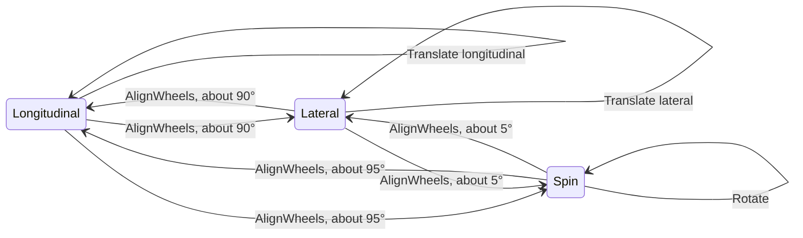

**Lifting** works the same way in both directions. Going up under a tray picks the tray up, and going down
while carrying one sets it down. The tray may carry a payload (a car). The lift's duration and the AGV's
speed while carrying can depend on whether a tray and a payload are on board.

**Lift and tray as a state machine.**

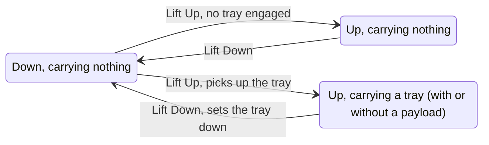

The robot's command interface (`interfaces/interfaces/msg/AgvCommand.msg`) defines these commands:

```
#  - Translate: node changes, heading same, lift same
#  - Rotate:    node same, heading changes, lift same
#  - Lift:      node same, heading same, lift changes
#  - Center:    src == dst
```

## 1.4 The core ideas

Four ideas carry the whole design. Learn these before the code.

- **State**: what a plan can change about an AGV, at one instant: its pose (node and heading), its wheel
  mode, its lift position, and the tray it carries with that tray's payload. A state is a *value*: it
  describes one moment.
- **Action**: one thing the robot does from start to finish: hold, translate along a straight run, rotate,
  align wheels, or lift. An action is a *decision* made by the planner, with the parameters that decision
  needs (which nodes, how many degrees, which wheel mode, which lift position).
- **Step**: an action placed on the clock, with how long it takes and the job it serves.
- **Timeline**: one AGV's plan: a starting state, a start time, and a list of steps, each starting exactly
  when the previous one ends. Every later state and every start time is *derived*.

Two functions connect them:
- **`Apply(state, action)`** returns the state after the action. It's the one definition of what an
  action does.
- **`CanApply(state, action)`** says whether the action may start from that state. It holds the physical
  rules.

One more function supplies durations:
- **The cost model** computes how long an action takes from the action, the state it starts from, and the
  physical parameters (section 1.10). The timeline stores its answers.

## 1.5 The types

**UML class diagram.** An `AgvAction` holds exactly one of its five alternatives; the dotted arrows from
`AgvAction` point to them. `Apply`, `CanApply` and the cost model are free functions, shown as
`<<functions>>` boxes.

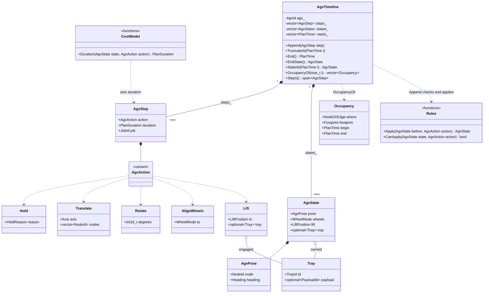

**The enumerations.**

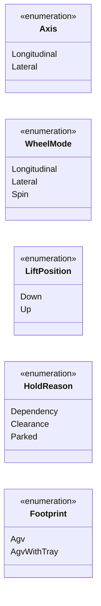

The full definitions:

```cpp
#include <chrono>
#include <cstdint>
#include <optional>
#include <span>
#include <utility>
#include <variant>
#include <vector>

namespace volley::planner {

// ---- Identifiers and units ----
using AgvId = uint16_t;
using NodeId = uint32_t;          // a node in the garage layout
using TrayId = uint16_t;
using PayloadId = uint64_t;       // the car on a tray (a GUID in today's messages)
using JobId = uint64_t;           // the scheduler job a step serves
using Heading = int16_t;          // degrees, in [-179, 180]

// Time measured from the start of the plan, in nanoseconds.
struct PlanClock {
  using duration = std::chrono::nanoseconds;
};
using PlanDuration = PlanClock::duration;
using PlanTime = std::chrono::time_point<PlanClock>;

// ---- State ----
enum class Axis : uint8_t { Longitudinal, Lateral };             // relative to the AGV's heading
enum class WheelMode : uint8_t { Longitudinal, Lateral, Spin };  // where the drive wheels point
enum class LiftPosition : uint8_t { Down, Up };

struct AgvPose {
  NodeId node;
  Heading heading;
};

struct Tray {
  TrayId id;
  std::optional<PayloadId> payload;   // the car on the tray, if any
};

// What a plan can change about an AGV. A value: Apply returns a new one.
struct AgvState {
  AgvPose pose;
  WheelMode wheels;
  LiftPosition lift;
  std::optional<Tray> tray;           // the tray it carries, if any
};

// ---- Actions ----
enum class HoldReason : uint8_t { Dependency, Clearance, Parked };

struct Hold        { HoldReason reason; };                      // stay put
struct Translate   { Axis axis; std::vector<NodeId> nodes; };   // straight run; nodes.front() is the start
struct Rotate      { int16_t degrees; };                        // spin in place; positive is CCW
struct AlignWheels { WheelMode to; };                           // pivot the wheels; the body stays put
struct Lift        { LiftPosition to; std::optional<Tray> tray; };  // the tray picked up or set down, if any

using AgvAction = std::variant<Hold, Translate, Rotate, AlignWheels, Lift>;

struct AgvStep {
  AgvAction action;
  PlanDuration duration;              // from the cost model
  JobId job;                          // why the AGV does this
};

// ---- Space ----
enum class Footprint : uint8_t { Agv, AgvWithTray };

// The space an AGV takes up during part of a step: a node (holding, rotating, aligning, lifting) or an
// edge between two nodes (translating), over [begin, end).
struct Occupancy {
  std::variant<NodeId, std::pair<NodeId, NodeId>> where;
  Footprint footprint;
  PlanTime begin;
  PlanTime end;
};

// ---- The rules ----
AgvState Apply(const AgvState& before, const AgvAction& action);
bool CanApply(const AgvState& state, const AgvAction& action);

// ---- One AGV's plan ----
class AgvTimeline {
public:
  AgvTimeline(AgvId agv, AgvState initial, PlanTime start);

  // The new step starts exactly when the last one ends. Throws if !CanApply(EndState(), step.action).
  void Append(AgvStep step);

  // Drops every step that starts at or after t, so the rest can be replanned.
  void TruncateAt(PlanTime t);

  PlanTime End() const;
  const AgvState& EndState() const;
  AgvState StateAt(PlanTime t) const;       // binary search on step start times

  // The space step i takes up, edge by edge for a translation, each with its sub-interval.
  // The footprint comes from the state: carrying a tray or not.
  std::vector<Occupancy> OccupancyOf(size_t i) const;

  std::span<const AgvStep> Steps() const;

private:
  AgvId agv_;
  std::vector<AgvStep> steps_;
  std::vector<AgvState> states_;   // states_[i] is the state before step i; one more than steps_
  std::vector<PlanTime> starts_;   // starts_[i] is when step i starts; one more than steps_
};

}  // namespace volley::planner
```

Notes on the choices:
- **`Translate` holds a run of nodes.** One action is one start-to-stop move, so a run of edges the AGV
  drives through pays one acceleration and one stop.
- **One `Lift` action covers both directions.** `to` gives the end position. The lift has two positions
  today (`AgvLiftChanged` carries a `bool raised`), so an enum fits; if it ever gains intermediate heights,
  the enum grows.
- **The payload belongs to the tray.** The car sits on the tray, and the AGV carries the tray. `Lift` names
  the tray it engages, so `Apply` can update the state and the cost model can see whether a tray and a car
  are being lifted.
- **Time is plan-relative**, in integer nanoseconds. The starting state describes the AGV at the plan's
  start time.

## 1.6 How data flows

Data flows from the state and the action into a new state:

```
state (where the AGV is now)  +  action (what the planner decided)  →  Apply  →  new state
```

The planner fills in an action's fields when it makes a decision: "align the wheels for lateral travel",
"translate laterally through nodes 12 → 13", "lift up, picking up tray 7". `Apply` reads the action
together with the current state and returns the next state. To use a chess comparison: the state is the
board, the action is a move, and `Apply` makes the move.

**UML sequence diagram: adding one step to a timeline.**

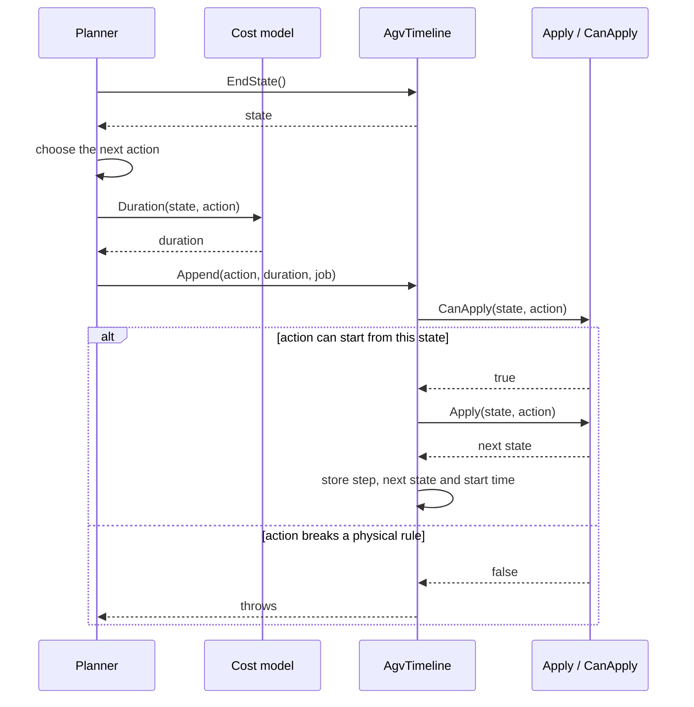

The rules:

```cpp
namespace volley::planner {

template <class... Ts> struct Overloaded : Ts... { using Ts::operator()...; };

inline WheelMode WheelsFor(Axis axis) {
  return axis == Axis::Longitudinal ? WheelMode::Longitudinal : WheelMode::Lateral;
}

// Wraps a heading in degrees into [-179, 180].
inline Heading Wrap(int degrees) {
  int wrapped = ((degrees + 179) % 360 + 360) % 360 - 179;
  return static_cast<Heading>(wrapped);
}

inline bool SameTray(const std::optional<Tray>& a, const std::optional<Tray>& b) {
  return a.has_value() == b.has_value() && (!a || a->id == b->id);
}

AgvState Apply(AgvState s, const AgvAction& action) {
  std::visit(Overloaded {
      [&](const Hold&) {},
      [&](const Translate& t) { s.pose.node = t.nodes.back(); },
      [&](const Rotate& r) { s.pose.heading = Wrap(s.pose.heading + r.degrees); },
      [&](const AlignWheels& a) { s.wheels = a.to; },
      [&](const Lift& l) {
        s.lift = l.to;
        s.tray = (l.to == LiftPosition::Up) ? l.tray : std::nullopt;
      },
  }, action);
  return s;
}

bool CanApply(const AgvState& s, const AgvAction& action) {
  return std::visit(Overloaded {
      [&](const Hold&) { return true; },
      [&](const Translate& t) {
        return t.nodes.size() >= 2 && t.nodes.front() == s.pose.node && s.wheels == WheelsFor(t.axis);
      },
      [&](const Rotate& r) { return r.degrees != 0 && s.wheels == WheelMode::Spin; },
      [&](const AlignWheels& a) { return a.to != s.wheels; },
      [&](const Lift& l) {
        if(l.to == s.lift) {
          return false;
        }
        // Going up: the AGV carries nothing yet. Going down: it sets down exactly what it carries.
        return l.to == LiftPosition::Up ? !s.tray.has_value() : SameTray(l.tray, s.tray);
      },
  }, action);
}

}  // namespace volley::planner
```

`CanApply` is where the physical rules live. A translation needs the wheels in its axis's mode, and a
rotation needs them in `Spin`, so the planner inserts an `AlignWheels` step wherever the mode changes.

## 1.7 Why a variant with `std::visit`

There are three common ways to represent "one of several kinds of action".

| Representation | Strengths | Weaknesses |
|---|---|---|
| **One struct with a kind field** | Simple syntax; `switch` on the kind. | Every field exists for every kind, so a `Rotate` carries unused nodes, and a `Translate` can have degrees set. |
| **Class hierarchy with virtual functions** | Each kind's logic sits in one class; a new kind leaves existing code alone. | Lives behind `unique_ptr`, so copying a timeline needs `clone()` and one allocation per step. Every new operation adds a virtual function to every class and ties actions to the cost model, graph and ROS. |
| **`std::variant` + `std::visit`** | Plain values in one `std::vector`, cheap to copy. Each kind has only its own fields. Operations are free functions in the module that needs them. The compiler flags every `visit` that misses a kind. | Adding a kind means updating every visitor, with the compiler listing them. The `Overloaded` helper is unfamiliar to some. |

**What decides it is which side grows.** The set of AGV actions is small and fixed by what the robot can
physically do. The set of operations keeps growing: validate, apply, cost, occupancy, to-command, metrics,
serialization. A variant makes adding an operation cheap, so it fits.

For a one-off check, `std::get_if<Rotate>(&action)` is fine. Use `visit` where every kind needs handling,
because `visit` makes the compiler check that.

## 1.8 Example

AGV 1 is at node 10, facing 0°, wheels longitudinal, lift down, carrying nothing. It drives two nodes
forward, slides one node sideways, waits for AGV 2 to clear the way, slides one more node, picks up empty
tray 7, and turns 90°. The durations are illustrative.

| # | Step | Duration | State after (derived by `Apply`) |
|---|---|---|---|
| | *start* | | node 10, 0°, wheels longitudinal, lift down |
| 1 | `Translate{Longitudinal, [10, 11, 12]}` | 6.1 s | node 12 |
| 2 | `AlignWheels{Lateral}` | 1.5 s | wheels lateral |
| 3 | `Translate{Lateral, [12, 13]}` | 3.2 s | node 13 |
| 4 | `Hold{Clearance}` | 4.0 s | unchanged |
| 5 | `Translate{Lateral, [13, 14]}` | 3.2 s | node 14 |
| 6 | `Lift{Up, tray 7 with no payload}` | 6.0 s | lift up, carrying tray 7 |
| 7 | `AlignWheels{Spin}` | 0.1 s | wheels spin |
| 8 | `Rotate{+90}` | 9.2 s | heading 90° |

The same timeline on a clock (the axis is in seconds):

```mermaid
gantt
  title AGV 1 timeline from the example
  dateFormat x
  axisFormat %S
  section AGV 1
    Translate longitudinal 10 to 12 : s1, 0, 6100ms
    AlignWheels lateral : s2, after s1, 1500ms
    Translate lateral 12 to 13 : s3, after s2, 3200ms
    Hold for clearance : s4, after s3, 4000ms
    Translate lateral 13 to 14 : s5, after s4, 3200ms
    Lift up with tray 7 : s6, after s5, 6000ms
    AlignWheels spin : s7, after s6, 100ms
    Rotate plus 90 : s8, after s7, 9200ms
```

Things to notice:
- **Step 1 is one action covering two edges**, because the AGV drives through node 11. Per-edge times for
  collision checks are calculated from its speed profile.
- **Steps 3 and 5 are split by a hold**, because the AGV stops at node 13 to wait. The split between
  actions matches what the robot physically does.
- **Wheel alignment has its own steps** (2 and 7), with their own cost. Step 7 is the ~5° lateral→spin
  turn.
- **Steps 6 onward** use the loaded speeds, because the state says the AGV carries a tray.
- **Every second is accounted for**, so a metrics tool can total time by kind and hold reason.

## 1.9 What the design guarantees

1. **Contiguous time.** Each step starts where the previous one ends.
2. **Explicit wheel alignment.** `CanApply` requires the right wheel mode for every move, and each
   alignment is a step with its own cost.
3. **Each fact stored once.** States come from `Apply`, locations and footprints come from states and
   actions, and durations come from the cost model.
4. **One action per start-to-stop move**, so per-edge timing comes from one speed profile.
5. **Derived tray and payload positions.** A tray stays where it was until a `Lift{Up}` picks it up,
   follows the AGV, and stays where a `Lift{Down}` sets it. Its payload travels with it.
6. **Direct mapping to commands.** `Translate`, `Rotate` and `Lift` are the robot's Translate, Rotate and
   Lift commands.
7. **Typed data inside the planner**, serialized where it leaves.

## 1.10 Durations: the cost model

The cost model answers "how long does this action take?":

- **A move that starts and ends at rest** follows a speed profile. It accelerates to the top speed, cruises,
  and decelerates, which is a **trapezoid**. When the move is too short to reach top speed, it's a
  **triangle**. The time to cover any partial distance along that profile gives per-edge timing inside a
  run.
- **Parameters**: top speed and acceleration for each kind of move (translate longitudinal, translate
  lateral, rotate), with lower speeds when carrying a tray, plus durations for lifting and for wheel
  alignment.
- **Wheel alignment** costs a duration that depends on the starting and ending wheel modes.
- **Lifting** costs a duration that can depend on direction, and on whether a tray and a payload are
  engaged.
- **Holding** lasts as long as the planner decides.

The planner uses these durations to choose the best plan, and the timeline records the result.

## 1.11 Instrumentation: a published cost report

Plan data is published as a ROS message, so other nodes and offline tools can analyze it. With the
timeline design, the message mirrors `AgvStep`:

```
# PlanCostReport.msg
std_msgs/Header header
Guid plan_id                  # PlanResponse.id, to join with the recorded plan response
float32 makespan              # seconds
PlanCostSegment[] segments
```

```
# PlanCostSegment.msg
uint8 KIND_HOLD = 1
uint8 KIND_TRANSLATE = 2
uint8 KIND_ROTATE = 3
uint8 KIND_ALIGN_WHEELS = 4
uint8 KIND_LIFT = 5

uint8 kind
uint8 axis                    # translate only
uint8 wheel_mode_to           # align wheels only
uint8 lift_to                 # lift only
uint8 hold_reason             # hold only
GarageEntityId entity
Guid action_guid              # ActionNode.guid this step became; zero for steps that aren't commands
float32 start                 # seconds from plan start
float32 duration              # seconds
float32 length                # meters or degrees, for moves
bool carrying_tray
bool carrying_payload
```

The cost parameters in effect are published too, since ROS params aren't recorded in bags.

An offline tool joins three sources:
- the cost reports, for planned time by kind;
- the recorded plan responses, for the DAG and commands;
- execution reports, for actual times.

From those it produces:
- **cost-model calibration:** planned vs actual for each kind of action, with and without a tray and a
  payload;
- **where makespan goes:** the share of moves, wheel alignment, lifts and holds;
- **deconfliction cost:** hold time by reason, per plan and per AGV.

---

# Part 2. Mapping the concepts onto today's code

## 2.1 At a glance

Each row names a concept from Part 1, the code that plays its role today, and exactly what differs
between the two. The verdict in bold comes first:
- **Close** means the same data in a different shape.
- **Split** means one design concept is spread over several pieces of today's code.
- **Implicit** means today's code produces the effect without storing the concept.

| Concept (Part 1) | Today | What differs |
|---|---|---|
| State (`AgvState`) | `DiscreteAgvStateMsg`, one entry in `DiscreteGarageState` | **Close, different scope** (section 2.2).<br>The design holds `{pose, wheels, lift, tray}` for one AGV. Today's message holds `{id, state, pose, lift, tray_id, disabled}`, and the plan's state is the whole garage.<br>The tray is a `uint16 tray_id` (0 for none) that points at a separate tray record; the design holds the `Tray` itself.<br>The lift is a `bool`; the design uses `LiftPosition`.<br>Wheel mode lives only inside SIPP's search, as the previous edge's transition type (`parent_type`). The plan's starting state counts as "waiting", which skips the alignment. |
| `Tray` with payload | `DiscreteTrayStateMsg {id, pose, agv_id, payload_id, disabled}` | **Close.**<br>The design's `Tray` is `{id, optional payload}` and rides inside the AGV's state, so its position is the AGV's.<br>Today the tray is its own record with its own `pose`. It links both ways to the AGV (`agv.tray_id` ↔ `tray.agv_id`) and to the payload (`tray.payload_id` ↔ `payload.tray_id`). `OnEvent` keeps those links in sync.<br>An empty GUID marks "no payload"; the design uses `std::nullopt`. |
| Action (`AgvAction`) | `Motion`'s `delta_`, `location_` and `is_idle_` | **Split across three fields** (section 2.3).<br>Today there is no `AgvAction` type, a variant whose alternative names the kind of action. Instead:<br>• the **kind** is `delta_->type` (`"AgvPoseChanged"`, `"AgvLiftChanged"`), or a missing `delta_` for a wait;<br>• the **parameters** are `delta_->buffer`, a serialized before → after pose or a `raised` flag, which must be deserialized to read;<br>• `location_` repeats the before and after poses as a `Pose` or an `Edge`;<br>• `is_idle_` is true exactly when an AGV motion has no delta.<br>Translate and Rotate are the same message: a rotation is a pose change whose two node ids are equal. The axis (longitudinal or lateral) appears nowhere in the motion. It is the graph edge's `TransitionType` (`LOCOMOTE`/`STRAFE`), looked up through `GarageGraph::GetTransition`.<br>Today records the action's **effect** (before → after); the design records the **cause** and derives the effect with `Apply`. |
| Step (`AgvStep`) | `Motion` | **Close in role, wider in content** (section 2.3).<br>The design's step is `{action, duration, job}`; the timeline knows the AGV and derives start times and footprints.<br>A `Motion` also stores its owner (`entity_id_`), an absolute `interval_` in place of a duration, and two derived values (`location_`, `collision_id_`).<br>One `Motion` type serves every entity kind (AGV, tray, bay, VECS, VRC); the design is AGV-only.<br>An AGV `Motion` covers one graph edge; an `AgvStep` covers a whole run. |
| Timeline (`AgvTimeline`) | `Trajectory`, one per entity in `ContinuousState` | **Same purpose, different structure** (section 2.4).<br>Design: a `std::vector` of steps in order, the state after each step, and start times derived from durations. Steps are contiguous, and `Append` throws when `CanApply` fails.<br>Today: a `std::set<Motion>` ordered by start time. Motions may leave gaps. `AddMotion` returns `false` on overlap, and the callers ignore it. No intermediate states are stored. The first motion is a "stationary" one starting at `Timepoint::min()`. |
| `Apply` | `DiscreteGarageState::OnEvent`, replayed by `ContinuousState::GetEndState` | **Same role, different shape** (section 2.5).<br>Design: a pure function of one AGV's state and one action that returns the next state, called on every `Append`.<br>Today: `OnEvent(const DiscreteGarageEventMsg&)` switches on the type string, deserializes, and mutates the whole garage in place, returning `{success, message}`. It runs only in `GetEndState`, after planning, over every entity's deltas sorted by end time. On a failure `GetEndState` prints the message and returns `std::nullopt`.<br>Same as the design: moving an AGV also moves the tray it carries. |
| `CanApply` | Four places: `Motion`'s constructors, `OnEvent`, SIPP, and the AGV's validation of each `AgvCommand` | **Split across four places, checked at different times** (section 2.5).<br>• The constructors throw when a pose change leaves the pose unchanged (when the motion is built).<br>• `OnEvent` checks that the AGV is at `node_id_curr`/`heading_curr`, that the lift is changing, and that a tray being lifted is parallel to the AGV (only in `GetEndState`).<br>• SIPP only expands edges that exist in the graph (during search).<br>• The AGV validates each command it receives (at run time).<br>Two of the design's rules live elsewhere today. The wheels-match-axis rule is SIPP inserting a wheel-turn delay. The lowered-tray-is-the-carried-tray rule is `OnEvent` dropping whatever tray the AGV holds. |
| `Hold` | A `Motion` built from a `Pose` with no delta | **Close; the reason lives in which code created it.**<br>Four places create waits: CHUGG's `wait_for_deps` (the design's `Dependency`), SIPP's same-pose states (`Clearance`), `ContinuousState`'s initial stationary motion, and a placed tray's motion to `Timepoint::max()` (both `Parked`).<br>The `Motion` stores no reason.<br>`ToActionNode` drops waits, so the published schedule holds no trace of them. |
| `Translate` over a run | One `Motion` per graph edge, each with an `Edge` and an `AgvPoseChanged` delta | **Different granularity** (section 2.6).<br>Design: one step lists every node of the run and takes one trapezoid duration.<br>Today: one motion per edge. The run exists only in pricing. SIPP charges an edge that continues the parent's run `length / vmax`, so the per-edge intervals add up to one trapezoid, and the first edge carries all of the acceleration and braking time. `MotionRun` in `cost_functions` groups runs for durations.<br>`ToActionNode` publishes one `AgvCommand` per edge. |
| `Rotate` | One `Motion` per rotation edge | **Different granularity.**<br>Design: one step with a signed angle (`Rotate{+90}`).<br>Today: a rotation edge joins two headings at the same node. A turn that spans several rotation edges becomes several motions, which SIPP prices as one run when they turn the same way.<br>The rotation is recognizable only by comparing node ids, as in the Action row. |
| `AlignWheels` | Empty time before the next motion | **Implicit** (section 2.6).<br>Design: a step with a target `WheelMode` and its own duration, and `wheels` is part of the state.<br>Today: SIPP delays an edge by `wheel_turn_time_` when its transition type (`LOCOMOTE`, `STRAFE`, `ROTATION`) differs from the previous edge's. The delay leaves a gap in the `Trajectory`, and no `Motion` fills it.<br>Every change between modes costs the same fixed time. The cost model's `WheelTurnDuration` is unused and uses a different rule.<br>`AgvCommand.msg` has no wheel command. |
| `Lift` | A `Motion` with an `AgvLiftChanged {agv_id, raised}` delta at a `Pose`, plus edits to the tray's `Trajectory` | **Close for the AGV; trays differ** (section 2.4).<br>Design: `Lift{to, tray}` names the tray and its payload, and tray positions come from the AGV's timeline.<br>Today the delta carries only `raised`. `OnEvent` attaches whatever tray is on the AGV's node, or drops whatever tray the AGV carries, and CHUGG finds the tray with `GetTrayOnNode`.<br>CHUGG edits the tray's own `Trajectory` by hand (`chugg_sequential.cpp:204-229`). On a raise, the tray's stationary motion ends where the lift event begins. While the tray is carried it has no motions; the AGV's `collision_id_` covers it. On a lower, a new stationary motion runs from the AGV's last motion to `Timepoint::max()`.<br>Lift time is a fixed `agv_lift_up`/`agv_lift_down`, the same with or without a tray or payload. |
| `job` | `action_id_` | **One level finer.**<br>Design: `JobId`, the job the step serves.<br>Today: `action_id_` is the `ScheduleEventDag::Vertex` the motion carries out. A job expands into several `ScheduleEvent`s, and the job is one lookup further (`ScheduleEvent::GetJobIndex()`). Tray motions sometimes use a placeholder `999999`.<br>The published `ActionNode` carries the job's GUID as `job_id`. |
| `Occupancy` | `location_` plus `collision_id_`, stored on every `Motion` | **Stored today, derived in the design.**<br>Design: `OccupancyOf(i)` computes the node or edge and the `Footprint` from the state before step `i` and its action.<br>Today: each motion stores its `Pose`/`Edge` and a `collision_id_`. CHUGG computes one `collision_id_` per event, from the AGV's state before the event, and every motion of that event reuses it. A lift event always takes the tray's id, including the raise.<br>Today's footprint is finer than the design's: `CollisionEntityIdFromAgvState` gives `AGV`, `TRAY`, or `PAYLOAD` plus the smallest resource size that encloses the payload. The design's `Footprint {Agv, AgvWithTray}` needs a payload size class to match it. |
| `PlanTime` | `Interval` on `system_clock` | **Absolute today, relative in the design** (section 2.7).<br>Both use half-open `[begin, end)` spans with nanosecond resolution.<br>Today each motion stores wall-clock time points. The open-ended motions use the sentinels `Timepoint::min()` (initial stationary) and `Timepoint::max()` (placed tray).<br>The design stores durations, measures time from the plan start, and derives start times. |
| Cost model | `planner/cost_functions`, plus two rules inside SIPP | **Same model, rules in two places** (section 2.6).<br>Design: one `Duration(state, action)` owns every rule.<br>Today: `MotionCostModel` gives a trapezoid duration per transition, with loaded and unloaded speeds and fixed lift times. SIPP adds two rules of its own: run extension (cruise-only cost) and the wheel-turn delay.<br>Lift time ignores the tray and payload. |
| Cost report | `cost_audit` console output, plus the recorded `PlanResponse` | **Partial** (section 2.8).<br>Design: a `PlanCostReport` message with one segment per step, including holds and alignments, recorded for offline analysis.<br>Today: `cost_audit` prints per-segment costs to the console, threaded through three packages. The recorded `PlanResponse` has each published action's duration. Waits, wheel-turn gaps, start times and the cost parameters are missing from both. |

**Today's types, as a UML class diagram.** These are the pieces the mapping diagrams below point at.

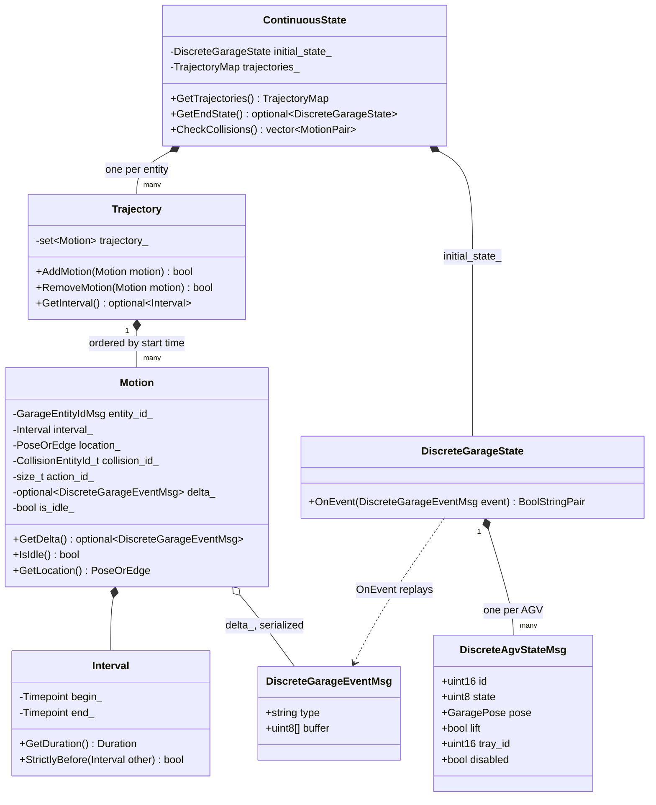

**Mapping the data types.** Solid arrows mean the concept maps onto one piece of today's code. Dotted
arrows mean the concept is spread over several pieces, or matches one only in part.

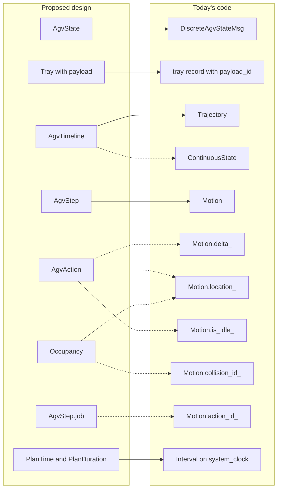

**Mapping the actions.** Each proposed action next to the way today's code represents the same thing.

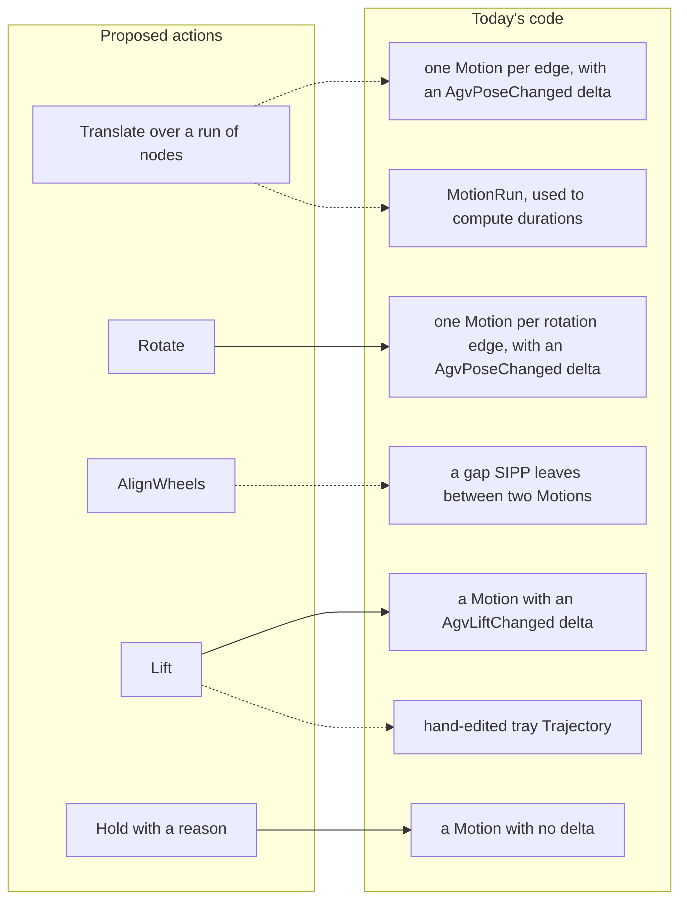

**Mapping the behavior.** Where today's code does the work of each proposed function.

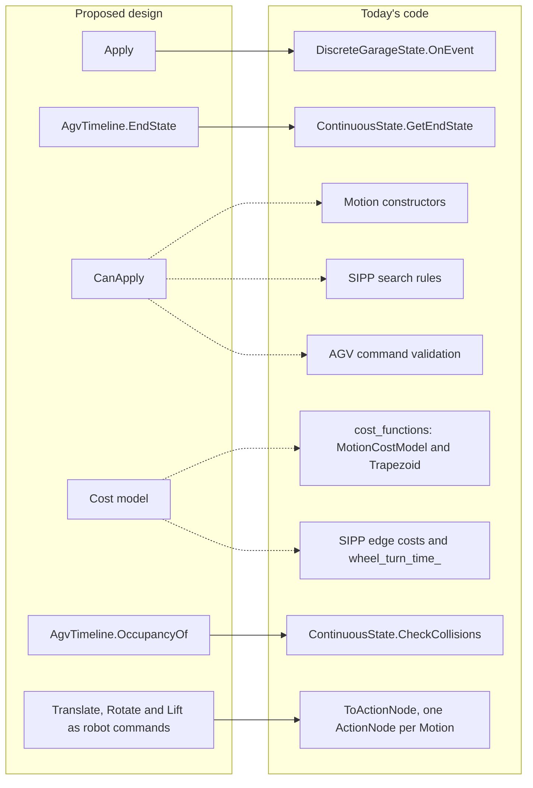

## 2.2 State

The scheduler keeps two views of the garage:
- **Discrete state** (`DiscreteGarageState`): where everything *is*. An AGV at node 2066 facing 90° with
  its lift down, a bay in READY_TO_INSERT, a VRC on floor 2.
- **Continuous state** (`ContinuousState`, `Trajectory`): *when* things happen and how long they take.

The closest match to `AgvState` is `DiscreteAgvStateMsg`:
```
uint16 id
uint8 state
GaragePose pose
bool lift       # if true, then the AGV's lift is raised
uint16 tray_id  # if non-zero, the id of the tray this AGV is carrying
bool disabled   # if true, then the AGV is disabled in the scheduler and will not be used
```
It's the garage's full record of an AGV. It also holds facts a plan leaves unchanged (`disabled`, the
operational `state` code) and uses 0 for "no tray". The tray's payload lives on the tray record as
`payload_id`, with an empty GUID for "no payload", which matches the design's `Tray`. Wheel mode is tracked
only during SIPP's search, as the transition type of the previous edge.

## 2.3 Action and step: `Motion`

`planner/motion_planner/include/motion_planner/trajectory.hpp:15`. A `Motion` is one entity doing one thing
over one interval, which corresponds to an `AgvStep`. Its fields map like this:

| `Motion` field | Meaning | Concept |
|---|---|---|
| `entity_id_` | which AGV, tray, bay, VECS or VRC | the timeline's owner |
| `interval_` | when | the step's start and duration |
| `location_` | `variant<Pose, Edge>`: standing on a pose, or crossing an edge | derived from state + action |
| `collision_id_` | which collision body to use | derived from state (`Footprint`) |
| `action_id_` | the `ScheduleEvent` vertex this motion carries out | `job`, one level finer: the job is that event's `GetJobIndex()` |
| `delta_` | optional discrete state change, stored **serialized** | the action's effect (`Apply`) |
| `is_idle_` | a wait, or a "transition" whose before and after states are equal | `Hold` |

**What `delta` means.** It's the change in discrete state that the motion causes, written as before →
after. For AGVs:

| Delta message | Fields | Concept |
|---|---|---|
| `AgvPoseChanged` | `agv_id`, `node_id_curr/heading_curr` → `node_id_next/heading_next` | one edge of a `Translate`, or one step of a `Rotate` |
| `AgvLiftChanged` | `agv_id`, `raised` | `Lift` |

(Bays, VECS and VRCs have `BayStateChanged`, `VecsStateChanged` and `VrcStateChanged`.)

Today stores the **effect** (before → after). The design stores the **cause** (the action) and derives
the effect with `Apply`.

There are three cases:
- **no delta:** a wait, which corresponds to `Hold`;
- **a delta with `IsIdle()`:** a "transition" with equal before and after states, such as a bay staying
  in RTR;
- **any other delta:** a real change.

A delta takes effect when its motion **ends**.

The delta is stored in the system's generic event envelope, `{string type; uint8[] buffer}`. The garage
tracker publishes the same envelope, and `DiscreteGarageState::OnEvent` consumes it, so the planner can
replay its own motions through the same code.

One `ScheduleEvent` usually becomes several `Motion`s. An AGV move along a 5-edge path becomes 5 motions,
each with a one-edge `AgvPoseChanged` delta, plus any waits.

## 2.4 Timeline: `Trajectory` and `ContinuousState`

`Trajectory` (`trajectory.hpp:103`) is one entity's timeline, a `std::set<Motion>` ordered by start time.
Its one invariant is that **an entity's motions never overlap**. `AddMotion` (`trajectory.cpp:116`) finds
the neighboring motions with `lower_bound` and returns `false` when the new one would overlap them.

Compared with `AgvTimeline`:
- Gaps between motions are allowed. The design's timeline is contiguous.
- Each motion stores its own absolute interval. The design stores durations and derives start times.
- `ContinuousState` begins each entity with a "stationary until now" motion starting at
  `Timepoint::min()`. The design begins with a starting state.
- Trays have their own `Trajectory`, which CHUGG edits by hand when an AGV picks one up
  (`chugg_sequential.cpp:204-209`). The design derives tray positions from AGV lifts.

`ContinuousState` maps each entity to its `Trajectory`, and that map is the solved plan. Everything
downstream reads it:
1. **CHUGG builds it.** `chugg_sequential.cpp` plans events in dependency order and appends a wait and/or
   motions to the right entity for each one.
2. **Collision checking** (`ContinuousState::CheckCollisions`) compares motions across entities through
   the collision table. This is the role of `OccupancyOf`.
3. **`GetEndState`** replays the deltas to get the discrete state at the end of the plan. This is the role
   of `EndState()`.
4. **The scheduler publishes it.** `ToActionNode` (`planner/scheduler/src/scheduler.cpp:27`) turns each
   motion that has a delta into one `ActionNode` with that motion's duration (`:41`), and drops waits. This
   is the mapping to commands, at one command per edge.

## 2.5 `Apply` and `CanApply`

- **`Apply`** corresponds to `DiscreteGarageState::OnEvent(const DiscreteGarageEventMsg&)`, which switches on
  the event's type string, deserializes it and applies it. `ContinuousState::GetEndState` calls it for every
  motion, sorted by end time.
- **`CanApply`** is spread over:
  - `Motion`'s constructors (a pose change must actually move);
  - SIPP's search (which edges exist, the wheel-turn delay);
  - the AGV's own validation of each command (`AgvCommand.msg`).

## 2.6 Durations, runs and wheel alignment

The cost model lives in `planner/cost_functions`:
- **`MotionCostParams`**: speed and acceleration for locomote, strafe, rotate and VRC transit (lower when
  loaded), and fixed durations for lift, bay door, VECS, VRC gates and wheel turns.
- **`Trapezoid(distance, vmax, amax)`** and **`TimeAtDistance`**: the speed profile from section 1.10.
- **`MotionCostModel`**: `Duration(Transition)`, `Duration(MotionRun)`, `VelocityLimitsFor(type, loaded)`,
  `Params()`.
- **`MotionRun` / `CoalesceMotionRuns`**: groups consecutive edges the AGV drives through without stopping.
  This is the closest thing today to a `Translate` run. It's used to compute durations; the plan itself
  stores one motion per edge.

Old names map to new ones like this:

| Today | Design |
|---|---|
| LOCOMOTE | `Translate{Longitudinal}` |
| STRAFE | `Translate{Lateral}` |
| ROTATION | `Rotate` |
| wheel turn | `AlignWheels` |
| lift raised / lowered | `Lift{Up}` / `Lift{Down}` |

How durations reach the plan:
- `GetEdgeDurations` (`planner/motion_planner/src/garage_graph_pathing.cpp:13`) precomputes a full trapezoid
  time for every edge. It's both SIPP's cost for starting an edge from rest and the seed for the A*
  heuristic.
- Inside SIPP, edge cost depends on the path taken (`safe_interval_path_planning.cpp:380`). An edge that
  continues the parent's run costs only cruise time, `length / vmax`, so a run's per-edge costs add up to
  one trapezoid.
- **Wheel alignment** is SIPP adding `wheel_turn_time_` before an edge whose drive mode differs from the
  previous one (`safe_interval_path_planning.cpp:389`). It appears in the plan as a gap between two
  motions. In the design it's an `AlignWheels` step.
- **Lift duration** comes from `agv_lift_up` and `agv_lift_down` in `MotionCostParams`, with no
  dependence on tray or payload.

**The same moves in both designs.** Steps 1–3 of the example in section 1.8, as `AgvStep`s and as today's
`Motion`s. The axis is in seconds. Today's split of the run into two edges uses illustrative times. Between
6.1 s and 7.6 s, today's plan holds no `Motion`: the wheel alignment exists only as that gap.

```mermaid
gantt
  title Steps 1 to 3 of the example, proposed and today
  dateFormat x
  axisFormat %S
  section Proposed
    Translate longitudinal 10 to 12 : p1, 0, 6100ms
    AlignWheels lateral : p2, after p1, 1500ms
    Translate lateral 12 to 13 : p3, after p2, 3200ms
  section Today
    Motion edge 10 to 11 : c1, 0, 3400ms
    Motion edge 11 to 12 : c2, after c1, 2700ms
    Motion edge 12 to 13 : c3, 7600, 3200ms
```

## 2.7 Time

`Interval` (`planner/motion_planner/include/motion_planner/interval.hpp`) is a half-open `[begin, end)`
span on `std::chrono::system_clock`, with nanosecond durations. `StrictlyBefore` is `end <= other.begin`,
so two intervals that touch end to start don't overlap. `IntervalSet`, a sorted set of non-overlapping
intervals with merge and carve operations, backs SIPP's safe-interval table.

The design keeps the half-open interval and measures time from the start of the plan, storing durations.

## 2.8 Instrumentation

Today's equivalent of the cost report is `cost_audit`, a CSV printout of each plan's per-segment cost.
Paul added it in `b7e081b1` (#650) while tuning the cost model. It runs through three packages:
- **scheduler:** the `SchedulerParams` field, the `scheduler.cost_audit` ROS param, a
  `public: mutable bool costaudit_` member (`scheduler.hpp:447`), and a 30-line print block
  (`scheduler.cpp:4028`);
- **motion_planner:** a `CostVector*` argument to `SolveSequential`, a `Chugg::audit_` member with a
  scope guard, five `if(audit_)` blocks in `chugg_sequential.cpp`, and an `audit` argument to
  `ConvertPosePathToTrajectory`;
- **cost_functions:** audit overloads of `Duration` and `Event`, and `CostVector`/`CostEntry`.

**Much of the report's data is already published.** Each `ActionNode`'s duration is its motion's duration.
Dispatch republishes every `PlanRequest` and `PlanResponse` as topics (`central/src/dispatch_ros.cpp:97`),
and the central recorder saves every topic except `/bay/` (`launcher/launch/central.launch.py:108`).
`sim_metrics` already has bag-reading tools (`read_bag.py`, `extract_bag_metrics.py`) for the offline side.

The published schedule leaves out:
- the absolute start time of each motion,
- waits (`ToActionNode` drops them, so the time spent deconflicting is invisible),
- wheel-turn gaps,
- the split of a VRC move into gate close, transit and gate open,
- the cost parameters that produced the plan.

Before the timeline design exists, the report can be built after solving, from the final trajectories,
with no changes inside CHUGG. A gap between consecutive AGV motions is an `AlignWheels` up to the turn time
and a `Hold` beyond it, using **SIPP's** wheel-turn rule.

## 2.9 Concepts with no counterpart today

- **Contiguity**: a `Trajectory` can have gaps.
- **Wheel mode as state, and wheel alignment as a step**: both live inside SIPP's search.
- **Hold reasons**: a wait records no reason.
- **`Translate` runs as plan elements**: runs appear in cost calculations.
- **Derived tray positions**: trays have hand-edited trajectories.
- **Payload-dependent lift and travel costs**: the cost model distinguishes loaded from unloaded travel,
  and uses one lift time per direction.
- **Plan-relative time**: times are absolute, with sentinel values.

---

# Part 3. Issues with the current design

## 3.1 `Motion`

1. **`delta` is a vague name.** It suggests a numeric difference. Everywhere else the codebase calls this
   a change: the `*Changed` messages, `OnEvent`, and `ScheduleEvent::GetDiscreteChange()`
   (`planner/planner_core/include/planner_core/schedule_events.hpp:78`), which is already a typed
   `std::variant<AgvLiftChangedMsg, AgvPoseChangedMsg>`. So one concept has two names and two
   representations, one step apart in the pipeline.
2. **It stores the effect.** Before → after is stored, so every reader re-derives what the AGV actually
   did. (Principle 2.)
3. **It's stored in the transport format.** Every construction serializes the change and every reader
   deserializes it again: `ToActionNode`, `GetEndState`, `IsFloorTraversalMotion`, `BayIsReadyToRetrieve`
   and the hasher. Dispatch is by string comparison (`delta->type == "AgvPoseChanged"`). (Principle 7.)
4. **A failed serialization silently turns an action into a wait.** The constructors do
   `delta_(volley::Serialize(delta))`, and `Serialize` returns `nullopt` on failure
   (`common_ros/include/common_ros/discrete_garage_event_io.hpp:15`). The motion then looks exactly like a
   wait, so `GetEndState` skips it and `ToActionNode` drops it.
5. **Three fields can disagree.** `delta_`, `location_` and `is_idle_` are set independently, yet each can
   be derived from the others. An edge location with a bay delta can be constructed. (Principle 3.)
6. **`action_id_` holds a `ScheduleEvent` vertex.** The callers in CHUGG already name the variable they
   pass `event_id`.

## 3.2 `Trajectory`

Every production insert is an append in time order:

| Call site | Pattern |
|---|---|
| `sipp_agv.cpp:134-145` | builds a path's motions in path order |
| `garage_graph_pathing.cpp:209` | builds an edge chain in order |
| `chugg_sequential.cpp` | each event starts at the entity's current end time and appends |
| `chugg_common.cpp:341` | copies newly planned motions after the initial motion |
| `chugg_sequential.cpp:204-209` | the one "edit": removes a tray's **last** motion and re-adds it with an earlier end |

So `std::set` gains nothing over a sorted vector, and it costs the following:

1. **The set's idea of "the same" differs from `==`.** Elements count as duplicates when neither sorts
   before the other, which here means the same start time, while `operator==` compares every field.
   - `insert` silently ignores a zero-length motion that starts at the same instant as an existing one,
     and `AddMotion` still returns `true`.
   - `RemoveMotion(const Motion&)` erases whichever motion has that start time.
2. **Failed inserts go unnoticed.** Every `AddMotion` call in `chugg_sequential.cpp` ignores the returned
   `bool`, so a motion rejected for overlapping is dropped from the plan without any error.
3. **Elements are immutable.** Set elements are `const`, so shortening the tray's last motion means remove,
   rebuild and re-insert. `Motion::WithInterval` exists to copy a motion with a new interval.
4. **It allocates per motion.** `Motion` is heavy (a `std::string` entity type, a serialized message, a
   pose variant), and every set node is a separate allocation. CBS copies whole branches. (Principle 5.)
5. **The ordering is barely used.** `CheckCollisions` (`continuous_state.cpp:254`) compares every motion
   of every entity against every motion of every other entity, without using the sort to skip pairs that
   can't overlap in time. `GetEndState` re-sorts by end time, and the scheduler builds a third ordering
   (`MotionScheduleOrder`). `FindInInterval` and `RemoveInInterval` are only called by tests.

**A latent bug from the same mistake.** `GetEndState` (`continuous_state.cpp:95`) collects motions from
*all* entities into a `std::set<Motion, EndSorter>`, which compares end times only. Two motions on
different entities that end at the same instant would collapse into one, and the second one's change
would be missing from the end state. That's realistic: two AGVs waiting on the same dependency, each moving
an edge of the same length, end together. Today `GetEndState` is only called on CHUGG's initial
trajectories (`chugg_sequential.cpp:51`, `chugg_common.cpp:38` and `:216`), whose motions carry no deltas.
It would break on a solved plan.

`IntervalSet` probably explains the original choice: SIPP's safe-interval table does need sorted insertion
with merge and carve, and `Trajectory` seems to have been modeled on it.

## 3.3 The cost model and SIPP

1. **Run coalescing is implemented three times:** `ExtendsRun` in `planner/cost_functions/src/motion_run.cpp`,
   `extends_run` inside SIPP, and `CoalesceTrajectory` in `planner/motion_planner/src/coalesce_trajectory.cpp`.
   The last one has no production callers; the comment at `chugg_sequential.cpp:150` explains why it was
   dropped.
2. **The two wheel-turn rules disagree.** SIPP (`safe_interval_path_planning.cpp:389`) charges a wheel turn
   on any drive-mode change. `MotionCostModel::WheelTurnDuration` (`motion_cost_model.cpp:54`) charges
   nothing for strafe↔rotate. `WheelTurnDuration` has no production callers, so SIPP's rule is the one in
   effect.
3. **Wheel alignment has no identity in the plan.** It's a duration SIPP adds before an edge, visible
   afterwards as a gap, so it can't be reported, checked or attributed.
4. **The heuristic is inadmissible.** The comment at `scheduler.cpp:4012` says so: with path-dependent edge
   costs, the full-trapezoid heuristic can overestimate, so A* may return paths that aren't optimal. That
   was a deliberate speed trade-off, with a "Ring 3c" fix planned.
5. **Time units are mixed.** The cost model works in `float` seconds, `Interval` in `int64` nanoseconds,
   and `ActionNode.duration` is `float` seconds again. Values convert back and forth with `duration_cast`.
6. **The final ordering tie-break is a hash.** `MotionScheduleOrder` (`scheduler.cpp:136`) orders by start
   time, then action id, then `MotionHasher`. The order is stable but arbitrary.

## 3.4 Code with no production callers

- `Trajectory::FindInInterval` and `RemoveInInterval`
- `Motion::WithInterval` (used only by `CoalesceTrajectory`)
- `CoalesceTrajectory`
- `GetEdgeMarginalDurations` (mentioned only in a comment)
- `MotionCostModel::WheelTurnDuration`
- `ConvertPosePathToTrajectory`'s `audit` argument and `RunLabel`: the only production caller passes
  `nullptr` (`scheduler.cpp:3162`)
- `Trajectory::rbegin` and `rend`, which carry a "get rid of these eventually" TODO

## 3.5 `cost_audit`

1. **It's a debug switch in a settings struct.** That's why the test `SharedScheduler` includes it in its
   cache key, though it has no effect on results.
2. **The defaults disagree.** `params.yaml` sets it to `false`, but the struct default and the `Param`
   fallback are both `true`, so every test runs the audit.
3. **The member is `public` and `mutable`**, and nothing writes it after construction.
4. **The doc comment is stale.** It mentions a `verbose` setting that doesn't exist.
5. **It prints to the log.** CSV in the log is hard to join with execution data or analyze across runs
   (section 1.11).

---

# Part 4. Open problems

1. **SIPP has to plan in these terms.** SIPP emits one motion per edge today. It would group them into
   `Translate` runs, ending a run wherever it waits or changes axis, and emit `AlignWheels` steps where the
   mode changes. It already tracks when an edge extends a run, so the information is there.
   The hard part is the case the comment at `chugg_sequential.cpp:150` warns about: in the triangular
   regime, slicing one profile across edges gives different per-edge times than SIPP assumed. For collision
   reservations to be exact, SIPP has to reason about the same profile the timeline uses. That's the real
   design problem.
2. **How `AlignWheels` reaches the robot.** `AgvCommand.msg` defines Translate, Rotate, Lift and Center.
   Mechanical engineering confirms wheel alignment is a separate motion that takes time. The AGV team
   needs to confirm whether it's commanded on its own or performed as part of the following Translate or
   Rotate. Either way, the plan keeps it as its own step; dispatch can fold it into the next command if
   needed.
3. **Payload-dependent costs.** Whether lift time and travel speed depend on an empty tray vs a tray with a
   car needs numbers from mechanical engineering. The design has the information (`Tray::payload`); the
   cost model needs the parameters.
4. **The heuristic** (section 3.3, item 4) needs to be both admissible and tight under path-dependent
   costs.
5. **Other entities need their own timelines.** Bays, VECS and VRCs would get small timeline types with
   their own actions (door open, carriage move). What they share is the collision interface: each produces
   a stream of `Occupancy`. The current RTR → RTR "idle transition" on a bay becomes a bay `Hold` with a
   reason.
6. **`Center`.** The robot accepts a Center command (`src == dst`). Whether the planner needs it as an
   action is undecided.
7. **Edits happen at the end.** Changing a step in the middle means `TruncateAt` and replanning. Planners
   like this usually commit a prefix and replan the rest, and CHUGG already plans forward.
8. **Performance is unmeasured.** The allocation and copying argument against `std::set` is sound in
   principle, and nobody has profiled whether trajectory copies matter compared with SIPP search.
9. **`CheckCollisions` compares every pair.** With sorted, contiguous timelines it could sweep through time.
   That's a separate improvement.
10. **Which execution topic gives actual times** for the offline tool is unchecked. `AgvCommandReport` is
    the likely source.

---

# Part 5. Migration path from today's code

Each step should build and pass tests on its own. The scenario files from SW2-1126
(`planner/scheduler/test/scenarios/`) pin the plan output, so they show whether a step changes behavior.

**Cleanup that stands alone**
1. Delete the `cost_audit` plumbing end to end (section 2.8). Tell Paul first; this is Paul's tuning tool.
2. Delete the code with no production callers (section 3.4).
3. Make every `AddMotion` caller handle a `false` result (mark the function `[[nodiscard]]`), and fix
   `GetEndState`'s end-time set so ties are kept (`std::stable_sort` on a vector).

**Make `Motion` typed**
4. Introduce `using DiscreteChange = std::variant<AgvPoseChangedMsg, AgvLiftChangedMsg,
   BayStateChangedMsg, VecsStateChangedMsg, VrcStateChangedMsg>` and store it typed as `discrete_change_`.
   Keep `GetDelta()` temporarily as a wrapper that serializes on demand.
5. Move readers to the typed accessor one at a time: `ToActionNode`, `GetEndState`,
   `IsFloorTraversalMotion`, `BayIsReadyToRetrieve`, the hasher. Then delete `GetDelta()`.
6. Derive location and idle, add named constructors (`Motion::Wait`, `Motion::Change`), and rename
   `action_id_` to `event_id_`.
7. Optionally, make `ScheduleEvent::GetDiscreteChange()` use the shared variant.

**Make `Trajectory` a timeline**
8. Back `Trajectory` with a sorted `std::vector<Motion>`. Add `Append` (checks the last element) and
   `TruncateBack` (for the tray case), and remove `WithInterval`.
9. Make the wheel-turn rule a single function used by SIPP, record wheel alignment as its own motion, and
   publish `PlanCostReport` built from the final trajectories (section 2.8).

**Move to the target model**
10. Introduce `AgvState`, `AgvAction`, `AgvStep` and `AgvTimeline` for AGVs, converting at CHUGG's
    boundary. Teach SIPP to emit `Translate` runs and `AlignWheels` steps (Part 4, item 1), then retire the
    per-edge AGV motions and the hand-edited tray trajectories. Give the other entities their own timeline
    types behind a shared `Occupancy` interface.

Steps 1–3 are small, safe PRs. Steps 4–9 fit the SW2-482 scheduler refactor. Step 10 is a project of its
own, and Part 4, item 1 decides how hard it is.

---

## Appendix A. `SchedulerParams` and `bay_readiness_ratio`

The same session looked at `SchedulerParams` (`planner/scheduler/include/scheduler/scheduler.hpp:48`), the
scheduler's startup settings: `bay_readiness_ratio`, `cost_audit` and `motion_cost`.

**`bay_readiness_ratio`** is the target fraction of bays kept READY_TO_INSERT when the garage is idle.

Why it exists: retrieves are requested ahead of time and switch a bay's mode themselves when they need to.
Inserts are walk-ups, and a customer needs a bay that's already ready with an empty tray.

How it works:
- `PlanRebalanceGarageJob` reads it.
- `CalculateDesiredBaySplit` computes `ceil(ratio × eligible bays)`, capped at the number of empty trays.
- Dispatch queues a rebalance at startup, when the active job list empties, after each insert, and when the
  ratio changes.
- Operators change it at runtime through the REST API. In practice it acts as a switch between "stage for
  inserts" (1.0) and "stage for retrieves" (0.0), with 0.5 as the default.

Problems:
1. **It's runtime state held as a parameter.** `SchedulerParams` holds the initial value; the live one is a
   `std::atomic<float>` changed by a service. `Plan()`'s output depends on it without any job saying so.
2. **Dispatch already owns the rest of this policy.** Dispatch could own the ratio and put the target in
   `RebalanceGarageJob`. That removes the scheduler service, the atomic and the round trip.
3. **With so few bays, the ratio is really a count.** Because of `ceil`, any value above 0 guarantees one
   insert-ready bay, and disabling a bay changes the split. A count would say what it does.
4. **The name and defaults are confusing.** `insert_ready_bay_ratio` would be clearer. The struct defaults
   to 0.0 and `params.yaml` to 0.5, and the system tests disagree about which is the default.
