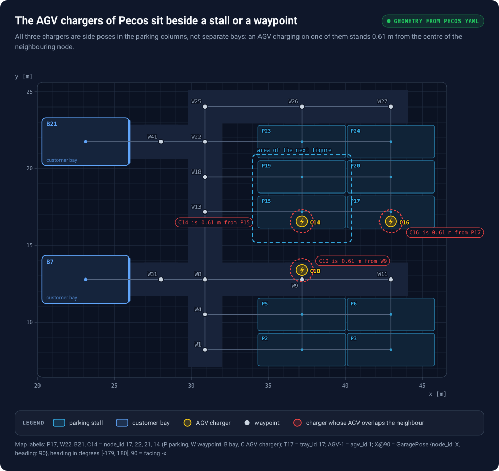
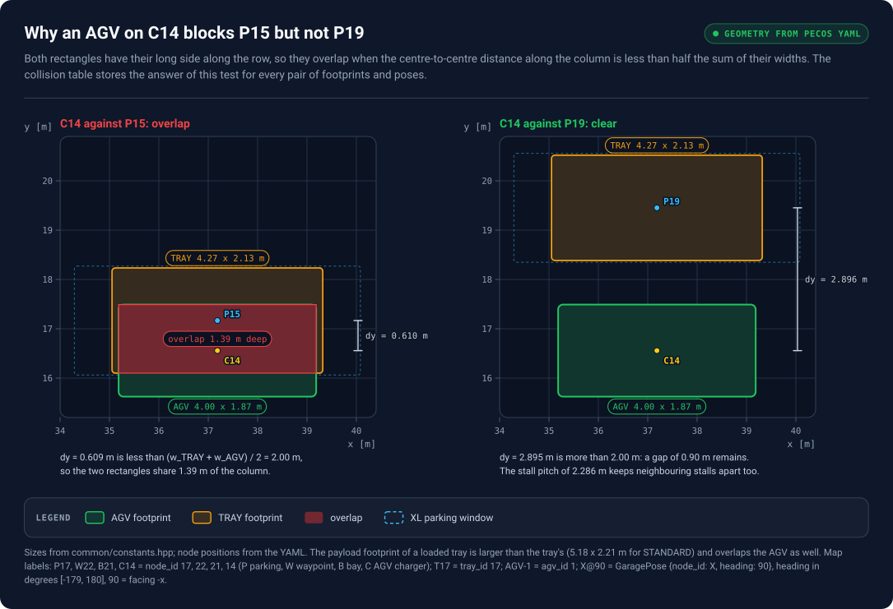
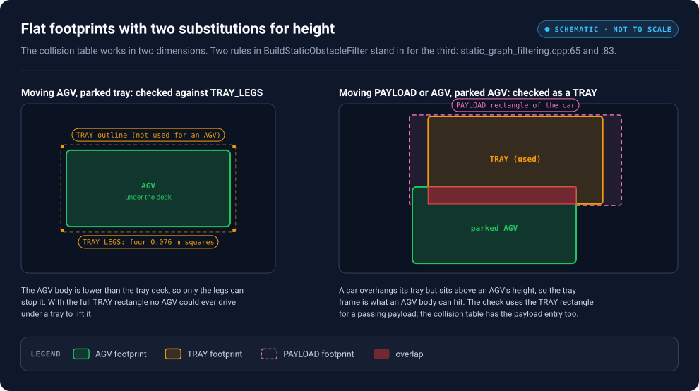
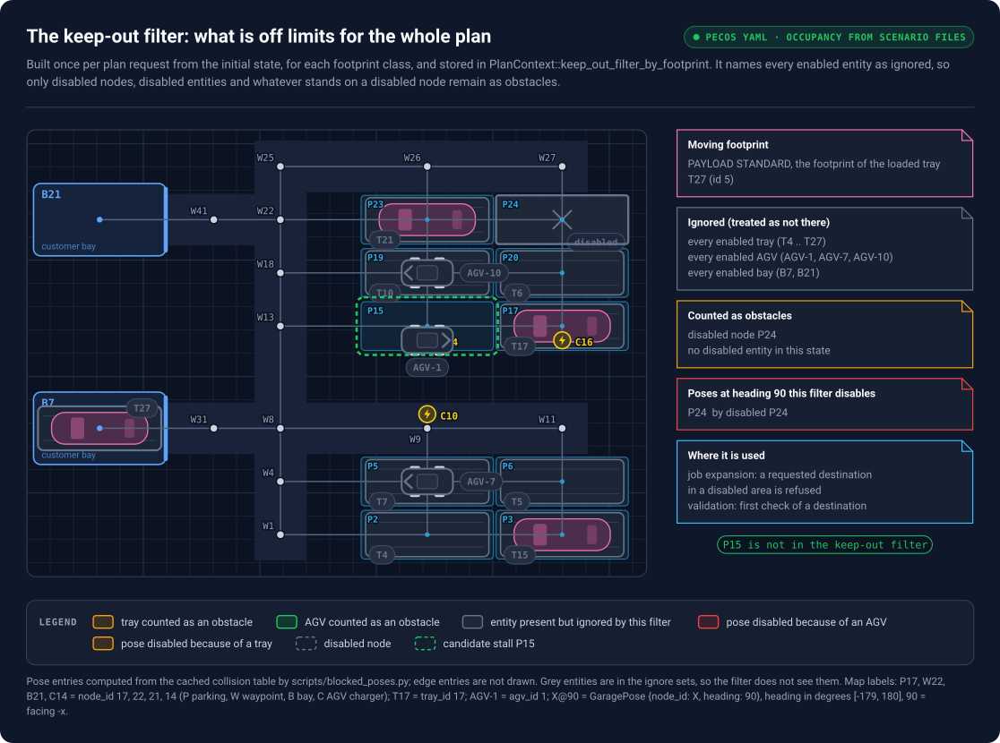
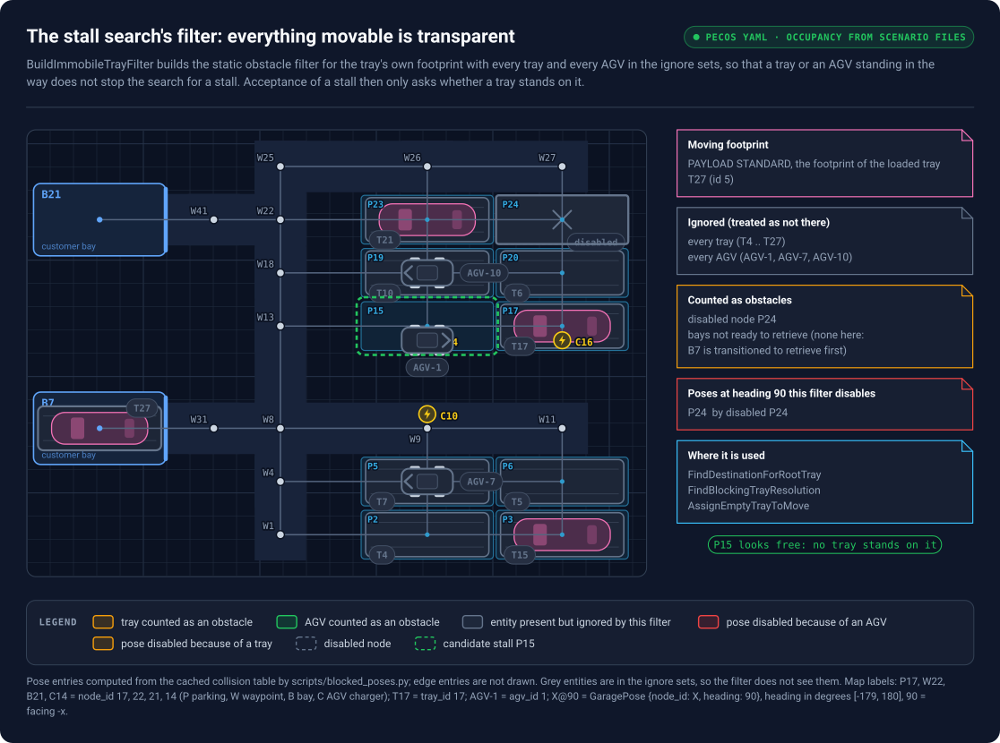
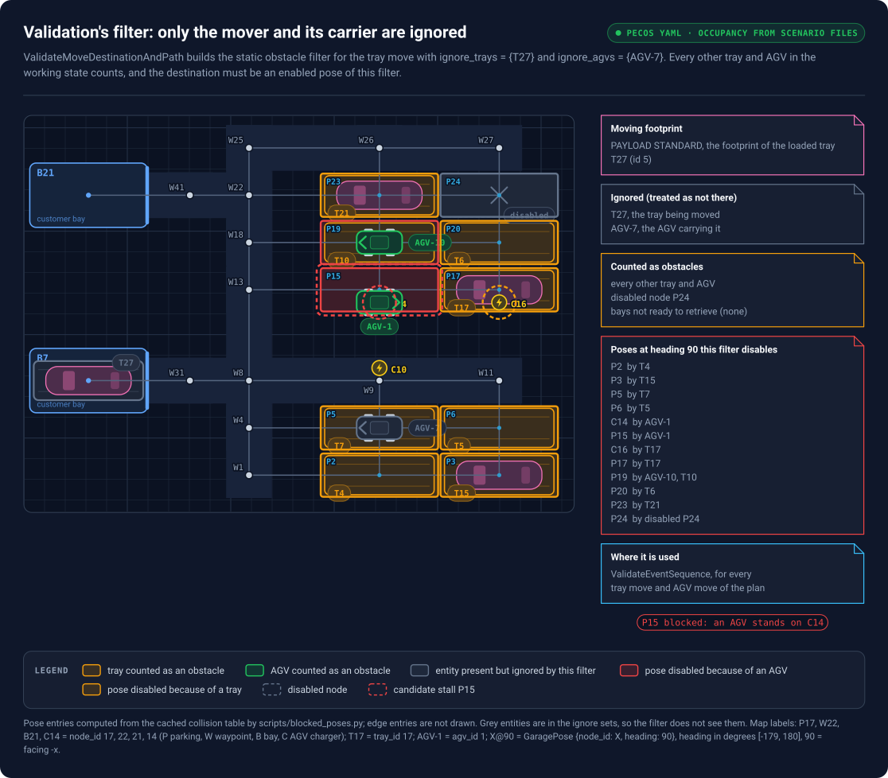
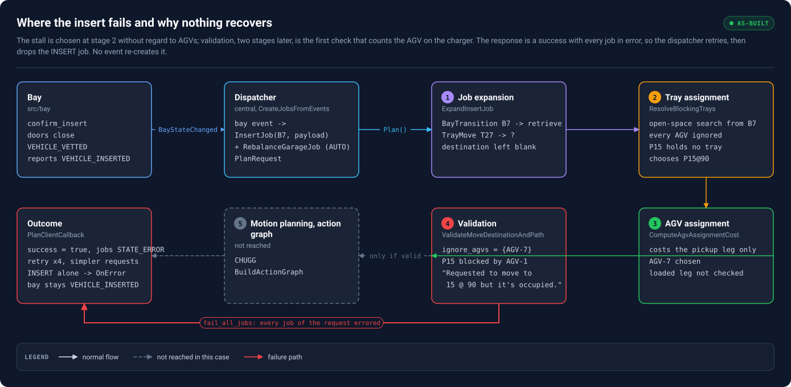
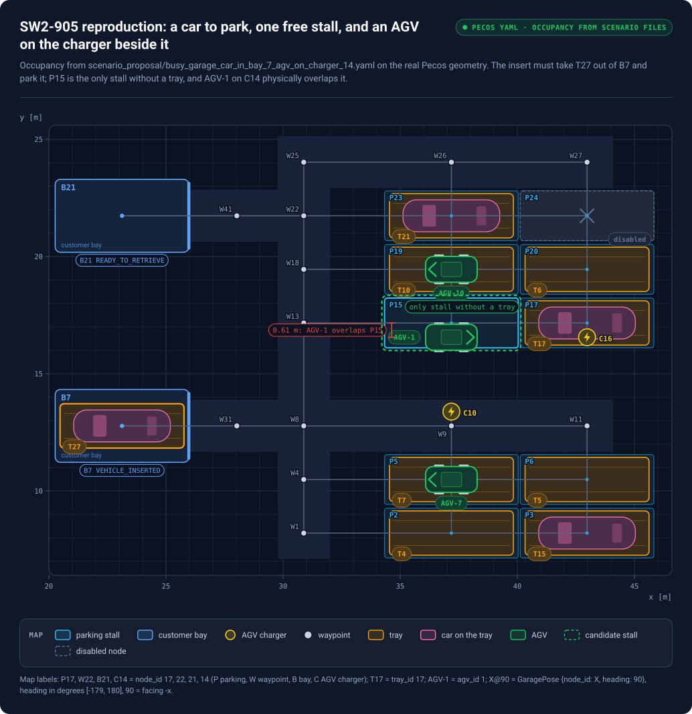
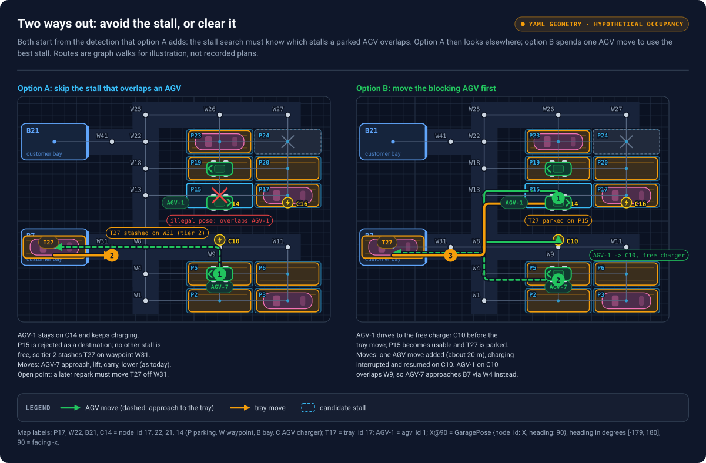

# SW2-905: insert fails when an AGV on a charger overlaps the chosen parking stall

Working notes, kept outside the volley repository. Written on 2026-11-02 from a
read of branch `jmg/SW2-1135/scheduler-renames-and-cleanups` (PR #1018), then
brought up to date on 2026-11-05 after that PR was merged into `main` (merge
`a468657f`, seven commits `110dff33` to `129cd6fc`). The fix now builds on
`main`, in a branch of its own: `jmg/SW2-905/insert-stall-blocked-by-agv`, which
on 2026-11-05 holds the scenario files and tests of section 6 (unstaged,
uncommitted) and no fix yet; the direction is chosen first (section 8), and
section 11 records the review of 2026-11-05.

Line numbers below refer to `main` at `a468657f`. The scheduler now lives in
namespace `volley::scheduler` (its tests in `volley::scheduler::test`); the
functions this analysis walks kept their names and bodies between the branch tip
`a80d0ee3` and the merge, so only line numbers moved.

Notation: italic letters for scalars, bold lowercase for vectors, bold uppercase
for matrices.

Figures are SVG files under `figures/`, generated by `scripts/build_figures.py`
with the SVG kit of the SW2-482 study pack
(`scheduler_package/scripts/diagrams`), so the Pecos geometry is read from the
same YAML. The blocked-pose data of figure 3 is computed from the cached
collision table by `scripts/blocked_poses.py` (run inside the devcontainer) and
kept in `figures/data/blocked_poses.json`.

## 0. Summary

A patron parks a car in a bay and confirms. The bay closes both doors, verifies
the car and reports "vehicle inserted". The dispatcher then asks the scheduler
to plan the insert: an AGV lifts the tray with the car out of the bay and parks
it in a stall. The scheduler chooses the stall with a search that accounts for
trays but not for AGVs. When an AGV is parked on a charger whose pose lies 0.6 m
from the chosen stall, the stall is physically blocked. The scheduler detects
this only in its final check before motion planning, fails the whole plan, and
the dispatcher discards the job. The bay remains closed with the car inside and
nothing retries, so staff must fault the bay, remove the car and restart the
dispatcher.

The root cause is in tray assignment (section 4). The recommended fix is a small
change there that makes the stall search treat parked AGVs as positions a tray
may pass but may not be parked on, reading the AGV poses from a state that
includes the AGV moves planned before the tray move (section 7, option A),
together with a recorded planning scenario that reproduces the failure (section
6). Moving the blocking AGV out of the way (option B) builds on that detection
and is the follow-up (section 8).

## 1. The ticket

- **Key:** SW2-905, Bug, priority Highest, epic SW2-1067 "[NRI]
  Scheduler/Dispatcher Improvements".
- **Title:** Failure to plan insert when AGV is in collision with selected
  parking node.
- **Description, paraphrased:** During the parking sequence, once a vehicle is
  vetted and a `confirm_insert` request arrives, the bay transitions to
  VEHICLE_INSERTED. This signals the dispatcher to plan the insert job and send
  it to the scheduler. The scheduler selects a parking spot and plans to it. If
  an AGV is at a charge node in collision with that parking node, planning
  fails. Recovery is costly: the bay has already closed both doors with the
  vehicle inside, so the bay has to be forced into a faulted state by opening
  the patron door, the vehicle removed, and the dispatcher restarted.
- The full text: `acli jira workitem view SW2-905`.

The reporter assumed the scheduler picks the nearest unoccupied spot. It picks
the nearest stall that holds no tray; AGVs play no part in that choice.

### 1.1 Ticket status and related work (checked 2026-11-05)

- Created 2026-10-06 by Paula, assigned to the user on 2026-11-02, status To Do,
  no comments, no links, no fix version, no sprint field set. Parent epic
  SW2-1067.
- No branch, PR or commit refers to SW2-905: none locally, none on `origin`,
  none among GitHub's pull requests (`gh pr list --state all --search SW2-905`
  is empty).
- The one in-flight change that touches the same situation is PR #1031,
  `[SW2-1164] Charge very-low-battery AGVs while the garage is busy` (Jesse
  Lessner, open, review required, base `main`, written against the scheduler
  before PR #1018 so it needs a rebase onto the renamed code). Three parts of it
  matter here:
  - `PlanRequest.unassignable_agvs`: very-low-battery AGVs that the scheduler
    must neither assign tray moves nor hide during a clean-garage job; sent only
    in AUTO mode with dispatch charging on. An AGV on that list is exactly an
    AGV sitting on a charger, so option B must never move one; option A needs no
    extra logic for them (the stall beside them is skipped).
  - An INSERT that fails to plan while that list is non-empty is re-queued
    instead of errored out, "since the charging AGV may be what's in the way": a
    dispatcher-side mitigation of this bug, limited to AGVs on the list. An AGV
    charging for an ordinary reason (an idle-time charge job) is not on it, and
    the insert still errors out as section 4.1 describes.
  - Its known limitations say the recovering AGV on eng's charger C10 beside W9
    becomes a fixed obstacle, and that "the blocking AGV should be handled by
    the motion planning work in progress", which is this ticket. Its files
    (`dispatch.*`, `scheduler.cpp`, `scheduler.hpp`, `agv_hiding_search.*`,
    `agv_assignment_tests.cpp`) do not overlap the files the fix touches
    (`tray_assignment.cpp`, `insert_job_tests.cpp`, the scenario files), so the
    two can land in either order.

## 2. Background

### 2.1 Components

| Component | Package | Role in an insert |
| --- | --- | --- |
| Bay | `src/bay` | A room with a patron door and a system door. Its insert state machine guides the car in, closes the doors on `confirm_insert`, verifies the car and reports VEHICLE_INSERTED. |
| Dispatcher | `src/central`, class `Dispatch` | Turns garage events into jobs (`InsertJob`, `RetrieveJob`, ...), batches pending jobs into one plan request, sends it to the scheduler and executes the returned schedule. |
| Scheduler | `src/planner/scheduler` | `Scheduler::Plan()` turns a plan request (garage state plus jobs) into an action graph of AGV and bay commands. The method is `const` and holds no state between calls. |
| Motion planner | `src/planner/motion_planner` | Search helpers the scheduler uses (blocking-tray search, open-space search, graph filters) and CHUGG, the multi-AGV motion planner. |

### 2.2 Layout, poses and the graph

A layout is a graph $G = (\mathcal{V}, \mathcal{E})$ whose vertices are poses. A
pose $p = (n, \theta)$ is a node $n$ with a heading $\theta$ from the node's
allowed set. A node has a position $\mathbf{x}_n \in \mathbb{R}^2$ in metres and
a type: bay, waypoint, parking, AGV charger or EV charger. Pecos combined
(`src/config/site_config/layouts/5675_pecos_combined.yaml`) has 28 nodes and 37
layout edges; its stalls allow the single heading 90°, and the waypoints W8 and
W22 allow 0° and 90° so that AGVs can turn there. `GarageGraph` in `common_ros`
is the graph form of a layout. The three AGV chargers are dead-end spurs of the
graph: C10's only edge leads to W9, C14's to P15 and C16's to P17, so an AGV
reaches or leaves a charger through the stall or waypoint beside it.

### 2.3 Entities and footprints

A garage holds trays, AGVs, bays and payloads. A tray is a 14 ft by 7 ft
platform on short legs; a car sits on a tray. An AGV is 157.5 in by 73.5 in and
lower than a tray deck, so it drives under a tray, lifts it and carries it.

Collision checks are performed between two footprints. A footprint class $k$ is
a polygon $\mathcal{P}_k \subset \mathbb{R}^2$ centred at the origin. Placed at
pose $p = (n, \theta)$ it becomes

$$ \mathcal{P}_k(p) = {, \mathbf{R}(\theta),\mathbf{u} + \mathbf{x}_n ;:; \mathbf{u} \in \mathcal{P}_k ,},
\qquad \mathbf{R}(\theta) = \begin{pmatrix} \cos\theta & -\sin\theta \\ \sin\theta & \cos\theta \end{pmatrix} \in \mathbb{R}^{2 \times 2}.$$

The classes and their ids (`CollisionEntityId`, `common_ros/include/common_ros/collision_geometry.hpp:34`):

| id | class | polygon | stands for |
|---|---|---|---|
| 0 | `BAY_ODP` | the strip a bay's system door sweeps | a bay that is not ready to retrieve |
| 1 | `TRAY_LEGS` | four 0.076 m squares at the tray corners | a parked tray as seen by an AGV, which fits between the legs |
| 2 | `TRAY` | rectangle 4.267 m by 2.134 m | an empty tray; also any parked AGV as seen by a tray or a payload |
| 3 | `AGV` | rectangle 4.000 m by 1.867 m | an AGV |
| 4 + j | `PAYLOAD` of parking window j | the window's rectangle (Pecos: COMPACT 4.267, STANDARD 5.182, LARGE 5.486, XL 5.791 m long; all 2.21 m wide) | a tray carrying a car of that size class |

Every filter and search takes a `collision_id` argument, called the moving footprint in this document. It
is the footprint of the single entity whose path or destination is being computed, derived from that
entity's state:

- an AGV carrying nothing: `AGV` (`CollisionEntityIdFromAgvState`);
- an empty tray, carried or parked: `TRAY`;
- a tray with a car, carried or parked: the `PAYLOAD` class of the car's window
  (`CollisionEntityIdFromTrayState`). In the insert under study the car on tray 27 is STANDARD, so the moving
  footprint is id 5.

All other entities in the state are obstacles, each with its own footprint. Two substitutions encode the
vertical dimension that the flat polygons lack:

- an `AGV` moving past a parked tray is checked against `TRAY_LEGS` rather than `TRAY`, because it passes
  under the deck (`static_graph_filtering.cpp:65`);
- an `AGV` or `PAYLOAD` moving past a parked AGV is checked as a `TRAY` against that AGV, because the AGV
  body meets the tray frame before it meets the overhang of a car (`static_graph_filtering.cpp:83`).



*Figure 1a. The three AGV chargers of Pecos. Each is a pose inside a parking column, 0.61 m from a stall or a
waypoint: C10 beside W9, C14 beside P15, C16 beside P17. An AGV charging on one of them stands inside the
footprint of a tray parked on the neighbouring node. The dashed box is the area of figure 1b.*



*Figure 1b. C14 against P15 and against P19, to scale. The AGV (4.00 m by 1.87 m) and the tray (4.27 m by
2.13 m) both lie along the row, so they overlap when their centres are closer than half the sum of their
widths, 2.00 m, along the column. P15 is 0.609 m from C14 and the rectangles share 1.39 m; P19 is 2.895 m
away and a 0.90 m gap remains. The stall pitch of 2.286 m is why stalls never collide with their neighbours.
The payload footprint of a loaded tray (5.18 m by 2.21 m for STANDARD) is larger and overlaps the AGV as
well. Section 5 gives the arithmetic.*



*Figure 1c. The two substitutions that stand in for height. Left: an AGV moving past a parked tray is checked
against TRAY_LEGS, the four 0.076 m squares at the tray's corners, because its body passes under the deck.
Right: a payload or an AGV moving past a parked AGV is checked with the TRAY rectangle, because the tray
frame is what the AGV body can hit; the car's overhang sits above it.*

### 2.4 The collision table

`CollisionTable` (`common_ros/.../collision_geometry.*`) precomputes, once per layout, whether footprint
$k_a$ at pose $p$ overlaps footprint $k_b$ at pose $q$:

$$C(k_a, p;\; k_b, q) = 1 \iff \mathcal{P}_{k_a}(p) \cap \mathcal{P}_{k_b}(q) \neq \emptyset,$$

and the same for an edge $e = (p, q)$ in place of a pose, using the polygon swept along the move. The
relation is stored in both directions (`collision_geometry.cpp:354`), so it is symmetric. The scheduler uses
it through two calls:

```
table.Query(fixed, queried, pose)            -> the poses and edges a `queried` footprint cannot occupy
                                                while a `fixed` footprint stands at `pose`
table.Query(fixed, queried, pose, candidate) -> true if `candidate` is one of them
```

The table is cached as JSON inside the devcontainer at `~/.cache/volley/<layout>_collision_table_<md5>.json`.
It is not present on the host. In that file, `pose_pose_map["3"]["14@-90"]["2"]` lists the poses a `TRAY`
cannot occupy while an `AGV` stands on charger C14 at heading -90°.

### 2.5 Graph filters

A filter (`GraphFilterProperties`) is a pair of boolean masks over the graph, one entry per pose and one
per edge, where 1 means enabled. A search expands only enabled edges, and a destination check reads the
single entry of the destination pose. Everything the planner knows about obstacles enters a search through
such a filter.

#### 2.5.1 The static obstacle filter

`BuildStaticObstacleFilter` (`motion_planner/src/static_graph_filtering.cpp:39`) builds the masks for one
moving footprint from a garage state and three ignore sets. Every entity in the state is an obstacle unless
it is named in an ignore set; the ignore sets are how a caller declares "this entity is the one moving" or
"this entity can be moved out of the way, do not let it stop the search". Disabled nodes, disabled entities
and entities standing on disabled nodes block regardless of the ignore sets.

```
function BuildStaticObstacleFilter(moving, state, ignore_trays, ignore_agvs, ignore_bays):
    blocked = {}                                   # poses and edges
    disabled_nodes = copy(state.disabled_nodes)

    for tray in state.trays:
        if tray.disabled: disabled_nodes.add(tray.node)
        if tray.id in ignore_trays: continue
        obstacle = TRAY_LEGS if moving == AGV else footprint_of(tray)      # section 2.3
        blocked += table.Query(fixed=obstacle at tray.pose, queried=moving)

    for agv in state.agvs:
        if agv.disabled: disabled_nodes.add(agv.node)
        if agv.id in ignore_agvs: continue
        queried = TRAY if moving in {AGV, PAYLOAD_*} else moving          # section 2.3
        blocked += table.Query(fixed=AGV at agv.pose, queried=queried)

    for bay in state.bays:
        if bay.disabled: disabled_nodes.add(bay.node)
        if bay.id in ignore_bays or bay.state == READY_TO_RETRIEVE: continue
        blocked += table.Query(fixed=BAY_ODP at bay inbound pose, queried=moving)

    for node in disabled_nodes:                    # never ignorable
        for heading in node.headings:
            blocked += table.Query(fixed=largest payload footprint of node at (node, heading), queried=moving)

    if moving is a PAYLOAD class:
        blocked += every pose whose node is too small for that window, and its edges

    return Filter(enabled = everything not in blocked)
```

The result answers one question: for this one moving entity, which poses and edges are taken by the
entities of the state that the caller has not chosen to ignore.

#### 2.5.2 The keep-out filter

At the start of every plan the scheduler needs a map of the places that are off limits for the entire
plan, independent of what will move during it. These are:

- nodes an operator has disabled;
- entities that are disabled (an AGV in error, a disabled tray, a disabled bay) and the nodes they stand on;
- entities parked on a disabled node;
- resources reserved by the committed schedule. Before planning, `ExcludeCommittedResources`
  (`scheduler.cpp:31`) marks every AGV with a committed command as disabled, together with the source and
  destination nodes of that command, and every bay or EV charger with a committed command as disabled.

The planner calls such a map a keep-out filter, in the sense of a keep-out zone in robot navigation: an
area the plan must stay out of whatever else happens. `BuildKeepOutFilters`
(`static_graph_filtering.cpp:194`) produces it with the static obstacle filter of 2.5.1 by naming every
enabled entity that is not on a disabled node in the ignore sets. What remains as obstacles is exactly the
list above:

```
function BuildKeepOutFilters(state):
    ignore_agvs  = { agv.id  for agv  in state.agvs  if not agv.disabled  and agv.node  not in state.disabled_nodes }
    ignore_trays = { tray.id for tray in state.trays if not tray.disabled and tray.node not in state.disabled_nodes }
    ignore_bays  = { bay.id  for bay  in state.bays  if not bay.disabled  and bay.node  not in state.disabled_nodes }
    return { footprint: BuildStaticObstacleFilter(footprint, state, ignore_trays, ignore_agvs, ignore_bays)
             for footprint in [AGV, TRAY] + payload classes present in state }
```

`Plan()` builds this map once per request (`scheduler.cpp:156`) and stores it as
`PlanContext::keep_out_filter_by_footprint`, one filter per footprint class. Job expansion consults it
whenever a job names a destination: a repark to a disabled area is refused (`CheckReparkDestination`), a
retrieve of a payload parked in a disabled area is refused, and the charger search skips chargers in a
disabled area. Validation reads it too, before its own occupancy check.

The keep-out filter therefore describes the static part of the world and nothing else. An enabled AGV
that is charging on an enabled node is in `ignore_agvs` by construction, so the keep-out filter contains no
trace of it. Occupancy by enabled entities is handled separately: each search builds its own static obstacle
filter from the current working state with an ignore set that fits its purpose. Section 2.7 shows the
ignore set the stall search uses, and section 4 the one validation uses; the difference between the two is
the bug.



*Figure 2a. The keep-out filter for the loaded tray's footprint, on the reproduction state. It is built once
per plan from the initial state and names every enabled entity as ignored (drawn grey), so only disabled
nodes, disabled entities and whatever stands on a disabled node remain as obstacles: here the disabled stall
P24. P15 is not in it. Job expansion uses this filter to refuse a requested destination in a disabled area,
and validation reads it before its own occupancy check.*



*Figure 2b. The stall search's filter (`BuildImmobileTrayFilter`) for the same footprint and state. Every
tray and every AGV is ignored so that movable things do not stop the search; only P24 remains, and the
search accepts P15 because no tray stands on it. The AGV on C14 is as invisible to this filter as it is to
the keep-out filter, for a different reason: the keep-out filter ignores enabled entities by definition, the
stall search ignores them because it assumes they can be moved.*



*Figure 2c. Validation's filter for the tray move. Only T27, the tray being moved, and AGV-7, its carrier,
are ignored; every other tray and AGV counts (drawn in colour). The occupied stalls are disabled by their
trays, and AGV-1 disables P15 and C14. The destination accepted in figure 2b is a disabled pose here, which
is the failure described in section 4.*

### 2.6 The scheduler pipeline

`Scheduler::Plan()` (`scheduler/src/scheduler.cpp:138`) runs five stages over one `PlanContext`:

| # | Stage | File | Purpose |
|---|---|---|---|
| 1 | Job expansion | `job_expansion.cpp` | One `Expand<Type>Job` per job builds the event DAG: tray moves, AGV moves, bay and charger transitions. A tray move may leave its tray id or its destination blank. |
| 2 | Tray assignment | `tray_assignment.cpp`, `AssignTrays` | Fills the blanks: which empty tray, which parking stall, and the moves of the trays that block the way. |
| 3 | AGV assignment | `agv_assignment.cpp`, `AssignAgvs` | Chooses the AGV for each tray move and adds the AGV's own moves. |
| 3b | Validation | `validation.cpp`, `ValidateEventSequence` | Replays the events on a copy of the state and checks every destination and path, because the motion planner does not fail gracefully on an infeasible event order. |
| 4 | Motion planning | `PlanMotions`, CHUGG | Trajectories. |
| 5 | Action graph | `action_graph.cpp` | The response the dispatcher executes. |

A failure in stage 1 fails only the job concerned (`scheduler.cpp:163`). A failure in stages 2 to 5 fails
every job of the request through `fail_all_jobs` (`scheduler.cpp:177`), which marks each job `STATE_ERROR`
while leaving `response.success` true.

Each stage replays the events on a working copy of the state, and the copies differ. Job expansion and
validation replay every planned event (`ComputeStateAfterPlannedEvents`, `ValidateEventSequence`). Tray
assignment replays tray moves and bay or VECS transitions only: `ApplyBayOrChargerTransition`
(`tray_assignment.cpp:327`) returns before applying any other event, so an AGV move that job expansion
planned earlier in the request leaves the AGV at its initial pose for the whole of tray assignment. Nothing
in tray assignment reads AGV poses today, so the difference is invisible; option A makes it matter
(section 7).

### 2.7 Selection of a parking stall

For a tray move with a blank destination, `AssignTrays` calls `AssignDestinationAndUnblockingMoves`
(`tray_assignment.cpp:398`), which calls `ResolveBlockingTrays` (`:509`), which calls
`FindDestinationForRootTray` (`:605`). That function runs `OpenSpaceSearchEnvironment`
(`motion_planner/src/blocking_tray_search.cpp:70`), a breadth-first search over the graph that starts at the
tray's current pose, uses the tray's moving footprint, and stops at the first pose it accepts as a
destination. Three parts of the search matter here.

**The path filter.** `BuildImmobileTrayFilter` (`tray_assignment.cpp:470`) calls the static obstacle
filter with every tray except the caller's immobile ones in `ignore_trays` and every AGV in `ignore_agvs`:

```
function BuildImmobileTrayFilter(moving, state, immobile_trays):
    return BuildStaticObstacleFilter(moving, state,
                                     ignore_trays = { t.id for t in state.trays if t.id not in immobile_trays },
                                     ignore_agvs  = { a.id for a in state.agvs },
                                     ignore_bays  = {})
```

Only disabled nodes and entities, closed bays and payload-size limits can stop the search. The rationale is
that everything movable can be moved out of the way, so it should not stop the search for a stall.

**The edge cost.** Expanding an edge costs its travel time plus a 30 s penalty for every tray newly found
in the way of that edge (`blocking_tray_search.cpp:46`). The trays in the way become the blocking trays that
`ResolveBlockingTrays` later reparks. AGVs are not examined.

**Acceptance of a destination.** `OpenSpaceSearchEnvironment::OnExpansion` (`blocking_tray_search.cpp:112`):

```
function AcceptAsDestination(candidate):          # candidate is a pose
    node = node_of(candidate)
    if node.type not in {PARKING, EV_CHARGE} and not (tier 2 and node.type == WAYPOINT): return false
    if state.tray_on_node(node): return false
    for (pose, footprint) in illegal_poses:
        if table.Query(fixed=footprint at pose, queried=moving, candidate): return false
    # retrieval-heading (where the graph caches one), EV-charger and payload-height rules follow
    return true
```

`illegal_poses` is a map from a pose to a footprint, supplied by the caller. It means that the tray may be
driven through that pose but must not be parked anywhere that overlaps it; the main loop fills it with the
root tray's own path so that a blocking tray is not reparked back into the way. The AGVs of the state are
not consulted at any point. The retrieval-heading rule (`:149`) applies only to nodes for which
`StorePreferredPayloadHeadingsForRetrieval` (`scheduler.cpp:97`) cached a heading; the stalls of Pecos have
none (they allow heading 90 only), so on this layout the rule accepts every candidate.

The search runs in two tiers: parking and EV-charge nodes first; if nothing is found and the caller
allows it, a second search may stash the tray on a waypoint (`FindDestinationForRootTray`, tier 2).

## 3. The insert flow, end to end

| Step | Code | What happens |
|---|---|---|
| Patron confirms | `bay/include/bay/bay_insert_state_machine.hpp:91` to `:93`; `bay_state_machine.hpp:500` | Inner insert machine: VEHICLE_INSERTED + INSERT_CONFIRMED → PATRON_DOOR_CLOSING (the doors close) → DOORS_CLOSED → VERIFYING_VEHICLE → VEHICLE_VETTED. The outer bay machine then goes PROCESSING_INSERT + VEHICLE_VETTED → VEHICLE_INSERTED, the state the bay reports. The doors are closed before anything is planned. |
| Dispatcher creates the job | `central/src/dispatch.cpp:1347`, `CreateJobsFromEvents` | On the bay event PROCESSING_INSERT → VEHICLE_INSERTED, if a tray with a payload is in the bay: `InsertJob(bay, payload)`; in AUTO mode also a `RebalanceGarageJob`. No other code path creates an InsertJob. |
| Plan request | `dispatch.cpp`, `GetPlannerServiceRequest` | The pending jobs, the garage state and the committed base schedule go to `Scheduler::Plan`. |
| Stage 1 | `job_expansion.cpp:359`, `ExpandInsertJob` | Checks bay, tray and payload; adds a bay transition to retrieve; calls `ExpandReparkTrayJob(ctx, tray.id, job_index, true)` with no destination (`:397`). With no destination, `CheckReparkDestination` and the keep-out check do not run. |
| Stage 2 | `tray_assignment.cpp:398, 509, 605` | The search of section 2.7 chooses the stall without regard to AGVs. The heading is then settled (`:416` to `:426`) and the move applied to the working state. |
| Stage 3 | `agv_assignment.cpp:231`, `ComputeAgvAssignmentEdgeCosts`; `:700`, `ComputeAgvPickupDuration` | Costs only the AGV's drive to the tray, with the AGV footprint and every assignable AGV ignored. The loaded leg to the stall is not checked against AGVs here. `OrderAgvMoveAfterBlockerDeparture` (`:742`) only concerns AGV pose moves blocked by another AGV body. |
| Validation | `validation.cpp:18` and `:72` | For the tray move: payload footprint, `ignore_trays = {the tray}`, `ignore_agvs = {its carrier}`. Every other AGV counts. The keep-out check (`:84`) and the destination check (`:94`) run before the path search. |

## 4. Root cause and the observed failure



*Figure 3. The insert from the bay event to the dropped job. The stall is chosen at stage 2; validation is
the first check that sees the AGV on the charger; the dispatcher receives a successful response whose jobs
all failed, retries, and drops the INSERT job.*

Two facts in stage 2 combine:

1. `BuildImmobileTrayFilter` ignores every AGV (`tray_assignment.cpp:470`).
2. `OpenSpaceSearchEnvironment::OnExpansion` rejects a stall only for a tray on it or for an illegal pose
   (`blocking_tray_search.cpp:112`); it never reads the AGVs of the state.

A stall whose footprint overlaps an idle, enabled AGV therefore appears free. An AGV blocks the search only
when it is disabled or stands on a disabled node, because those nodes join `disabled_nodes` regardless of
the ignore sets (`static_graph_filtering.cpp:73`). An AGV charging on an enabled charger is enabled, so it
is invisible to the search.

The first check that does see the AGV is validation. For the tray move, `ValidateMoveDestinationAndPath`
builds its own static obstacle filter from the working state and reads the destination entry:

```
filter = BuildStaticObstacleFilter(moving, working_state,
                                   ignore_trays = {tray.id}, ignore_agvs = {tray.carrier}, ignore_bays = {})
if not filter.enabled(destination):
    fail "Requested to move to <destination> but it's occupied."         # validation.cpp:95
```

Stage 2 ignores every AGV; validation ignores one. Any stall that overlaps another AGV passes stage 2 and
fails validation. The message the dispatcher logs, with the tray move's string form from
`planner_core/src/schedule_events.cpp:119`, reads:

```
Pre-motion planning sanity check failed: Invalid destination for <... Tray ID: 27 Dest: 15 @ 90 Agv ID: 7> .: Requested to move to 15 @ 90 but it's occupied.
```

It is the destination check that fails, not the path search ("Cannot find path"), because the destination
check comes first. `fail_all_jobs` (`scheduler.cpp:177`) then errors every job of the request with this text.
Two consequences follow:

- `response.success` remains true; the dispatcher receives a plan whose jobs all failed, not a failed call.
- The clean-garage request is not sent: `clean_garage_request_fn_` runs only when an insert fails at
  expansion (`scheduler.cpp:171`).

### 4.1 Why recovery is manual

In `Dispatch::PlanClientCallback` (`dispatch.cpp:479`):

- With two or more jobs in the request and all of them failed (`:566`), the dispatcher retries with simpler
  request strategies (`NextSimplerPlanRequestStrategy`, `:1201`) up to `kMaxPlanRetries = 4`, then moves the
  first pending job to the back of the queue. Every retry meets the same obstacle.
- Once the INSERT is requested alone (`PLAN_JOBS_ONE_JOB_AT_TIME`), the per-job branch at `:729` calls
  `job->OnError`, removes the job from the pending list and completes it. Only RETRIEVE jobs are re-queued
  (`:707`).

No code path re-creates the InsertJob: it exists only because of the bay state-change event. The bay stays
in VEHICLE_INSERTED with its doors closed and the car inside. A dispatcher restart does not re-create the
job either; the restart in the ticket is part of clearing the manually faulted state.

The footprint substitution of section 2.3 (`static_graph_filtering.cpp:83`) is not the cause. Validation
checks the payload against the AGV as a `TRAY`; the table blocks `TRAY` and every `PAYLOAD` class at the
same poses in this case, and a payload rectangle contains the tray rectangle in general. The substitution
only matters for keeping any new destination check at least as strict as validation.

## 5. The geometry at Pecos

Pecos combined, column $x = 37.186$ m: waypoint W9 at $y = 12.775$, charger C10 at $13.385$, charger C14 at
$16.557$, stall P15 at $17.166$, stall P19 at $19.452$. The chargers are side poses 0.61 m from a stall or a
waypoint, not separate bays. The cached collision table, queried inside the container with the `AGV`
footprint fixed, gives:

| AGV on | Blocks `TRAY` and every `PAYLOAD` class at |
|---|---|
| C10, either heading | W9 at ±90°, and C10 itself |
| C14, either heading | P15 at ±90°, and C14 itself |
| C16, either heading | P17 at ±90°, and C16 itself |

P19 is not blocked by C14: the conflict is confined to the stall adjacent to each charger. At heading 90°
both rectangles have their long side along the row (the $x$ axis) and their short side along the column
(the $y$ axis). Two such rectangles with centres $\mathbf{x}_a, \mathbf{x}_b$ and offset
$\boldsymbol{\Delta} = \mathbf{x}_b - \mathbf{x}_a = (\Delta x, \Delta y)$ overlap when

$$|\Delta x| < \tfrac{1}{2}(\ell_a + \ell_b) \quad\text{and}\quad |\Delta y| < \tfrac{1}{2}(w_a + w_b).$$

For an AGV on C14 and a tray on P15, $\boldsymbol{\Delta} = (0,\; 0.609)$ m and
$\tfrac{1}{2}(w_{\text{TRAY}} + w_{\text{AGV}}) = \tfrac{1}{2}(2.134 + 1.867) = 2.0$ m, so they overlap. For
P19, $\boldsymbol{\Delta} = (0,\; 2.895)$ m exceeds 2.0 m, so they do not. The stall pitch along the column
is 2.286 m, which is why neighbouring stalls never collide with each other while a charger pose 0.6 m from
a stall always does.

This geometry also explains the recorded insert scenarios `plan/insert_job/FromBay7*` and `FromBay21*`: their
initial states disable node 14, and a disabled node blocks the volume of the largest footprint it allows at
each of its headings (`static_graph_filtering.cpp:122`), a tray-sized footprint at C14 here, which covers
P15. The search never reaches P15 and the tray is stashed on W31 (W41 from bay B21). The comment above
`ExpectInsert` in `test/src/jobs/insert_job_tests.cpp:15` attributes the stash to the retrieval-heading rule;
that rule accepts every heading on Pecos (section 2.7), so the comment is wrong, and the observation
recorded during stage SW2-1126 ("lowered on the waypoint rather than in the free stall P15") has this cause.
The fix PR should correct the comment, and a control scenario with C14 enabled and no AGV on it (section 6)
shows the car parking on P15.

The collision of this ticket is in the end one between two AGV bodies: the carrier that lowers the tray at
P15 and the AGV charging on C14 would stand 0.61 m apart. That is why validation exempts the carrier, and
why an AGV on C14 that carries the tray itself causes no failure: it has left the charger, through P15, before
the tray arrives.

## 6. Reproduction

The drafts are in `scenario_proposal/` next to this file. On the user's go of 2026-11-05 they were added to
the repository on `jmg/SW2-905/insert-stall-blocked-by-agv` (under `src/planner/scheduler/test/scenarios/` and
in `test/src/jobs/insert_job_tests.cpp`, whose `ExpectInsert` now prints the plan's message when a job is not
executing) and run; the results are at the end of this section.



*Figure 4. The reproduction state on the Pecos layout: a car on T27 in bay B7, every stall but P15 occupied,
P24 disabled, and AGV-1 stopped on charger C14, 0.61 m from the centre of P15.*

- `busy_garage_car_in_bay_7_agv_on_charger_14.yaml`, for `initial_states/5675_pecos_combined/`. A copy of
  `busy_garage_car_in_bay_7_heading_90` (car on tray 27 in B7, state VEHICLE_INSERTED; AGV 7 under an empty
  tray at P5; AGV 10 under one at P19; every stall but P15 occupied; P24 disabled) with two changes: node 14
  is no longer disabled, and a new AGV 1, stopped, stands at `{node_id: 14, heading: -90}`, the charger's
  inbound pose as in `agv_on_charger_14.yaml`.
- `StallBlockedByAgvOnCharger.yaml`, for `plan/insert_job/`: one INSERT for bay 7, authored part only.
- `insert_job_tests.cpp.patch.txt`: `TEST(InsertJob, StallBlockedByAgvOnCharger)` using the suite's
  `ExpectInsert` plus the assertion that the tray is never lowered on node 15.
- A control, drafted on 2026-11-05 in the same folder: the same busy garage with node 14 enabled and no
  AGV on it (`busy_garage_car_in_bay_7_charger_14_enabled.yaml`, `plan/insert_job/FromBay7StallFree.yaml`,
  `TEST(InsertJob, FromBay7StallFree)`). Expected: the car parks on P15. It records the behaviour the fix must
  keep, and it settles by a run what section 5 concludes by reading: the stash on W31 in the recorded
  scenarios comes from the disabled charger, not from the retrieval-heading rule.

The drafts are unchanged by the merge of PR #1018: the YAML keys are those the README on `main` describes,
and the test patch inserts into the file as it now is (namespace `volley::scheduler::test`, `ExpectInsert`
unchanged).

Expected behaviour today: tier 1 finds P15, the only stall without a tray (the stalls of this layout cache
no retrieval heading, so that rule filters nothing); AGV 7 is assigned; validation fails with the message of
section 4; the test's `ASSERT_EQ(state, STATE_EXECUTING)` fails and prints it. After the fix: a plan of the
same shape as `FromBay7TrayHeading90` (AGV 7 lifts in B7 and stashes the tray on W31), recorded at that
point.

**Run of 2026-11-05** (`main` `a468657f` plus the test files, scheduler built with 0 warnings):

- `InsertJob.FromBay7StallFree`, the control, passes and is recorded: AGV 7 lifts T27 in B7 and lowers it
  on P15 through W31, W8 and W13. P15 is chosen as soon as nothing blocks it, which settles the cause of
  the W31 stash in the older recordings (section 5).
- `InsertJob.StallBlockedByAgvOnCharger` fails as predicted, with AGV 7 as the carrier:

  ```
  Pre-motion planning sanity check failed: Invalid destination for Task ID: 0 TRAY_MOVE Tray ID: 27 Dest: 15@90 Agv ID: 7 .: Requested to move to 15@90 but it's occupied.
  ```

  It is not recorded yet: its recording is made after the fix, when the plan executes.
- The other six insert tests, including `Deterministic` and every existing recording under
  `SCHEDULER_CHECK_RECORDINGS=1`, pass.

## 7. Fix options

Every option below starts from the same missing fact: the stall search does not know which stalls a parked
AGV overlaps. Option A adds that fact and uses it to look elsewhere; option B adds it and uses it to clear
the stall; option C leaves the scheduler alone and changes when the failure happens.



*Figure 5. Left, option A: P15 is rejected because it overlaps AGV-1, no other stall is free, and T27 is
stashed on waypoint W31. Right, option B: AGV-1 moves to the free charger C10 before the tray move and T27
is parked on P15; because an AGV on C10 overlaps W9, AGV-7 approaches the bay through W4. Routes are graph
walks for illustration, not recorded plans.*

### Option A: tell the stall search where the AGVs are

The stall search already accepts a list of places a tray may drive through but must not be parked over: the
illegal poses of section 2.7, which the main loop uses to keep a reparked blocking tray off the root tray's
path. Option A puts the parked AGVs on that list. Before `ResolveBlockingTrays` (`tray_assignment.cpp:509`)
starts its loop, it copies the request and adds the pose of every enabled AGV with footprint `AGV`, except an
AGV that is already under the root tray:

```
request_with_agvs = copy(request)
for agv in base_state.agvs:
    if agv.disabled or agv.id == root_tray.agv_id: continue
    request_with_agvs.illegal_poses[vertex_of(agv.pose)] = AGV
```

From then on, every time the search reaches a stall, `AcceptAsDestination` asks the collision table
whether a tray parked on that stall would overlap one of those AGVs, exactly the question validation asks
later, and keeps searching if it would. The path masks, the edge costs and the blocking-tray logic are
untouched: the AGV's own pose stays passable, only parking over it is refused. `FindDestinationForRootTray`
derives the illegal poses of the blocking-tray searches from the request (`:632`), so those searches and the
recursion see the AGVs too. They need to: a blocking tray reparked onto a stall that overlaps an AGV would
fail validation exactly as the root tray does.

Which state the AGV poses come from decides whether the check agrees with validation. Tray assignment's
working state does not apply AGV moves (section 2.6), while validation replays them in topological order.
An AGV move planned before the tray move, the hiding moves of a clean-garage job for instance, leaves the
AGV at its old pose for the stall search but at its new pose for validation. Reading the poses from tray
assignment's state as it is would make the search reject stalls that validation accepts: recordings in which
an AGV move precedes a tray move could change, and the clean-garage recovery described under the limit below
would land one plan late. Option A therefore also applies AGV pose moves to tray assignment's working state
(`ApplyBayOrChargerTransition`, `tray_assignment.cpp:340`, returns early for them today), so that the search
sees the AGV poses validation will see. That is a few lines and no new concept: the same `ApplyTo` the
function already calls for transitions, without registering the move as an occupant, since ordering AGV
moves against tray moves stays AGV assignment's job.

In the reproduction, P15 is passed over, no other stall is free, and the second tier stashes T27 on W31.
That is the plan the scheduler produces today when C14 is disabled (`FromBay7TrayHeading90`), so the
outcome is known to execute. In a garage with another free stall, the search simply takes that stall.

- Planning output: a stall overlapping an idle AGV is skipped; otherwise unchanged.
- Recorded scenarios: none expected to change, given the state refinement above. Every recorded plan passed
  validation, which rejects such a destination unless the overlapping AGV is the carrier, and the search
  takes the first acceptable candidate in cost order, so removing candidates validation would have rejected
  cannot change a recorded choice. The one case that could change is a recorded plan whose carrier was an AGV
  overlapping the chosen stall without standing under the tray; none is known. The comparison run
  (`SCHEDULER_CHECK_RECORDINGS=1`) settles it.
- Tray-solver direction (SW2-482/SW2-484, `PROMPT.md` section 6.3): compatible. `ResolveRequest.illegal_poses`
  is already in the planned module API; the change is a few lines inside the function that stage C1 moves
  to `task_planning/tray_assignment/blocking_trays.cpp`, and the module test can cover it without a
  `Scheduler`.
- Footprint note: the search queries the payload footprint against the AGV where validation uses `TRAY`.
  The table gives the same answer here and the payload rectangle contains the tray rectangle in general, so
  the search is never less strict than validation.
- Size: about ten lines in `ResolveBlockingTrays` and a few in `ApplyBayOrChargerTransition`, plus the
  scenarios, the tests and their recordings.
- Limit: when no stall is clear, the car ends on a waypoint, and W31 is the only approach to bay B7. The
  stash is not permanent: a clean-garage job (`ExpandCleanGarageJob`, `job_expansion.cpp:514`) first hides
  every AGV under an empty tray (`FindAgvUnderTrayAssignment`, `:523`), which takes AGV 1 off C14, and then
  reparks every tray that stands on a waypoint (`ReparkWaypointStashedTrays`, `:553`). The dispatcher queues
  that job on its own, among other occasions when the garage is idle and dirty (`dispatch.cpp:991`). With the
  AGV poses read from a state that includes the hiding moves, the repark lands on P15 in that same plan;
  otherwise one plan later. Until then B7 cannot take a new car and a retrieve to B7 waits.

### Option B: move the blocking AGV first

The AGV on the charger is idle, carries nothing and is the cheapest thing in the garage to move. Option B
keeps P15 as the destination and adds one AGV move before the tray move:

1. Detect the conflict as in option A, and remember which stall was rejected because of which AGV.
2. When the stall the search settled on is worse than the rejected one (a waypoint stash, or a stall much
   farther away), choose a parking pose for the blocking AGV: the nearest free charger first, through
   `FindUnoccupiedChargerWithShortestTravelTime` (`job_expansion.cpp:855`), which the charge job already
   uses; otherwise a pose under an empty tray (`FindAgvUnderTrayAssignment`, the hiding search of the clean
   garage job) or a waypoint off the tray's path. The pose must not overlap the stall, the tray's path or
   another stall in use; in the reproduction C10 qualifies, and it keeps the AGV charging.
3. Add an `AgvMove` for that AGV to the event DAG and an edge from it to the tray move, and set the tray
   move's destination to the rejected stall.

The stages after tray assignment need no new concepts: AGV assignment applies the AGV moves that reach the
root of the DAG before it assigns the tray moves beneath them (`ApplyNonTrayRootEvents`,
`agv_assignment.cpp:202`), chains them per AGV and orders their arrivals, so the blocking AGV is busy until
it arrives; validation replays the AGV move before the tray move, so P15 reads as free; CHUGG plans both
motions. Tray assignment must apply the move to its own working state, the same change option A needs.

The layout fixes two details. C14's only edge leads to P15, so AGV 1 leaves through P15 and must be gone
before the tray arrives; the DAG edge from the AGV move to the tray move says exactly that. Of the
destinations, a hiding pose under an empty tray (T4 at P2, T5 at P6 or T6 at P20 in the reproduction) is
what the clean-garage job would choose and blocks nothing; the free charger C10 keeps AGV 1 charging, but an
AGV on C10 blocks W9 for every AGV and every loaded tray, so AGV 7 must approach B7 through W4 and carry the
tray through W13, as figure 5 draws. Both are plans the validator accepts; which is better is a policy
question (section 9).

- Planning output: one more AGV move; the car gets the best stall instead of a waypoint or a farther stall.
- Recorded scenarios: none expected to change, for the same reason as option A.
- Cost: tray assignment would emit AGV events for the first time (today it emits tray moves only); the AGV
  needs a destination search with its own collision checks (an AGV on C10 overlaps W9, so other AGVs must
  route around it, as figure 5 shows); charging is interrupted unless the destination is another charger;
  the plan is longer by the AGV's drive, about 20 m here.
- Tray-solver direction: the solver's planned `Result` (PROMPT.md 6.3) lists new tray moves only; option B
  needs an AGV-move output as well, a small extension of the interface before or during stage C1.
- Size: roughly 100 to 200 lines, plus tests. It presupposes option A's detection.

### Option C: fail before the bay closes its doors

Central would gate `confirm_insert` on a dry-run plan. `Plan()` is `const` and stateless, so a dry run is
feasible, but the dispatcher's plan pipeline is single-flight (`plan_call_data_`) and the bay flow would need
a rejection path. The change crosses packages and does not make the insert succeed; it changes the moment at
which it fails. Better treated as a separate recovery ticket, together with re-queueing failed INSERT jobs as
RETRIEVE jobs are re-queued (`dispatch.cpp:707`) and sending the clean-garage request on validation failures.

### Which is better

Neither A nor B is best on its own; the answer depends on whether another stall is free.

| Garage state | Option A | Option B |
|---|---|---|
| Another stall is free | takes it: no extra move, charging continues | spends an AGV move it did not need and interrupts charging |
| No other stall is free | stashes the car on a waypoint; a later repark is needed and W31 blocks bay B7 | parks the car properly for one AGV move |

The policy that is right in both cases is A's choice with B as the fallback: skip stalls that overlap an
AGV, and only when that leaves a waypoint stash (or a stall much farther than the rejected one) move the AGV
instead. B cannot be built without A's detection, and A on its own already turns the outage into a plan
that executes.

## 8. Recommendation and plan

Two steps, on a branch from `main` (`jmg/SW2-905/insert-stall-blocked-by-agv`):

1. **Option A now**, two commits that each build and pass:
   - `test(scheduler): record an insert whose only free stall is blocked by an AGV on a charger`: the
     initial states, the two scenarios (authored part) and the two tests of section 6, with the control
     recorded (it passes today) and the `ExpectInsert` comment corrected. The blocked scenario fails with
     the message of section 4.
   - `fix(scheduler): keep tray destinations clear of parked AGVs`: the illegal-poses change in
     `ResolveBlockingTrays`, the AGV-move application in `ApplyBayOrChargerTransition`, the recording of
     the blocked scenario, and `SCHEDULER_CHECK_RECORDINGS=1` across `scheduler`, `planner_core` and
     `scheduler_advanced_tests` to show that nothing else moved; then `volley-in-container tidy`.
   - Before stage C1 of the refactor: commit 5 of `PROMPT.md` moves `ResolveBlockingTrays` into the tray
     module, and it should move the fixed code. If C1 starts first, the same change goes into
     `blocking_trays.cpp` instead.
2. **Option B as the follow-up** under the same epic, with the fallback policy of section 7: it changes the
   reproduction's recording from a waypoint stash to a parked car plus one AGV move, and it is the place to
   decide where a displaced AGV goes. Whether it lands before or after stage C1 of the refactor depends on
   when the solver interface gains an AGV-move output.

Recovery hardening in the dispatcher (option C) goes to its own ticket under SW2-1067.

## 9. Open questions

- Should the AGV that will carry the tray be exempt from the new check? At stage 2 the carrier is not yet
  known, so option A exempts only an AGV already under the tray. Being conservative costs at most a farther
  stall; being permissive risks today's failure. A variant of option B would prefer the blocking AGV as the
  carrier, so that it clears the stall by doing the job; that needs AGV assignment to accept a preference
  from tray assignment and is only right when that AGV's battery allows it.
- Where should a displaced AGV go (option B)? A free charger keeps it charging; a pose under an empty tray
  keeps it out of the way; a waypoint is cheapest but may block a lane.
- Pulling an AGV off its charger to clear a stall, or to carry the tray, is a decision the scheduler cannot
  judge: the AGV state it receives (`DiscreteAgvState`: id, state, pose, lift, tray id, disabled) carries no
  charge level. The dispatcher owns charging through its charge jobs, so option B should prefer destinations
  that keep the AGV charging, and the carrier variant stays out until the state carries a charge level.
- The `TRAY`-for-`AGV` footprint substitution (`static_graph_filtering.cpp:83`) is an open item from the
  refactor review (codex review 14, item 5). It is not needed for this fix and deserves its own ticket.
- The tray-solver interface of `PROMPT.md` 6.3 has no AGV output: `Result::NewMove` is a tray move and
  `StepsFromDag` skips AGV events, so stage C1 cannot move the eviction as it stands. The interface needs
  an AGV-relocation result (and the eligibility inputs: carrier, unassignable AGVs) before C1-4 moves
  `ResolveBlockingTrays`. Raised by Codex review 1.
- `SW2-1135_scheduler_renames/upstream_cleanup_assessment.md` (item 3) proposes renaming
  `BuildStaticObstacleFilter` to `BuildKeepOutFilter`. That name already belongs to the per-plan filter
  (`BuildKeepOutFilters`, `PlanContext::keep_out_filter_by_footprint`), and this document keeps the two apart
  on purpose (section 2.5); the rename should take another name, `BuildObstacleFilter` for instance.
- The site on which the reporter observed the failure is not named in the ticket. Pecos is the only layout
  in the scenario set with AGV chargers, and its geometry matches the description; the fix is
  site-independent in any case.

## 10. Glossary

- **AGV**: the robot that drives under a tray, lifts it and carries it.
- **Tray, root tray**: the platform a car sits on; the root tray is the one a job wants to move.
- **Blocking tray**: a tray in the root tray's way that must be reparked first.
- **Stall, parking node**: a node of type Parking where a tray may be left.
- **Charger, C-node**: an AGV charge node; at Pecos a side pose next to a stall or a waypoint.
- **Waypoint stash**: leaving a tray on a transit-lane node when no stall is reachable (tier 2).
- **Footprint, collision id**: the polygon used for overlap checks (section 2.3).
- **Moving footprint**: the footprint of the entity whose path or destination a search computes (section 2.3).
- **Static obstacle filter**: the per-search masks of poses and edges taken by non-ignored entities (section 2.5.1).
- **Keep-out filter**: the per-plan masks of disabled and reserved areas; not an occupancy map (section 2.5.2).
- **Illegal poses**: poses a tray may pass but must not be parked over (section 2.7).
- **Scenario file**: a YAML under `scheduler/test/scenarios/` that drives a planning test and records its output.

## 11. Review of 2026-11-05

**What changed in the code.** PR #1018 was merged into `main` on 2026-11-05 (`a468657f`). Between the branch
tip these notes were written against (`a80d0ee3`) and the merge, the branch was squashed to seven commits and
review items were folded in: the scheduler moved into `volley::scheduler`, the repark destination is validated
after its heading is final, action-graph failures became specific, and the Eccles exception and dead paths
went. None of it touches the functions this analysis walks; every quoted body (`BuildStaticObstacleFilter`,
`BuildKeepOutFilters`, `BuildImmobileTrayFilter`, `OpenSpaceSearchEnvironment::OnExpansion`,
`ResolveBlockingTrays`, `FindDestinationForRootTray`, `ValidateMoveDestinationAndPath`, `Plan()`'s stage
sequence, the dispatcher's retry and drop paths, the bay transitions) was re-read on `main` and the line
numbers above were corrected. `main` after the merge also carries SW2-1076, SW2-1103 and SW2-1147, none of
which touch the planner.

**What was learned on the way.** Three facts not in the notes of 2026-11-02:

1. Tray assignment's working state never applies AGV moves (`ApplyBayOrChargerTransition` returns early
   for them), while validation replays every event. Any check in tray assignment that reads AGV poses, as
   option A does, must take them from a state that includes the AGV moves ordered before the tray move, or
   it disagrees with validation and lags the clean-garage recovery by one plan.
2. The chargers are dead-end spurs (C14's only edge is P15), and the collision is between the carrier and
   the charging AGV. This settles the ordering option B needs (AGV out through P15, then the tray in) and
   explains why the charging AGV as carrier never fails.
3. The stash on W31 in the recorded insert scenarios comes from the disabled charger C14 blocking P15, not
   from the retrieval-heading rule as the comment in `insert_job_tests.cpp:15` says. The stage SW2-1126 note
   that flagged the stash "for the team" has this answer.

**Does the strategy still make sense.** Yes, with three refinements, all folded into sections 6 to 9 above:

- Build on `main`, not on the merged branch; land before stage C1 of the refactor, whose commit 5 moves the
  very function option A changes.
- Option A reads AGV poses from a state that includes earlier AGV moves (the `ApplyBayOrChargerTransition`
  change). Without it the fix is correct for the reproduction but conservative elsewhere, and the recorded
  scenarios could move.
- Add the control scenario (C14 enabled, no AGV: the car parks on P15) and fix the misleading test comment
  in the same PR.

On A against B: the user's instinct that moving the AGV is the right outcome holds whenever no other stall is
free, and the notes recommend B as the follow-up rather than the first step for three reasons that still
stand. B cannot exist without A's detection; A alone already turns a dropped job and a closed bay into a plan
that executes and self-heals through the clean-garage job; and B needs a decision the scheduler cannot make
today, whether an AGV may leave its charger, because the AGV state carries no charge level. The cheapest
"move the AGV" of all, letting the charging AGV carry the tray, is blocked by the same missing information.
If the user wants B in the same ticket, the order of work does not change: A's two commits first, then B on
top, with the reproduction's recording changing from a stash on W31 to a parked car plus one AGV move.

**Related work.** PR #1031 (SW2-1164, section 1.1) adds unassignable AGVs and a dispatcher re-queue of inserts
that fail while such an AGV charges. It strengthens the case for A as the baseline: the AGV most likely to be
on a charger is one option B is not allowed to move. No branch or PR exists for SW2-905 yet.

**Verified by the run of 2026-11-05** (section 6): AGV 7 is the carrier in the reproduction, the failure
message is the one predicted, and the control parks the car on P15.

## 12. Implementation log

- **2026-11-05, commit 1** `a9d88f48` `test(scheduler): record an insert whose only free stall is blocked by
  an AGV on a charger` on `jmg/SW2-905/insert-stall-blocked-by-agv`: the two initial states, the two
  scenarios, the two tests and the corrected `ExpectInsert` comment. To keep the commit green, the blocked
  test asserts today's behaviour (job in error, the "occupied" message, empty schedule) and records the
  failed response; the fix commit flips it and re-records. The branch also carries `8fa8a934`, the test
  viewer's step scrubber (a session that shared the checkout committed it here; bookmarked as
  `jmg/scheduler-test-viewer-steps` so it can be split off before the PR).
- **2026-11-05, option A implemented, uncommitted** (`tray_assignment.cpp`, `scheduler.hpp`;
  message drafted in `log/commitmsg/sw2-905-fix.txt`):
  - `ResolveBlockingTrays` copies the request and adds every enabled AGV's pose, except the AGV under the
    root tray, to `illegal_poses` with the `AGV` footprint; both searches take the copy.
  - Tray assignment's working state applies AGV moves. After the user's review of the first cut (an
    `ApplyNonTrayEvent` with two branches and two comments), `AssignTrays` dispatches on the event type
    instead: AGV moves are applied, bay and VECS transitions are registered by `RegisterTransition`
    (the old `ApplyBayOrChargerTransition` without the apply) and then applied, a VRC transition is
    skipped, which the old code did silently. The eight "apply to the working state" blocks of the file
    share a file-local `ApplyToWorkingState` with one failure text; the advance-move failure no longer
    logs an ERROR on top of returning it. No comment was added for the AGV case; the loop shows it.
  - Result: `InsertJob.StallBlockedByAgvOnCharger` plans; its recording is the same eight commands as
    `FromBay7TrayHeading90` (AGV 7 lifts in B7, stashes on W31). All eight insert tests pass with
    `SCHEDULER_CHECK_RECORDINGS=1`. `planner_core` (24) and `scheduler_advanced_tests` (15) pass.
  - One recording changed and was re-recorded: `TrayAssignment.FillsBlankDestination` (275_sunrise_b,
    tray 1 at P2067 with a blank destination, the only AGV standing idle on P2066). It chose P2066, the
    AGV's own stall, which the full pipeline accepts only because that AGV becomes the carrier; it now
    chooses P2062. This is the conservative case of section 9: the carrier is unknown at stage 2, so an
    AGV's stall is skipped even when the AGV would have carried the tray. The cost is a farther stall in
    a one-AGV garage; the alternative, exempting an AGV when it is the only one enabled, is a special case
    not worth encoding. The user decides whether to keep it.
  - The `ApplyToWorkingState` helper and `ComputeStateAfterPlannedEvents` both compensate for
    `ScheduleEvent::ApplyTo` returning `BoolStringPair`; the consistent design is SW2-1170 (`ApplyTo`
    returns `stdx::Result`), after which the helper is deleted. The user deferred that to SW2-1170; the
    commit message says so.
- **2026-11-05, commit 2** `6b6c65dd` `fix(scheduler): keep tray destinations clear of parked AGVs`: the
  fix, the refactor and the two recordings. Built with 0 warnings; `scheduler` 196, `planner_core` 24 and
  `scheduler_advanced_tests` 15 tests pass with `SCHEDULER_CHECK_RECORDINGS=1` (the earlier run had been
  cut short by the devcontainer exiting on its own, which it did twice that day about 30 minutes after
  `devc start`). `volley-in-container tidy main` on the tip: 0 findings.
- The viewer commit `8fa8a934` (the test viewer's step scrubber, committed under this branch by a session
  that shared the checkout) ships in the same PR: the user's teammate saw no need for a second PR, since
  the user is the tool's only user. On the user's explicit ask the branch was rebased on 2026-11-05 to
  `main` → `8fa8a934` (viewer) → `7cf5f666` (tests) → `4d7401c7` (fix); the ticket patches are identical
  to the earlier `a9d88f48` / `6b6c65dd`. `jmg/scheduler-test-viewer-steps` still points at `8fa8a934`
  and can be deleted.
- **2026-11-05, PR #1036** opened as a draft (https://github.com/VolleyAutomation/volley/pull/1036) from
  `pr_description.md`, after the user pushed the branch. Bound to the session with Auto-fix off (the user
  answers review comments himself). Jira SW2-905 moved to In Progress on the user's go.
- **2026-11-05, option B, commit 3** `2008ca0a` `feat(scheduler): send an idle AGV to another charger when it
  blocks the only free stall` (user's decision: evict the AGV to another charger, then park the car; the
  stash stays as the last resort; comments kept to one line in the test, none in the library code):
  - `AssignDestinationAndUnblockingMoves` builds the request (the AGV illegal poses moved out of
    `ResolveBlockingTrays` into a file-local `IllegalPosesOfParkedAgvs`, so a search without them is one
    request away) and, when the result is a waypoint stash, calls `ResolveByEvictingAgvs`.
  - `ResolveByEvictingAgvs`: reruns the search without AGV poses and without a stash to find the stall
    the tray would take; asks the collision table which enabled, non-carrier AGVs overlap it; sends each
    to the nearest free charger whose occupant would not overlap the stall
    (`FindUnoccupiedChargerWithShortestTravelTime` gained an exclusion set); reruns the search on the
    state with the AGVs moved; returns the AGV moves and the plan only if that reaches a stall. The AGV
    moves are added to the DAG with edges to every tray move of the plan; they are roots, so AGV
    assignment schedules them as it does a charge job's move, and CHUGG runs the carrier's approach in
    parallel (recorded: AGV 7's drive to B7 has no dependency on AGV 1; only the loaded leg waits).
  - Results: `StallBlockedByAgvOnCharger` re-recorded: AGV 1 C14 → P15 → P17 → C16 (nearest free
    charger; it passes under T17's legs), AGV 7 lifts in B7 and parks on P15. New scenarios
    `StallBlockedByAgvNoFreeCharger` (AGVs on C10, C14, C16: no eviction; AGV 2 on C10 is the nearest
    carrier and stashes on W31) and `StallBlockedByDisabledAgvOnCharger` (AGV 1 disabled: stash on W31 by
    AGV 7). `scheduler` 198, `planner_core` 24, `scheduler_advanced_tests` 15 pass with recording checks;
    no other recording changed.
  - Not handled: PR #1031's unassignable AGVs (not on `main` yet); an AGV that is the only enabled one is
    still evicted and then carries, one needless move; a hiding pose under an empty tray as a second
    destination choice when no charger is free.
- **2026-11-05, Codex review 1** (`codex_reviews/codex_review_1.md`, with the evaluation and the fix plan).
  Two defects accepted: (1) the eviction can send the AGV to a charger that closes the tray's only route
  (the rerun's path filter ignores AGVs; validation then fails "Cannot find path"), reproduced by Codex
  with W4 disabled; (2) commit 4 moved the AGV exclusions out of `ResolveBlockingTrays`, so the
  fixed-destination blocker reparks and `ExpandChargePayloadJob` lost them again. Also accepted: the
  ordering test must walk `parents`, four more scenarios, most renames, `[[nodiscard]]` and `_opt`, the
  viewer's hash handling. Rejected: `is_*` for a predicate lambda. Fix plan in the review file; the PR
  stays a draft until it lands.
- **2026-11-05, review-1 fixes, commit 4** `9c8637c4` `fix(scheduler): keep evictions off the tray's route and
  the AGV exclusions in the resolver` (the viewer's hash fix rides in it; not pushed yet):
  - Resolver: `ResolveRequest::is_parking_over_agvs_allowed` (default false); `ResolveBlockingTrays`
    merges `CollectIllegalPosesOfParkedAgvs` into its request unless set; the eviction's candidate search
    sets it. Covers `AssignTrays`'s fixed-destination blocker reparks, `ExpandChargePayloadJob` and the
    recursion again. No recording moved.
  - Route: `FindUnoccupiedChargersByTravelTime` (sorted; the old name wraps it), `MoveAgvToFreeCharger`
    takes the first charger whose placement keeps the destination reachable (`IsDestinationReachable`:
    validation's filter, ignoring the tray, its carrier and the AGV standing on the tray's node, which is
    what validation's carrier exemption amounts to at this stage), and the final plan is checked again
    after its blocking-tray moves. The eviction moves blocking AGVs in one pass; a multi-pass version for
    AGVs boxed in by each other was dropped with its scenario (see below).
  - Tests: `ExpectEviction` walks `ActionNode.parents` from the loaded departure to each evicted AGV's
    last action and checks the job GUID; `StallBlockedByAgvEvictedAwayFromRoute` (empty tray on P15,
    AGV 7 idle on P5, AGV 2 under the car in B7, W4 disabled: C10 would close W9, AGV 7 goes to C14
    beside the tray on P15, the car parks on P5); `StallBlockedByAgvChargersUnreachable` (W9 and P17
    disabled: stash); `TrayAssignment.KeepsDestinationsOffParkedAgvs` on the empty tray at P2 (a tray
    in a bay cannot be used there: the bay's door strip blocks it until the insert's transition). A
    two-AGV scenario was tried and dropped: an AGV on P15 and one on C14 overlap each other, and no
    Pecos stall is overlapped by two non-overlapping AGV poses.
  - Learned on the way: the route check must ignore the AGV standing on the tray's node (AGV 2 under
    the car in the bay), or every route from the bay reads as blocked; with no AGV on C14 and no tray on
    P15 the search simply takes P15, so the route scenario needs the empty tray on P15.
  - Results: `scheduler` 201, `planner_core` 24, `scheduler_advanced_tests` 15 with recording checks.
    The viewer session fixed the hash handling and shortened `app.js`'s introduction in the same tree.
- **2026-11-05, Codex review 2** (`codex_reviews/codex_review_2.md`): no reproduced blocker left. Accepted:
  the candidate check ran before the plan's blocking-tray moves, so the placement loop became a
  depth-first search over the blocking AGVs and their ranked chargers (`EvictBlockingAgvs`) with the whole
  plan checked at the leaf (`IsTrayPlanFeasible`: each blocking-tray move's route in sequence, then the
  root); `IsTrayDestinationReachable` with a one-line note that the AGV under the tray is taken for its
  carrier until assignment; the small rule fixes in the tests. Recordings unchanged.
- **2026-11-05, history rebuilt as three commits** on the user's ask (viewer, tests, solution), from the
  final tree via a temporary commit `cc5654c6` and a new branch from `main`: `9c243aad`
  `feat(scheduler): review the test viewer's solutions step by step`, `c9ec26ac` `test(scheduler): record
  inserts whose only free stall is blocked by an AGV on a charger` (compiles on its own; four of its six
  scenarios fail until the next commit, which the message says), `a989c498` `fix(scheduler): keep tray
  destinations clear of parked AGVs, moving the AGV when it must`. `git diff cc5654c6 a989c498` is empty;
  tidy on the tip 0 findings; the five old commits are kept as `jmg/SW2-905/old-five-commits`. The PR body
  on GitHub describes the three commits; the user force-pushes (`--force-with-lease`).
- **2026-11-05, Codex review 3** (`codex_reviews/codex_review_3.md`): no blocking findings, ready to leave
  draft. PR text corrected (six recorded scenarios plus one stage test; P5 in the route scenario). The
  rename `EvictBlockingAgvs` → `FindAgvEvictionPlan` was applied on the user's go by amending the solution
  commit: `a989c498` → `0737691a` (same message; insert tests pass with recording checks). Origin still has
  `a989c498` until the user force-pushes.
- **2026-11-06, viewer colours folded into commit 1** on the user's ask: an AGV that moves, its ghost at a
  step's destination and the thickened stretch of the selected step were drawn in the AGV body colour or
  the accent, both dark green, the same as AGV 7's path shade, so AGV 1's step looked like AGV 7's. Now
  `paths.agent_colours` assigns the shades once, `Scene.assets` draws each moving AGV's body, plate,
  chevron and label in its shade (one trace group per colour; AGVs that do not move keep the AGV colour),
  `Canvas.ghost` takes the colour, the stretch trace uses it, and the page only widens the selected
  arrow and badge border instead of recolouring them to the accent. Checked with a headless-Chrome
  screenshot of `StallBlockedByAgvOnCharger@6` (the built-in browser refuses `file://`). Commit 1 amended
  and the other two replayed: `01752a3c` (viewer), `b1988e61` (tests), `076e4115` (fix); the tree outside
  `tools/plan_viewer` is identical to `0737691a`. Unpushed.
- **2026-11-06, timeline tab folded into commit 1** on the user's ask: the OUTPUT table reads as a serial
  script, so `page.timeline` lays the schedule out in time, one row per agent and one column per second,
  each action a bar from the earliest start its `after` chain allows (`start = max(end of parents)`,
  `end = start + duration`) in its agent's shade, numbered as in the schedule, clickable and highlighted
  with the selected step; a caption above it and one above the schedule say how to read each. Stage
  scenarios, which carry no durations, say so. Checked with a headless screenshot through a scratchpad
  wrapper that presets the tab (the artifact itself must not be copied). Commit 1 amended and the others
  replayed: `ba41e140` (viewer), `b855ffef` (tests), `65db2a82` (fix); the tree outside the viewer is
  unchanged. Unpushed.
- **2026-11-06, tab labels**: the user noted that the timeline is an output too, so the two tabs read
  `output tables` and `output timeline` (the pane keys and the saved tab are unchanged; `TAB_LABELS` in
  `app.js` maps them); captions and the scenarios README follow. Commit 1 amended again and the others
  replayed: `b88636db` (viewer), `6cdee934` (tests), `54af1216` (fix). Pushed by the user.
- **2026-11-06, simulation**: `simulation.md` next to this file explains how to watch the eviction in the
  sim with Foxglove. The scenario
  `src/scenario/scenarios/5675_pecos_sandbox_combined_insert_blocked_by_agv_on_charger.yaml` (untracked;
  joins the tests commit once it has run) is the busy garage on the sandbox layout, run in MANUAL mode so
  the dispatcher's start-up clean-garage job (`dispatch.cpp:962`) cannot hide AGV 1 before the patron
  arrives; a manual `transition_bay_to_insert` readies B7 and a `patron_arrival` at 90 s triggers the
  insert. Run by the user in Foxglove on 2026-11-06 (the Testing box of the PR is ticked).
- **2026-11-06, two AGVs**: on the user's ask every new Pecos scenario of the PR uses the site's two AGVs:
  AGV 1 is the one in the way (on C14, or idle on P5 in the route case, or disabled), AGV 2 the carrier under
  the empty tray at P5 (in the control AGV 1 stands under the tray at P19). `StallBlockedByAgvNoFreeCharger`
  could no longer park AGVs on every charger, so its state disables C10 and C16 instead
  (`busy_garage_car_in_bay_7_agv_on_charger_14_other_chargers_disabled`); the disabled C10 also closes W9, so
  AGV 2 reaches the bay through W4. All six re-recorded; the eviction plan keeps its shape (AGV 2 to the bay
  in parallel with AGV 1's C14 → C16; the loaded leg waits for both). The sim scenario joins the tests
  commit. `scheduler` 201, `planner_core` 24, `scheduler_advanced_tests` 15 with recording checks.
- **2026-11-06, comments**: the sim scenario lost its header and inline comments (the tests commit's
  message carries the why), and the two test comments that retold the investigation shrank to one line
  each. A first attempt put the edits in the wrong commit because a refused `git switch` was hidden by a
  pipe; redone from a clean tree. Branch: `b88636db` (viewer), `55ac7b2b` (tests), `0a3e42bd` (fix); the
  tree equals the previous tip apart from the comments. Unpushed.
- **2026-11-06, sim timing**: the user asked whether 90 s was consistent with the other scenarios. It was
  not (their patrons arrive at 5 to 30 s), and the 20 s transition was too early: a manual
  transition-to-insert needs the bay READY_TO_RETRIEVE (`ExpandBayTransitionJob`), which the simulated bay
  reaches only after boot and door validation (about 20 s with `bay.door` times 4 s plus the 10 s wait),
  and a rejected manual job is dropped. Now 40 s and 45 s; `simulation.md` section 4 explains. Folded into
  the tests commit (the devcontainer stopped in the middle again; finished after a restart). Branch:
  `b88636db` (viewer), `a8fe0933` (tests), `b8ca66e8` (fix). Unpushed.
- **2026-11-06, rebased onto `main` `54d59be4`** (PRs #1028 and #1015 landed; no file overlap, clean dry
  run) on the user's ask: `aa18d58a` (viewer), `6467ea96` (tests), `e9f799bb` (fix). Built, 201 + 24 + 15
  tests with recording checks, tidy 0. The force-push is the user's (the wrapper refuses `--force*`).
- **2026-11-06, PR text and figure**: the PR body was cut from 1166 to about 450 words (the last twelve PRs run
  100 to 600; the dense version is kept as `pr_description_dense_2026-11-06.md`). A PR figure,
  `figures/06_pr_scenario_and_plan.svg` (`fig_pr` in `scripts/build_figures.py`, which now finds the kit at
  `presentations/scheduler_package/scripts/diagrams` after the reorganisation), shows the two-AGV scenario
  on the left and the recorded plan on the right; `figures/06_pr_scenario_and_plan.png` is the static
  render for the PR body. On the user's review: light theme (`scripts/build_pr_figure.py` patches the kit's
  `theme.T` before import, since the kit captures colours in default arguments, and replaces the hard-coded
  dark corridor band), panels titled "On main: the insert fails" (with the rejected P15 crossed out) and
  "With this PR: the AGV moves and the car is parked", no status badge, the site named in the subtitle.
  Output `figures/06_pr_scenario_and_plan_light.svg` / `.png` (static, headless Chrome at 2x), awaiting the
  user's approval before it is attached; the user attached it himself. Figures 1 to 5 still show the original
  three-AGV reproduction state of 2026-11-02.
- **2026-11-06, #1031 interplay checked**: PR #1031 (SW2-1164) is based on `1ef237be`, before #1018 merged,
  and already conflicts with `origin/main` in four files (`agv_hiding_search.{hpp,cpp}`, `scheduler.hpp`,
  `scheduler.cpp`: the renames and the split). A merge with this branch conflicts in exactly the same four
  files and no other, so this PR adds no conflict of its own; the only file both touch is `scheduler.hpp`,
  in different regions. #1031 stays needed whichever lands first (battery-driven charging, the
  unassignable list, the insert re-queue while an AGV charges); the one-line guard that keeps the eviction
  off unassignable AGVs goes into whichever PR lands second.
- **2026-11-06, Codex review 4** (`codex_reviews/codex_review_4.md`): Greptile's P1 holds: the eviction does not
  exclude an AGV carrying a tray and would move it with a bare AGV move, which validation then rejects.
  Plan: skip carrying AGVs as eviction candidates (and register their tray's footprint among the illegal
  poses), a `StallBlockedByLoadedAgvOnCharger` scenario, softer PR wording, the #1031 contract written down.
  Applied on the user's go (no #1031 work: that PR stays separate; the aim is only that its rebase onto the
  renamed scheduler meets no conflict from this branch). Commits amended in place: tests `da2d5d4a`
  (the loaded-AGV state and scenario, seven in all), fix `2f87b51a` (`IsCarryingTray` skip, tray footprint
  in `CollectIllegalPosesOfParkedAgvs`). `scheduler` 202, `planner_core` 24, `scheduler_advanced_tests` 15
  with recording checks; tidy clean. Drafts of the Greptile reply and the note to Jesse are at the end of
  `codex_reviews/codex_review_4.md`. Unpushed.

## 13. The decision path, before and after (walkthrough for the PR)

The insert job reaches tray assignment as one tray move with a blank destination. Everything below happens
inside `AssignDestinationAndUnblockingMoves` (`tray_assignment.cpp`) and the functions it calls; the stages
after it are unchanged in kind and only see one more event.

| Step | `main` | This PR |
|---|---|---|
| 1. Search for a stall | `ResolveBlockingTrays` → `FindDestinationForRootTray`: breadth-first over the graph with a path filter that ignores every tray and every AGV; tier 1 accepts the first parking node without a tray, tier 2 a waypoint. AGVs are invisible, so P15 is accepted with AGV 1 on C14. | The same search, but `ResolveBlockingTrays` first lists every enabled AGV's pose (except the one under the tray) as an illegal parking pose: the tray may drive through it, but a destination overlapping it is skipped. Tier 1 finds nothing, tier 2 returns the stash W31. |
| 2. React to a stash | Nothing: a stash is a valid answer. | `FindAgvEvictionPlan`: rerun tier 1 with parking over AGVs allowed, which names the stall the AGV blocks (P15); ask the collision table which AGVs overlap it (AGV 1); rank the free chargers by AGV 1's travel time, skipping those whose occupant would overlap P15 (C14 itself); for each candidate, apply the AGV move to a copy of the state, rerun the real search (P15 is now accepted) and check that the resulting plan is feasible under validation's own filter, each blocking-tray move and then the root move. The first candidate that passes wins (C16 here); none passing, the stash stands. |
| 3. Emit the plan | The tray move gets its destination; blocking-tray reparks are added before it. | As before, plus the AGV move: added to the DAG with an edge to every tray move of the plan, and applied to tray assignment's working state, which now replays AGV moves like bay and VECS transitions. |
| 4. AGV assignment | Picks the carrier for the tray move by cost. | The AGV move is a root of the DAG with no parent, so it is scheduled like a charge job's move: AGV 1 is busy for its duration; the carrier is still picked by cost (AGV 7). |
| 5. Validation | Rejects the tray move: P15 "occupied" by AGV 1. Every job of the request fails; the dispatcher drops the insert. | Replays the AGV move before the tray move, so P15 is free; the plan passes. |
| 6. CHUGG and the action graph | Not reached. | Trajectories for both AGVs; the action nodes carry the DAG edges as `parents`. |

**Parallelism.** Two AGVs do move at the same time. In the recording of `StallBlockedByAgvOnCharger`, AGV
7's drive from P5 to the bay (actions 1 to 4) has no dependency on AGV 1's drive from C14 to C16 (actions
5 to 7); the lift in the bay waits for the bay transition and the arrival; only the loaded departure
(action 10) has AGV 1's last action as a parent, through the DAG edge from the eviction to the tray move.
The DAG orders events; CHUGG, the multi-AGV motion planner, turns them into time-parameterised
trajectories and resolves the remaining space-time conflicts (two AGVs wanting one lane at one moment)
with its safe intervals, so the two drives overlap on the floor wherever they do not collide. The one
conservative point: the loaded leg waits for AGV 1 to reach its charger, not merely to clear P15, because
the eviction is a single AGV move event and the DAG has no finer-grained node to depend on. A later
refinement could split the move at the first node outside the stall's footprint. The viewer
(`poe scheduler-test-viewer`, scenario `StallBlockedByAgvOnCharger`, graph tab) shows the two chains and
the single edge between them.

**Why the output table looks serial.** The OUTPUT tab lists the action nodes in one topological order,
one row each, and the scrubber walks that order; that is a presentation choice, not the execution order.
The `after` column is the dependency graph: a row with no `after` may start at once (rows 1 and 5 both
start at time zero), and a row waits only for the rows it names. The dispatcher releases an action when
its parents have completed, so everything not ordered by `after` runs concurrently, subject to the
trajectories CHUGG planned. A timeline view (rows per agent, actions as bars from the earliest start the
`after` chain allows, using the `duration` column) makes the overlap visible at a glance: the TIMELINE
tab of the viewer, added on 2026-11-06.
$$
- **2026-11-06, garage test plan**: `garage_test.md` next to this file walks the comb garage test with the
  NOC: deploy `pr-1036` (CI images built for `2f87b51a`), Manual mode, AGV 1 on `14@-90`, every stall but
  P15 holding a tray, empty tray in B7, then a real insert. Fill stalls rather than disable them: a disabled
  node is a keep-out obstacle for every footprint and can close the route beside it. Not yet run.
- **2026-11-06, comb's state**: read over SSH (`garage_test.md` section 8). comb already runs `pr-1036`
  (`2f87b51`), dispatcher Stopped/Manual, a16 on C14 at `14@-90`, a17 in B7 under the empty tray 9, trays on
  every enabled stall but P15 (P24 disabled). The test case is already set up; only a17's place in the bay
  differs from the recording.
- **2026-11-06, comb garage test of pr-1036 (central GITSHA 2f87b51): the rejected manual MOVE_TRAY is not the
  insert path**. The log (`comb_swarm_logs.txt`, the garage-test session's scratchpad): dispatcher set to
  MANUAL and started; manual MOVE_AGV a16 19@-90 → 14@-90 (through 15@-90, planned fine); manual MOVE_AGV
  a17 5@-90 → 8@-90; then `Received request to move tray!` and `Failed job: Type: MOVE_TRAY ... Tray: t9
  Destination: 15@90 ... Requested to move to 15@90 but it's occupied.`, `Job was not retained`. No bay
  transition and no VEHICLE_INSERTED after the manual start, so no InsertJob ever ran. The request also
  breaks the guide's own order (section 4: AGV 1 goes to C14 *last*, P15 stays free): a tray put on P15 by
  hand would leave the insert no free stall at all.
  - Code path of a manual MOVE_TRAY with a destination: `Dispatch::MoveTraySrvCallback` (`dispatch.cpp:300`,
    `CanAcceptManualJob` = RUNNING/STARTING and MANUAL) → `MoveTrayJob` → scheduler
    `TYPE_MOVE_TRAY`/`TYPE_REPARK_TRAY` → `ExpandReparkTrayJob(..., dest)` (`job_expansion.cpp:248`) →
    `CheckReparkDestination` (`:314`: VECS state, keep-out, disabled bay; nothing about AGVs or trays) →
    `AssignTrays` fixed-destination branch (`tray_assignment.cpp:119`–`150`: `BuildImmobileTrayFilter`
    ignores every AGV, `ResolveDestinationHeading` passes, the blocking-tray search runs with that filter)
    → `ValidateMoveDestinationAndPath` (`validation.cpp:92`–`95`, filter ignores only the tray and its
    carrier) → "occupied" → job dropped. The eviction (`ResolveByEvictingAgvs`) and the AGV illegal poses
    live in `ResolveBlockingTrays` / `AssignDestinationAndUnblockingMoves`, reached only from the blank-
    destination branch (`:119`), i.e. inserts, reparks without a destination and clean-garage moves. An
    explicit destination is never resolved, so an AGV on it is still only seen by validation. Expected,
    and the same as on `main`.
  - Verdict: out of scope for #1036 (SW2-905 is the blank-destination insert). The rejection is safe: the
    job is refused before any command is sent, nothing moves, the state is unchanged, the bay is not
    involved. Worth a follow-up ticket only as a usability item: a manual move onto a stall overlapping a
    parked AGV could either evict that AGV like the insert does, or fail earlier with a clearer message in
    `CheckReparkDestination` (it has the working state and the collision table). Not for this PR.
  - What exercises the fix on the garage (checked against central): with the dispatcher in MANUAL and
    RUNNING, call `/central/transition_bay_to_insert` for B7 (`TransitionBayToInsertSrvCallback`, manual-
    only, needs B7 READY_TO_RETRIEVE with the empty tray inside and the ODP area clear); drive the car in and
    confirm the insert on the NOC. The bay's PROCESSING_INSERT → VEHICLE_INSERTED report creates the
    `InsertJob` in both modes (`dispatch.cpp:1347`–`1355`; only the follow-up rebalance is AUTO-only,
    `:1356`); the planner runs it on the main timer regardless of mode. Its tray move has no destination,
    so it goes through `AssignDestinationAndUnblockingMoves`, sees a16 on C14 as an illegal pose, and plans
    the eviction a16 C14 → P15 → P17 → C16 in parallel with a17 fetching the tray. Section 5 of
    `garage_test.md` describes exactly this; section 9's correction (the transition is the ROS service, not a
    NOC button) matches `dispatch.cpp`. Setup must leave P15 free and a16 on C14 as the last manual move
    (section 4); do not move a tray onto P15 by hand. Stay in MANUAL: AUTO start-up queues CleanGarage +
    Rebalance, which would hide a16 under a tray before the insert.
  - Not posted on the PR; relayed to the garage-test session.
